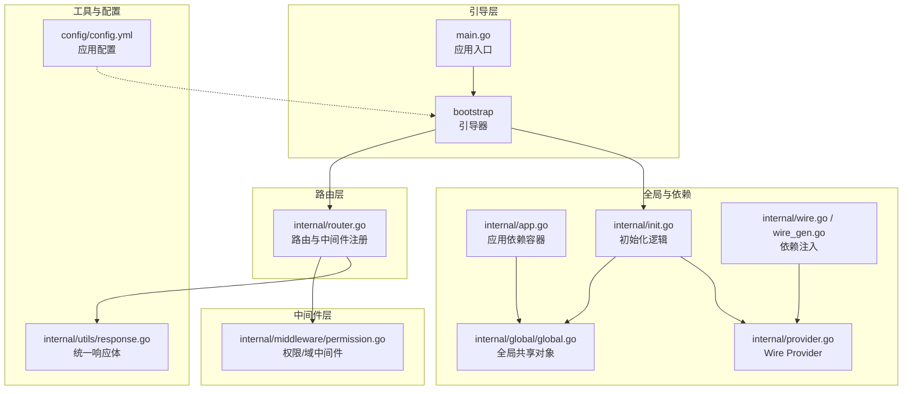
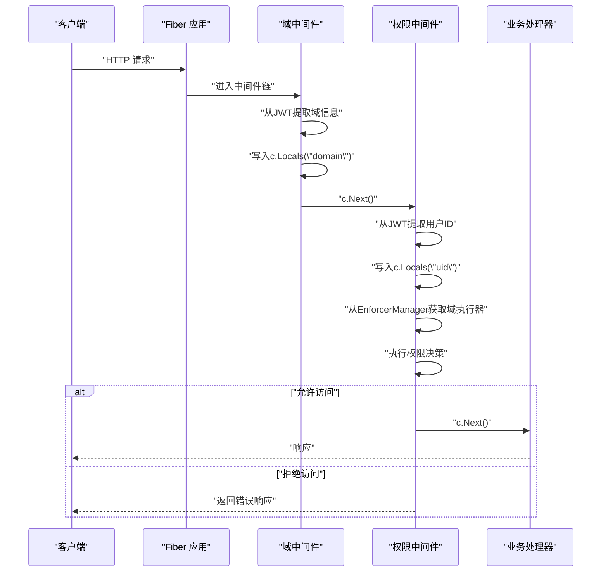
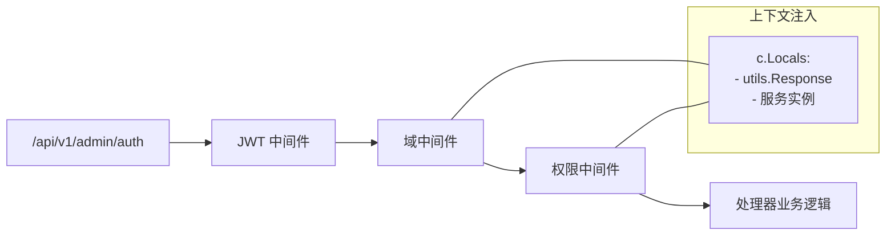
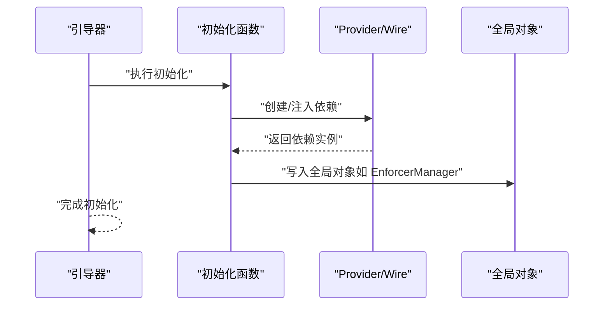
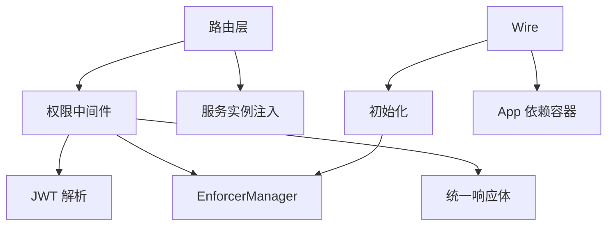

# 中间件扩展

<cite>
**本文引用的文件**
- [internal/middleware/permission.go](file://internal/middleware/permission.go)
- [internal/router.go](file://internal/router.go)
- [internal/app.go](file://internal/app.go)
- [internal/init.go](file://internal/init.go)
- [internal/global/global.go](file://internal/global/global.go)
- [internal/utils/response.go](file://internal/utils/response.go)
- [config/config.yml](file://config/config.yml)
- [main.go](file://main.go)
- [internal/provider.go](file://internal/provider.go)
- [internal/wire.go](file://internal/wire.go)
- [internal/wire_gen.go](file://internal/wire_gen.go)
</cite>

## 目录
1. [简介](#简介)
2. [项目结构](#项目结构)
3. [核心组件](#核心组件)
4. [架构总览](#架构总览)
5. [详细组件分析](#详细组件分析)
6. [依赖分析](#依赖分析)
7. [性能考虑](#性能考虑)
8. [故障排查指南](#故障排查指南)
9. [结论](#结论)
10. [附录](#附录)

## 简介
本指南面向希望在 Go Admin 项目中扩展中间件能力的开发者，系统讲解中间件架构设计、执行链路、注册与配置、与处理器的数据传递机制，并提供认证、日志、限流等常见中间件的开发范式与最佳实践。读者无需深入源码即可按图索骥地实现自定义中间件。

## 项目结构
Go Admin 基于 Fiber 框架构建，采用“引导器 + 路由注册 + 中间件链”的组织方式：
- 引导器负责初始化依赖（数据库、缓存、Casbin、文件系统等），并注册中间件与路由。
- 路由层通过分组与中间件组合形成清晰的执行链。
- 中间件层提供认证、权限、域解析等横切能力，通过 Fiber 的 Handler 链式调用串联。



**图表来源**
- [main.go:47-107](file://main.go#L47-L107)
- [internal/router.go:16-190](file://internal/router.go#L16-L190)
- [internal/middleware/permission.go:11-79](file://internal/middleware/permission.go#L11-L79)
- [config/config.yml:1-143](file://config/config.yml#L1-143)
- [internal/utils/response.go:9-50](file://internal/utils/response.go#L9-L50)
- [internal/app.go:15-26](file://internal/app.go#L15-L26)
- [internal/init.go:39-96](file://internal/init.go#L39-L96)
- [internal/global/global.go:11-16](file://internal/global/global.go#L11-L16)
- [internal/wire.go:22-37](file://internal/wire.go#L22-L37)
- [internal/provider.go:17-46](file://internal/provider.go#L17-L46)
- [internal/wire_gen.go:17-62](file://internal/wire_gen.go#L17-L62)

**章节来源**
- [main.go:47-107](file://main.go#L47-L107)
- [internal/router.go:16-190](file://internal/router.go#L16-L190)
- [config/config.yml:1-143](file://config/config.yml#L1-143)

## 核心组件
- 中间件接口与链式调用
  - Fiber 中间件以 fiber.Handler 形式实现，遵循“前置处理 -> c.Next() -> 后置处理”的链式模式。
  - 中间件通过 c.Locals 在请求上下文中传递数据，供后续处理器使用。
- 认证与域中间件
  - 域中间件从 JWT 提取域信息并写入 Locals，供权限中间件使用。
  - 权限中间件从 JWT 提取用户 ID，结合域、路径、方法进行 Casbin 权限判断。
- 统一响应体
  - 统一响应体封装了 code、message、data 字段，便于中间件与处理器输出一致格式。
- 引导与初始化
  - 引导器在启动阶段注册中间件与路由；初始化逻辑负责数据库、Casbin、定时任务等子系统的准备。
- 依赖注入与全局对象
  - 通过 Wire 构建应用依赖容器，全局共享 ORM、EnforcerManager、CronManager 等对象。

**章节来源**
- [internal/middleware/permission.go:11-79](file://internal/middleware/permission.go#L11-L79)
- [internal/utils/response.go:9-50](file://internal/utils/response.go#L9-L50)
- [internal/router.go:16-190](file://internal/router.go#L16-L190)
- [internal/init.go:39-96](file://internal/init.go#L39-L96)
- [internal/global/global.go:11-16](file://internal/global/global.go#L11-L16)
- [internal/app.go:15-26](file://internal/app.go#L15-L26)
- [internal/wire.go:22-37](file://internal/wire.go#L22-L37)
- [internal/provider.go:17-46](file://internal/provider.go#L17-L46)
- [internal/wire_gen.go:17-62](file://internal/wire_gen.go#L17-L62)

## 架构总览
下图展示从请求进入应用到路由处理的完整链路，以及中间件在其中的位置与职责：



**图表来源**
- [internal/middleware/permission.go:11-79](file://internal/middleware/permission.go#L11-L79)
- [internal/router.go:63-70](file://internal/router.go#L63-L70)
- [internal/utils/response.go:47-50](file://internal/utils/response.go#L47-L50)

## 详细组件分析

### 权限中间件与域中间件
- 设计要点
  - 域中间件负责从 JWT 中提取域信息并写入 Locals，供后续中间件使用。
  - 权限中间件从 JWT 提取用户 ID，结合域、请求路径与方法，通过 EnforcerManager 获取对应域的执行器进行权限判定。
  - 通过 c.Locals 传递 uid、domain，供处理器直接使用。
- 错误处理
  - 对缺失 JWT、无效用户 ID、缺少域信息、执行器获取失败、权限检查异常等情况进行统一响应。
- 性能建议
  - 域执行器应按需加载并复用；高频域可配置自动加载以减少首次延迟。

```mermaid
flowchart TD
S["进入权限中间件"] --> J["从JWT读取用户ID"]
J --> JOK{"ID有效？"}
JOK -- "否" --> E1["返回未授权响应"] --> X
JOK -- "是" --> L1["写入c.Locals(\"uid\")"]
L1 --> D["读取c.Locals(\"domain\")"]
D --> DOK{"域有效？"}
DOK -- "否" --> E2["返回缺少域信息响应"] --> X
DOK -- "是" --> P["获取域执行器"]
P --> POK{"执行器可用？"}
POK -- "否" --> E3["返回执行器获取失败响应"] --> X
POK -- "是" --> C["执行权限决策"]
C --> COK{"允许访问？"}
COK -- "否" --> E4["返回禁止访问响应"] --> X
COK -- "是" --> N["c.Next() 进入下一个中间件/处理器"] --> X
X["结束"]
```

**图表来源**
- [internal/middleware/permission.go:11-79](file://internal/middleware/permission.go#L11-L79)
- [internal/utils/response.go:47-50](file://internal/utils/response.go#L47-L50)

**章节来源**
- [internal/middleware/permission.go:11-79](file://internal/middleware/permission.go#L11-L79)
- [internal/utils/response.go:9-50](file://internal/utils/response.go#L9-L50)

### 路由与中间件注册
- 路由分组与中间件链
  - 通过 Fiber Group 与匿名中间件函数组合，形成多层中间件链。
  - 在路由组上注册 JWT 中间件、域中间件、权限中间件，确保认证与权限检查按序执行。
- 上下文注入
  - 在路由组中间件中向 c.Locals 注入服务实例与统一响应体，供处理器直接使用。
- 日志中间件
  - 在引导器阶段注册请求日志中间件，统一记录请求信息。



**图表来源**
- [internal/router.go:16-190](file://internal/router.go#L16-L190)
- [main.go:59-96](file://main.go#L59-L96)

**章节来源**
- [internal/router.go:16-190](file://internal/router.go#L16-L190)
- [main.go:59-96](file://main.go#L59-L96)

### 初始化与依赖注入
- 初始化流程
  - 引导器注册初始化函数，完成数据库、Casbin、定时任务、密钥管理、种子数据等初始化。
  - 初始化过程中创建并注入 EnforcerManager，供中间件使用。
- 依赖注入
  - 使用 Wire 构建 App 依赖容器，Provider 负责创建 EntClient、Casbin 适配器、EnforcerManager 等。
  - 未启用 Wire 时，通过 wire_gen.go 中的手动实现等效初始化。



**图表来源**
- [internal/init.go:39-96](file://internal/init.go#L39-L96)
- [internal/provider.go:17-46](file://internal/provider.go#L17-L46)
- [internal/wire.go:22-37](file://internal/wire.go#L22-L37)
- [internal/wire_gen.go:17-62](file://internal/wire_gen.go#L17-L62)
- [internal/global/global.go:11-16](file://internal/global/global.go#L11-L16)

**章节来源**
- [internal/init.go:39-96](file://internal/init.go#L39-L96)
- [internal/provider.go:17-46](file://internal/provider.go#L17-L46)
- [internal/wire.go:22-37](file://internal/wire.go#L22-L37)
- [internal/wire_gen.go:17-62](file://internal/wire_gen.go#L17-L62)
- [internal/global/global.go:11-16](file://internal/global/global.go#L11-L16)

## 依赖分析
- 组件耦合
  - 中间件依赖 JWT 解析、全局 EnforcerManager、统一响应体。
  - 路由层依赖中间件与服务实例注入，通过 c.Locals 实现弱耦合数据传递。
- 外部依赖
  - Fiber：中间件链与上下文。
  - Casbin：权限执行器管理与策略决策。
  - Wire：依赖注入与 Provider。



**图表来源**
- [internal/middleware/permission.go:11-79](file://internal/middleware/permission.go#L11-L79)
- [internal/router.go:16-190](file://internal/router.go#L16-L190)
- [internal/utils/response.go:9-50](file://internal/utils/response.go#L9-L50)
- [internal/init.go:39-96](file://internal/init.go#L39-L96)
- [internal/wire.go:22-37](file://internal/wire.go#L22-L37)
- [internal/app.go:15-26](file://internal/app.go#L15-L26)

**章节来源**
- [internal/middleware/permission.go:11-79](file://internal/middleware/permission.go#L11-L79)
- [internal/router.go:16-190](file://internal/router.go#L16-L190)
- [internal/utils/response.go:9-50](file://internal/utils/response.go#L9-L50)
- [internal/init.go:39-96](file://internal/init.go#L39-L96)
- [internal/wire.go:22-37](file://internal/wire.go#L22-L37)
- [internal/app.go:15-26](file://internal/app.go#L15-L26)

## 性能考虑
- 中间件链长度控制
  - 将高成本逻辑（如数据库查询、远程调用）置于链后或按需执行，避免对所有请求产生额外开销。
- 缓存与预热
  - 对频繁访问的域执行器可配置自动加载，减少首次加载延迟。
  - 利用全局缓存或本地内存缓存降低重复计算与 IO。
- 统一响应体
  - 使用统一响应体减少序列化与格式化差异带来的性能波动。
- 日志中间件
  - 在生产环境谨慎开启高粒度日志，避免 I/O 成为瓶颈。

[本节为通用指导，无需特定文件引用]

## 故障排查指南
- 常见错误与定位
  - 未授权访问：检查 JWT 是否正确签发与携带，确认域中间件是否成功写入 domain。
  - 缺少域信息：确认 JWT 中包含域字段，或域中间件是否提前返回错误。
  - 权限检查失败：检查 EnforcerManager 是否正确初始化，策略是否已加载。
  - 统一响应体未生效：确认中间件返回的是统一响应体而非原始错误。
- 调试建议
  - 在引导器阶段注册请求日志中间件，观察请求路径、方法与状态码。
  - 在中间件中打印关键上下文（如 uid、domain），辅助定位问题。
  - 使用最小化路由组验证中间件链，逐步排除干扰因素。

**章节来源**
- [internal/middleware/permission.go:11-79](file://internal/middleware/permission.go#L11-L79)
- [internal/utils/response.go:9-50](file://internal/utils/response.go#L9-L50)
- [main.go:59-96](file://main.go#L59-L96)

## 结论
Go Admin 的中间件体系以 Fiber Handler 链为核心，通过 JWT、域与 Casbin 的组合实现认证与权限控制；借助 c.Locals 与引导器的上下文注入，中间件与处理器之间实现了低耦合、高可维护的数据传递。遵循本文的开发范式与最佳实践，可快速扩展认证、日志、限流等中间件能力，并在保证性能的前提下提升系统稳定性。

[本节为总结性内容，无需特定文件引用]

## 附录

### 开发自定义中间件步骤
- 接口实现
  - 返回 fiber.Handler，遵循“前置处理 -> c.Next() -> 后置处理”。
- 参数与上下文
  - 通过 c.Locals 传递数据；必要时从 c.Request() 与 c.Response() 获取请求/响应细节。
- 错误处理
  - 使用统一响应体输出标准化错误；根据场景返回 401、403、500 等状态码。
- 注册与配置
  - 在引导器阶段注册全局中间件；在路由组中按需组合中间件链。
  - 通过配置文件调整行为（如日志、缓存、Casbin 域配置）。

**章节来源**
- [internal/middleware/permission.go:11-79](file://internal/middleware/permission.go#L11-L79)
- [internal/router.go:16-190](file://internal/router.go#L16-L190)
- [config/config.yml:1-143](file://config/config.yml#L1-143)
- [internal/utils/response.go:9-50](file://internal/utils/response.go#L9-L50)
- [main.go:59-96](file://main.go#L59-L96)

### 常见中间件类型与开发要点
- 认证中间件
  - 从请求头解析令牌，校验签名与有效期；将用户标识写入上下文。
- 日志中间件
  - 记录请求路径、方法、耗时、状态码；可选择性脱敏敏感字段。
- 限流中间件
  - 基于 IP 或用户维度统计请求频率；超过阈值返回 429。
- CORS 中间件
  - 设置跨域响应头；仅在需要时启用，避免影响静态资源访问。

[本节为概念性内容，无需特定文件引用]

### 中间件与处理器的交互机制
- 数据传递
  - 通过 c.Locals 注入服务实例与工具对象；处理器直接读取上下文中的数据。
- 控制流
  - 中间件链按注册顺序执行；任一中间件可短路返回错误响应，也可继续调用 c.Next()。
- 统一响应
  - 中间件与处理器均使用统一响应体输出，保持对外一致的 JSON 结构。

**章节来源**
- [internal/router.go:16-190](file://internal/router.go#L16-L190)
- [internal/utils/response.go:9-50](file://internal/utils/response.go#L9-L50)

### 配置选项与注册方法
- 配置项
  - 应用基础配置、日志、数据库、缓存、Redis、文件系统、Casbin 域配置等。
- 注册方法
  - 引导器注册中间件与路由；路由层通过 Group 与中间件函数组合形成链。
  - 依赖注入通过 Wire Provider 构建 App 容器，确保全局对象可用。

**章节来源**
- [config/config.yml:1-143](file://config/config.yml#L1-143)
- [main.go:59-96](file://main.go#L59-L96)
- [internal/router.go:16-190](file://internal/router.go#L16-L190)
- [internal/provider.go:17-46](file://internal/provider.go#L17-L46)
- [internal/wire.go:22-37](file://internal/wire.go#L22-L37)
- [internal/wire_gen.go:17-62](file://internal/wire_gen.go#L17-L62)