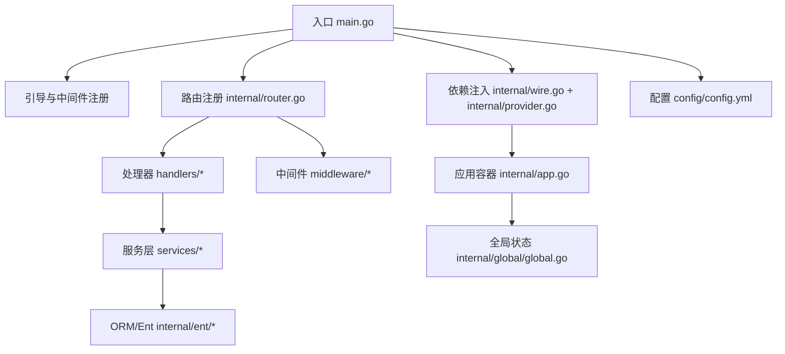
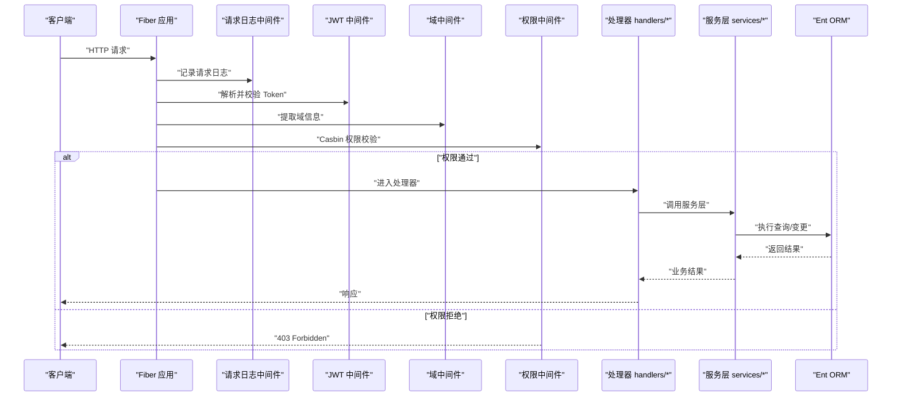
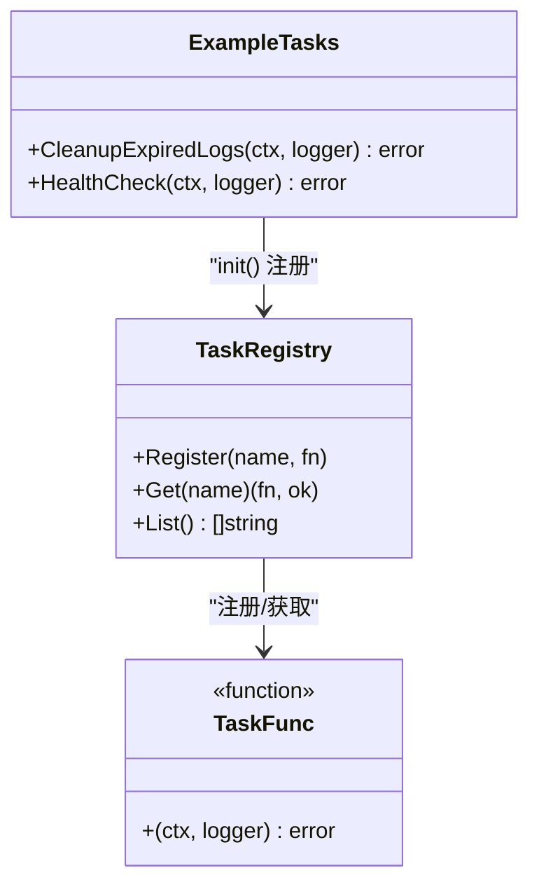
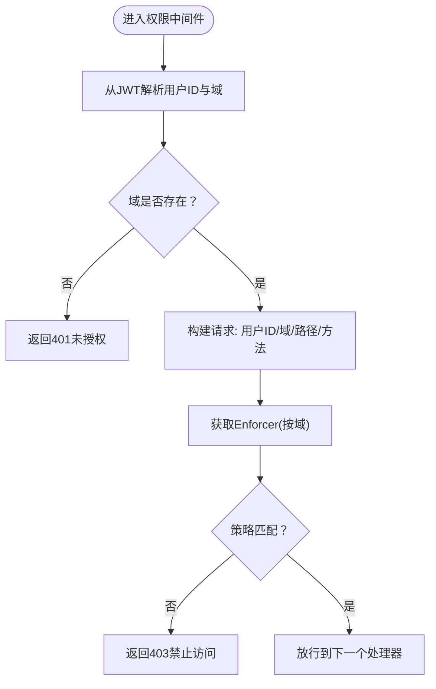
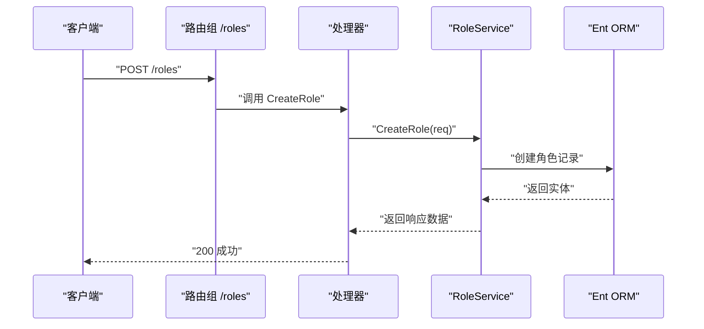
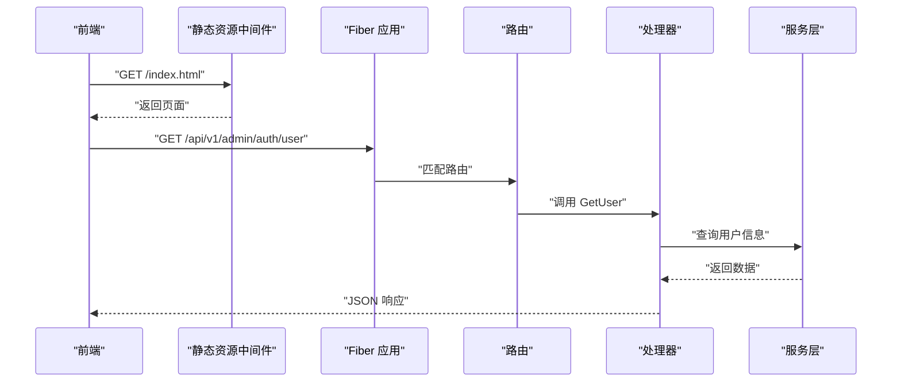
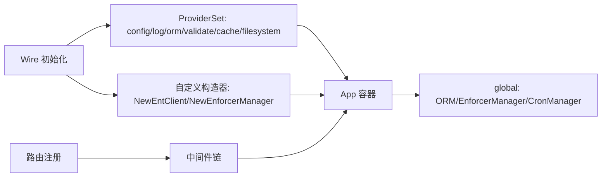

# 扩展开发

<cite>
**本文引用的文件**
- [main.go](file://main.go)
- [internal/app.go](file://internal/app.go)
- [internal/provider.go](file://internal/provider.go)
- [internal/router.go](file://internal/router.go)
- [internal/wire.go](file://internal/wire.go)
- [internal/init.go](file://internal/init.go)
- [internal/cleanup.go](file://internal/cleanup.go)
- [internal/global/global.go](file://internal/global/global.go)
- [internal/middleware/permission.go](file://internal/middleware/permission.go)
- [internal/tabs/registry.go](file://internal/tabs/registry.go)
- [internal/tabs/example.go](file://internal/tabs/example.go)
- [internal/service/role.go](file://internal/service/role.go)
- [internal/handler/public.go](file://internal/handler/public.go)
- [config/config.yml](file://config/config.yml)
</cite>

## 目录
1. [简介](#简介)
2. [项目结构](#项目结构)
3. [核心组件](#核心组件)
4. [架构总览](#架构总览)
5. [详细组件分析](#详细组件分析)
6. [依赖分析](#依赖分析)
7. [性能考虑](#性能考虑)
8. [故障排查指南](#故障排查指南)
9. [结论](#结论)
10. [附录](#附录)

## 简介
本指南面向希望基于 Go Admin 管理系统进行扩展开发的工程师，围绕插件系统（任务系统）、中间件扩展与自定义模块开发，提供从数据模型设计、服务层实现、API 接口开发到前端集成的完整流程；同时覆盖第三方服务集成、自定义中间件开发与注册、性能优化与扩展性设计、测试与质量保障、发布与版本管理以及安全与权限控制等主题。

## 项目结构
Go Admin 采用分层清晰的组织方式：
- 入口与引导：main.go 负责应用初始化、静态资源托管、路由注册与生命周期清理。
- 依赖注入：internal/wire.go 与 internal/provider.go 定义依赖提供集与构造器，internal/app.go 描述应用依赖容器。
- 路由与中间件：internal/router.go 统一注册 API 路由组与中间件链；权限中间件位于 internal/middleware/permission.go。
- 业务模块：internal/service/* 提供领域服务；internal/handler/* 提供 Fiber 处理器；internal/ent/* 为数据模型与查询构建器。
- 全局状态：internal/global/global.go 暴露 ORM、Casbin EnforcerManager、CronManager 等全局对象。
- 配置：config/config.yml 提供应用、数据库、缓存、Redis、文件系统与 Casbin 多域配置。

图表来源
- [main.go:47-107](file://main.go#L47-L107)
- [internal/router.go:16-189](file://internal/router.go#L16-L189)
- [internal/wire.go:22-37](file://internal/wire.go#L22-L37)
- [internal/provider.go:17-46](file://internal/provider.go#L17-L46)
- [internal/app.go:15-25](file://internal/app.go#L15-L25)
- [internal/global/global.go:11-16](file://internal/global/global.go#L11-L16)
- [config/config.yml:1-143](file://config/config.yml#L1-L143)

章节来源
- [main.go:47-107](file://main.go#L47-L107)
- [internal/router.go:16-189](file://internal/router.go#L16-L189)
- [internal/wire.go:22-37](file://internal/wire.go#L22-L37)
- [internal/provider.go:17-46](file://internal/provider.go#L17-L46)
- [internal/app.go:15-25](file://internal/app.go#L15-L25)
- [internal/global/global.go:11-16](file://internal/global/global.go#L11-L16)
- [config/config.yml:1-143](file://config/config.yml#L1-L143)

## 核心组件
- 应用依赖容器 App：集中持有配置、日志、数据库、验证器、缓存、Ent 客户端、Casbin 策略执行器、文件系统等。
- 依赖注入：通过 Wire ProviderSet 与自定义构造器（如 NewEntClient、NewEnforcerManager）统一装配。
- 路由与中间件：统一在 RegisterRoute 中注册，包含 JWT 认证、域中间件、权限中间件、操作日志服务注入等。
- 全局状态：ORM、EnforcerManager、CronManager 通过 internal/global/global.go 暴露，供各模块共享。
- 配置中心：config/config.yml 提供数据库、缓存、Redis、文件系统与 Casbin 多域模型配置。

章节来源
- [internal/app.go:15-25](file://internal/app.go#L15-L25)
- [internal/provider.go:17-46](file://internal/provider.go#L17-L46)
- [internal/router.go:16-189](file://internal/router.go#L16-L189)
- [internal/global/global.go:11-16](file://internal/global/global.go#L11-L16)
- [config/config.yml:1-143](file://config/config.yml#L1-L143)

## 架构总览
下图展示从请求进入至业务处理的关键流转，包括中间件链、权限校验、服务层调用与 ORM 访问。

图表来源
- [internal/router.go:16-189](file://internal/router.go#L16-L189)
- [internal/middleware/permission.go:11-80](file://internal/middleware/permission.go#L11-L80)
- [internal/handler/public.go:78-145](file://internal/handler/public.go#L78-L145)
- [internal/service/role.go:118-167](file://internal/service/role.go#L118-L167)

## 详细组件分析

### 任务系统（插件机制）
- 任务注册表：tasks/registry.go 提供全局注册表，支持注册、获取、列举任务。
- 任务函数签名：TaskFunc 接受上下文与日志写入器，便于日志输出与取消。
- 内置示例：tasks/example.go 在 init() 中注册了清理过期日志与健康检查两个示例任务。
- 启动触发：main.go 中通过导入 internal/tasks 触发 init() 注册，随后在 internal/init.go 中初始化 CronManager 并启动。

图表来源
- [internal/tabs/registry.go:8-32](file://internal/tabs/registry.go#L8-L32)
- [internal/tabs/example.go:10-28](file://internal/tabs/example.go#L10-L28)

章节来源
- [internal/tabs/registry.go:8-32](file://internal/tabs/registry.go#L8-L32)
- [internal/tabs/example.go:10-28](file://internal/tabs/example.go#L10-L28)
- [main.go:15](file://main.go#L15)
- [internal/init.go:67-72](file://internal/init.go#L67-L72)

### 中间件扩展与自定义中间件
- 权限中间件：middleware/permission.go 实现基于 Casbin 的权限校验，从 JWT 提取用户域、路径与方法，调用 EnforcerManager 获取对应域的 Enforcer 执行策略匹配。
- 域中间件：从 JWT 中提取域信息并注入到 c.Locals，供权限中间件使用。
- 注册位置：在 internal/router.go 中，先注册请求日志中间件，再按需挂载 JWT、域中间件与权限中间件。

图表来源
- [internal/middleware/permission.go:11-80](file://internal/middleware/permission.go#L11-L80)
- [internal/router.go:64-70](file://internal/router.go#L64-L70)

章节来源
- [internal/middleware/permission.go:11-80](file://internal/middleware/permission.go#L11-L80)
- [internal/router.go:64-70](file://internal/router.go#L64-L70)

### 自定义模块开发（以角色管理为例）
- 数据模型：internal/ent/schema/role.go 定义角色实体；查询/变更构建器在 internal/ent/role*.go 中生成。
- 服务层：service/role.go 提供角色 CRUD、状态变更与缓存清理等能力，并对系统内置角色进行保护。
- 处理器：router.go 中注册角色相关路由，处理器从 c.Locals 获取服务实例并调用。
- 集成点：权限中间件自动生效于受保护路由组，确保访问控制。

图表来源
- [internal/router.go:72-86](file://internal/router.go#L72-L86)
- [internal/service/role.go:118-167](file://internal/service/role.go#L118-L167)

章节来源
- [internal/router.go:72-86](file://internal/router.go#L72-L86)
- [internal/service/role.go:118-167](file://internal/service/role.go#L118-L167)

### API 接口开发与前端集成
- 路由注册：在 internal/router.go 中按功能域分组注册路由，统一前缀 /api/v1/admin 或 /api/v1/public。
- 处理器模式：处理器从 c.Locals 获取服务实例与统一响应封装，处理请求体校验、JWT 用户数据提取、调用服务层并记录操作日志。
- 前端集成：main.go 中通过嵌入式文件系统提供 SPA 静态资源，API 前缀 /api/ 交由后端路由处理，非 API 路由回退到 index.html。

图表来源
- [main.go:62-94](file://main.go#L62-L94)
- [internal/router.go:48-61](file://internal/router.go#L48-L61)
- [internal/handler/public.go:147-184](file://internal/handler/public.go#L147-L184)

章节来源
- [main.go:62-94](file://main.go#L62-L94)
- [internal/router.go:48-61](file://internal/router.go#L48-L61)
- [internal/handler/public.go:147-184](file://internal/handler/public.go#L147-L184)

### 第三方服务集成（API 调用、数据同步与错误处理）
- 集成建议：
  - 使用独立服务层封装外部 API 调用，统一错误码映射与重试策略。
  - 对关键写入操作采用幂等设计，结合本地事务与外部回调确认。
  - 引入队列或任务系统异步处理耗时同步，避免阻塞主请求。
  - 在中间件或服务层增加超时与熔断配置，防止级联故障。
- 错误处理：
  - 明确区分网络错误、业务错误与系统错误，分别返回不同状态码与提示。
  - 记录调用链路日志与上下文 ID，便于追踪与审计。

[本节为通用实践说明，不直接分析具体文件，故无“章节来源”]

### 性能优化与扩展性设计
- 缓存策略：利用 config.yml 中的 cache/store 配置，服务层可选择性启用缓存；注意缓存键命名与失效策略。
- 数据库优化：合理使用索引、分页查询与批量操作；避免 N+1 查询。
- 中间件顺序：将轻量中间件前置，昂贵校验靠后；对静态资源与公开接口减少中间件开销。
- 并发与连接池：合理配置数据库与 Redis 连接池大小，避免峰值拥塞。
- 日志与监控：统一请求日志中间件，结合指标采集与告警。

章节来源
- [config/config.yml:32-59](file://config/config.yml#L32-L59)
- [internal/router.go:16-20](file://internal/router.go#L16-L20)

### 测试策略与质量保证
- 单元测试：针对服务层方法编写测试，使用内存数据库或测试专用数据库，模拟边界条件与异常场景。
- 集成测试：通过 HTTP 客户端调用路由，验证中间件链与权限控制行为。
- 端到端测试：结合前端自动化测试，覆盖关键业务流程。
- 质量门禁：引入代码规范检查、静态分析与覆盖率阈值，确保提交质量。

[本节为通用实践说明，不直接分析具体文件，故无“章节来源”]

### 发布与版本管理
- 版本策略：遵循语义化版本，变更日志记录破坏性变更与新特性。
- 构建与打包：使用 CI/CD 自动化构建二进制与镜像，嵌入版本信息。
- 配置热更新：对可热加载的配置（如缓存、日志）在运行时动态刷新；对数据库结构变更采用迁移脚本。
- 回滚预案：保留上一版本镜像与配置快照，快速回滚。

[本节为通用实践说明，不直接分析具体文件，故无“章节来源”]

### 安全考虑与权限控制
- 认证与授权：JWT 作为认证载体，Casbin 作为授权引擎；域中间件与权限中间件共同实现多域 RBAC。
- 密钥管理：使用密钥轮换与时间戳、Nonce 防重放，登录接口支持加密字段传输。
- 最小权限：为角色与用户分配最小必要权限，定期审计策略。
- 输入校验：统一使用 validate 包进行请求体校验，避免注入与越权。
- 操作审计：记录关键操作日志，关联用户、模块、动作与路径。

章节来源
- [internal/middleware/permission.go:11-80](file://internal/middleware/permission.go#L11-L80)
- [internal/handler/public.go:78-145](file://internal/handler/public.go#L78-L145)
- [internal/init.go:134-310](file://internal/init.go#L134-L310)

## 依赖分析
- Wire 依赖注入：通过 ProviderSet 与自定义构造器装配 App 所需组件，降低耦合度。
- 全局共享：ORM、EnforcerManager、CronManager 通过 global 包共享，避免重复初始化。
- 中间件链：请求日志、JWT、域、权限中间件按序组合，形成统一的访问控制与可观测性。

图表来源
- [internal/wire.go:22-37](file://internal/wire.go#L22-L37)
- [internal/provider.go:17-46](file://internal/provider.go#L17-L46)
- [internal/app.go:15-25](file://internal/app.go#L15-L25)
- [internal/global/global.go:11-16](file://internal/global/global.go#L11-L16)
- [internal/router.go:16-20](file://internal/router.go#L16-L20)

章节来源
- [internal/wire.go:22-37](file://internal/wire.go#L22-L37)
- [internal/provider.go:17-46](file://internal/provider.go#L17-L46)
- [internal/app.go:15-25](file://internal/app.go#L15-L25)
- [internal/global/global.go:11-16](file://internal/global/global.go#L11-L16)
- [internal/router.go:16-20](file://internal/router.go#L16-L20)

## 性能考虑
- 中间件顺序优化：将轻量中间件置于前，昂贵校验置于后。
- 缓存与降级：对热点数据与策略规则启用缓存；对外部依赖增加熔断与降级。
- 数据库与连接池：根据 QPS 调整连接池大小与超时；使用索引与分页。
- 日志与监控：统一日志中间件，结合指标与链路追踪定位瓶颈。

[本节为通用实践说明，不直接分析具体文件，故无“章节来源”]

## 故障排查指南
- 启动阶段：检查 config.yml 配置项是否正确；确认数据库连接与表前缀初始化。
- 权限问题：确认 JWT 中域信息是否正确；检查 Casbin 策略是否加载；核对 EnforcerManager 域配置。
- 路由问题：确认路由组前缀与中间件挂载顺序；检查公开接口与受保护接口的划分。
- 清理阶段：关注 Cleanup 中数据库连接池与 CronManager 的关闭顺序，避免资源泄漏。

章节来源
- [config/config.yml:19-31](file://config/config.yml#L19-L31)
- [internal/middleware/permission.go:11-80](file://internal/middleware/permission.go#L11-L80)
- [internal/router.go:16-189](file://internal/router.go#L16-L189)
- [internal/cleanup.go:11-42](file://internal/cleanup.go#L11-L42)

## 结论
Go Admin 通过清晰的分层、统一的依赖注入与中间件链、完善的权限与配置体系，为扩展开发提供了稳定基础。开发者可按本文流程新增业务模块、扩展任务系统与中间件，并结合缓存、异步与监控等手段持续优化性能与可靠性。

## 附录
- 新增业务模块流程（示例：角色管理）
  1) 设计数据模型：在 internal/ent/schema 下新增 schema，生成查询/变更构建器。
  2) 实现服务层：在 internal/service 下实现领域服务，处理业务规则与缓存。
  3) 开发处理器：在 internal/handler 下编写处理器，解析请求、调用服务、封装响应。
  4) 注册路由：在 internal/router.go 中注册路由组与中间件。
  5) 配置与部署：完善 config/config.yml，CI/CD 自动化构建与发布。
- 任务系统扩展流程
  1) 在 tasks 目录新增任务文件，定义 TaskFunc 并在 init() 中注册。
  2) 在 internal/init.go 中确保 CronManager 已初始化并启动。
  3) 通过 CronManager 管理任务调度与日志。
- 中间件扩展流程
  1) 在 internal/middleware 下新增中间件文件，遵循 Fiber.Handler 签名。
  2) 在 internal/router.go 中按需挂载中间件，确保顺序正确。
- 第三方服务集成要点
  1) 在服务层封装外部调用，统一错误处理与重试。
  2) 对关键写入采用幂等与异步处理。
  3) 在中间件或服务层加入超时与熔断配置。

[本节为流程性说明，不直接分析具体文件，故无“章节来源”]