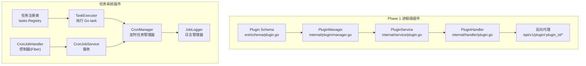
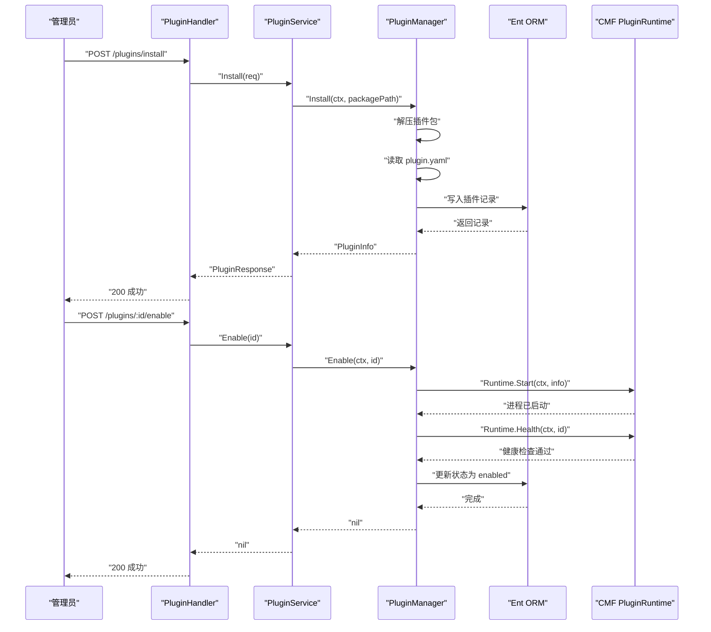
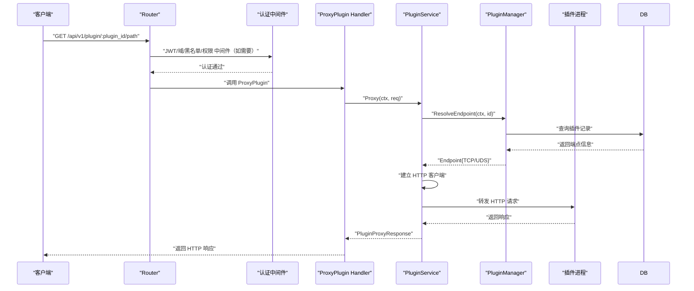
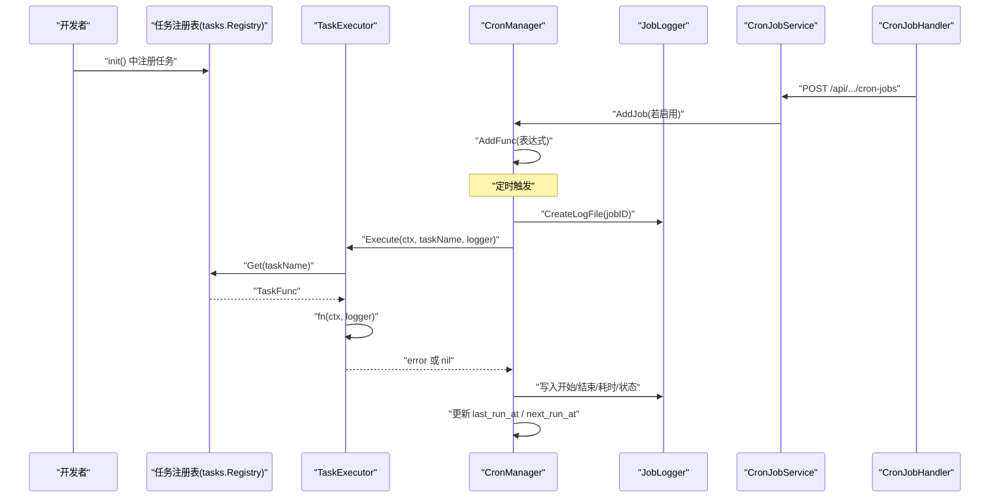
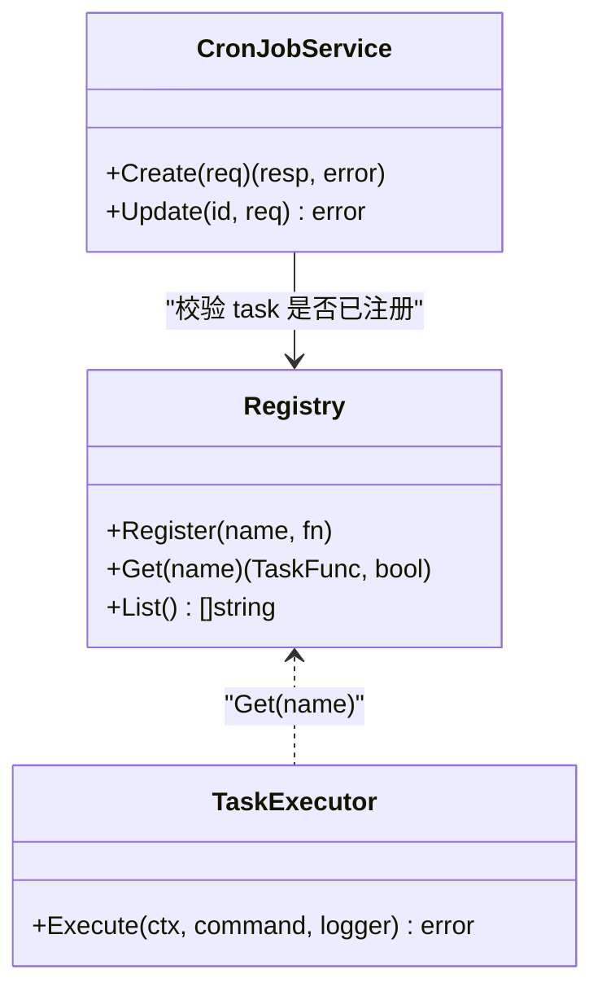
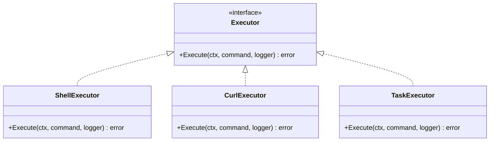
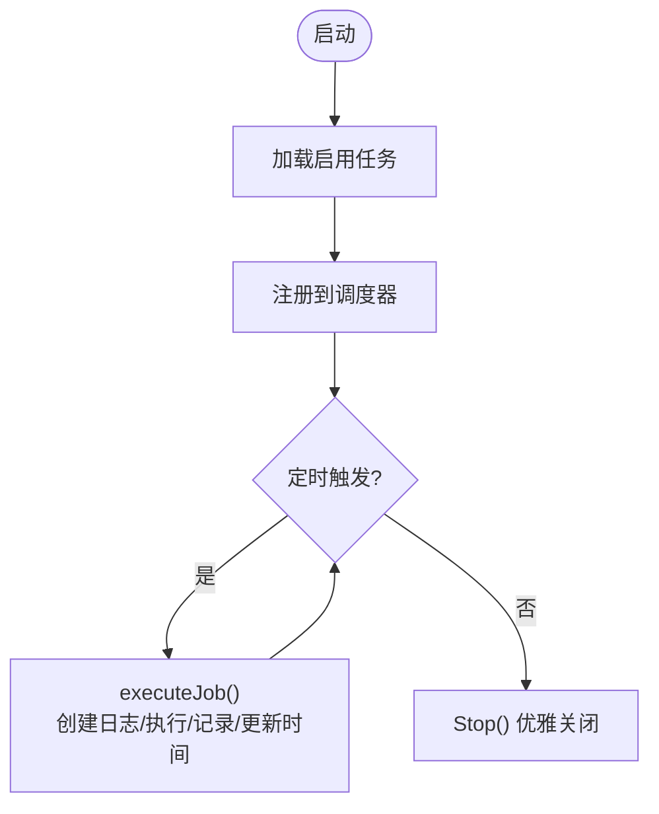
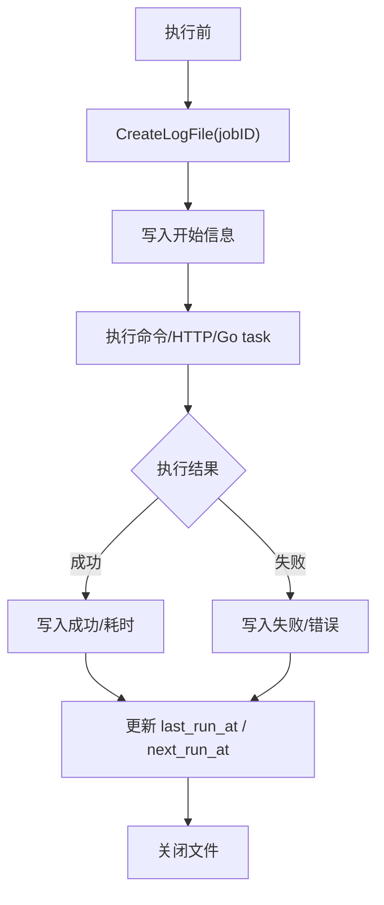
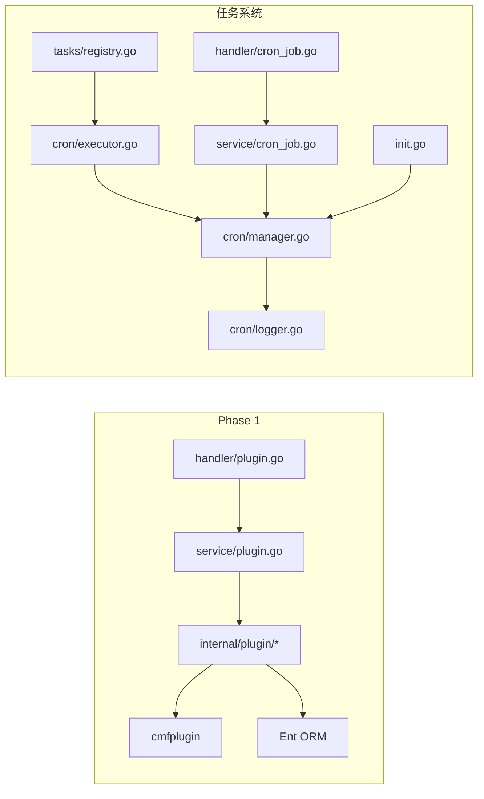

# 插件开发

<cite>
**本文引用的文件**
- [internal/plugin/manager.go](file://internal/plugin/manager.go)
- [internal/plugin/errors.go](file://internal/plugin/errors.go)
- [internal/ent/schema/plugin.go](file://internal/ent/schema/plugin.go)
- [internal/handler/plugin.go](file://internal/handler/plugin.go)
- [internal/service/plugin.go](file://internal/service/plugin.go)
- [internal/router.go](file://internal/router.go)
- [internal/global/msg.go](file://internal/global/msg.go)
- [registry.go](file://internal/tasks/registry.go)
- [example.go](file://internal/tasks/example.go)
- [executor.go](file://internal/cron/executor.go)
- [manager.go](file://internal/cron/manager.go)
- [logger.go](file://internal/cron/logger.go)
- [cron_job.go](file://internal/service/cron_job.go)
- [cron_job_handler.go](file://internal/handler/cron_job.go)
- [init.go](file://internal/init.go)
- [go.mod](file://go.mod)
- [manager_test.go](file://internal/cron/manager_test.go)
- [plugin_test.go](file://internal/service/plugin_test.go)
</cite>

## 目录
1. [简介](#简介)
2. [项目结构](#项目结构)
3. [核心组件](#核心组件)
4. [架构总览](#架构总览)
5. [详细组件分析](#详细组件分析)
6. [依赖分析](#依赖分析)
7. [性能考虑](#性能考虑)
8. [故障排查指南](#故障排查指南)
9. [结论](#结论)
10. [附录](#附录)

## 简介
本指南面向希望在 Go Admin 中开发插件的开发者。Go Admin 提供两套插件/扩展机制：

**Phase 1 进程级插件系统**（推荐用于独立功能扩展）：
- 插件以独立进程运行，通过 UDS (Unix Domain Socket) 或 TCP 与主程序通信
- 支持独立发布、版本管理，与主程序解耦
- 通过反向代理将请求转发到插件进程

**任务系统插件**（适用于定时任务/数据处理）：
- 任务注册表的工作原理与插件发现机制
- 如何开发自定义任务插件（接口实现、参数配置、执行逻辑）
- 开发模板与最佳实践（错误处理、日志记录、性能优化）
- 生命周期管理与状态监控
- 从简单定时任务到复杂数据处理插件的完整示例

## 项目结构

### Phase 1 进程级插件系统
插件系统围绕"Plugin ent schema + PluginManager + PluginService + Handler"构建：
- Plugin ent schema：定义插件元数据（plugin_id、name、version、status、manifest_json 等）
- PluginManager：管理插件进程生命周期（安装、启用、禁用、卸载、端点解析）
- PluginService：插件 CRUD 业务逻辑
- Handler：插件管理 API + UDS/TCP 反向代理
- 插件代理路由：/api/v1/plugin/:plugin_id/* 转发到插件进程

### 任务系统（原有插件机制）
任务系统围绕"任务注册表 + 执行器 + 定时任务管理器 + 日志管理器 + 服务层 + 控制器"构建：
- 任务注册表：集中管理可被调度执行的 Go 函数
- 执行器：根据任务类型选择具体执行策略（Shell、HTTP、Go task）
- 定时任务管理器：负责加载、调度、执行、记录与清理
- 日志管理器：按任务维度生成与轮转日志文件
- 服务层与控制器：对外暴露 REST 接口，供前端或外部系统调用



图表来源
- [internal/ent/schema/plugin.go:11-94](file://internal/ent/schema/plugin.go#L11-L94)
- [internal/plugin/manager.go:19-375](file://internal/plugin/manager.go#L19-L375)
- [internal/service/plugin.go:15-171](file://internal/service/plugin.go#L15-L171)
- [internal/handler/plugin.go:26-232](file://internal/handler/plugin.go#L26-L232)
- [registry.go:1-33](file://internal/tasks/registry.go#L1-L33)
- [executor.go:1-126](file://internal/cron/executor.go#L1-L126)
- [manager.go:1-237](file://internal/cron/manager.go#L1-L237)
- [logger.go:1-192](file://internal/cron/logger.go#L1-L192)
- [cron_job.go:1-492](file://internal/service/cron_job.go#L1-L492)
- [cron_job_handler.go:1-450](file://internal/handler/cron_job.go#L1-L450)

章节来源
- [internal/ent/schema/plugin.go:11-94](file://internal/ent/schema/plugin.go#L11-L94)
- [internal/plugin/manager.go:19-375](file://internal/plugin/manager.go#L19-L375)
- [internal/service/plugin.go:15-171](file://internal/service/plugin.go#L15-L171)
- [internal/handler/plugin.go:26-232](file://internal/handler/plugin.go#L26-L232)
- [registry.go:1-33](file://internal/tasks/registry.go#L1-L33)
- [executor.go:1-126](file://internal/cron/executor.go#L1-L126)
- [manager.go:1-237](file://internal/cron/manager.go#L1-L237)
- [logger.go:1-192](file://internal/cron/logger.go#L1-L192)
- [cron_job.go:1-492](file://internal/service/cron_job.go#L1-L492)
- [cron_job_handler.go:1-450](file://internal/handler/cron_job.go#L1-L450)
- [init.go:67-72](file://internal/init.go#L67-L72)

## 核心组件

### Phase 1 进程级插件核心组件
- Plugin ent schema
  - plugin_id：唯一标识（如 admin.example-plugin）
  - name、version、author、description：基本信息
  - status：installed / enabled / disabled / error
  - manifest_json：完整插件 manifest 的 JSON
  - install_path：安装路径
  - error_message：最近一次错误信息
- PluginManager（internal/plugin/manager.go）
  - 提供 Manager 接口：Install、Enable、Disable、Uninstall、List、Get、ResolveEndpoint
  - 安装时解压插件包、校验 manifest、写入数据库
  - 启用时启动插件进程、注册扩展点
  - 启动时恢复所有已启用插件（RestoreEnabled）
  - 通过 CMF 的 cmfplugin 包管理进程生命周期与扩展注册
- PluginService（internal/service/plugin.go）
  - 封装 PluginManager，提供 InstallPluginRequest/PluginResponse/PluginProxyRequest 等 DTO
  - Proxy 方法：解析端点、建立 HTTP 客户端（支持 TCP/UDS）、转发请求
- Handler（internal/handler/plugin.go）
  - 插件管理 API：ListPlugins、GetPlugin、InstallPlugin、EnablePlugin、DisablePlugin、UninstallPlugin
  - 插件代理：ProxyPlugin 将请求通过 UDS/TCP 转发到插件进程
  - 代理请求过滤：排除敏感 Header（Authorization、Cookie 等），保护 admin/auth 路径
- 插件路由注册（internal/router.go）
  - /api/v1/admin/auth/plugins 下注册管理 API
  - /api/v1/plugin/:plugin_id/* 下注册代理路由，区分公开代理与需认证代理

### 任务系统核心组件
- 任务注册表（tasks.Registry）
  - 提供全局注册、查询、枚举任务的能力
  - 任务函数签名统一为带上下文与日志输出的错误返回
- 执行器（Executor 接口及其实现）
  - ShellExecutor：执行系统命令
  - CurlExecutor：解析 JSON 配置并发起 HTTP 请求
  - TaskExecutor：从注册表查找并执行 Go task
- 定时任务管理器（CronManager）
  - 加载数据库中的启用任务，注册到调度器
  - 统一执行入口，写入日志，更新执行时间
  - 内置日志清理任务（每日凌晨2点）
- 日志管理器（JobLogger）
  - 按任务 ID 生成独立日志目录与文件
  - 支持列出、读取、尾部读取与过期清理
- 服务与控制器（CronJobService / CronJobHandler）
  - 对外提供创建、更新、启用、禁用、立即执行、日志查看等能力
  - 参数校验、错误码映射、操作日志记录

章节来源
- [internal/ent/schema/plugin.go:11-94](file://internal/ent/schema/plugin.go#L11-L94)
- [internal/plugin/manager.go:19-375](file://internal/plugin/manager.go#L19-L375)
- [internal/service/plugin.go:15-171](file://internal/service/plugin.go#L15-L171)
- [internal/handler/plugin.go:26-232](file://internal/handler/plugin.go#L26-L232)
- [registry.go:8-32](file://internal/tasks/registry.go#L8-L32)
- [executor.go:18-125](file://internal/cron/executor.go#L18-L125)
- [manager.go:17-236](file://internal/cron/manager.go#L17-L236)
- [logger.go:13-191](file://internal/cron/logger.go#L13-L191)
- [cron_job.go:28-491](file://internal/service/cron_job.go#L28-L491)
- [cron_job_handler.go:15-449](file://internal/handler/cron_job.go#L15-L449)

## 架构总览

### Phase 1 插件系统请求链路



### 插件代理请求链路



图表来源
- [internal/handler/plugin.go:56-161](file://internal/handler/plugin.go#L56-L161)
- [internal/service/plugin.go:63-158](file://internal/service/plugin.go#L63-L158)
- [internal/plugin/manager.go:71-128](file://internal/plugin/manager.go#L71-L128)
- [internal/plugin/manager.go:130-195](file://internal/plugin/manager.go#L130-L195)
- [internal/router.go:113-124](file://internal/router.go#L113-L124)

### 任务系统端到端流程



图表来源
- [example.go:10-13](file://internal/tasks/example.go#L10-L13)
- [registry.go:14-23](file://internal/tasks/registry.go#L14-L23)
- [executor.go:118-125](file://internal/cron/executor.go#L118-L125)
- [manager.go:97-221](file://internal/cron/manager.go#L97-L221)
- [logger.go:34-51](file://internal/cron/logger.go#L34-L51)

## 详细组件分析

### Phase 1 插件包格式

插件为一个 Zip 文件，解压后根目录须包含 plugin.yaml：

```text
example.plugin.zip
  plugin.yaml
  README.md
  bin/
    windows-amd64/
      plugin.exe
    linux-amd64/
      plugin
  assets/
  migrations/
```

### plugin.yaml 格式

```yaml
id: admin.example-plugin
name: Example Plugin
version: 1.0.0
author: example
description: Example plugin

engine:
  type: process
  protocol: http
  entry:
    windows-amd64: bin/windows-amd64/plugin.exe
    linux-amd64: bin/linux-amd64/plugin

compatibility:
  app: ">=1.0.0 <2.0.0"
  api: "v1"

permissions:
  - route:register
  - menu:register
  - config:read

extension_points:
  - admin.routes
  - admin.menus
  - admin.permissions
```

### PluginManager 接口

```go
type Manager interface {
    Install(ctx context.Context, packagePath string) (*cmfplugin.PluginInfo, error)
    Enable(ctx context.Context, pluginID string) error
    Disable(ctx context.Context, pluginID string) error
    Uninstall(ctx context.Context, pluginID string) error
    List(ctx context.Context) ([]cmfplugin.PluginInfo, error)
    Get(ctx context.Context, pluginID string) (*cmfplugin.PluginInfo, error)
    ResolveEndpoint(ctx context.Context, pluginID string) (*Endpoint, error)
}
```

### 插件代理（Proxy）实现要点
- ResolveEndpoint：根据插件的 transport 配置（TCP/UDS）返回端点信息
- UDS 通信：使用 http.Client 的 DialContext 连接到 Unix Socket 文件
- 安全过滤：代理时过滤 Authorization、Cookie、X-Forwarded-* 等敏感 Header
- 路径保护：禁止插件代理访问 admin/auth 路径（防止权限绕过）
- 路径安全验证：Socket 路径必须在插件安装目录内

### 插件管理 API

所有端点需要 JWT、域中间件、黑名单中间件与权限中间件：

```text
GET    /api/v1/admin/auth/plugins
GET    /api/v1/admin/auth/plugins/:plugin_id
POST   /api/v1/admin/auth/plugins/install
POST   /api/v1/admin/auth/plugins/:plugin_id/enable
POST   /api/v1/admin/auth/plugins/:plugin_id/disable
DELETE /api/v1/admin/auth/plugins/:plugin_id
```

安装请求体：
```json
{
  "package_path": "D:/tmp/admin.example-plugin.zip"
}
```

### 插件代理路由

```text
ALL /api/v1/plugin/:plugin_id/admin/auth        # 需认证+权限
ALL /api/v1/plugin/:plugin_id/admin/auth/*       # 需认证+权限
ALL /api/v1/plugin/:plugin_id/*                  # 无需认证
```

### 任务系统详细组件分析（保持原有内容）

#### 任务注册表与插件发现机制
- 任务注册表采用全局 map，键为任务名称，值为函数指针
- 插件通过在包级 init() 中调用注册函数完成"自动发现"
- TaskExecutor 在执行时通过名称从注册表检索并调用对应函数
- 服务层在创建/更新任务时对 type=task 的命令进行注册校验



图表来源
- [registry.go:11-32](file://internal/tasks/registry.go#L11-L32)
- [executor.go:118-125](file://internal/cron/executor.go#L118-L125)
- [cron_job.go:115-120](file://internal/service/cron_job.go#L115-L120)

章节来源
- [registry.go:8-32](file://internal/tasks/registry.go#L8-L32)
- [example.go:10-13](file://internal/tasks/example.go#L10-L13)
- [executor.go:118-125](file://internal/cron/executor.go#L118-L125)
- [cron_job.go:115-120](file://internal/service/cron_job.go#L115-L120)

#### 执行器与任务类型
- ShellExecutor：跨平台执行命令，标准输出/错误输出写入日志
- CurlExecutor：解析 JSON 配置（方法、URL、头、体、超时），发起 HTTP 请求并记录响应状态与内容
- TaskExecutor：从注册表获取任务函数并执行，未注册时返回明确错误



图表来源
- [executor.go:18-125](file://internal/cron/executor.go#L18-L125)

章节来源
- [executor.go:23-125](file://internal/cron/executor.go#L23-L125)

#### 定时任务管理器与生命周期
- 启动：加载启用任务，注册到调度器；内置每日清理任务
- 运行：执行前创建日志文件，执行后记录耗时与状态，更新数据库执行时间
- 停止：优雅关闭调度器
- 动态变更：新增、删除、启用、禁用、立即执行均通过服务层协调管理器与数据库



图表来源
- [manager.go:41-77](file://internal/cron/manager.go#L41-L77)
- [manager.go:154-221](file://internal/cron/manager.go#L154-L221)

章节来源
- [manager.go:41-116](file://internal/cron/manager.go#L41-L116)
- [manager.go:154-236](file://internal/cron/manager.go#L154-L236)

#### 日志管理与状态监控
- 按任务 ID 创建独立日志目录与文件，文件名包含时间戳
- 支持列出、读取、尾部读取（默认最近100行）
- 定时清理过期日志（默认保留7天）



图表来源
- [logger.go:34-51](file://internal/cron/logger.go#L34-L51)
- [manager.go:154-221](file://internal/cron/manager.go#L154-L221)

章节来源
- [logger.go:34-191](file://internal/cron/logger.go#L34-L191)
- [manager.go:154-221](file://internal/cron/manager.go#L154-L221)

#### 服务层与控制器
- 服务层负责参数校验、任务类型与表达式校验、注册表校验、数据库持久化与调度器同步
- 控制器负责路由、参数解析、错误码映射与操作日志记录

章节来源
- [cron_job.go:107-164](file://internal/service/cron_job.go#L107-L164)
- [cron_job.go:166-246](file://internal/service/cron_job.go#L166-L246)
- [cron_job.go:248-269](file://internal/service/cron_job.go#L248-L269)
- [cron_job.go:271-348](file://internal/service/cron_job.go#L271-L348)
- [cron_job.go:350-410](file://internal/service/cron_job.go#L350-L410)
- [cron_job.go:412-474](file://internal/service/cron_job.go#L412-L474)
- [cron_job_handler.go:15-62](file://internal/handler/cron_job.go#L15-L62)
- [cron_job_handler.go:142-194](file://internal/handler/cron_job.go#L142-L194)
- [cron_job_handler.go:196-230](file://internal/handler/cron_job.go#L196-L230)
- [cron_job_handler.go:232-302](file://internal/handler/cron_job.go#L232-L302)
- [cron_job_handler.go:304-338](file://internal/handler/cron_job.go#L304-L338)
- [cron_job_handler.go:340-372](file://internal/handler/cron_job.go#L340-L372)
- [cron_job_handler.go:374-412](file://internal/handler/cron_job.go#L374-L412)
- [cron_job_handler.go:414-449](file://internal/handler/cron_job.go#L414-L449)

## 依赖分析
- Phase 1 插件系统依赖 CMF 的 cmfplugin 包（PluginRuntime、ExtensionRegistry、PluginManifest）、Ent ORM
- 任务系统依赖标准库 context 与 io
- 执行器依赖 tasks 包以访问注册表
- 定时任务管理器依赖 ent ORM 查询任务、zap 日志、robfig/cron 调度器
- 服务层依赖 cron 管理器与 tasks 注册表
- 控制器依赖 Fiber v3 框架与服务层
- 初始化阶段在应用启动时创建并启动 CronManager



图表来源
- [internal/plugin/manager.go:44-68](file://internal/plugin/manager.go#L44-L68)
- [internal/service/plugin.go:26-31](file://internal/service/plugin.go#L26-L31)
- [internal/handler/plugin.go:13-15](file://internal/handler/plugin.go#L13-L15)
- [registry.go:1-33](file://internal/tasks/registry.go#L1-L33)
- [executor.go:1-126](file://internal/cron/executor.go#L1-L126)
- [manager.go:1-237](file://internal/cron/manager.go#L1-L237)
- [logger.go:1-192](file://internal/cron/logger.go#L1-L192)
- [cron_job.go:1-492](file://internal/service/cron_job.go#L1-L492)
- [cron_job_handler.go:1-450](file://internal/handler/cron_job.go#L1-L450)
- [init.go:67-72](file://internal/init.go#L67-L72)
- [go.mod:1-145](file://go.mod#L1-L145)

章节来源
- [go.mod:5-19](file://go.mod#L5-L19)
- [init.go:67-72](file://internal/init.go#L67-L72)

## 性能考虑
- 插件进程使用 UDS 通信，减少网络开销与延迟
- 插件进程健康检查：启用时进行健康检查，确保进程正常运行
- 启动时恢复已启用插件，避免逐个手动启用
- 日志写入采用同步写入与追加模式，保证可靠性；大量高频任务建议：
  - 将日志输出重定向至缓冲或异步队列（需扩展 JobLogger）
  - 控制日志大小与保留周期，避免磁盘压力
- HTTP 执行器限制响应体长度截断，避免内存膨胀
- 任务函数应尽量短小、幂等、具备超时控制与资源释放
- 调度器并发执行多个任务时，注意数据库连接池与锁竞争

[本节为通用指导，无需特定文件来源]

## 故障排查指南
- 插件安装失败
  - 现象：安装报错"插件包无效"
  - 排查：确认 Zip 包格式正确，根目录包含 plugin.yaml；确认 plugin.yaml 格式合法
- 插件启用失败
  - 现象：启用报错"插件启用失败"
  - 排查：查看插件进程日志；检查插件错误消息（error_message 字段）；确认二进制文件存在且可执行
- 插件代理失败
  - 现象：代理请求报错"代理插件请求失败"
  - 排查：确认插件已启用；检查 UDS Socket 路径是否正确；确认插件进程正在运行
- 插件路径非法
  - 现象：安装/启用/卸载报错"插件路径非法"
  - 排查：确认安装路径在 data/plugins 目录内；Socket 路径在插件安装目录内
- 任务未注册
  - 现象：执行 type=task 报错"Go task 未注册"
  - 排查：确认包级 init() 是否已调用注册；服务层创建/更新时会校验
- cron 表达式无效
  - 现象：创建/更新报错"无效的 cron 表达式"
  - 排查：使用秒级解析器校验表达式格式
- 任务不存在
  - 现象：启用/禁用/立即执行时报错"定时任务不存在"
  - 排查：确认任务 ID 正确且存在
- 日志读取失败
  - 现象：读取日志文件报错"日志不存在/无效的文件名"
  - 排查：确认文件名不含路径遍历字符，且存在于对应任务目录

章节来源
- [internal/plugin/manager.go:71-127](file://internal/plugin/manager.go#L71-L127)
- [internal/plugin/manager.go:130-195](file://internal/plugin/manager.go#L130-L195)
- [internal/plugin/manager.go:267-308](file://internal/plugin/manager.go#L267-L308)
- [internal/plugin/errors.go:5-16](file://internal/plugin/errors.go#L5-L16)
- [cron_job.go:115-120](file://internal/service/cron_job.go#L115-L120)
- [cron_job.go:109-113](file://internal/service/cron_job.go#L109-L113)
- [cron_job.go:171-176](file://internal/service/cron_job.go#L171-L176)
- [cron_job.go:414-425](file://internal/service/cron_job.go#L414-L425)
- [logger.go:88-105](file://internal/cron/logger.go#L88-L105)

## 结论
Go Admin 提供两套插件/扩展机制：

**Phase 1 进程级插件系统**以"Plugin ent schema + PluginManager + PluginService + Handler + 反向代理"为核心，支持将独立进程作为插件集成到主程序。插件通过 Zip 包分发，安装后以独立进程运行，通过 UDS/TCP 通信。适用于需要独立部署、版本管理、与主程序解耦的功能扩展。

**任务系统插件**以"任务注册表 + 执行器 + 定时任务管理器 + 日志管理器 + 服务/控制器"为核心，提供了简洁而强大的插件化任务执行框架。开发者只需遵循统一的任务函数签名并在包级 init() 中注册，即可通过调度器自动发现并执行。

[本节为总结，无需特定文件来源]

## 附录

### Phase 1 插件开发流程
1. 打包插件：按指定格式制作 Zip 包（含 plugin.yaml 和对应平台的二进制文件）
2. 安装：通过 POST /api/v1/admin/auth/plugins/install API 上传安装
3. 启用：通过 POST /api/v1/admin/auth/plugins/:plugin_id/enable API 启用
4. 调用：通过对 /api/v1/plugin/:plugin_id/* 的 HTTP 请求调用插件能力
5. 卸载：通过 DELETE /api/v1/admin/auth/plugins/:plugin_id API 卸载

### 任务开发模板与最佳实践
- 任务接口实现
  - 函数签名：接收 context 与 io.Writer，并返回 error
  - 建议：在函数内使用 logger 输出进度与关键信息
- 参数配置
  - ShellExecutor：直接传入命令字符串
  - CurlExecutor：传入 JSON 配置（方法、URL、头、体、超时）
  - TaskExecutor：传入任务名称（需已在注册表中注册）
- 错误处理
  - 明确区分"参数错误""执行失败""未注册"等场景
  - 在日志中记录开始/结束/耗时/状态，便于排障
- 日志记录
  - 使用日志管理器按任务维度生成独立日志文件
  - 控制日志保留周期，定期清理过期日志
- 性能优化
  - 避免阻塞型 IO；必要时使用超时控制
  - 对高频任务减少日志量或降级日志级别
- 生命周期管理
  - 通过服务层的启用/禁用/立即执行接口管理任务
  - 监控 last_run_at/next_run_at 字段了解执行状态

章节来源
- [executor.go:23-125](file://internal/cron/executor.go#L23-L125)
- [logger.go:34-191](file://internal/cron/logger.go#L34-L191)
- [cron_job.go:107-164](file://internal/service/cron_job.go#L107-L164)
- [cron_job.go:350-410](file://internal/service/cron_job.go#L350-L410)

### 开发示例（从简单到复杂）
- 简单定时任务
  - 在包级 init() 中注册任务名称与函数
  - 通过控制器创建任务，type=task，command=任务名称
  - 参考示例任务函数与注册位置
- 复杂数据处理插件
  - 在任务函数中执行数据库查询/更新、文件处理、HTTP 调用等
  - 使用 context 控制超时与取消
  - 通过日志记录关键步骤与异常
- HTTP 调用插件
  - 使用 CurlExecutor，传入 JSON 配置
  - 注意响应状态码与内容截断
- Shell 命令插件
  - 使用 ShellExecutor，注意跨平台命令差异

章节来源
- [example.go:10-28](file://internal/tasks/example.go#L10-L28)
- [executor.go:23-113](file://internal/cron/executor.go#L23-L113)

### 插件的打包、部署与版本管理
- 打包
  - Phase 1 插件：按 Zip 格式打包，含 plugin.yaml 和对应平台二进制
  - 任务插件：将代码放入独立包，确保在包级 init() 中注册任务
- 部署
  - Phase 1 插件：通过安装 API 上传，系统自动解压到 data/plugins 目录
  - 任务插件：编译进主程序或作为独立二进制，确保在应用启动时被导入
- 版本管理
  - Phase 1 插件：通过 plugin.yaml 的 version 字段管理，支持多版本安装
  - 任务插件：通过任务名称版本化（如 mytask_v1），在新版本中注册新名称

章节来源
- [init.go:67-72](file://internal/init.go#L67-L72)
- [cron_job.go:115-120](file://internal/service/cron_job.go#L115-L120)

### 测试参考
- 插件服务测试覆盖了安装、列表、获取、启用、禁用、卸载等场景
- 定时任务管理器测试覆盖了创建、添加/移除、立即执行、启动加载启用任务、日志读取等场景
- 任务执行器测试覆盖了已注册与未注册任务的执行行为

章节来源
- [plugin_test.go:1-100](file://internal/service/plugin_test.go#L1-L100)
- [manager_test.go:23-214](file://internal/cron/manager_test.go#L23-L214)
- [executor.go:148-182](file://internal/cron/executor.go#L148-L182)
