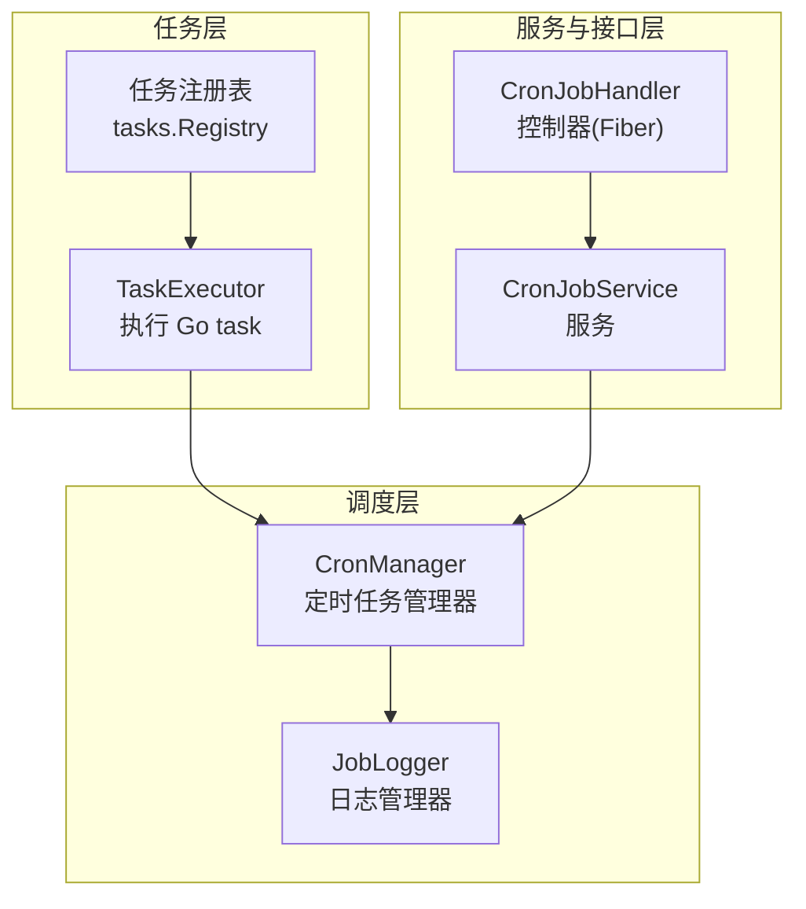
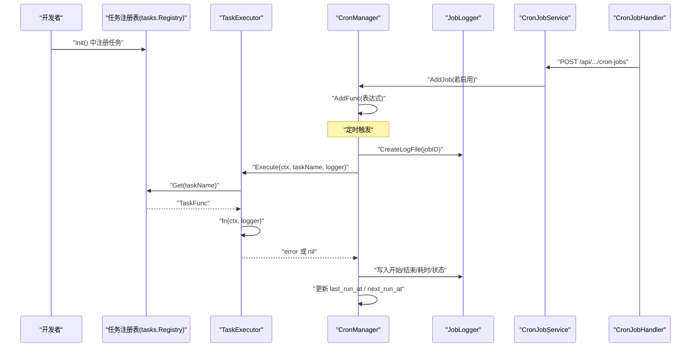
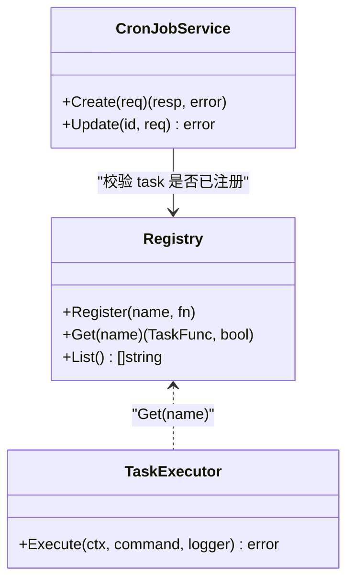
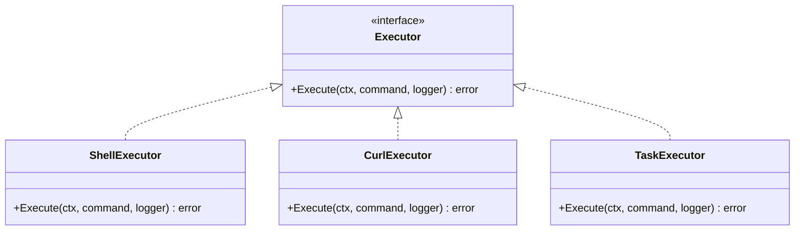
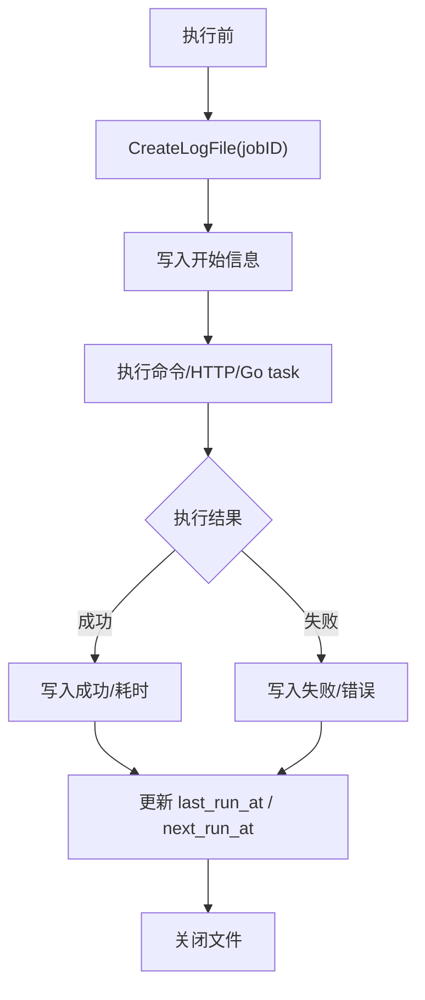
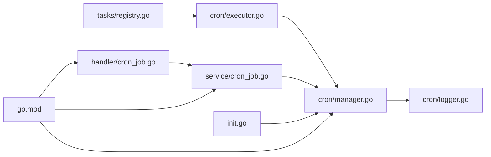

# 插件开发

<cite>
**本文引用的文件**
- [registry.go](file://internal/tasks/registry.go)
- [example.go](file://internal/tasks/example.go)
- [executor.go](file://internal/cron/executor.go)
- [manager.go](file://internal/cron/manager.go)
- [logger.go](file://internal/cron/logger.go)
- [cron_job.go](file://internal/service/cron_job.go)
- [cron_job_handler.go](file://internal/handler/cron_job.go)
- [init.go](file://internal/init.go)
- [go.mod](file://go.mod)
- [manager_test.go](file://internal/cron/manager_test.go)
</cite>

## 目录
1. [简介](#简介)
2. [项目结构](#项目结构)
3. [核心组件](#核心组件)
4. [架构总览](#架构总览)
5. [详细组件分析](#详细组件分析)
6. [依赖分析](#依赖分析)
7. [性能考虑](#性能考虑)
8. [故障排查指南](#故障排查指南)
9. [结论](#结论)
10. [附录](#附录)

## 简介
本指南面向希望在 Go Admin 中开发“任务插件”的开发者，系统讲解任务系统的架构设计与插件注册机制，重点覆盖：
- 任务注册表的工作原理与插件发现机制
- 如何开发自定义任务插件（接口实现、参数配置、执行逻辑）
- 开发模板与最佳实践（错误处理、日志记录、性能优化）
- 生命周期管理与状态监控
- 从简单定时任务到复杂数据处理插件的完整示例
- 插件的打包、部署与版本管理建议

## 项目结构
Go Admin 的任务系统围绕“任务注册表 + 执行器 + 定时任务管理器 + 日志管理器 + 服务层 + 控制器”构建，形成清晰的分层与职责分离：
- 任务注册表：集中管理可被调度执行的 Go 函数
- 执行器：根据任务类型选择具体执行策略（Shell、HTTP、Go task）
- 定时任务管理器：负责加载、调度、执行、记录与清理
- 日志管理器：按任务维度生成与轮转日志文件
- 服务层与控制器：对外暴露 REST 接口，供前端或外部系统调用

图表来源
- [registry.go:1-33](file://internal/tasks/registry.go#L1-L33)
- [executor.go:1-126](file://internal/cron/executor.go#L1-L126)
- [manager.go:1-237](file://internal/cron/manager.go#L1-L237)
- [logger.go:1-192](file://internal/cron/logger.go#L1-L192)
- [cron_job.go:1-492](file://internal/service/cron_job.go#L1-L492)
- [cron_job_handler.go:1-450](file://internal/handler/cron_job.go#L1-L450)

章节来源
- [registry.go:1-33](file://internal/tasks/registry.go#L1-L33)
- [executor.go:1-126](file://internal/cron/executor.go#L1-L126)
- [manager.go:1-237](file://internal/cron/manager.go#L1-L237)
- [logger.go:1-192](file://internal/cron/logger.go#L1-L192)
- [cron_job.go:1-492](file://internal/service/cron_job.go#L1-L492)
- [cron_job_handler.go:1-450](file://internal/handler/cron_job.go#L1-L450)
- [init.go:67-72](file://internal/init.go#L67-L72)

## 核心组件
- 任务注册表（tasks.Registry）
  - 提供全局注册、查询、枚举任务的能力
  - 任务函数签名统一为带上下文与日志输出的错误返回
- 执行器（Executor 接口及其实现）
  - ShellExecutor：执行系统命令
  - CurlExecutor：解析 JSON 配置并发起 HTTP 请求
  - TaskExecutor：从注册表查找并执行 Go task
- 定时任务管理器（CronManager）
  - 加载数据库中的启用任务，注册到调度器
  - 统一执行入口，写入日志，更新执行时间
  - 内置日志清理任务（每日凌晨2点）
- 日志管理器（JobLogger）
  - 按任务 ID 生成独立日志目录与文件
  - 支持列出、读取、尾部读取与过期清理
- 服务与控制器（CronJobService / CronJobHandler）
  - 对外提供创建、更新、启用、禁用、立即执行、日志查看等能力
  - 参数校验、错误码映射、操作日志记录

章节来源
- [registry.go:8-32](file://internal/tasks/registry.go#L8-L32)
- [executor.go:18-125](file://internal/cron/executor.go#L18-L125)
- [manager.go:17-236](file://internal/cron/manager.go#L17-L236)
- [logger.go:13-191](file://internal/cron/logger.go#L13-L191)
- [cron_job.go:28-491](file://internal/service/cron_job.go#L28-L491)
- [cron_job_handler.go:15-449](file://internal/handler/cron_job.go#L15-L449)

## 架构总览
下图展示从“任务注册表”到“调度执行”的端到端流程，以及“服务层/控制器层”的交互。

图表来源
- [example.go:10-13](file://internal/tasks/example.go#L10-L13)
- [registry.go:14-23](file://internal/tasks/registry.go#L14-L23)
- [executor.go:118-125](file://internal/cron/executor.go#L118-L125)
- [manager.go:97-221](file://internal/cron/manager.go#L97-L221)
- [logger.go:34-51](file://internal/cron/logger.go#L34-L51)

## 详细组件分析

### 任务注册表与插件发现机制
- 任务注册表采用全局 map，键为任务名称，值为函数指针
- 插件通过在包级 init() 中调用注册函数完成“自动发现”
- TaskExecutor 在执行时通过名称从注册表检索并调用对应函数
- 服务层在创建/更新任务时对 type=task 的命令进行注册校验

图表来源
- [registry.go:11-32](file://internal/tasks/registry.go#L11-L32)
- [executor.go:118-125](file://internal/cron/executor.go#L118-L125)
- [cron_job.go:115-120](file://internal/service/cron_job.go#L115-L120)

章节来源
- [registry.go:8-32](file://internal/tasks/registry.go#L8-L32)
- [example.go:10-13](file://internal/tasks/example.go#L10-L13)
- [executor.go:118-125](file://internal/cron/executor.go#L118-L125)
- [cron_job.go:115-120](file://internal/service/cron_job.go#L115-L120)

### 执行器与任务类型
- ShellExecutor：跨平台执行命令，标准输出/错误输出写入日志
- CurlExecutor：解析 JSON 配置（方法、URL、头、体、超时），发起 HTTP 请求并记录响应状态与内容
- TaskExecutor：从注册表获取任务函数并执行，未注册时返回明确错误

图表来源
- [executor.go:18-125](file://internal/cron/executor.go#L18-L125)

章节来源
- [executor.go:23-125](file://internal/cron/executor.go#L23-L125)

### 定时任务管理器与生命周期
- 启动：加载启用任务，注册到调度器；内置每日清理任务
- 运行：执行前创建日志文件，执行后记录耗时与状态，更新数据库执行时间
- 停止：优雅关闭调度器
- 动态变更：新增、删除、启用、禁用、立即执行均通过服务层协调管理器与数据库

图表来源
- [manager.go:41-77](file://internal/cron/manager.go#L41-L77)
- [manager.go:154-221](file://internal/cron/manager.go#L154-L221)

章节来源
- [manager.go:41-116](file://internal/cron/manager.go#L41-L116)
- [manager.go:154-236](file://internal/cron/manager.go#L154-L236)

### 日志管理与状态监控
- 按任务 ID 创建独立日志目录与文件，文件名包含时间戳
- 支持列出、读取、尾部读取（默认最近100行）
- 定时清理过期日志（默认保留7天）

图表来源
- [logger.go:34-51](file://internal/cron/logger.go#L34-L51)
- [manager.go:154-221](file://internal/cron/manager.go#L154-L221)

章节来源
- [logger.go:34-191](file://internal/cron/logger.go#L34-L191)
- [manager.go:154-221](file://internal/cron/manager.go#L154-L221)

### 服务层与控制器
- 服务层负责参数校验、任务类型与表达式校验、注册表校验、数据库持久化与调度器同步
- 控制器负责路由、参数解析、错误码映射与操作日志记录

章节来源
- [cron_job.go:107-164](file://internal/service/cron_job.go#L107-L164)
- [cron_job.go:166-246](file://internal/service/cron_job.go#L166-L246)
- [cron_job.go:248-269](file://internal/service/cron_job.go#L248-L269)
- [cron_job.go:271-348](file://internal/service/cron_job.go#L271-L348)
- [cron_job.go:350-410](file://internal/service/cron_job.go#L350-L410)
- [cron_job.go:412-474](file://internal/service/cron_job.go#L412-L474)
- [cron_job_handler.go:15-62](file://internal/handler/cron_job.go#L15-L62)
- [cron_job_handler.go:142-194](file://internal/handler/cron_job.go#L142-L194)
- [cron_job_handler.go:196-230](file://internal/handler/cron_job.go#L196-L230)
- [cron_job_handler.go:232-302](file://internal/handler/cron_job.go#L232-L302)
- [cron_job_handler.go:304-338](file://internal/handler/cron_job.go#L304-L338)
- [cron_job_handler.go:340-372](file://internal/handler/cron_job.go#L340-L372)
- [cron_job_handler.go:374-412](file://internal/handler/cron_job.go#L374-L412)
- [cron_job_handler.go:414-449](file://internal/handler/cron_job.go#L414-L449)

## 依赖分析
- 任务注册表依赖于标准库 context 与 io
- 执行器依赖 tasks 包以访问注册表
- 定时任务管理器依赖 ent ORM 查询任务、zap 日志、robfig/cron 调度器
- 服务层依赖 cron 管理器与 tasks 注册表
- 控制器依赖 Fiber 框架与服务层
- 初始化阶段在应用启动时创建并启动 CronManager

图表来源
- [registry.go:1-33](file://internal/tasks/registry.go#L1-L33)
- [executor.go:1-126](file://internal/cron/executor.go#L1-L126)
- [manager.go:1-237](file://internal/cron/manager.go#L1-L237)
- [logger.go:1-192](file://internal/cron/logger.go#L1-L192)
- [cron_job.go:1-492](file://internal/service/cron_job.go#L1-L492)
- [cron_job_handler.go:1-450](file://internal/handler/cron_job.go#L1-L450)
- [init.go:67-72](file://internal/init.go#L67-L72)
- [go.mod:1-128](file://go.mod#L1-L128)

章节来源
- [go.mod:5-19](file://go.mod#L5-L19)
- [init.go:67-72](file://internal/init.go#L67-L72)

## 性能考虑
- 日志写入采用同步写入与追加模式，保证可靠性；大量高频任务建议：
  - 将日志输出重定向至缓冲或异步队列（需扩展 JobLogger）
  - 控制日志大小与保留周期，避免磁盘压力
- HTTP 执行器限制响应体长度截断，避免内存膨胀
- 任务函数应尽量短小、幂等、具备超时控制与资源释放
- 调度器并发执行多个任务时，注意数据库连接池与锁竞争

[本节为通用指导，无需特定文件来源]

## 故障排查指南
- 任务未注册
  - 现象：执行 type=task 报错“Go task 未注册”
  - 排查：确认包级 init() 是否已调用注册；服务层创建/更新时会校验
- cron 表达式无效
  - 现象：创建/更新报错“无效的 cron 表达式”
  - 排查：使用秒级解析器校验表达式格式
- 任务不存在
  - 现象：启用/禁用/立即执行时报错“定时任务不存在”
  - 排查：确认任务 ID 正确且存在
- 日志读取失败
  - 现象：读取日志文件报错“日志不存在/无效的文件名”
  - 排查：确认文件名不含路径遍历字符，且存在于对应任务目录

章节来源
- [cron_job.go:115-120](file://internal/service/cron_job.go#L115-L120)
- [cron_job.go:109-113](file://internal/service/cron_job.go#L109-L113)
- [cron_job.go:171-176](file://internal/service/cron_job.go#L171-L176)
- [cron_job.go:414-425](file://internal/service/cron_job.go#L414-L425)
- [logger.go:88-105](file://internal/cron/logger.go#L88-L105)

## 结论
Go Admin 的任务系统以“任务注册表 + 执行器 + 定时任务管理器 + 日志管理器 + 服务/控制器”为核心，提供了简洁而强大的插件化任务执行框架。开发者只需遵循统一的任务函数签名并在包级 init() 中注册，即可通过调度器自动发现并执行。配合服务层的参数校验与控制器的 REST 接口，可快速构建从简单定时任务到复杂数据处理的各类插件。

[本节为总结，无需特定文件来源]

## 附录

### 开发模板与最佳实践
- 任务接口实现
  - 函数签名：接收 context 与 io.Writer，并返回 error
  - 建议：在函数内使用 logger 输出进度与关键信息
- 参数配置
  - ShellExecutor：直接传入命令字符串
  - CurlExecutor：传入 JSON 配置（方法、URL、头、体、超时）
  - TaskExecutor：传入任务名称（需已在注册表中注册）
- 错误处理
  - 明确区分“参数错误”“执行失败”“未注册”等场景
  - 在日志中记录开始/结束/耗时/状态，便于排障
- 日志记录
  - 使用日志管理器按任务维度生成独立日志文件
  - 控制日志保留周期，定期清理过期日志
- 性能优化
  - 避免阻塞型 IO；必要时使用超时控制
  - 对高频任务减少日志量或降级日志级别
- 生命周期管理
  - 通过服务层的启用/禁用/立即执行接口管理任务
  - 监控 last_run_at/next_run_at 字段了解执行状态

章节来源
- [executor.go:23-125](file://internal/cron/executor.go#L23-L125)
- [logger.go:34-191](file://internal/cron/logger.go#L34-L191)
- [cron_job.go:107-164](file://internal/service/cron_job.go#L107-L164)
- [cron_job.go:350-410](file://internal/service/cron_job.go#L350-L410)

### 开发示例（从简单到复杂）
- 简单定时任务
  - 在包级 init() 中注册任务名称与函数
  - 通过控制器创建任务，type=task，command=任务名称
  - 参考示例任务函数与注册位置
- 复杂数据处理插件
  - 在任务函数中执行数据库查询/更新、文件处理、HTTP 调用等
  - 使用 context 控制超时与取消
  - 通过日志记录关键步骤与异常
- HTTP 调用插件
  - 使用 CurlExecutor，传入 JSON 配置
  - 注意响应状态码与内容截断
- Shell 命令插件
  - 使用 ShellExecutor，注意跨平台命令差异

章节来源
- [example.go:10-28](file://internal/tasks/example.go#L10-L28)
- [executor.go:23-113](file://internal/cron/executor.go#L23-L113)

### 插件的打包、部署与版本管理
- 打包
  - 将插件代码放入独立包，确保在包级 init() 中注册任务
  - 保持任务名称全局唯一，避免冲突
- 部署
  - 将插件编译进主程序或作为独立二进制，确保在应用启动时被导入
  - 应用启动时会自动加载启用的任务
- 版本管理
  - 通过任务名称版本化（如 mytask_v1），在新版本中注册新名称
  - 通过服务层更新任务名称与命令，逐步迁移

章节来源
- [init.go:67-72](file://internal/init.go#L67-L72)
- [cron_job.go:115-120](file://internal/service/cron_job.go#L115-L120)

### 测试参考
- 定时任务管理器测试覆盖了创建、添加/移除、立即执行、启动加载启用任务、日志读取等场景
- 任务执行器测试覆盖了已注册与未注册任务的执行行为

章节来源
- [manager_test.go:23-214](file://internal/cron/manager_test.go#L23-L214)
- [executor.go:148-182](file://internal/cron/executor.go#L148-L182)