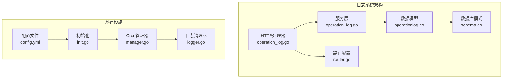
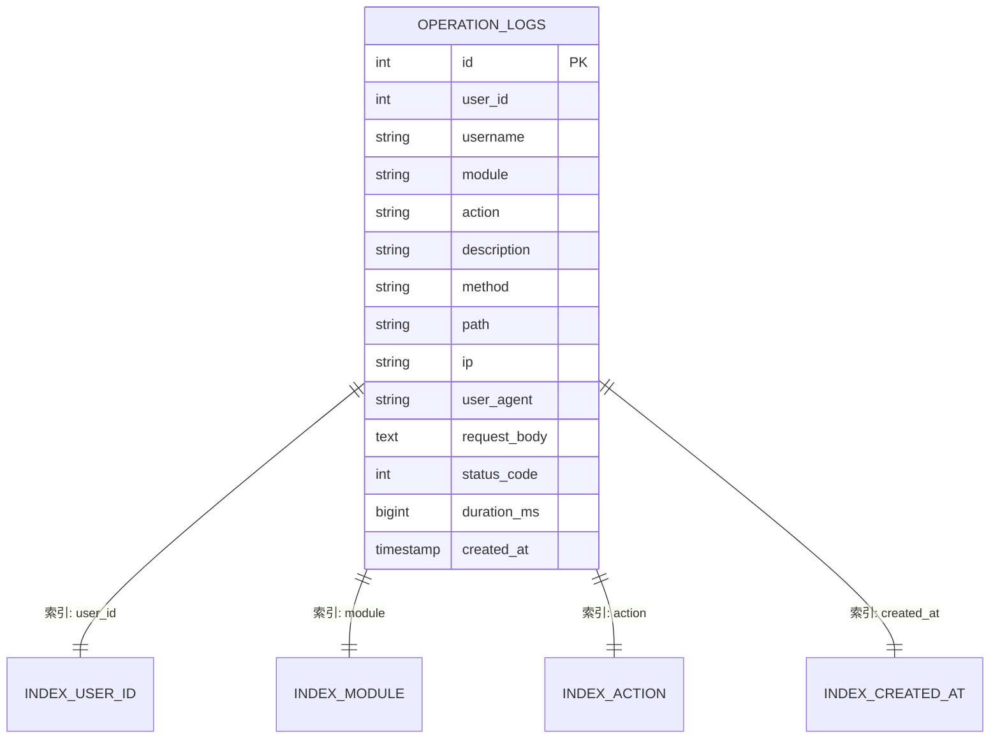
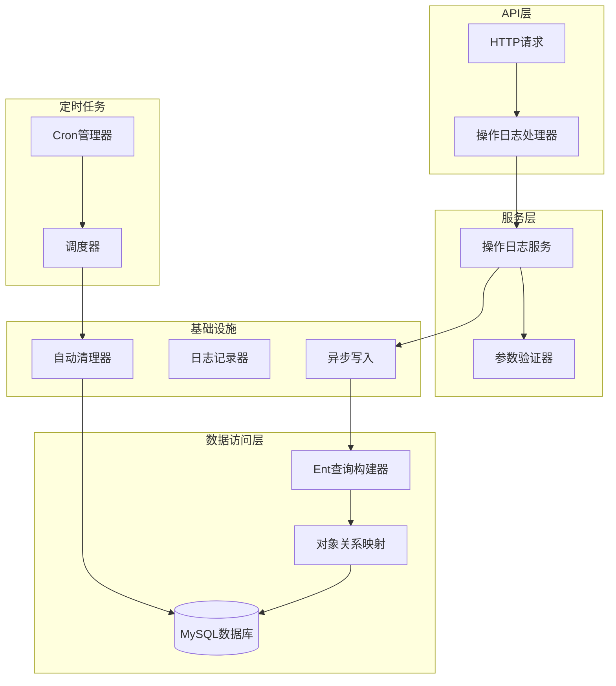
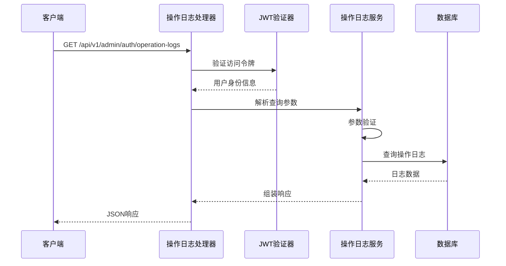
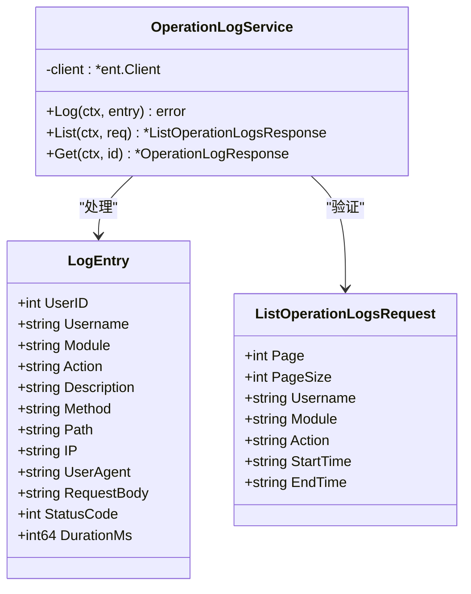
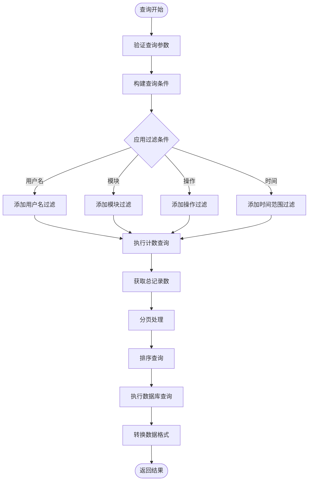
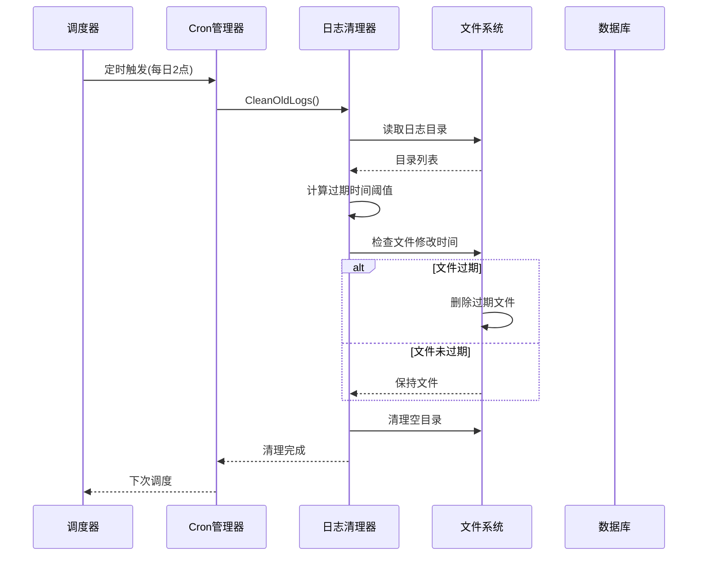
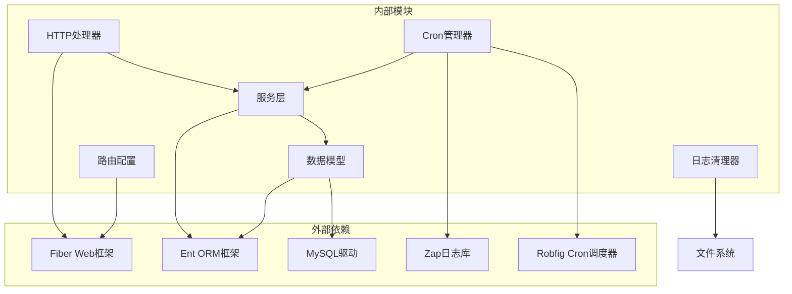
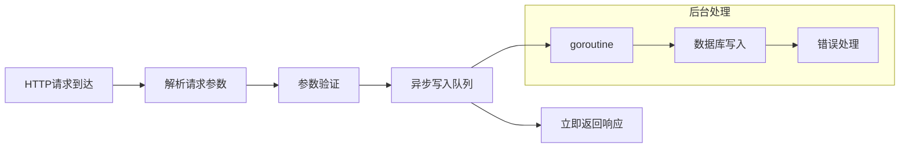
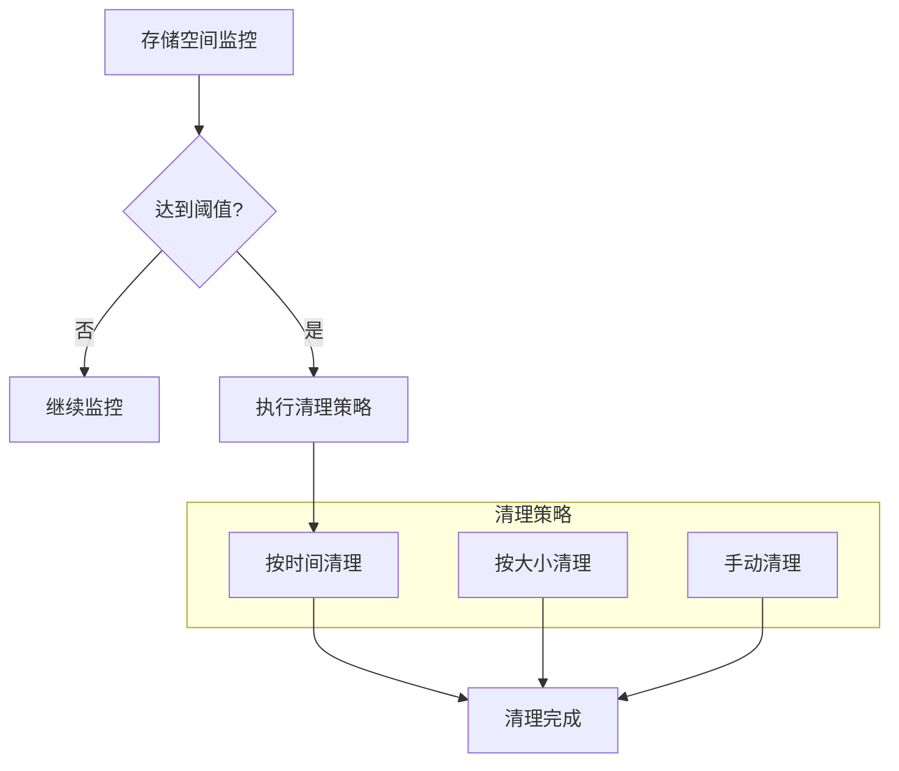

# 操作日志系统

<cite>
**本文档引用的文件**
- [operationlog.go](file://internal/ent/operationlog/operationlog.go)
- [operationlog.go](file://internal/ent/operationlog.go)
- [operation_log.go](file://internal/handler/operation_log.go)
- [operation_log.go](file://internal/service/operation_log.go)
- [operationlog_create.go](file://internal/ent/operationlog_create.go)
- [operationlog_query.go](file://internal/ent/operationlog_query.go)
- [schema.go](file://internal/ent/migrate/schema.go)
- [router.go](file://internal/router.go)
- [logger.go](file://internal/cron/logger.go)
- [manager.go](file://internal/cron/manager.go)
- [executor.go](file://internal/cron/executor.go)
- [config.yml](file://config/config.yml)
- [init.go](file://internal/init.go)
</cite>

## 目录
1. [简介](#简介)
2. [项目结构](#项目结构)
3. [核心组件](#核心组件)
4. [架构概览](#架构概览)
5. [详细组件分析](#详细组件分析)
6. [依赖关系分析](#依赖关系分析)
7. [性能考虑](#性能考虑)
8. [故障排除指南](#故障排除指南)
9. [结论](#结论)

## 简介

Go Admin管理系统的操作日志系统是一个完整的审计跟踪解决方案，用于记录和分析用户行为、系统事件和数据变更。该系统提供了实时的操作日志记录、强大的查询过滤功能、自动化的日志清理策略以及基础的日志分析能力。

系统采用异步写入机制确保高性能，支持多种查询条件筛选，包括按用户、模块、操作类型、时间范围等维度进行精确过滤。同时集成了定时任务管理系统，实现了自动化的日志清理和存储空间管理。

## 项目结构

操作日志系统主要分布在以下核心模块中：

**图表来源**
- [operation_log.go:1-128](file://internal/handler/operation_log.go#L1-128)
- [operation_log.go:1-218](file://internal/service/operation_log.go#L1-218)
- [operationlog.go:1-238](file://internal/ent/operationlog.go#L1-238)
- [schema.go:130-174](file://internal/ent/migrate/schema.go#L130-174)

**章节来源**
- [operation_log.go:1-128](file://internal/handler/operation_log.go#L1-128)
- [operation_log.go:1-218](file://internal/service/operation_log.go#L1-218)
- [router.go:145-149](file://internal/router.go#L145-149)

## 核心组件

### 数据模型设计

操作日志系统基于Ent框架构建，采用了规范的数据模型设计：

| 字段名称 | 类型 | 约束 | 描述 |
|---------|------|------|------|
| id | 整数 | 主键, 自增 | 日志记录唯一标识 |
| user_id | 整数 | 必填 | 操作用户ID |
| username | 字符串 | 必填, 最大255字符 | 用户名 |
| module | 字符串 | 必填, 最大255字符 | 模块名称 |
| action | 字符串 | 必填, 最大255字符 | 操作类型 |
| description | 字符串 | 可选, 最大1024字符 | 操作描述 |
| method | 字符串 | 必填, 最大10字符 | HTTP方法 |
| path | 字符串 | 必填, 最大1024字符 | 请求路径 |
| ip | 字符串 | 必填, 最大50字符 | 客户端IP地址 |
| user_agent | 字符串 | 可选, 最大1024字符 | 用户代理信息 |
| request_body | 文本 | 可选 | 请求体内容 |
| status_code | 整数 | 必填 | HTTP状态码 |
| duration_ms | 整数 | 必填 | 处理耗时(毫秒) |
| created_at | 时间戳 | 必填 | 创建时间 |

### 查询索引优化

系统为关键查询字段建立了专门的数据库索引：

**图表来源**
- [schema.go:148-174](file://internal/ent/migrate/schema.go#L148-174)

**章节来源**
- [operationlog.go:13-98](file://internal/ent/operationlog/operationlog.go#L13-98)
- [schema.go:130-174](file://internal/ent/migrate/schema.go#L130-174)

## 架构概览

操作日志系统采用分层架构设计，确保了良好的可维护性和扩展性：

**图表来源**
- [operation_log.go:16-47](file://internal/handler/operation_log.go#L16-47)
- [operation_log.go:88-118](file://internal/service/operation_log.go#L88-118)
- [manager.go:40-77](file://internal/cron/manager.go#L40-77)

## 详细组件分析

### HTTP处理器组件

HTTP处理器负责接收和处理操作日志相关的HTTP请求：

**图表来源**
- [operation_log.go:49-93](file://internal/handler/operation_log.go#L49-93)

处理器支持以下查询参数：
- `page`: 页码，默认1
- `page_size`: 每页数量，默认10，最大100
- `username`: 用户名模糊匹配
- `module`: 模块名称精确匹配
- `action`: 操作类型精确匹配
- `start_time`: 开始时间(RFC3339格式)
- `end_time`: 结束时间(RFC3339格式)

**章节来源**
- [operation_log.go:49-93](file://internal/handler/operation_log.go#L49-93)

### 服务层组件

服务层实现了核心的业务逻辑和数据处理：

**图表来源**
- [operation_log.go:18-51](file://internal/service/operation_log.go#L18-51)

服务层的关键特性：
1. **异步写入**: 使用goroutine实现非阻塞的日志记录
2. **参数验证**: 严格的输入参数验证和默认值处理
3. **分页查询**: 支持高效的大数据量查询
4. **时间范围过滤**: 支持精确的时间范围查询

**章节来源**
- [operation_log.go:25-183](file://internal/service/operation_log.go#L25-183)

### 数据访问层组件

数据访问层基于Ent框架构建，提供了强大的查询和操作能力：

**图表来源**
- [operationlog_query.go:120-183](file://internal/ent/operationlog_query.go#L120-183)

**章节来源**
- [operationlog_query.go:120-183](file://internal/ent/operationlog_query.go#L120-183)

### 日志清理策略

系统集成了自动化的日志清理功能，确保存储空间的有效管理：

**图表来源**
- [manager.go:60-77](file://internal/cron/manager.go#L60-77)
- [logger.go:148-191](file://internal/cron/logger.go#L148-191)

清理策略特点：
- **时间阈值**: 默认保留7天的日志数据
- **目录结构**: 按任务ID组织日志文件
- **自动清理**: 每日凌晨2点自动执行
- **空目录清理**: 删除清理后留下的空目录

**章节来源**
- [logger.go:148-191](file://internal/cron/logger.go#L148-191)
- [manager.go:60-77](file://internal/cron/manager.go#L60-77)

## 依赖关系分析

操作日志系统的依赖关系呈现清晰的分层结构：

**图表来源**
- [router.go:16-149](file://internal/router.go#L16-149)
- [init.go:59-67](file://internal/init.go#L59-67)

**章节来源**
- [router.go:16-149](file://internal/router.go#L16-149)
- [init.go:59-67](file://internal/init.go#L59-67)

## 性能考虑

### 异步写入机制

操作日志系统采用异步写入策略，避免阻塞主业务流程：

**优势**:
- **低延迟**: 主线程无需等待数据库写入完成
- **高吞吐量**: 支持高并发场景下的日志记录
- **可靠性**: 异步处理失败不影响主线程执行

### 查询优化策略

系统通过多种方式优化查询性能：

1. **索引优化**: 为常用查询字段建立数据库索引
2. **分页查询**: 限制单次查询的数据量
3. **选择性字段**: 只查询必要的字段
4. **时间范围限制**: 默认限制查询时间范围

### 存储空间管理

**章节来源**
- [operation_log.go:88-118](file://internal/service/operation_log.go#L88-118)
- [logger.go:148-191](file://internal/cron/logger.go#L148-191)

## 故障排除指南

### 常见问题及解决方案

| 问题类型 | 症状 | 可能原因 | 解决方案 |
|---------|------|----------|----------|
| 日志记录失败 | 操作正常但无日志 | 数据库连接异常 | 检查数据库配置和连接状态 |
| 查询超时 | 日志查询响应缓慢 | 缺少必要索引 | 为查询字段添加数据库索引 |
| 存储空间不足 | 磁盘空间告警 | 日志文件过多 | 调整日志保留策略或清理历史数据 |
| API调用失败 | HTTP 500错误 | 参数验证失败 | 检查请求参数格式和范围 |

### 调试工具和方法

1. **日志级别调整**: 在配置文件中调整日志详细程度
2. **数据库监控**: 监控慢查询和连接池状态
3. **性能分析**: 使用pprof分析CPU和内存使用情况
4. **网络诊断**: 检查数据库连接和网络延迟

**章节来源**
- [config.yml:11-18](file://config/config.yml#L11-18)
- [operation_log.go:113-116](file://internal/service/operation_log.go#L113-116)

## 结论

Go Admin操作日志系统提供了一个完整、高效且可扩展的审计跟踪解决方案。系统的主要优势包括：

**技术优势**:
- 基于Ent框架的强类型数据模型
- 异步写入机制确保高并发性能
- 完善的查询过滤和索引优化
- 自动化的日志清理策略

**功能特性**:
- 实时用户行为追踪
- 系统事件完整记录
- 数据变更审计
- 多维度查询和分析
- 自动化存储管理

**扩展性考虑**:
- 模块化设计便于功能扩展
- 支持自定义日志字段
- 可配置的清理策略
- 良好的监控和诊断能力

该系统为Go Admin平台提供了坚实的安全审计基础，能够满足企业级应用对操作审计和合规性的严格要求。