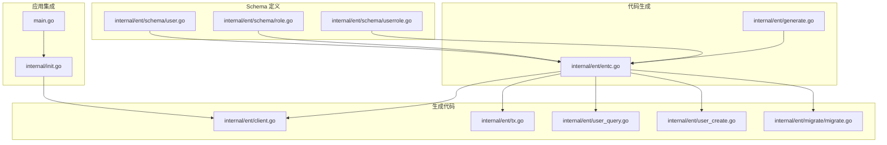
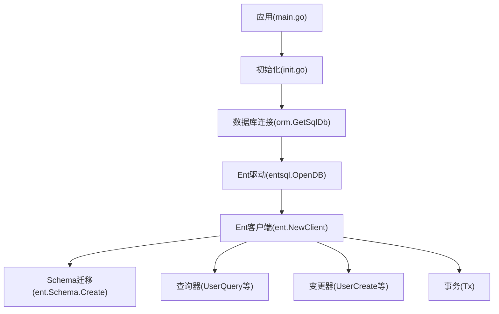
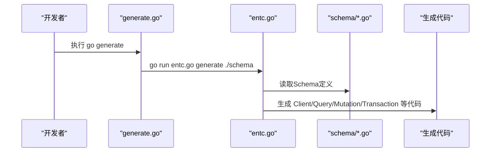
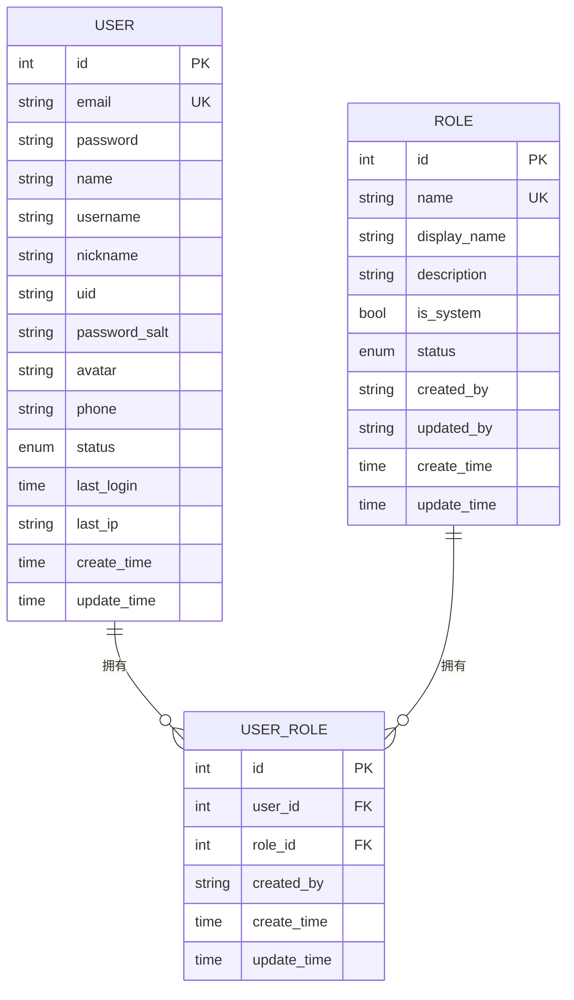
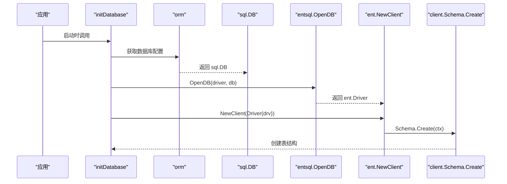
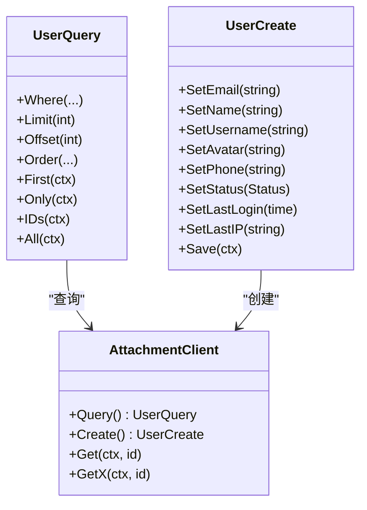
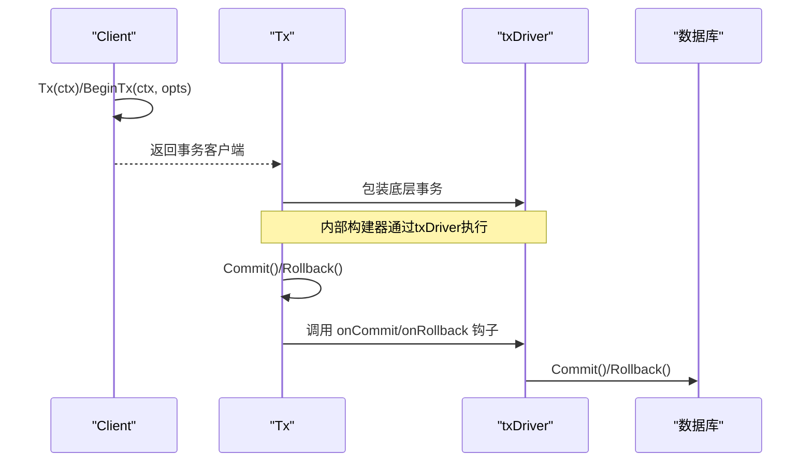
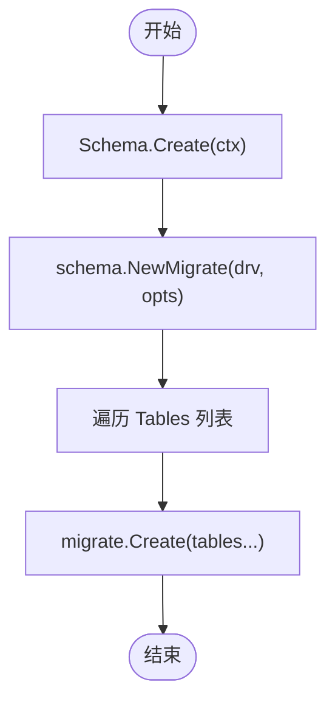
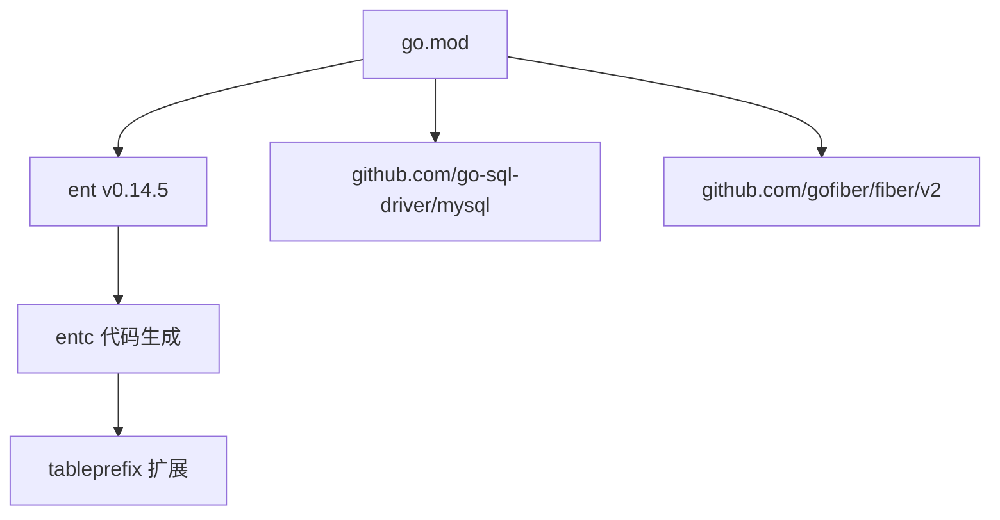

# Ent ORM框架

<cite>
**本文档引用的文件**
- [internal/ent/ent.go](file://internal/ent/ent.go)
- [internal/ent/client.go](file://internal/ent/client.go)
- [internal/ent/tx.go](file://internal/ent/tx.go)
- [internal/ent/generate.go](file://internal/ent/generate.go)
- [internal/ent/entc.go](file://internal/ent/entc.go)
- [internal/ent/migrate/migrate.go](file://internal/ent/migrate/migrate.go)
- [internal/ent/schema/user.go](file://internal/ent/schema/user.go)
- [internal/ent/schema/role.go](file://internal/ent/schema/role.go)
- [internal/ent/schema/userrole.go](file://internal/ent/schema/userrole.go)
- [internal/ent/user.go](file://internal/ent/user.go)
- [internal/ent/user_query.go](file://internal/ent/user_query.go)
- [internal/ent/user_create.go](file://internal/ent/user_create.go)
- [internal/init.go](file://internal/init.go)
- [main.go](file://main.go)
- [go.mod](file://go.mod)
</cite>

## 目录
1. [简介](#简介)
2. [项目结构](#项目结构)
3. [核心组件](#核心组件)
4. [架构总览](#架构总览)
5. [详细组件分析](#详细组件分析)
6. [依赖分析](#依赖分析)
7. [性能考虑](#性能考虑)
8. [故障排除指南](#故障排除指南)
9. [结论](#结论)
10. [附录](#附录)

## 简介
本文件面向Go Admin管理系统中的Ent ORM框架，系统性阐述其核心概念、架构设计与使用方式。内容覆盖代码生成机制、Schema定义、类型安全的查询接口、生命周期管理（客户端初始化、连接池配置、事务处理）、关系映射与复杂查询示例，并提供最佳实践以避免N+1查询、合理使用预加载与批量操作优化。

## 项目结构
Ent ORM在项目中的组织遵循“代码生成 + 模式定义”的分层结构：
- internal/ent/schema：存放实体Schema定义，描述字段、索引、Mixin等元信息
- internal/ent：存放entc生成的客户端、查询器、变更器、事务等代码
- internal/ent/migrate：封装迁移API，支持创建/写入DDL变更
- internal/ent/generate.go与internal/ent/entc.go：定义代码生成入口与扩展钩子
- internal/init.go与main.go：应用启动时初始化Ent客户端并创建数据库表结构

**图表来源**
- [internal/ent/schema/user.go:1-104](file://internal/ent/schema/user.go#L1-L104)
- [internal/ent/schema/role.go:1-73](file://internal/ent/schema/role.go#L1-L73)
- [internal/ent/schema/userrole.go:1-56](file://internal/ent/schema/userrole.go#L1-L56)
- [internal/ent/generate.go:1-4](file://internal/ent/generate.go#L1-L4)
- [internal/ent/entc.go:1-45](file://internal/ent/entc.go#L1-L45)
- [internal/ent/client.go:1-140](file://internal/ent/client.go#L1-L140)
- [internal/ent/tx.go:1-120](file://internal/ent/tx.go#L1-L120)
- [internal/ent/user_query.go:1-120](file://internal/ent/user_query.go#L1-L120)
- [internal/ent/user_create.go:1-120](file://internal/ent/user_create.go#L1-L120)
- [internal/ent/migrate/migrate.go:1-65](file://internal/ent/migrate/migrate.go#L1-L65)
- [internal/init.go:69-84](file://internal/init.go#L69-L84)
- [main.go:47-67](file://main.go#L47-L67)

**章节来源**
- [internal/ent/schema/user.go:1-104](file://internal/ent/schema/user.go#L1-L104)
- [internal/ent/schema/role.go:1-73](file://internal/ent/schema/role.go#L1-L73)
- [internal/ent/schema/userrole.go:1-56](file://internal/ent/schema/userrole.go#L1-L56)
- [internal/ent/generate.go:1-4](file://internal/ent/generate.go#L1-L4)
- [internal/ent/entc.go:1-45](file://internal/ent/entc.go#L1-L45)
- [internal/ent/client.go:1-140](file://internal/ent/client.go#L1-L140)
- [internal/ent/tx.go:1-120](file://internal/ent/tx.go#L1-L120)
- [internal/ent/user_query.go:1-120](file://internal/ent/user_query.go#L1-L120)
- [internal/ent/user_create.go:1-120](file://internal/ent/user_create.go#L1-L120)
- [internal/ent/migrate/migrate.go:1-65](file://internal/ent/migrate/migrate.go#L1-L65)
- [internal/init.go:69-84](file://internal/init.go#L69-L84)
- [main.go:47-67](file://main.go#L47-L67)

## 核心组件
- 客户端与配置：Client封装所有实体客户端，支持Debug、日志、驱动、钩子与拦截器配置
- 查询器：各实体提供Query构建器，支持Where、Limit、Offset、Order、Select、IDs等
- 变更器：Create/Update/Delete构建器，支持批量创建与字段赋值
- 事务：Tx包装事务驱动，提供Commit/Rollback与提交/回滚钩子
- 迁移：Schema封装DDL创建与写入，支持外键、索引、列删除等选项
- 错误类型：统一的验证、约束、未找到、非单数、未加载错误类型

**章节来源**
- [internal/ent/client.go:29-120](file://internal/ent/client.go#L29-L120)
- [internal/ent/ent.go:25-120](file://internal/ent/ent.go#L25-L120)
- [internal/ent/tx.go:12-95](file://internal/ent/tx.go#L12-L95)
- [internal/ent/migrate/migrate.go:35-65](file://internal/ent/migrate/migrate.go#L35-L65)

## 架构总览
Ent ORM在Go Admin中的运行时架构如下：
- 应用启动时通过initDatabase创建数据库连接并初始化Ent客户端
- 客户端持有底层驱动，按需创建Schema
- 请求处理中通过各实体客户端执行查询与变更
- 事务通过Tx隔离多步操作，保证一致性

**图表来源**
- [internal/init.go:69-84](file://internal/init.go#L69-L84)
- [main.go:47-67](file://main.go#L47-L67)
- [internal/ent/client.go:127-141](file://internal/ent/client.go#L127-L141)
- [internal/ent/migrate/migrate.go:43-55](file://internal/ent/migrate/migrate.go#L43-L55)

**章节来源**
- [internal/init.go:69-84](file://internal/init.go#L69-L84)
- [main.go:47-67](file://main.go#L47-L67)
- [internal/ent/client.go:127-141](file://internal/ent/client.go#L127-L141)
- [internal/ent/migrate/migrate.go:43-55](file://internal/ent/migrate/migrate.go#L43-L55)

## 详细组件分析

### 代码生成机制与entc配置
- 生成入口：generate.go通过go:generate调用entc生成
- 生成逻辑：entc.go使用entc.Generate，传入schema目录与gen.Config，启用钩子与扩展
- 钩子：EnsureStructTag确保字段具备指定结构体标签
- 扩展：tableprefix扩展为表名添加前缀

**图表来源**
- [internal/ent/generate.go:1-4](file://internal/ent/generate.go#L1-L4)
- [internal/ent/entc.go:16-27](file://internal/ent/entc.go#L16-L27)

**章节来源**
- [internal/ent/generate.go:1-4](file://internal/ent/generate.go#L1-L4)
- [internal/ent/entc.go:1-45](file://internal/ent/entc.go#L1-L45)

### Schema定义与类型安全查询
- 用户Schema：定义字段、索引、Mixin（时间戳），未启用角色关联边
- 角色Schema：定义字段、索引、Mixin（时间戳），未启用用户关联边
- 用户角色Schema：定义字段、边（到User/Role的必填唯一边）与复合索引

**图表来源**
- [internal/ent/schema/user.go:17-104](file://internal/ent/schema/user.go#L17-L104)
- [internal/ent/schema/role.go:10-73](file://internal/ent/schema/role.go#L10-L73)
- [internal/ent/schema/userrole.go:11-56](file://internal/ent/schema/userrole.go#L11-L56)

**章节来源**
- [internal/ent/schema/user.go:17-104](file://internal/ent/schema/user.go#L17-L104)
- [internal/ent/schema/role.go:10-73](file://internal/ent/schema/role.go#L10-L73)
- [internal/ent/schema/userrole.go:11-56](file://internal/ent/schema/userrole.go#L11-L56)

### 生命周期管理：客户端初始化、连接池与事务
- 客户端初始化：initDatabase通过orm获取sql.DB，OpenDB创建驱动，NewClient创建客户端，Schema.Create自动建表
- 连接池：通过orm.GetSqlDb配置底层sql.DB连接参数（最大连接数、空闲数、生命周期等）
- 事务：Client.Tx/BeginTx创建事务客户端；Tx.Commit/Rollback提供提交/回滚钩子；txDriver隔离内部构建器与用户控制

**图表来源**
- [internal/init.go:69-84](file://internal/init.go#L69-L84)
- [internal/ent/client.go:127-141](file://internal/ent/client.go#L127-L141)
- [internal/ent/migrate/migrate.go:43-55](file://internal/ent/migrate/migrate.go#L43-L55)

**章节来源**
- [internal/init.go:69-84](file://internal/init.go#L69-L84)
- [internal/ent/client.go:127-141](file://internal/ent/client.go#L127-L141)
- [internal/ent/tx.go:12-95](file://internal/ent/tx.go#L12-L95)
- [internal/ent/migrate/migrate.go:43-55](file://internal/ent/migrate/migrate.go#L43-L55)

### 类型安全查询接口与复杂查询示例
- 查询器：UserQuery支持Where、Limit、Offset、Order、First/Only/IDs等方法
- 变更器：UserCreate支持链式字段赋值，批量创建通过MapCreateBulk
- 关系查询：通过QueryGroup/QueryAttachments等路径函数构造邻接查询

**图表来源**
- [internal/ent/user_query.go:18-200](file://internal/ent/user_query.go#L18-L200)
- [internal/ent/user_create.go:16-200](file://internal/ent/user_create.go#L16-L200)
- [internal/ent/client.go:267-374](file://internal/ent/client.go#L267-L374)

**章节来源**
- [internal/ent/user_query.go:18-200](file://internal/ent/user_query.go#L18-L200)
- [internal/ent/user_create.go:16-200](file://internal/ent/user_create.go#L16-L200)
- [internal/ent/client.go:267-374](file://internal/ent/client.go#L267-L374)

### 事务处理流程
- 开启事务：Client.Tx/BeginTx返回Tx客户端，内部使用txDriver包装底层事务
- 提交/回滚：Tx.Commit/Rollback执行钩子链，最终调用底层事务提交或回滚
- 延迟绑定：Tx.Client惰性创建普通Client，共享配置但绑定到事务驱动

**图表来源**
- [internal/ent/client.go:146-197](file://internal/ent/client.go#L146-L197)
- [internal/ent/tx.go:12-170](file://internal/ent/tx.go#L12-L170)
- [internal/ent/tx.go:172-232](file://internal/ent/tx.go#L172-L232)

**章节来源**
- [internal/ent/client.go:146-197](file://internal/ent/client.go#L146-L197)
- [internal/ent/tx.go:12-170](file://internal/ent/tx.go#L12-L170)
- [internal/ent/tx.go:172-232](file://internal/ent/tx.go#L172-L232)

### 迁移与模式管理
- Schema.Create：创建所有表资源
- WriteTo：将DDL变更输出到Writer而非直接执行
- 选项：支持全局唯一ID、外键、索引/列删除等

**图表来源**
- [internal/ent/migrate/migrate.go:43-55](file://internal/ent/migrate/migrate.go#L43-L55)

**章节来源**
- [internal/ent/migrate/migrate.go:35-65](file://internal/ent/migrate/migrate.go#L35-L65)

## 依赖分析
- 版本与依赖：项目使用ent v0.14.5，配合mysql/sqlite驱动与相关中间件
- 生成工具：entc作为代码生成器，tableprefix扩展为表名加前缀
- 运行时：应用通过Wire注入或手动初始化EntClient，统一作为全局ORM使用

**图表来源**
- [go.mod:5-21](file://go.mod#L5-L21)
- [internal/ent/entc.go:6-23](file://internal/ent/entc.go#L6-L23)

**章节来源**
- [go.mod:5-21](file://go.mod#L5-L21)
- [internal/ent/entc.go:6-23](file://internal/ent/entc.go#L6-L23)

## 性能考虑
- 避免N+1查询：使用Query预加载关联边（例如QueryGroup/QueryAttachments），减少多次往返数据库
- 合理使用预加载：仅在必要时加载关联数据，避免不必要的JOIN与扫描
- 批量操作：使用MapCreateBulk/批量更新/删除减少网络往返
- 分页与限制：结合Limit/Offset与合适的索引，避免全表扫描
- 事务边界：将多个写操作放入单个事务，减少锁竞争与重复校验

## 故障排除指南
- 未找到实体：检查Only/First/IDs返回的NotFoundError，确认过滤条件与唯一性
- 非单数结果：Only期望唯一结果，若返回多条会触发NotSingularError
- 未加载边：访问未预加载的边会触发NotLoadedError，需在查询时显式加载
- 约束冲突：插入/更新违反唯一性/外键约束会触发ConstraintError，检查Schema与输入数据
- 事务嵌套：尝试在已有事务内再次开启事务会报错，应复用现有Tx

**章节来源**
- [internal/ent/ent.go:185-301](file://internal/ent/ent.go#L185-L301)
- [internal/ent/client.go:146-151](file://internal/ent/client.go#L146-L151)

## 结论
Go Admin系统采用Ent ORM实现强类型的数据库抽象与代码生成，结合Schema定义、查询器与变更器，提供了清晰的实体模型与一致的API体验。通过事务与迁移模块，系统实现了可靠的ACID语义与可演进的数据库结构。建议在实际开发中遵循预加载与批量操作的最佳实践，以获得更优的性能与可维护性。

## 附录
- 代码生成命令：通过go:generate在项目根目录执行，自动扫描schema并生成ent代码
- 配置选项：entc.Generate支持钩子与扩展，tableprefix为表名添加前缀；迁移支持外键、索引/列删除等选项
- 应用集成：initDatabase负责创建驱动与客户端，并自动执行Schema.Create

**章节来源**
- [internal/ent/generate.go:1-4](file://internal/ent/generate.go#L1-L4)
- [internal/ent/entc.go:16-27](file://internal/ent/entc.go#L16-L27)
- [internal/ent/migrate/migrate.go:14-33](file://internal/ent/migrate/migrate.go#L14-L33)
- [internal/init.go:69-84](file://internal/init.go#L69-L84)