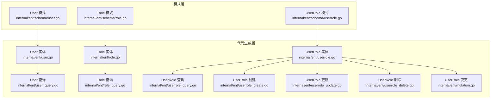
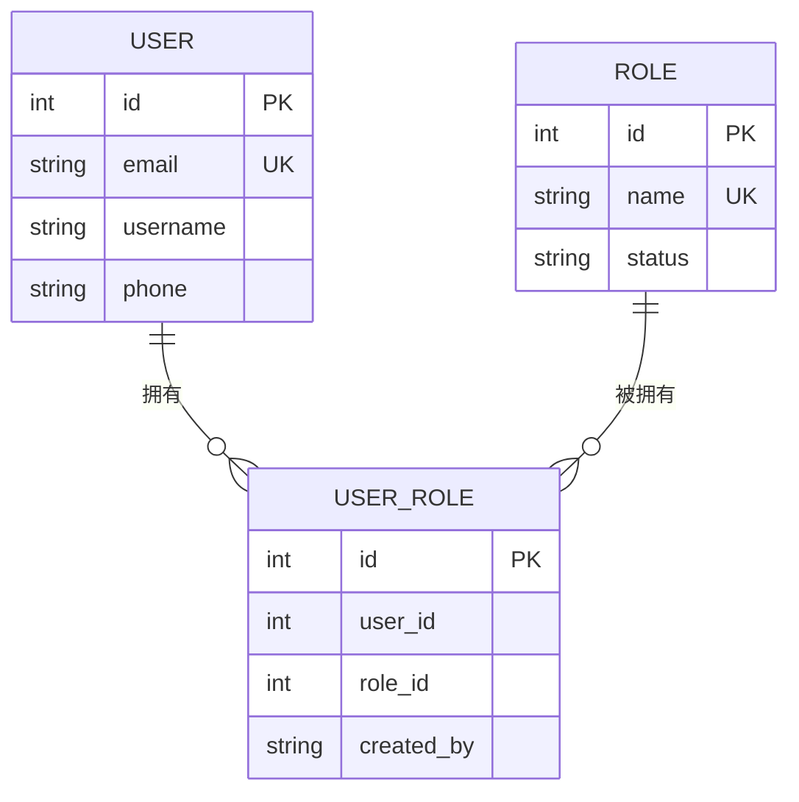
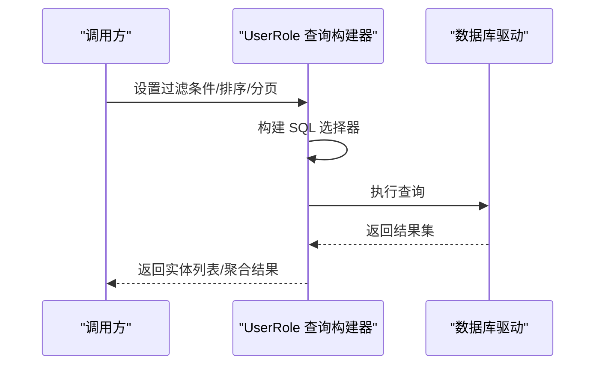
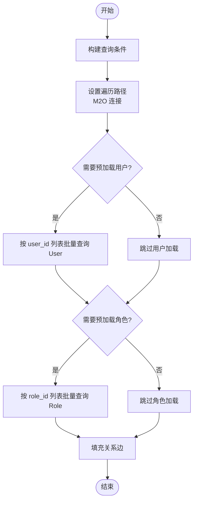
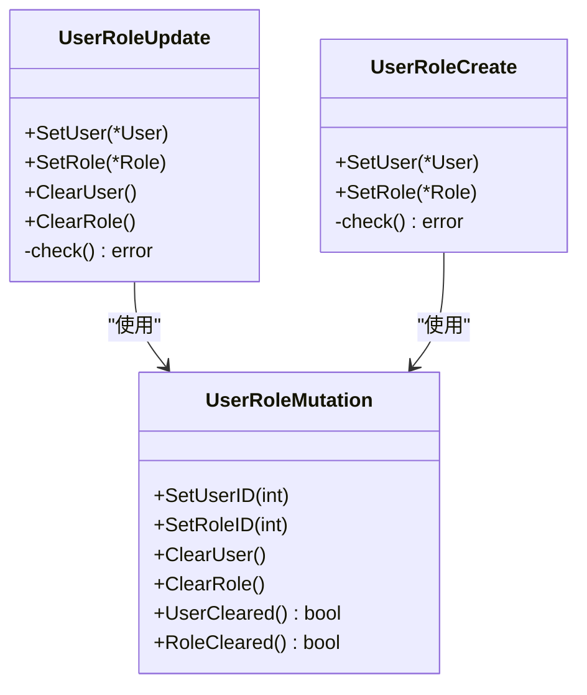
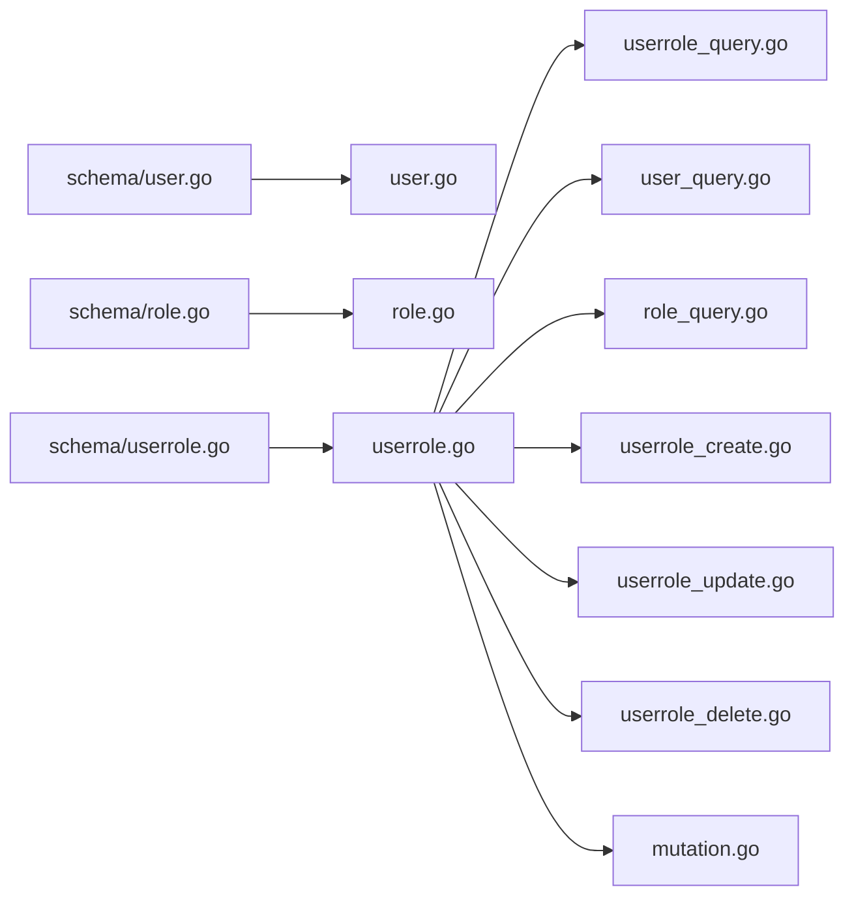

# 实体关系映射

<cite>
**本文档引用的文件**
- [internal/ent/schema/user.go](file://internal/ent/schema/user.go)
- [internal/ent/schema/role.go](file://internal/ent/schema/role.go)
- [internal/ent/schema/userrole.go](file://internal/ent/schema/userrole.go)
- [internal/ent/user.go](file://internal/ent/user.go)
- [internal/ent/role.go](file://internal/ent/role.go)
- [internal/ent/userrole.go](file://internal/ent/userrole.go)
- [internal/ent/user_query.go](file://internal/ent/user_query.go)
- [internal/ent/role_query.go](file://internal/ent/role_query.go)
- [internal/ent/userrole_query.go](file://internal/ent/userrole_query.go)
- [internal/ent/userrole_create.go](file://internal/ent/userrole_create.go)
- [internal/ent/userrole_update.go](file://internal/ent/userrole_update.go)
- [internal/ent/userrole_delete.go](file://internal/ent/userrole_delete.go)
- [internal/ent/mutation.go](file://internal/ent/mutation.go)
</cite>

## 目录
1. [简介](#简介)
2. [项目结构](#项目结构)
3. [核心组件](#核心组件)
4. [架构总览](#架构总览)
5. [详细组件分析](#详细组件分析)
6. [依赖关系分析](#依赖关系分析)
7. [性能考量](#性能考量)
8. [故障排查指南](#故障排查指南)
9. [结论](#结论)

## 简介
本文件聚焦于 Go Admin 管理系统中 User（用户）、Role（角色）、UserRole（用户-角色关联）三者的实体关系映射与实现机制。文档从数据库层面的 ER 设计出发，结合代码生成层的实体模型与查询构建器，系统阐述：
- 多对多关系的中间表设计与字段定义
- 关系映射中的外键约束与唯一性约束
- 导航查询的实现方式与最佳实践
- 关系变更对数据完整性的保障策略
- 查询性能优化与索引设计建议

## 项目结构
围绕实体关系映射的关键文件组织如下：
- 模式层（Schema）：定义实体字段、索引与边（Edge）
- 代码生成层（Model + Query + Mutation）：基于 Schema 自动生成的实体模型、查询构建器与变更对象
- 关系操作层：创建、更新、删除中间表记录的构建器

图表来源
- [internal/ent/schema/user.go](file://internal/ent/schema/user.go)
- [internal/ent/schema/role.go](file://internal/ent/schema/role.go)
- [internal/ent/schema/userrole.go](file://internal/ent/schema/userrole.go)
- [internal/ent/user.go](file://internal/ent/user.go)
- [internal/ent/role.go](file://internal/ent/role.go)
- [internal/ent/userrole.go](file://internal/ent/userrole.go)
- [internal/ent/user_query.go](file://internal/ent/user_query.go)
- [internal/ent/role_query.go](file://internal/ent/role_query.go)
- [internal/ent/userrole_query.go](file://internal/ent/userrole_query.go)
- [internal/ent/userrole_create.go](file://internal/ent/userrole_create.go)
- [internal/ent/userrole_update.go](file://internal/ent/userrole_update.go)
- [internal/ent/userrole_delete.go](file://internal/ent/userrole_delete.go)
- [internal/ent/mutation.go](file://internal/ent/mutation.go)

章节来源
- [internal/ent/schema/user.go](file://internal/ent/schema/user.go)
- [internal/ent/schema/role.go](file://internal/ent/schema/role.go)
- [internal/ent/schema/userrole.go](file://internal/ent/schema/userrole.go)

## 核心组件
- User（用户）
  - 字段：自增主键、邮箱（唯一）、密码、姓名、用户名、昵称、唯一标识、密码盐、头像、手机、状态、最后登录时间与IP等
  - 索引：邮箱、手机、用户名
- Role（角色）
  - 字段：自增主键、名称（唯一）、显示名称、描述、是否系统内置、状态、创建者/更新者
  - 索引：名称（唯一）、状态
- UserRole（用户-角色关联）
  - 字段：自增主键、user_id、role_id、分配者ID
  - 边：到 User 的必填唯一边；到 Role 的必填唯一边
  - 索引：(user_id, role_id) 唯一、user_id、role_id

章节来源
- [internal/ent/schema/user.go](file://internal/ent/schema/user.go)
- [internal/ent/schema/role.go](file://internal/ent/schema/role.go)
- [internal/ent/schema/userrole.go](file://internal/ent/schema/userrole.go)

## 架构总览
下图展示了 User、Role、UserRole 三者在数据库与代码生成层的映射关系，以及查询时的导航路径。

图表来源
- [internal/ent/schema/user.go](file://internal/ent/schema/user.go)
- [internal/ent/schema/role.go](file://internal/ent/schema/role.go)
- [internal/ent/schema/userrole.go](file://internal/ent/schema/userrole.go)

## 详细组件分析

### User 实体与查询
- 实体模型
  - 包含标准字段与敏感信息（如密码、盐值）的处理
  - 支持选择性字段扫描与赋值，便于按需加载
- 查询构建器
  - 提供过滤、排序、分页、聚合、唯一性控制等能力
  - 支持通过中间查询路径进行关系遍历（例如与 UserRole 的连接）

章节来源
- [internal/ent/user.go](file://internal/ent/user.go)
- [internal/ent/user_query.go](file://internal/ent/user_query.go)

### Role 实体与查询
- 实体模型
  - 角色元数据与状态管理
  - 时间混入支持
- 查询构建器
  - 与 User 类似的查询能力，支持按状态、名称等条件筛选

章节来源
- [internal/ent/role.go](file://internal/ent/role.go)
- [internal/ent/role_query.go](file://internal/ent/role_query.go)

### UserRole 中间表与关系操作
- 实体模型
  - 定义 user_id、role_id、created_by 等字段
  - 边定义为必填且唯一，确保每条记录对应唯一的用户-角色组合
- 查询构建器
  - 支持与 User、Role 的导航查询
  - 内部通过 SQL 图遍历实现跨表连接
- 创建/更新/删除构建器
  - 创建：校验必填字段与边，执行约束检查
  - 更新：支持清空或替换边，防止破坏唯一性约束
  - 删除：基于谓词删除指定记录

图表来源
- [internal/ent/userrole_query.go](file://internal/ent/userrole_query.go)

章节来源
- [internal/ent/userrole.go](file://internal/ent/userrole.go)
- [internal/ent/userrole_query.go](file://internal/ent/userrole_query.go)
- [internal/ent/userrole_create.go](file://internal/ent/userrole_create.go)
- [internal/ent/userrole_update.go](file://internal/ent/userrole_update.go)
- [internal/ent/userrole_delete.go](file://internal/ent/userrole_delete.go)

### 导航查询与最佳实践
- 从 UserRole 导航到 User/Role
  - 通过查询构建器的路径函数构造 SQL 步进，实现 M2O（多对一）连接
  - 支持延迟加载与预加载（WithUser/WithRole），减少 N+1 查询
- 从 User/Role 导航到 UserRole
  - 可通过反向查询或中间表查询实现
- 最佳实践
  - 明确唯一性约束：UserRole 的 (user_id, role_id) 唯一索引确保用户-角色组合不重复
  - 使用 WithX 预加载：批量获取用户及其角色时，先按用户 ID 列表查询中间表，再一次性拉取所有目标角色
  - 控制字段选择：仅选择必要字段，避免全表扫描

图表来源
- [internal/ent/userrole_query.go](file://internal/ent/userrole_query.go)

章节来源
- [internal/ent/userrole_query.go](file://internal/ent/userrole_query.go)

### 关系变更与数据一致性
- 创建
  - 必填字段与边校验，违反约束返回错误
- 更新
  - 清除唯一边会触发约束检查，防止破坏唯一性
  - 支持添加/替换边，内部通过边规格（EdgeSpec）维护关系
- 删除
  - 基于谓词删除，避免误删
- 变更对象（Mutation）
  - 记录边的清除/添加状态，用于更新/删除阶段的约束判断

图表来源
- [internal/ent/mutation.go](file://internal/ent/mutation.go)
- [internal/ent/userrole_update.go](file://internal/ent/userrole_update.go)
- [internal/ent/userrole_create.go](file://internal/ent/userrole_create.go)

章节来源
- [internal/ent/mutation.go](file://internal/ent/mutation.go)
- [internal/ent/userrole_update.go](file://internal/ent/userrole_update.go)
- [internal/ent/userrole_create.go](file://internal/ent/userrole_create.go)

## 依赖关系分析
- 模式层到代码生成层
  - 每个实体的 Schema 文件决定生成的 Model、Query、Create、Update、Delete、Mutation 的结构与行为
- 查询构建器之间的耦合
  - UserRole 查询构建器可与 User、Role 查询构建器协作，形成跨表查询链路
- 约束与索引
  - 中间表唯一索引保证用户-角色组合唯一
  - 主表唯一索引保证用户邮箱、角色名称等唯一性

图表来源
- [internal/ent/schema/user.go](file://internal/ent/schema/user.go)
- [internal/ent/schema/role.go](file://internal/ent/schema/role.go)
- [internal/ent/schema/userrole.go](file://internal/ent/schema/userrole.go)
- [internal/ent/user.go](file://internal/ent/user.go)
- [internal/ent/role.go](file://internal/ent/role.go)
- [internal/ent/userrole.go](file://internal/ent/userrole.go)
- [internal/ent/userrole_query.go](file://internal/ent/userrole_query.go)
- [internal/ent/user_query.go](file://internal/ent/user_query.go)
- [internal/ent/role_query.go](file://internal/ent/role_query.go)
- [internal/ent/userrole_create.go](file://internal/ent/userrole_create.go)
- [internal/ent/userrole_update.go](file://internal/ent/userrole_update.go)
- [internal/ent/userrole_delete.go](file://internal/ent/userrole_delete.go)
- [internal/ent/mutation.go](file://internal/ent/mutation.go)

章节来源
- [internal/ent/schema/user.go](file://internal/ent/schema/user.go)
- [internal/ent/schema/role.go](file://internal/ent/schema/role.go)
- [internal/ent/schema/userrole.go](file://internal/ent/schema/userrole.go)
- [internal/ent/userrole_query.go](file://internal/ent/userrole_query.go)

## 性能考量
- 索引设计
  - 中间表：(user_id, role_id) 唯一索引；user_id、role_id 单列索引
  - 主表：User.email、User.phone、User.username；Role.name（唯一）、Role.status
- 查询优化
  - 使用 WithX 预加载，减少多次往返
  - 仅选择必要字段，避免 SELECT *
  - 合理使用 LIMIT/OFFSET，避免大偏移量
  - 对高频过滤字段（如状态、名称）建立索引
- 写入优化
  - 批量创建中间表记录时，优先使用批量插入接口
  - 避免不必要的边清除与重建，减少约束检查开销

## 故障排查指南
- 常见错误类型
  - 约束错误：违反唯一性（如重复的用户-角色组合）
  - 未找到错误：查询目标不存在
  - 非单数错误：期望单条但返回多条
- 排查步骤
  - 检查中间表唯一索引是否生效
  - 校验创建/更新时的边是否满足唯一性要求
  - 使用最小化查询验证过滤条件与排序
- 相关实现参考
  - 约束错误包装与返回：创建/更新/删除构建器中的约束检查
  - 未找到/非单数错误：查询构建器的 Only/First 等方法

章节来源
- [internal/ent/userrole_create.go](file://internal/ent/userrole_create.go)
- [internal/ent/userrole_update.go](file://internal/ent/userrole_update.go)
- [internal/ent/userrole_delete.go](file://internal/ent/userrole_delete.go)
- [internal/ent/userrole_query.go](file://internal/ent/userrole_query.go)

## 结论
本系统通过明确的中间表设计与严格的唯一性约束，实现了 User 与 Role 的多对多关系管理。代码生成层提供了完善的查询、创建、更新、删除能力，并通过预加载与索引策略保障了查询性能与数据一致性。遵循本文的最佳实践与性能建议，可在保证数据完整性的前提下获得稳定的运行表现。