# 实体关系设计

<cite>
**本文引用的文件**
- [internal/ent/schema/user.go](file://internal/ent/schema/user.go)
- [internal/ent/schema/role.go](file://internal/ent/schema/role.go)
- [internal/ent/schema/userrole.go](file://internal/ent/schema/userrole.go)
- [internal/ent/schema/casbinrule.go](file://internal/ent/schema/casbinrule.go)
- [internal/ent/schema/attachment.go](file://internal/ent/schema/attachment.go)
- [internal/ent/schema/attachmentgroup.go](file://internal/ent/schema/attachmentgroup.go)
- [internal/ent/schema/cronjob.go](file://internal/ent/schema/cronjob.go)
- [internal/ent/schema/dictdata.go](file://internal/ent/schema/dictdata.go)
- [internal/ent/schema/systemconfig.go](file://internal/ent/schema/systemconfig.go)
- [internal/ent/schema/operationlog.go](file://internal/ent/schema/operationlog.go)
- [internal/ent/schema/admin.go](file://internal/ent/schema/admin.go)
- [internal/ent/schema/admin_role.go](file://internal/ent/schema/admin_role.go)
- [internal/ent/schema/systempermission.go](file://internal/ent/schema/systempermission.go)
- [internal/ent/schema/plugin.go](file://internal/ent/schema/plugin.go)
- [internal/ent/schema/message.go](file://internal/ent/schema/message.go)
- [internal/ent/schema/message_preference.go](file://internal/ent/schema/message_preference.go)
- [internal/ent/schema/blacklist.go](file://internal/ent/schema/blacklist.go)
- [internal/ent/schema/thirdpartyuser.go](file://internal/ent/schema/thirdpartyuser.go)
</cite>

## 目录
1. [简介](#简介)
2. [项目结构](#项目结构)
3. [核心组件](#核心组件)
4. [架构总览](#架构总览)
5. [详细组件分析](#详细组件分析)
6. [依赖分析](#依赖分析)
7. [性能考量](#性能考量)
8. [故障排查指南](#故障排查指南)
9. [结论](#结论)
10. [附录](#附录)

## 简介
本文件面向 Go Admin 系统的实体关系设计，基于 Ent ORM 的 Schema 定义进行深入解析。文档围绕用户(User)、角色(Role)、用户角色(UserRole)、管理员(Admin)、管理员角色(AdminRole)、权限规则(CasbinRule)、系统权限定义(SystemPermission)、附件(Attachment)、附件分组(AttachmentGroup)、定时任务(CronJob)、数据字典(DictData)、系统配置(SystemConfig)、操作日志(OperationLog)、站内消息(Message)、消息偏好(MessagePreference)、插件(Plugin)、黑名单(Blacklist)、第三方用户(ThirdPartyUser)等核心实体展开，系统阐述字段定义、数据类型与约束、业务语义、实体间关联关系（一对一、一对多、多对多）、索引策略与引用完整性保障，并给出实体关系图(ERD)与数据库表结构映射说明。同时提供最佳实践与扩展性建议，帮助开发者在保持一致性的同时进行演进。

## 项目结构
Ent ORM 的实体定义集中在 internal/ent/schema 目录下，每个实体以独立的 schema 文件呈现，遵循"按实体拆分"的组织方式，便于维护与扩展。各实体均包含以下要素：
- 字段定义：使用 ent.Field 描述列属性（类型、长度、唯一性、默认值、敏感标记等）
- 边缘定义：使用 ent.Edge 声明实体间关系（含外键字段与引用完整性）
- 索引定义：使用 ent.Index 为高频查询列建立索引
- 混入：通过 mixin.Time 提供通用的时间戳字段

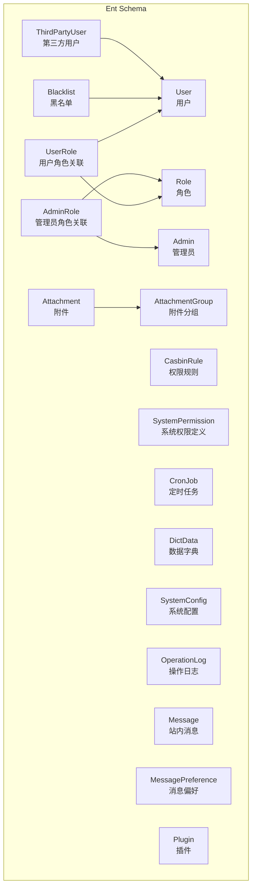

图表来源
- [internal/ent/schema/user.go:17-101](file://internal/ent/schema/user.go#L17-L101)
- [internal/ent/schema/role.go:10-72](file://internal/ent/schema/role.go#L10-L72)
- [internal/ent/schema/userrole.go:11-61](file://internal/ent/schema/userrole.go#L11-L61)
- [internal/ent/schema/admin.go:10-105](file://internal/ent/schema/admin.go#L10-L105)
- [internal/ent/schema/admin_role.go:11-61](file://internal/ent/schema/admin_role.go#L11-L61)
- [internal/ent/schema/systempermission.go:11-46](file://internal/ent/schema/systempermission.go#L11-L46)
- [internal/ent/schema/attachmentgroup.go:11-56](file://internal/ent/schema/attachmentgroup.go#L11-L56)
- [internal/ent/schema/attachment.go:12-88](file://internal/ent/schema/attachment.go#L12-L88)
- [internal/ent/schema/cronjob.go:11-81](file://internal/ent/schema/cronjob.go#L11-L81)
- [internal/ent/schema/dictdata.go:11-79](file://internal/ent/schema/dictdata.go#L11-L79)
- [internal/ent/schema/systemconfig.go:11-78](file://internal/ent/schema/systemconfig.go#L11-L78)
- [internal/ent/schema/operationlog.go:11-91](file://internal/ent/schema/operationlog.go#L11-L91)
- [internal/ent/schema/casbinrule.go:9-36](file://internal/ent/schema/casbinrule.go#L9-L36)
- [internal/ent/schema/message.go:11-79](file://internal/ent/schema/message.go#L11-L79)
- [internal/ent/schema/message_preference.go:11-75](file://internal/ent/schema/message_preference.go#L11-L75)
- [internal/ent/schema/plugin.go:11-94](file://internal/ent/schema/plugin.go#L11-L94)
- [internal/ent/schema/blacklist.go:12-60](file://internal/ent/schema/blacklist.go#L12-L60)
- [internal/ent/schema/thirdpartyuser.go:12-130](file://internal/ent/schema/thirdpartyuser.go#L12-L130)

章节来源
- [internal/ent/schema/user.go:17-101](file://internal/ent/schema/user.go#L17-L101)
- [internal/ent/schema/role.go:10-72](file://internal/ent/schema/role.go#L10-L72)
- [internal/ent/schema/userrole.go:11-61](file://internal/ent/schema/userrole.go#L11-L61)
- [internal/ent/schema/admin.go:10-105](file://internal/ent/schema/admin.go#L10-L105)
- [internal/ent/schema/admin_role.go:11-61](file://internal/ent/schema/admin_role.go#L11-L61)
- [internal/ent/schema/systempermission.go:11-46](file://internal/ent/schema/systempermission.go#L11-L46)
- [internal/ent/schema/attachmentgroup.go:11-56](file://internal/ent/schema/attachmentgroup.go#L11-L56)
- [internal/ent/schema/attachment.go:12-88](file://internal/ent/schema/attachment.go#L12-L88)
- [internal/ent/schema/cronjob.go:11-81](file://internal/ent/schema/cronjob.go#L11-L81)
- [internal/ent/schema/dictdata.go:11-79](file://internal/ent/schema/dictdata.go#L11-L79)
- [internal/ent/schema/systemconfig.go:11-78](file://internal/ent/schema/systemconfig.go#L11-L78)
- [internal/ent/schema/operationlog.go:11-91](file://internal/ent/schema/operationlog.go#L11-L91)
- [internal/ent/schema/casbinrule.go:9-36](file://internal/ent/schema/casbinrule.go#L9-L36)
- [internal/ent/schema/message.go:11-79](file://internal/ent/schema/message.go#L11-L79)
- [internal/ent/schema/message_preference.go:11-75](file://internal/ent/schema/message_preference.go#L11-L75)
- [internal/ent/schema/plugin.go:11-94](file://internal/ent/schema/plugin.go#L11-L94)
- [internal/ent/schema/blacklist.go:12-60](file://internal/ent/schema/blacklist.go#L12-L60)
- [internal/ent/schema/thirdpartyuser.go:12-130](file://internal/ent/schema/thirdpartyuser.go#L12-L130)

## 核心组件
本节从数据模型角度概述各实体的关键字段与约束，帮助快速理解业务含义与约束条件。

- 用户(User)
  - 关键字段：自增主键、唯一邮箱、可选用户名/昵称、可选 UID、密码与盐值（敏感）、头像、可选手机号、枚举状态、可选最后登录时间与 IP
  - 约束：邮箱唯一；字符串长度限制；正则校验邮箱与手机号；状态枚举默认值
  - 索引：邮箱、手机号、用户名
  - 时间戳：由 mixin.Time 提供

- 角色(Role)
  - 关键字段：自增主键、唯一名称、显示名称、可选描述、布尔系统内置标志、状态枚举、可选创建/更新者 ID
  - 约束：名称唯一；状态枚举默认值；长度限制
  - 索引：名称唯一、状态
  - 时间戳：mixin.Time

- 用户角色(UserRole)
  - 关键字段：自增主键、用户 ID、角色 ID、布尔 is_primary（是否主角色）、可选分配者 ID
  - 约束：用户 ID 与角色 ID 组合唯一；均为必需
  - 边缘：分别指向 User 与 Role，均为一对一且必需
  - 索引：复合唯一索引(user_id, role_id)、(user_id, is_primary)，以及单列索引(user_id)、(role_id)
  - 时间戳：mixin.Time

- 管理员(Admin)
  - 关键字段：自增主键、唯一邮箱/用户名/UID、密码与盐值（敏感）、昵称/姓名、头像、手机号、部门/职位、枚举状态、最后登录时间/IP、bool is_super_admin
  - 约束：邮箱/用户名/UID 唯一；字符串长度限制；密码非空
  - 索引：邮箱、用户名、UID
  - 时间戳：mixin.Time

- 管理员角色(AdminRole)
  - 关键字段：自增主键、管理员 ID、角色 ID、布尔 is_primary、可选分配者 ID
  - 约束：admin_id 与 role_id 组合唯一；均为必需
  - 边缘：分别指向 Admin 与 Role，均为一对一且必需
  - 索引：复合唯一索引(admin_id, role_id)、(admin_id, is_primary)，以及单列索引(admin_id)、(role_id)
  - 时间戳：mixin.Time

- 权限规则(CasbinRule)
  - 关键字段：规则类型 Ptype 与最多 6 个规则值 V0..V5
  - 约束：字符串长度限制；默认空串
  - 索引：复合唯一索引(Ptype, V0..V5)
  - 说明：用于 Casbin 权限引擎的策略存储

- 系统权限定义(SystemPermission)
  - 关键字段：domain、type(api/menu/button)、name、code、path、method、menu_path、icon、component、parent_id、sort_order、is_common、status、description
  - 约束：(domain, code) 唯一；type 非空
  - 索引：(domain, code) 唯一、domain、type
  - 时间戳：手动 created_at/updated_at

- 附件分组(AttachmentGroup)
  - 关键字段：自增主键、唯一名称、可选描述、排序、时间戳
  - 约束：名称唯一；排序默认 0
  - 边缘：一对多，分组拥有多个附件
  - 时间戳：mixin.Time

- 附件(Attachment)
  - 关键字段：自增主键、名称/原始名、存储路径、MIME 类型、扩展名、大小、可选分组 ID、上传者 UID、创建/更新时间
  - 约束：路径与名称必填；大小为整数；分组 ID 可选
  - 边缘：多对一，附件属于一个分组
  - 索引：分组 ID、MIME 类型、创建时间
  - 时间戳：mixin.Time

- 定时任务(CronJob)
  - 关键字段：自增主键、唯一名称、可选描述、任务类型枚举(shell/curl/task)、cron 表达式、命令/配置/task 名称、启用标志、上次/下次执行时间、创建/更新时间
  - 约束：名称唯一；类型枚举；启用默认 true；时间可空
  - 索引：启用、类型
  - 时间戳：mixin.Time

- 数据字典(DictData)
  - 关键字段：自增主键、标签、值、字典类型编码、排序、状态、可选样式 class、是否默认、可选备注、创建/更新时间
  - 约束：标签与值非空；类型编码非空；状态默认 1；排序默认 0
  - 索引：字典类型、状态
  - 时间戳：mixin.Time

- 系统配置(SystemConfig)
  - 关键字段：自增主键、配置名称、唯一键、可选值、值类型枚举、可选分组、状态、可选备注、创建/更新时间
  - 约束：键唯一；类型默认 string；状态默认 1
  - 索引：键唯一、分组、状态
  - 时间戳：mixin.Time

- 操作日志(OperationLog)
  - 关键字段：自增主键、用户 ID、用户名、模块、操作、可选描述、HTTP 方法、请求路径、客户端 IP、可选 UA、可选敏感请求体、状态码、耗时毫秒、创建时间
  - 约束：模块与动作非空；方法与路径非空；状态码与耗时为数值
  - 索引：用户 ID、模块、操作、创建时间
  - 时间戳：mixin.Time

- 站内消息(Message)
  - 关键字段：自增主键、接收者 UID（空为广播）、类型(system/business/task)、级别(info/warning/error)、标题、内容(纯文本)、可选富文本 HTML、可选 extra JSON、可空已读时间、创建时间
  - 约束：类型/标题非空；级别默认 info
  - 索引：user_uid+created_at、user_uid+type+read_at、user_uid+read_at+id、type、created_at

- 消息偏好(MessagePreference)
  - 关键字段：自增主键、唯一 user_UID、桌面通知/声音提醒开关、订阅系统/业务/任务消息开关、免打扰开始/结束时间(HH:mm)
  - 约束：user_uid 唯一；非空
  - 索引：user_uid 唯一
  - 时间戳：mixin.Time

- 插件(Plugin)
  - 关键字段：自增主键、唯一 plugin_id、名称、版本、可选作者/描述、状态(installed/enabled/disabled/error)、安装路径、manifest JSON、错误信息、安装/启用时间、创建/更新时间
  - 约束：plugin_id 唯一；(plugin_id, version) 唯一复合
  - 索引：plugin_id、status、(plugin_id, version) 唯一

- 黑名单(Blacklist)
  - 关键字段：自增主键、用户 ID（唯一）、拉黑原因、操作人 ID/姓名、拉黑时间
  - 约束：user_id 唯一
  - 边缘：指向 User
  - 索引：user_id 唯一

- 第三方用户(ThirdPartyUser)
  - 关键字段：自增主键、系统用户 ID、平台标识、可选平台名称、openid、可选 unionid、可选令牌(敏感)、令牌过期时间、可选昵称/头像、可选 JSON 扩展数据、来源系统/用户 ID、公司、合作有效期、状态(active/inactive)、最后同步时间
  - 约束：(platform, openid) 唯一组合
  - 边缘：指向 User
  - 索引：(platform, openid) 唯一、user_id、platform

章节来源
- [internal/ent/schema/user.go:23-80](file://internal/ent/schema/user.go#L23-L80)
- [internal/ent/schema/role.go:16-50](file://internal/ent/schema/role.go#L16-L50)
- [internal/ent/schema/userrole.go:17-35](file://internal/ent/schema/userrole.go#L17-L35)
- [internal/ent/schema/admin.go:16-84](file://internal/ent/schema/admin.go#L16-L84)
- [internal/ent/schema/admin_role.go:17-36](file://internal/ent/schema/admin_role.go#L17-L36)
- [internal/ent/schema/systempermission.go:17-36](file://internal/ent/schema/systempermission.go#L17-L36)
- [internal/ent/schema/casbinrule.go:15-24](file://internal/ent/schema/casbinrule.go#L15-L24)
- [internal/ent/schema/attachmentgroup.go:17-48](file://internal/ent/schema/attachmentgroup.go#L17-L48)
- [internal/ent/schema/attachment.go:18-68](file://internal/ent/schema/attachment.go#L18-L68)
- [internal/ent/schema/cronjob.go:17-72](file://internal/ent/schema/cronjob.go#L17-L72)
- [internal/ent/schema/dictdata.go:17-69](file://internal/ent/schema/dictdata.go#L17-L69)
- [internal/ent/schema/systemconfig.go:17-67](file://internal/ent/schema/systemconfig.go#L17-L67)
- [internal/ent/schema/operationlog.go:17-80](file://internal/ent/schema/operationlog.go#L17-L80)
- [internal/ent/schema/message.go:17-64](file://internal/ent/schema/message.go#L17-L64)
- [internal/ent/schema/message_preference.go:17-61](file://internal/ent/schema/message_preference.go#L17-L61)
- [internal/ent/schema/plugin.go:16-86](file://internal/ent/schema/plugin.go#L16-L86)
- [internal/ent/schema/blacklist.go:17-48](file://internal/ent/schema/blacklist.go#L17-L48)
- [internal/ent/schema/thirdpartyuser.go:17-116](file://internal/ent/schema/thirdpartyuser.go#L17-L116)

## 架构总览
下图展示实体间的主要关系与引用方向。注意：UserRole 作为用户与角色的多对多中间表；AdminRole 作为管理员与角色的多对多中间表；Attachment 与 AttachmentGroup 为一对多；Blacklist 和 ThirdPartyUser 关联到 User；Message 和 MessagePreference 按 user_uid 逻辑关联而非外键；CasbinRule 和 SystemPermission 为独立表；其他实体相对独立。

```mermaid
erDiagram
USER {
int id PK
string email UK
string username
string nickname
string uid
string avatar
string phone
enum status
datetime last_login
string last_ip
}
ROLE {
int id PK
string name UK
string display_name
string description
bool is_system
enum status
string created_by
string updated_by
}
USER_ROLE {
int id PK
int user_id
int role_id
bool is_primary
string created_by
}
ADMIN {
int id PK
string email UK
string username UK
string uid UK
string password
string nickname
string name
string avatar
string phone
string department
string position
enum status
bool is_super_admin
}
ADMIN_ROLE {
int id PK
int admin_id
int role_id
bool is_primary
string created_by
}
ATTACHMENT_GROUP {
int id PK
string name UK
string description
int sort
}
ATTACHMENT {
int id PK
string name
string original_name
string path
string mime_type
string extension
bigint size
int group_id FK
string uploaded_by
}
CRON_JOB {
int id PK
string name UK
string description
enum type
string expression
string command
bool enabled
datetime last_run_at
datetime next_run_at
}
DICT_DATA {
int id PK
string label
string value
string dict_type
int sort
int status
string css_class
bool is_default
}
SYSTEM_CONFIG {
int id PK
string name
string key UK
string value
string type
string group
int status
}
OPERATION_LOG {
int id PK
int user_id
string username
string module
string action
string description
string method
string path
string ip
string user_agent
string request_body
int status_code
bigint duration_ms
}
CASBIN_RULE {
string Ptype
string V0
string V1
string V2
string V3
string V4
string V5
}
SYSTEM_PERMISSION {
string domain
string type
string name
string code
string path
string method
string menu_path
int parent_id
int sort_order
bool is_common
int8 status
}
MESSAGE {
int id PK
string user_uid
string type
string level
string title
text content
text content_html
json extra
datetime read_at
datetime created_at
}
MESSAGE_PREFERENCE {
int id PK
string user_uid UK
bool desktop_notify
bool sound_notify
bool subscribe_system
bool subscribe_business
bool subscribe_task
string do_not_disturb_start
string do_not_disturb_end
}
PLUGIN {
int id PK
string plugin_id UK
string name
string version
string author
string description
enum status
string install_path
json manifest_json
string error_message
datetime installed_at
datetime enabled_at
}
BLACKLIST {
int id PK
int user_id UK
string reason
string operator_id
string operator_name
datetime created_at
}
THIRD_PARTY_USER {
int id PK
int user_id
string platform
string openid
string unionid
string nickname
string avatar_url
json extra_data
enum status
datetime last_sync_at
}
USER ||--o{ USER_ROLE : "拥有"
ROLE ||--o{ USER_ROLE : "拥有"
ADMIN ||--o{ ADMIN_ROLE : "拥有"
ROLE ||--o{ ADMIN_ROLE : "拥有"
ATTACHMENT_GROUP ||--o{ ATTACHMENT : "拥有"
USER ||--o{ BLACKLIST : "拥有"
USER ||--o{ THIRD_PARTY_USER : "拥有"
```

图表来源
- [internal/ent/schema/user.go:23-80](file://internal/ent/schema/user.go#L23-L80)
- [internal/ent/schema/role.go:16-50](file://internal/ent/schema/role.go#L16-L50)
- [internal/ent/schema/userrole.go:17-39](file://internal/ent/schema/userrole.go#L17-L39)
- [internal/ent/schema/admin.go:17-84](file://internal/ent/schema/admin.go#L17-L84)
- [internal/ent/schema/admin_role.go:17-36](file://internal/ent/schema/admin_role.go#L17-L36)
- [internal/ent/schema/attachmentgroup.go:17-48](file://internal/ent/schema/attachmentgroup.go#L17-L48)
- [internal/ent/schema/attachment.go:18-78](file://internal/ent/schema/attachment.go#L18-L78)
- [internal/ent/schema/cronjob.go:17-72](file://internal/ent/schema/cronjob.go#L17-L72)
- [internal/ent/schema/dictdata.go:17-69](file://internal/ent/schema/dictdata.go#L17-L69)
- [internal/ent/schema/systemconfig.go:17-67](file://internal/ent/schema/systemconfig.go#L17-L67)
- [internal/ent/schema/operationlog.go:17-80](file://internal/ent/schema/operationlog.go#L17-L80)
- [internal/ent/schema/casbinrule.go:15-24](file://internal/ent/schema/casbinrule.go#L15-L24)
- [internal/ent/schema/systempermission.go:17-36](file://internal/ent/schema/systempermission.go#L17-L36)
- [internal/ent/schema/message.go:17-64](file://internal/ent/schema/message.go#L17-L64)
- [internal/ent/schema/message_preference.go:17-61](file://internal/ent/schema/message_preference.go#L17-L61)
- [internal/ent/schema/plugin.go:16-86](file://internal/ent/schema/plugin.go#L16-L86)
- [internal/ent/schema/blacklist.go:17-48](file://internal/ent/schema/blacklist.go#L17-L48)
- [internal/ent/schema/thirdpartyuser.go:17-116](file://internal/ent/schema/thirdpartyuser.go#L17-L116)

## 详细组件分析

### 用户(User)与角色(Role)及用户角色(UserRole)
- 多对多关系：User 与 Role 通过 UserRole 进行桥接
- 引用完整性：
  - UserRole.user_id 必需且唯一指向 User.id
  - UserRole.role_id 必需且唯一指向 Role.id
- 约束与索引：
  - 复合唯一索引(user_id, role_id)防止重复授权
  - 单列索引(user_id)与(role_id)支持按用户或角色检索
  - (user_id, is_primary) 复合索引支持主角色查询
- 新增字段：is_primary 标记当前用户的"主角色"，用于界面默认显示等场景
- 扩展建议：
  - 若未来需要记录授权来源或过期时间，可在 UserRole 新增字段并补充索引
  - 对于大规模用户/角色场景，可考虑引入"授权范围"维度（如部门/租户）

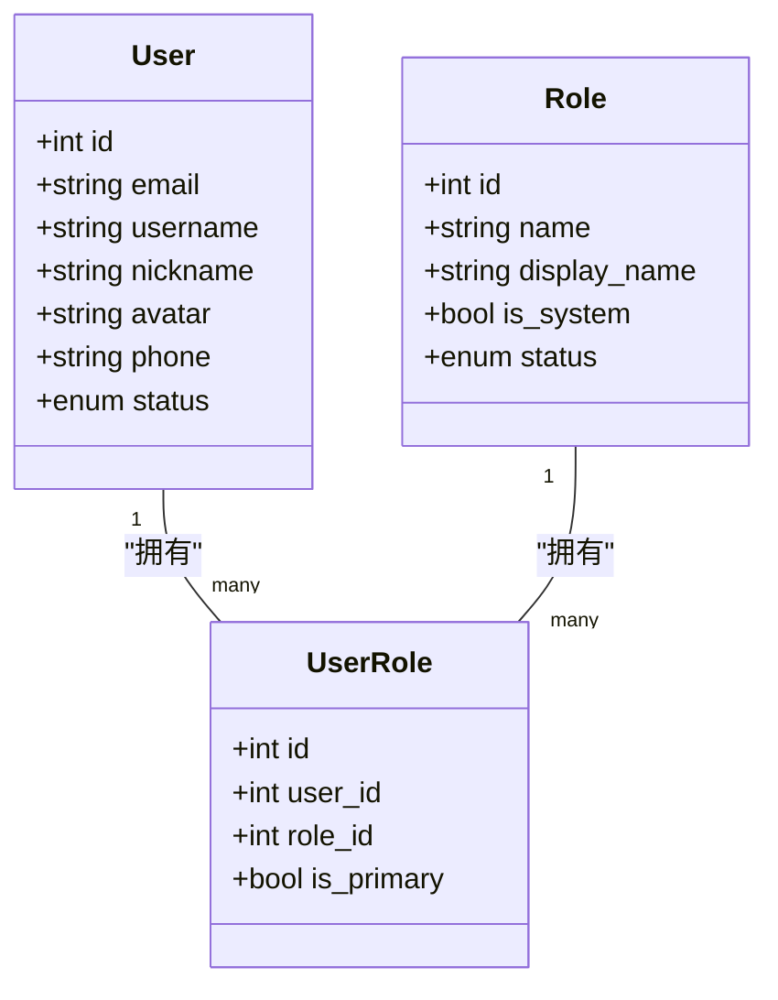

图表来源
- [internal/ent/schema/user.go:23-80](file://internal/ent/schema/user.go#L23-L80)
- [internal/ent/schema/role.go:16-50](file://internal/ent/schema/role.go#L16-L50)
- [internal/ent/schema/userrole.go:17-39](file://internal/ent/schema/userrole.go#L17-L39)

章节来源
- [internal/ent/schema/userrole.go:17-39](file://internal/ent/schema/userrole.go#L17-L39)
- [internal/ent/schema/user.go:23-80](file://internal/ent/schema/user.go#L23-L80)
- [internal/ent/schema/role.go:16-50](file://internal/ent/schema/role.go#L16-L50)

### 管理员(Admin)与管理员角色(AdminRole)
- 多对多关系：Admin 与 Role 通过 AdminRole 进行桥接
- 引用完整性：
  - AdminRole.admin_id 必需且唯一指向 Admin.id
  - AdminRole.role_id 必需且唯一指向 Role.id
- 约束与索引：复合唯一索引(admin_id, role_id)、(admin_id, is_primary)
- is_super_admin 标记：Admin 实体上的布尔字段，超级管理员在权限校验中旁路

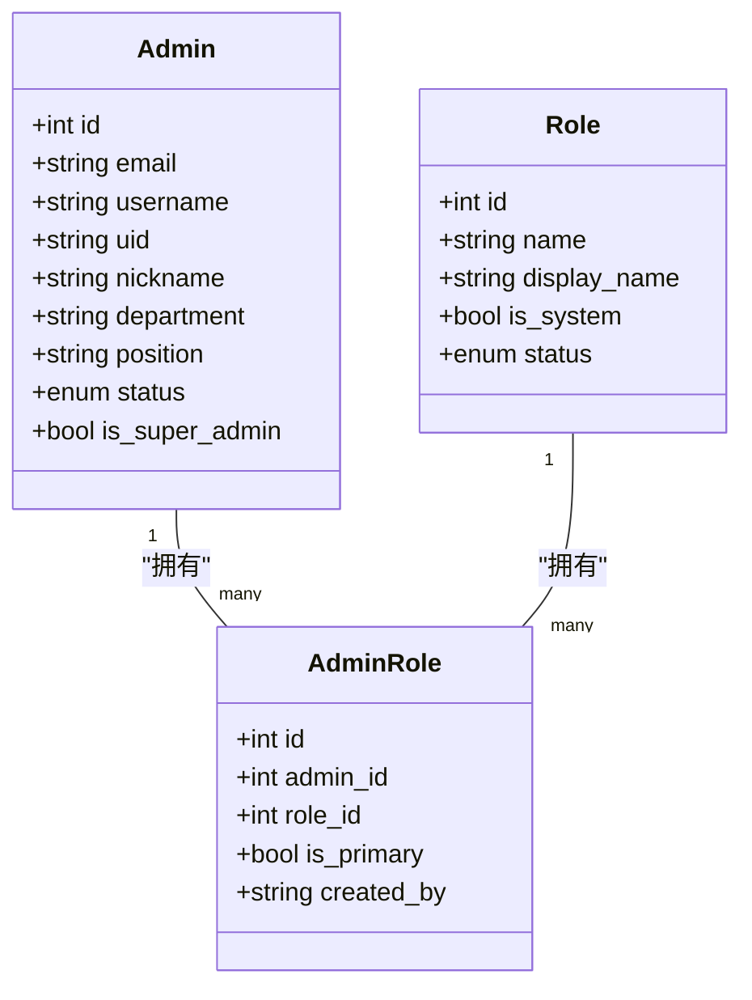

图表来源
- [internal/ent/schema/admin.go:17-84](file://internal/ent/schema/admin.go#L17-L84)
- [internal/ent/schema/admin_role.go:17-36](file://internal/ent/schema/admin_role.go#L17-L36)
- [internal/ent/schema/role.go:16-50](file://internal/ent/schema/role.go#L16-L50)

章节来源
- [internal/ent/schema/admin.go:17-84](file://internal/ent/schema/admin.go#L17-L84)
- [internal/ent/schema/admin_role.go:17-36](file://internal/ent/schema/admin_role.go#L17-L36)
- [internal/ent/schema/role.go:16-50](file://internal/ent/schema/role.go#L16-L50)

### 附件(Attachment)与附件分组(AttachmentGroup)
- 一对多关系：AttachmentGroup 拥有多个 Attachment
- 引用完整性：
  - Attachment.group_id 可选，指向 AttachmentGroup.id
  - 当分组被删除时，若希望保留附件，应设置为可空或采用软删除策略
- 索引策略：
  - 分组 ID、MIME 类型、创建时间建立索引，满足常见筛选与归档需求
- 最佳实践：
  - 建议在删除分组前迁移附件至其他分组或归档，避免孤立附件
  - 对大文件访问可结合 CDN 与预签名 URL

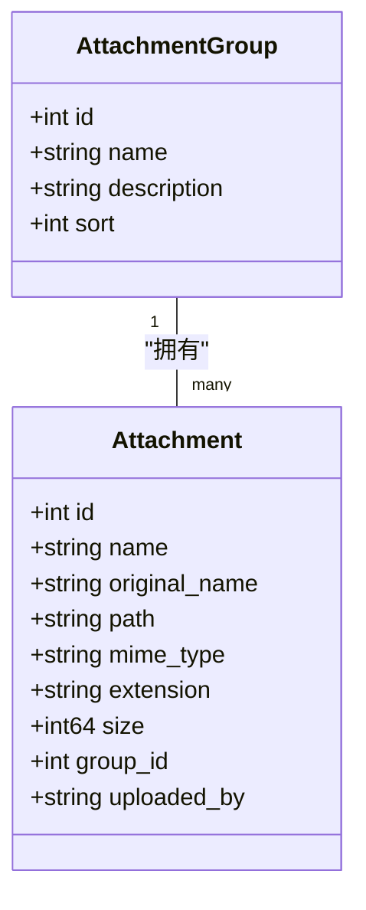

图表来源
- [internal/ent/schema/attachmentgroup.go:17-48](file://internal/ent/schema/attachmentgroup.go#L17-L48)
- [internal/ent/schema/attachment.go:18-78](file://internal/ent/schema/attachment.go#L18-L78)

章节来源
- [internal/ent/schema/attachment.go:18-78](file://internal/ent/schema/attachment.go#L18-L78)
- [internal/ent/schema/attachmentgroup.go:17-48](file://internal/ent/schema/attachmentgroup.go#L17-L48)

### 权限规则(CasbinRule)与系统权限定义(SystemPermission)
- CasbinRule：采用策略表形式存储规则，字段 Ptype 与 V0..V5 支持灵活的策略类型与主体/资源/操作组合；复合唯一索引确保规则不重复。
- SystemPermission：权限定义表，存储菜单、按钮、API 三种类型的权限定义，通过 domain 隔离多租户，通过 parent_id 支持树形结构。

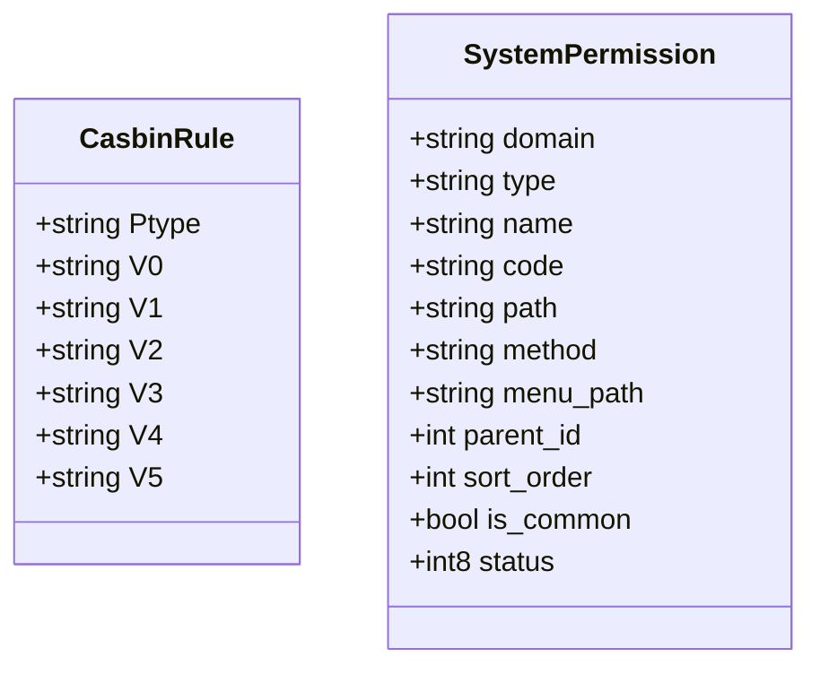

图表来源
- [internal/ent/schema/casbinrule.go:15-24](file://internal/ent/schema/casbinrule.go#L15-L24)
- [internal/ent/schema/systempermission.go:17-36](file://internal/ent/schema/systempermission.go#L17-L36)

章节来源
- [internal/ent/schema/casbinrule.go:15-24](file://internal/ent/schema/casbinrule.go#L15-L24)
- [internal/ent/schema/systempermission.go:17-36](file://internal/ent/schema/systempermission.go#L17-L36)

### 定时任务(CronJob)
- 设计要点：
  - 支持 shell、curl、task 三类任务类型
  - cron 表达式驱动调度，记录上次/下次执行时间
  - 启用标志控制任务开关
- 调度建议：
  - 结合独立调度器或队列系统，避免单点瓶颈
  - 记录执行结果与错误日志，便于监控与重试

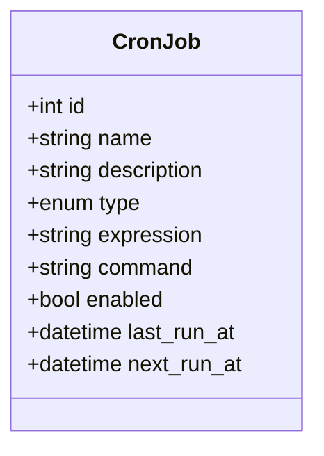

图表来源
- [internal/ent/schema/cronjob.go:17-72](file://internal/ent/schema/cronjob.go#L17-L72)

章节来源
- [internal/ent/schema/cronjob.go:17-72](file://internal/ent/schema/cronjob.go#L17-L72)

### 数据字典(DictData)与系统配置(SystemConfig)
- 数据字典：
  - 通过 dict_type 分类，支持排序、状态、默认标记等
  - 常用于前端下拉/标签等静态数据
- 系统配置：
  - 键唯一，支持分组与状态管理
  - 值类型枚举覆盖常用配置形态
- 最佳实践：
  - 配置变更应具备灰度与回滚机制
  - 对热词/热点字典可引入本地缓存

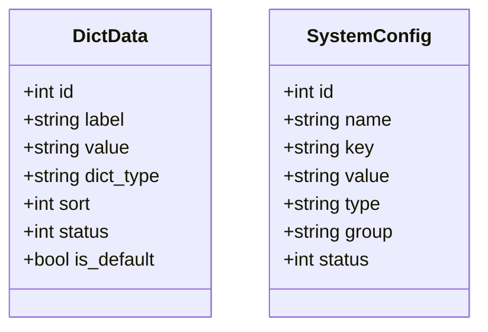

图表来源
- [internal/ent/schema/dictdata.go:17-69](file://internal/ent/schema/dictdata.go#L17-L69)
- [internal/ent/schema/systemconfig.go:17-67](file://internal/ent/schema/systemconfig.go#L17-L67)

章节来源
- [internal/ent/schema/dictdata.go:17-69](file://internal/ent/schema/dictdata.go#L17-L69)
- [internal/ent/schema/systemconfig.go:17-67](file://internal/ent/schema/systemconfig.go#L17-L67)

### 操作日志(OperationLog)
- 设计要点：
  - 记录用户、模块、操作、请求路径、方法、状态码、耗时等关键信息
  - 请求体标记为敏感，避免泄露
- 监控建议：
  - 结合指标系统统计失败率、平均耗时、Top 路径
  - 对高并发接口建议异步落库或批量写入

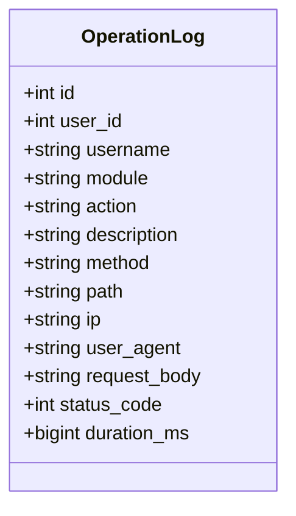

图表来源
- [internal/ent/schema/operationlog.go:17-80](file://internal/ent/schema/operationlog.go#L17-L80)

章节来源
- [internal/ent/schema/operationlog.go:17-80](file://internal/ent/schema/operationlog.go#L17-L80)

### 站内消息(Message)与消息偏好(MessagePreference)
- Message：user_uid 为空字符串表示全员广播消息，type 限定 system/business/task，level 限定 info/warning/error，read_at 为空表示未读。
- MessagePreference：user_uid 唯一且非空，控制桌面通知、声音提醒、各类型订阅、免打扰时段。
- 关系：消息偏向于逻辑关联（按 user_uid），无需数据库外键。

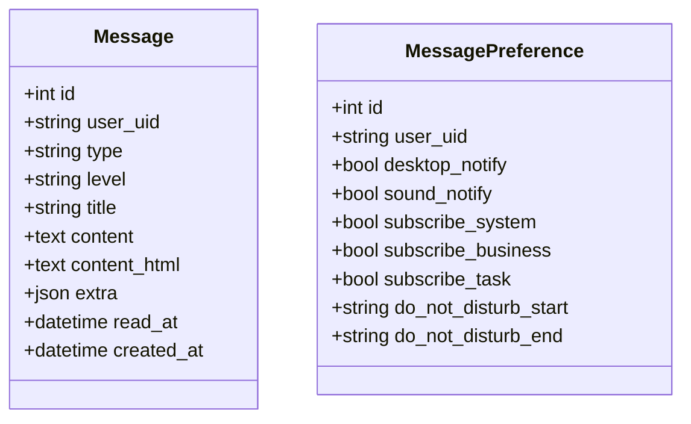

图表来源
- [internal/ent/schema/message.go:17-64](file://internal/ent/schema/message.go#L17-L64)
- [internal/ent/schema/message_preference.go:17-61](file://internal/ent/schema/message_preference.go#L17-L61)

章节来源
- [internal/ent/schema/message.go:17-64](file://internal/ent/schema/message.go#L17-L64)
- [internal/ent/schema/message_preference.go:17-61](file://internal/ent/schema/message_preference.go#L17-L61)

### 插件(Plugin)
- 设计要点：
  - plugin_id 唯一标识，配合 version 形成唯一版本记录
  - 状态机：installed -> enabled/disabled/error
  - manifest_json 存储插件元数据
- 扩展建议：
  - 支持插件市场/远程安装
  - 插件间依赖关系与版本冲突管理

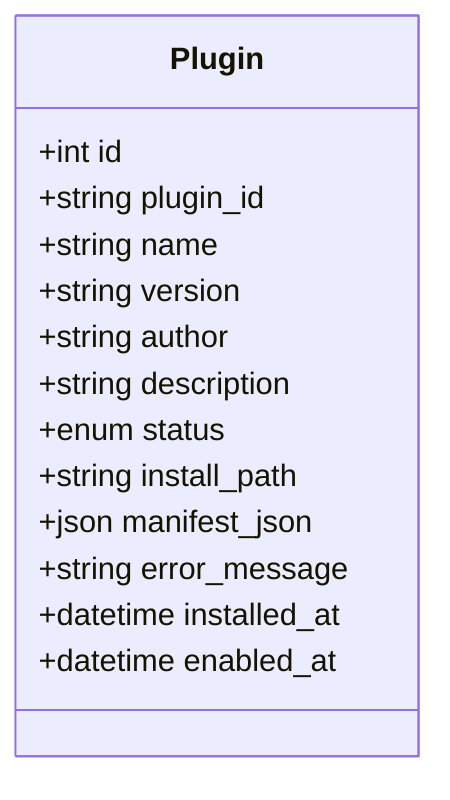

图表来源
- [internal/ent/schema/plugin.go:16-86](file://internal/ent/schema/plugin.go#L16-L86)

章节来源
- [internal/ent/schema/plugin.go:16-86](file://internal/ent/schema/plugin.go#L16-L86)

### 黑名单(Blacklist)与第三方用户(ThirdPartyUser)
- Blacklist：user_id 唯一，关联到 User，记录拉黑原因和操作人。
- ThirdPartyUser：多对一关联到 User，支持多平台绑定，(platform, openid) 唯一。

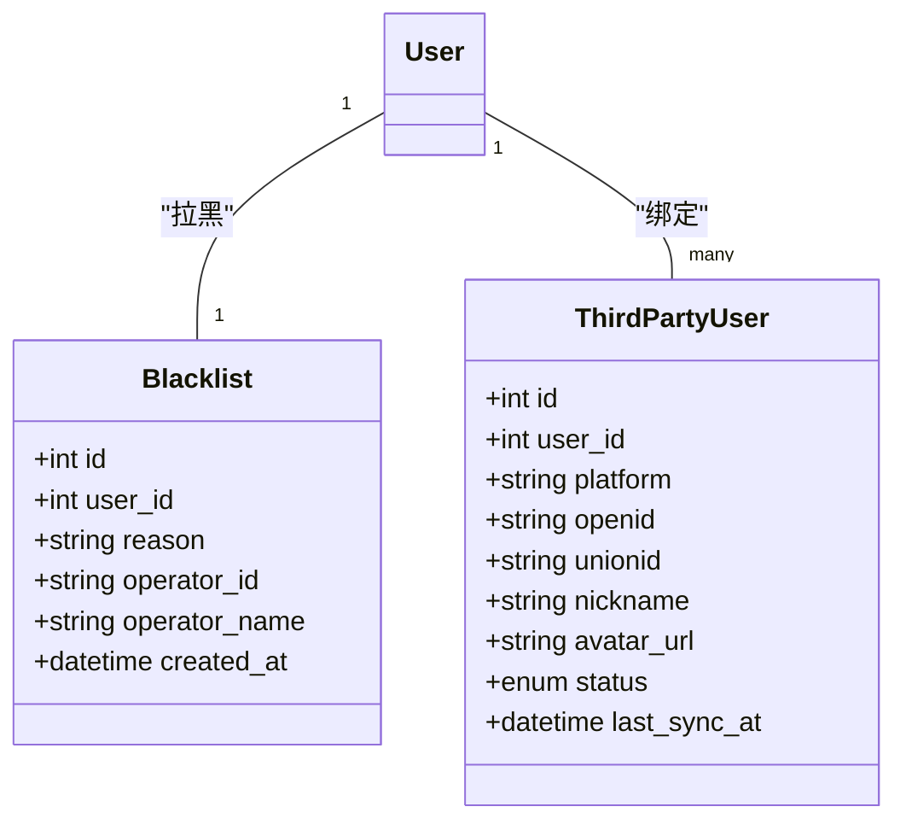

图表来源
- [internal/ent/schema/blacklist.go:17-48](file://internal/ent/schema/blacklist.go#L17-L48)
- [internal/ent/schema/thirdpartyuser.go:17-116](file://internal/ent/schema/thirdpartyuser.go#L17-L116)

章节来源
- [internal/ent/schema/blacklist.go:17-48](file://internal/ent/schema/blacklist.go#L17-L48)
- [internal/ent/schema/thirdpartyuser.go:17-116](file://internal/ent/schema/thirdpartyuser.go#L17-L116)

## 依赖分析
- 内部依赖：
  - User 与 Role 通过 UserRole 解耦，降低直接多对多带来的复杂性
  - Admin 与 Role 通过 AdminRole 解耦
  - Attachment 与 AttachmentGroup 通过外键关联，形成清晰的层级结构
  - Blacklist 和 ThirdPartyUser 通过外键关联到 User
  - Message 和 MessagePreference 按 user_uid 逻辑关联
  - CronJob、DictData、SystemConfig、OperationLog、Plugin、SystemPermission 等为独立业务域实体，彼此无直接外键依赖
- 外键与级联：
  - UserRole.user_id -> User.id（NoAction）
  - UserRole.role_id -> Role.id（NoAction）
  - AdminRole.admin_id -> Admin.id
  - AdminRole.role_id -> Role.id
  - Attachment.group_id -> AttachmentGroup.id（SetNull）
  - Blacklist.user_id -> User.id
  - ThirdPartyUser.user_id -> User.id
- 索引与查询：
  - 多数实体已针对高频查询字段建立索引，有助于提升读性能
  - 对于高写入场景，建议评估索引数量与写放大影响

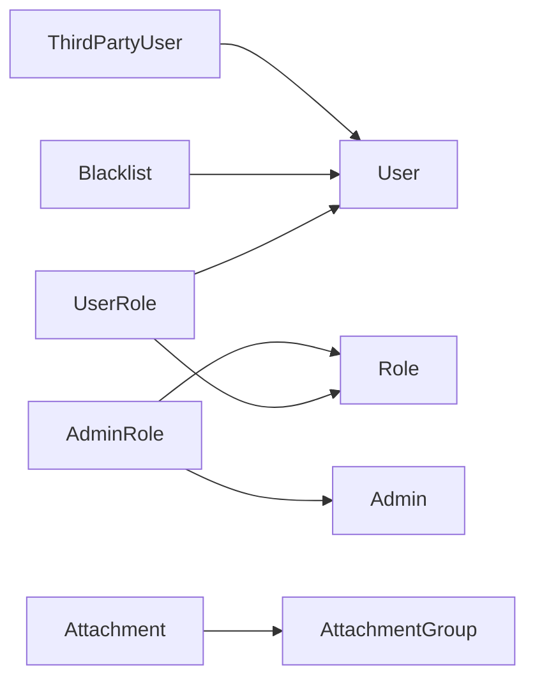

图表来源
- [internal/ent/schema/userrole.go:35-39](file://internal/ent/schema/userrole.go#L35-L39)
- [internal/ent/schema/admin_role.go:39-44](file://internal/ent/schema/admin_role.go#L39-L44)
- [internal/ent/schema/attachment.go:72-78](file://internal/ent/schema/attachment.go#L72-L78)
- [internal/ent/schema/blacklist.go:50-54](file://internal/ent/schema/blacklist.go#L50-L54)
- [internal/ent/schema/thirdpartyuser.go:118-122](file://internal/ent/schema/thirdpartyuser.go#L118-L122)

章节来源
- [internal/ent/schema/userrole.go:35-39](file://internal/ent/schema/userrole.go#L35-L39)
- [internal/ent/schema/admin_role.go:39-44](file://internal/ent/schema/admin_role.go#L39-L44)
- [internal/ent/schema/attachment.go:72-78](file://internal/ent/schema/attachment.go#L72-L78)
- [internal/ent/schema/blacklist.go:50-54](file://internal/ent/schema/blacklist.go#L50-L54)
- [internal/ent/schema/thirdpartyuser.go:118-122](file://internal/ent/schema/thirdpartyuser.go#L118-L122)

## 性能考量
- 索引优化：
  - 针对高频过滤字段（如用户邮箱、角色状态、附件 MIME 类型、任务启用/类型）建立索引
  - 对复合查询（如用户+角色、字典类型+状态、消息 user_uid+type+read_at）优先使用复合索引
  - Time 类型字段（created_at）索引排序查询
- 写入优化：
  - 对日志类大表（OperationLog、Message）采用分区或归档策略，减少热数据膨胀
  - 批量写入与异步落库可显著降低写延迟
- 查询优化：
  - 尽量使用覆盖索引，避免回表
  - 对分页查询使用游标或基于索引的 limit+offset 策略
- 缓存策略：
  - 对热点配置与字典数据引入本地缓存，降低数据库压力
  - 对权限规则可做 LRU 缓存，加速匹配
  - 黑名单、用户角色信息等也支持缓存

## 故障排查指南
- 常见问题与定位
  - 无法登录/鉴权异常：检查 CasbinRule 是否存在重复或缺失的策略条目；核对用户/管理员角色授权是否正确
  - 附件丢失：确认 Attachment.group_id 是否为空或指向不存在的分组；检查删除策略
  - 任务未执行：核对 CronJob.enabled 与 expression；检查最近/下次执行时间是否异常
  - 日志缺失：确认 OperationLog 写入链路是否正常；检查敏感字段是否被截断
  - 消息未送达：检查 SSE 连接是否正常；确认用户消息偏好订阅状态；检查免打扰时段
  - 插件异常：检查 plugin.status 与 error_message；确认安装路径与 manifest 格式
  - 黑名单拦截：确认用户是否在黑名单中；检查黑名单记录的操作人与原因
  - 第三方账号问题：确认 platform/openid 唯一约束；检查 token 是否过期
- 建议流程
  - 先查看相关实体索引与唯一约束是否满足业务预期
  - 使用数据库 EXPLAIN 分析慢查询，针对性补充索引
  - 对关键路径增加埋点与告警，缩短故障定位时间

## 结论
本设计以 Ent ORM 为核心，围绕用户、管理员、角色、附件、定时任务、字典、配置、日志、消息、插件、黑名单、第三方账号等核心实体构建了清晰的数据模型。通过中间表 UserRole 和 AdminRole 分别实现用户/管理员与角色的解耦；通过 CasbinRule 和 SystemPermission 支撑灵活的权限体系；通过 Message 和 MessagePreference 实现站内消息推送与偏好控制。索引与字段约束共同保障了查询效率与数据一致性。建议在生产环境中进一步完善外键与级联策略、引入缓存与异步写入，并持续优化索引与查询路径，以满足高并发与高可用需求。

## 附录
- 数据库表结构映射说明
  - 每个实体对应一张数据库表，主键为自增整型；字符串字段映射为 varchar/nvarchar，长度由 MaxLen 指定；枚举字段映射为 enum 或受限字符集；时间字段映射为 datetime/timestamp
  - 外键字段（如 Attachment.group_id、UserRole.user_id/role_id、AdminRole.admin_id/role_id）在数据库层面应建立外键约束与索引
- 扩展性建议
  - 引入租户/部门维度，扩展用户与角色授权范围
  - 对附件引入版本与快照能力，支持回溯与审计
  - 对日志与配置引入版本化与灰度发布能力
  - 站内消息可扩展支持附件、富文本、定时发送等能力
