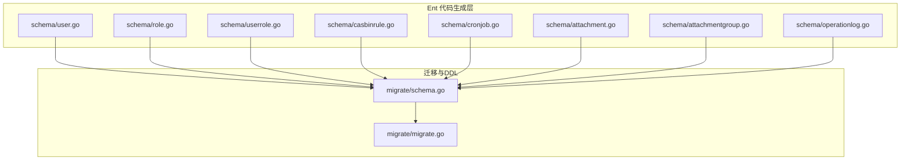
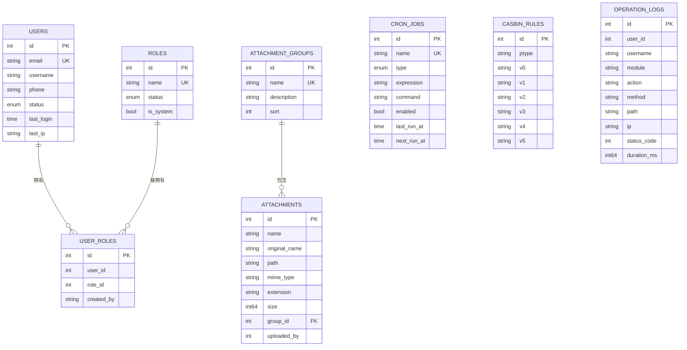
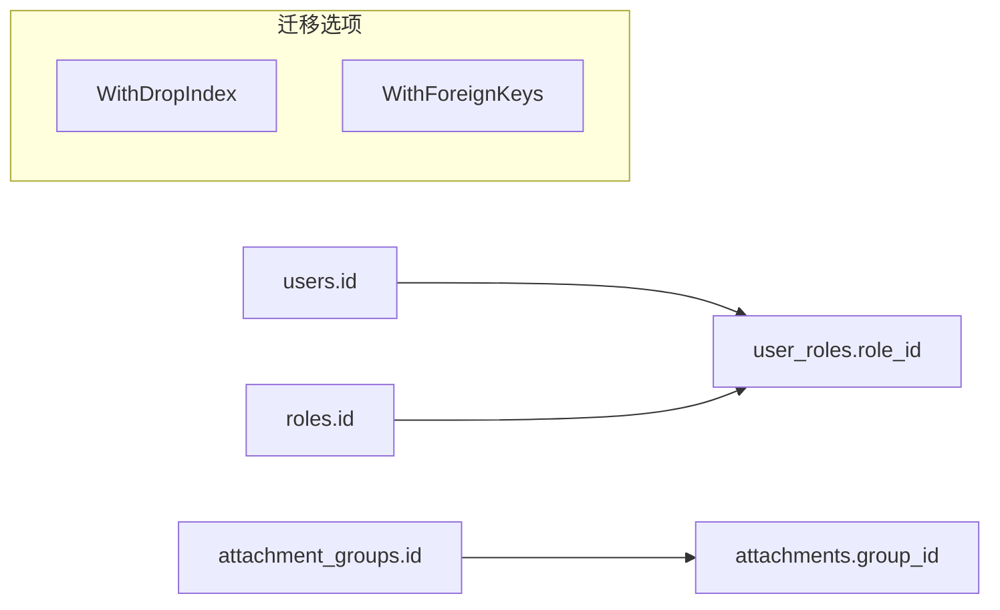

# 数据库表结构设计

<cite>
**本文引用的文件**
- [user.go](file://internal/ent/schema/user.go)
- [role.go](file://internal/ent/schema/role.go)
- [userrole.go](file://internal/ent/schema/userrole.go)
- [casbinrule.go](file://internal/ent/schema/casbinrule.go)
- [cronjob.go](file://internal/ent/schema/cronjob.go)
- [attachment.go](file://internal/ent/schema/attachment.go)
- [attachmentgroup.go](file://internal/ent/schema/attachmentgroup.go)
- [operationlog.go](file://internal/ent/schema/operationlog.go)
- [schema.go](file://internal/ent/migrate/schema.go)
- [migrate.go](file://internal/ent/migrate/migrate.go)
- [runtime.go](file://internal/ent/runtime/runtime.go)
</cite>

## 目录
1. [简介](#简介)
2. [项目结构](#项目结构)
3. [核心组件](#核心组件)
4. [架构总览](#架构总览)
5. [详细组件分析](#详细组件分析)
6. [依赖分析](#依赖分析)
7. [性能考虑](#性能考虑)
8. [故障排查指南](#故障排查指南)
9. [结论](#结论)
10. [附录](#附录)

## 简介
本文件面向 Go Admin 管理系统的数据库表结构设计，系统采用 Ent ORM 进行代码生成与迁移，覆盖用户、角色、权限（基于 Casbin）、定时任务、附件与分组、操作日志等核心业务表。本文从表设计理念、字段定义、主键与外键约束、索引策略、表间关系（一对一、一对多、多对多）到最佳实践与示例进行系统化说明。

## 项目结构
- 表结构定义位于 internal/ent/schema 下，通过 Ent 的 Schema 定义字段、索引与边（Edge）。
- 实际的 SQL 建表脚本由 internal/ent/migrate/schema.go 中的 schema.Table 描述生成，包含主键、唯一键、索引与外键。
- 迁移入口在 internal/ent/migrate/migrate.go，负责创建或写入 DDL。

图表来源
- [schema.go:1-311](file://internal/ent/migrate/schema.go#L1-L311)
- [migrate.go:1-65](file://internal/ent/migrate/migrate.go#L1-L65)

章节来源
- [schema.go:1-311](file://internal/ent/migrate/schema.go#L1-L311)
- [migrate.go:1-65](file://internal/ent/migrate/migrate.go#L1-L65)

## 核心组件
本节概述各核心表的职责与关键字段，便于快速建立整体认知。

- 用户表 users：存储系统用户基本信息、认证凭据、状态与登录信息。
- 角色表 roles：定义角色元数据、状态与系统内置标记。
- 用户-角色关联表 user_roles：实现用户与角色的多对多映射。
- 权限规则表 casbin_rules：存储基于 Casbin 的访问控制规则。
- 定时任务表 cron_jobs：记录计划任务的配置、调度与运行状态。
- 附件表 attachments：记录文件元数据与所属分组。
- 附件分组表 attachment_groups：对附件进行分类管理。
- 操作日志表 operation_logs：记录用户操作轨迹与性能指标。

章节来源
- [user.go:17-104](file://internal/ent/schema/user.go#L17-L104)
- [role.go:10-73](file://internal/ent/schema/role.go#L10-L73)
- [userrole.go:11-56](file://internal/ent/schema/userrole.go#L11-L56)
- [casbinrule.go:9-37](file://internal/ent/schema/casbinrule.go#L9-L37)
- [cronjob.go:11-82](file://internal/ent/schema/cronjob.go#L11-L82)
- [attachment.go:12-89](file://internal/ent/schema/attachment.go#L12-L89)
- [attachmentgroup.go:11-57](file://internal/ent/schema/attachmentgroup.go#L11-L57)
- [operationlog.go:11-92](file://internal/ent/schema/operationlog.go#L11-L92)

## 架构总览
下图展示核心表之间的关系：用户与角色通过 user_roles 关联；附件与附件分组为一对多；权限规则用于授权控制；定时任务独立；操作日志记录用户行为。

图表来源
- [schema.go:14-311](file://internal/ent/migrate/schema.go#L14-L311)

章节来源
- [schema.go:14-311](file://internal/ent/migrate/schema.go#L14-L311)

## 详细组件分析

### 用户表 users
- 主键：自增整型 id。
- 唯一键：email。
- 索引：username、phone。
- 字段要点：
  - 认证与安全：password、password_salt（敏感字段）。
  - 身份信息：name、username、nickname、uid、avatar。
  - 联系方式：email（唯一且正则校验）、phone（正则校验）。
  - 状态与审计：status（枚举）、last_login、last_ip、创建/更新时间混入。
- 业务含义：
  - email 唯一性确保登录入口唯一。
  - phone 可选，便于短信类功能。
  - status 支持激活/未激活/封禁三态。
- 数据类型选择理由：
  - id 使用整型自增，简单高效。
  - email/username/phone 使用字符串并限制长度，兼顾可读性与存储成本。
  - 时间字段使用 time 类型，便于排序与范围查询。
- 约束与规则：
  - email 唯一。
  - password 非空且敏感。
  - phone 仅数字。
- 示例字段取值（示意）
  - id: 1
  - email: admin@example.com
  - username: admin
  - phone: 13800001111
  - status: active
  - last_login: 2025-03-01 12:00:00
  - last_ip: 127.0.0.1

章节来源
- [user.go:23-81](file://internal/ent/schema/user.go#L23-L81)
- [schema.go:206-246](file://internal/ent/migrate/schema.go#L206-L246)

### 角色表 roles
- 主键：自增整型 id。
- 唯一键：name。
- 索引：status。
- 字段要点：
  - 元数据：name、display_name、description。
  - 控制与审计：is_system（布尔）、status（枚举）、created_by、updated_by。
  - 创建/更新时间混入。
- 业务含义：
  - is_system 标记系统内置角色，避免误删。
  - status 控制角色启用/停用。
- 数据类型选择理由：
  - name 唯一，适合短文本。
  - is_system 使用布尔，简洁明确。
- 约束与规则：
  - name 唯一。
  - status 默认 active。
- 示例字段取值（示意）
  - id: 1
  - name: admin
  - display_name: 管理员
  - is_system: true
  - status: active

章节来源
- [role.go:16-51](file://internal/ent/schema/role.go#L16-L51)
- [schema.go:175-205](file://internal/ent/migrate/schema.go#L175-L205)

### 用户-角色关联表 user_roles
- 主键：自增整型 id。
- 复合唯一键：(user_id, role_id)。
- 索引：user_id、role_id。
- 边关系：
  - 到 User 的边：Required、Unique，字段 user_id。
  - 到 Role 的边：Required、Unique，字段 role_id。
- 外键约束：
  - user_id 引用 users.id。
  - role_id 引用 roles.id。
- 业务含义：
  - 实现用户与角色的多对多映射。
  - created_by 记录分配者。
- 数据类型选择理由：
  - user_id、role_id 使用整型，建立清晰的外键关系。
- 约束与规则：
  - (user_id, role_id) 唯一，防止重复授权。
- 示例字段取值（示意）
  - id: 1
  - user_id: 1
  - role_id: 1
  - created_by: 1

章节来源
- [userrole.go:17-32](file://internal/ent/schema/userrole.go#L17-L32)
- [schema.go:247-292](file://internal/ent/migrate/schema.go#L247-L292)

### 权限规则表 casbin_rules
- 主键：自增整型 id。
- 唯一索引：(Ptype, V0, V1, V2, V3, V4, V5)。
- 字段要点：
  - Ptype：策略类型（如 p 或 g）。
  - V0..V5：策略参数，支持最多 6 个字段。
- 业务含义：
  - 存储基于 Casbin 的 RBAC/ABAC 规则。
- 数据类型选择理由：
  - 所有字段为字符串，便于策略灵活组合。
- 约束与规则：
  - 复合唯一索引保证规则不重复。
- 示例字段取值（示意）
  - id: 1
  - ptype: p
  - v0: 1
  - v1: /api/users
  - v2: GET
  - v3: null
  - v4: null
  - v5: null

章节来源
- [casbinrule.go:15-25](file://internal/ent/schema/casbinrule.go#L15-L25)
- [schema.go:74-97](file://internal/ent/migrate/schema.go#L74-L97)

### 定时任务表 cron_jobs
- 主键：自增整型 id。
- 唯一键：name。
- 索引：enabled、type。
- 字段要点：
  - 名称与描述：name（唯一）、description。
  - 类型与表达式：type（枚举：shell/curl/task）、expression（cron 表达式）。
  - 命令与开关：command、enabled。
  - 调度时间：last_run_at、next_run_at。
  - 创建/更新时间：created_at、updated_at。
- 业务含义：
  - 统一管理后台定时任务，支持多种执行类型。
- 数据类型选择理由：
  - expression/command 使用长文本，满足复杂配置。
  - enabled 使用布尔，便于快速筛选启用任务。
- 约束与规则：
  - name 唯一。
  - type 限定枚举值。
- 示例字段取值（示意）
  - id: 1
  - name: daily-backup
  - type: shell
  - expression: 0 0 2 * * ?
  - command: /bin/bash backup.sh
  - enabled: true
  - last_run_at: null
  - next_run_at: 2025-03-02 02:00:00

章节来源
- [cronjob.go:17-73](file://internal/ent/schema/cronjob.go#L17-L73)
- [schema.go:98-129](file://internal/ent/migrate/schema.go#L98-L129)

### 附件表 attachments
- 主键：自增整型 id。
- 索引：group_id、mime_type、created_at。
- 字段要点：
  - 文件元信息：name、original_name、path、mime_type、extension、size。
  - 关联与归属：group_id（可空，关联分组）、uploaded_by（上传用户）。
  - 创建/更新时间：created_at、updated_at。
- 边关系：
  - 从 group（AttachmentGroup）反向引用，字段 group_id。
- 外键约束：
  - group_id 引用 attachment_groups.id（删除策略：SetNull）。
- 业务含义：
  - 统一管理文件资源，支持按分组归档。
- 数据类型选择理由：
  - size 使用 int64，满足大文件容量。
  - path/original_name 使用长文本，兼容复杂存储路径。
- 约束与规则：
  - group_id 可空，允许未分组文件。
- 示例字段取值（示意）
  - id: 1
  - name: report.pdf
  - original_name: Report Q4.pdf
  - path: uploads/reports/2025/12/report.pdf
  - mime_type: application/pdf
  - extension: pdf
  - size: 1048576
  - group_id: 1
  - uploaded_by: 1

章节来源
- [attachment.go:18-69](file://internal/ent/schema/attachment.go#L18-L69)
- [schema.go:14-58](file://internal/ent/migrate/schema.go#L14-L58)

### 附件分组表 attachment_groups
- 主键：自增整型 id。
- 唯一键：name。
- 字段要点：
  - 分组元信息：name（唯一）、description、sort。
  - 创建/更新时间：created_at、updated_at。
- 边关系：
  - 向下关联多个附件（attachments）。
- 业务含义：
  - 对附件进行分类与排序管理。
- 数据类型选择理由：
  - sort 使用整型，便于前端排序。
- 约束与规则：
  - name 唯一。
- 示例字段取值（示意）
  - id: 1
  - name: reports
  - description: 年度报告
  - sort: 0

章节来源
- [attachmentgroup.go:17-49](file://internal/ent/schema/attachmentgroup.go#L17-L49)
- [schema.go:59-74](file://internal/ent/migrate/schema.go#L59-L74)

### 操作日志表 operation_logs
- 主键：自增整型 id。
- 索引：user_id、module、action、created_at。
- 字段要点：
  - 用户与上下文：user_id、username、module、action。
  - 请求信息：method、path、ip、user_agent。
  - 请求体与响应：request_body（敏感）、status_code。
  - 性能指标：duration_ms。
  - 时间戳：created_at。
- 业务含义：
  - 记录用户操作轨迹，支撑审计与排障。
- 数据类型选择理由：
  - duration_ms 使用 int64，便于统计耗时分布。
  - request_body 敏感字段，避免泄露。
- 约束与规则：
  - 无显式唯一键，按时间与上下文记录。
- 示例字段取值（示意）
  - id: 1
  - user_id: 1
  - username: admin
  - module: 用户管理
  - action: 更新
  - method: PUT
  - path: /api/users/1
  - ip: 127.0.0.1
  - status_code: 200
  - duration_ms: 120

章节来源
- [operationlog.go:17-81](file://internal/ent/schema/operationlog.go#L17-L81)
- [schema.go:130-174](file://internal/ent/migrate/schema.go#L130-L174)

## 依赖分析
- 外键关系：
  - user_roles.user_id → users.id（NoAction 删除策略）
  - user_roles.role_id → roles.id（NoAction 删除策略）
  - attachments.group_id → attachment_groups.id（SetNull 删除策略）
- 约束与索引：
  - 多处唯一键（email、name、复合唯一 user_id+role_id、全字段唯一 casbin_rules）。
  - 多处普通索引（email、phone、username、role.status、cron.enabled/type、attachment.*、operation.*）。
- 迁移能力：
  - 支持创建表、写入 DDL（WriteTo）与选项（如 DropIndex、ForeignKeys 开关）。

图表来源
- [schema.go:261-274](file://internal/ent/migrate/schema.go#L261-L274)
- [migrate.go:14-33](file://internal/ent/migrate/migrate.go#L14-L33)

章节来源
- [schema.go:261-274](file://internal/ent/migrate/schema.go#L261-L274)
- [migrate.go:14-33](file://internal/ent/migrate/migrate.go#L14-L33)

## 性能考虑
- 索引策略
  - 在高频过滤字段上建立索引：users(email/phone/username)、roles(status)、cron(enabled/type)、attachments(group_id/mime_type/created_at)、operation_logs(user_id/module/action/created_at)。
  - 复合唯一索引避免重复规则与授权冲突。
- 查询优化
  - 使用唯一键字段作为过滤条件优先（如 email、name）。
  - 对枚举字段（status/type/enabled）建立索引以提升筛选效率。
- 写入与删除
  - 外键删除策略：attachments.group_id 设置为 SetNull，避免级联删除导致数据丢失。
- 存储与类型
  - 大文本字段（如 command/path/original_name）按需限制长度，平衡可读性与存储。
  - 时间字段统一使用 time 类型，便于排序与范围查询。

## 故障排查指南
- 唯一约束冲突
  - 现象：插入失败，提示违反唯一约束。
  - 排查：检查 email、name、(user_id, role_id)、casbin_rules 全字段唯一索引。
  - 参考
    - [schema.go:211-212](file://internal/ent/migrate/schema.go#L211-L212)
    - [schema.go:180-181](file://internal/ent/migrate/schema.go#L180-L181)
    - [schema.go:277-280](file://internal/ent/migrate/schema.go#L277-L280)
    - [schema.go:92-96](file://internal/ent/migrate/schema.go#L92-L96)
- 外键约束错误
  - 现象：插入/更新 user_roles 或 attachments 失败。
  - 排查：确认引用的 users.id、roles.id、attachment_groups.id 是否存在。
  - 参考
    - [schema.go:261-274](file://internal/ent/migrate/schema.go#L261-L274)
- 正则校验失败
  - 现象：email/phone 校验不通过。
  - 排查：确认格式是否符合正则要求。
  - 参考
    - [user.go:12-15](file://internal/ent/schema/user.go#L12-L15)
- 迁移问题
  - 现象：迁移报错或 DDL 不生效。
  - 排查：检查 WithDropIndex/WithForeignKeys 等迁移选项，必要时开启 DropIndex 获取更大灵活性。
  - 参考
    - [migrate.go:14-33](file://internal/ent/migrate/migrate.go#L14-L33)

章节来源
- [schema.go:211-212](file://internal/ent/migrate/schema.go#L211-L212)
- [schema.go:180-181](file://internal/ent/migrate/schema.go#L180-L181)
- [schema.go:277-280](file://internal/ent/migrate/schema.go#L277-L280)
- [schema.go:92-96](file://internal/ent/migrate/schema.go#L92-L96)
- [user.go:12-15](file://internal/ent/schema/user.go#L12-L15)
- [migrate.go:14-33](file://internal/ent/migrate/migrate.go#L14-L33)

## 结论
本设计以 Ent 为核心，围绕用户、角色、权限、定时任务、附件与日志构建了清晰的领域模型。通过唯一键与复合唯一索引保障数据一致性，通过外键与删除策略维护引用完整性，通过索引与类型选择提升查询与写入性能。建议在生产环境结合业务增长持续评估索引与分区策略，并定期审查权限规则与日志保留周期。

## 附录
- 建表语句生成
  - 通过 Ent 迁移工具生成 DDL，参考
    - [migrate.go:44-55](file://internal/ent/migrate/migrate.go#L44-L55)
- 版本信息
  - Ent 代码生成版本与校验和
    - [runtime.go:7-10](file://internal/ent/runtime/runtime.go#L7-L10)