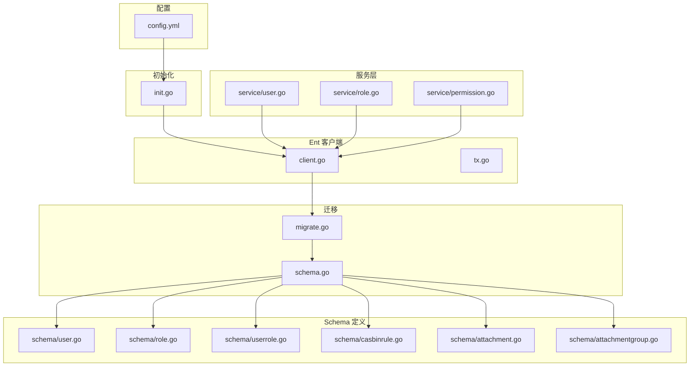
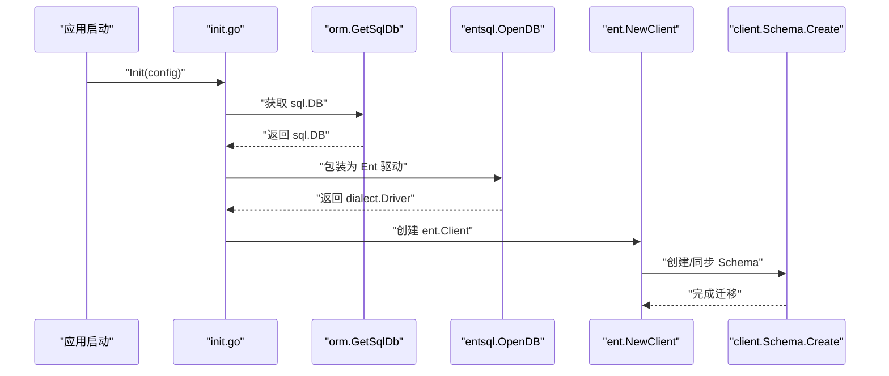
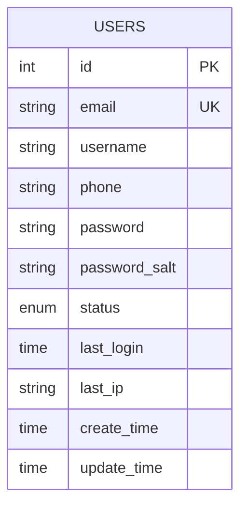
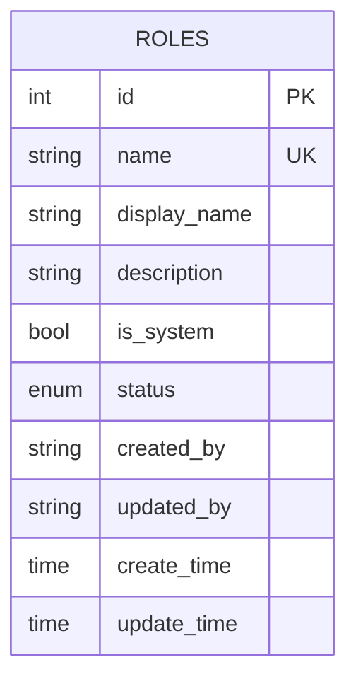
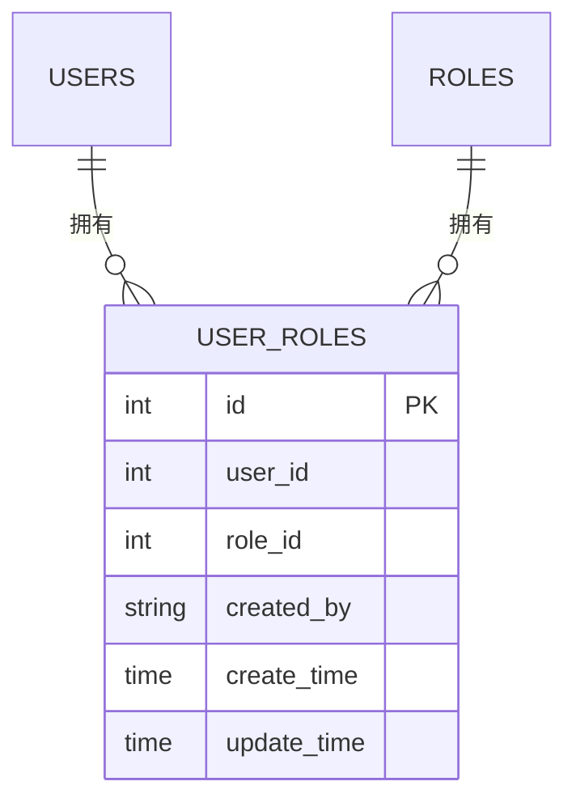
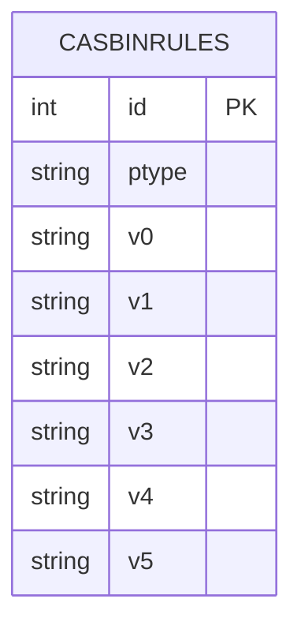
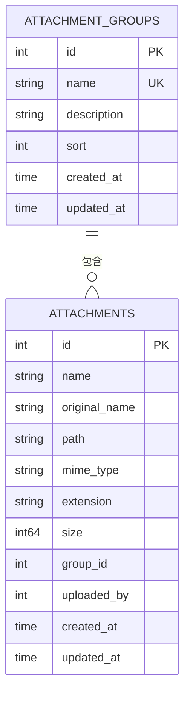
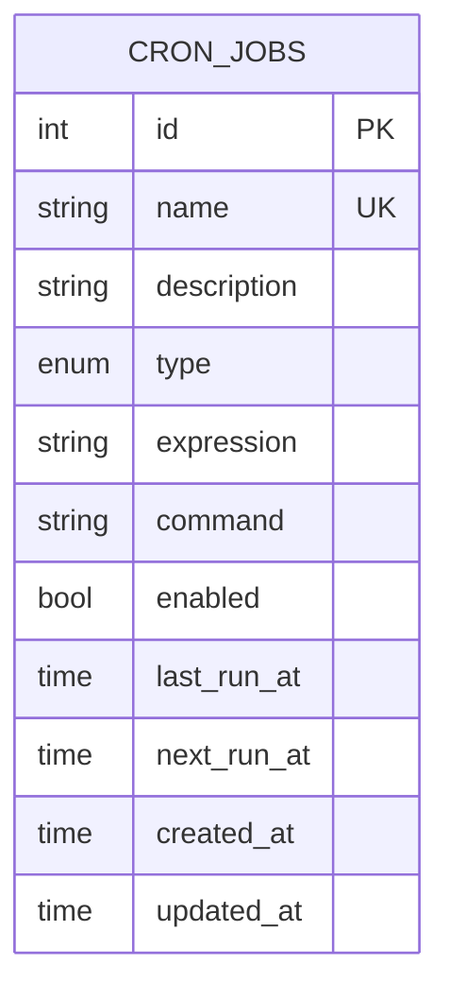
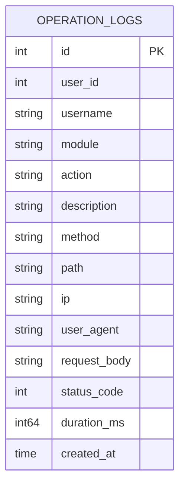
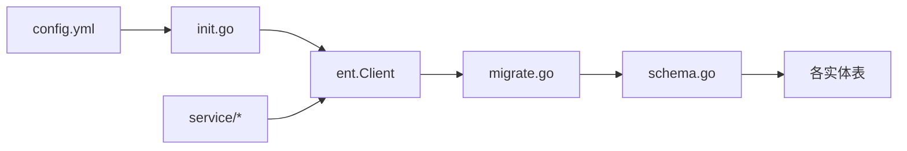

# 数据库设计

<cite>
**本文引用的文件**
- [config.yml](file://config/config.yml)
- [init.go](file://internal/init.go)
- [client.go](file://internal/ent/client.go)
- [tx.go](file://internal/ent/tx.go)
- [migrate.go](file://internal/ent/migrate/migrate.go)
- [schema.go](file://internal/ent/migrate/schema.go)
- [user.go](file://internal/ent/schema/user.go)
- [role.go](file://internal/ent/schema/role.go)
- [userrole.go](file://internal/ent/schema/userrole.go)
- [casbinrule.go](file://internal/ent/schema/casbinrule.go)
- [attachment.go](file://internal/ent/schema/attachment.go)
- [attachmentgroup.go](file://internal/ent/schema/attachmentgroup.go)
- [user.go](file://internal/service/user.go)
- [role.go](file://internal/service/role.go)
- [permission.go](file://internal/service/permission.go)
</cite>

## 目录
1. [简介](#简介)
2. [项目结构](#项目结构)
3. [核心组件](#核心组件)
4. [架构总览](#架构总览)
5. [详细组件分析](#详细组件分析)
6. [依赖分析](#依赖分析)
7. [性能考虑](#性能考虑)
8. [故障排查指南](#故障排查指南)
9. [结论](#结论)
10. [附录](#附录)

## 简介
本文件面向 Go Admin 管理系统的数据库设计，围绕基于 Ent ORM 的数据模型与迁移机制展开，覆盖以下主题：
- 实体关系映射与字段类型定义
- 索引与约束策略
- 数据库迁移（Schema 变更、版本控制与回滚）
- 核心数据表设计（用户、角色、权限、任务、文件）
- 索引优化策略与查询性能
- 数据访问模式最佳实践（事务、连接池、并发控制）
- 性能监控与优化建议

## 项目结构
数据库相关的核心位置集中在 internal/ent 下，包含：
- schema 定义：各实体的字段、索引、Mixin、边等
- migrate：自动生成的 DDL 描述与迁移入口
- client/tx：Ent 客户端、事务封装与驱动适配
- service 层：业务服务对数据库的调用示例

**图表来源**
- [config.yml:19-31](file://config/config.yml#L19-L31)
- [init.go:69-84](file://internal/init.go#L69-L84)
- [client.go:127-141](file://internal/ent/client.go#L127-L141)
- [migrate.go:35-65](file://internal/ent/migrate/migrate.go#L35-L65)
- [schema.go:11-311](file://internal/ent/migrate/schema.go#L11-L311)
- [user.go:17-104](file://internal/ent/schema/user.go#L17-L104)
- [role.go:10-73](file://internal/ent/schema/role.go#L10-L73)
- [userrole.go:11-56](file://internal/ent/schema/userrole.go#L11-L56)
- [casbinrule.go:9-37](file://internal/ent/schema/casbinrule.go#L9-L37)
- [attachment.go:12-89](file://internal/ent/schema/attachment.go#L12-L89)
- [attachmentgroup.go:11-57](file://internal/ent/schema/attachmentgroup.go#L11-L57)
- [user.go:86-130](file://internal/service/user.go#L86-L130)
- [role.go:118-167](file://internal/service/role.go#L118-L167)
- [permission.go:189-239](file://internal/service/permission.go#L189-L239)

**章节来源**
- [config.yml:19-31](file://config/config.yml#L19-L31)
- [init.go:69-84](file://internal/init.go#L69-L84)
- [client.go:127-141](file://internal/ent/client.go#L127-L141)
- [migrate.go:35-65](file://internal/ent/migrate/migrate.go#L35-L65)
- [schema.go:11-311](file://internal/ent/migrate/schema.go#L11-L311)

## 核心组件
- 数据库配置：通过 config.yml 中 database.default 与 connections.default 指定驱动、主机、端口、账号、密码、库名与表前缀。
- 初始化流程：init.go 使用 orm.GetSqlDb 获取 sql.DB，再通过 entsql.OpenDB 包装为 Ent 驱动，并创建 ent.Client；随后执行 client.Schema.Create 完成迁移。
- 迁移入口：migrate.go 提供 Schema.Create/WriteTo 等 API，内部委托 schema.NewMigrate 执行 DDL。
- Schema 描述：schema.go 由 Ent 自动生成，包含所有表的列、主键、外键、索引与表名（含前缀）。

关键点：
- 表前缀来自 orm.GetTablePrefix 并拼接在表名上，便于多租户或多实例隔离。
- 自动迁移在应用启动时执行，确保数据库结构与代码一致。

**章节来源**
- [config.yml:19-31](file://config/config.yml#L19-L31)
- [init.go:69-84](file://internal/init.go#L69-L84)
- [migrate.go:35-65](file://internal/ent/migrate/migrate.go#L35-L65)
- [schema.go:11-311](file://internal/ent/migrate/schema.go#L11-L311)

## 架构总览
Ent ORM 在本项目中的职责：
- 将 schema 定义映射为 SQL 表结构
- 生成客户端 API 用于查询、插入、更新、删除
- 通过 migrate 模块进行版本化迁移
- 通过 tx 模块提供事务能力

**图表来源**
- [init.go:69-84](file://internal/init.go#L69-L84)
- [client.go:127-141](file://internal/ent/client.go#L127-L141)
- [migrate.go:43-65](file://internal/ent/migrate/migrate.go#L43-L65)

## 详细组件分析

### 用户表（users）
- 字段要点：自增主键、邮箱/用户名/手机唯一索引、密码盐、状态枚举、最后登录时间与 IP 等。
- 索引：email、phone、username 单列唯一/非唯一索引。
- 时间戳：Mixin.Time 提供 create_time/update_time。
- 业务用途：用户注册、登录、状态管理、权限归属。

**图表来源**
- [user.go:23-81](file://internal/ent/schema/user.go#L23-L81)
- [schema.go:206-246](file://internal/ent/migrate/schema.go#L206-L246)

**章节来源**
- [user.go:23-81](file://internal/ent/schema/user.go#L23-L81)
- [schema.go:206-246](file://internal/ent/migrate/schema.go#L206-L246)

### 角色表（roles）
- 字段要点：唯一 name、显示名、描述、系统内置标志、状态枚举、创建/更新者。
- 索引：name 唯一索引、status 非唯一索引。
- 时间戳：Mixin.Time。
- 业务用途：角色定义与状态控制。

**图表来源**
- [role.go:16-51](file://internal/ent/schema/role.go#L16-L51)
- [schema.go:175-205](file://internal/ent/migrate/schema.go#L175-L205)

**章节来源**
- [role.go:16-51](file://internal/ent/schema/role.go#L16-L51)
- [schema.go:175-205](file://internal/ent/migrate/schema.go#L175-L205)

### 用户-角色关联表（user_roles）
- 字段要点：user_id、role_id、created_by；联合唯一索引 (user_id, role_id)。
- 索引：user_id、role_id 单列索引。
- 外键：指向 users.id 与 roles.id（NoAction）。
- 业务用途：多对多关系承载。

**图表来源**
- [userrole.go:17-49](file://internal/ent/schema/userrole.go#L17-L49)
- [schema.go:247-292](file://internal/ent/migrate/schema.go#L247-L292)

**章节来源**
- [userrole.go:17-49](file://internal/ent/schema/userrole.go#L17-L49)
- [schema.go:247-292](file://internal/ent/migrate/schema.go#L247-L292)

### 权限规则表（casbin_rules）
- 字段要点：Ptype/V0-V5 组成的复合唯一索引，用于 Casbin 策略存储。
- 索引：(Ptype,V0,V1,V2,V3,V4,V5) 唯一索引。
- 业务用途：RBAC 策略持久化，支持 API、菜单、按钮三类权限。

**图表来源**
- [casbinrule.go:15-36](file://internal/ent/schema/casbinrule.go#L15-L36)
- [schema.go:74-97](file://internal/ent/migrate/schema.go#L74-L97)

**章节来源**
- [casbinrule.go:15-36](file://internal/ent/schema/casbinrule.go#L15-L36)
- [schema.go:74-97](file://internal/ent/migrate/schema.go#L74-L97)

### 文件表（attachments）与分组表（attachment_groups）
- 文件表：name/original_name/path/mime_type/extension/size/group_id/uploaded_by/create_time/update_time。
- 分组表：name 唯一、description、sort、create_time/update_time。
- 边：Attachment.group -> AttachmentGroup（一对一外键）。
- 索引：group_id、mime_type、created_at。
- 业务用途：文件元数据与分组管理。

**图表来源**
- [attachmentgroup.go:17-49](file://internal/ent/schema/attachmentgroup.go#L17-L49)
- [attachment.go:18-69](file://internal/ent/schema/attachment.go#L18-L69)
- [schema.go:59-74](file://internal/ent/migrate/schema.go#L59-L74)
- [schema.go:14-58](file://internal/ent/migrate/schema.go#L14-L58)

**章节来源**
- [attachmentgroup.go:17-49](file://internal/ent/schema/attachmentgroup.go#L17-L49)
- [attachment.go:18-69](file://internal/ent/schema/attachment.go#L18-L69)
- [schema.go:14-58](file://internal/ent/migrate/schema.go#L14-L58)
- [schema.go:59-74](file://internal/ent/migrate/schema.go#L59-L74)

### 任务表（cron_jobs）
- 字段要点：name 唯一、type（枚举）、expression/command、enabled、last_run_at/next_run_at、create_time/update_time。
- 索引：enabled、type。
- 业务用途：定时任务调度。

**图表来源**
- [schema.go:98-129](file://internal/ent/migrate/schema.go#L98-L129)

**章节来源**
- [schema.go:98-129](file://internal/ent/migrate/schema.go#L98-L129)

### 操作日志表（operation_logs）
- 字段要点：user_id/username/module/action/description/method/path/ip/user_agent/request_body/status_code/duration_ms/create_time。
- 索引：user_id、module、action、create_time。
- 业务用途：审计与追踪。

**图表来源**
- [schema.go:130-174](file://internal/ent/migrate/schema.go#L130-L174)

**章节来源**
- [schema.go:130-174](file://internal/ent/migrate/schema.go#L130-L174)

## 依赖分析
- 配置到初始化：config.yml 提供数据库连接参数，init.go 读取并创建 Ent 客户端。
- 初始化到迁移：init.go 调用 client.Schema.Create，委托 migrate.go 执行 DDL。
- Schema 描述：schema.go 由 Ent 自动生成，包含所有表的列、索引、外键与表名（带前缀）。
- 服务层依赖：service 层通过 global.ORM（ent.Client）进行查询与写入。

**图表来源**
- [config.yml:19-31](file://config/config.yml#L19-L31)
- [init.go:69-84](file://internal/init.go#L69-L84)
- [client.go:127-141](file://internal/ent/client.go#L127-L141)
- [migrate.go:35-65](file://internal/ent/migrate/migrate.go#L35-L65)
- [schema.go:11-311](file://internal/ent/migrate/schema.go#L11-L311)

**章节来源**
- [config.yml:19-31](file://config/config.yml#L19-L31)
- [init.go:69-84](file://internal/init.go#L69-L84)
- [client.go:127-141](file://internal/ent/client.go#L127-L141)
- [migrate.go:35-65](file://internal/ent/migrate/migrate.go#L35-L65)
- [schema.go:11-311](file://internal/ent/migrate/schema.go#L11-L311)

## 性能考虑
- 索引策略
  - 用户表：email/phone/username 已建立索引，满足登录与查询场景。
  - 角色表：name 唯一索引、status 非唯一索引，适合按状态筛选。
  - 用户-角色：user_id/role_id 联合唯一与单列索引，支撑多对多查询。
  - 权限规则：Ptype+V0..V5 唯一索引，保证策略唯一性与快速匹配。
  - 文件表：group_id/mime_type/created_at 索引，支持分组与类型过滤。
  - 任务表：enabled/type 索引，便于调度筛选。
  - 日志表：user_id/module/action/create_time 索引，利于审计查询。
- 查询优化
  - 使用 Exists/Only/All 等 API 控制结果集规模。
  - 使用 WithRole 等 eager loading 避免 N+1 查询。
  - 对高频条件（如 enabled、status）建立索引。
- 事务与并发
  - 使用 Client.Tx/BeginTx 开启事务，确保一致性。
  - 使用 Commit/Rollback 显式提交或回滚。
  - 避免在事务内执行长时间阻塞操作。
- 连接池
  - 通过 orm.GetSqlDb 返回的 sql.DB 配置连接池参数（最大连接数、空闲数、生命周期），由底层驱动统一管理。
- 缓存
  - 权限服务对用户/角色权限结果进行缓存，降低 Casbin 查询压力。
- 监控与诊断
  - 使用 client.Debug() 输出 SQL 与耗时，辅助定位慢查询。
  - 结合日志模块记录关键操作与异常。

**章节来源**
- [schema.go:11-311](file://internal/ent/migrate/schema.go#L11-L311)
- [permission.go:146-187](file://internal/service/permission.go#L146-L187)
- [client.go:199-214](file://internal/ent/client.go#L199-L214)
- [tx.go:73-150](file://internal/ent/tx.go#L73-L150)

## 故障排查指南
- 迁移失败
  - 现象：启动时报错提示 failed creating schema resources。
  - 排查：确认数据库连接参数正确；检查表前缀是否冲突；查看数据库权限。
  - 参考：init.go 中 schemaErr 处理逻辑。
- 重复索引/唯一约束冲突
  - 现象：迁移时报唯一索引冲突。
  - 排查：检查现有数据是否违反唯一约束；调整数据或迁移选项。
  - 参考：migrate.go 中 WithDropIndex/WithDropColumn 选项。
- 事务嵌套错误
  - 现象：在同一事务内再次开启事务报错。
  - 排查：避免在 Tx 上再次调用 Tx/BeginTx；使用嵌套事务需谨慎。
  - 参考：client.go 中 ErrTxStarted 与 BeginTx 错误处理。
- 权限查询异常
  - 现象：用户权限获取为空或不一致。
  - 排查：确认角色与用户关联是否存在；检查 Casbin 策略是否正确；清理相关缓存后重试。
  - 参考：permission.go 中缓存键与清理逻辑。

**章节来源**
- [init.go:79-81](file://internal/init.go#L79-L81)
- [migrate.go:14-33](file://internal/ent/migrate/migrate.go#L14-L33)
- [client.go:146-197](file://internal/ent/client.go#L146-L197)
- [permission.go:146-187](file://internal/service/permission.go#L146-L187)

## 结论
本项目的数据库设计以 Ent ORM 为核心，通过 schema 定义与自动生成的迁移模块，实现了强一致性的结构演进。结合合理的索引策略、事务与缓存机制，能够满足用户、角色、权限、文件与任务等核心业务的高可用需求。建议在生产环境中持续关注慢查询、连接池配置与权限缓存命中率，并定期评估索引有效性与数据增长趋势。

## 附录

### 数据访问模式最佳实践
- 事务处理
  - 使用 Client.Tx 或 BeginTx 创建事务，集中提交/回滚。
  - 在事务中避免长时间持有锁或执行外部 IO。
- 连接池管理
  - 通过 sql.DB 参数合理设置最大连接数、空闲连接数与生命周期。
- 并发控制
  - 对热点资源使用乐观锁或分布式锁；避免在事务中执行阻塞操作。
- 查询优化
  - 优先使用带索引的过滤条件；避免 SELECT *；必要时使用 Limit/Offset 分页。
- 缓存策略
  - 对高频读取的权限与配置进行缓存，设置合理 TTL 并在变更时主动失效。

### 数据库迁移与回滚策略
- 版本化迁移
  - 使用 client.Schema.Create 自动同步结构；如需导出 SQL，使用 WriteTo 写入文件。
- 回滚策略
  - 建议在开发环境使用 WithDropIndex/WithDropColumn 等选项获得灵活性；生产环境谨慎使用，优先通过新增列/索引的方式演进。
  - 对关键变更采用“向前兼容”设计，先添加新字段/索引，再迁移数据，最后删除旧结构。

**章节来源**
- [migrate.go:35-65](file://internal/ent/migrate/migrate.go#L35-L65)
- [client.go:146-197](file://internal/ent/client.go#L146-L197)