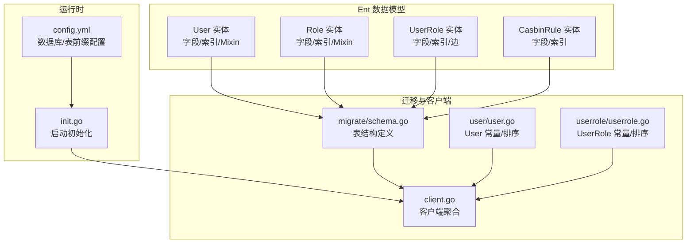
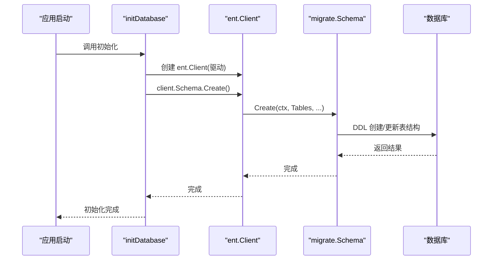
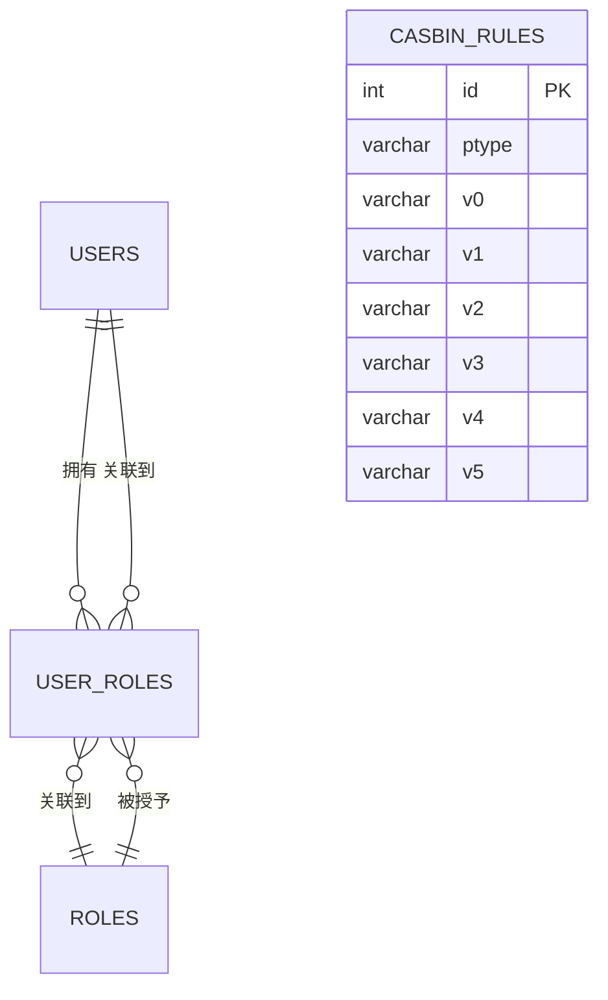
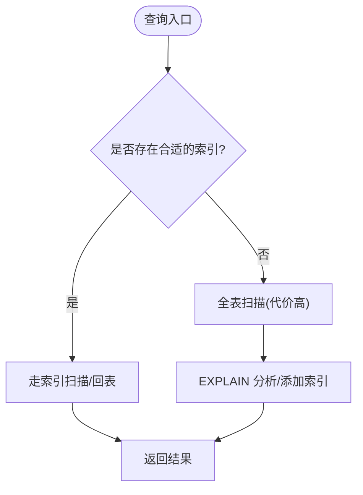
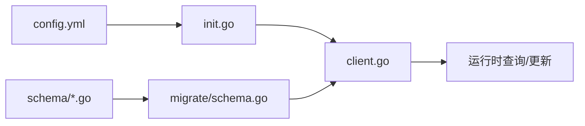

# 数据库设计

<cite>
**本文引用的文件**
- [internal/ent/schema/user.go](file://internal/ent/schema/user.go)
- [internal/ent/schema/role.go](file://internal/ent/schema/role.go)
- [internal/ent/schema/casbinrule.go](file://internal/ent/schema/casbinrule.go)
- [internal/ent/schema/userrole.go](file://internal/ent/schema/userrole.go)
- [internal/ent/migrate/schema.go](file://internal/ent/migrate/schema.go)
- [internal/ent/client.go](file://internal/ent/client.go)
- [internal/ent/user/user.go](file://internal/ent/user/user.go)
- [internal/ent/userrole/userrole.go](file://internal/ent/userrole/userrole.go)
- [internal/init.go](file://internal/init.go)
- [config/config.yml](file://config/config.yml)
- [internal/ent/generate.go](file://internal/ent/generate.go)
</cite>

## 目录
1. [简介](#简介)
2. [项目结构](#项目结构)
3. [核心组件](#核心组件)
4. [架构总览](#架构总览)
5. [详细组件分析](#详细组件分析)
6. [依赖分析](#依赖分析)
7. [性能考量](#性能考量)
8. [故障排查指南](#故障排查指南)
9. [结论](#结论)
10. [附录](#附录)

## 简介
本文件为 Go Admin 管理系统的数据库设计文档，围绕 Ent ORM 的数据模型进行系统化梳理，覆盖 User、Role、CasbinRule、UserRole 四个核心实体及其关系映射、字段定义与约束、索引策略、迁移机制与版本管理、以及数据访问模式与查询优化建议。文档同时给出 ER 图与表结构说明，并提供初始化流程与种子数据建议，帮助开发者快速理解并维护数据库层。

## 项目结构
数据库相关代码主要集中在 internal/ent 目录下，采用“代码生成 + 迁移”的方式管理数据库结构。关键位置如下：
- internal/ent/schema：实体定义（字段、索引、Mixin）
- internal/ent/migrate：迁移表结构定义（自动生成）
- internal/ent/*：各实体的客户端与常量定义
- internal/init.go：应用启动时的数据库初始化与迁移执行
- config/config.yml：数据库连接与表前缀配置

图表来源
- [internal/ent/schema/user.go:17-104](file://internal/ent/schema/user.go#L17-L104)
- [internal/ent/schema/role.go:10-73](file://internal/ent/schema/role.go#L10-L73)
- [internal/ent/schema/userrole.go:11-56](file://internal/ent/schema/userrole.go#L11-L56)
- [internal/ent/schema/casbinrule.go:9-37](file://internal/ent/schema/casbinrule.go#L9-L37)
- [internal/ent/migrate/schema.go:13-164](file://internal/ent/migrate/schema.go#L13-L164)
- [internal/ent/client.go:25-53](file://internal/ent/client.go#L25-L53)
- [internal/ent/user/user.go:14-71](file://internal/ent/user/user.go#L14-L71)
- [internal/ent/userrole/userrole.go:14-47](file://internal/ent/userrole/userrole.go#L14-L47)
- [internal/init.go:33-47](file://internal/init.go#L33-L47)
- [config/config.yml:19-31](file://config/config.yml#L19-L31)

章节来源
- [internal/ent/schema/user.go:17-104](file://internal/ent/schema/user.go#L17-L104)
- [internal/ent/schema/role.go:10-73](file://internal/ent/schema/role.go#L10-L73)
- [internal/ent/schema/userrole.go:11-56](file://internal/ent/schema/userrole.go#L11-L56)
- [internal/ent/schema/casbinrule.go:9-37](file://internal/ent/schema/casbinrule.go#L9-L37)
- [internal/ent/migrate/schema.go:13-164](file://internal/ent/migrate/schema.go#L13-L164)
- [internal/ent/client.go:25-53](file://internal/ent/client.go#L25-L53)
- [internal/ent/user/user.go:14-71](file://internal/ent/user/user.go#L14-L71)
- [internal/ent/userrole/userrole.go:14-47](file://internal/ent/userrole/userrole.go#L14-L47)
- [internal/init.go:33-47](file://internal/init.go#L33-L47)
- [config/config.yml:19-31](file://config/config.yml#L19-L31)

## 核心组件
本节概述四个核心实体的设计要点与约束。

- User（用户）
  - 主键：自增整数 ID（唯一）
  - 关键字段：邮箱（唯一、最大长度 255）、密码（最大长度 255）、姓名、用户名、昵称、唯一标识、密码盐、头像、手机、状态枚举（active/inactive/suspended，默认 inactive）、最后登录时间、最后登录 IP
  - 索引：邮箱、手机、用户名（非唯一）
  - 时间 Mixin：自动维护 create_time/update_time
  - 业务规则：邮箱与手机使用正则校验；敏感字段标记为敏感；状态枚举受控

- Role（角色）
  - 主键：自增整数 ID（唯一）
  - 关键字段：名称（唯一、最大长度 100）、显示名称、描述、是否系统内置、状态枚举（active/inactive，默认 active）、创建者/更新者标识
  - 索引：名称（唯一）、状态（非唯一）
  - 时间 Mixin：自动维护 create_time/update_time

- UserRole（用户-角色关联）
  - 主键：自增整数 ID（唯一）
  - 关键字段：user_id、role_id、分配者 created_by
  - 边：user（必选、唯一）、role（必选、唯一）
  - 索引：联合唯一(user_id, role_id)、user_id、role_id
  - 时间 Mixin：自动维护 create_time/update_time

- CasbinRule（权限策略）
  - 主键：自增整数 ID（唯一）
  - 关键字段：Ptype、V0-V5（默认空字符串），用于策略存储
  - 索引：全字段唯一索引（Ptype,V0..V5）

章节来源
- [internal/ent/schema/user.go:23-103](file://internal/ent/schema/user.go#L23-L103)
- [internal/ent/schema/role.go:16-72](file://internal/ent/schema/role.go#L16-L72)
- [internal/ent/schema/userrole.go:17-55](file://internal/ent/schema/userrole.go#L17-L55)
- [internal/ent/schema/casbinrule.go:15-36](file://internal/ent/schema/casbinrule.go#L15-L36)

## 架构总览
Ent ORM 在本项目中承担“模型定义 + 自动迁移 + 客户端封装”的职责。启动时通过 initDatabase 调用 client.Schema.Create 执行迁移，确保数据库结构与 schema 保持一致。Casbin 通过 Ent 适配器与 ORM 共享连接，实现策略持久化。

图表来源
- [internal/init.go:33-47](file://internal/init.go#L33-L47)
- [internal/ent/client.go:40-53](file://internal/ent/client.go#L40-L53)
- [internal/ent/migrate/migrate.go:44-55](file://internal/ent/migrate/migrate.go#L44-L55)

章节来源
- [internal/init.go:33-47](file://internal/init.go#L33-L47)
- [internal/ent/client.go:40-53](file://internal/ent/client.go#L40-L53)
- [internal/ent/migrate/migrate.go:44-55](file://internal/ent/migrate/migrate.go#L44-L55)

## 详细组件分析

### 实体关系与映射
- 用户与角色：多对多（通过 UserRole 关联）
  - User 与 UserRole：一对多（User -> 多个 UserRole）
  - Role 与 UserRole：一对多（Role -> 多个 UserRole）
  - UserRole 与 User/Role：多对一（反向引用）
- CasbinRule：独立实体，用于存储策略元组，无外键边

图表来源
- [internal/ent/migrate/schema.go:110-155](file://internal/ent/migrate/schema.go#L110-L155)
- [internal/ent/schema/userrole.go:35-40](file://internal/ent/schema/userrole.go#L35-L40)

章节来源
- [internal/ent/schema/userrole.go:35-40](file://internal/ent/schema/userrole.go#L35-L40)
- [internal/ent/migrate/schema.go:120-137](file://internal/ent/migrate/schema.go#L120-L137)

### 字段定义、数据类型与约束
- 整体遵循 Ent 字段语义，结合 schema 与 migrate 层的定义：
  - 主键：自增整数（Increment: true）
  - 唯一性：Unique(true) 或唯一索引
  - 可空性：Nullable(true) 或未声明（默认非空）
  - 枚举：枚举类型 + 默认值
  - 时间：Time 类型 + Mixin 自动生成 create_time/update_time
  - 表前缀：由配置读取并拼接至表名

章节来源
- [internal/ent/migrate/schema.go:11-164](file://internal/ent/migrate/schema.go#L11-L164)
- [config/config.yml](file://config/config.yml#L30)

### 索引策略与性能优化
- 用户表（users）
  - 索引：user_email、user_phone、user_username（均为普通索引）
  - 用途：支持按邮箱/手机/用户名检索
- 角色表（roles）
  - 索引：role_name（唯一）、role_status（普通）
  - 用途：唯一约束保证角色名唯一；状态过滤常用
- 用户-角色关联（user_roles）
  - 索引：userrole_user_id_role_id（唯一）、userrole_user_id、userrole_role_id
  - 用途：唯一约束避免重复授权；分别针对 user_id 与 role_id 的单列查询
- CasbinRule
  - 索引：casbinrule_ptype_v0_v1_v2_v3_v4_v5（唯一）
  - 用途：策略去重与快速匹配

图表来源
- [internal/ent/migrate/schema.go:92-108](file://internal/ent/migrate/schema.go#L92-L108)
- [internal/ent/migrate/schema.go:62-67](file://internal/ent/migrate/schema.go#L62-L67)
- [internal/ent/migrate/schema.go:138-154](file://internal/ent/migrate/schema.go#L138-L154)
- [internal/ent/migrate/schema.go:30-36](file://internal/ent/migrate/schema.go#L30-L36)

章节来源
- [internal/ent/migrate/schema.go:92-108](file://internal/ent/migrate/schema.go#L92-L108)
- [internal/ent/migrate/schema.go:62-67](file://internal/ent/migrate/schema.go#L62-L67)
- [internal/ent/migrate/schema.go:138-154](file://internal/ent/migrate/schema.go#L138-L154)
- [internal/ent/migrate/schema.go:30-36](file://internal/ent/migrate/schema.go#L30-L36)

### 数据访问模式与查询优化技巧
- 使用排序选项（OrderOption）控制查询顺序，减少应用侧排序成本
- 通过边查询（Edge Query）在关联表上进行邻居查询，避免 N+1 查询
- 合理利用唯一索引与联合索引，避免重复扫描
- 对于频繁过滤的状态字段，优先使用索引列

章节来源
- [internal/ent/user/user.go:139-215](file://internal/ent/user/user.go#L139-L215)
- [internal/ent/userrole/userrole.go:85-130](file://internal/ent/userrole/userrole.go#L85-L130)

### 数据完整性约束与业务规则实现
- 唯一约束：用户邮箱、角色名称、用户-角色组合唯一
- 外键约束：user_roles.user_id 引用 users.id；user_roles.role_id 引用 roles.id
- 枚举约束：用户状态、角色状态枚举值受控
- 正则约束：邮箱与手机号格式校验
- 敏感字段：密码、盐值标记为敏感，避免日志泄露

章节来源
- [internal/ent/migrate/schema.go:124-137](file://internal/ent/migrate/schema.go#L124-L137)
- [internal/ent/schema/user.go:29-68](file://internal/ent/schema/user.go#L29-L68)
- [internal/ent/schema/role.go:22-41](file://internal/ent/schema/role.go#L22-L41)
- [internal/ent/schema/userrole.go:23-31](file://internal/ent/schema/userrole.go#L23-L31)

### 数据库迁移机制与版本管理
- 迁移入口：client.Schema.Create 调用 migrate.Create
- 迁移目标：基于 migrate/schema.go 中的 Tables 列表
- 选项：支持启用/禁用外键、删除列/索引等高级选项
- 版本管理：Ent 通过生成的迁移文件与数据库结构对比，自动应用变更

章节来源
- [internal/ent/migrate/migrate.go:44-55](file://internal/ent/migrate/migrate.go#L44-L55)
- [internal/ent/migrate/schema.go:156-163](file://internal/ent/migrate/schema.go#L156-L163)

### 初始化脚本与种子数据
- 初始化流程：启动时调用 initDatabase，创建 ent.Client 并执行 Schema.Create
- 表前缀：来自配置文件的 table_prefix，拼接到表名
- 种子数据建议：
  - 插入系统内置角色（如 admin、user），并设置 is_system 标记
  - 为管理员用户分配角色（写入 user_roles）
  - 初始化 Casbin 策略（写入 casbin_rules），确保权限生效

章节来源
- [internal/init.go:33-47](file://internal/init.go#L33-L47)
- [config/config.yml](file://config/config.yml#L30)
- [internal/ent/schema/casbinrule.go:15-24](file://internal/ent/schema/casbinrule.go#L15-L24)

## 依赖分析
- 模型到迁移：schema 文件定义字段与索引，migrate/schema.go 生成表结构与索引
- 客户端到模型：client.go 聚合各实体客户端，统一暴露查询/更新接口
- 运行时到配置：init.go 读取配置构建数据库连接，执行迁移
- 表前缀：config.yml 提供 table_prefix，迁移动态拼接表名

图表来源
- [config/config.yml:19-31](file://config/config.yml#L19-L31)
- [internal/init.go:33-47](file://internal/init.go#L33-L47)
- [internal/ent/client.go:25-53](file://internal/ent/client.go#L25-L53)
- [internal/ent/migrate/schema.go:11-164](file://internal/ent/migrate/schema.go#L11-L164)

章节来源
- [config/config.yml:19-31](file://config/config.yml#L19-L31)
- [internal/init.go:33-47](file://internal/init.go#L33-L47)
- [internal/ent/client.go:25-53](file://internal/ent/client.go#L25-L53)
- [internal/ent/migrate/schema.go:11-164](file://internal/ent/migrate/schema.go#L11-L164)

## 性能考量
- 索引命中：优先使用唯一索引与覆盖索引，减少回表
- 查询计划：对复杂查询使用 EXPLAIN 分析，必要时调整索引或拆分查询
- 批量操作：使用批量创建/更新接口降低往返开销
- 缓存策略：热点数据可引入缓存（Redis 等），降低数据库压力
- 连接池：合理配置连接池参数，避免并发瓶颈

## 故障排查指南
- 迁移失败
  - 检查数据库连接配置与权限
  - 查看迁移输出日志，确认表前缀与字段类型是否匹配
- 查询慢
  - 使用 EXPLAIN 分析执行计划，确认是否命中索引
  - 为高频过滤字段补充索引
- 唯一约束冲突
  - 检查用户邮箱/角色名称是否重复
  - 检查 user_roles 组合是否重复
- 密码安全
  - 确保密码与盐值正确存储，避免明文
  - 对敏感字段进行脱敏处理

章节来源
- [internal/ent/migrate/migrate.go:44-55](file://internal/ent/migrate/migrate.go#L44-L55)
- [internal/ent/schema/user.go:29-68](file://internal/ent/schema/user.go#L29-L68)
- [internal/ent/schema/userrole.go:44-48](file://internal/ent/schema/userrole.go#L44-L48)

## 结论
本设计以 Ent ORM 为核心，通过清晰的实体定义、完善的索引策略与严格的约束，实现了用户、角色、权限策略与关联表的完整数据模型。配合自动迁移与启动初始化流程，能够稳定地支撑权限与用户管理场景。建议在生产环境中持续关注查询性能与索引命中率，并根据业务增长迭代索引与缓存策略。

## 附录
- 代码生成入口：internal/ent/generate.go
- 表前缀配置：config/config.yml 中 database.connections.default.table_prefix

章节来源
- [internal/ent/generate.go:1-4](file://internal/ent/generate.go#L1-L4)
- [config/config.yml](file://config/config.yml#L30)