# 数据库设计

<cite>
**本文引用的文件**
- [internal/ent/schema/user.go](file://internal/ent/schema/user.go)
- [internal/ent/schema/role.go](file://internal/ent/schema/role.go)
- [internal/ent/schema/userrole.go](file://internal/ent/schema/userrole.go)
- [internal/ent/schema/casbinrule.go](file://internal/ent/schema/casbinrule.go)
- [internal/ent/schema/attachment.go](file://internal/ent/schema/attachment.go)
- [internal/ent/schema/attachmentgroup.go](file://internal/ent/schema/attachmentgroup.go)
- [internal/ent/schema/cronjob.go](file://internal/ent/schema/cronjob.go)
- [internal/ent/schema/systemconfig.go](file://internal/ent/schema/systemconfig.go)
- [internal/ent/schema/dictdata.go](file://internal/ent/schema/dictdata.go)
- [internal/ent/schema/operationlog.go](file://internal/ent/schema/operationlog.go)
- [internal/ent/schema/admin.go](file://internal/ent/schema/admin.go)
- [internal/ent/schema/admin_role.go](file://internal/ent/schema/admin_role.go)
- [internal/ent/schema/systempermission.go](file://internal/ent/schema/systempermission.go)
- [internal/ent/schema/plugin.go](file://internal/ent/schema/plugin.go)
- [internal/ent/schema/message.go](file://internal/ent/schema/message.go)
- [internal/ent/schema/message_preference.go](file://internal/ent/schema/message_preference.go)
- [internal/ent/schema/blacklist.go](file://internal/ent/schema/blacklist.go)
- [internal/ent/schema/thirdpartyuser.go](file://internal/ent/schema/thirdpartyuser.go)
- [internal/ent/migrate/schema.go](file://internal/ent/migrate/schema.go)
- [internal/ent/migrate/migrate.go](file://internal/ent/migrate/migrate.go)
- [internal/ent/tableprefix_init.go](file://internal/ent/tableprefix_init.go)
- [internal/ent/client.go](file://internal/ent/client.go)
- [internal/service/user.go](file://internal/service/user.go)
- [internal/service/permission.go](file://internal/service/permission.go)
- [internal/service/role.go](file://internal/service/role.go)
</cite>

## 目录
1. [简介](#简介)
2. [项目结构](#项目结构)
3. [核心组件](#核心组件)
4. [架构总览](#架构总览)
5. [详细组件分析](#详细组件分析)
6. [依赖分析](#依赖分析)
7. [性能考量](#性能考量)
8. [故障排查指南](#故障排查指南)
9. [结论](#结论)
10. [附录](#附录)

## 简介
本文件面向 Go Admin 管理系统的数据库设计与实现，基于 Ent ORM 的数据模型，覆盖用户、角色、权限、文件、定时任务、管理员、站内消息、插件、黑名单、第三方账号、系统权限定义等核心实体，并提供完整的 ER 图、表结构说明、索引与约束策略、迁移机制、查询优化、事务与并发控制、数据访问模式、缓存策略、扩展指南与最佳实践。

## 项目结构
- 数据模型定义位于 internal/ent/schema 下，每个实体对应一个 schema 文件，统一通过 Ent 代码生成器生成数据库表结构与客户端代码。
- 数据库迁移由 internal/ent/migrate 包负责，包含表结构定义、索引与外键映射，以及迁移 API。
- 表前缀支持通过 internal/ent/tableprefix_init.go 动态设置，便于多租户或多实例部署。
- 业务服务层位于 internal/service，封装了用户、权限、角色等服务的增删改查与缓存逻辑。

```mermaid
graph TB
subgraph "Ent 模型层"
S_User["schema/user.go"]
S_Role["schema/role.go"]
S_UserRole["schema/userrole.go"]
S_Casbin["schema/casbinrule.go"]
S_Attach["schema/attachment.go"]
S_AttachGroup["schema/attachmentgroup.go"]
S_Cron["schema/cronjob.go"]
S_SysCfg["schema/systemconfig.go"]
S_Dict["schema/dictdata.go"]
S_OpLog["schema/operationlog.go"]
S_Admin["schema/admin.go"]
S_AdminRole["schema/admin_role.go"]
S_SysPerm["schema/systempermission.go"]
S_Plugin["schema/plugin.go"]
S_Message["schema/message.go"]
S_MsgPref["schema/message_preference.go"]
S_Blacklist["schema/blacklist.go"]
S_ThirdParty["schema/thirdpartyuser.go"]
end
subgraph "迁移与驱动"
M_Schema["migrate/schema.go"]
M_Migrate["migrate/migrate.go"]
T_Init["tableprefix_init.go"]
C_Client["client.go"]
end
subgraph "服务层"
SVC_User["service/user.go"]
SVC_Permission["service/permission.go"]
SVC_Role["service/role.go"]
end
S_User --> M_Schema
S_Role --> M_Schema
S_UserRole --> M_Schema
S_Casbin --> M_Schema
S_Attach --> M_Schema
S_AttachGroup --> M_Schema
S_Cron --> M_Schema
S_SysCfg --> M_Schema
S_Dict --> M_Schema
S_OpLog --> M_Schema
S_Admin --> M_Schema
S_AdminRole --> M_Schema
S_SysPerm --> M_Schema
S_Plugin --> M_Schema
S_Message --> M_Schema
S_MsgPref --> M_Schema
S_Blacklist --> M_Schema
S_ThirdParty --> M_Schema
M_Migrate --> C_Client
T_Init --> M_Schema
SVC_User --> C_Client
SVC_Permission --> C_Client
SVC_Role --> C_Client
```

图表来源
- [internal/ent/schema/user.go:1-102](file://internal/ent/schema/user.go#L1-L102)
- [internal/ent/schema/role.go:1-73](file://internal/ent/schema/role.go#L1-L73)
- [internal/ent/schema/userrole.go:1-61](file://internal/ent/schema/userrole.go#L1-L61)
- [internal/ent/schema/casbinrule.go:1-37](file://internal/ent/schema/casbinrule.go#L1-L37)
- [internal/ent/schema/attachment.go:1-89](file://internal/ent/schema/attachment.go#L1-L89)
- [internal/ent/schema/attachmentgroup.go:1-57](file://internal/ent/schema/attachmentgroup.go#L1-L57)
- [internal/ent/schema/cronjob.go:1-82](file://internal/ent/schema/cronjob.go#L1-L82)
- [internal/ent/schema/systemconfig.go:1-79](file://internal/ent/schema/systemconfig.go#L1-L79)
- [internal/ent/schema/dictdata.go:1-80](file://internal/ent/schema/dictdata.go#L1-L80)
- [internal/ent/schema/operationlog.go:1-92](file://internal/ent/schema/operationlog.go#L1-L92)
- [internal/ent/schema/admin.go:1-105](file://internal/ent/schema/admin.go#L1-L105)
- [internal/ent/schema/admin_role.go:1-61](file://internal/ent/schema/admin_role.go#L1-L61)
- [internal/ent/schema/systempermission.go:1-46](file://internal/ent/schema/systempermission.go#L1-L46)
- [internal/ent/schema/plugin.go:1-95](file://internal/ent/schema/plugin.go#L1-L95)
- [internal/ent/schema/message.go:1-80](file://internal/ent/schema/message.go#L1-L80)
- [internal/ent/schema/message_preference.go:1-76](file://internal/ent/schema/message_preference.go#L1-L76)
- [internal/ent/schema/blacklist.go:1-61](file://internal/ent/schema/blacklist.go#L1-L61)
- [internal/ent/schema/thirdpartyuser.go:1-131](file://internal/ent/schema/thirdpartyuser.go#L1-L131)
- [internal/ent/migrate/schema.go:1-381](file://internal/ent/migrate/schema.go#L1-L381)
- [internal/ent/migrate/migrate.go:1-65](file://internal/ent/migrate/migrate.go#L1-L65)
- [internal/ent/tableprefix_init.go:1-65](file://internal/ent/tableprefix_init.go#L1-L65)
- [internal/ent/client.go:1-200](file://internal/ent/client.go#L1-L200)
- [internal/service/user.go:1-427](file://internal/service/user.go#L1-L427)
- [internal/service/permission.go:1-829](file://internal/service/permission.go#L1-L829)
- [internal/service/role.go:1-429](file://internal/service/role.go#L1-L429)

章节来源
- [internal/ent/schema/user.go:1-102](file://internal/ent/schema/user.go#L1-L102)
- [internal/ent/schema/role.go:1-73](file://internal/ent/schema/role.go#L1-L73)
- [internal/ent/schema/userrole.go:1-61](file://internal/ent/schema/userrole.go#L1-L61)
- [internal/ent/schema/casbinrule.go:1-37](file://internal/ent/schema/casbinrule.go#L1-L37)
- [internal/ent/schema/attachment.go:1-89](file://internal/ent/schema/attachment.go#L1-L89)
- [internal/ent/schema/attachmentgroup.go:1-57](file://internal/ent/schema/attachmentgroup.go#L1-L57)
- [internal/ent/schema/cronjob.go:1-82](file://internal/ent/schema/cronjob.go#L1-L82)
- [internal/ent/schema/systemconfig.go:1-79](file://internal/ent/schema/systemconfig.go#L1-L79)
- [internal/ent/schema/dictdata.go:1-80](file://internal/ent/schema/dictdata.go#L1-L80)
- [internal/ent/schema/operationlog.go:1-92](file://internal/ent/schema/operationlog.go#L1-L92)
- [internal/ent/schema/admin.go:1-105](file://internal/ent/schema/admin.go#L1-L105)
- [internal/ent/schema/admin_role.go:1-61](file://internal/ent/schema/admin_role.go#L1-L61)
- [internal/ent/schema/systempermission.go:1-46](file://internal/ent/schema/systempermission.go#L1-L46)
- [internal/ent/schema/plugin.go:1-95](file://internal/ent/schema/plugin.go#L1-L95)
- [internal/ent/schema/message.go:1-80](file://internal/ent/schema/message.go#L1-L80)
- [internal/ent/schema/message_preference.go:1-76](file://internal/ent/schema/message_preference.go#L1-L76)
- [internal/ent/schema/blacklist.go:1-61](file://internal/ent/schema/blacklist.go#L1-L61)
- [internal/ent/schema/thirdpartyuser.go:1-131](file://internal/ent/schema/thirdpartyuser.go#L1-L131)
- [internal/ent/migrate/schema.go:1-381](file://internal/ent/migrate/schema.go#L1-L381)
- [internal/ent/migrate/migrate.go:1-65](file://internal/ent/migrate/migrate.go#L1-L65)
- [internal/ent/tableprefix_init.go:1-65](file://internal/ent/tableprefix_init.go#L1-L65)
- [internal/ent/client.go:1-200](file://internal/ent/client.go#L1-L200)
- [internal/service/user.go:1-427](file://internal/service/user.go#L1-L427)
- [internal/service/permission.go:1-829](file://internal/service/permission.go#L1-L829)
- [internal/service/role.go:1-429](file://internal/service/role.go#L1-L429)

## 核心组件
- 用户(User)：存储用户基本信息、认证凭据、状态与登录信息；具备邮箱、用户名、手机号等唯一索引。
- 角色(Role)：角色元数据与状态；具备名称唯一索引。
- 用户-角色(UserRole)：多对多关联表，支持唯一组合索引(user_id, role_id)，记录分配者，并新增 is_primary 字段标识主角色。
- 管理员(Admin)：后台管理员账号，包含 email/username/uid/password/status 等字段，以及 is_super_admin 布尔字段标记超级管理员。
- 管理员-角色(AdminRole)：管理员与角色的多对多关联表，支持 admin_id/role_id 唯一组合索引及 is_primary 主角色标记。
- 权限(CasbinRule)：基于 Casbin 的权限规则存储，采用复合唯一索引(Ptype,V0..V5)。
- 系统权限定义(SystemPermission)：菜单、按钮、API 权限定义表，包含 domain、type、code、path、method、menu_path、parent_id 等字段。
- 附件(Attachment)与分组(AttachmentGroup)：一对多关系，附件可归属分组并建立外键约束。
- 定时任务(CronJob)：存储计划任务的名称、类型、表达式、命令与运行时间。
- 系统配置(SystemConfig)：键值型配置，支持分组与状态索引。
- 字典数据(DictData)：字典项，按类型与状态索引。
- 操作日志(OperationLog)：记录用户操作轨迹，按用户、模块、动作、时间建立索引。
- 站内消息(Message)：用户站内消息，含 user_uid、type、level、title、content、read_at 等字段，空 user_uid 表示广播消息。
- 消息偏好(MessagePreference)：用户消息偏好设置，含 desktop_notify、subscribe_*、do_not_disturb_* 等字段。
- 插件(Plugin)：插件管理表，记录插件的 plugin_id、name、version、status、install_path 等信息。
- 黑名单(Blacklist)：用户黑名单记录，通过 user_id 关联用户，记录原因和操作人。
- 第三方用户(ThirdPartyUser)：第三方账号绑定信息，支持多平台（微信/GitHub/Google 等）账号关联。

章节来源
- [internal/ent/schema/user.go:17-102](file://internal/ent/schema/user.go#L17-L102)
- [internal/ent/schema/role.go:10-73](file://internal/ent/schema/role.go#L10-L73)
- [internal/ent/schema/userrole.go:11-61](file://internal/ent/schema/userrole.go#L11-L61)
- [internal/ent/schema/casbinrule.go:9-37](file://internal/ent/schema/casbinrule.go#L9-L37)
- [internal/ent/schema/attachment.go:12-89](file://internal/ent/schema/attachment.go#L12-L89)
- [internal/ent/schema/attachmentgroup.go:11-57](file://internal/ent/schema/attachmentgroup.go#L11-L57)
- [internal/ent/schema/cronjob.go:11-82](file://internal/ent/schema/cronjob.go#L11-L82)
- [internal/ent/schema/systemconfig.go:11-79](file://internal/ent/schema/systemconfig.go#L11-L79)
- [internal/ent/schema/dictdata.go:11-80](file://internal/ent/schema/dictdata.go#L11-L80)
- [internal/ent/schema/operationlog.go:11-92](file://internal/ent/schema/operationlog.go#L11-L92)
- [internal/ent/schema/admin.go:10-105](file://internal/ent/schema/admin.go#L10-L105)
- [internal/ent/schema/admin_role.go:11-61](file://internal/ent/schema/admin_role.go#L11-L61)
- [internal/ent/schema/systempermission.go:11-46](file://internal/ent/schema/systempermission.go#L11-L46)
- [internal/ent/schema/plugin.go:11-95](file://internal/ent/schema/plugin.go#L11-L95)
- [internal/ent/schema/message.go:11-80](file://internal/ent/schema/message.go#L11-L80)
- [internal/ent/schema/message_preference.go:11-76](file://internal/ent/schema/message_preference.go#L11-L76)
- [internal/ent/schema/blacklist.go:12-61](file://internal/ent/schema/blacklist.go#L12-L61)
- [internal/ent/schema/thirdpartyuser.go:12-131](file://internal/ent/schema/thirdpartyuser.go#L12-L131)

## 架构总览
Ent ORM 通过 schema 定义生成数据库表结构与客户端，迁移工具负责创建/变更表结构，服务层通过 Ent 客户端进行数据访问，并结合缓存与事务保障一致性与性能。

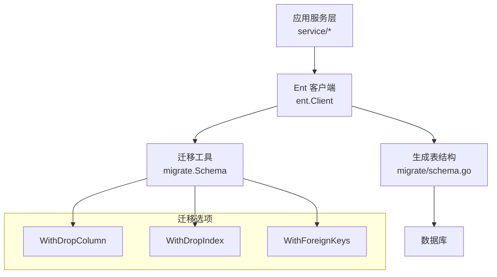

图表来源
- [internal/ent/client.go:31-77](file://internal/ent/client.go#L31-L77)
- [internal/ent/migrate/migrate.go:35-65](file://internal/ent/migrate/migrate.go#L35-L65)
- [internal/ent/migrate/schema.go:362-381](file://internal/ent/migrate/schema.go#L362-L381)

## 详细组件分析

### 用户(User)模型
- 字段要点：整型自增主键、邮箱/用户名唯一、密码与盐值、状态枚举、uid（可选）、最后登录时间与 IP、头像等。
- 索引策略：对 email、phone、username 建立普通索引，提升查询效率。
- 时间混入：自动维护 create_time/update_time。

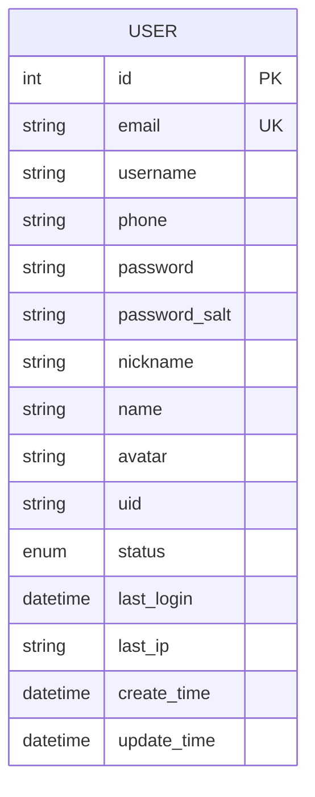

图表来源
- [internal/ent/schema/user.go:23-102](file://internal/ent/schema/user.go#L23-L102)
- [internal/ent/migrate/schema.go:274-314](file://internal/ent/migrate/schema.go#L274-L314)

章节来源
- [internal/ent/schema/user.go:23-102](file://internal/ent/schema/user.go#L23-L102)
- [internal/ent/migrate/schema.go:274-314](file://internal/ent/migrate/schema.go#L274-L314)

### 角色(Role)与用户-角色(UserRole)模型
- 角色：名称唯一、显示名、描述、系统内置标记、状态、创建/更新者。
- 用户-角色：多对多关联，唯一(user_id, role_id)索引，分别对 user_id、role_id 建立二级索引；新增 is_primary 字段标记主角色；外键指向 users 与 roles。
- 时间混入：自动维护 create_time/update_time。

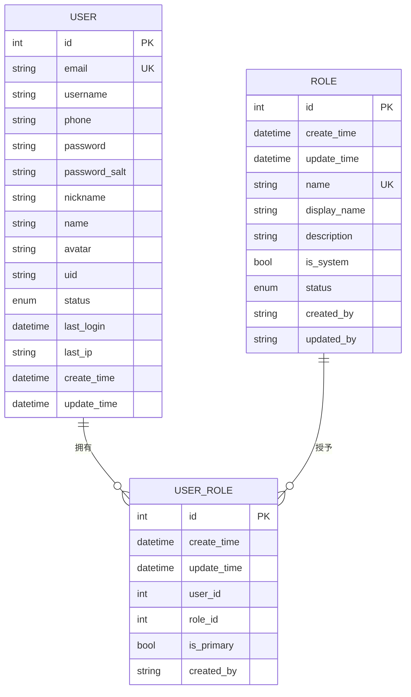

图表来源
- [internal/ent/schema/role.go:16-73](file://internal/ent/schema/role.go#L16-L73)
- [internal/ent/schema/userrole.go:17-61](file://internal/ent/schema/userrole.go#L17-L61)
- [internal/ent/migrate/schema.go:207-237](file://internal/ent/migrate/schema.go#L207-L237)
- [internal/ent/migrate/schema.go:315-360](file://internal/ent/migrate/schema.go#L315-L360)

章节来源
- [internal/ent/schema/role.go:16-73](file://internal/ent/schema/role.go#L16-L73)
- [internal/ent/schema/userrole.go:17-61](file://internal/ent/schema/userrole.go#L17-L61)
- [internal/ent/migrate/schema.go:207-237](file://internal/ent/migrate/schema.go#L207-L237)
- [internal/ent/migrate/schema.go:315-360](file://internal/ent/migrate/schema.go#L315-L360)

### 管理员(Admin)与管理员-角色(AdminRole)模型
- 管理员：自增主键、邮箱/用户名/uid 唯一、密码与盐值、昵称/姓名/头像/手机号、部门/职位、状态、最后登录时间/IP、is_super_admin 标记。
- 管理员-角色：多对多关联表，admin_id 和 role_id 组合唯一，is_primary 标记主角色，created_by 记录分配者。

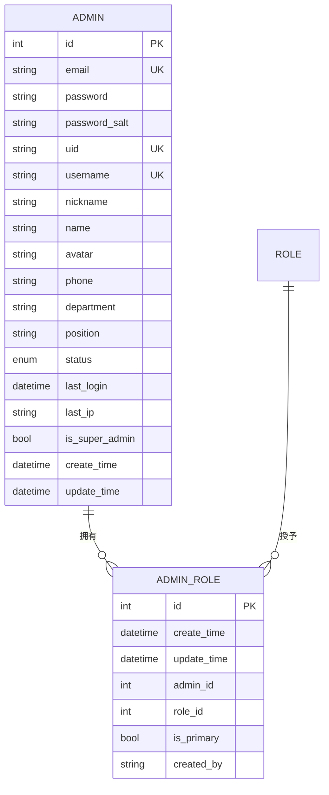

图表来源
- [internal/ent/schema/admin.go:16-105](file://internal/ent/schema/admin.go#L16-L105)
- [internal/ent/schema/admin_role.go:17-61](file://internal/ent/schema/admin_role.go#L17-L61)

章节来源
- [internal/ent/schema/admin.go:16-105](file://internal/ent/schema/admin.go#L16-L105)
- [internal/ent/schema/admin_role.go:17-61](file://internal/ent/schema/admin_role.go#L17-L61)

### 权限(CasbinRule)模型
- 存储 Casbin 的 p 策略规则，字段 Ptype/V0..V5 对应策略类型与主体/域/对象/动作等。
- 复合唯一索引确保规则唯一性，便于快速匹配与去重。

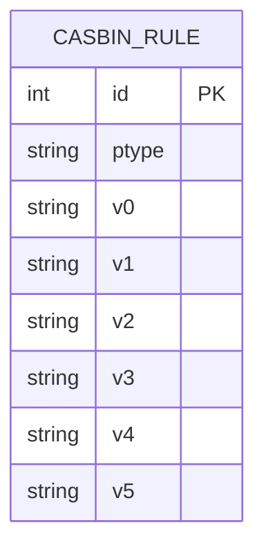

图表来源
- [internal/ent/schema/casbinrule.go:15-37](file://internal/ent/schema/casbinrule.go#L15-L37)
- [internal/ent/migrate/schema.go:74-97](file://internal/ent/migrate/schema.go#L74-L97)

章节来源
- [internal/ent/schema/casbinrule.go:15-37](file://internal/ent/schema/casbinrule.go#L15-L37)
- [internal/ent/migrate/schema.go:74-97](file://internal/ent/migrate/schema.go#L74-L97)

### 系统权限定义(SystemPermission)模型
- 定义菜单、按钮、API 三种权限类型。
- 字段包含 domain、type、code、path、method、menu_path、icon、component、parent_id、sort_order、is_common、status 等。
- 复合唯一索引 (domain, code)，按 domain 和 type 建立索引。

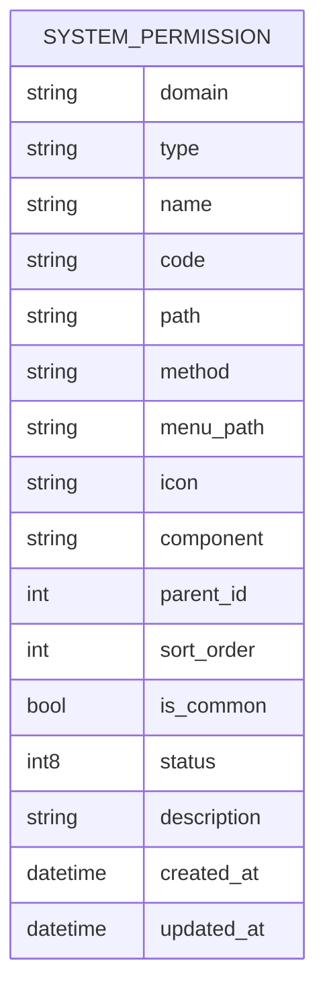

图表来源
- [internal/ent/schema/systempermission.go:17-46](file://internal/ent/schema/systempermission.go#L17-L46)

章节来源
- [internal/ent/schema/systempermission.go:17-46](file://internal/ent/schema/systempermission.go#L17-L46)

### 附件(Attachment)与分组(AttachmentGroup)模型
- AttachmentGroup 与 Attachment 为一对多关系，Attachment.group_id 外键指向 AttachmentGroup.id，删除策略为 SET NULL。
- Attachment 建有 group_id、mime_type、created_at 索引，便于按分组、类型与时间检索。

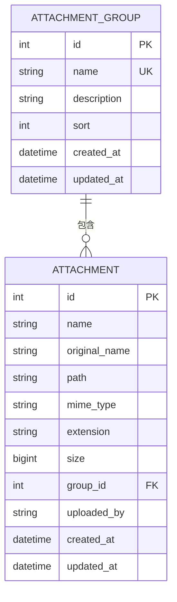

图表来源
- [internal/ent/schema/attachmentgroup.go:17-57](file://internal/ent/schema/attachmentgroup.go#L17-L57)
- [internal/ent/schema/attachment.go:18-89](file://internal/ent/schema/attachment.go#L18-L89)
- [internal/ent/migrate/schema.go:59-73](file://internal/ent/migrate/schema.go#L59-L73)
- [internal/ent/migrate/schema.go:14-58](file://internal/ent/migrate/schema.go#L14-L58)

章节来源
- [internal/ent/schema/attachmentgroup.go:17-57](file://internal/ent/schema/attachmentgroup.go#L17-L57)
- [internal/ent/schema/attachment.go:18-89](file://internal/ent/schema/attachment.go#L18-L89)
- [internal/ent/migrate/schema.go:14-58](file://internal/ent/migrate/schema.go#L14-L58)

### 定时任务(CronJob)模型
- 字段包含名称(唯一)、类型、表达式、命令、启用标志、最近/下次执行时间等。
- 为 enabled 与 type 建立索引，便于筛选启用任务与按类型过滤。

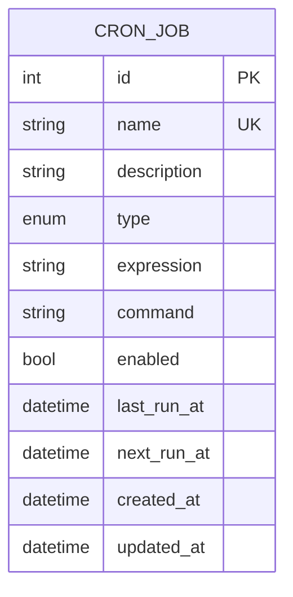

图表来源
- [internal/ent/schema/cronjob.go:17-82](file://internal/ent/schema/cronjob.go#L17-L82)
- [internal/ent/migrate/schema.go:98-129](file://internal/ent/migrate/schema.go#L98-L129)

章节来源
- [internal/ent/schema/cronjob.go:17-82](file://internal/ent/schema/cronjob.go#L17-L82)
- [internal/ent/migrate/schema.go:98-129](file://internal/ent/migrate/schema.go#L98-L129)

### 系统配置(SystemConfig)与字典数据(DictData)模型
- SystemConfig：name/key(唯一)、value、类型、分组、状态、备注等；为 key、group、status 建立索引。
- DictData：label/value/dict_type、sort/status/is_default/css_class、备注等；为 dict_type、status 建立索引。

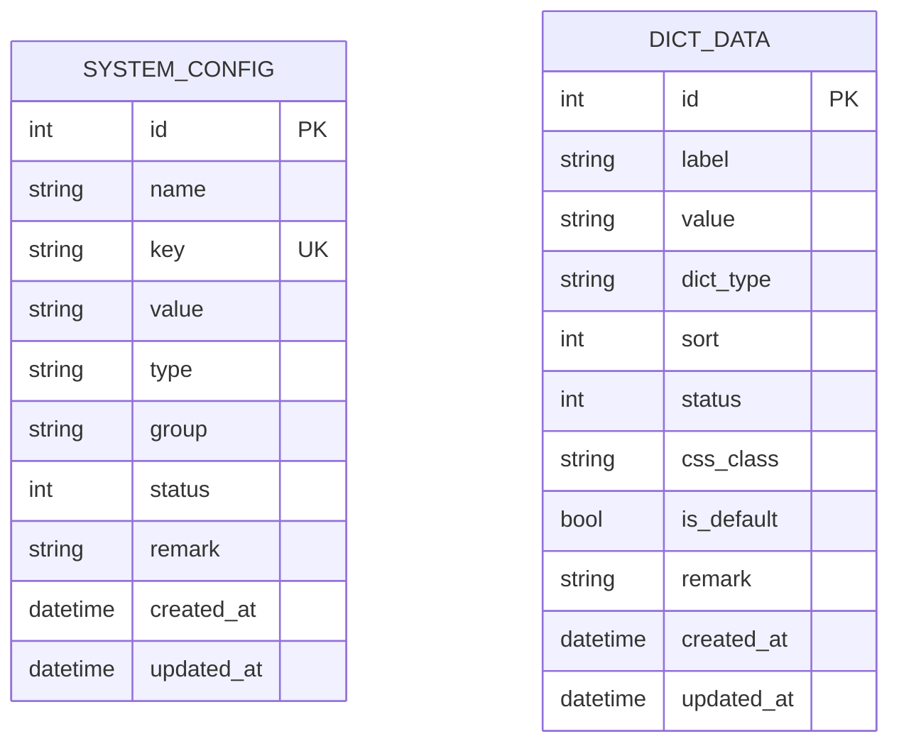

图表来源
- [internal/ent/schema/systemconfig.go:17-79](file://internal/ent/schema/systemconfig.go#L17-L79)
- [internal/ent/migrate/schema.go:238-273](file://internal/ent/migrate/schema.go#L238-L273)
- [internal/ent/schema/dictdata.go:17-80](file://internal/ent/schema/dictdata.go#L17-L80)
- [internal/ent/migrate/schema.go:130-161](file://internal/ent/migrate/schema.go#L130-L161)

章节来源
- [internal/ent/schema/systemconfig.go:17-79](file://internal/ent/schema/systemconfig.go#L17-L79)
- [internal/ent/migrate/schema.go:238-273](file://internal/ent/migrate/schema.go#L238-L273)
- [internal/ent/schema/dictdata.go:17-80](file://internal/ent/schema/dictdata.go#L17-L80)
- [internal/ent/migrate/schema.go:130-161](file://internal/ent/migrate/schema.go#L130-L161)

### 操作日志(OperationLog)模型
- 记录用户操作轨迹，包含用户ID/名称、模块、动作、描述、HTTP 方法/路径/IP、请求体、状态码、耗时、创建时间等。
- 为 user_id、module、action、created_at 建立索引，便于审计与统计。

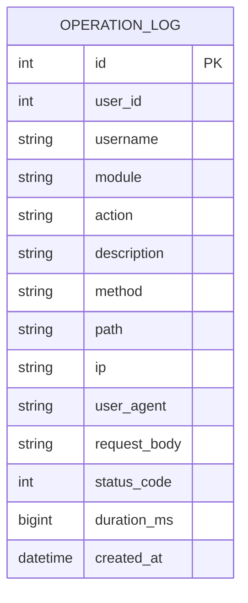

图表来源
- [internal/ent/schema/operationlog.go:17-92](file://internal/ent/schema/operationlog.go#L17-L92)
- [internal/ent/migrate/schema.go:162-206](file://internal/ent/migrate/schema.go#L162-L206)

章节来源
- [internal/ent/schema/operationlog.go:17-92](file://internal/ent/schema/operationlog.go#L17-L92)
- [internal/ent/migrate/schema.go:162-206](file://internal/ent/migrate/schema.go#L162-L206)

### 站内消息(Message)与消息偏好(MessagePreference)模型
- Message：user_uid（空字符串为广播）、type(system/business/task)、level(info/warning/error)、title、content、content_html、extra(JSON)、read_at 等。
  - 索引：按 user_uid+created_at 分页查询，按 user_uid+type+read_at 统计未读，按 type 和 created_at 独立索引。
- MessagePreference：user_uid 唯一，desktop_notify、sound_notify、subscribe_system/business/task、do_not_disturb_start/end。

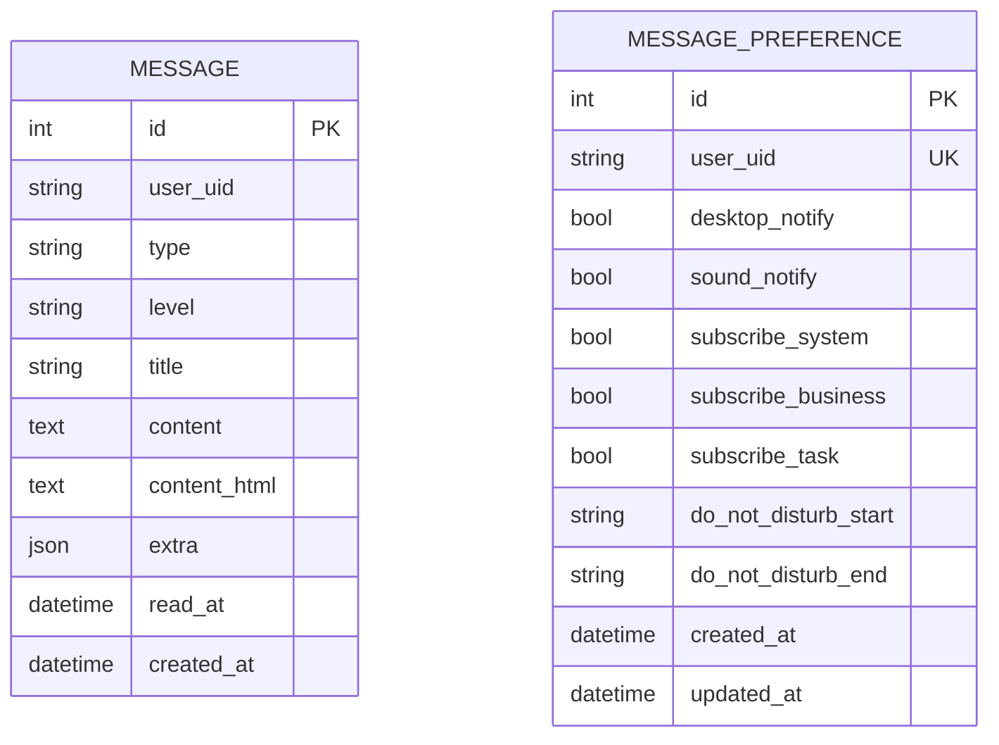

图表来源
- [internal/ent/schema/message.go:16-80](file://internal/ent/schema/message.go#L16-L80)
- [internal/ent/schema/message_preference.go:16-76](file://internal/ent/schema/message_preference.go#L16-L76)

章节来源
- [internal/ent/schema/message.go:16-80](file://internal/ent/schema/message.go#L16-L80)
- [internal/ent/schema/message_preference.go:16-76](file://internal/ent/schema/message_preference.go#L16-L76)

### 插件(Plugin)模型
- 记录插件的唯一标识 plugin_id、名称、版本、作者、描述、状态(installed/enabled/disabled/error)、安装路径、manifest JSON、错误信息、安装/启用/创建/更新时间。
- 索引：plugin_id、status 单独索引，(plugin_id, version) 唯一复合索引。

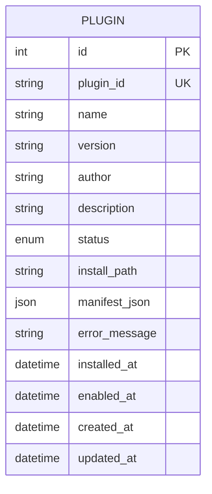

图表来源
- [internal/ent/schema/plugin.go:11-95](file://internal/ent/schema/plugin.go#L11-L95)

章节来源
- [internal/ent/schema/plugin.go:11-95](file://internal/ent/schema/plugin.go#L11-L95)

### 黑名单(Blacklist)模型
- 记录被拉黑的用户(user_id 唯一)、原因、操作人 ID/姓名、拉黑时间。
- user_id 唯一索引，通过 edge 关联到 User 实体。

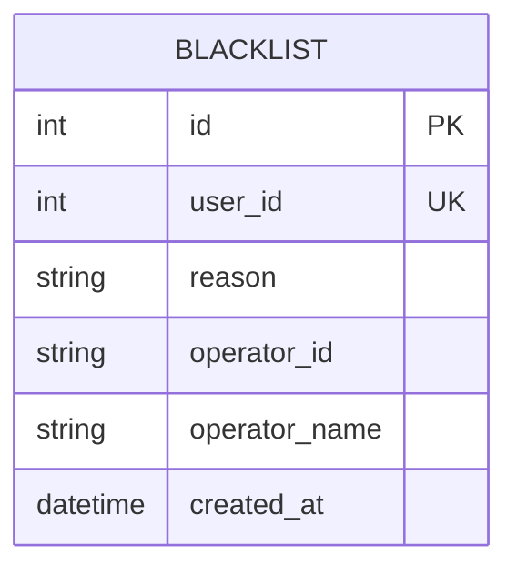

图表来源
- [internal/ent/schema/blacklist.go:17-61](file://internal/ent/schema/blacklist.go#L17-L61)

章节来源
- [internal/ent/schema/blacklist.go:17-61](file://internal/ent/schema/blacklist.go#L17-L61)

### 第三方用户(ThirdPartyUser)模型
- 记录用户关联的第三方平台账号信息，包含 platform、openid、unionid、token、nickname、avatar_url、extra_data、status 等。
- 复合唯一索引 (platform, openid)，按 user_id 和 platform 建立索引。

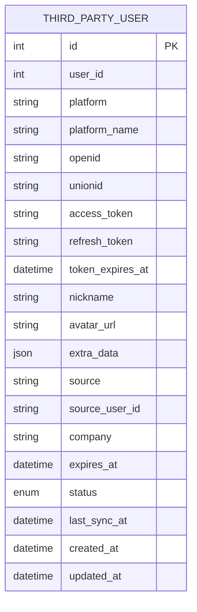

图表来源
- [internal/ent/schema/thirdpartyuser.go:17-131](file://internal/ent/schema/thirdpartyuser.go#L17-L131)

章节来源
- [internal/ent/schema/thirdpartyuser.go:17-131](file://internal/ent/schema/thirdpartyuser.go#L17-L131)

### 权限服务流程（登录与权限校验）
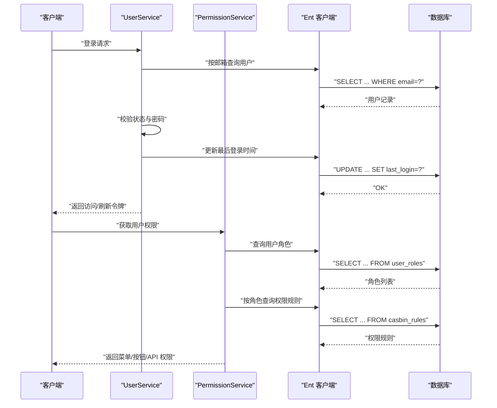

图表来源
- [internal/service/user.go:139-218](file://internal/service/user.go#L139-L218)
- [internal/service/permission.go:559-753](file://internal/service/permission.go#L559-L753)
- [internal/ent/client.go:31-77](file://internal/ent/client.go#L31-L77)

章节来源
- [internal/service/user.go:139-218](file://internal/service/user.go#L139-L218)
- [internal/service/permission.go:559-753](file://internal/service/permission.go#L559-L753)
- [internal/ent/client.go:31-77](file://internal/ent/client.go#L31-L77)

### 权限缓存与失效策略
- 缓存键命名：user:menu/:userID:domain、user:button/:userID:domain、user:api/:userID:domain、role:perms/:roleName:domain。
- 当角色或用户权限发生变更时，清除相关缓存键，保证一致性。
- 默认缓存过期时间为 5 分钟。

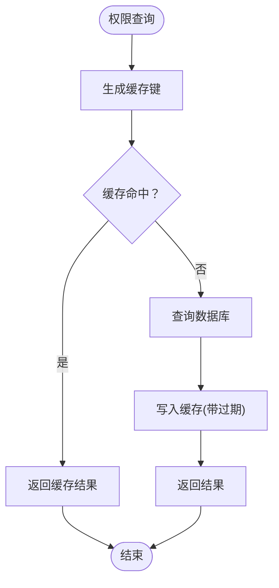

图表来源
- [internal/service/permission.go:137-145](file://internal/service/permission.go#L137-L145)
- [internal/service/permission.go:514-557](file://internal/service/permission.go#L514-L557)
- [internal/service/permission.go:559-753](file://internal/service/permission.go#L559-L753)

章节来源
- [internal/service/permission.go:137-145](file://internal/service/permission.go#L137-L145)
- [internal/service/permission.go:514-557](file://internal/service/permission.go#L514-L557)
- [internal/service/permission.go:559-753](file://internal/service/permission.go#L559-L753)

## 依赖分析
- 表前缀动态初始化：InitTablePrefix 在配置加载后调用，统一更新各实体包与迁移包中的表名，避免硬编码。
- 外键关系：Attachment.group_id -> AttachmentGroup.id；UserRoles.user_id -> Users.id；UserRoles.role_id -> Roles.id；AdminRole.admin_id -> Admins.id；AdminRole.role_id -> Roles.id；Blacklist.user_id -> Users.id；ThirdPartyUser.user_id -> Users.id。
- 迁移选项：支持列/索引删除与外键开关，便于演进式迁移。

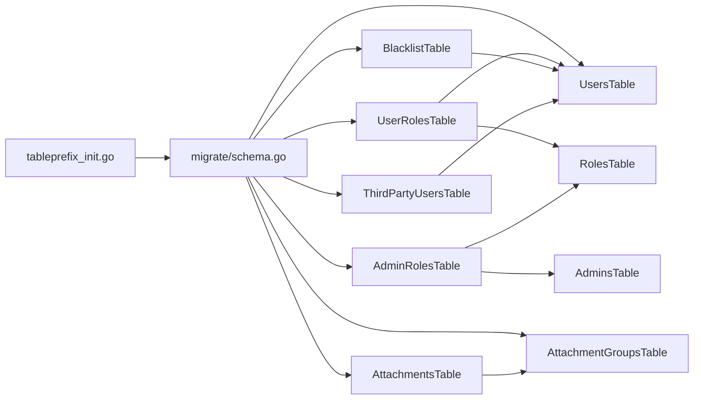

图表来源
- [internal/ent/tableprefix_init.go:20-64](file://internal/ent/tableprefix_init.go#L20-L64)
- [internal/ent/migrate/schema.go:362-381](file://internal/ent/migrate/schema.go#L362-L381)

章节来源
- [internal/ent/tableprefix_init.go:20-64](file://internal/ent/tableprefix_init.go#L20-L64)
- [internal/ent/migrate/schema.go:362-381](file://internal/ent/migrate/schema.go#L362-L381)

## 性能考量
- 索引策略
  - 用户：email、phone、username 唯一/普通索引，加速登录与检索。
  - 角色：name 唯一索引，status 普通索引，便于按状态筛选。
  - 用户-角色：user_id+role_id 唯一索引，user_id、role_id 单列索引，user_id+is_primary 复合索引，支撑多对多查询与主角色查询。
  - 管理员-角色：admin_id+role_id 唯一索引，admin_id、role_id 单列索引，admin_id+is_primary 复合索引。
  - 权限：CasbinRule 复合唯一索引，确保规则唯一且高效匹配。
  - 系统权限定义：(domain, code) 唯一索引，domain、type 普通索引。
  - 附件：group_id、mime_type、created_at 索引，支持分组、类型与时间检索。
  - 定时任务：enabled、type 索引，支持启用筛选与类型过滤。
  - 系统配置：key(唯一)、group、status 索引，支持键值检索与分组/状态筛选。
  - 字典数据：dict_type、status 索引，支持类型与状态检索。
  - 操作日志：user_id、module、action、created_at 索引，便于审计与统计。
  - 站内消息：user_uid+created_at、user_uid+type+read_at、user_uid+read_at+id 复合索引，type、created_at 单列索引，支持分页、未读统计。
  - 消息偏好：user_uid 唯一索引。
  - 插件：plugin_id、status 单列索引，(plugin_id, version) 唯一索引。
  - 黑名单：user_id 唯一索引。
  - 第三方用户：(platform, openid) 唯一索引，user_id、platform 普通索引。
- 查询优化
  - 使用 Exists/Count 减少不必要的数据载荷。
  - 使用 WithRole 预加载关联，减少 N+1 查询。
  - 使用 Limit/Offset 实现分页，避免全表扫描。
- 事务与并发
  - 通过 Ent Client.Tx/BeginTx 支持显式事务，确保跨表一致性。
  - 并发控制建议：对热点表使用行级锁或乐观锁策略，避免写放大。
- 缓存
  - 权限结果缓存 5 分钟，降低 Casbin 查询压力。
  - 缓存键粒度细化到用户/角色/域，避免缓存污染。
  - 动态配置、角色、黑名单、用户信息等也支持缓存。
- 迁移与版本管理
  - 使用 migrate.Schema.Create 进行结构创建与变更。
  - 通过 WithDropIndex/WithDropColumn 等选项灵活处理结构演进。
  - 表前缀统一管理，支持多实例部署。

章节来源
- [internal/ent/migrate/migrate.go:35-65](file://internal/ent/migrate/migrate.go#L35-L65)
- [internal/ent/client.go:154-209](file://internal/ent/client.go#L154-L209)
- [internal/service/permission.go:147-188](file://internal/service/permission.go#L147-L188)

## 故障排查指南
- 常见错误
  - 用户：用户不存在、密码错误、邮箱/用户名已存在、用户状态异常。
  - 角色：角色不存在、角色名称冲突、系统内置角色保护、角色被使用中。
  - 权限：权限不存在、权限类型非法、权限已存在、角色不存在。
  - 管理员：管理员登录失败、is_super_admin 标记异常、管理员角色分配错误。
  - 消息：消息类型/级别不合法、广播目标解析失败、SSE 推送异常。
  - 插件：插件安装失败、插件状态异常、插件路由冲突。
  - 黑名单：重复拉黑、已拉黑用户仍尝试登录。
  - 第三方账号：绑定冲突（同平台 openid 重复）、Token 过期未刷新。
- 排查步骤
  - 登录失败：确认用户状态为 active，核对密码哈希与盐值。
  - 权限未生效：检查角色与用户/管理员关联是否正确，确认 Casbin 规则是否重复或缺失。
  - 缓存不一致：触发缓存清理函数，确认缓存键命名与过期时间。
  - 迁移失败：检查 WithDropIndex/WithDropColumn 选项是否符合预期，确认表前缀是否正确设置。
- 日志与审计
  - 操作日志记录用户行为，便于回溯与审计。

章节来源
- [internal/service/user.go:20-26](file://internal/service/user.go#L20-L26)
- [internal/service/role.go:16-25](file://internal/service/role.go#L16-L25)
- [internal/service/permission.go:20-26](file://internal/service/permission.go#L20-L26)
- [internal/ent/schema/operationlog.go:17-92](file://internal/ent/schema/operationlog.go#L17-L92)

## 结论
本设计以 Ent ORM 为核心，围绕用户、角色、权限、文件、定时任务、管理员、站内消息、插件、黑名单、第三方账号等实体构建了清晰的数据模型与索引策略，并通过迁移工具与表前缀支持实现可演进的数据库结构。配合权限缓存与事务控制，满足高并发场景下的性能与一致性需求。建议在生产环境中持续关注索引维护、缓存策略与迁移风险管控。

## 附录

### 数据库迁移机制
- 迁移入口：migrate.Schema.Create，传入表集合与迁移选项。
- 选项说明：
  - WithDropColumn：允许删除列（谨慎使用）。
  - WithDropIndex：允许删除索引（推荐开启以获得更大灵活性）。
  - WithForeignKeys：控制是否生成外键 DDL。
- 表前缀：InitTablePrefix 统一更新各实体与迁移包中的表名，适用于多租户或多实例部署。

章节来源
- [internal/ent/migrate/migrate.go:35-65](file://internal/ent/migrate/migrate.go#L35-L65)
- [internal/ent/migrate/schema.go:1-381](file://internal/ent/migrate/schema.go#L1-L381)
- [internal/ent/tableprefix_init.go:17-64](file://internal/ent/tableprefix_init.go#L17-L64)

### 查询优化与事务处理
- 优化建议
  - 为高频查询字段建立合适索引，避免全表扫描。
  - 使用 Exists/Count 替代 Select *，减少网络与内存开销。
  - 使用 WithEdge 预加载关联，避免 N+1 查询。
  - 分页查询使用 Limit/Offset，必要时引入游标分页。
- 事务处理
  - 使用 Client.Tx 或 Client.BeginTx 开启事务，确保跨表一致性。
  - 对热点资源使用行级锁或乐观锁，降低冲突概率。

章节来源
- [internal/ent/client.go:154-209](file://internal/ent/client.go#L154-L209)
- [internal/service/permission.go:577-584](file://internal/service/permission.go#L577-L584)

### 数据访问模式与缓存策略
- 数据访问模式
  - 服务层通过 Ent 客户端进行 CRUD，结合 Where/Only/All/Count 等 API。
  - 使用 WithEdge 预加载关联，减少查询次数。
- 缓存策略
  - 用户权限缓存：user:menu/:userID:domain、user:button/:userID:domain、user:api/:userID:domain。
  - 角色权限缓存：role:perms/:roleName:domain。
  - 默认过期时间 5 分钟，变更时主动清理相关键。

章节来源
- [internal/service/permission.go:137-188](file://internal/service/permission.go#L137-L188)
- [internal/service/permission.go:514-753](file://internal/service/permission.go#L514-L753)

### 扩展指南与自定义字段
- 新增实体
  - 在 internal/ent/schema 下新增 schema 文件，定义字段、索引与边。
  - 重新生成代码：entc generate，更新 internal/ent/migrate/schema.go 与各实体包。
  - 在 internal/ent/tableprefix_init.go 中补充表前缀更新逻辑。
- 自定义字段
  - 字段类型选择：优先使用 Ent 内置类型，必要时使用字符串/JSON 存储复杂结构。
  - 约束与索引：为常用查询字段添加唯一/普通索引，注意维护成本。
  - 边与关系：通过 edge 定义多对多/一对多关系，生成外键与反向查询。
- 迁移与兼容
  - 使用 WithDropIndex/WithDropColumn 选项进行结构演进。
  - 保持表前缀一致性，避免跨实例冲突。

章节来源
- [internal/ent/schema/user.go:23-102](file://internal/ent/schema/user.go#L23-L102)
- [internal/ent/migrate/schema.go:1-381](file://internal/ent/migrate/schema.go#L1-L381)
- [internal/ent/tableprefix_init.go:20-64](file://internal/ent/tableprefix_init.go#L20-L64)

### 数据安全、备份与迁移升级最佳实践
- 数据安全
  - 密码使用盐值与哈希存储，禁止明文保存。
  - 对敏感字段（如请求体、第三方 token）进行脱敏或限制存储。
  - 权限最小化：基于角色的权限控制，定期审计。
- 备份与恢复
  - 定期全量备份与增量备份结合，验证恢复流程。
  - 迁移前先备份，使用只读副本验证结构变更。
- 迁移升级
  - 通过 Ent 迁移工具进行结构变更，优先使用 WithDropIndex。
  - 表前缀统一管理，避免多实例冲突。
  - 对大表变更采用分批处理与灰度发布，降低风险。

章节来源
- [internal/service/user.go:118-136](file://internal/service/user.go#L118-L136)
- [internal/ent/migrate/migrate.go:14-33](file://internal/ent/migrate/migrate.go#L14-L33)
- [internal/ent/tableprefix_init.go:17-20](file://internal/ent/tableprefix_init.go#L17-L20)
