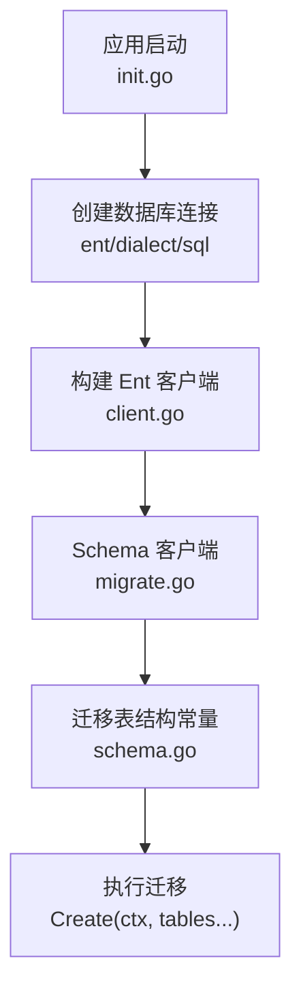
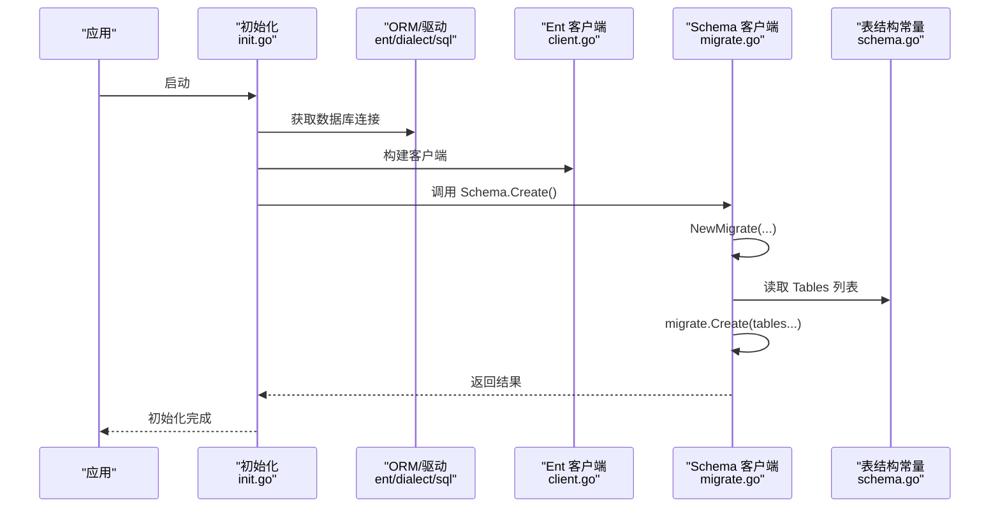
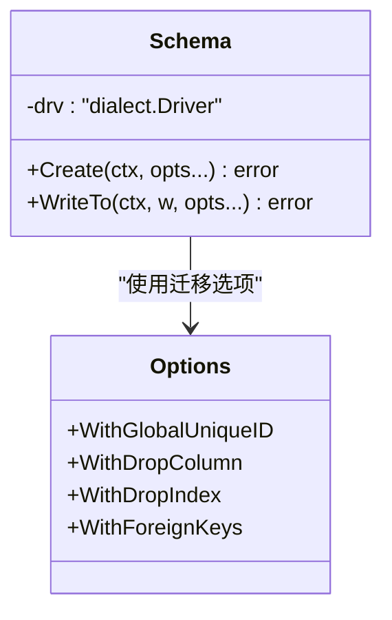
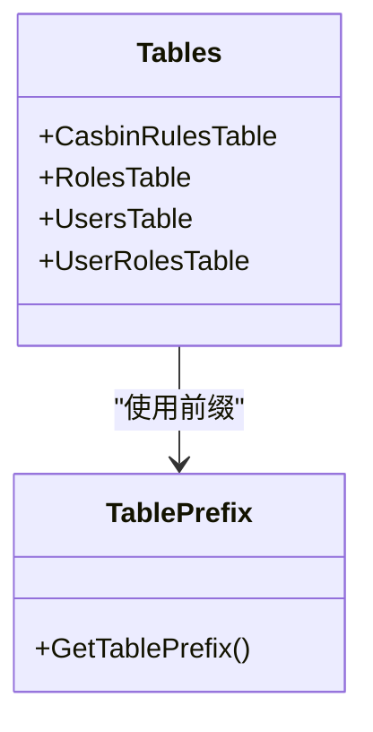
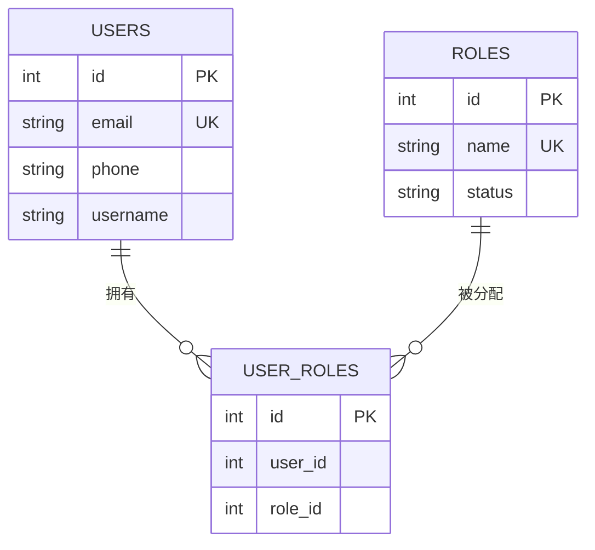
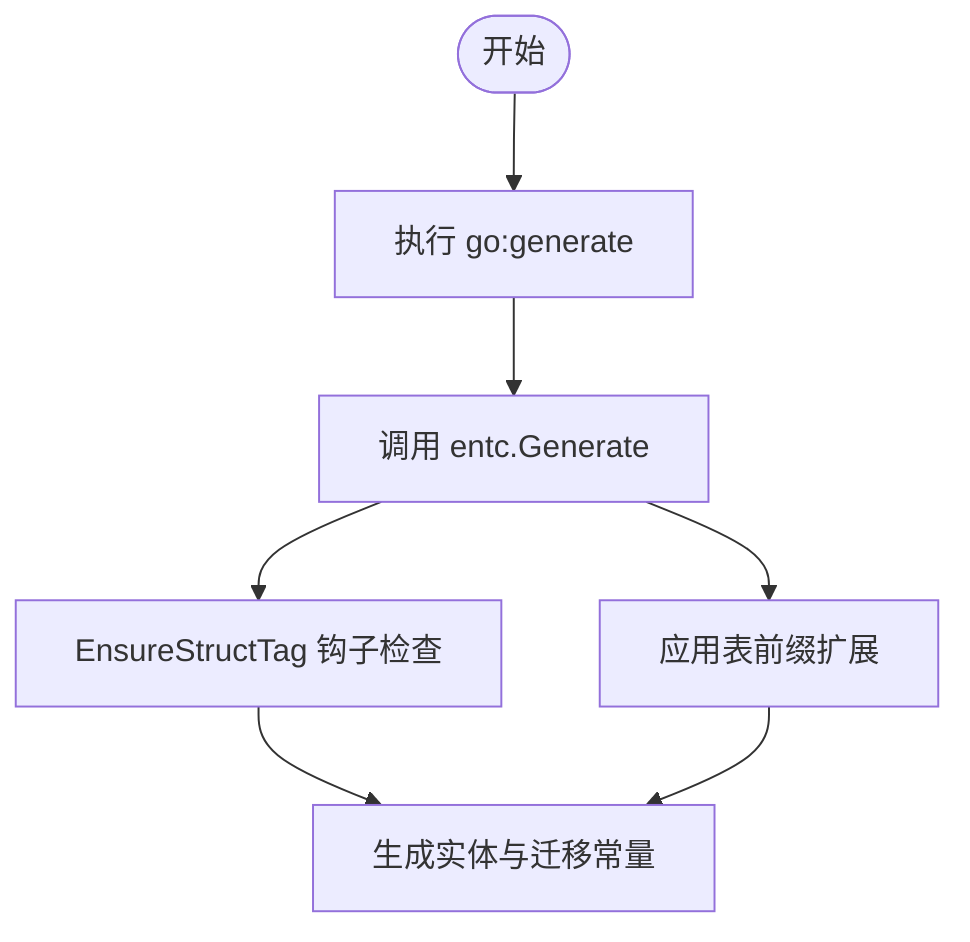
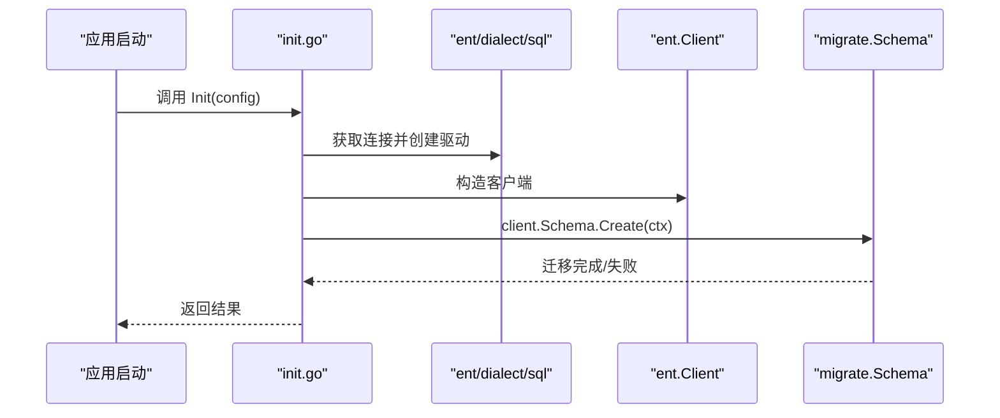
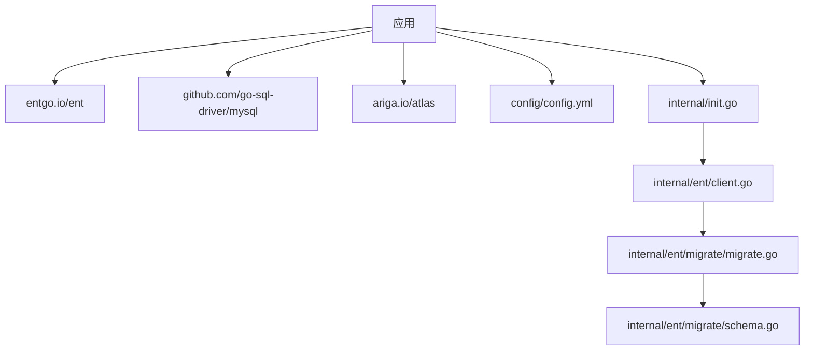

# 数据库迁移

<cite>
**本文引用的文件**
- [migrate.go](file://internal/ent/migrate/migrate.go)
- [schema.go](file://internal/ent/migrate/schema.go)
- [ent.go](file://internal/ent/ent.go)
- [client.go](file://internal/ent/client.go)
- [runtime.go](file://internal/ent/runtime.go)
- [entc.go](file://internal/ent/entc.go)
- [generate.go](file://internal/ent/generate.go)
- [user.go](file://internal/ent/schema/user.go)
- [role.go](file://internal/ent/schema/role.go)
- [userrole.go](file://internal/ent/schema/userrole.go)
- [casbinrule.go](file://internal/ent/schema/casbinrule.go)
- [config.yml](file://config/config.yml)
- [init.go](file://internal/init.go)
- [go.mod](file://go.mod)
</cite>

## 目录
1. [简介](#简介)
2. [项目结构](#项目结构)
3. [核心组件](#核心组件)
4. [架构总览](#架构总览)
5. [详细组件分析](#详细组件分析)
6. [依赖分析](#依赖分析)
7. [性能考虑](#性能考虑)
8. [故障排除指南](#故障排除指南)
9. [结论](#结论)
10. [附录](#附录)

## 简介
本文件面向 Go Admin 管理系统，围绕 Ent ORM 的数据库迁移机制与版本管理策略进行系统化说明。内容涵盖：
- 迁移文件生成流程与代码生成钩子
- 迁移执行顺序与回滚能力边界
- 自动化模式变更（表结构、索引、约束）处理
- 迁移过程中的数据保护与备份建议
- 迁移脚本编写规范与最佳实践
- 开发/测试/生产环境差异策略
- 故障排除与常见问题
- 性能优化与大表迁移最佳实践

## 项目结构
与迁移相关的关键目录与文件：
- internal/ent/schema：实体定义与索引声明
- internal/ent/migrate：迁移 API 与表结构常量
- internal/ent：Ent 客户端、运行时初始化
- internal/ent/entc.go/generate.go：代码生成入口与钩子
- config/config.yml：数据库连接与表前缀配置
- internal/init.go：应用启动时的数据库初始化与迁移调用

图表来源
- [init.go:33-47](file://internal/init.go#L33-L47)
- [client.go:47-53](file://internal/ent/client.go#L47-L53)
- [migrate.go:44-55](file://internal/ent/migrate/migrate.go#L44-L55)
- [schema.go:156-163](file://internal/ent/migrate/schema.go#L156-L163)

章节来源
- [init.go:33-47](file://internal/init.go#L33-L47)
- [client.go:47-53](file://internal/ent/client.go#L47-L53)
- [migrate.go:44-55](file://internal/ent/migrate/migrate.go#L44-L55)
- [schema.go:156-163](file://internal/ent/migrate/schema.go#L156-L163)

## 核心组件
- 迁移 API：通过 Schema 客户端封装底层 schema.Migrate，支持创建表、写入 SQL 而不执行等。
- 表结构常量：集中定义各表列、主键、索引、外键，统一受表前缀影响。
- 代码生成：entc 生成器配合扩展与钩子，确保结构标签一致性与表前缀注入。
- 启动迁移：应用初始化阶段自动执行数据库迁移。

章节来源
- [migrate.go:35-64](file://internal/ent/migrate/migrate.go#L35-L64)
- [schema.go:11-163](file://internal/ent/migrate/schema.go#L11-L163)
- [entc.go:16-27](file://internal/ent/entc.go#L16-L27)
- [generate.go:3](file://internal/ent/generate.go#L3)
- [init.go:42-44](file://internal/init.go#L42-L44)

## 架构总览
下图展示从应用启动到迁移执行的端到端流程：

图表来源
- [init.go:33-47](file://internal/init.go#L33-L47)
- [client.go:47-53](file://internal/ent/client.go#L47-L53)
- [migrate.go:44-55](file://internal/ent/migrate/migrate.go#L44-L55)
- [schema.go:156-163](file://internal/ent/migrate/schema.go#L156-L163)

## 详细组件分析

### 组件A：迁移 API 与选项
- 功能职责
  - 提供 Schema.Create(ctx, opts...) 便捷入口
  - 支持写入 SQL 到 Writer 而非直接执行（WriteTo），便于审计与预检
  - 导出迁移选项：全局唯一 ID、列删除、索引删除、外键开关
- 关键点
  - 通过 schema.NewMigrate 包装底层驱动，保证跨方言兼容
  - 选项控制迁移行为，如 WithDropIndex 用于更灵活地变更索引
- 适用场景
  - 开发期预览变更
  - 生产灰度发布前的变更核对

图表来源
- [migrate.go:35-64](file://internal/ent/migrate/migrate.go#L35-L64)

章节来源
- [migrate.go:14-33](file://internal/ent/migrate/migrate.go#L14-L33)
- [migrate.go:44-64](file://internal/ent/migrate/migrate.go#L44-L64)

### 组件B：表结构常量与表前缀
- 功能职责
  - 定义 CasbinRules、Roles、Users、UserRoles 的列、主键、索引、外键
  - 通过 TablePrefix 统一加前缀，来源于配置中心
- 关键点
  - 索引覆盖常用查询字段（如用户邮箱、角色名、联合唯一索引）
  - 外键符号命名清晰，删除策略明确
  - 表前缀由外部模块提供，确保多租户/多实例隔离

图表来源
- [schema.go:11](file://internal/ent/migrate/schema.go#L11)
- [schema.go:156-163](file://internal/ent/migrate/schema.go#L156-L163)

章节来源
- [schema.go:11-163](file://internal/ent/migrate/schema.go#L11-L163)

### 组件C：实体定义与索引
- 用户表：email、phone、username 等字段均定义索引，保障查询效率
- 角色表：name 唯一索引、status 辅助索引
- 用户角色关联表：user_id+role_id 联合唯一索引，以及单列索引
- Casbin 规则表：全字段唯一索引，满足策略匹配需求

图表来源
- [user.go:91-97](file://internal/ent/schema/user.go#L91-L97)
- [role.go:61-66](file://internal/ent/schema/role.go#L61-L66)
- [userrole.go:43-49](file://internal/ent/schema/userrole.go#L43-L49)
- [casbinrule.go:32-36](file://internal/ent/schema/casbinrule.go#L32-L36)

章节来源
- [user.go:23-97](file://internal/ent/schema/user.go#L23-L97)
- [role.go:16-66](file://internal/ent/schema/role.go#L16-L66)
- [userrole.go:17-49](file://internal/ent/schema/userrole.go#L17-L49)
- [casbinrule.go:15-36](file://internal/ent/schema/casbinrule.go#L15-L36)

### 组件D：代码生成与钩子
- 生成入口：generate.go 中通过 go:generate 调用 entc.go
- 生成逻辑：entc.go 使用 entc.Generate，启用 EnsureStructTag 钩子确保 JSON 标签存在，并应用表前缀扩展
- 作用：保证实体结构一致、标签完备、表前缀注入

图表来源
- [generate.go:3](file://internal/ent/generate.go#L3)
- [entc.go:16-27](file://internal/ent/entc.go#L16-L27)

章节来源
- [generate.go:3](file://internal/ent/generate.go#L3)
- [entc.go:16-44](file://internal/ent/entc.go#L16-L44)

### 组件E：启动时迁移与客户端初始化
- 初始化流程：init.go 中构造数据库连接，创建 Ent 客户端，随后调用 client.Schema.Create 执行迁移
- 运行时校验：ent.go 内部维护列检查器，避免无效列导致的查询错误
- 全局错误类型：提供验证、未找到、约束冲突等错误类型，便于上层处理

图表来源
- [init.go:33-47](file://internal/init.go#L33-L47)
- [client.go:47-53](file://internal/ent/client.go#L47-L53)
- [ent.go:76-86](file://internal/ent/ent.go#L76-L86)

章节来源
- [init.go:33-47](file://internal/init.go#L33-L47)
- [client.go:47-53](file://internal/ent/client.go#L47-L53)
- [ent.go:76-86](file://internal/ent/ent.go#L76-L86)

## 依赖分析
- 外部依赖
  - entgo.io/ent：ORM 与迁移框架
  - github.com/go-sql-driver/mysql：MySQL 驱动
  - ariga.io/atlas：迁移工具链（间接依赖）
- 内部依赖
  - internal/ent/*：迁移 API、实体定义、客户端、运行时
  - config/config.yml：数据库连接与表前缀
  - internal/init.go：应用启动与迁移触发

图表来源
- [go.mod:5-13](file://go.mod#L5-L13)
- [config.yml:19-31](file://config/config.yml#L19-L31)
- [init.go:33-47](file://internal/init.go#L33-L47)
- [client.go:47-53](file://internal/ent/client.go#L47-L53)
- [migrate.go:44-55](file://internal/ent/migrate/migrate.go#L44-L55)
- [schema.go:156-163](file://internal/ent/migrate/schema.go#L156-L163)

章节来源
- [go.mod:5-13](file://go.mod#L5-L13)
- [config.yml:19-31](file://config/config.yml#L19-L31)
- [init.go:33-47](file://internal/init.go#L33-L47)
- [client.go:47-53](file://internal/ent/client.go#L47-L53)
- [migrate.go:44-55](file://internal/ent/migrate/migrate.go#L44-L55)
- [schema.go:156-163](file://internal/ent/migrate/schema.go#L156-L163)

## 性能考虑
- 索引设计
  - 为高频查询字段建立索引（如用户邮箱、角色名、联合唯一索引）
  - 控制索引数量与大小，避免写入放大
- 大表迁移
  - 分批处理：按主键范围分页扫描与写入
  - 选择低峰时段执行
  - 使用只读副本或影子表策略降低锁竞争
- 连接与并发
  - 合理设置连接池参数，避免过载
  - 在迁移前后评估慢查询日志与锁等待

## 故障排除指南
- 迁移失败
  - 检查迁移选项：是否启用了 WithDropIndex/WithDropColumn 等
  - 使用 WriteTo 输出 SQL，人工核对后再执行
- 约束冲突
  - 使用 IsConstraintError 判断并针对性修复数据
- 启动失败
  - 查看 init.go 中的错误日志，确认数据库连通性与凭据
- 列不存在
  - 运行时列检查器会拦截无效列，需同步实体定义与数据库结构

章节来源
- [migrate.go:57-64](file://internal/ent/migrate/migrate.go#L57-L64)
- [ent.go:267-292](file://internal/ent/ent.go#L267-L292)
- [init.go:42-44](file://internal/init.go#L42-L44)
- [ent.go:76-86](file://internal/ent/ent.go#L76-L86)

## 结论
本项目基于 Ent ORM 实现了自动化、可审计的数据库迁移机制。通过代码生成、表前缀注入与集中式表结构常量，确保了迁移的一致性与可维护性。结合合理的索引设计与大表迁移策略，可在保证性能的同时安全地演进数据库模式。

## 附录

### 迁移文件生成与执行流程
- 生成阶段
  - 执行 go:generate，调用 entc.Generate
  - 应用 EnsureStructTag 钩子与表前缀扩展
- 运行阶段
  - 应用启动时，init.go 构造客户端并调用 client.Schema.Create
  - migrate.Schema.Create 通过 schema.NewMigrate 包装底层驱动并执行

章节来源
- [generate.go:3](file://internal/ent/generate.go#L3)
- [entc.go:16-27](file://internal/ent/entc.go#L16-L27)
- [init.go:42-44](file://internal/init.go#L42-L44)
- [migrate.go:44-55](file://internal/ent/migrate/migrate.go#L44-L55)

### 不同环境下的迁移策略
- 开发环境
  - 允许 WithDropIndex/WithDropColumn 等选项，快速迭代
  - 使用 WriteTo 预览 SQL，便于本地调试
- 测试环境
  - 与生产相同迁移策略，但限制并发与窗口期
- 生产环境
  - 严格审核 SQL；优先使用影子表或蓝绿部署
  - 保留回滚方案与数据备份

### 迁移脚本编写规范与最佳实践
- 规范
  - 明确迁移目标与影响面
  - 使用 WriteTo 输出 SQL 并评审
  - 为大表迁移制定分批与窗口期计划
- 最佳实践
  - 保持索引数量与大小合理
  - 对外键与唯一约束变更进行风险评估
  - 在变更前后记录基准指标（QPS、延迟）

### 数据保护与备份策略
- 迁移前
  - 全量备份或逻辑导出
  - 识别长事务与热点表
- 迁移中
  - 限制并发与扫描范围
  - 监控锁等待与慢查询
- 迁移后
  - 校验数据完整性与索引健康
  - 回归性能基线