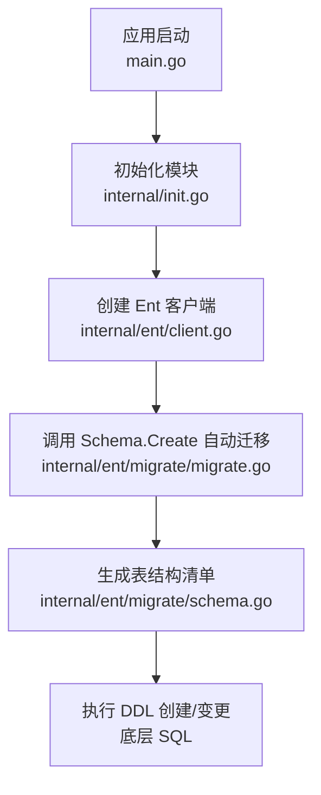
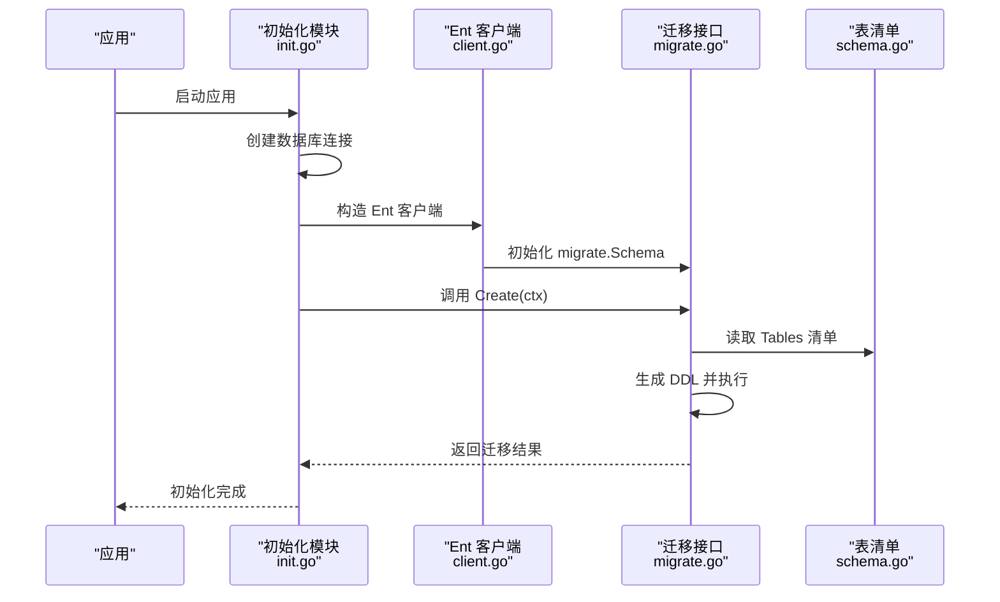
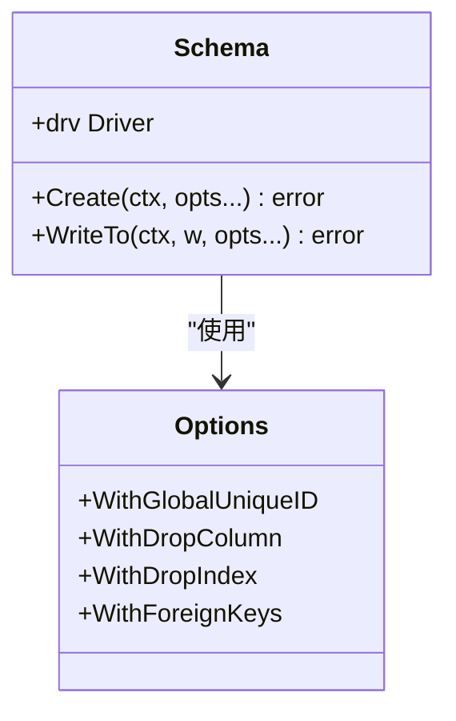
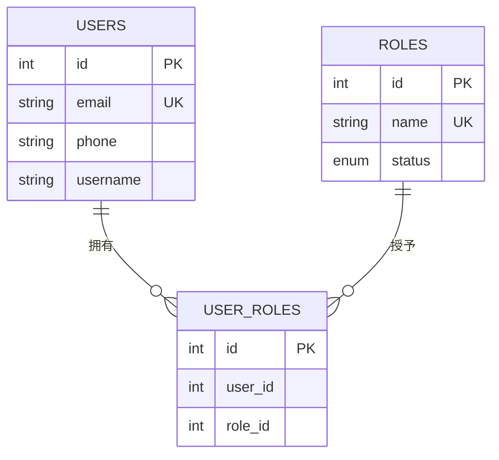
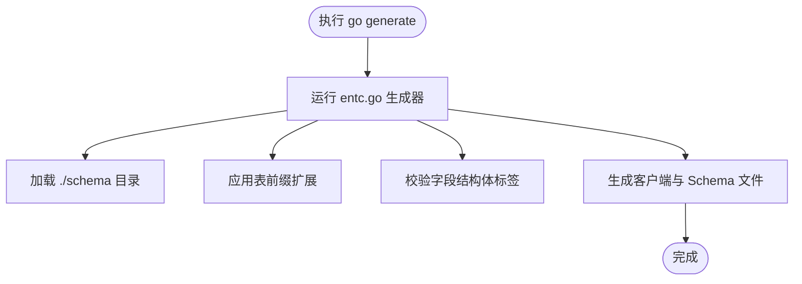
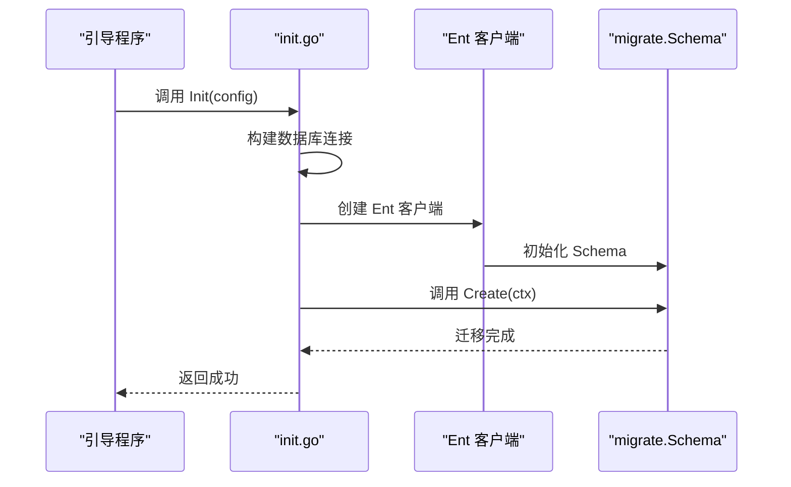
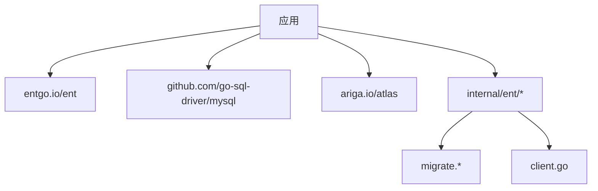

# 数据库迁移机制

<cite>
**本文引用的文件**
- [migrate.go](file://internal/ent/migrate/migrate.go)
- [schema.go](file://internal/ent/migrate/schema.go)
- [client.go](file://internal/ent/client.go)
- [generate.go](file://internal/ent/generate.go)
- [entc.go](file://internal/ent/entc.go)
- [user.go](file://internal/ent/schema/user.go)
- [role.go](file://internal/ent/schema/role.go)
- [init.go](file://internal/init.go)
- [config.yml](file://config/config.yml)
- [go.mod](file://go.mod)
</cite>

## 目录
1. [简介](#简介)
2. [项目结构](#项目结构)
3. [核心组件](#核心组件)
4. [架构总览](#架构总览)
5. [详细组件分析](#详细组件分析)
6. [依赖分析](#依赖分析)
7. [性能考虑](#性能考虑)
8. [故障排查指南](#故障排查指南)
9. [结论](#结论)
10. [附录](#附录)

## 简介
本文件系统性阐述 Go Admin 管理系统的数据库迁移机制，重点围绕 Ent ORM 的 Schema 迁移实现，覆盖自动迁移、手动迁移与版本控制策略；详解迁移文件生成流程与管理方式，说明如何处理 Schema 变更、字段更新与索引调整；并给出生产环境的迁移策略（零停机、回滚与备份）、具体迁移示例（新增表、修改表结构、数据转换）以及常见问题与解决方案。

## 项目结构
本项目的迁移相关代码主要集中在 internal/ent 子目录中，核心文件包括：
- 迁移 API 与选项：internal/ent/migrate/migrate.go
- Schema 定义与表清单：internal/ent/migrate/schema.go
- Ent 客户端与 Schema 引用：internal/ent/client.go
- 代码生成入口：internal/ent/generate.go、internal/ent/entc.go
- 应用初始化与自动迁移触发点：internal/init.go
- 数据库配置：config/config.yml
- 依赖声明：go.mod

图表来源
- [init.go:69-84](file://internal/init.go#L69-L84)
- [client.go:59-69](file://internal/ent/client.go#L59-L69)
- [migrate.go:44-55](file://internal/ent/migrate/migrate.go#L44-L55)
- [schema.go:293-303](file://internal/ent/migrate/schema.go#L293-L303)

章节来源
- [init.go:69-84](file://internal/init.go#L69-L84)
- [client.go:59-69](file://internal/ent/client.go#L59-L69)
- [migrate.go:44-55](file://internal/ent/migrate/migrate.go#L44-L55)
- [schema.go:293-303](file://internal/ent/migrate/schema.go#L293-L303)

## 核心组件
- 迁移 API 与选项
  - 提供 Schema.Create 与 WriteTo 接口，封装底层 schema.Migrate 的创建逻辑，并暴露 WithGlobalUniqueID、WithDropColumn、WithDropIndex、WithForeignKeys 等迁移选项。
- Schema 表清单
  - 维护所有表的列、主键、外键、索引等元信息，统一由 Tables 列表导出，供迁移时比对与生成 DDL。
- Ent 客户端
  - 在初始化阶段持有 migrate.Schema 实例，用于在应用启动时自动执行迁移。
- 代码生成
  - generate.go 与 entc.go 协同工作，通过 entc 生成客户端与 Schema 定义，并支持扩展（如表前缀）。
- 应用初始化
  - init.go 中在未注入外部 ORM 时，手动创建数据库连接与 Ent 客户端，并调用 client.Schema.Create 执行自动迁移。

章节来源
- [migrate.go:14-33](file://internal/ent/migrate/migrate.go#L14-L33)
- [migrate.go:35-64](file://internal/ent/migrate/migrate.go#L35-L64)
- [schema.go:11-11](file://internal/ent/migrate/schema.go#L11-L11)
- [schema.go:293-303](file://internal/ent/migrate/schema.go#L293-L303)
- [client.go:29-69](file://internal/ent/client.go#L29-L69)
- [generate.go:1-4](file://internal/ent/generate.go#L1-L4)
- [entc.go:16-27](file://internal/ent/entc.go#L16-L27)
- [init.go:69-84](file://internal/init.go#L69-L84)

## 架构总览
下图展示了从应用启动到自动迁移执行的关键交互：

图表来源
- [init.go:69-84](file://internal/init.go#L69-L84)
- [client.go:59-69](file://internal/ent/client.go#L59-L69)
- [migrate.go:44-55](file://internal/ent/migrate/migrate.go#L44-L55)
- [schema.go:293-303](file://internal/ent/migrate/schema.go#L293-L303)

## 详细组件分析

### 迁移 API 与选项（migrate.go）
- 能力概览
  - 提供 Schema.Create(ctx, opts...) 一键创建所有表资源。
  - 支持 WriteTo(ctx, writer, opts...) 将迁移 DDL 写入输出而不直接执行，便于审计与预审。
  - 暴露迁移选项：
    - WithGlobalUniqueID：为实体分配全局唯一 ID 区间（仅适用于新建表）。
    - WithDropColumn：允许删除已废弃列（默认关闭）。
    - WithDropIndex：允许删除旧索引（推荐开启以获得更大灵活性）。
    - WithForeignKeys：是否在 DDL 中创建外键（默认开启）。
- 设计要点
  - 通过 schema.NewMigrate(drv, opts...) 组合驱动与选项，再调用 migrate.Create(tables...) 执行。
  - WriteTo 使用 schema.WriteDriver 将 DDL 输出到任意 io.Writer，避免直接写库。

图表来源
- [migrate.go:35-64](file://internal/ent/migrate/migrate.go#L35-L64)

章节来源
- [migrate.go:14-33](file://internal/ent/migrate/migrate.go#L14-L33)
- [migrate.go:35-64](file://internal/ent/migrate/migrate.go#L35-L64)

### Schema 表清单与元数据（schema.go）
- 表清单
  - 通过全局变量维护各表的列、主键、外键、索引等定义，并汇总到 Tables 列表，供迁移时比对与生成 DDL。
- 表前缀
  - 通过 TablePrefix = orm.GetTablePrefix() 动态注入表前缀，确保多租户或多实例隔离。
- 典型表结构
  - 用户、角色、附件、定时任务、操作日志等均在此集中定义，包含列类型、长度、默认值、可空性、唯一性与索引等。
- 外键与索引
  - 明确外键符号、引用列与删除策略；索引覆盖常用查询字段，兼顾查询与写入性能。

图表来源
- [schema.go:175-246](file://internal/ent/migrate/schema.go#L175-L246)
- [schema.go:247-292](file://internal/ent/migrate/schema.go#L247-L292)

章节来源
- [schema.go:11-11](file://internal/ent/migrate/schema.go#L11-L11)
- [schema.go:293-303](file://internal/ent/migrate/schema.go#L293-L303)

### 代码生成与扩展（generate.go、entc.go）
- 生成入口
  - generate.go 通过 //go:generate 指令调用 entc.go，执行 entc.Generate，生成客户端与 Schema。
- 扩展支持
  - entc.go 使用 entc.Extensions(tableprefix.NewTablePrefix()) 注入表前缀扩展，确保生成的表名符合配置。
  - 通过 Hooks 确保字段具备指定结构体标签（如 json），保证序列化一致性。

图表来源
- [generate.go:1-4](file://internal/ent/generate.go#L1-L4)
- [entc.go:16-27](file://internal/ent/entc.go#L16-L27)
- [entc.go:29-44](file://internal/ent/entc.go#L29-L44)

章节来源
- [generate.go:1-4](file://internal/ent/generate.go#L1-L4)
- [entc.go:16-27](file://internal/ent/entc.go#L16-L27)
- [entc.go:29-44](file://internal/ent/entc.go#L29-L44)

### 应用初始化与自动迁移（init.go、client.go）
- 初始化流程
  - 若未注入外部 ORM，init.go 会手动创建数据库连接与 Ent 客户端，并调用 client.Schema.Create 执行自动迁移。
- 客户端集成
  - client.go 在 init() 中将 migrate.Schema 赋给 Client.Schema，使上层可通过 client.Schema 调用迁移能力。

图表来源
- [init.go:69-84](file://internal/init.go#L69-L84)
- [client.go:59-69](file://internal/ent/client.go#L59-L69)

章节来源
- [init.go:69-84](file://internal/init.go#L69-L84)
- [client.go:59-69](file://internal/ent/client.go#L59-L69)

### 生产环境迁移策略
- 自动迁移
  - 在应用启动阶段自动执行，确保数据库结构与代码一致；适合开发与测试环境。
- 手动迁移
  - 使用 WriteTo(ctx, writer, opts...) 将 DDL 导出到脚本文件，经人工审核后再执行，适合生产环境。
- 版本控制
  - 建议将生成的 DDL 脚本纳入版本控制，配合 Git 分支与 PR 审核，形成“结构即代码”的治理。
- 零停机迁移
  - 优先采用“在线 DDL”策略（如 MySQL Online DDL），分步执行：先加列/建索引，再回填数据，最后删除旧列/重建索引。
  - 对大表重定义，建议在低峰期执行，并结合影子表或灰度发布。
- 回滚机制
  - 保留最近 N 个版本的 DDL 脚本；回滚时按逆序执行对应版本的降级脚本。
  - 对关键变更（如删除列、重建索引）提前评估影响范围与数据备份。
- 数据备份
  - 迁移前对目标表进行逻辑备份（mysqldump 或物理备份），迁移后验证一致性与性能指标。

章节来源
- [migrate.go:57-64](file://internal/ent/migrate/migrate.go#L57-L64)

### 迁移示例与最佳实践
- 新增表
  - 在 ./internal/ent/schema 下新增 Schema 文件（参考 user.go、role.go），定义字段、索引与 Mixin。
  - 执行 go generate 更新客户端与迁移清单，然后通过 client.Schema.Create 或导出 DDL 审核后执行。
- 修改现有表结构
  - 仅修改 Schema 定义（如新增列、调整默认值、新增索引），保持列名与类型兼容。
  - 对于高风险变更（删除列、重命名列、修改列类型），先导出 DDL 审核，再执行。
- 处理数据转换
  - 对于需要数据清洗或转换的场景，可在迁移后执行数据修复脚本或在业务层增加数据迁移任务。
- 索引调整
  - 新增复合索引时，优先覆盖高频查询字段；删除冗余索引以降低写入开销。

章节来源
- [user.go:23-97](file://internal/ent/schema/user.go#L23-L97)
- [role.go:16-66](file://internal/ent/schema/role.go#L16-L66)
- [generate.go:1-4](file://internal/ent/generate.go#L1-L4)

## 依赖分析
- 外部依赖
  - entgo.io/ent：ORM 与迁移框架
  - github.com/go-sql-driver/mysql：MySQL 驱动
  - ariga.io/atlas：可选的迁移工具链（间接依赖）
- 内部依赖
  - internal/ent/migrate：迁移 API 与表清单
  - internal/ent/client：客户端与 Schema 引用
  - internal/init：应用初始化与自动迁移触发

图表来源
- [go.mod:5-21](file://go.mod#L5-L21)
- [migrate.go:10-12](file://internal/ent/migrate/migrate.go#L10-L12)
- [client.go:23-27](file://internal/ent/client.go#L23-L27)

章节来源
- [go.mod:5-21](file://go.mod#L5-L21)
- [migrate.go:10-12](file://internal/ent/migrate/migrate.go#L10-L12)
- [client.go:23-27](file://internal/ent/client.go#L23-L27)

## 性能考虑
- 迁移窗口
  - 尽量在业务低峰期执行大表 DDL；对长事务与锁竞争敏感的操作，采用分批处理或影子表策略。
- 索引设计
  - 新增索引时遵循“查询覆盖优先”，避免过度索引导致写入性能下降。
- 并发与幂等
  - 迁移脚本需具备幂等性，避免重复执行造成资源浪费或异常。
- 监控与回滚
  - 迁移前后对比慢查询、锁等待与表大小；准备回滚脚本与快速恢复预案。

## 故障排查指南
- 迁移失败
  - 检查数据库连接参数与权限；确认表前缀配置正确（config.yml 中 table_prefix）。
  - 使用 WriteTo 导出 DDL，逐条核对语法与约束冲突。
- 锁等待与长时间运行
  - 对大表 DDL 采用在线变更；必要时临时降级或切换只读副本。
- 数据不一致
  - 迁移前后执行一致性校验（行数、关键字段校验）；对关键表进行抽样回归测试。
- 配置问题
  - 确认 config.yml 中 database.connections.default.table_prefix 与实际部署一致；检查驱动与 SSL 设置。

章节来源
- [config.yml:19-31](file://config/config.yml#L19-L31)
- [migrate.go:57-64](file://internal/ent/migrate/migrate.go#L57-L64)

## 结论
本项目基于 Ent ORM 的 Schema 迁移机制，实现了“自动生成、集中管理、可控执行”的迁移体系。通过迁移 API、表清单与代码生成工具链的协同，既能满足开发效率，又能在生产环境中通过导出 DDL 与严格审核实现安全可控的变更。建议在生产中结合零停机策略、回滚预案与备份方案，确保迁移过程的稳定性与可追溯性。

## 附录
- 关键配置项
  - 数据库连接与表前缀：config.yml 中 database.connections.default.table_prefix
- 常用命令
  - 生成客户端与迁移清单：go generate
  - 导出 DDL 审核：client.Schema.WriteTo(ctx, writer, opts...)

章节来源
- [config.yml:19-31](file://config/config.yml#L19-L31)
- [generate.go:1-4](file://internal/ent/generate.go#L1-L4)