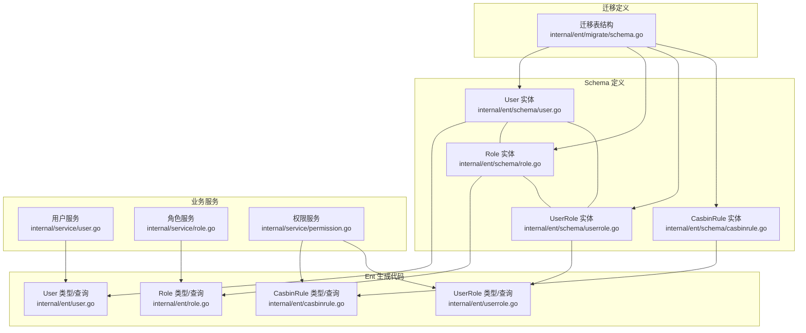
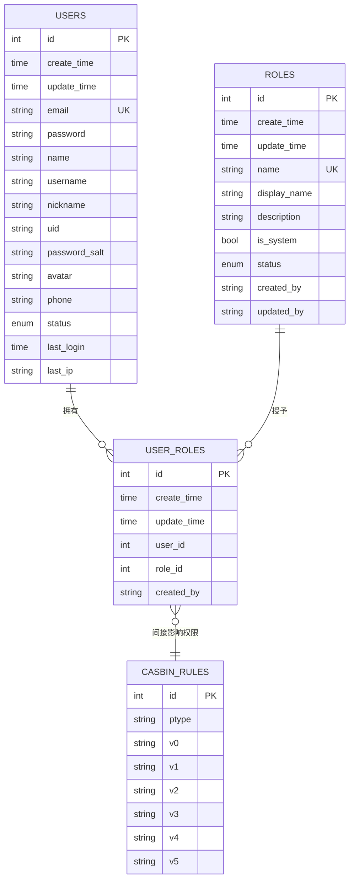
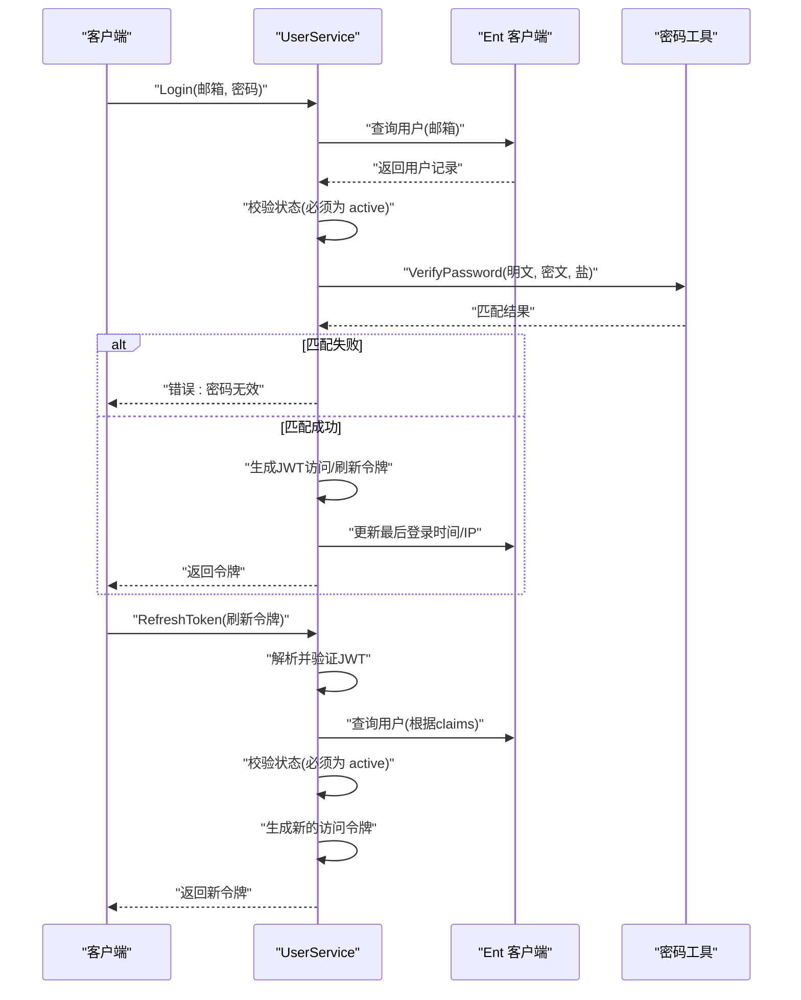
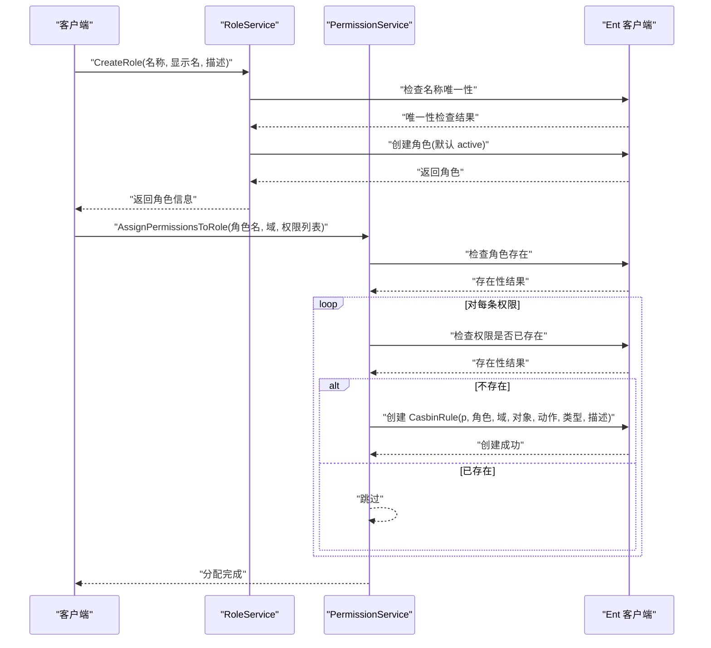
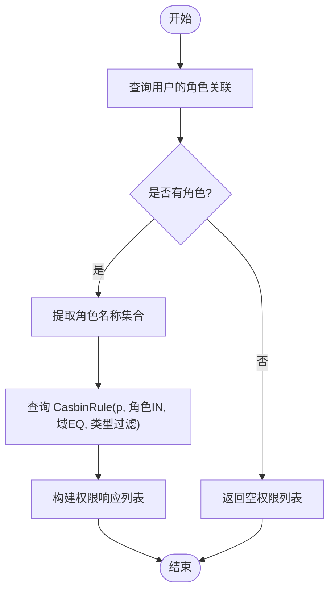
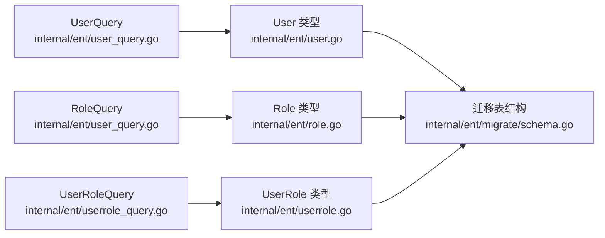

# 数据模型设计

<cite>
**本文引用的文件**
- [internal/ent/schema/user.go](file://internal/ent/schema/user.go)
- [internal/ent/schema/role.go](file://internal/ent/schema/role.go)
- [internal/ent/schema/casbinrule.go](file://internal/ent/schema/casbinrule.go)
- [internal/ent/schema/userrole.go](file://internal/ent/schema/userrole.go)
- [internal/ent/user.go](file://internal/ent/user.go)
- [internal/ent/role.go](file://internal/ent/role.go)
- [internal/ent/casbinrule.go](file://internal/ent/casbinrule.go)
- [internal/ent/userrole.go](file://internal/ent/userrole.go)
- [internal/ent/user_query.go](file://internal/ent/user_query.go)
- [internal/ent/userrole_query.go](file://internal/ent/userrole_query.go)
- [internal/ent/migrate/schema.go](file://internal/ent/migrate/schema.go)
- [config/rbac_model.conf](file://config/rbac_model.conf)
- [internal/service/user.go](file://internal/service/user.go)
- [internal/service/role.go](file://internal/service/role.go)
- [internal/service/permission.go](file://internal/service/permission.go)
</cite>

## 目录
1. [简介](#简介)
2. [项目结构](#项目结构)
3. [核心组件](#核心组件)
4. [架构总览](#架构总览)
5. [详细组件分析](#详细组件分析)
6. [依赖分析](#依赖分析)
7. [性能考量](#性能考量)
8. [故障排查指南](#故障排查指南)
9. [结论](#结论)
10. [附录](#附录)

## 简介
本文件面向 Go Admin 管理系统，系统化梳理基于 Ent ORM 的数据模型设计与实现，重点覆盖以下实体与关系：
- User 用户模型：用户基本信息、认证凭据、状态与登录追踪
- Role 角色模型：角色元数据、状态与归属
- CasbinRule 权限规则模型：基于 Casbin 的 RBAC 策略存储
- UserRole 用户角色关联模型：用户与角色的多对多桥接表

文档从字段定义、约束、索引、验证规则、生命周期与业务规则等维度进行深入解析，并通过图示展示实体间关系与典型流程。

## 项目结构
围绕 Ent 的分层组织：
- schema 层：定义实体结构、字段、索引、Mixin
- ent 自动生成层：实体类型、查询器、选择器、聚合器
- migrate 层：数据库迁移表结构定义
- service 层：业务服务封装，调用 Ent 客户端执行读写



图表来源
- [internal/ent/schema/user.go:17-104](file://internal/ent/schema/user.go#L17-L104)
- [internal/ent/schema/role.go:10-73](file://internal/ent/schema/role.go#L10-L73)
- [internal/ent/schema/casbinrule.go:9-37](file://internal/ent/schema/casbinrule.go#L9-L37)
- [internal/ent/schema/userrole.go:11-56](file://internal/ent/schema/userrole.go#L11-L56)
- [internal/ent/migrate/schema.go:13-164](file://internal/ent/migrate/schema.go#L13-L164)
- [internal/service/user.go:36-44](file://internal/service/user.go#L36-L44)
- [internal/service/role.go:39-48](file://internal/service/role.go#L39-L48)
- [internal/service/permission.go:116-125](file://internal/service/permission.go#L116-L125)

章节来源
- [internal/ent/schema/user.go:17-104](file://internal/ent/schema/user.go#L17-L104)
- [internal/ent/schema/role.go:10-73](file://internal/ent/schema/role.go#L10-L73)
- [internal/ent/schema/casbinrule.go:9-37](file://internal/ent/schema/casbinrule.go#L9-L37)
- [internal/ent/schema/userrole.go:11-56](file://internal/ent/schema/userrole.go#L11-L56)
- [internal/ent/migrate/schema.go:13-164](file://internal/ent/migrate/schema.go#L13-L164)

## 核心组件
本节按实体维度逐一说明字段、约束、索引、默认值与业务含义。

### User 用户模型
- 字段与约束
  - id: 整数主键，自增、唯一、不可变
  - email: 唯一、最大长度 255、正则匹配邮箱格式
  - password: 最大长度 255、敏感字段、非空
  - name/nickname/username: 可选、最大长度 255
  - uid: 可选、最大长度 255（用户唯一标识）
  - password_salt: 可选、最大长度 255、敏感字段
  - avatar: 可选、最大长度 1024
  - phone: 可选、最大长度 20、正则仅数字
  - status: 枚举(active/inactive/suspended)，默认 inactive
  - last_login: 可选时间
  - last_ip: 可选、最大长度 50
- 索引
  - email、phone、username 单列索引
- 生命周期
  - 自动注入 create_time/update_time（Mixin）
- 业务含义
  - 认证主体；状态控制登录能力；登录成功后更新 last_login/last_ip

章节来源
- [internal/ent/schema/user.go:23-81](file://internal/ent/schema/user.go#L23-L81)
- [internal/ent/schema/user.go:91-97](file://internal/ent/schema/user.go#L91-L97)
- [internal/ent/schema/user.go:99-104](file://internal/ent/schema/user.go#L99-L104)
- [internal/ent/migrate/schema.go:69-109](file://internal/ent/migrate/schema.go#L69-L109)

### Role 角色模型
- 字段与约束
  - id: 整数主键，自增、唯一、不可变
  - name: 唯一、最大长度 100、非空
  - display_name: 最大长度 255、非空
  - description: 可选、最大长度 500
  - is_system: 布尔，默认 false
  - status: 枚举(active/inactive)，默认 active
  - created_by/updated_by: 可选、最大长度 255
- 索引
  - name 唯一索引
  - status 非唯一索引
- 生命周期
  - 自动注入 create_time/update_time（Mixin）
- 业务含义
  - 角色元数据；系统内置角色标记；状态控制可用性

章节来源
- [internal/ent/schema/role.go:16-51](file://internal/ent/schema/role.go#L16-L51)
- [internal/ent/schema/role.go:61-66](file://internal/ent/schema/role.go#L61-L66)
- [internal/ent/schema/role.go:68-73](file://internal/ent/schema/role.go#L68-L73)
- [internal/ent/migrate/schema.go:38-68](file://internal/ent/migrate/schema.go#L38-L68)

### CasbinRule 权限规则模型
- 字段与约束
  - Ptype/V0-V5: 字符串，默认空字符串
- 索引
  - 复合唯一索引(Ptype,V0,V1,V2,V3,V4,V5)
- 业务含义
  - 存储 Casbin 策略 p 元组(sub,obj,act)，并扩展类型与描述字段

章节来源
- [internal/ent/schema/casbinrule.go:15-25](file://internal/ent/schema/casbinrule.go#L15-L25)
- [internal/ent/schema/casbinrule.go:32-36](file://internal/ent/schema/casbinrule.go#L32-L36)
- [internal/ent/migrate/schema.go:14-37](file://internal/ent/migrate/schema.go#L14-L37)

### UserRole 用户角色关联模型
- 字段与约束
  - id: 整数主键，自增、唯一、不可变
  - user_id/role_id: 必填整数
  - created_by: 可选、最大长度 255
- 边关系
  - user: To(User)、必填、唯一、字段 user_id
  - role: To(Role)、必填、唯一、字段 role_id
- 索引
  - 唯一复合索引(user_id,role_id)
  - user_id、role_id 单列索引
- 生命周期
  - 自动注入 create_time/update_time（Mixin）
- 业务含义
  - 用户与角色的多对多桥接；记录分配者信息

章节来源
- [internal/ent/schema/userrole.go:17-32](file://internal/ent/schema/userrole.go#L17-L32)
- [internal/ent/schema/userrole.go:35-40](file://internal/ent/schema/userrole.go#L35-L40)
- [internal/ent/schema/userrole.go:43-49](file://internal/ent/schema/userrole.go#L43-L49)
- [internal/ent/schema/userrole.go:51-56](file://internal/ent/schema/userrole.go#L51-L56)
- [internal/ent/migrate/schema.go:110-155](file://internal/ent/migrate/schema.go#L110-L155)

## 架构总览
下图展示实体关系、索引与迁移表结构的对应关系，以及服务层如何通过 Ent 查询器与客户端进行交互。



图表来源
- [internal/ent/migrate/schema.go:69-109](file://internal/ent/migrate/schema.go#L69-L109)
- [internal/ent/migrate/schema.go:38-68](file://internal/ent/migrate/schema.go#L38-L68)
- [internal/ent/migrate/schema.go:110-155](file://internal/ent/migrate/schema.go#L110-L155)
- [internal/ent/migrate/schema.go:14-37](file://internal/ent/migrate/schema.go#L14-L37)

## 详细组件分析

### 用户模型类图
```mermaid
classDiagram
class User {
+int id
+string email
+string password
+string name
+string username
+string nickname
+string uid
+string password_salt
+string avatar
+string phone
+enum status
+time last_login
+string last_ip
+time create_time
+time update_time
}
class Role {
+int id
+string name UK
+string display_name
+string description
+bool is_system
+enum status
+string created_by
+string updated_by
+time create_time
+time update_time
}
class UserRole {
+int id
+int user_id FK
+int role_id FK
+string created_by
+time create_time
+time update_time
}
class CasbinRule {
+int id
+string ptype
+string v0
+string v1
+string v2
+string v3
+string v4
+string v5
}
User "1" --o{ UserRole : "拥有"
Role "1" --o{ UserRole : "授予"
UserRole ||--o{ CasbinRule : "间接影响权限"
```

图表来源
- [internal/ent/user.go:15-49](file://internal/ent/user.go#L15-L49)
- [internal/ent/role.go:15-39](file://internal/ent/role.go#L15-L39)
- [internal/ent/userrole.go:17-36](file://internal/ent/userrole.go#L17-L36)
- [internal/ent/casbinrule.go:14-34](file://internal/ent/casbinrule.go#L14-L34)

章节来源
- [internal/ent/user.go:15-49](file://internal/ent/user.go#L15-L49)
- [internal/ent/role.go:15-39](file://internal/ent/role.go#L15-L39)
- [internal/ent/userrole.go:17-36](file://internal/ent/userrole.go#L17-L36)
- [internal/ent/casbinrule.go:14-34](file://internal/ent/casbinrule.go#L14-L34)

### 用户登录与令牌刷新序列图


图表来源
- [internal/service/user.go:127-206](file://internal/service/user.go#L127-L206)
- [internal/service/user.go:274-356](file://internal/service/user.go#L274-L356)

章节来源
- [internal/service/user.go:127-206](file://internal/service/user.go#L127-L206)
- [internal/service/user.go:274-356](file://internal/service/user.go#L274-L356)

### 角色管理与权限分配序列图


图表来源
- [internal/service/role.go:94-143](file://internal/service/role.go#L94-L143)
- [internal/service/permission.go:356-403](file://internal/service/permission.go#L356-L403)

章节来源
- [internal/service/role.go:94-143](file://internal/service/role.go#L94-L143)
- [internal/service/permission.go:356-403](file://internal/service/permission.go#L356-L403)

### 用户权限查询流程图


图表来源
- [internal/service/permission.go:466-510](file://internal/service/permission.go#L466-L510)
- [internal/service/permission.go:511-554](file://internal/service/permission.go#L511-L554)
- [internal/service/permission.go:556-600](file://internal/service/permission.go#L556-L600)

章节来源
- [internal/service/permission.go:466-510](file://internal/service/permission.go#L466-L510)
- [internal/service/permission.go:511-554](file://internal/service/permission.go#L511-L554)
- [internal/service/permission.go:556-600](file://internal/service/permission.go#L556-L600)

## 依赖分析
- 实体关系
  - User 与 Role 通过 UserRole 多对多关联
  - UserRole 作为桥接表，承载 user_id/role_id 外键与 created_by
  - CasbinRule 存储策略元组，与角色名称形成间接关联
- 查询器与选择器
  - UserQuery/RoleQuery/UserRoleQuery 提供链式查询、聚合、分组、排序、分页
  - 支持预加载边（eager load），如 UserRoleQuery.WithUser/WithRole
- 迁移与索引
  - 迁移定义了表前缀、主键、唯一/非唯一索引、外键约束
  - 索引覆盖高频查询字段（如 email、username、role.name、userrole 复合索引）



图表来源
- [internal/ent/user_query.go:18-528](file://internal/ent/user_query.go#L18-L528)
- [internal/ent/userrole_query.go:20-682](file://internal/ent/userrole_query.go#L20-L682)
- [internal/ent/user.go:15-248](file://internal/ent/user.go#L15-L248)
- [internal/ent/role.go:15-197](file://internal/ent/role.go#L15-L197)
- [internal/ent/userrole.go:17-199](file://internal/ent/userrole.go#L17-L199)
- [internal/ent/migrate/schema.go:13-164](file://internal/ent/migrate/schema.go#L13-L164)

章节来源
- [internal/ent/user_query.go:18-528](file://internal/ent/user_query.go#L18-L528)
- [internal/ent/userrole_query.go:20-682](file://internal/ent/userrole_query.go#L20-L682)
- [internal/ent/migrate/schema.go:13-164](file://internal/ent/migrate/schema.go#L13-L164)

## 性能考量
- 索引策略
  - 用户：email/phone/username 单列索引，支持常见登录与检索
  - 角色：name 唯一索引、status 非唯一索引，支撑角色名唯一性与状态筛选
  - 关联：user_id/role_id 复合唯一索引与单列索引，避免重复分配与加速查询
  - 权限：CasbinRule 复合唯一索引，保证策略去重
- 查询优化
  - 使用 Select 精准选择字段，减少扫描与序列化开销
  - 使用 Where + 聚合函数进行统计查询
  - 使用 WithUser/WithRole 预加载边，降低 N+1 查询风险
- 写入优化
  - 批量创建权限时先做存在性检查，避免重复插入
  - 使用事务包裹批量写入，确保一致性与性能

## 故障排查指南
- 用户相关
  - 用户不存在：查询 Only/Exist 返回 NotFound 错误
  - 密码无效：密码校验失败返回错误
  - 用户状态异常：非 active 状态禁止登录
- 角色相关
  - 角色名称冲突：唯一性约束导致创建失败
  - 角色被使用：删除前需确认无用户关联
  - 系统内置角色：状态与部分字段受保护
- 权限相关
  - 权限不存在：查找失败返回 NotFound
  - 权限类型非法：类型不在允许集合内
  - 权限重复：唯一索引导致插入失败

章节来源
- [internal/service/user.go:19-25](file://internal/service/user.go#L19-L25)
- [internal/service/role.go:14-23](file://internal/service/role.go#L14-L23)
- [internal/service/permission.go:16-22](file://internal/service/permission.go#L16-L22)

## 结论
本数据模型以 Ent ORM 为核心，围绕用户、角色、权限三要素构建清晰的层次化结构。通过合理的字段约束、索引与查询器能力，既满足业务需求又兼顾性能与可维护性。配合服务层的业务规则封装，实现了从认证到授权的闭环。

## 附录
- RBAC 模型配置
  - 请求定义、策略定义、角色关系、策略效果、匹配器均在配置文件中定义，用于 Casbin 策略评估

章节来源
- [config/rbac_model.conf:1-15](file://config/rbac_model.conf#L1-L15)