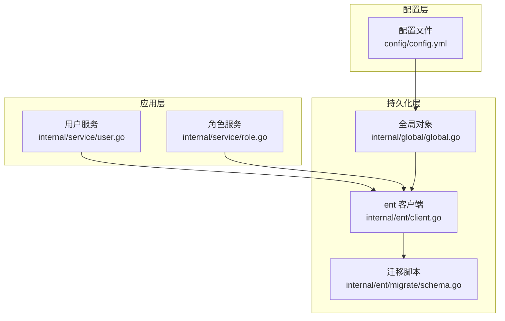
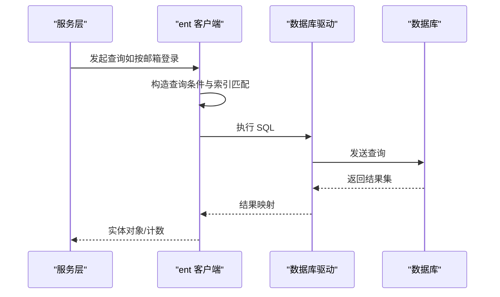
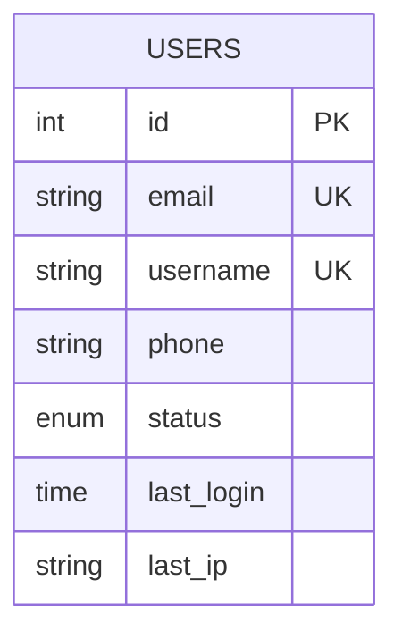
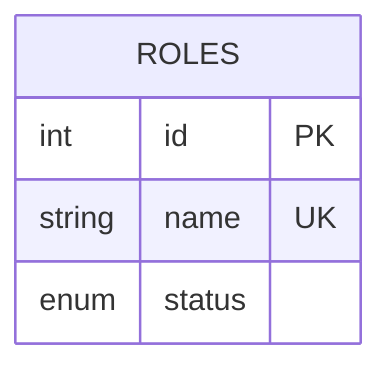
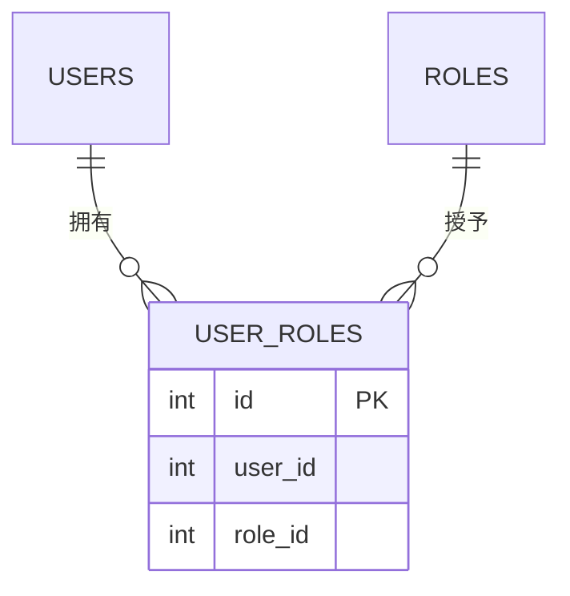
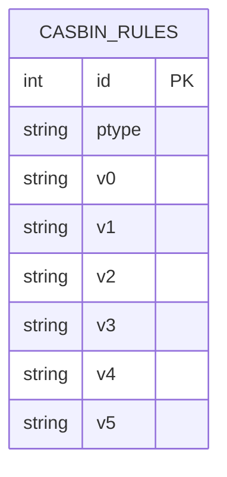
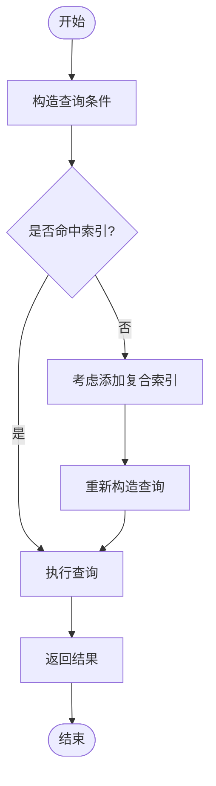
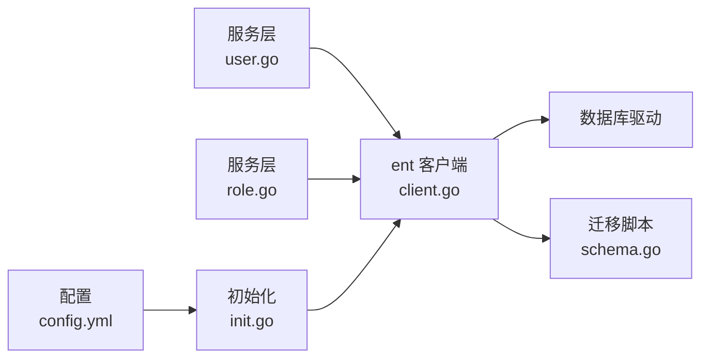

# 索引与性能优化

<cite>
**本文引用的文件**
- [user.go](file://internal/ent/schema/user.go)
- [role.go](file://internal/ent/schema/role.go)
- [userrole.go](file://internal/ent/schema/userrole.go)
- [casbinrule.go](file://internal/ent/schema/casbinrule.go)
- [schema.go](file://internal/ent/migrate/schema.go)
- [client.go](file://internal/ent/client.go)
- [init.go](file://internal/init.go)
- [config.yml](file://config/config.yml)
- [user.go](file://internal/service/user.go)
- [role.go](file://internal/service/role.go)
- [tx.go](file://internal/ent/tx.go)
- [user_query.go](file://internal/ent/user_query.go)
- [adapter.go](file://internal/casbin/adapter/adapter.go)
- [global.go](file://internal/global/global.go)
</cite>

## 目录
1. [简介](#简介)
2. [项目结构](#项目结构)
3. [核心组件](#核心组件)
4. [架构总览](#架构总览)
5. [详细组件分析](#详细组件分析)
6. [依赖分析](#依赖分析)
7. [性能考量](#性能考量)
8. [故障排查指南](#故障排查指南)
9. [结论](#结论)
10. [附录](#附录)

## 简介
本文件聚焦于 Go Admin 管理系统的数据库索引与性能优化，结合代码库中的实体定义、迁移脚本与运行时配置，系统阐述以下主题：
- 实体索引设计策略与实现原理（主键、唯一、复合索引）
- 查询性能分析方法与慢查询优化技巧
- 数据库连接池配置与并发访问优化
- 索引维护策略与定期性能监控方案
- 不同查询模式下的索引使用效果与优化建议
- 数据库参数调优与硬件资源配置建议
- 大数据量场景下的分表分库策略与读写分离方案

## 项目结构
本项目采用基于实体框架（ent）的分层架构，数据库层通过 ent 自动生成客户端与迁移脚本，应用层通过服务层封装业务逻辑，配置层集中管理数据库与缓存等外部依赖。

**图表来源**
- [client.go:114-125](file://internal/ent/client.go#L114-L125)
- [schema.go:157-163](file://internal/ent/migrate/schema.go#L157-L163)
- [init.go:33-47](file://internal/init.go#L33-L47)
- [config.yml:19-31](file://config/config.yml#L19-L31)
- [global.go:10-14](file://internal/global/global.go#L10-L14)

**章节来源**
- [client.go:114-125](file://internal/ent/client.go#L114-L125)
- [schema.go:157-163](file://internal/ent/migrate/schema.go#L157-L163)
- [init.go:33-47](file://internal/init.go#L33-L47)
- [config.yml:19-31](file://config/config.yml#L19-L31)
- [global.go:10-14](file://internal/global/global.go#L10-L14)

## 核心组件
- 实体与索引定义
  - 用户实体：主键自增、邮箱/手机/用户名唯一索引
  - 角色实体：主键自增、名称唯一索引、状态普通索引
  - 用户角色关联：联合唯一索引、单列普通索引
  - 访问控制规则：全字段联合唯一索引
- 运行时客户端与事务
  - 支持 Open/Driver/Debug/Close 等选项
  - 提供事务包装与提交/回滚钩子
- 初始化流程
  - 依据配置创建数据库连接，构建 ent 客户端并执行迁移
- 服务层
  - 用户登录、注册、更新等操作均通过 ent 查询与更新
  - 角色列表、状态变更等操作通过 ent 查询与更新

**章节来源**
- [user.go:90-97](file://internal/ent/schema/user.go#L90-L97)
- [role.go:60-66](file://internal/ent/schema/role.go#L60-L66)
- [userrole.go:42-49](file://internal/ent/schema/userrole.go#L42-L49)
- [casbinrule.go:32-36](file://internal/ent/schema/casbinrule.go#L32-L36)
- [schema.go:14-163](file://internal/ent/migrate/schema.go#L14-L163)
- [client.go:114-125](file://internal/ent/client.go#L114-L125)
- [tx.go:66-78](file://internal/ent/tx.go#L66-L78)
- [init.go:33-47](file://internal/init.go#L33-L47)
- [user.go:82-125](file://internal/service/user.go#L82-L125)
- [role.go:163-222](file://internal/service/role.go#L163-L222)

## 架构总览
下图展示数据库索引与查询路径的关键交互：服务层发起查询，ent 客户端生成 SQL，迁移脚本确保索引存在，最终由数据库执行查询并返回结果。

**图表来源**
- [user.go:128-138](file://internal/service/user.go#L128-L138)
- [client.go:114-125](file://internal/ent/client.go#L114-L125)
- [schema.go:88-109](file://internal/ent/migrate/schema.go#L88-L109)

## 详细组件分析

### 用户实体索引设计
- 主键索引：自增整型 id
- 唯一索引：email、username
- 普通索引：phone
- 时间戳 mixin：统一记录 create_time/update_time

**图表来源**
- [user.go:23-80](file://internal/ent/schema/user.go#L23-L80)
- [schema.go:69-109](file://internal/ent/migrate/schema.go#L69-L109)

**章节来源**
- [user.go:90-97](file://internal/ent/schema/user.go#L90-L97)
- [schema.go:88-109](file://internal/ent/migrate/schema.go#L88-L109)

### 角色实体索引设计
- 主键索引：自增整型 id
- 唯一索引：name
- 普通索引：status

**图表来源**
- [role.go:16-51](file://internal/ent/schema/role.go#L16-L51)
- [schema.go:39-67](file://internal/ent/migrate/schema.go#L39-L67)

**章节来源**
- [role.go:60-66](file://internal/ent/schema/role.go#L60-L66)
- [schema.go:52-67](file://internal/ent/migrate/schema.go#L52-L67)

### 用户角色关联索引设计
- 主键索引：自增整型 id
- 联合唯一索引：user_id + role_id
- 单列普通索引：user_id、role_id

**图表来源**
- [userrole.go:17-40](file://internal/ent/schema/userrole.go#L17-L40)
- [schema.go:110-155](file://internal/ent/migrate/schema.go#L110-L155)

**章节来源**
- [userrole.go:42-49](file://internal/ent/schema/userrole.go#L42-L49)
- [schema.go:119-155](file://internal/ent/migrate/schema.go#L119-L155)

### 访问控制规则索引设计
- 主键索引：自增整型 id
- 联合唯一索引：Ptype + V0..V5（全字段）

**图表来源**
- [casbinrule.go:15-36](file://internal/ent/schema/casbinrule.go#L15-L36)
- [schema.go:14-37](file://internal/ent/migrate/schema.go#L14-L37)

**章节来源**
- [casbinrule.go:32-36](file://internal/ent/schema/casbinrule.go#L32-L36)
- [schema.go:26-37](file://internal/ent/migrate/schema.go#L26-L37)

### 查询性能分析与慢查询优化
- 唯一条件查询
  - 用户邮箱登录：利用 email 唯一索引快速定位
  - 角色名称查询：利用 name 唯一索引快速定位
- 范围/排序查询
  - 角色列表按创建时间倒序：建议在 create_time 上建立普通索引（当前 schema 中未显式定义，但 mixin 包含时间戳）
- 组合过滤与排序
  - 用户列表按状态/登录时间排序：建议在 status/last_login 建立复合索引
- 计数与分页
  - 使用 Count/Offset/Limit 时，尽量让过滤条件命中索引，避免全表扫描

**图表来源**
- [user_query.go:358-405](file://internal/ent/user_query.go#L358-L405)
- [user.go:128-138](file://internal/service/user.go#L128-L138)
- [role.go:163-222](file://internal/service/role.go#L163-L222)

**章节来源**
- [user_query.go:358-405](file://internal/ent/user_query.go#L358-L405)
- [user.go:128-138](file://internal/service/user.go#L128-L138)
- [role.go:163-222](file://internal/service/role.go#L163-L222)

### 数据库连接池配置与并发访问优化
- 当前配置
  - 驱动：MySQL
  - 表前缀：test_
- 连接池参数（来自配置文件）
  - pool_size、min_idle_conns、max_idle_conns、conn_max_idle_time、conn_max_lifetime 等
- 并发访问建议
  - 为高并发场景设置合理的最大连接数与空闲连接数
  - 控制连接生命周期，避免长时间占用导致资源枯竭
  - 对热点查询开启只读副本或读写分离

**章节来源**
- [config.yml:19-31](file://config/config.yml#L19-L31)
- [config.yml:42-58](file://config/config.yml#L42-L58)

### 索引维护策略与定期性能监控
- 索引维护
  - 定期重建碎片化索引（如 MySQL 的 OPTIMIZE TABLE 或 ALTER TABLE ... FORCE）
  - 监控索引选择性，对低选择性的索引进行合并或删除
- 性能监控
  - 开启慢查询日志，识别执行时间过长的 SQL
  - 使用 EXPLAIN 分析查询计划，确认索引被有效使用
  - 建立周期性性能回归测试，覆盖关键路径（登录、列表、更新）

[本节为通用指导，无需特定文件来源]

### 不同查询模式下的索引使用效果与优化建议
- 精确匹配（唯一索引）
  - 效果：极快，走主键或唯一索引
  - 建议：保持唯一约束，避免重复值
- 范围查询（状态/时间）
  - 效果：若无合适索引，可能退化为全表扫描
  - 建议：为常用范围字段建立复合索引，遵循“最左前缀原则”
- 多条件组合
  - 效果：多列等值条件优先使用联合唯一/复合索引
  - 建议：根据查询频率与选择性调整联合索引顺序

[本节为通用指导，无需特定文件来源]

### 数据库参数调优与硬件资源配置建议
- 参数调优
  - innodb_buffer_pool_size：根据可用内存设置，建议占物理内存 60%-70%
  - innodb_log_file_size：平衡恢复速度与磁盘 IO
  - max_connections：与应用连接池上限相匹配
- 硬件建议
  - SSD 存储，降低延迟
  - CPU 核数与内存与 QPS 成正比，建议预留 20% 缓冲

[本节为通用指导，无需特定文件来源]

### 大数据量场景下的分表分库策略与读写分离方案
- 分表分库
  - 垂直分库：将用户、角色、权限分别部署到不同库
  - 水平分表：按用户 ID 或时间维度进行分片
- 读写分离
  - 主库负责写入（注册、更新、删除）
  - 从库负责读取（登录、列表、详情）
  - 通过中间件或代理实现自动路由

[本节为通用指导，无需特定文件来源]

## 依赖分析
- 服务层依赖 ent 客户端，通过 where/only/count 等 API 构造查询
- ent 客户端依赖数据库驱动，支持 MySQL/Postgres/SQLite
- 初始化流程通过配置文件创建连接并执行迁移，确保索引与表结构一致

**图表来源**
- [user.go:82-125](file://internal/service/user.go#L82-L125)
- [role.go:163-222](file://internal/service/role.go#L163-L222)
- [client.go:114-125](file://internal/ent/client.go#L114-L125)
- [schema.go:157-163](file://internal/ent/migrate/schema.go#L157-L163)
- [init.go:33-47](file://internal/init.go#L33-L47)
- [config.yml:19-31](file://config/config.yml#L19-L31)

**章节来源**
- [user.go:82-125](file://internal/service/user.go#L82-L125)
- [role.go:163-222](file://internal/service/role.go#L163-L222)
- [client.go:114-125](file://internal/ent/client.go#L114-L125)
- [schema.go:157-163](file://internal/ent/migrate/schema.go#L157-L163)
- [init.go:33-47](file://internal/init.go#L33-L47)
- [config.yml:19-31](file://config/config.yml#L19-L31)

## 性能考量
- 索引选择标准
  - 唯一性：唯一约束字段优先
  - 高选择性：区分度高的字段优先
  - 查询频率：高频过滤/排序字段优先
- 复合索引设计
  - 最左前缀原则：将等值过滤列放在前面
  - 排序需求：将 ORDER BY 字段纳入联合索引
- 写入性能
  - 批量插入：减少往返次数
  - 事务边界：合理拆分事务，避免长事务锁竞争
- 读取性能
  - 覆盖索引：尽量通过索引返回所需列
  - 避免函数与隐式转换：防止索引失效

[本节为通用指导，无需特定文件来源]

## 故障排查指南
- 登录失败排查
  - 确认邮箱唯一索引是否生效
  - 检查密码哈希与盐值是否正确
- 角色列表异常
  - 检查 status 索引是否存在
  - 使用 Count/Offset/Limit 时确认过滤条件命中索引
- 事务问题
  - 确认事务提交/回滚钩子是否正确注册
  - 避免嵌套事务与并发冲突

**章节来源**
- [user.go:128-138](file://internal/service/user.go#L128-L138)
- [role.go:163-222](file://internal/service/role.go#L163-L222)
- [tx.go:66-78](file://internal/ent/tx.go#L66-L78)

## 结论
通过对实体索引设计与查询路径的深入分析，结合配置与初始化流程，可以形成一套完整的索引与性能优化方案。建议在现有唯一索引基础上，针对高频范围查询与排序字段补充复合索引，并配合连接池参数与监控体系，持续优化系统在高并发与大数据量场景下的稳定性与吞吐能力。

## 附录
- 关键索引清单
  - 用户：email、username（唯一），phone（普通）
  - 角色：name（唯一），status（普通）
  - 用户角色：user_id+role_id（联合唯一），user_id、role_id（普通）
  - 访问控制：Ptype+V0..V5（联合唯一）
- 建议新增索引（基于查询模式）
  - 用户：status、last_login（复合索引）
  - 角色：status+create_time（复合索引）
  - 用户角色：user_id+role_id（联合唯一已存在）

[本节为通用指导，无需特定文件来源]