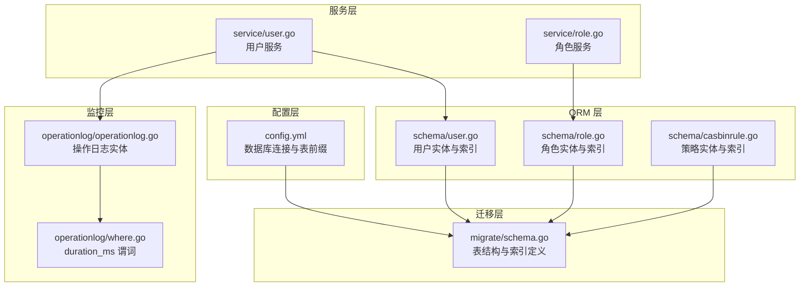
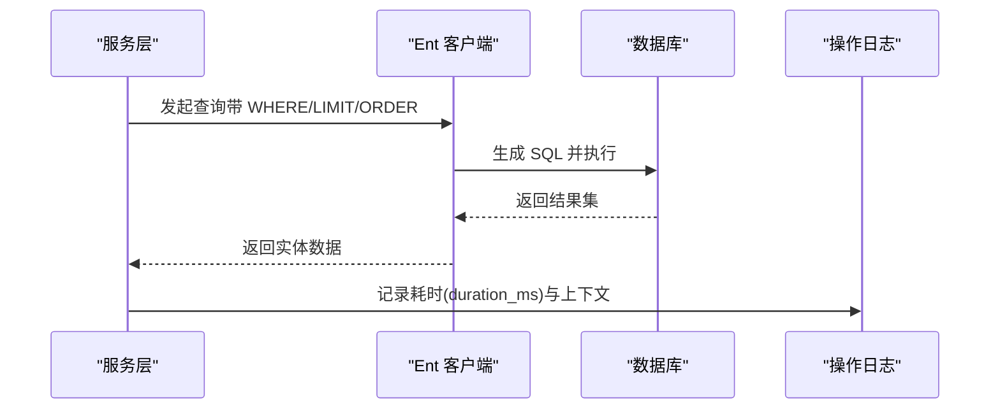
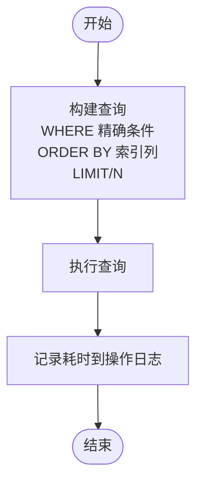
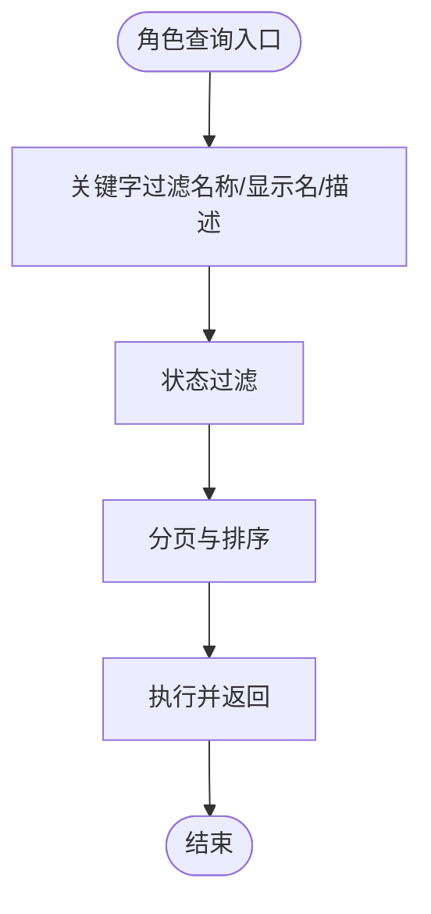
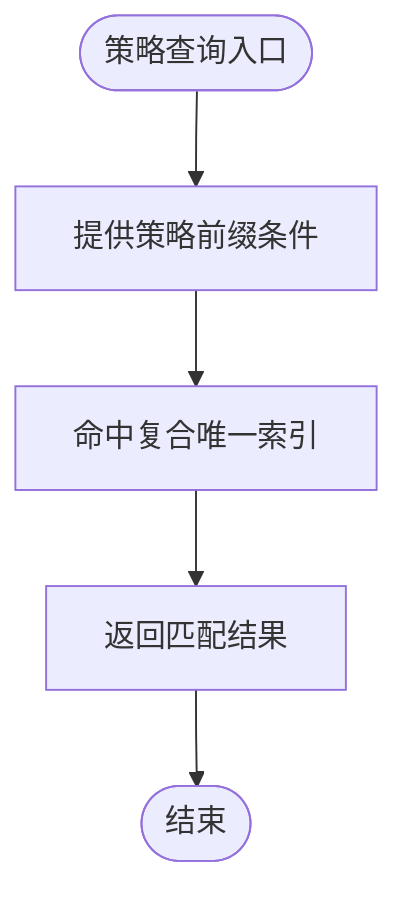
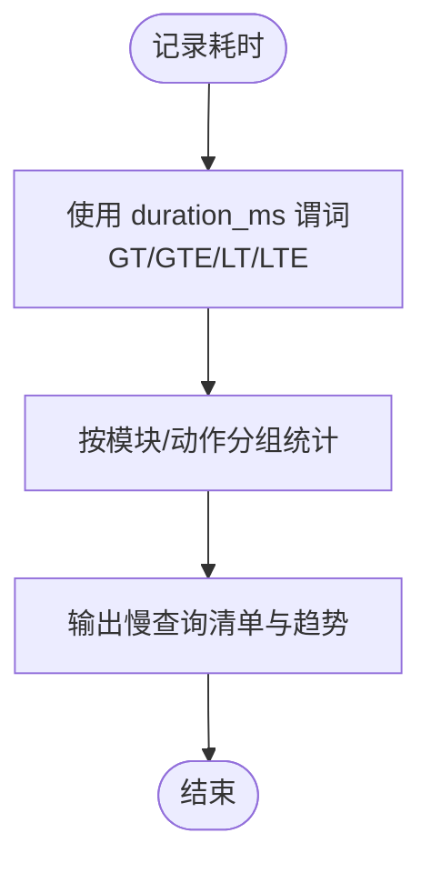
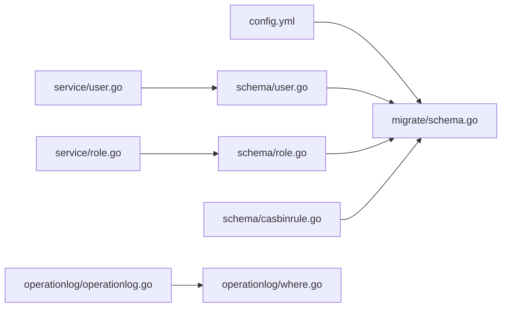

# 索引与性能优化

<cite>
**本文引用的文件**
- [config.yml](file://config/config.yml)
- [schema.go](file://internal/ent/migrate/schema.go)
- [user.go](file://internal/ent/schema/user.go)
- [role.go](file://internal/ent/schema/role.go)
- [casbinrule.go](file://internal/ent/schema/casbinrule.go)
- [user.go](file://internal/ent/user/user.go)
- [role.go](file://internal/ent/role/role.go)
- [casbinrule.go](file://internal/ent/casbinrule/casbinrule.go)
- [operationlog.go](file://internal/ent/operationlog/operationlog.go)
- [user_query.go](file://internal/ent/user_query.go)
- [where.go](file://internal/ent/operationlog/where.go)
- [user.go](file://internal/service/user.go)
- [role.go](file://internal/service/role.go)
- [client.go](file://internal/ent/client.go)
</cite>

## 目录
1. [简介](#简介)
2. [项目结构](#项目结构)
3. [核心组件](#核心组件)
4. [架构总览](#架构总览)
5. [详细组件分析](#详细组件分析)
6. [依赖关系分析](#依赖关系分析)
7. [性能考量](#性能考量)
8. [故障排查指南](#故障排查指南)
9. [结论](#结论)
10. [附录](#附录)

## 简介
本文件围绕 Go Admin 管理系统的数据库索引与性能优化展开，结合项目中基于 Ent ORM 的实体定义与查询构建器，系统阐述以下主题：
- 查询性能优化的核心原理：索引设计策略、查询计划分析与执行性能监控
- 不同类型索引的选择标准：单列索引、复合索引、唯一索引的应用场景
- 查询优化技巧：WHERE 条件优化、JOIN 操作优化、LIMIT 使用策略
- 性能测试方法与基准测试结果分析思路
- 实际查询优化案例：慢查询的识别与解决流程
- 数据库监控工具使用指南与性能调优最佳实践

## 项目结构
本项目采用分层与按功能模块组织的结构，数据库层通过 Ent ORM 生成的客户端与迁移脚本进行统一管理。关键目录与文件如下：
- 配置层：数据库连接与表前缀等配置
- ORM 层：实体定义与索引声明
- 迁移层：数据库表结构与索引的生成与维护
- 服务层：业务逻辑与查询调用
- 日志与监控：操作日志表记录耗时指标，便于性能分析

**图表来源**
- [config.yml](file://config/config.yml)
- [schema.go](file://internal/ent/migrate/schema.go)
- [user.go](file://internal/ent/schema/user.go)
- [role.go](file://internal/ent/schema/role.go)
- [casbinrule.go](file://internal/ent/schema/casbinrule.go)
- [user.go](file://internal/service/user.go)
- [role.go](file://internal/service/role.go)
- [operationlog.go](file://internal/ent/operationlog/operationlog.go)
- [where.go](file://internal/ent/operationlog/where.go)

**章节来源**
- [config.yml](file://config/config.yml)
- [schema.go](file://internal/ent/migrate/schema.go)

## 核心组件
- 用户实体与索引：用户邮箱、手机号、用户名等字段建立单列索引，满足高频查询与去重需求。
- 角色实体与索引：角色名称唯一索引，状态字段单列索引，支撑角色检索与状态过滤。
- 策略实体与索引：策略字段组合唯一索引，保证策略规则的唯一性与快速匹配。
- 操作日志实体与索引：用户 ID、模块、动作、创建时间等字段建立索引，便于审计与统计分析。
- 查询构建器与谓词：Ent 提供丰富的 WHERE 谓词与排序选项，支持 LIMIT、OFFSET、排序等优化手段。

**章节来源**
- [user.go](file://internal/ent/schema/user.go)
- [role.go](file://internal/ent/schema/role.go)
- [casbinrule.go](file://internal/ent/schema/casbinrule.go)
- [schema.go](file://internal/ent/migrate/schema.go)
- [operationlog.go](file://internal/ent/operationlog/operationlog.go)

## 架构总览
下图展示了应用如何通过服务层调用 ORM 客户端，最终落到数据库表与索引上，并利用操作日志记录查询耗时，形成闭环的性能监控与优化路径。

**图表来源**
- [user.go](file://internal/service/user.go)
- [user_query.go](file://internal/ent/user_query.go)
- [operationlog.go](file://internal/ent/operationlog/operationlog.go)
- [where.go](file://internal/ent/operationlog/where.go)

## 详细组件分析

### 用户查询与索引优化
- 单列索引策略
  - 邮箱、手机号、用户名：用于登录、查找与去重，建议保持唯一性约束与索引同步。
  - 状态字段：用于筛选活跃/非活跃用户，配合 ORDER BY 与 LIMIT 实现高效分页。
- 查询优化要点
  - 使用精确相等条件命中索引；避免在 WHERE 中对索引列做函数运算或隐式转换。
  - 对于分页查询，优先使用基于索引的排序字段，并尽量使用“基于游标的分页”减少 OFFSET 开销。
  - 控制 SELECT 字段范围，仅取必要列，降低 IO 与网络开销。
- 性能监控
  - 在服务层计算查询耗时，写入操作日志的 duration_ms 字段，便于后续分析热点查询。

**图表来源**
- [user.go](file://internal/service/user.go)
- [user_query.go](file://internal/ent/user_query.go)
- [operationlog.go](file://internal/ent/operationlog/operationlog.go)

**章节来源**
- [user.go](file://internal/ent/schema/user.go)
- [user.go](file://internal/ent/user/user.go)
- [user_query.go](file://internal/ent/user_query.go)
- [user.go](file://internal/service/user.go)

### 角色查询与索引优化
- 单列索引策略
  - 名称唯一索引：保障角色名唯一性，适合高并发下的幂等创建。
  - 状态单列索引：支持按状态筛选，常用于启用/禁用角色的批量处理。
- 查询优化要点
  - 列表查询建议结合关键字与状态过滤，控制分页大小，避免一次性拉取过多数据。
  - 排序优先使用创建时间等稳定字段，确保可重复性与可预测性。
- 性能监控
  - 通过操作日志记录角色相关接口耗时，识别慢查询并定位具体 SQL。

**图表来源**
- [role.go](file://internal/ent/schema/role.go)
- [role.go](file://internal/ent/role/role.go)
- [role.go](file://internal/service/role.go)
- [operationlog.go](file://internal/ent/operationlog/operationlog.go)

**章节来源**
- [role.go](file://internal/ent/schema/role.go)
- [role.go](file://internal/ent/role/role.go)
- [role.go](file://internal/service/role.go)

### 策略查询与索引优化
- 复合唯一索引策略
  - 策略字段组合唯一索引：保证策略规则唯一性，提高匹配效率。
- 查询优化要点
  - 匹配策略时尽量提供完整前缀，减少回表与全表扫描。
  - 若需统计或聚合，建议在业务层进行缓存或物化视图，避免频繁复杂查询。
- 性能监控
  - 记录策略相关接口耗时，结合业务场景评估是否需要引入缓存或预计算。

**图表来源**
- [casbinrule.go](file://internal/ent/schema/casbinrule.go)
- [casbinrule.go](file://internal/ent/casbinrule/casbinrule.go)
- [operationlog.go](file://internal/ent/operationlog/operationlog.go)

**章节来源**
- [casbinrule.go](file://internal/ent/schema/casbinrule.go)
- [casbinrule.go](file://internal/ent/casbinrule/casbinrule.go)

### 操作日志与性能监控
- 表结构与索引
  - 用户 ID、模块、动作、创建时间等字段建立索引，便于审计与报表统计。
- 耗时监控
  - 通过 duration_ms 字段记录每次请求耗时，结合 WHERE 谓词进行范围筛选与聚合分析。
- 查询优化技巧
  - 使用 GT/GTE/LT/LTE 对耗时进行区间筛选，定位慢查询。
  - 结合模块与动作维度进行分组统计，识别热点模块与接口。

**图表来源**
- [operationlog.go](file://internal/ent/operationlog/operationlog.go)
- [where.go](file://internal/ent/operationlog/where.go)

**章节来源**
- [operationlog.go](file://internal/ent/operationlog/operationlog.go)
- [where.go](file://internal/ent/operationlog/where.go)

## 依赖关系分析
- 配置驱动迁移：config.yml 中的表前缀影响 Ent 迁移生成的表名，确保索引与查询一致。
- 实体与索引：各实体的索引定义在 schema 层声明，迁移层生成对应数据库索引。
- 查询链路：服务层通过 Ent 客户端发起查询，底层由 SQL 选择器拼装 SQL 并执行，最终落盘到操作日志表。

**图表来源**
- [config.yml](file://config/config.yml)
- [schema.go](file://internal/ent/migrate/schema.go)
- [user.go](file://internal/ent/schema/user.go)
- [role.go](file://internal/ent/schema/role.go)
- [casbinrule.go](file://internal/ent/schema/casbinrule.go)
- [user.go](file://internal/service/user.go)
- [role.go](file://internal/service/role.go)
- [operationlog.go](file://internal/ent/operationlog/operationlog.go)
- [where.go](file://internal/ent/operationlog/where.go)

**章节来源**
- [client.go](file://internal/ent/client.go)
- [schema.go](file://internal/ent/migrate/schema.go)

## 性能考量
- 索引设计原则
  - 唯一索引：用于主键、唯一约束字段，确保数据一致性与高命中率。
  - 单列索引：用于高频过滤与排序字段，如邮箱、状态、创建时间等。
  - 复合索引：用于多条件联合过滤，注意最左前缀原则与选择性。
- 查询优化策略
  - WHERE 条件：优先使用等值匹配与范围查询，避免在索引列上使用函数或隐式转换。
  - JOIN 操作：尽量减少跨表关联，必要时确保关联键有索引；对中间结果集进行裁剪。
  - LIMIT 使用：分页时优先使用基于游标的分页，避免深层 OFFSET 导致的性能退化。
- 执行监控
  - 使用 Ent 的 Debug 模式输出 SQL，结合数据库 EXPLAIN 分析执行计划。
  - 在服务层记录 duration_ms，定期统计慢查询并制定优化方案。

[本节为通用指导，无需列出具体文件来源]

## 故障排查指南
- 慢查询定位
  - 通过操作日志的 duration_ms 谓词筛选异常区间，结合模块与动作进行归因。
  - 使用数据库 EXPLAIN 分析 SQL 执行计划，确认是否命中预期索引。
- 索引缺失或失效
  - 检查实体索引定义与迁移生成的数据库索引是否一致。
  - 对于复合索引，确认查询条件满足最左前缀原则。
- 查询参数问题
  - 检查服务层是否正确传入 LIMIT/OFFSET/ORDER 参数，避免不必要的全表扫描。

**章节来源**
- [where.go](file://internal/ent/operationlog/where.go)
- [user_query.go](file://internal/ent/user_query.go)
- [client.go](file://internal/ent/client.go)

## 结论
通过对用户、角色、策略等核心实体的索引设计与查询优化实践，结合操作日志的耗时监控，可以有效提升系统整体查询性能。建议持续关注热点查询、定期审查索引使用情况，并在服务层落实性能埋点与回归测试，确保优化成果可持续。

[本节为总结性内容，无需列出具体文件来源]

## 附录
- 性能测试方法
  - 基准测试：固定数据规模与并发，对比不同查询策略的吞吐与延迟。
  - A/B 测试：在灰度环境中对比优化前后指标变化，评估收益。
- 工具与实践
  - 数据库：EXPLAIN 分析执行计划；慢查询日志与性能模式。
  - 应用：开启 Ent Debug 输出 SQL；在服务层记录 duration_ms；结合缓存与物化视图降低热点查询压力。

[本节为通用指导，无需列出具体文件来源]