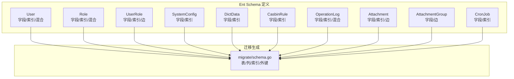
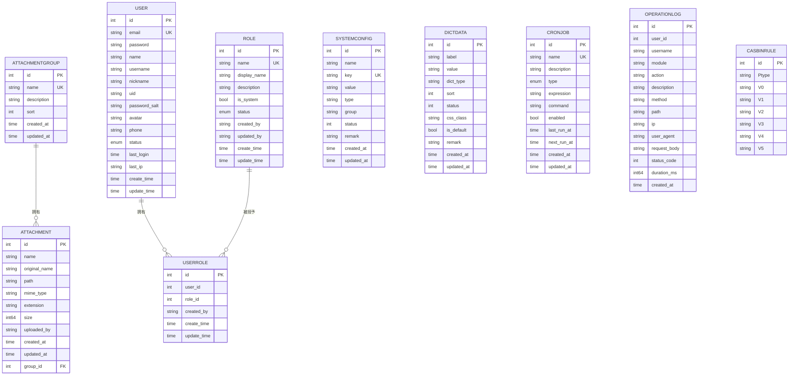
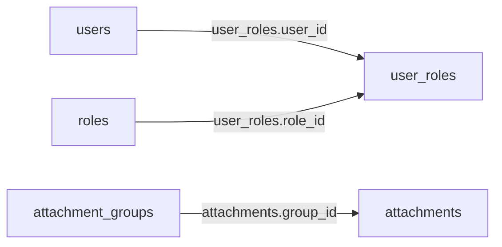

# 表结构定义

<cite>
**本文引用的文件**
- [user.go](file://internal/ent/schema/user.go)
- [role.go](file://internal/ent/schema/role.go)
- [userrole.go](file://internal/ent/schema/userrole.go)
- [systemconfig.go](file://internal/ent/schema/systemconfig.go)
- [dictdata.go](file://internal/ent/schema/dictdata.go)
- [casbinrule.go](file://internal/ent/schema/casbinrule.go)
- [operationlog.go](file://internal/ent/schema/operationlog.go)
- [attachment.go](file://internal/ent/schema/attachment.go)
- [attachmentgroup.go](file://internal/ent/schema/attachmentgroup.go)
- [cronjob.go](file://internal/ent/schema/cronjob.go)
- [schema.go](file://internal/ent/migrate/schema.go)
- [hook.go](file://internal/ent/hook/hook.go)
- [predicate.go](file://internal/ent/predicate/predicate.go)
</cite>

## 目录
1. [简介](#简介)
2. [项目结构](#项目结构)
3. [核心组件](#核心组件)
4. [架构总览](#架构总览)
5. [详细组件分析](#详细组件分析)
6. [依赖关系分析](#依赖关系分析)
7. [性能考虑](#性能考虑)
8. [故障排查指南](#故障排查指南)
9. [结论](#结论)
10. [附录：完整建表语句与约束](#附录完整建表语句与约束)

## 简介
本文件基于 Ent ORM 的 Schema 定义，系统性梳理并输出 Go Admin 后端所涉及的全部数据库表结构，覆盖字段定义、数据类型、长度限制、是否允许为空、默认值、注释说明、主键/外键/唯一索引/普通索引配置，并解释敏感字段处理、枚举映射、时间戳自动维护机制，以及字段验证规则在数据库层面的落地方式（如长度限制、格式校验）。同时提供索引策略说明与查询性能优化建议，并给出各表的完整建表语句与约束定义。

## 项目结构
- 表结构由 Ent Schema 定义生成，迁移脚本中以 migrate/schema.go 形式固化为数据库表结构与索引/外键定义。
- Ent 的 mixin.Time 将自动注入创建/更新时间字段，部分实体通过显式字段或默认值覆盖行为。
- 外键关系在迁移脚本中明确声明，确保引用完整性。

图表来源
- [schema.go:1-381](file://internal/ent/migrate/schema.go#L1-L381)
- [user.go:17-102](file://internal/ent/schema/user.go#L17-L102)
- [role.go:10-73](file://internal/ent/schema/role.go#L10-L73)
- [userrole.go:11-56](file://internal/ent/schema/userrole.go#L11-L56)
- [systemconfig.go:11-79](file://internal/ent/schema/systemconfig.go#L11-L79)
- [dictdata.go:11-80](file://internal/ent/schema/dictdata.go#L11-L80)
- [casbinrule.go:9-37](file://internal/ent/schema/casbinrule.go#L9-L37)
- [operationlog.go:11-92](file://internal/ent/schema/operationlog.go#L11-L92)
- [attachment.go:12-89](file://internal/ent/schema/attachment.go#L12-L89)
- [attachmentgroup.go:11-57](file://internal/ent/schema/attachmentgroup.go#L11-L57)
- [cronjob.go:11-82](file://internal/ent/schema/cronjob.go#L11-L82)

章节来源
- [schema.go:1-381](file://internal/ent/migrate/schema.go#L1-L381)

## 核心组件
- 用户表 users：邮箱/用户名/手机等唯一性与格式校验，状态枚举，时间戳自动维护。
- 角色表 roles：名称唯一，状态枚举，系统内置标记。
- 用户角色关联表 user_roles：联合唯一索引，分别对 user_id 和 role_id 建立普通索引。
- 系统配置表 system_configs：键唯一，类型枚举，状态开关，时间戳。
- 字典数据表 dict_data：字典类型与状态索引，排序与默认标记。
- 计划任务表 cron_jobs：名称唯一，类型枚举，启用开关，时间戳。
- 操作日志表 operation_logs：用户/模块/动作/创建时间索引，敏感字段不落库。
- 附件表 attachments：分组关联，MIME 类型与创建时间索引。
- 附件分组表 attachment_groups：名称唯一，排序。
- Casbin 权限规则表 casbin_rules：复合唯一索引，用于 RBAC/ABAC。

章节来源
- [user.go:17-102](file://internal/ent/schema/user.go#L17-L102)
- [role.go:10-73](file://internal/ent/schema/role.go#L10-L73)
- [userrole.go:11-56](file://internal/ent/schema/userrole.go#L11-L56)
- [systemconfig.go:11-79](file://internal/ent/schema/systemconfig.go#L11-L79)
- [dictdata.go:11-80](file://internal/ent/schema/dictdata.go#L11-L80)
- [casbinrule.go:9-37](file://internal/ent/schema/casbinrule.go#L9-L37)
- [operationlog.go:11-92](file://internal/ent/schema/operationlog.go#L11-L92)
- [attachment.go:12-89](file://internal/ent/schema/attachment.go#L12-L89)
- [attachmentgroup.go:11-57](file://internal/ent/schema/attachmentgroup.go#L11-L57)
- [cronjob.go:11-82](file://internal/ent/schema/cronjob.go#L11-L82)

## 架构总览
下图展示实体间的关系与外键约束，来源于迁移脚本中的外键定义与索引配置。

图表来源
- [schema.go:14-381](file://internal/ent/migrate/schema.go#L14-L381)

## 详细组件分析

### 用户表 users
- 主键：自增整型 id
- 唯一索引：email、username
- 普通索引：phone
- 时间戳：Ent mixin.Time 注入 create_time/update_time；Schema 中未显式字段，但迁移脚本包含 create_time/update_time 列
- 敏感字段：password/password_salt（Ent Sensitive 标记）
- 枚举：status（active/inactive/suspended），默认 inactive
- 长度限制与格式：邮箱/用户名/昵称最大 255；手机号最大 20；邮箱使用正则匹配；密码最大 255
- 允许为空：name/nickname/avatar/uid/password_salt/phone/last_ip/last_login

章节来源
- [user.go:23-102](file://internal/ent/schema/user.go#L23-L102)
- [schema.go:274-314](file://internal/ent/migrate/schema.go#L274-L314)

### 角色表 roles
- 主键：自增整型 id
- 唯一索引：name
- 普通索引：status
- 时间戳：mixin.Time 注入 create_time/update_time
- 枚举：status（active/inactive），默认 active；is_system 默认 false
- 允许为空：description/created_by/updated_by

章节来源
- [role.go:16-73](file://internal/ent/schema/role.go#L16-L73)
- [schema.go:207-237](file://internal/ent/migrate/schema.go#L207-L237)

### 用户角色关联表 user_roles
- 主键：自增整型 id
- 联合唯一索引：(user_id, role_id)
- 普通索引：user_id、role_id
- 外键：user_id 引用 users.id；role_id 引用 roles.id（删除策略 NoAction）
- 时间戳：mixin.Time 注入 create_time/update_time
- 允许为空：created_by

章节来源
- [userrole.go:17-56](file://internal/ent/schema/userrole.go#L17-L56)
- [schema.go:315-360](file://internal/ent/migrate/schema.go#L315-L360)

### 系统配置表 system_configs
- 主键：自增整型 id
- 唯一索引：key
- 普通索引：group、status
- 时间戳：created_at 默认当前时间，updated_at 默认并更新时默认当前时间
- 枚举：type（string/number/boolean/json），默认 string；status 默认 1
- 允许为空：value/remark/group

章节来源
- [systemconfig.go:17-79](file://internal/ent/schema/systemconfig.go#L17-L79)
- [schema.go:238-273](file://internal/ent/migrate/schema.go#L238-L273)

### 字典数据表 dict_data
- 主键：自增整型 id
- 普通索引：dict_type、status
- 时间戳：created_at 默认当前时间，updated_at 默认并更新时默认当前时间
- 枚举：status 默认 1；is_default 默认 false；sort 默认 0
- 允许为空：css_class/remark

章节来源
- [dictdata.go:17-80](file://internal/ent/schema/dictdata.go#L17-L80)
- [schema.go:130-161](file://internal/ent/migrate/schema.go#L130-L161)

### 计划任务表 cron_jobs
- 主键：自增整型 id
- 唯一索引：name
- 普通索引：enabled、type
- 时间戳：created_at 默认当前时间，updated_at 默认并更新时默认当前时间
- 枚举：type（shell/curl/task）；enabled 默认 true
- 允许为空：description/last_run_at/next_run_at

章节来源
- [cronjob.go:17-82](file://internal/ent/schema/cronjob.go#L17-L82)
- [schema.go:98-129](file://internal/ent/migrate/schema.go#L98-L129)

### 操作日志表 operation_logs
- 主键：自增整型 id
- 普通索引：user_id、module、action、created_at
- 时间戳：created_at 只写（Immutable），默认当前时间
- 敏感字段：request_body（Ent Sensitive 标记）
- 允许为空：description/user_agent

章节来源
- [operationlog.go:17-92](file://internal/ent/schema/operationlog.go#L17-L92)
- [schema.go:162-206](file://internal/ent/migrate/schema.go#L162-L206)

### 附件表 attachments
- 主键：自增整型 id
- 普通索引：group_id、mime_type、created_at
- 外键：group_id 引用 attachment_groups.id（删除策略 SetNull）
- 时间戳：created_at 默认当前时间，updated_at 默认并更新时默认当前时间
- 允许为空：uploaded_by/size

章节来源
- [attachment.go:18-89](file://internal/ent/schema/attachment.go#L18-L89)
- [schema.go:14-58](file://internal/ent/migrate/schema.go#L14-L58)

### 附件分组表 attachment_groups
- 主键：自增整型 id
- 唯一索引：name
- 时间戳：created_at 默认当前时间，updated_at 默认并更新时默认当前时间
- 允许为空：description

章节来源
- [attachmentgroup.go:17-57](file://internal/ent/schema/attachmentgroup.go#L17-L57)
- [schema.go:59-73](file://internal/ent/migrate/schema.go#L59-L73)

### Casbin 权限规则表 casbin_rules
- 主键：自增整型 id
- 联合唯一索引：(Ptype, V0..V5)
- 允许为空：除 Ptype/V0..V5 外均为空字符串默认值

章节来源
- [casbinrule.go:15-37](file://internal/ent/schema/casbinrule.go#L15-L37)
- [schema.go:74-97](file://internal/ent/migrate/schema.go#L74-L97)

## 依赖关系分析
- 外键依赖
  - user_roles.user_id → users.id（NoAction）
  - user_roles.role_id → roles.id（NoAction）
  - attachments.group_id → attachment_groups.id（SetNull）
- 索引覆盖
  - 查询高频字段（如 email/username/phone、user_id/module/action、key/group/status、dict_type/status、enabled/type）均有索引支撑
- 验证规则落地
  - 长度限制：通过 MaxLen 映射到数据库长度约束
  - 格式校验：邮箱/手机号正则在 Ent 层验证，数据库层面无直接正则约束
  - 唯一性：通过 Unique 约束保证
  - 枚举：通过 Enum/Enums 映射到数据库枚举/字符串类型并配合默认值
  - 敏感字段：Ent Sensitive 标记，迁移脚本中未见明文存储敏感字段（如密码、请求体）

图表来源
- [schema.go:329-342](file://internal/ent/migrate/schema.go#L329-L342)

章节来源
- [schema.go:329-342](file://internal/ent/migrate/schema.go#L329-L342)

## 性能考虑
- 索引策略
  - 唯一索引：email/username/key/name/attachment_groups.name/casbin_rules(Ptype,V0..V5) 保障去重与快速查找
  - 普通索引：phone/email/username（users）、user_id/module/action/created_at（operation_logs）、group/status（system_configs/dict_data）、enabled/type（cron_jobs）、mime_type/created_at（attachments）、dict_type/status（dict_data）
- 查询优化建议
  - 使用唯一索引字段进行等值查询（如 email/username/key/name）
  - 对范围/排序场景优先使用 created_at、sort 等字段
  - 关联查询注意连接字段命中索引（user_id、role_id、group_id）
- 写入优化
  - 批量插入时避免重复触发唯一约束冲突
  - 对大文本字段（如 request_body）避免频繁更新，必要时拆表或归档

## 故障排查指南
- 唯一约束冲突
  - 现象：插入/更新时报唯一键冲突
  - 排查：确认 email/username/key/name 是否重复；检查是否误传空字符串而非 NULL
- 外键约束失败
  - 现象：插入 user_roles 或 attachments 报外键错误
  - 排查：确认引用的 users.id/roles.id/attachment_groups.id 存在且类型一致
- 正则/长度校验失败
  - 现象：提交邮箱/手机号格式错误或超长
  - 排查：确认前端/后端校验逻辑与 Ent 层 MaxLen/Match 一致
- 敏感信息泄露风险
  - 现象：日志/备份中出现敏感字段明文
  - 排查：确认 Ent Sensitive 标记已生效，数据库不存储明文密码/请求体

章节来源
- [hook.go:223-271](file://internal/ent/hook/hook.go#L223-L271)
- [predicate.go:9-38](file://internal/ent/predicate/predicate.go#L9-L38)

## 结论
本表结构文档基于 Ent Schema 与迁移脚本，完整呈现了用户、角色、权限、配置、字典、计划任务、日志、附件等核心业务表的字段定义、索引与外键设计。通过唯一索引、普通索引与外键约束，结合 Ent 的验证与敏感字段处理机制，既满足业务需求又兼顾性能与安全。建议在实际部署中根据查询热点持续优化索引，并严格遵循敏感字段不落库原则。

## 附录：完整建表语句与约束

以下为各表的建表语句与约束定义（基于迁移脚本解析，表名前缀来自迁移代码中的 TablePrefix）：

- users
  - 主键：id
  - 唯一索引：email、username
  - 普通索引：phone
  - 时间戳：create_time、update_time
  - 枚举：status（active/inactive/suspended），默认 inactive
  - 长度：email/username/nickname/uid/password/phone/last_ip 最大 255/255/255/255/255/20/50
  - 允许为空：name/nickname/avatar/uid/password_salt/phone/last_ip/last_login

- roles
  - 主键：id
  - 唯一索引：name
  - 普通索引：status
  - 时间戳：create_time、update_time
  - 枚举：status（active/inactive），默认 active；is_system 默认 false
  - 长度：name/display_name/description/created_by/updated_by 最大 100/255/500/255/255

- user_roles
  - 主键：id
  - 联合唯一索引：(user_id, role_id)
  - 普通索引：user_id、role_id
  - 外键：user_id → users(id)，role_id → roles(id)
  - 时间戳：create_time、update_time
  - 长度：created_by 最大 255

- system_configs
  - 主键：id
  - 唯一索引：key
  - 普通索引：group、status
  - 时间戳：created_at、updated_at
  - 枚举：type（string/number/boolean/json），默认 string；status 默认 1
  - 长度：name/key/value/group/remark 最大 100/100/2048/50/500

- dict_data
  - 主键：id
  - 普通索引：dict_type、status
  - 时间戳：created_at、updated_at
  - 枚举：status 默认 1；is_default 默认 false；sort 默认 0
  - 长度：label/value/dict_type/css_class 最大 100/100/100/100

- cron_jobs
  - 主键：id
  - 唯一索引：name
  - 普通索引：enabled、type
  - 时间戳：created_at、updated_at
  - 枚举：type（shell/curl/task）；enabled 默认 true
  - 长度：name/description/expression/command 最大 255/500/255/2048

- operation_logs
  - 主键：id
  - 普通索引：user_id、module、action、created_at
  - 时间戳：created_at（只写）
  - 长度：username/module/action/path/ip/user_agent 最大 255/255/255/1024/50/1024
  - 允许为空：description/user_agent

- attachments
  - 主键：id
  - 普通索引：group_id、mime_type、created_at
  - 外键：group_id → attachment_groups(id)（删除策略 SetNull）
  - 时间戳：created_at、updated_at
  - 长度：name/original_name/path/mime_type/extension 最大 255/255/1024/255/50

- attachment_groups
  - 主键：id
  - 唯一索引：name
  - 时间戳：created_at、updated_at
  - 长度：name/description 最大 255/500

- casbin_rules
  - 主键：id
  - 联合唯一索引：(Ptype, V0, V1, V2, V3, V4, V5)
  - 长度：Ptype/V0..V5 最大 100

章节来源
- [schema.go:14-381](file://internal/ent/migrate/schema.go#L14-L381)