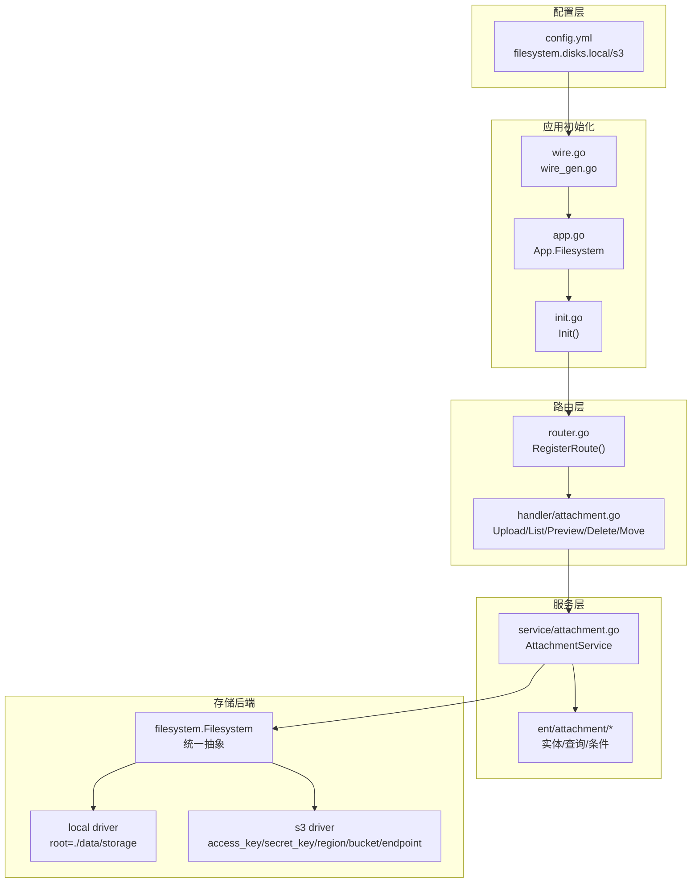
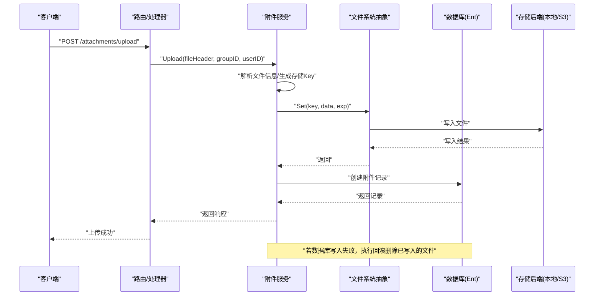
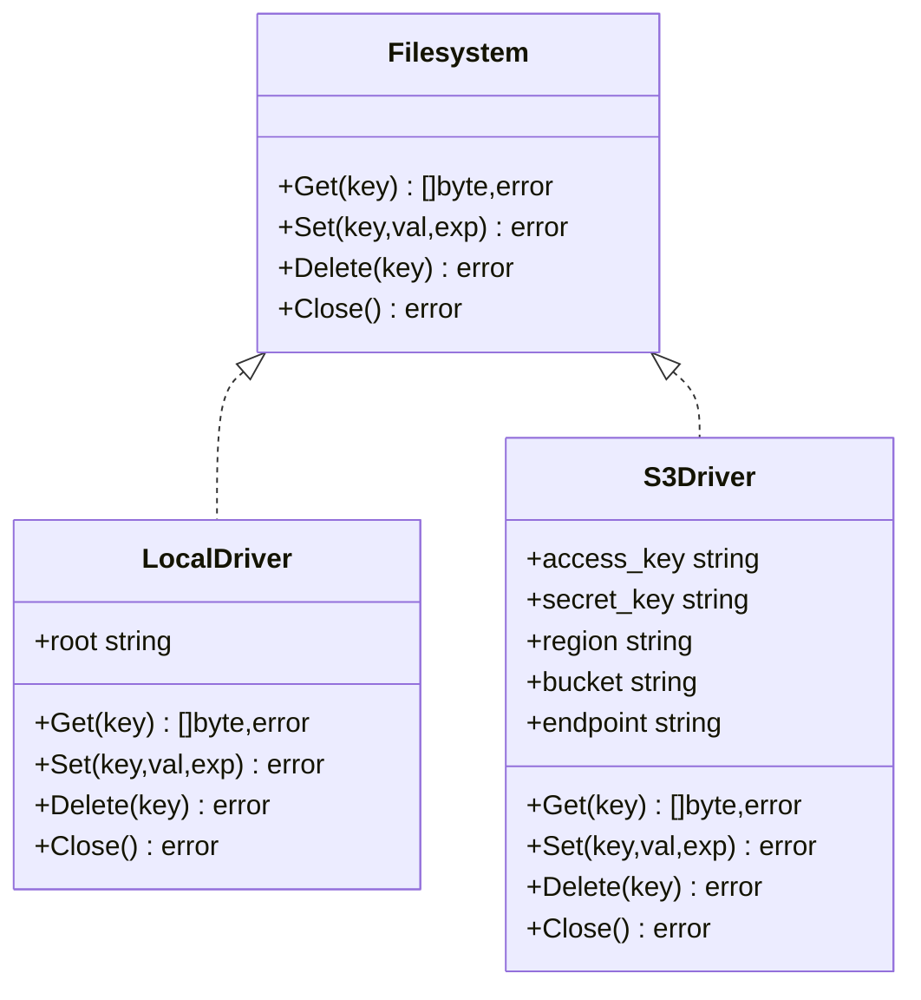
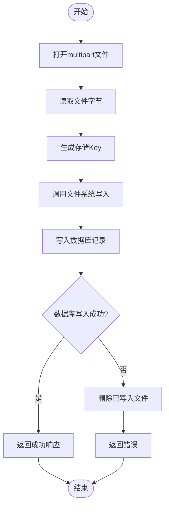
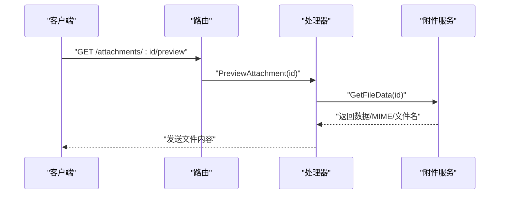
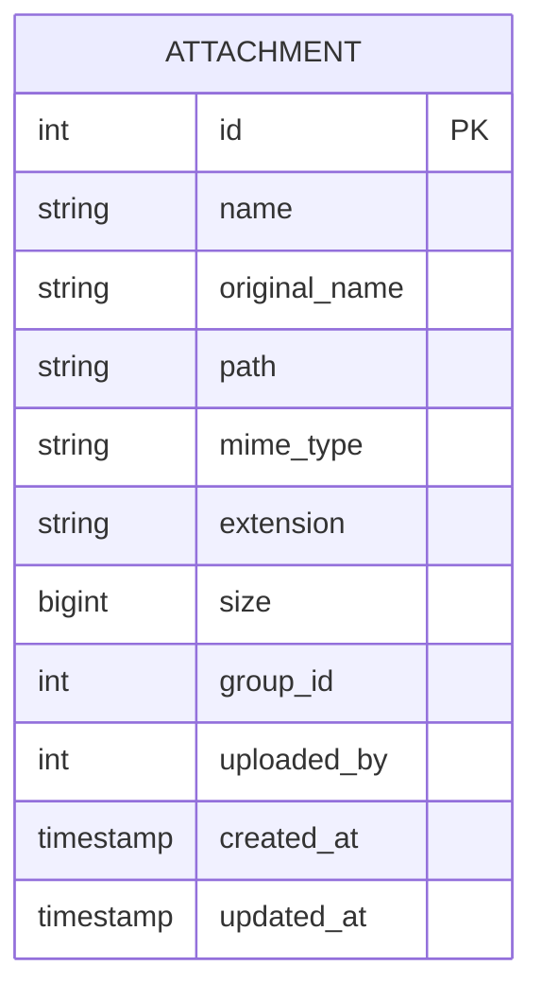

# 存储后端支持

<cite>
**本文引用的文件**
- [config.yml](file://config/config.yml)
- [attachment.go](file://internal/service/attachment.go)
- [attachment.go](file://internal/handler/attachment.go)
- [attachment.go](file://internal/ent/attachment/attachment.go)
- [attachment_create.go](file://internal/ent/attachment_create.go)
- [attachment_where.go](file://internal/ent/attachment/where.go)
- [router.go](file://internal/router.go)
- [app.go](file://internal/app.go)
- [init.go](file://internal/init.go)
- [wire.go](file://internal/wire.go)
- [wire_gen.go](file://internal/wire_gen.go)
- [main.go](file://main.go)
- [go.mod](file://go.mod)
- [attachment_test.go](file://internal/service/attachment_test.go)
</cite>

## 目录
1. [简介](#简介)
2. [项目结构](#项目结构)
3. [核心组件](#核心组件)
4. [架构总览](#架构总览)
5. [详细组件分析](#详细组件分析)
6. [依赖分析](#依赖分析)
7. [性能考虑](#性能考虑)
8. [故障排查指南](#故障排查指南)
9. [结论](#结论)
10. [附录](#附录)

## 简介
本文件面向Go Admin管理系统中“存储后端支持”能力，系统性阐述多存储后端的架构设计与实现要点，覆盖本地文件系统与云存储（以S3为例）的统一抽象、存储适配器的标准化接口、配置项与切换流程、性能优化策略以及故障恢复机制。文档同时给出基于现有代码的架构图与流程图，帮助读者快速理解与落地实施。

## 项目结构
围绕存储后端的关键模块与文件如下：
- 配置层：通过配置文件定义存储后端类型与参数（本地与S3）
- 服务层：附件服务封装上传、删除、查询、预览等操作，统一调用底层文件系统抽象
- 路由层：注册附件相关API，绑定服务实例
- 应用初始化：通过Wire注入文件系统实例，供服务层使用
- 数据模型：附件实体持久化存储元数据（文件名、路径、MIME、扩展名、大小、分组、上传人等）

**图表来源**
- [config.yml:60-76](file://config/config.yml#L60-L76)
- [wire.go:22-37](file://internal/wire.go#L22-L37)
- [wire_gen.go:17-62](file://internal/wire_gen.go#L17-L62)
- [app.go:15-26](file://internal/app.go#L15-L26)
- [init.go:31-67](file://internal/init.go#L31-L67)
- [router.go:113-149](file://internal/router.go#L113-L149)
- [attachment.go:93-148](file://internal/service/attachment.go#L93-L148)
- [attachment.go:276-294](file://internal/service/attachment.go#L276-L294)

**章节来源**
- [config.yml:60-76](file://config/config.yml#L60-L76)
- [wire.go:22-37](file://internal/wire.go#L22-L37)
- [wire_gen.go:17-62](file://internal/wire_gen.go#L17-L62)
- [app.go:15-26](file://internal/app.go#L15-L26)
- [init.go:31-67](file://internal/init.go#L31-L67)
- [router.go:113-149](file://internal/router.go#L113-L149)
- [attachment.go:93-148](file://internal/service/attachment.go#L93-L148)
- [attachment.go:276-294](file://internal/service/attachment.go#L276-L294)

## 核心组件
- 文件系统抽象：通过统一的filesystem.Filesystem接口屏蔽本地与云存储差异，服务层仅依赖该抽象进行存取
- 附件服务：负责业务逻辑（校验、生成存储Key、调用文件系统、写入数据库、错误回滚）
- 路由与处理器：暴露REST API，解析参数并调用服务层
- 数据模型：附件实体持久化文件元数据，查询条件支持按名称、原始名、路径、MIME、分组等字段过滤
- 应用初始化：通过Wire注入文件系统实例，确保运行期可切换存储后端

**章节来源**
- [attachment.go:27-36](file://internal/service/attachment.go#L27-L36)
- [attachment.go:93-148](file://internal/service/attachment.go#L93-L148)
- [attachment.go:276-294](file://internal/service/attachment.go#L276-L294)
- [attachment_where.go:268-306](file://internal/ent/attachment/where.go#L268-L306)
- [router.go:113-149](file://internal/router.go#L113-L149)
- [app.go:15-26](file://internal/app.go#L15-L26)
- [wire_gen.go:47-50](file://internal/wire_gen.go#L47-L50)

## 架构总览
下图展示从HTTP请求到存储后端的完整调用链路，以及错误回滚与数据库一致性保障。

**图表来源**
- [attachment.go:93-148](file://internal/service/attachment.go#L93-L148)
- [attachment.go:141-145](file://internal/service/attachment.go#L141-L145)

## 详细组件分析

### 组件A：文件系统抽象与适配器
- 抽象接口：服务层通过filesystem.Filesystem进行Get/Set/Delete等操作，屏蔽本地与S3差异
- 本地驱动：通过root配置项指定存储根目录
- S3驱动：通过access_key、secret_key、region、bucket、endpoint等参数连接对象存储
- 初始化：应用启动时通过Wire注入filesystem.Filesystem实例，供路由层构造服务使用

**图表来源**
- [config.yml:60-76](file://config/config.yml#L60-L76)
- [wire_gen.go:47-50](file://internal/wire_gen.go#L47-L50)
- [app.go:15-26](file://internal/app.go#L15-L26)

**章节来源**
- [config.yml:60-76](file://config/config.yml#L60-L76)
- [wire_gen.go:47-50](file://internal/wire_gen.go#L47-L50)
- [app.go:15-26](file://internal/app.go#L15-L26)

### 组件B：附件服务（业务编排与一致性）
- 上传流程：打开multipart文件、读取字节、生成存储Key、调用文件系统写入、创建数据库记录；若数据库失败则删除已写入文件
- 删除流程：先删存储文件，再删数据库记录
- 列表/详情/预览：查询数据库并结合文件系统读取数据
- 错误处理：对“附件不存在”等场景返回明确错误码

**图表来源**
- [attachment.go:93-148](file://internal/service/attachment.go#L93-L148)
- [attachment.go:141-145](file://internal/service/attachment.go#L141-L145)

**章节来源**
- [attachment.go:93-148](file://internal/service/attachment.go#L93-L148)
- [attachment.go:150-172](file://internal/service/attachment.go#L150-L172)
- [attachment.go:215-274](file://internal/service/attachment.go#L215-L274)
- [attachment.go:276-294](file://internal/service/attachment.go#L276-L294)

### 组件C：路由与处理器（API入口）
- 提供上传、列表、详情、预览、删除、批量删除、移动分组等接口
- 参数校验与分页控制
- 预览时根据MIME类型决定inline或attachment响应头

**图表来源**
- [attachment.go:144-185](file://internal/handler/attachment.go#L144-L185)
- [attachment.go:276-294](file://internal/service/attachment.go#L276-L294)

**章节来源**
- [attachment.go:16-64](file://internal/handler/attachment.go#L16-L64)
- [attachment.go:144-185](file://internal/handler/attachment.go#L144-L185)
- [attachment.go:209-221](file://internal/handler/attachment.go#L209-L221)
- [attachment.go:223-257](file://internal/handler/attachment.go#L223-L257)
- [attachment.go:259-303](file://internal/handler/attachment.go#L259-L303)

### 组件D：数据模型与查询条件
- 实体字段：name、original_name、path、mime_type、extension、size、group_id、uploaded_by、created_at、updated_at
- 查询排序与过滤：支持按ID、名称、原始名、路径、MIME、扩展、大小、分组、上传人、时间等字段排序与过滤
- 与服务层协作：服务层将文件元数据写入数据库，查询时使用Ent提供的条件与排序

**图表来源**
- [attachment.go:14-48](file://internal/ent/attachment/attachment.go#L14-L48)
- [attachment_create.go:246-283](file://internal/ent/attachment_create.go#L246-L283)
- [attachment_where.go:268-306](file://internal/ent/attachment/where.go#L268-L306)

**章节来源**
- [attachment.go:14-48](file://internal/ent/attachment/attachment.go#L14-L48)
- [attachment_where.go:268-306](file://internal/ent/attachment/where.go#L268-L306)
- [attachment_create.go:246-283](file://internal/ent/attachment_create.go#L246-L283)

## 依赖分析
- Wire注入：通过ProviderSet注入filesystem.Filesystem，随后在应用初始化阶段创建App并注入全局
- 启动流程：main -> InitializeApp(Wire) -> Init -> RegisterRoute -> 启动HTTP服务
- 外部依赖：go.mod中引入了S3相关SDK与存储库，为S3驱动提供基础能力

**图表来源**
- [main.go:47-104](file://main.go#L47-L104)
- [wire.go:22-37](file://internal/wire.go#L22-L37)
- [wire_gen.go:17-62](file://internal/wire_gen.go#L17-L62)
- [init.go:31-67](file://internal/init.go#L31-L67)
- [router.go:113-149](file://internal/router.go#L113-L149)

**章节来源**
- [main.go:47-104](file://main.go#L47-L104)
- [wire.go:22-37](file://internal/wire.go#L22-L37)
- [wire_gen.go:17-62](file://internal/wire_gen.go#L17-L62)
- [init.go:31-67](file://internal/init.go#L31-L67)
- [router.go:113-149](file://internal/router.go#L113-L149)

## 性能考虑
- 上传路径优化
  - 流式写入：当前实现一次性读取multipart文件至内存，建议在大文件场景采用流式写入，减少内存峰值
  - 并发写入：S3场景可启用并发上传（如分块上传），提升吞吐
- 缓存策略
  - 对热点小文件可引入缓存层（内存/Redis），降低重复读取成本
- 数据库索引
  - 在path、mime_type、group_id等常用查询字段上建立合适索引，提升查询性能
- 响应头优化
  - 预览场景按MIME类型设置合适的Content-Disposition，避免不必要的下载行为

[本节为通用性能建议，无需特定文件引用]

## 故障排查指南
- 上传失败
  - 现象：返回上传失败且数据库未记录
  - 排查：检查文件系统写入是否成功、数据库事务是否提交、异常回滚是否执行
  - 参考：服务层在数据库写入失败时会删除已写入文件
- 删除失败
  - 现象：数据库记录删除失败或存储文件未被删除
  - 排查：确认存储Key正确、文件系统驱动可用、权限足够
- 预览失败
  - 现象：无法返回文件内容或MIME类型不正确
  - 排查：确认数据库中path字段有效、文件系统Get调用成功、Content-Type/Content-Disposition设置正确
- 配置问题
  - 现象：S3无法连接或本地路径不可写
  - 排查：核对config.yml中的drivers与options配置项，验证凭证与网络连通性

**章节来源**
- [attachment.go:141-145](file://internal/service/attachment.go#L141-L145)
- [attachment.go:150-172](file://internal/service/attachment.go#L150-L172)
- [attachment.go:276-294](file://internal/service/attachment.go#L276-L294)
- [config.yml:60-76](file://config/config.yml#L60-L76)

## 结论
Go Admin通过filesystem.Filesystem实现了对本地与S3等多存储后端的统一抽象，配合Wire注入与路由层解耦，形成清晰的“配置—初始化—服务—存储”的架构。服务层在上传时保证数据库与存储的一致性（失败回滚），在查询与预览时通过数据库与文件系统协同工作。通过合理的配置与性能优化策略，系统可在不同部署环境下稳定运行并具备良好的扩展性。

[本节为总结性内容，无需特定文件引用]

## 附录

### 存储配置选项与说明
- default：当前默认使用的磁盘（local或s3）
- disks.local.driver：本地驱动
  - options.root：本地存储根目录（例如：./data/storage）
- disks.s3.driver：S3驱动
  - options.access_key：访问密钥
  - options.secret_key：私有密钥
  - options.region：区域
  - options.bucket：存储桶
  - options.endpoint：自定义Endpoint（可选）

**章节来源**
- [config.yml:60-76](file://config/config.yml#L60-L76)

### 存储后端切换步骤
- 步骤1：修改config.yml中的filesystem.default为需要的磁盘名称（local或s3）
- 步骤2：完善对应磁盘的options配置（本地需设置root；S3需设置凭证与桶信息）
- 步骤3：重启应用，Wire注入新的filesystem.Filesystem实例
- 步骤4：验证上传/预览/删除功能是否正常

**章节来源**
- [config.yml:60-76](file://config/config.yml#L60-L76)
- [wire_gen.go:47-50](file://internal/wire_gen.go#L47-L50)
- [init.go:31-67](file://internal/init.go#L31-L67)

### 存储容量限制与安全
- 容量限制：当前代码未内置容量上限控制，建议在部署层面（如挂载点配额、对象存储桶配额）或业务层（单用户/单租户限额）增加限制
- 访问权限：本地需确保root目录权限正确；S3需配置合适的Bucket Policy与IAM策略，避免过度授权

[本节为通用实践建议，无需特定文件引用]

### 单元测试与模拟存储
- 测试中通过自定义存储实现（Get/Set/Delete）模拟文件系统行为，避免真实文件系统依赖
- 通过NewFilesystem(storage, config.Config{})构造测试用文件系统实例

**章节来源**
- [attachment_test.go:24-55](file://internal/service/attachment_test.go#L24-L55)
- [attachment_test.go:68-82](file://internal/service/attachment_test.go#L68-L82)