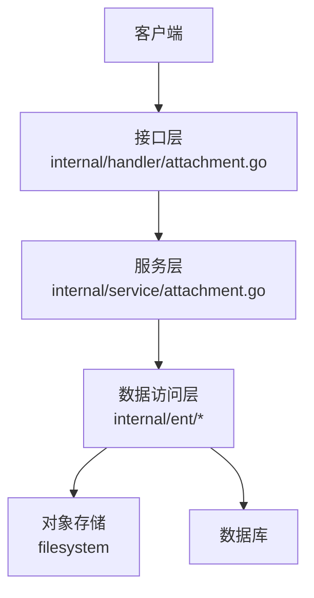
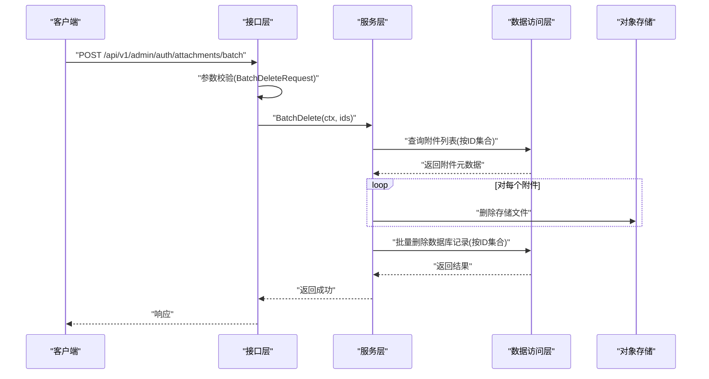
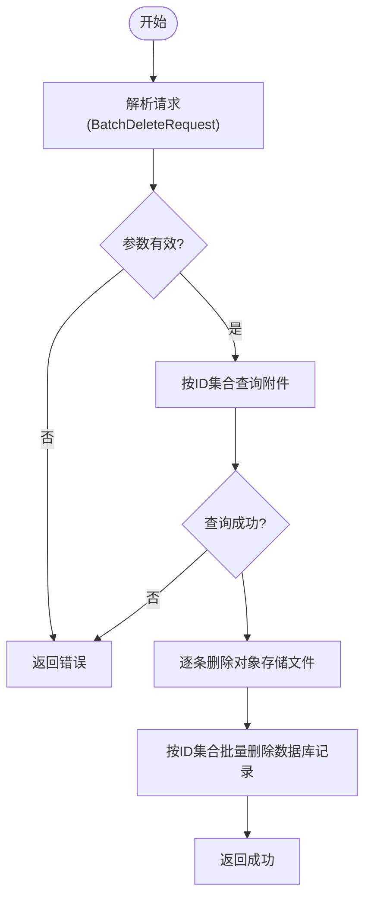
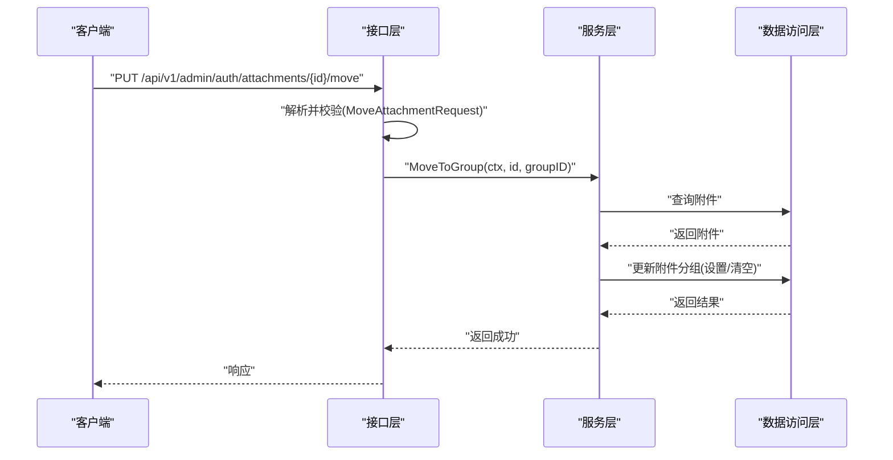
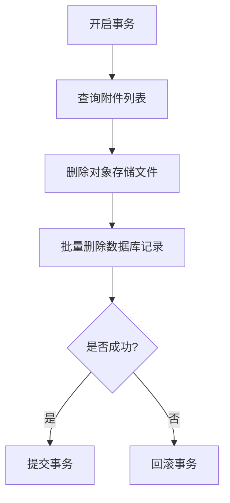
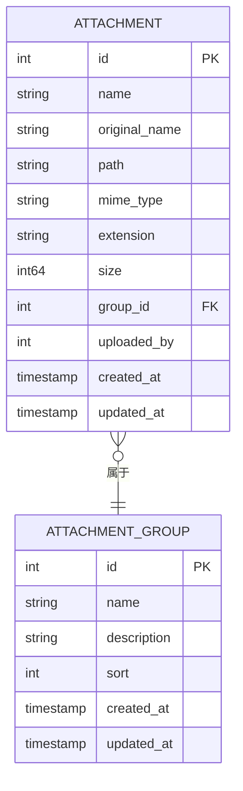
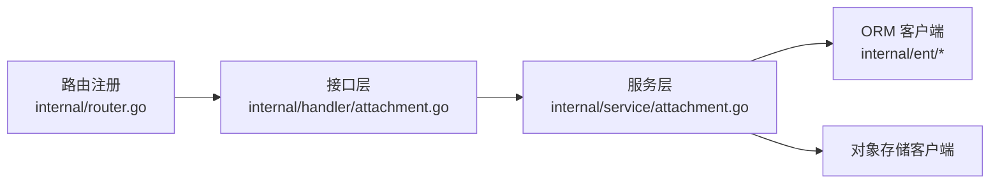

# 批量文件操作

<cite>
**本文档引用的文件**
- [internal/handler/attachment.go](file://internal/handler/attachment.go)
- [internal/service/attachment.go](file://internal/service/attachment.go)
- [internal/router.go](file://internal/router.go)
- [internal/ent/attachment/attachment.go](file://internal/ent/attachment/attachment.go)
- [internal/ent/attachment_delete.go](file://internal/ent/attachment_delete.go)
- [internal/ent/attachment_update.go](file://internal/ent/attachment_update.go)
- [internal/ent/attachmentgroup/attachmentgroup.go](file://internal/ent/attachmentgroup/attachmentgroup.go)
- [internal/ent/tx.go](file://internal/ent/tx.go)
- [docs/swagger.yaml](file://docs/swagger.yaml)
- [docs/swagger.json](file://docs/swagger.json)
</cite>

## 目录
1. [简介](#简介)
2. [项目结构](#项目结构)
3. [核心组件](#核心组件)
4. [架构总览](#架构总览)
5. [详细组件分析](#详细组件分析)
6. [依赖分析](#依赖分析)
7. [性能考量](#性能考量)
8. [故障排查指南](#故障排查指南)
9. [结论](#结论)
10. [附录](#附录)

## 简介
本文件聚焦于 Go Admin 管理系统中的“批量文件操作”能力，围绕以下目标展开：
- 批量删除：实现多附件的批量删除，包含事务边界内的文件与数据库一致性处理、错误回滚与批量清理机制。
- 批量移动：实现附件的分组批量调整与重新分类，支持将附件从一个分组移动到另一个分组或移出分组。
- 性能优化：批量查询、批量更新与内存管理策略，降低批量操作的资源消耗。
- API 规范：明确批量请求格式、响应处理与安全策略。
- 安全与错误处理：鉴权、参数校验、错误传播与日志记录。

## 项目结构
批量文件操作涉及三层协作：
- 接口层（Handler）：负责接收请求、参数解析与响应封装。
- 服务层（Service）：封装业务逻辑，协调存储与数据库操作。
- 数据访问层（Ent）：通过 ORM 生成器完成数据库查询、更新与删除。

图表来源
- [internal/handler/attachment.go:1-304](file://internal/handler/attachment.go#L1-L304)
- [internal/service/attachment.go:1-339](file://internal/service/attachment.go#L1-L339)
- [internal/router.go:113-144](file://internal/router.go#L113-L144)

章节来源
- [internal/handler/attachment.go:1-304](file://internal/handler/attachment.go#L1-L304)
- [internal/service/attachment.go:1-339](file://internal/service/attachment.go#L1-L339)
- [internal/router.go:113-144](file://internal/router.go#L113-L144)

## 核心组件
- 批量删除接口：接收附件 ID 列表，查询对应记录，删除对象存储中的文件，再批量删除数据库记录。
- 批量移动接口：接收目标分组 ID（可为空），将附件移动到指定分组或移出分组。
- 事务与回滚：当前实现未显式使用事务，但 Ent 提供了完整的事务 API，可用于增强一致性与回滚能力。
- 错误回滚与清理：在上传等场景中展示了“先删后写”的回滚思路；批量删除可借鉴该模式以提升健壮性。

章节来源
- [internal/handler/attachment.go:223-257](file://internal/handler/attachment.go#L223-L257)
- [internal/handler/attachment.go:259-303](file://internal/handler/attachment.go#L259-L303)
- [internal/service/attachment.go:174-198](file://internal/service/attachment.go#L174-L198)
- [internal/service/attachment.go:296-321](file://internal/service/attachment.go#L296-L321)
- [internal/ent/tx.go:1-232](file://internal/ent/tx.go#L1-L232)

## 架构总览
批量操作的端到端流程如下：

图表来源
- [internal/handler/attachment.go:223-257](file://internal/handler/attachment.go#L223-L257)
- [internal/service/attachment.go:174-198](file://internal/service/attachment.go#L174-L198)
- [internal/ent/attachment_delete.go:28-57](file://internal/ent/attachment_delete.go#L28-L57)

章节来源
- [internal/handler/attachment.go:223-257](file://internal/handler/attachment.go#L223-L257)
- [internal/service/attachment.go:174-198](file://internal/service/attachment.go#L174-L198)
- [internal/ent/attachment_delete.go:28-57](file://internal/ent/attachment_delete.go#L28-L57)

## 详细组件分析

### 批量删除组件分析
- 请求模型：BatchDeleteRequest，包含必填的 ID 数组（最小长度为 1）。
- 处理流程：
  - 查询阶段：根据 ID 集合一次性拉取所有附件元数据。
  - 存储清理：逐条删除对象存储中的文件。
  - 数据库清理：使用 IN 条件进行批量删除。
- 错误处理：任一环节失败均向上抛错；当前未实现事务回滚，建议结合事务增强一致性。

图表来源
- [internal/service/attachment.go:174-198](file://internal/service/attachment.go#L174-L198)
- [internal/ent/attachment_delete.go:28-57](file://internal/ent/attachment_delete.go#L28-L57)

章节来源
- [internal/service/attachment.go:83-86](file://internal/service/attachment.go#L83-L86)
- [internal/service/attachment.go:174-198](file://internal/service/attachment.go#L174-L198)
- [docs/swagger.yaml:48-57](file://docs/swagger.yaml#L48-L57)
- [docs/swagger.json:3877-3890](file://docs/swagger.json#L3877-L3890)

### 批量移动组件分析
- 请求模型：MoveAttachmentRequest，包含可空的目标分组 ID。
- 处理流程：
  - 查询附件是否存在。
  - 若 group_id 非空则设置分组 ID，否则清空分组字段。
  - 保存更新。
- 扩展建议：批量移动可复用相同思路，按 ID 集合循环或使用批量更新（如需要）。

图表来源
- [internal/handler/attachment.go:259-303](file://internal/handler/attachment.go#L259-L303)
- [internal/service/attachment.go:296-321](file://internal/service/attachment.go#L296-L321)

章节来源
- [internal/handler/attachment.go:259-303](file://internal/handler/attachment.go#L259-L303)
- [internal/service/attachment.go:88-91](file://internal/service/attachment.go#L88-L91)
- [internal/service/attachment.go:296-321](file://internal/service/attachment.go#L296-L321)

### 事务与回滚机制
- 当前批量删除未使用事务，但 Ent 已提供完整的事务 API（提交/回滚钩子、事务驱动器等）。
- 建议在批量删除中引入事务，确保“文件删除 + 数据库删除”原子性；失败时统一回滚。
- 回滚策略可参考上传流程中的“先删后写”思路：若数据库删除失败，尝试恢复或标记异常。

图表来源
- [internal/ent/tx.go:74-142](file://internal/ent/tx.go#L74-L142)
- [internal/service/attachment.go:94-147](file://internal/service/attachment.go#L94-L147)

章节来源
- [internal/ent/tx.go:1-232](file://internal/ent/tx.go#L1-L232)
- [internal/service/attachment.go:94-147](file://internal/service/attachment.go#L94-L147)

### 数据模型与关系
附件与分组之间存在多对一关系，批量操作需关注外键约束与级联行为。

图表来源
- [internal/ent/attachment/attachment.go:14-68](file://internal/ent/attachment/attachment.go#L14-L68)
- [internal/ent/attachmentgroup/attachmentgroup.go:14-53](file://internal/ent/attachmentgroup/attachmentgroup.go#L14-L53)

章节来源
- [internal/ent/attachment/attachment.go:14-68](file://internal/ent/attachment/attachment.go#L14-L68)
- [internal/ent/attachmentgroup/attachmentgroup.go:14-53](file://internal/ent/attachmentgroup/attachmentgroup.go#L14-L53)

## 依赖分析
- 接口路由注册：批量删除与移动接口在路由中注册，绑定到附件服务。
- 服务依赖：附件服务依赖 ORM 客户端与对象存储客户端。
- ORM 生成器：Ent 自动生成查询、更新、删除构建器，支持批量操作与条件过滤。

图表来源
- [internal/router.go:113-144](file://internal/router.go#L113-L144)
- [internal/handler/attachment.go:133-135](file://internal/handler/attachment.go#L133-L135)

章节来源
- [internal/router.go:113-144](file://internal/router.go#L113-L144)
- [internal/handler/attachment.go:133-135](file://internal/handler/attachment.go#L133-L135)

## 性能考量
- 批量查询：使用 IN 条件一次性拉取所需附件元数据，避免 N+1 查询。
- 批量更新/删除：使用 ORM 的批量删除构建器，减少网络往返与 SQL 解析开销。
- 内存管理：逐条删除对象存储文件，避免一次性加载大量文件到内存；如需并发，建议限制并发度并控制缓冲区大小。
- 分页与上限：列表接口对分页参数有默认值与上限控制，批量操作应避免一次性传入超大 ID 集合。

章节来源
- [internal/service/attachment.go:177-192](file://internal/service/attachment.go#L177-L192)
- [internal/service/attachment.go:215-274](file://internal/service/attachment.go#L215-L274)

## 故障排查指南
- 参数校验失败：请求体不满足 BatchDeleteRequest 或 MoveAttachmentRequest 的校验规则，返回 400。
- 附件不存在：查询不到目标附件时返回 404。
- 数据库错误：查询、删除或更新失败时返回 500。
- 对象存储错误：文件删除失败时需检查存储连接与权限。
- 日志记录：接口层在成功与失败时会记录操作日志，便于追踪。

章节来源
- [internal/handler/attachment.go:241-247](file://internal/handler/attachment.go#L241-L247)
- [internal/handler/attachment.go:284-290](file://internal/handler/attachment.go#L284-L290)
- [internal/service/attachment.go:150-172](file://internal/service/attachment.go#L150-L172)
- [internal/service/attachment.go:296-321](file://internal/service/attachment.go#L296-L321)

## 结论
- 批量删除与批量移动功能已在接口层与服务层完整实现，具备基本的批量查询与批量删除能力。
- 当前未使用事务，建议在关键路径引入事务以保证“文件删除 + 数据库删除”的原子性。
- 可扩展批量移动为批量更新，统一使用分组字段的批量更新策略。
- 建议结合 Swagger 文档完善批量请求与响应的契约定义，确保前后端一致。

## 附录

### API 接口规范（批量删除）
- 路径：DELETE /api/v1/admin/auth/attachments/batch
- 认证：Bearer Token
- 请求体：
  - ids: 数组，元素为整数，至少 1 个
- 成功响应：200，包含通用响应结构
- 失败响应：400/401/403/500，包含通用响应结构

章节来源
- [internal/handler/attachment.go:223-257](file://internal/handler/attachment.go#L223-L257)
- [docs/swagger.yaml:48-57](file://docs/swagger.yaml#L48-L57)
- [docs/swagger.json:3877-3890](file://docs/swagger.json#L3877-L3890)

### API 接口规范（批量移动）
- 路径：PUT /api/v1/admin/auth/attachments/{id}/move
- 认证：Bearer Token
- 路径参数：
  - id: 整数，附件 ID
- 请求体：
  - group_id: 整数，可空；为空表示移出分组
- 成功响应：200，包含通用响应结构
- 失败响应：400/401/403/404/500，包含通用响应结构

章节来源
- [internal/handler/attachment.go:259-303](file://internal/handler/attachment.go#L259-L303)
- [docs/swagger.yaml:48-57](file://docs/swagger.yaml#L48-L57)
- [docs/swagger.json:3877-3890](file://docs/swagger.json#L3877-L3890)

### 安全与错误处理策略
- 鉴权：所有附件相关接口均受 JWT 中间件保护。
- 参数校验：请求体通过结构体校验，非法参数返回 400。
- 业务异常：附件不存在、上传/删除失败等返回相应错误码与消息。
- 日志：成功与失败均记录操作日志，便于审计与排障。

章节来源
- [internal/router.go:53-59](file://internal/router.go#L53-L59)
- [internal/handler/attachment.go:241-247](file://internal/handler/attachment.go#L241-L247)
- [internal/handler/attachment.go:284-290](file://internal/handler/attachment.go#L284-L290)