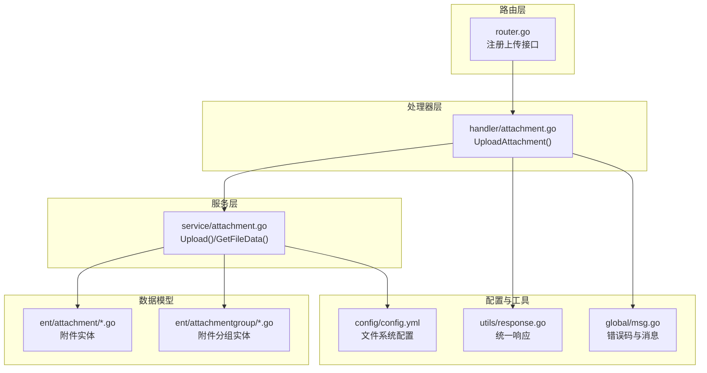
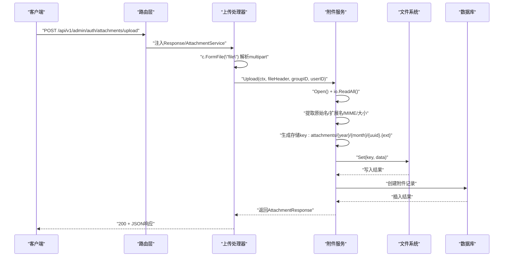
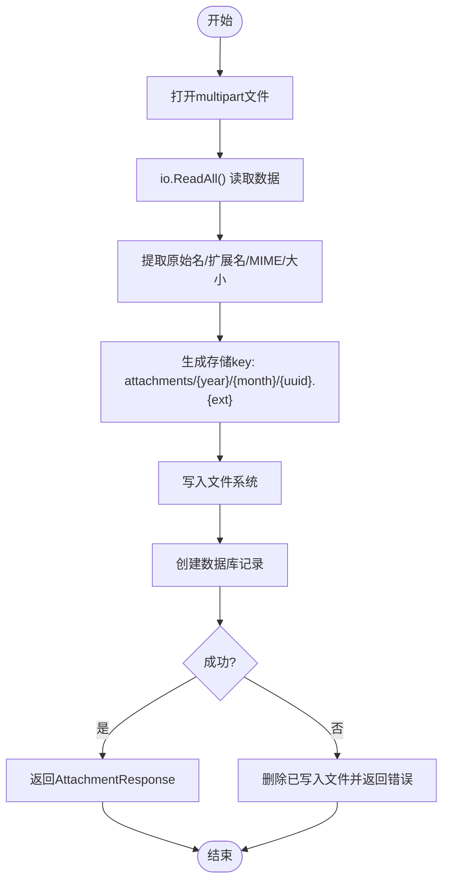
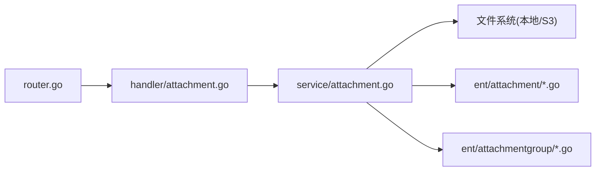

# 文件上传管理

<cite>
**本文引用的文件**
- [attachment.go](file://internal/handler/attachment.go)
- [attachment.go](file://internal/service/attachment.go)
- [attachment.go](file://internal/ent/attachment/attachment.go)
- [attachmentgroup.go](file://internal/ent/attachmentgroup/attachmentgroup.go)
- [config.yml](file://config/config.yml)
- [router.go](file://internal/router.go)
- [main.go](file://main.go)
- [response.go](file://internal/utils/response.go)
- [msg.go](file://internal/global/msg.go)
- [utils.go](file://internal/utils/utils.go)
</cite>

## 目录
1. [简介](#简介)
2. [项目结构](#项目结构)
3. [核心组件](#核心组件)
4. [架构总览](#架构总览)
5. [详细组件分析](#详细组件分析)
6. [依赖分析](#依赖分析)
7. [性能考虑](#性能考虑)
8. [故障排查指南](#故障排查指南)
9. [结论](#结论)
10. [附录](#附录)

## 简介
本章节概述Go Admin管理系统中的文件上传管理功能，重点覆盖以下方面：
- 完整的上传流程：multipart文件头解析、文件数据读取、MIME类型识别与扩展名提取、文件大小校验、存储路径生成与持久化。
- 存储策略：按年/月分目录的归档方式与基于UUID的文件命名机制。
- 安全检查：文件类型与大小限制、恶意文件防护思路与建议。
- 接口规范：请求参数、响应格式、错误处理与状态码。
- 最佳实践与性能优化建议。

## 项目结构
围绕文件上传功能的关键模块与职责如下：
- 路由层：定义上传接口与鉴权中间件，注入服务与工具对象。
- 处理器层：接收multipart表单，解析文件头，调用服务层执行上传。
- 服务层：负责文件读取、元数据提取、存储路径生成、文件系统写入、数据库记录创建与回滚。
- 数据模型：附件实体与分组实体，提供查询、过滤与排序能力。
- 配置：本地文件系统磁盘配置与S3等外部存储驱动。
- 工具与响应：统一响应结构体、消息映射与错误码。

**图表来源**
- [router.go:132-143](file://internal/router.go#L132-L143)
- [attachment.go:16-64](file://internal/handler/attachment.go#L16-L64)
- [attachment.go:93-148](file://internal/service/attachment.go#L93-L148)
- [attachment.go:14-68](file://internal/ent/attachment/attachment.go#L14-L68)
- [attachmentgroup.go:14-43](file://internal/ent/attachmentgroup/attachmentgroup.go#L14-L43)
- [config.yml:60-76](file://config/config.yml#L60-L76)
- [response.go:9-13](file://internal/utils/response.go#L9-L13)
- [msg.go:32-38](file://internal/global/msg.go#L32-L38)

**章节来源**
- [router.go:132-143](file://internal/router.go#L132-L143)
- [attachment.go:16-64](file://internal/handler/attachment.go#L16-L64)
- [attachment.go:93-148](file://internal/service/attachment.go#L93-L148)
- [attachment.go:14-68](file://internal/ent/attachment/attachment.go#L14-L68)
- [attachmentgroup.go:14-43](file://internal/ent/attachmentgroup/attachmentgroup.go#L14-L43)
- [config.yml:60-76](file://config/config.yml#L60-L76)
- [response.go:9-13](file://internal/utils/response.go#L9-L13)
- [msg.go:32-38](file://internal/global/msg.go#L32-L38)

## 核心组件
- 上传处理器：解析multipart/form-data，获取file与可选group_id，调用服务层执行上传。
- 附件服务：读取文件数据、提取原始名、扩展名、MIME类型与大小；生成按年/月分目录的存储key；写入文件系统；创建数据库记录；异常时回滚文件。
- 数据模型：附件实体包含名称、原始名、存储路径、MIME类型、扩展名、大小、分组ID、上传人等字段；支持按关键字、分组、MIME类型筛选与分页。
- 文件系统配置：支持本地磁盘与S3等驱动，根目录指向本地data/storage。
- 统一响应：封装code、message、data三段式响应，便于前端统一处理。

**章节来源**
- [attachment.go:16-64](file://internal/handler/attachment.go#L16-L64)
- [attachment.go:93-148](file://internal/service/attachment.go#L93-L148)
- [attachment.go:52-65](file://internal/service/attachment.go#L52-L65)
- [attachment.go:14-68](file://internal/ent/attachment/attachment.go#L14-L68)
- [config.yml:60-76](file://config/config.yml#L60-L76)
- [response.go:9-13](file://internal/utils/response.go#L9-L13)

## 架构总览
文件上传的端到端流程如下：

**图表来源**
- [router.go:137](file://internal/router.go#L137)
- [attachment.go:35-63](file://internal/handler/attachment.go#L35-L63)
- [attachment.go:93-148](file://internal/service/attachment.go#L93-L148)

## 详细组件分析

### 上传处理器（UploadAttachment）
- 功能要点
  - 从multipart表单读取file字段，若缺失则返回错误。
  - 解析可选的group_id参数，转换为指针类型传给服务层。
  - 从JWT上下文获取当前用户ID。
  - 调用服务层执行上传，捕获错误并统一返回。
  - 记录操作日志。
- 错误处理
  - 未选择文件：返回“请选择上传文件”。
  - 上传失败：返回“上传失败”，错误码对应附件上传失败。
- 响应
  - 成功时返回AttachmentResponse结构体，包含文件元信息与时间戳。

**章节来源**
- [attachment.go:35-63](file://internal/handler/attachment.go#L35-L63)
- [msg.go:73-79](file://internal/global/msg.go#L73-L79)

### 附件服务（AttachmentService）
- 文件读取与元数据
  - 打开multipart文件并读取全部数据。
  - 提取原始文件名、扩展名（去除前导点）、MIME类型（若为空则使用二进制流）与大小。
- 存储路径生成
  - 采用“按年/月分目录”的策略，结合UUID与原扩展名生成唯一key，避免同名冲突与目录过深。
- 文件系统写入与回滚
  - 写入成功后创建数据库记录；若数据库插入失败，立即删除已写入的文件，保证一致性。
- 数据库记录
  - 字段包含名称、原始名、路径、MIME类型、扩展名、大小、分组ID、上传人、创建/更新时间。
- 列表与筛选
  - 支持分页、关键字搜索（名称/原始名）、分组筛选、MIME类型前缀筛选。
- 预览/下载
  - 通过ID获取文件数据、MIME类型与原始名，设置Content-Type与Content-Disposition，实现在线预览或下载。

**图表来源**
- [attachment.go:93-148](file://internal/service/attachment.go#L93-L148)

**章节来源**
- [attachment.go:93-148](file://internal/service/attachment.go#L93-L148)
- [attachment.go:200-213](file://internal/service/attachment.go#L200-L213)
- [attachment.go:215-274](file://internal/service/attachment.go#L215-L274)
- [attachment.go:276-294](file://internal/service/attachment.go#L276-L294)

### 数据模型（附件与分组）
- 附件实体
  - 字段：id、name、original_name、path、mime_type、extension、size、group_id、uploaded_by、created_at、updated_at。
  - 支持按MIME类型前缀、扩展名等条件筛选。
- 附件分组实体
  - 字段：id、name、description、sort、created_at、updated_at。
  - 与附件实体存在多对一关系（附件属于分组）。

**章节来源**
- [attachment.go:14-68](file://internal/ent/attachment/attachment.go#L14-L68)
- [attachmentgroup.go:14-43](file://internal/ent/attachmentgroup/attachmentgroup.go#L14-L43)

### 文件系统与存储路径
- 驱动配置
  - 本地磁盘：root指向项目根下的data/storage。
  - S3：可配置access_key、secret_key、region、bucket、endpoint等。
- 存储策略
  - 目录结构：attachments/{年}/{月}/，按年/月归档，便于管理和清理。
  - 文件命名：UUID.原扩展名，确保唯一性与不可预测性，降低碰撞风险。

**章节来源**
- [config.yml:60-76](file://config/config.yml#L60-L76)
- [attachment.go:120-127](file://internal/service/attachment.go#L120-L127)

### API规范：上传接口
- 请求
  - 方法：POST
  - 路径：/api/v1/admin/auth/attachments/upload
  - 认证：Bearer Token（JWT）
  - 表单字段：
    - file: 必填，multipart文件
    - group_id: 可选，整数，附件所属分组ID
- 成功响应
  - 状态码：200
  - 结构：utils.Response，data为AttachmentResponse
  - AttachmentResponse字段：id、name、original_name、path、mime_type、extension、size、group_id、uploaded_by、created_at、updated_at
- 错误响应
  - 400：参数无效或未选择文件
  - 401：未授权
  - 403：拒绝访问
  - 500：内部服务器错误
- 响应结构
  - utils.Response：code、message、data

**章节来源**
- [attachment.go:16-30](file://internal/handler/attachment.go#L16-L30)
- [attachment.go:52-65](file://internal/service/attachment.go#L52-L65)
- [response.go:9-13](file://internal/utils/response.go#L9-L13)
- [msg.go:44-54](file://internal/global/msg.go#L44-L54)

## 依赖分析
- 路由到处理器：/api/v1/admin/auth/attachments/upload -> UploadAttachment
- 处理器到服务：UploadAttachment -> AttachmentService.Upload
- 服务到文件系统：AttachmentService.Upload -> filesystem.Set
- 服务到数据库：AttachmentService.Upload -> ORM创建附件记录
- 服务到模型：查询、筛选、排序依赖ent生成的附件与分组模型

**图表来源**
- [router.go:137](file://internal/router.go#L137)
- [attachment.go:35-63](file://internal/handler/attachment.go#L35-L63)
- [attachment.go:93-148](file://internal/service/attachment.go#L93-L148)
- [attachment.go:14-68](file://internal/ent/attachment/attachment.go#L14-L68)
- [attachmentgroup.go:14-43](file://internal/ent/attachmentgroup/attachmentgroup.go#L14-L43)

**章节来源**
- [router.go:132-143](file://internal/router.go#L132-L143)
- [attachment.go:35-63](file://internal/handler/attachment.go#L35-L63)
- [attachment.go:93-148](file://internal/service/attachment.go#L93-L148)
- [attachment.go:14-68](file://internal/ent/attachment/attachment.go#L14-L68)
- [attachmentgroup.go:14-43](file://internal/ent/attachmentgroup/attachmentgroup.go#L14-L43)

## 性能考虑
- 流式处理建议
  - 当前实现一次性读取整个文件到内存，适合中小文件。对于大文件，建议改为流式写入文件系统，避免内存峰值。
- 并发与限流
  - 在路由层或中间件增加并发与速率限制，防止突发上传导致资源耗尽。
- 缓存与索引
  - 对于频繁访问的附件，可在网关或CDN层做缓存；数据库侧确保对path、mime_type、group_id建立合适索引。
- 存储分层
  - 大量小文件可考虑归档至对象存储（如S3），本地仅保留近期热数据，降低IO压力。
- 压缩与去重
  - 对重复文件进行去重判断（基于哈希），减少存储空间与IO。
- 异步处理
  - 将非关键步骤（如缩略图生成、OCR识别）异步化，缩短上传主链路耗时。

## 故障排查指南
- 常见问题与定位
  - 未选择文件：检查前端multipart是否正确提交file字段。
  - 上传失败：查看服务层错误码与回滚逻辑，确认文件系统写入与数据库插入是否一致。
  - 路径不存在：确认文件系统root配置与目录权限，确保attachments/{year}/{month}可写。
  - MIME类型异常：若Content-Type为空，系统使用二进制流类型，需在前端正确设置。
- 日志与监控
  - 开启请求日志中间件，结合操作日志服务记录上传行为。
  - 监控文件系统写入耗时、数据库插入成功率与错误堆栈。
- 回滚与清理
  - 服务层在数据库插入失败时会删除已写入文件，确保数据一致性。

**章节来源**
- [attachment.go:35-38](file://internal/handler/attachment.go#L35-L38)
- [attachment.go:142-145](file://internal/service/attachment.go#L142-L145)
- [config.yml:60-76](file://config/config.yml#L60-L76)
- [main.go:62-91](file://main.go#L62-L91)

## 结论
该文件上传管理功能以清晰的分层设计实现了从表单解析到文件落盘与数据库记录的完整闭环。通过按年/月分目录与UUID命名策略，兼顾了可维护性与安全性。建议在生产环境中引入流式写入、并发控制、缓存与异步处理等优化手段，进一步提升稳定性与吞吐能力。

## 附录

### API规范：其他相关接口
- 列表附件
  - 方法：GET
  - 路径：/api/v1/admin/auth/attachments
  - 查询参数：page、page_size、keyword、group_id、mime_type
  - 响应：utils.Response，data为ListAttachmentsResponse
- 预览/下载
  - 方法：GET
  - 路径：/api/v1/admin/auth/attachments/{id}/preview
  - 响应：octet-stream，根据MIME类型决定inline或attachment
- 删除与批量删除
  - 方法：DELETE
  - 路径：/api/v1/admin/auth/attachments/{id} 与 /api/v1/admin/auth/attachments/batch
  - 响应：utils.Response

**章节来源**
- [attachment.go:66-108](file://internal/handler/attachment.go#L66-L108)
- [attachment.go:144-185](file://internal/handler/attachment.go#L144-L185)
- [attachment.go:187-257](file://internal/handler/attachment.go#L187-L257)