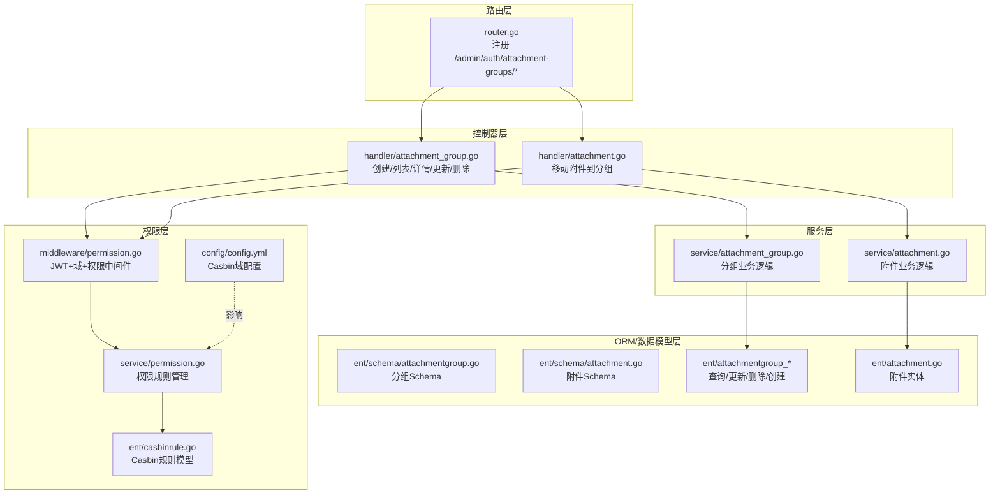
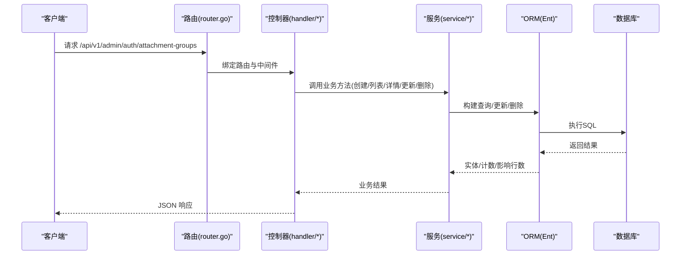
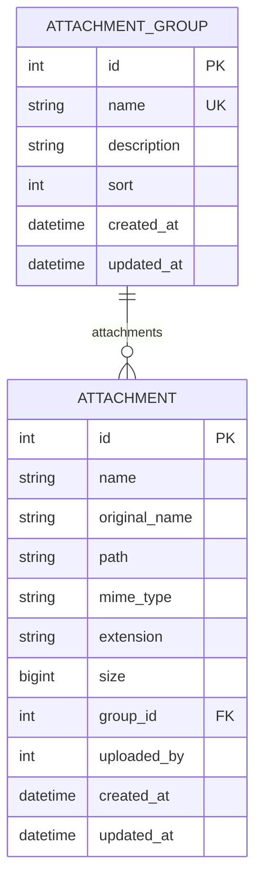
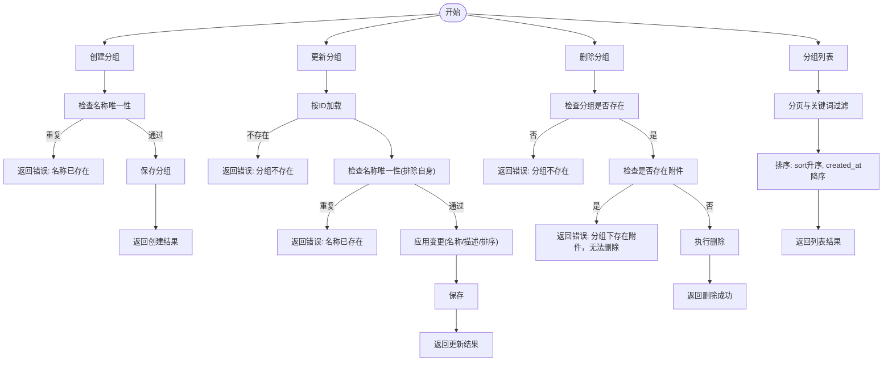
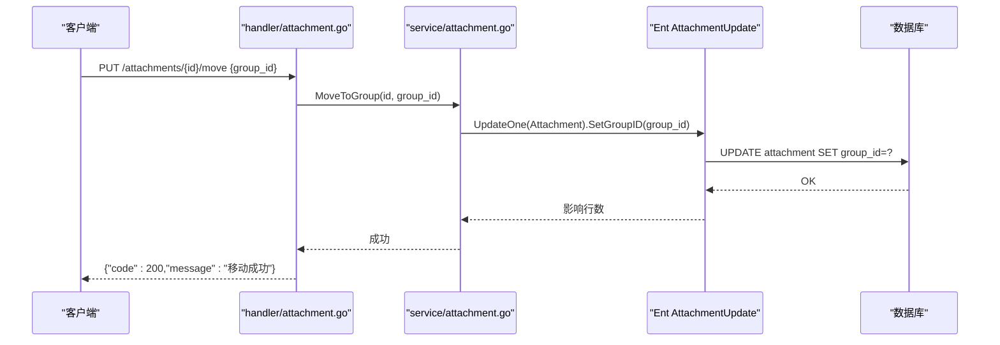
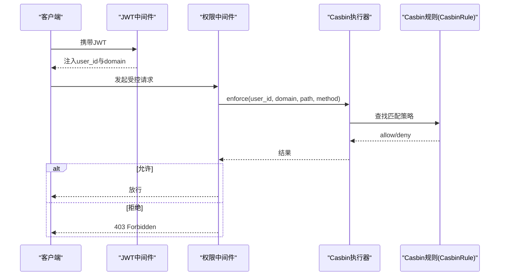
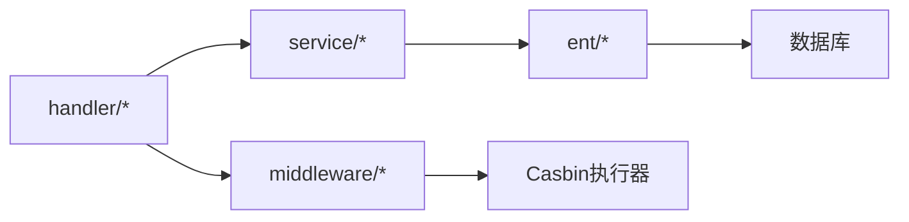

# 文件分组管理

<cite>
**本文引用的文件**
- [attachmentgroup.go](file://internal/ent/attachmentgroup/attachmentgroup.go)
- [attachmentgroup.go](file://internal/ent/attachmentgroup.go)
- [attachmentgroup_create.go](file://internal/ent/attachmentgroup_create.go)
- [attachmentgroup_update.go](file://internal/ent/attachmentgroup_update.go)
- [attachmentgroup_delete.go](file://internal/ent/attachmentgroup_delete.go)
- [attachmentgroup_query.go](file://internal/ent/attachmentgroup_query.go)
- [attachmentgroup.go](file://internal/ent/schema/attachmentgroup.go)
- [attachment.go](file://internal/ent/attachment.go)
- [attachment.go](file://internal/ent/schema/attachment.go)
- [attachment_group.go](file://internal/service/attachment_group.go)
- [attachment.go](file://internal/service/attachment.go)
- [attachment_group.go](file://internal/handler/attachment_group.go)
- [attachment.go](file://internal/handler/attachment.go)
- [router.go](file://internal/router.go)
- [permission.go](file://internal/middleware/permission.go)
- [permission.go](file://internal/service/permission.go)
- [casbinrule.go](file://internal/ent/casbinrule.go)
- [config.yml](file://config/config.yml)
</cite>

## 目录
1. [简介](#简介)
2. [项目结构](#项目结构)
3. [核心组件](#核心组件)
4. [架构总览](#架构总览)
5. [详细组件分析](#详细组件分析)
6. [依赖分析](#依赖分析)
7. [性能考虑](#性能考虑)
8. [故障排查指南](#故障排查指南)
9. [结论](#结论)
10. [附录](#附录)

## 简介
本文件面向 Go Admin 管理系统的“文件分组管理”能力，系统化阐述分组的创建、编辑、删除、查询、排序与搜索等完整生命周期管理；解释文件与分组之间的一对多关联关系及分组移动能力；说明基于 Casbin 的分组级权限控制与继承机制；给出分组管理的 API 接口规范与最佳实践建议。

## 项目结构
围绕文件分组管理的关键代码位于以下层次：
- 数据模型层（Ent Schema）：定义 AttachmentGroup 与 Attachment 的字段、边与索引
- ORM 查询层（Ent）：生成的查询、更新、删除、创建与排序/聚合构建器
- 服务层（Service）：封装业务逻辑，如分组的增删改查、校验与错误处理
- 控制器层（Handler）：HTTP 接口实现，参数解析与响应封装
- 路由层（Router）：注册分组与附件相关路由
- 权限层（Middleware/Service/Casbin）：基于 JWT 与 Casbin 的域级权限控制

图表来源
- [router.go:113-130](file://internal/router.go#L113-L130)
- [attachment_group.go:15-222](file://internal/handler/attachment_group.go#L15-L222)
- [attachment.go:280-303](file://internal/handler/attachment.go#L280-L303)
- [attachment_group.go:29-264](file://internal/service/attachment_group.go#L29-L264)
- [attachment.go:1-200](file://internal/service/attachment.go#L1-L200)
- [attachmentgroup.go:11-57](file://internal/ent/schema/attachmentgroup.go#L11-L57)
- [attachment.go:12-89](file://internal/ent/schema/attachment.go#L12-L89)
- [attachmentgroup_create.go:1-338](file://internal/ent/attachmentgroup_create.go#L1-L338)
- [attachmentgroup_update.go:1-552](file://internal/ent/attachmentgroup_update.go#L1-L552)
- [attachmentgroup_delete.go:1-89](file://internal/ent/attachmentgroup_delete.go#L1-L89)
- [attachmentgroup_query.go:1-607](file://internal/ent/attachmentgroup_query.go#L1-L607)
- [attachment.go:1-200](file://internal/ent/attachment.go#L1-L200)
- [permission.go:14-94](file://internal/middleware/permission.go#L14-L94)
- [permission.go:189-425](file://internal/service/permission.go#L189-L425)
- [casbinrule.go:1-36](file://internal/ent/casbinrule.go#L1-L36)
- [config.yml:77-112](file://config/config.yml#L77-L112)

章节来源
- [router.go:113-130](file://internal/router.go#L113-L130)

## 核心组件
- 分组模型（AttachmentGroup）
  - 字段：id、name（唯一）、description、sort、created_at、updated_at
  - 边：attachments（一对多）
- 附件模型（Attachment）
  - 字段：id、name、original_name、path、mime_type、extension、size、group_id、uploaded_by、created_at、updated_at
  - 边：group（多对一，唯一）
- 服务接口
  - 分组：Create、Update、Delete、Get、List
  - 附件：MoveToGroup（移动到分组）
- 控制器接口
  - 分组：POST/GET/GET/{id}/PUT/{id}/DELETE/{id}
  - 附件：PUT/{id}/move

章节来源
- [attachmentgroup.go:11-57](file://internal/ent/schema/attachmentgroup.go#L11-L57)
- [attachment.go:12-89](file://internal/ent/schema/attachment.go#L12-L89)
- [attachment_group.go:29-264](file://internal/service/attachment_group.go#L29-L264)
- [attachment.go:1-200](file://internal/service/attachment.go#L1-L200)
- [attachment_group.go:15-222](file://internal/handler/attachment_group.go#L15-L222)
- [attachment.go:280-303](file://internal/handler/attachment.go#L280-L303)

## 架构总览
分组管理遵循典型的 MVC + ORM 分层：
- Handler 层负责参数解析、鉴权与响应封装
- Service 层负责业务规则与数据一致性（如名称唯一性、删除前检查）
- Ent ORM 层负责数据库交互、关系查询与排序聚合
- 权限中间件通过 JWT 提取用户域，Casbin 执行策略匹配

图表来源
- [router.go:113-130](file://internal/router.go#L113-L130)
- [attachment_group.go:15-222](file://internal/handler/attachment_group.go#L15-L222)
- [attachment_group.go:29-264](file://internal/service/attachment_group.go#L29-L264)
- [attachmentgroup_query.go:1-607](file://internal/ent/attachmentgroup_query.go#L1-L607)

## 详细组件分析

### 分组模型与关系
- AttachmentGroup 与 Attachment 通过 group_id 建立一对多关系
- Attachment 的 group 边为唯一边，确保单一分组归属
- 支持通过 QueryAttachments 进行预加载与统计

图表来源
- [attachmentgroup.go:11-57](file://internal/ent/schema/attachmentgroup.go#L11-L57)
- [attachment.go:12-89](file://internal/ent/schema/attachment.go#L12-L89)

章节来源
- [attachmentgroup.go:14-133](file://internal/ent/attachmentgroup/attachmentgroup.go#L14-L133)
- [attachmentgroup_query.go:64-84](file://internal/ent/attachmentgroup_query.go#L64-L84)
- [attachment.go:172-175](file://internal/ent/attachment.go#L172-L175)

### 分组 CRUD 流程
- 创建：校验名称唯一性，设置默认排序与时间戳，保存后返回响应
- 更新：按 ID 查询，校验名称唯一性（排除自身），更新字段并保存
- 删除：先检查是否存在，再检查是否仍有附件，无附件方可删除
- 查询：支持分页、关键词（名称/描述）过滤、排序（sort 升序，created_at 降序）

图表来源
- [attachment_group.go:79-186](file://internal/service/attachment_group.go#L79-L186)
- [attachmentgroup_create.go:112-131](file://internal/ent/attachmentgroup_create.go#L112-L131)
- [attachmentgroup_update.go:134-160](file://internal/ent/attachmentgroup_update.go#L134-L160)
- [attachmentgroup_delete.go:28-57](file://internal/ent/attachmentgroup_delete.go#L28-L57)
- [attachmentgroup_query.go:204-250](file://internal/ent/attachmentgroup_query.go#L204-L250)

章节来源
- [attachment_group.go:79-186](file://internal/service/attachment_group.go#L79-L186)
- [attachmentgroup_create.go:112-201](file://internal/ent/attachmentgroup_create.go#L112-L201)
- [attachmentgroup_update.go:134-270](file://internal/ent/attachmentgroup_update.go#L134-L270)
- [attachmentgroup_delete.go:28-89](file://internal/ent/attachmentgroup_delete.go#L28-L89)
- [attachmentgroup_query.go:204-250](file://internal/ent/attachmentgroup_query.go#L204-L250)

### 分组移动与附件归属
- 移动附件到分组：通过 PUT /api/v1/admin/auth/attachments/{id}/move 实现
- 支持将附件移动到指定分组，或将附件从分组移除（传入空分组）
- 服务层通过 UpdateOne 设置 group_id 并保存

图表来源
- [attachment.go:280-303](file://internal/handler/attachment.go#L280-L303)
- [attachment.go:1-200](file://internal/service/attachment.go#L1-L200)
- [attachmentgroup_update.go:446-551](file://internal/ent/attachmentgroup_update.go#L446-L551)

章节来源
- [attachment.go:280-303](file://internal/handler/attachment.go#L280-L303)
- [attachment.go:1-200](file://internal/service/attachment.go#L1-L200)

### 权限控制与继承机制
- 认证与域：JWT 中提取 user_id 与 domain，中间件将域注入 Locals
- 权限检查：Casbin 执行 enforce(sub, dom, obj, act)，支持多域配置
- 继承机制：通过 Casbin 模型中的角色继承关系（g 关系）实现权限继承
- 分组级控制：可通过为不同域配置独立模型与策略，实现分组级访问控制

图表来源
- [permission.go:14-94](file://internal/middleware/permission.go#L14-L94)
- [permission.go:189-425](file://internal/service/permission.go#L189-L425)
- [casbinrule.go:1-36](file://internal/ent/casbinrule.go#L1-L36)
- [config.yml:77-112](file://config/config.yml#L77-L112)

章节来源
- [permission.go:14-94](file://internal/middleware/permission.go#L14-L94)
- [permission.go:189-425](file://internal/service/permission.go#L189-L425)
- [casbinrule.go:1-36](file://internal/ent/casbinrule.go#L1-L36)
- [config.yml:77-112](file://config/config.yml#L77-L112)

### API 接口规范（分组管理）
- 创建分组
  - 方法：POST
  - 路径：/api/v1/admin/auth/attachment-groups
  - 请求体：CreateGroupRequest（name、description、sort）
  - 响应：GroupResponse 或错误码
- 列表分组
  - 方法：GET
  - 路径：/api/v1/admin/auth/attachment-groups
  - 查询参数：page、page_size、keyword
  - 响应：ListGroupsResponse
- 获取分组详情
  - 方法：GET
  - 路径：/api/v1/admin/auth/attachment-groups/{id}
  - 响应：GroupResponse
- 更新分组
  - 方法：PUT
  - 路径：/api/v1/admin/auth/attachment-groups/{id}
  - 请求体：UpdateGroupRequest（name、description、sort）
  - 响应：成功或错误码
- 删除分组
  - 方法：DELETE
  - 路径：/api/v1/admin/auth/attachment-groups/{id}
  - 响应：成功或错误码

章节来源
- [attachment_group.go:15-222](file://internal/handler/attachment_group.go#L15-L222)
- [attachment_group.go:29-264](file://internal/service/attachment_group.go#L29-L264)
- [router.go:113-130](file://internal/router.go#L113-L130)

### API 接口规范（附件移动）
- 移动附件到分组
  - 方法：PUT
  - 路径：/api/v1/admin/auth/attachments/{id}/move
  - 请求体：MoveAttachmentRequest（group_id）
  - 响应：成功或错误码

章节来源
- [attachment.go:280-303](file://internal/handler/attachment.go#L280-L303)
- [attachment.go:1-200](file://internal/service/attachment.go#L1-L200)

## 依赖分析
- 组件耦合
  - Handler 依赖 Service；Service 依赖 Ent ORM；权限中间件依赖 Casbin
  - 分组与附件通过外键建立强约束关系
- 外部依赖
  - JWT 解析与校验
  - Casbin 策略引擎
  - Fiber 路由框架
- 潜在循环依赖
  - 当前结构清晰，未发现直接循环依赖

图表来源
- [router.go:113-130](file://internal/router.go#L113-L130)
- [attachment_group.go:15-222](file://internal/handler/attachment_group.go#L15-L222)
- [attachment_group.go:29-264](file://internal/service/attachment_group.go#L29-L264)
- [permission.go:14-94](file://internal/middleware/permission.go#L14-L94)

## 性能考虑
- 查询优化
  - 使用分页与关键词过滤，避免全表扫描
  - 排序优先使用索引列（sort、created_at）
- 关系查询
  - 预加载 attachments 边时注意 N+1 查询风险，必要时批量加载
- 写入优化
  - 批量创建/更新时利用 ORM 的批量接口减少往返
- 缓存策略
  - 对热点分组列表与权限规则进行缓存，降低 Casbin 查询压力

## 故障排查指南
- 常见错误与定位
  - 分组名称冲突：创建/更新时检查唯一性约束
  - 分组非空删除：删除前检查附件存在性
  - 分组不存在：按 ID 查询返回 Not Found
  - 权限不足：确认 JWT 中 domain 与用户权限策略匹配
- 日志与审计
  - 控制器层记录操作日志（创建/更新/删除/移动）
  - 建议在服务层增加关键步骤的日志埋点

章节来源
- [attachment_group.go:155-186](file://internal/service/attachment_group.go#L155-L186)
- [attachment_group.go:42-53](file://internal/handler/attachment_group.go#L42-L53)
- [attachment.go:280-303](file://internal/handler/attachment.go#L280-L303)
- [permission.go:14-94](file://internal/middleware/permission.go#L14-L94)

## 结论
文件分组管理在 Go Admin 中以清晰的分层架构实现：模型层定义明确的关系与约束，服务层保证业务一致性与错误处理，控制器层提供标准 API，权限中间件与 Casbin 提供域级细粒度控制。通过分组移动能力，系统实现了灵活的附件组织与权限治理。

## 附录

### 最佳实践与组织策略建议
- 分组命名与结构
  - 使用语义化名称，避免过深层级；结合业务域划分
  - 为常用分组设置合理 sort 值，便于前端展示
- 附件归属
  - 附件必须归属一个分组；无归属场景使用“未分组”专用分组
  - 移动附件时记录操作日志，便于审计
- 权限设计
  - 为不同域配置独立的 Casbin 模型与策略
  - 利用角色继承关系简化权限维护
- 性能与可用性
  - 列表查询开启分页与关键词过滤
  - 对高频访问的分组与权限进行缓存
  - 定期清理无用附件与分组，保持数据健康