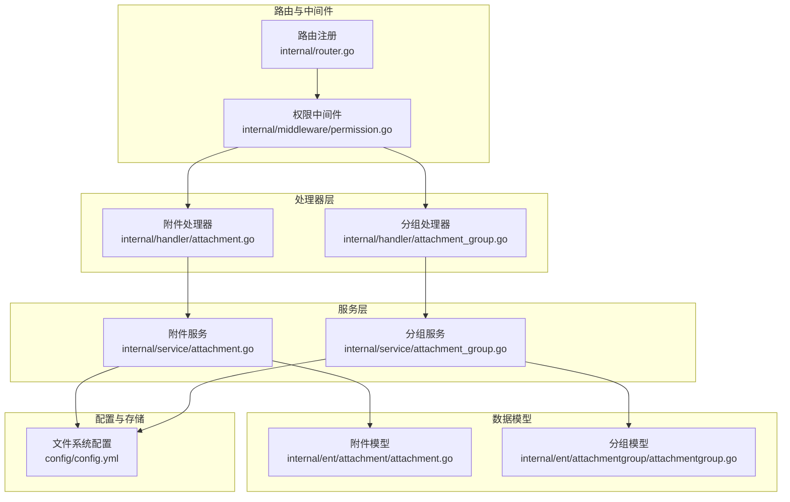
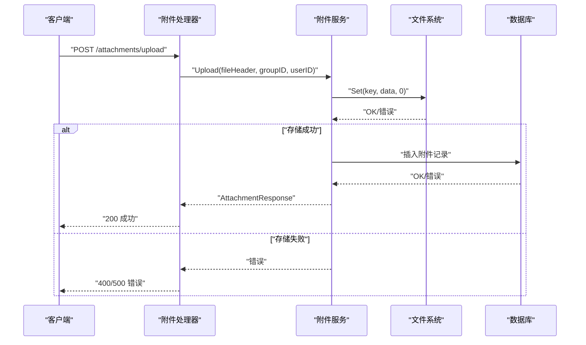
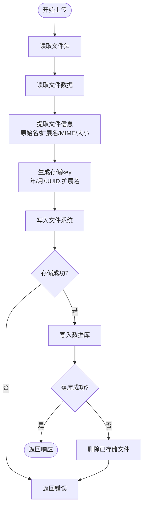
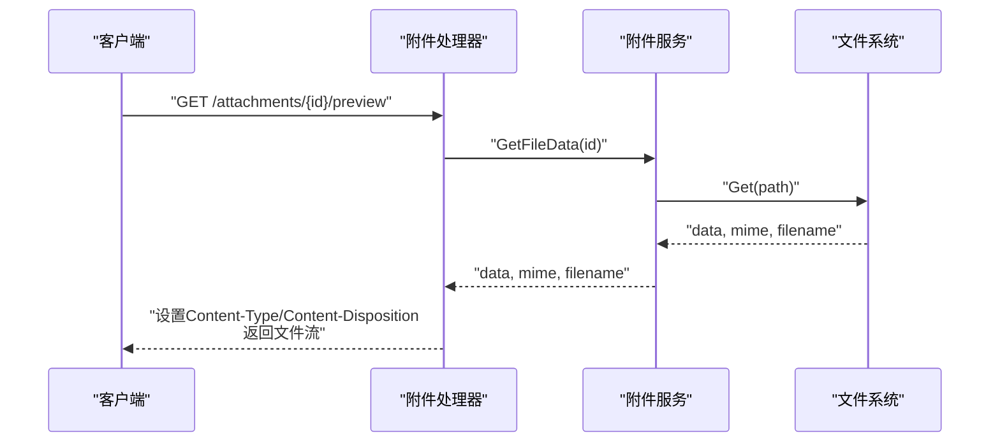
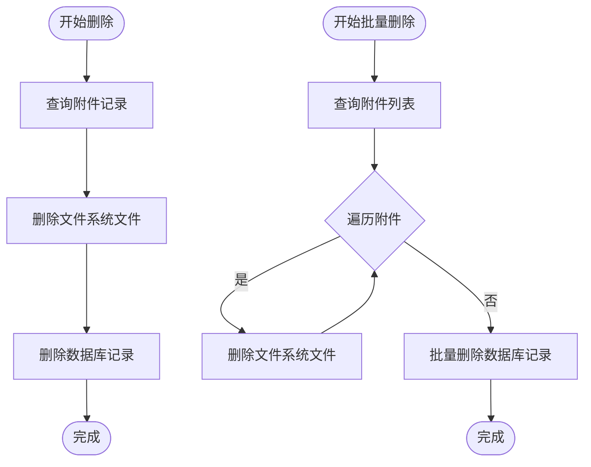
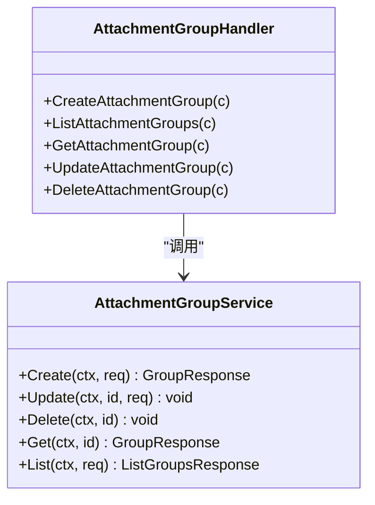
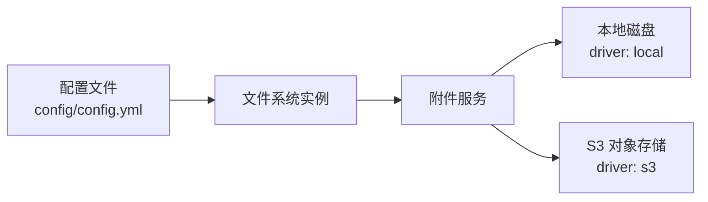
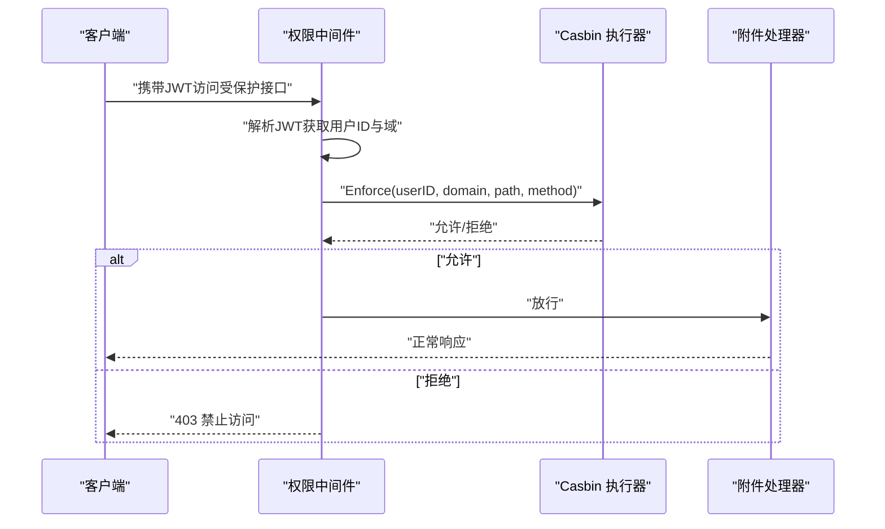
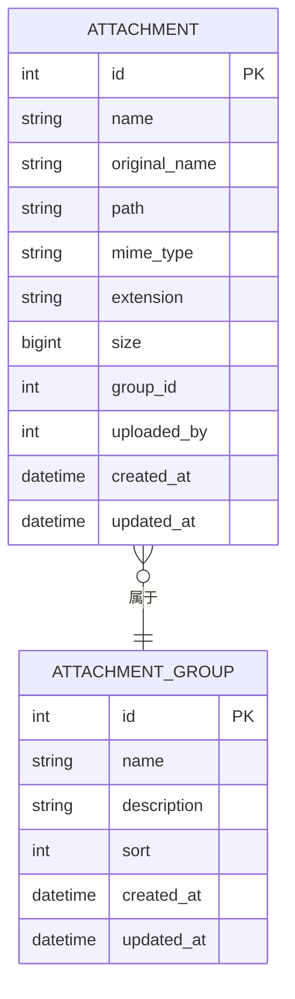
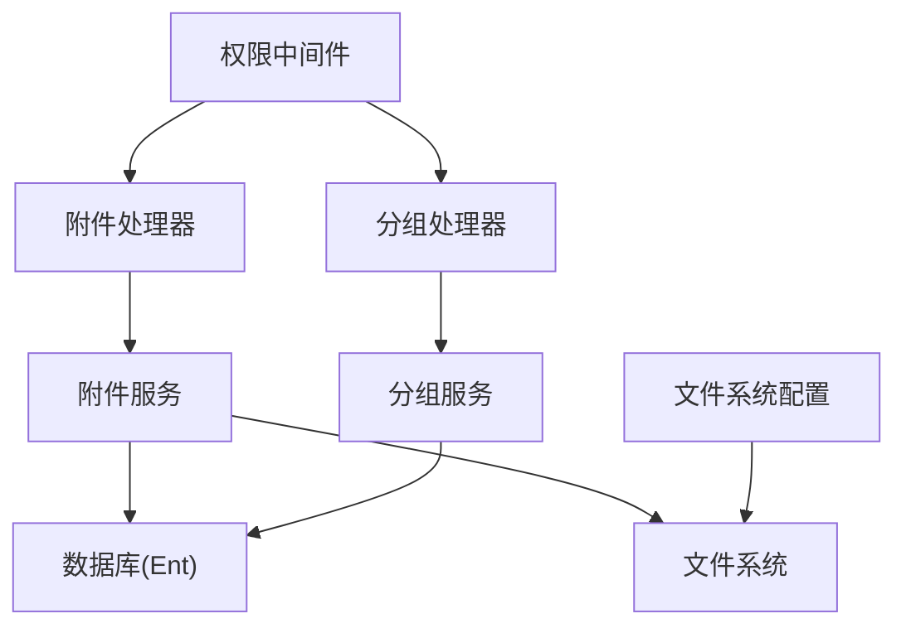

# 文件存储系统

<cite>
**本文引用的文件**
- [internal/service/attachment.go](file://internal/service/attachment.go)
- [internal/handler/attachment.go](file://internal/handler/attachment.go)
- [internal/service/attachment_group.go](file://internal/service/attachment_group.go)
- [internal/handler/attachment_group.go](file://internal/handler/attachment_group.go)
- [internal/ent/attachment/attachment.go](file://internal/ent/attachment/attachment.go)
- [internal/ent/attachmentgroup/attachmentgroup.go](file://internal/ent/attachmentgroup/attachmentgroup.go)
- [config/config.yml](file://config/config.yml)
- [internal/router.go](file://internal/router.go)
- [internal/middleware/permission.go](file://internal/middleware/permission.go)
- [internal/service/attachment_test.go](file://internal/service/attachment_test.go)
</cite>

## 目录
1. [简介](#简介)
2. [项目结构](#项目结构)
3. [核心组件](#核心组件)
4. [架构总览](#架构总览)
5. [详细组件分析](#详细组件分析)
6. [依赖分析](#依赖分析)
7. [性能考虑](#性能考虑)
8. [故障排查指南](#故障排查指南)
9. [结论](#结论)
10. [附录](#附录)

## 简介
本文件存储系统基于 Go Admin 管理平台，提供统一的文件上传、存储、检索与预览能力，并支持多存储后端（本地与 S3）。系统通过“附件”和“附件分组”两个维度实现文件的分类、标签化管理与访问控制，覆盖从上传校验、存储路径生成、数据库持久化到预览与批量操作的完整链路。

## 项目结构
围绕文件存储的关键模块分布如下：
- 路由与中间件：负责鉴权、域隔离与权限控制
- 处理器层：封装 API 行为，解析请求参数并调用服务层
- 服务层：实现业务逻辑，协调文件系统与数据库
- 数据模型：定义附件与附件分组的表结构与查询条件
- 配置：定义文件系统驱动与参数（本地与 S3）

图表来源
- [internal/router.go:113-149](file://internal/router.go#L113-L149)
- [internal/middleware/permission.go:14-78](file://internal/middleware/permission.go#L14-L78)
- [internal/handler/attachment.go:16-304](file://internal/handler/attachment.go#L16-L304)
- [internal/handler/attachment_group.go:15-223](file://internal/handler/attachment_group.go#L15-L223)
- [internal/service/attachment.go:38-339](file://internal/service/attachment.go#L38-L339)
- [internal/service/attachment_group.go:29-264](file://internal/service/attachment_group.go#L29-L264)
- [internal/ent/attachment/attachment.go:14-170](file://internal/ent/attachment/attachment.go#L14-L170)
- [internal/ent/attachmentgroup/attachmentgroup.go:14-133](file://internal/ent/attachmentgroup/attachmentgroup.go#L14-L133)
- [config/config.yml:60-76](file://config/config.yml#L60-L76)

章节来源
- [internal/router.go:113-149](file://internal/router.go#L113-L149)
- [config/config.yml:60-76](file://config/config.yml#L60-L76)

## 核心组件
- 附件服务（AttachmentService）：负责上传、删除、批量删除、查询、移动分组、获取文件数据等
- 附件处理器（Attachment Handler）：封装上传、列表、详情、预览、删除、批量删除、移动分组等 API
- 附件分组服务（AttachmentGroupService）：负责分组的增删改查与存在性校验
- 附件分组处理器（AttachmentGroup Handler）：封装分组的 CRUD 与列表 API
- 数据模型（Ent Schema）：定义附件与分组的字段、排序、过滤与关联
- 文件系统配置（Config）：定义本地与 S3 驱动及参数

章节来源
- [internal/service/attachment.go:27-339](file://internal/service/attachment.go#L27-L339)
- [internal/handler/attachment.go:16-304](file://internal/handler/attachment.go#L16-L304)
- [internal/service/attachment_group.go:20-264](file://internal/service/attachment_group.go#L20-L264)
- [internal/handler/attachment_group.go:15-223](file://internal/handler/attachment_group.go#L15-L223)
- [internal/ent/attachment/attachment.go:14-170](file://internal/ent/attachment/attachment.go#L14-L170)
- [internal/ent/attachmentgroup/attachmentgroup.go:14-133](file://internal/ent/attachmentgroup/attachmentgroup.go#L14-L133)
- [config/config.yml:60-76](file://config/config.yml#L60-L76)

## 架构总览
系统采用“处理器-服务-数据模型-文件系统”的分层架构，配合中间件完成鉴权与权限控制。上传流程先写入文件系统，再写入数据库；删除流程先删存储后删记录，保证一致性。

图表来源
- [internal/handler/attachment.go:31-64](file://internal/handler/attachment.go#L31-L64)
- [internal/service/attachment.go:93-148](file://internal/service/attachment.go#L93-L148)

## 详细组件分析

### 附件上传与存储
- 输入解析：从 multipart 表单读取文件头，提取原始文件名、扩展名、MIME 类型与大小
- 路径生成：按年/月层级生成存储 key，结合 UUID 与扩展名避免冲突
- 存储写入：调用文件系统接口写入二进制数据
- 记录落库：创建附件记录，包含名称、原始名、路径、MIME、扩展名、大小、分组与上传人
- 错误处理：若落库失败，回滚已写入的文件

图表来源
- [internal/service/attachment.go:93-148](file://internal/service/attachment.go#L93-L148)

章节来源
- [internal/service/attachment.go:93-148](file://internal/service/attachment.go#L93-L148)
- [internal/handler/attachment.go:31-64](file://internal/handler/attachment.go#L31-L64)

### 文件预览与下载
- 预览/下载接口根据附件的 MIME 类型决定 Content-Disposition：
  - 图片与 PDF：inline 直接预览
  - 其他类型：attachment 下载
- 从文件系统读取二进制数据并原样返回

图表来源
- [internal/handler/attachment.go:144-185](file://internal/handler/attachment.go#L144-L185)
- [internal/service/attachment.go:276-294](file://internal/service/attachment.go#L276-L294)

章节来源
- [internal/handler/attachment.go:144-185](file://internal/handler/attachment.go#L144-L185)
- [internal/service/attachment.go:276-294](file://internal/service/attachment.go#L276-L294)

### 文件删除与批量删除
- 单个删除：先删除文件系统中的文件，再删除数据库记录
- 批量删除：查询所有附件路径，逐个删除文件系统中的文件，然后批量删除数据库记录

图表来源
- [internal/service/attachment.go:150-198](file://internal/service/attachment.go#L150-L198)

章节来源
- [internal/service/attachment.go:150-198](file://internal/service/attachment.go#L150-L198)
- [internal/handler/attachment.go:187-221](file://internal/handler/attachment.go#L187-L221)
- [internal/handler/attachment.go:223-257](file://internal/handler/attachment.go#L223-L257)

### 文件分组管理
- 分组创建：校验名称唯一性，支持描述与排序
- 分组更新：校验名称唯一性（排除自身），可更新名称、描述与排序
- 分组删除：若分组下存在附件则拒绝删除
- 分组列表：支持分页、关键字搜索（名称/描述）

图表来源
- [internal/service/attachment_group.go:29-264](file://internal/service/attachment_group.go#L29-L264)
- [internal/handler/attachment_group.go:15-223](file://internal/handler/attachment_group.go#L15-L223)

章节来源
- [internal/service/attachment_group.go:29-264](file://internal/service/attachment_group.go#L29-L264)
- [internal/handler/attachment_group.go:15-223](file://internal/handler/attachment_group.go#L15-L223)

### 多存储后端支持机制
- 配置层面：支持本地与 S3 两种驱动，可通过 default 字段切换
- 运行时注入：在路由初始化时，将全局文件系统实例注入到服务层
- 接口抽象：服务层通过统一的文件系统接口进行读写，无需关心具体驱动

图表来源
- [config/config.yml:60-76](file://config/config.yml#L60-L76)
- [internal/router.go:115-120](file://internal/router.go#L115-L120)
- [internal/service/attachment.go:40-49](file://internal/service/attachment.go#L40-L49)

章节来源
- [config/config.yml:60-76](file://config/config.yml#L60-L76)
- [internal/router.go:115-120](file://internal/router.go#L115-L120)
- [internal/service/attachment.go:40-49](file://internal/service/attachment.go#L40-L49)

### 访问控制与安全策略
- JWT 鉴权：所有附件相关接口均需携带 Bearer Token
- 域隔离与权限控制：中间件从 JWT 中提取用户域，结合 Casbin 执行器进行权限校验
- 用户上下文：中间件将用户 ID 注入 Locals，供处理器与服务层使用

图表来源
- [internal/middleware/permission.go:14-78](file://internal/middleware/permission.go#L14-L78)
- [internal/router.go:53-59](file://internal/router.go#L53-L59)

章节来源
- [internal/middleware/permission.go:14-78](file://internal/middleware/permission.go#L14-L78)
- [internal/router.go:53-59](file://internal/router.go#L53-L59)

### 数据模型与查询
- 附件模型：包含名称、原始名、路径、MIME、扩展名、大小、分组、上传人、时间戳等字段
- 分组模型：包含名称、描述、排序、时间戳等字段
- 查询能力：支持按关键字、分组、MIME 前缀等条件过滤，支持分页与排序

图表来源
- [internal/ent/attachment/attachment.go:14-170](file://internal/ent/attachment/attachment.go#L14-L170)
- [internal/ent/attachmentgroup/attachmentgroup.go:14-133](file://internal/ent/attachmentgroup/attachmentgroup.go#L14-L133)

章节来源
- [internal/ent/attachment/attachment.go:14-170](file://internal/ent/attachment/attachment.go#L14-L170)
- [internal/ent/attachmentgroup/attachmentgroup.go:14-133](file://internal/ent/attachmentgroup/attachmentgroup.go#L14-L133)

## 依赖分析
- 组件耦合：处理器依赖服务层；服务层依赖数据库与文件系统；路由与中间件贯穿全链路
- 外部依赖：AWS SDK（S3）、JWT、Casbin、Fiber、Ent ORM
- 风险点：文件系统与数据库的一致性需通过事务或回滚策略保障；S3 配置缺失可能导致运行时错误

图表来源
- [internal/handler/attachment.go:16-304](file://internal/handler/attachment.go#L16-L304)
- [internal/handler/attachment_group.go:15-223](file://internal/handler/attachment_group.go#L15-L223)
- [internal/service/attachment.go:38-339](file://internal/service/attachment.go#L38-L339)
- [internal/service/attachment_group.go:29-264](file://internal/service/attachment_group.go#L29-L264)
- [config/config.yml:60-76](file://config/config.yml#L60-L76)

章节来源
- [internal/handler/attachment.go:16-304](file://internal/handler/attachment.go#L16-L304)
- [internal/handler/attachment_group.go:15-223](file://internal/handler/attachment_group.go#L15-L223)
- [internal/service/attachment.go:38-339](file://internal/service/attachment.go#L38-L339)
- [internal/service/attachment_group.go:29-264](file://internal/service/attachment_group.go#L29-L264)
- [config/config.yml:60-76](file://config/config.yml#L60-L76)

## 性能考虑
- 上传路径：建议在高并发场景下对文件系统写入进行限速或队列化，避免磁盘抖动
- 列表查询：对附件与分组列表查询建议增加索引（如 group_id、mime_type、created_at），减少排序与过滤成本
- 预览接口：对于大文件建议启用 CDN 或对象存储直传，降低应用服务器压力
- 缓存：可利用现有缓存层缓存热点分组与常用查询结果

## 故障排查指南
- 上传失败
  - 检查文件系统配置是否正确（本地 root 或 S3 参数）
  - 查看处理器返回的错误码与服务层日志
- 预览失败
  - 确认附件记录存在且路径有效
  - 检查 MIME 类型与 Content-Disposition 设置
- 删除失败
  - 若为数据库删除失败，确认事务与回滚逻辑
- 权限问题
  - 确认 JWT 正确且包含用户域
  - 检查 Casbin 策略是否允许该用户访问对应路径与方法

章节来源
- [internal/service/attachment.go:93-148](file://internal/service/attachment.go#L93-L148)
- [internal/handler/attachment.go:144-185](file://internal/handler/attachment.go#L144-L185)
- [internal/middleware/permission.go:14-78](file://internal/middleware/permission.go#L14-L78)

## 结论
该文件存储系统通过清晰的分层设计与统一的文件系统接口，实现了本地与 S3 的无缝切换；结合附件与分组模型，提供了完善的分类、检索与访问控制能力。建议在生产环境中进一步完善上传校验、CDN 加速与容量监控，确保稳定性与可扩展性。

## 附录
- 测试辅助：测试中使用了自定义的内存存储模拟器，便于在无真实文件系统的情况下验证上传与删除逻辑

章节来源
- [internal/service/attachment_test.go:24-82](file://internal/service/attachment_test.go#L24-L82)