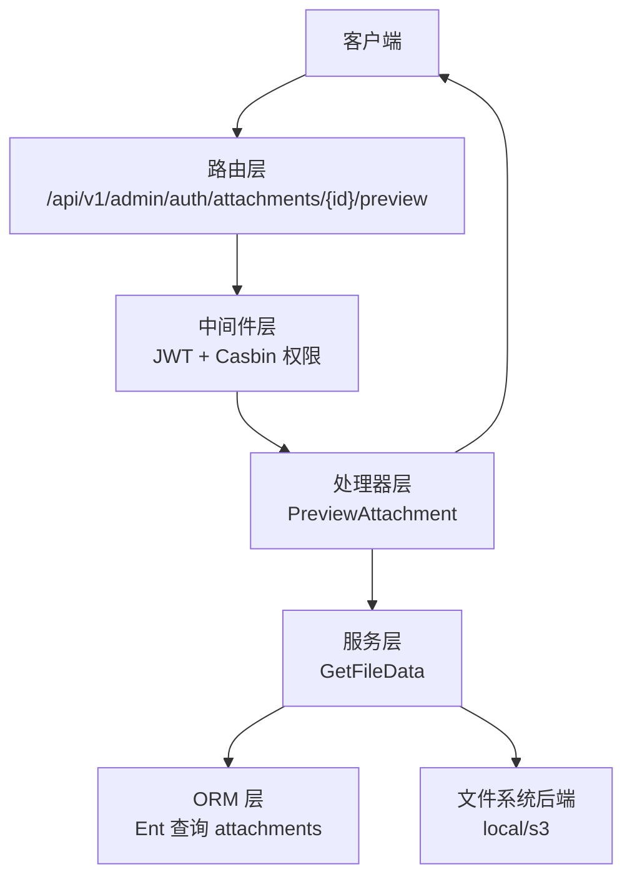
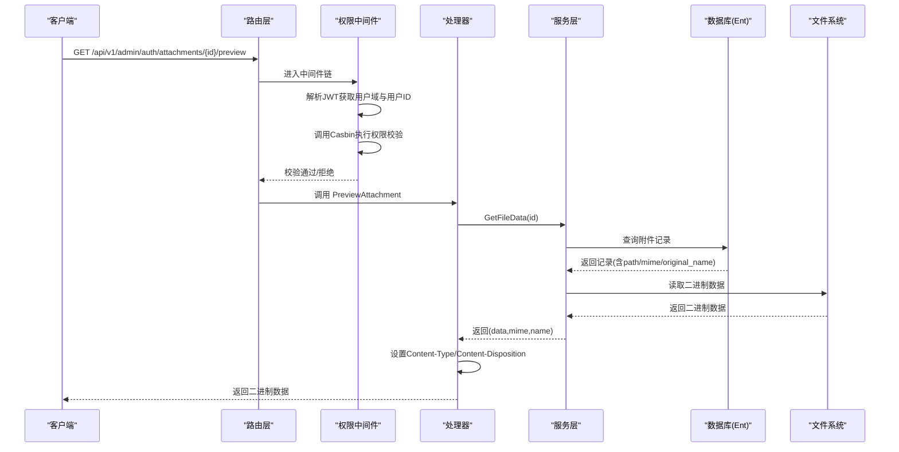
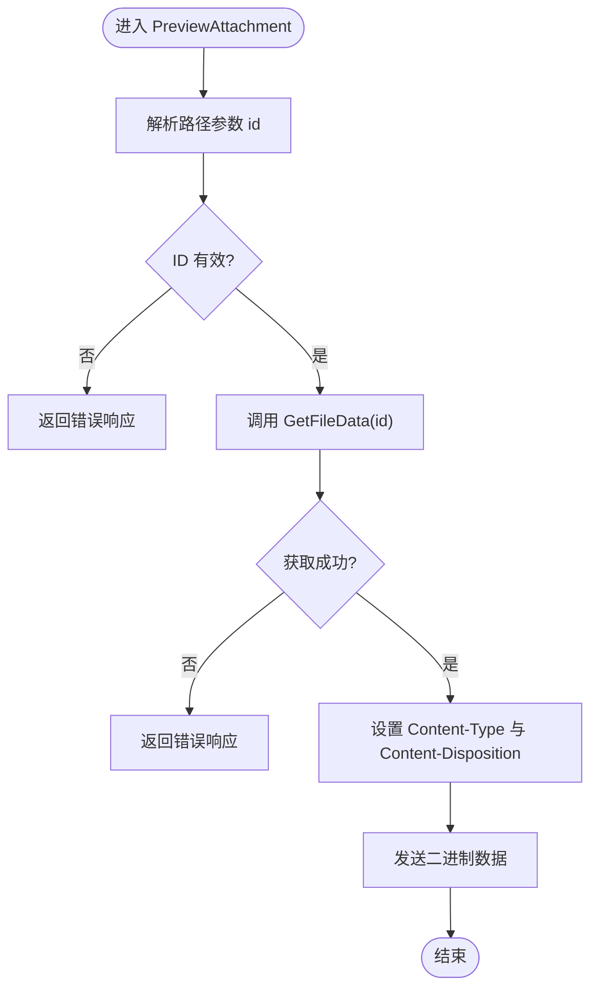
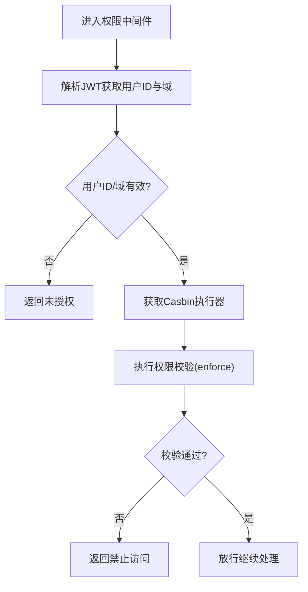
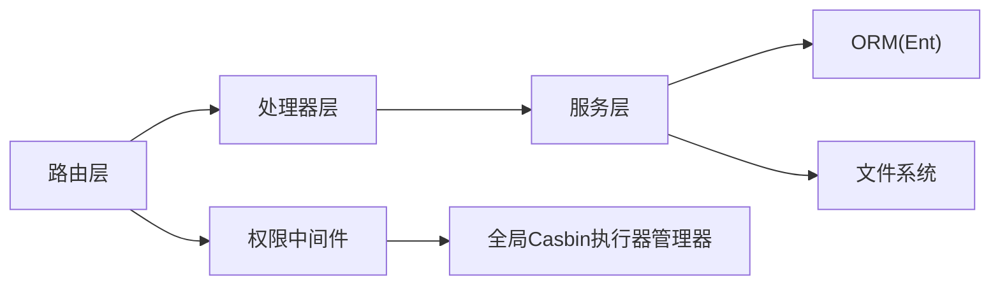

# 文件预览与下载

<cite>
**本文引用的文件**
- [attachment.go](file://internal/handler/attachment.go)
- [attachment.go](file://internal/service/attachment.go)
- [permission.go](file://internal/middleware/permission.go)
- [router.go](file://internal/router.go)
- [attachment.go](file://internal/ent/attachment/attachment.go)
- [response.go](file://internal/utils/response.go)
- [global.go](file://internal/global/global.go)
- [config.yml](file://config/config.yml)
- [app.go](file://internal/app.go)
- [attachment_test.go](file://internal/service/attachment_test.go)
</cite>

## 目录
1. [简介](#简介)
2. [项目结构](#项目结构)
3. [核心组件](#核心组件)
4. [架构总览](#架构总览)
5. [详细组件分析](#详细组件分析)
6. [依赖分析](#依赖分析)
7. [性能考量](#性能考量)
8. [故障排查指南](#故障排查指南)
9. [结论](#结论)
10. [附录](#附录)

## 简介
本文件聚焦于 Go Admin 管理系统的“文件预览与下载”能力，围绕以下目标展开：
- 文件预览的实现机制：支持的文件类型、预览组件与渲染方式
- 文件下载的处理流程：直接下载、带文件名下载与流式传输
- 访问权限控制：预览与下载的权限校验
- 数据获取 API：二进制数据读取与 MIME 类型处理
- 兼容性与性能优化策略

## 项目结构
与文件预览/下载直接相关的模块分布如下：
- 路由层：定义 /api/v1/admin/auth/attachments/{id}/preview 等接口
- 中间件层：JWT 鉴权与基于 Casbin 的 API 权限控制
- 处理器层：解析参数、调用服务、设置响应头并返回二进制数据
- 服务层：封装数据库与文件系统交互，负责数据获取与 MIME 类型处理
- ORM 层：通过 Ent 访问数据库表 attachments
- 配置层：文件系统后端（本地/云存储）与 Casbin 权限模型配置

图表来源
- [router.go:132-143](file://internal/router.go#L132-L143)
- [permission.go:14-78](file://internal/middleware/permission.go#L14-L78)
- [attachment.go:144-185](file://internal/handler/attachment.go#L144-L185)
- [attachment.go:276-294](file://internal/service/attachment.go#L276-L294)

章节来源
- [router.go:132-143](file://internal/router.go#L132-L143)
- [permission.go:14-78](file://internal/middleware/permission.go#L14-L78)
- [attachment.go:144-185](file://internal/handler/attachment.go#L144-L185)
- [attachment.go:276-294](file://internal/service/attachment.go#L276-L294)

## 核心组件
- 路由注册：在路由中挂载预览接口，绑定到处理器函数
- 权限中间件：基于 JWT 提取用户域与用户ID，调用 Casbin 执行权限校验
- 处理器：接收附件ID，调用服务获取二进制数据与元信息，设置 Content-Type 与 Content-Disposition 并返回
- 服务：查询附件记录，读取文件系统中的二进制数据，返回 MIME 类型与原始文件名
- ORM：通过 Ent 访问 attachments 表，读取路径、MIME 类型、扩展名等字段
- 文件系统：抽象存储后端，支持本地磁盘与 S3 等

章节来源
- [router.go:132-143](file://internal/router.go#L132-L143)
- [permission.go:14-78](file://internal/middleware/permission.go#L14-L78)
- [attachment.go:144-185](file://internal/handler/attachment.go#L144-L185)
- [attachment.go:276-294](file://internal/service/attachment.go#L276-L294)
- [attachment.go:14-68](file://internal/ent/attachment/attachment.go#L14-L68)

## 架构总览
下图展示从客户端发起预览请求到返回文件内容的完整链路，包括权限校验与数据获取。

图表来源
- [router.go:132-143](file://internal/router.go#L132-L143)
- [permission.go:14-78](file://internal/middleware/permission.go#L14-L78)
- [attachment.go:144-185](file://internal/handler/attachment.go#L144-L185)
- [attachment.go:276-294](file://internal/service/attachment.go#L276-L294)

## 详细组件分析

### 预览接口实现机制
- 接口定义与路由绑定：预览接口位于 /api/v1/admin/auth/attachments/{id}/preview，绑定到处理器函数
- 参数解析：从路径参数提取附件ID并进行类型转换
- 数据获取：调用服务层 GetFileData，返回二进制数据、MIME 类型与原始文件名
- 响应头设置：
  - Content-Type：使用附件记录中的 MIME 类型
  - Content-Disposition：图片与 PDF 使用 inline 预览；其他类型使用 attachment 下载
- 返回数据：直接发送二进制数据给客户端

图表来源
- [attachment.go:144-185](file://internal/handler/attachment.go#L144-L185)
- [attachment.go:276-294](file://internal/service/attachment.go#L276-L294)

章节来源
- [attachment.go:144-185](file://internal/handler/attachment.go#L144-L185)
- [attachment.go:276-294](file://internal/service/attachment.go#L276-L294)

### 支持的文件类型与预览渲染
- 判断逻辑：若 MIME 类型以 image/ 开头或 MIME 类型为 application/pdf，则采用 inline 预览；否则作为附件下载
- 渲染方式：浏览器根据 Content-Type 与 Content-Disposition 自行决定渲染行为（如图片直接显示、PDF 在浏览器中打开）

章节来源
- [attachment.go:175-182](file://internal/handler/attachment.go#L175-L182)

### 下载处理流程
- 直接下载：当 MIME 类型非 image/* 且非 application/pdf 时，设置 Content-Disposition 为 attachment，触发浏览器下载
- 带文件名下载：无论预览还是下载，均使用附件的原始文件名作为下载文件名
- 流式传输：当前实现为一次性读取文件全部二进制数据并返回，未使用流式传输

章节来源
- [attachment.go:175-182](file://internal/handler/attachment.go#L175-L182)
- [attachment.go:276-294](file://internal/service/attachment.go#L276-L294)

### 访问权限控制
- JWT 鉴权：中间件从 JWT 中提取用户ID与域信息，缺失则返回未授权
- API 权限：中间件通过 Casbin 执行权限校验，校验失败返回禁止访问
- 路由保护：预览接口位于 /admin/auth 组下，经过 JWT 与权限中间件保护

图表来源
- [permission.go:14-78](file://internal/middleware/permission.go#L14-L78)

章节来源
- [permission.go:14-78](file://internal/middleware/permission.go#L14-L78)
- [router.go:53-59](file://internal/router.go#L53-L59)

### 数据获取 API 与 MIME 类型处理
- 数据获取：服务层通过附件ID查询数据库，读取存储路径与 MIME 类型，再从文件系统读取二进制数据
- MIME 类型来源：优先使用上传时的 Content-Type，若为空则回退为 application/octet-stream
- 原始文件名：用于 Content-Disposition 的 filename 字段，确保下载时保留原文件名

章节来源
- [attachment.go:93-148](file://internal/service/attachment.go#L93-L148)
- [attachment.go:276-294](file://internal/service/attachment.go#L276-L294)
- [attachment.go:14-68](file://internal/ent/attachment/attachment.go#L14-L68)

### 文件系统后端与配置
- 后端选择：支持本地磁盘与 S3 等多种存储驱动
- 配置项：在配置文件中定义默认驱动与各驱动选项（如本地 root 路径、S3 凭证与桶信息）
- 应用注入：应用启动时注入文件系统实例，服务层通过构造函数注入使用

章节来源
- [config.yml:60-76](file://config/config.yml#L60-L76)
- [app.go:16-25](file://internal/app.go#L16-L25)
- [attachment.go:44-50](file://internal/service/attachment.go#L44-L50)

## 依赖分析
- 路由依赖：预览接口依赖中间件链（JWT + Casbin）
- 处理器依赖：依赖服务层提供的 GetFileData
- 服务层依赖：依赖 ORM（Ent）与文件系统抽象
- 文件系统依赖：依赖具体驱动实现（本地/S3）
- 权限依赖：依赖全局 Casbin 执行器管理器

图表来源
- [router.go:132-143](file://internal/router.go#L132-L143)
- [permission.go:14-78](file://internal/middleware/permission.go#L14-L78)
- [attachment.go:144-185](file://internal/handler/attachment.go#L144-L185)
- [attachment.go:276-294](file://internal/service/attachment.go#L276-L294)
- [global.go:11-16](file://internal/global/global.go#L11-L16)

章节来源
- [router.go:132-143](file://internal/router.go#L132-L143)
- [permission.go:14-78](file://internal/middleware/permission.go#L14-L78)
- [attachment.go:144-185](file://internal/handler/attachment.go#L144-L185)
- [attachment.go:276-294](file://internal/service/attachment.go#L276-L294)
- [global.go:11-16](file://internal/global/global.go#L11-L16)

## 性能考量
- 当前实现为一次性读取整个文件到内存后再返回，适合中小文件；大文件可能导致内存占用高
- 建议优化方向：
  - 使用流式传输：将文件系统读取改为分块读取并逐步写回响应，降低内存峰值
  - 缓存策略：对热点文件增加缓存层，减少重复读取
  - 并发控制：限制并发预览请求数，避免资源争用
  - CDN/对象存储直传：对于大文件，结合对象存储的签名URL直传/直返，减轻服务器压力

[本节为通用性能建议，不直接分析具体文件，故无章节来源]

## 故障排查指南
- 401 未授权
  - 检查请求头是否携带有效的 JWT
  - 确认 JWT 中包含用户ID与域信息
- 403 禁止访问
  - 检查 Casbin 策略是否允许该用户域访问该路径与方法
- 404 附件不存在
  - 确认附件ID正确且记录存在于数据库
- 500 内部错误
  - 检查文件系统读取是否成功
  - 检查数据库连接与查询是否异常

章节来源
- [attachment.go:167-173](file://internal/handler/attachment.go#L167-L173)
- [permission.go:17-74](file://internal/middleware/permission.go#L17-L74)
- [response.go:19-45](file://internal/utils/response.go#L19-L45)

## 结论
- 预览与下载功能通过统一的预览接口实现，依据 MIME 类型区分 inline 预览与 attachment 下载
- 权限控制通过 JWT 与 Casbin 实现，确保 API 访问安全
- 数据获取通过服务层封装，兼顾数据库与文件系统读取
- 当前实现简洁高效，适合中小规模场景；针对大文件与高并发场景，建议引入流式传输与缓存策略

[本节为总结性内容，不直接分析具体文件，故无章节来源]

## 附录

### API 定义概览
- 预览接口
  - 方法：GET
  - 路径：/api/v1/admin/auth/attachments/{id}/preview
  - 安全：BearerAuth
  - 成功响应：octet-stream（二进制文件内容）
  - 常见错误：400/401/403/404/500

章节来源
- [attachment.go:144-157](file://internal/handler/attachment.go#L144-L157)

### 数据模型要点
- 附件表字段：name、original_name、path、mime_type、extension、size、group_id、uploaded_by、created_at、updated_at
- 查询条件：支持按名称/原始名称模糊匹配、按分组筛选、按 MIME 类型前缀筛选

章节来源
- [attachment.go:14-68](file://internal/ent/attachment/attachment.go#L14-L68)
- [attachment.go:215-274](file://internal/service/attachment.go#L215-L274)

### 测试参考
- 单元测试展示了如何构造测试环境（内存数据库、临时文件系统）与模拟上传/预览流程

章节来源
- [attachment_test.go:68-82](file://internal/service/attachment_test.go#L68-L82)