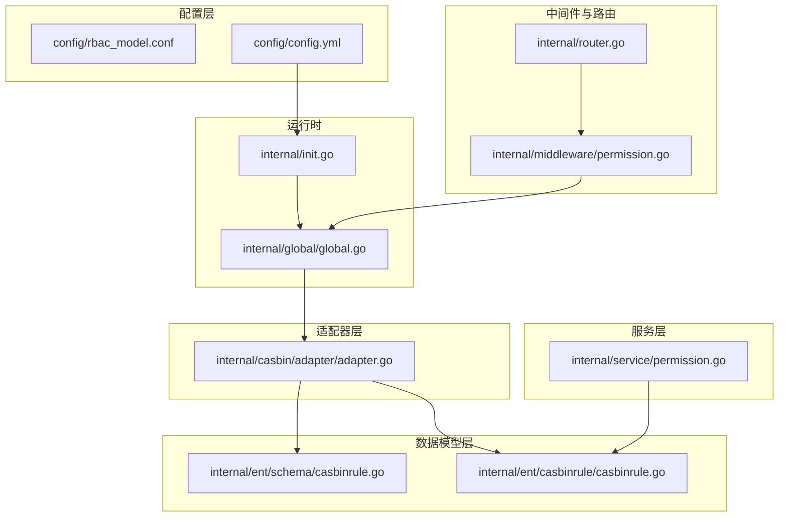
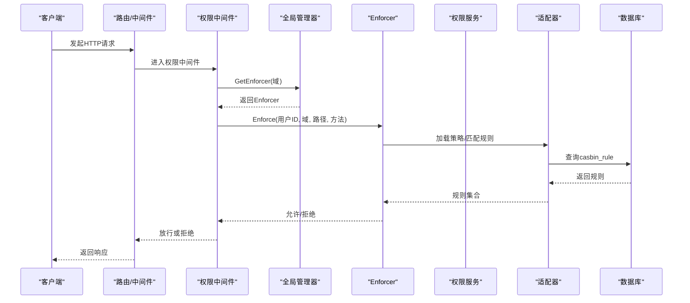
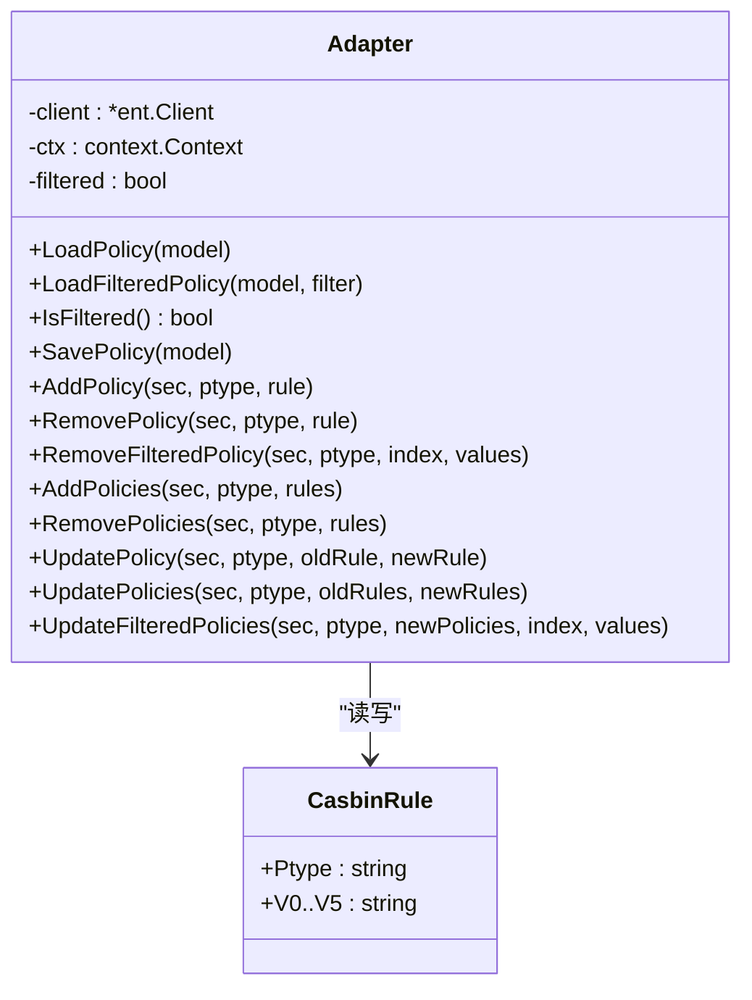
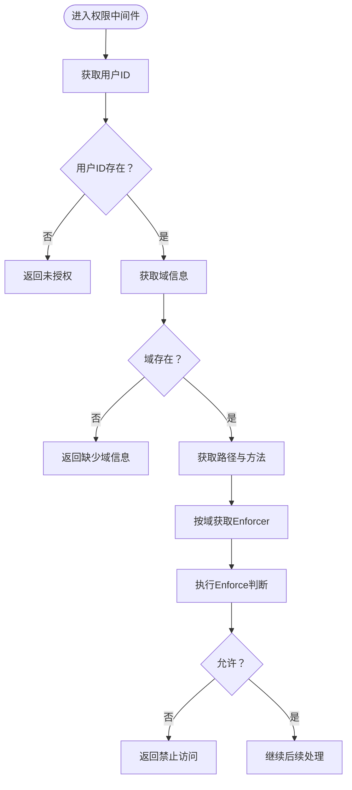
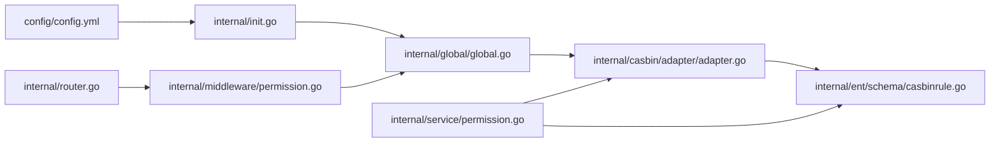

# Casbin权限集成

<cite>
**本文引用的文件**
- [config/rbac_model.conf](file://config/rbac_model.conf)
- [config/config.yml](file://config/config.yml)
- [internal/casbin/adapter/adapter.go](file://internal/casbin/adapter/adapter.go)
- [internal/middleware/permission.go](file://internal/middleware/permission.go)
- [internal/service/permission.go](file://internal/service/permission.go)
- [internal/ent/schema/casbinrule.go](file://internal/ent/schema/casbinrule.go)
- [internal/ent/casbinrule/casbinrule.go](file://internal/ent/casbinrule/casbinrule.go)
- [internal/global/global.go](file://internal/global/global.go)
- [internal/init.go](file://internal/init.go)
- [internal/router.go](file://internal/router.go)
</cite>

## 目录
1. [简介](#简介)
2. [项目结构](#项目结构)
3. [核心组件](#核心组件)
4. [架构总览](#架构总览)
5. [详细组件分析](#详细组件分析)
6. [依赖关系分析](#依赖关系分析)
7. [性能考量](#性能考量)
8. [故障排除指南](#故障排除指南)
9. [结论](#结论)
10. [附录](#附录)

## 简介
本文件面向Go Admin管理系统中的Casbin权限集成，系统性阐述Casbin作为核心权限引擎的集成方式与配置原理，详解RBAC模型配置文件结构与参数含义，说明Casbin适配器的工作机制与数据库存储实现，解释权限规则的存储格式与查询优化策略，阐述多域权限控制的实现原理与使用场景，并给出模型定义最佳实践与性能优化建议，最后提供调试与故障排除方法以及扩展Casbin模型以支持自定义权限类型的指导。

## 项目结构
围绕Casbin权限集成的关键目录与文件如下：
- 配置层
  - RBAC模型配置：config/rbac_model.conf
  - 系统配置：config/config.yml（含多域配置）
- 适配器层
  - 数据库适配器：internal/casbin/adapter/adapter.go
- 服务层
  - 权限服务：internal/service/permission.go
- 数据模型层
  - Ent Schema：internal/ent/schema/casbinrule.go
  - Ent生成代码：internal/ent/casbinrule/casbinrule.go
- 运行时与中间件
  - 全局变量：internal/global/global.go
  - 初始化流程：internal/init.go
  - 路由与中间件：internal/router.go、internal/middleware/permission.go

图表来源
- [config/config.yml:77-143](file://config/config.yml#L77-L143)
- [internal/init.go:49-65](file://internal/init.go#L49-L65)
- [internal/global/global.go:10-14](file://internal/global/global.go#L10-L14)
- [internal/casbin/adapter/adapter.go:115-125](file://internal/casbin/adapter/adapter.go#L115-L125)
- [internal/ent/schema/casbinrule.go:9-36](file://internal/ent/schema/casbinrule.go#L9-L36)
- [internal/middleware/permission.go:11-53](file://internal/middleware/permission.go#L11-L53)
- [internal/router.go:14-72](file://internal/router.go#L14-L72)

章节来源
- [config/rbac_model.conf:1-15](file://config/rbac_model.conf#L1-L15)
- [config/config.yml:77-143](file://config/config.yml#L77-L143)
- [internal/init.go:49-65](file://internal/init.go#L49-L65)
- [internal/global/global.go:10-14](file://internal/global/global.go#L10-L14)
- [internal/casbin/adapter/adapter.go:115-125](file://internal/casbin/adapter/adapter.go#L115-L125)
- [internal/ent/schema/casbinrule.go:9-36](file://internal/ent/schema/casbinrule.go#L9-L36)
- [internal/middleware/permission.go:11-53](file://internal/middleware/permission.go#L11-L53)
- [internal/router.go:14-72](file://internal/router.go#L14-L72)

## 核心组件
- Casbin适配器：基于Ent ORM实现的持久化适配器，负责将Casbin策略规则存取到数据库表casbin_rule。
- 权限服务：封装权限的增删改查、角色权限分配、用户权限查询与权限校验等业务逻辑。
- 中间件：在路由层拦截请求，结合JWT载荷中的域信息与用户ID进行权限校验。
- 全局管理器：通过配置初始化Enforcer管理器，按域提供独立的Enforcer实例。
- 数据模型：Ent Schema定义了casbin_rule表字段与唯一索引，确保规则去重与高效查询。

章节来源
- [internal/casbin/adapter/adapter.go:115-125](file://internal/casbin/adapter/adapter.go#L115-L125)
- [internal/service/permission.go:92-113](file://internal/service/permission.go#L92-L113)
- [internal/middleware/permission.go:11-53](file://internal/middleware/permission.go#L11-L53)
- [internal/global/global.go:10-14](file://internal/global/global.go#L10-L14)
- [internal/ent/schema/casbinrule.go:9-36](file://internal/ent/schema/casbinrule.go#L9-L36)

## 架构总览
系统通过初始化流程创建适配器并注入Enforcer管理器，随后在中间件中按域获取对应Enforcer，使用用户ID、域、请求路径与方法进行权限判断；权限服务通过Ent ORM与适配器交互，完成规则的创建、更新、删除与查询。

图表来源
- [internal/router.go:32-37](file://internal/router.go#L32-L37)
- [internal/middleware/permission.go:32-40](file://internal/middleware/permission.go#L32-L40)
- [internal/global/global.go:10-14](file://internal/global/global.go#L10-L14)
- [internal/casbin/adapter/adapter.go:115-125](file://internal/casbin/adapter/adapter.go#L115-L125)
- [internal/ent/schema/casbinrule.go:9-36](file://internal/ent/schema/casbinrule.go#L9-L36)

## 详细组件分析

### RBAC模型配置文件
- 请求定义：定义请求主体、对象与动作的字段。
- 策略定义：定义策略主体、对象与动作的字段。
- 角色定义：定义角色继承关系映射。
- 策略效果：定义允许/拒绝的判定规则。
- 匹配器：定义请求与策略的匹配逻辑。

章节来源
- [config/rbac_model.conf:1-15](file://config/rbac_model.conf#L1-L15)

### Casbin适配器工作机制与数据库存储
- 适配器结构：持有Ent客户端与上下文，支持过滤加载与事务写入。
- 表结构：casbin_rule表包含Ptype与V0~V5字段，唯一索引覆盖全部字段，保证规则唯一性。
- 加载策略：全量加载或按Filter条件过滤加载，将规则注入Casbin模型。
- 写入策略：批量插入与事务保证一致性，支持单条/批量增删改与按条件更新。
- 过滤器：支持按Ptype与V0~V5字段进行条件过滤，便于按域、角色、对象等维度查询。

图表来源
- [internal/casbin/adapter/adapter.go:43-48](file://internal/casbin/adapter/adapter.go#L43-L48)
- [internal/casbin/adapter/adapter.go:115-125](file://internal/casbin/adapter/adapter.go#L115-L125)
- [internal/casbin/adapter/adapter.go:177-214](file://internal/casbin/adapter/adapter.go#L177-L214)
- [internal/casbin/adapter/adapter.go:216-241](file://internal/casbin/adapter/adapter.go#L216-L241)
- [internal/casbin/adapter/adapter.go:243-272](file://internal/casbin/adapter/adapter.go#L243-L272)
- [internal/casbin/adapter/adapter.go:274-302](file://internal/casbin/adapter/adapter.go#L274-L302)
- [internal/casbin/adapter/adapter.go:401-425](file://internal/casbin/adapter/adapter.go#L401-L425)
- [internal/casbin/adapter/adapter.go:427-453](file://internal/casbin/adapter/adapter.go#L427-L453)
- [internal/casbin/adapter/adapter.go:455-509](file://internal/casbin/adapter/adapter.go#L455-L509)
- [internal/ent/schema/casbinrule.go:9-36](file://internal/ent/schema/casbinrule.go#L9-L36)

章节来源
- [internal/casbin/adapter/adapter.go:115-125](file://internal/casbin/adapter/adapter.go#L115-L125)
- [internal/casbin/adapter/adapter.go:177-214](file://internal/casbin/adapter/adapter.go#L177-L214)
- [internal/casbin/adapter/adapter.go:216-241](file://internal/casbin/adapter/adapter.go#L216-L241)
- [internal/casbin/adapter/adapter.go:243-272](file://internal/casbin/adapter/adapter.go#L243-L272)
- [internal/casbin/adapter/adapter.go:274-302](file://internal/casbin/adapter/adapter.go#L274-L302)
- [internal/casbin/adapter/adapter.go:401-425](file://internal/casbin/adapter/adapter.go#L401-L425)
- [internal/casbin/adapter/adapter.go:427-453](file://internal/casbin/adapter/adapter.go#L427-L453)
- [internal/casbin/adapter/adapter.go:455-509](file://internal/casbin/adapter/adapter.go#L455-L509)
- [internal/ent/schema/casbinrule.go:9-36](file://internal/ent/schema/casbinrule.go#L9-L36)

### 权限规则存储格式与查询优化
- 存储格式：采用Ptype+V0~V5的7列结构，其中V4用于存储权限类型（如api/menu/button），V5用于存储描述信息。
- 唯一索引：覆盖全部字段，避免重复规则，提高匹配效率。
- 查询优化：
  - 按域、角色、对象、动作等维度组合查询，利用唯一索引快速定位。
  - 列表查询支持分页与关键词过滤，减少一次性加载。
  - 批量写入采用事务与批量插入，降低数据库往返次数。

章节来源
- [internal/ent/schema/casbinrule.go:9-36](file://internal/ent/schema/casbinrule.go#L9-L36)
- [internal/service/permission.go:286-354](file://internal/service/permission.go#L286-L354)
- [internal/service/permission.go:435-464](file://internal/service/permission.go#L435-L464)
- [internal/service/permission.go:466-600](file://internal/service/permission.go#L466-L600)

### 多域权限控制实现原理与使用场景
- 配置原理：系统通过config.yml的domains配置为不同域提供独立的模型文本或模型文件，支持自动加载与延迟加载。
- 使用场景：适用于多租户或多业务域隔离的系统，每个域拥有独立的权限模型与规则集。
- 实现要点：中间件从JWT载荷中提取域信息，调用全局管理器按域获取Enforcer，再进行权限判断。

章节来源
- [config/config.yml:77-143](file://config/config.yml#L77-L143)
- [internal/middleware/permission.go:21-33](file://internal/middleware/permission.go#L21-L33)
- [internal/global/global.go:10-14](file://internal/global/global.go#L10-L14)

### 权限服务与中间件工作流
- 权限服务：提供创建、更新、删除、查询权限，为角色分配/移除权限，查询用户菜单/按钮/API权限，以及统一的权限校验接口。
- 中间件：在认证与域解析后，从全局管理器获取对应域的Enforcer，执行Enforce判断，决定放行或拒绝。

图表来源
- [internal/middleware/permission.go:11-53](file://internal/middleware/permission.go#L11-L53)

章节来源
- [internal/service/permission.go:92-113](file://internal/service/permission.go#L92-L113)
- [internal/middleware/permission.go:11-53](file://internal/middleware/permission.go#L11-L53)

### 初始化与全局管理器
- 初始化流程：先初始化数据库与Schema，再创建适配器并注入Enforcer管理器。
- 全局变量：通过global包暴露ORM与EnforcerManager，供其他模块使用。

章节来源
- [internal/init.go:49-65](file://internal/init.go#L49-L65)
- [internal/global/global.go:10-14](file://internal/global/global.go#L10-L14)

## 依赖关系分析
- 适配器依赖Ent ORM与Casbin persist接口，负责策略的加载与保存。
- 权限服务依赖Ent生成的查询器与适配器，提供业务层面的权限管理能力。
- 中间件依赖全局管理器与JWT工具，负责请求拦截与权限判断。
- 配置文件驱动初始化流程，决定多域模型与自动加载策略。

图表来源
- [config/config.yml:77-143](file://config/config.yml#L77-L143)
- [internal/init.go:49-65](file://internal/init.go#L49-L65)
- [internal/global/global.go:10-14](file://internal/global/global.go#L10-L14)
- [internal/casbin/adapter/adapter.go:115-125](file://internal/casbin/adapter/adapter.go#L115-L125)
- [internal/ent/schema/casbinrule.go:9-36](file://internal/ent/schema/casbinrule.go#L9-L36)
- [internal/service/permission.go:92-113](file://internal/service/permission.go#L92-L113)
- [internal/middleware/permission.go:11-53](file://internal/middleware/permission.go#L11-L53)
- [internal/router.go:14-72](file://internal/router.go#L14-L72)

章节来源
- [config/config.yml:77-143](file://config/config.yml#L77-L143)
- [internal/init.go:49-65](file://internal/init.go#L49-L65)
- [internal/global/global.go:10-14](file://internal/global/global.go#L10-L14)
- [internal/casbin/adapter/adapter.go:115-125](file://internal/casbin/adapter/adapter.go#L115-L125)
- [internal/ent/schema/casbinrule.go:9-36](file://internal/ent/schema/casbinrule.go#L9-L36)
- [internal/service/permission.go:92-113](file://internal/service/permission.go#L92-L113)
- [internal/middleware/permission.go:11-53](file://internal/middleware/permission.go#L11-L53)
- [internal/router.go:14-72](file://internal/router.go#L14-L72)

## 性能考量
- 批量写入：保存策略时采用批量插入与事务，减少数据库往返，提升吞吐。
- 过滤加载：LoadFilteredPolicy支持按条件过滤，避免全量加载，降低内存占用。
- 唯一索引：casbin_rule的唯一索引可加速规则去重与匹配。
- 自动加载：高频域建议启用auto_load，减少首次请求的加载开销。
- 查询分页：权限列表查询支持分页与关键词过滤，避免一次性加载大量数据。

章节来源
- [internal/casbin/adapter/adapter.go:177-214](file://internal/casbin/adapter/adapter.go#L177-L214)
- [internal/casbin/adapter/adapter.go:127-170](file://internal/casbin/adapter/adapter.go#L127-L170)
- [internal/ent/schema/casbinrule.go:32-36](file://internal/ent/schema/casbinrule.go#L32-L36)
- [config/config.yml:135-143](file://config/config.yml#L135-L143)
- [internal/service/permission.go:286-354](file://internal/service/permission.go#L286-L354)

## 故障排除指南
- 未授权访问：中间件无法从Locals获取用户ID，检查认证中间件是否正确设置user_id。
- 缺少域信息：中间件无法从JWT载荷获取domain，检查JWT中是否包含domain字段。
- 获取执行器失败：EnforcerManager.GetEnforcer返回错误，检查配置中domains是否正确配置且域名称一致。
- 权限检查失败：Enforce返回错误，检查请求路径、方法与规则是否匹配，确认模型与适配器加载正常。
- 权限不存在/已存在：权限服务在创建/更新时返回相应错误，检查角色是否存在、规则是否重复。
- 数据库连接问题：初始化数据库失败，检查config.yml中的数据库连接配置。

章节来源
- [internal/middleware/permission.go:14-37](file://internal/middleware/permission.go#L14-L37)
- [internal/middleware/permission.go:39-44](file://internal/middleware/permission.go#L39-L44)
- [internal/service/permission.go:128-174](file://internal/service/permission.go#L128-L174)
- [internal/service/permission.go:176-236](file://internal/service/permission.go#L176-L236)
- [internal/init.go:54-58](file://internal/init.go#L54-L58)

## 结论
本系统通过Ent适配器将Casbin策略规则持久化至数据库，结合多域配置与JWT域解析，在中间件层实现细粒度的权限控制。权限服务提供了完善的规则管理与用户权限查询能力，配合批量写入与过滤加载等优化策略，满足高并发场景下的权限校验需求。通过合理的模型设计与配置，系统能够灵活支持多租户与多业务域的权限隔离。

## 附录

### RBAC模型配置最佳实践
- 明确请求与策略字段：确保r与p字段与实际业务一致，避免匹配失败。
- 合理使用角色继承：g映射应覆盖角色继承关系，避免重复规则。
- 匹配器简洁明确：尽量使用内置匹配器函数，减少复杂正则表达式。
- 多域模型分离：不同域使用独立模型，必要时启用auto_load提升性能。

章节来源
- [config/rbac_model.conf:1-15](file://config/rbac_model.conf#L1-L15)
- [config/config.yml:77-143](file://config/config.yml#L77-L143)

### 扩展Casbin模型以支持自定义权限类型
- 在V4字段中扩展权限类型枚举，如file、report等。
- 在匹配器中增加针对新类型的匹配逻辑。
- 在权限服务中新增类型校验与查询逻辑，确保与业务一致。

章节来源
- [internal/service/permission.go:24-50](file://internal/service/permission.go#L24-L50)
- [internal/service/permission.go:655-670](file://internal/service/permission.go#L655-L670)
- [internal/casbin/adapter/adapter.go:130-170](file://internal/casbin/adapter/adapter.go#L130-L170)