# 权限管理

<cite>
**本文引用的文件**
- [config.rbac_model.conf](file://config/rbac_model.conf)
- [adapter.go](file://internal/casbin/adapter/adapter.go)
- [permission.go](file://internal/service/permission.go)
- [permission.go](file://internal/middleware/permission.go)
- [permission.go](file://internal/handler/permission.go)
- [casbinrule.go](file://internal/ent/casbinrule.go)
- [casbinrule_create.go](file://internal/ent/casbinrule_create.go)
- [casbinrule.go](file://internal/ent/schema/casbinrule.go)
- [role.go](file://internal/ent/role.go)
- [user.go](file://internal/ent/user.go)
- [userrole.go](file://internal/ent/userrole.go)
- [global.go](file://internal/global/global.go)
- [init.go](file://internal/init.go)
- [config.yml](file://config/config.yml)
- [router.go](file://internal/router.go)
</cite>

## 目录
1. [简介](#简介)
2. [项目结构](#项目结构)
3. [核心组件](#核心组件)
4. [架构总览](#架构总览)
5. [详细组件分析](#详细组件分析)
6. [依赖关系分析](#依赖关系分析)
7. [性能考量](#性能考量)
8. [故障排查指南](#故障排查指南)
9. [结论](#结论)
10. [附录](#附录)

## 简介
本文件面向 Go Admin 管理系统中的权限管理模块，围绕基于 Casbin 的 RBAC 权限模型进行深入解析。内容涵盖权限规则数据结构与存储机制、权限 CRUD 操作与验证流程、多域权限控制与继承规则、权限适配器工作原理与数据库持久化、权限分配与撤销流程、权限查询与批量操作、权限缓存与性能优化、权限审计与变更追踪、最佳实践与安全建议以及冲突检测与解决机制。

## 项目结构
权限管理相关代码主要分布在以下模块：
- 配置层：Casbin 模型与多域配置
- 适配器层：Casbin 与数据库的桥接适配器
- 数据访问层：Ent 模型与查询构建器
- 服务层：权限业务逻辑封装
- 中间件层：请求拦截与权限校验
- 控制器层：HTTP 接口定义与参数解析
- 全局初始化：ORM 与 Casbin 执行器管理器装配

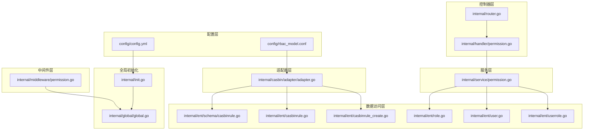

**图表来源**
- [config.rbac_model.conf](file://config/rbac_model.conf)
- [config.yml](file://config/config.yml)
- [adapter.go](file://internal/casbin/adapter/adapter.go)
- [casbinrule.go](file://internal/ent/schema/casbinrule.go)
- [casbinrule.go](file://internal/ent/casbinrule.go)
- [casbinrule_create.go](file://internal/ent/casbinrule_create.go)
- [role.go](file://internal/ent/role.go)
- [user.go](file://internal/ent/user.go)
- [userrole.go](file://internal/ent/userrole.go)
- [permission.go](file://internal/service/permission.go)
- [permission.go](file://internal/middleware/permission.go)
- [permission.go](file://internal/handler/permission.go)
- [router.go](file://internal/router.go)
- [global.go](file://internal/global/global.go)
- [init.go](file://internal/init.go)

**章节来源**
- [config.rbac_model.conf](file://config/rbac_model.conf)
- [config.yml](file://config/config.yml)
- [adapter.go](file://internal/casbin/adapter/adapter.go)
- [casbinrule.go](file://internal/ent/schema/casbinrule.go)
- [casbinrule.go](file://internal/ent/casbinrule.go)
- [casbinrule_create.go](file://internal/ent/casbinrule_create.go)
- [role.go](file://internal/ent/role.go)
- [user.go](file://internal/ent/user.go)
- [userrole.go](file://internal/ent/userrole.go)
- [permission.go](file://internal/service/permission.go)
- [permission.go](file://internal/middleware/permission.go)
- [permission.go](file://internal/handler/permission.go)
- [router.go](file://internal/router.go)
- [global.go](file://internal/global/global.go)
- [init.go](file://internal/init.go)

## 核心组件
- Casbin 模型与匹配器
  - 请求定义、策略定义、角色定义、策略效果、匹配器均在模型配置中声明，支持基于域的多租户模型。
- 权限适配器
  - 实现 Casbin 的持久化接口，负责策略的加载、保存、增删改、过滤等操作，并通过 Ent 客户端完成数据库读写。
- Ent 数据模型
  - CasbinRule 模型映射到数据库表，字段包含策略类型与六个策略值；索引保证唯一性。
- 权限服务
  - 提供权限的创建、更新、删除、查询、角色权限分配与撤销、用户权限查询与权限校验等能力。
- 中间件与控制器
  - 在请求进入业务处理前进行域与权限校验；控制器负责参数解析与响应封装。
- 全局初始化
  - 初始化 ORM 与 Casbin 执行器管理器，注入自定义适配器。

**章节来源**
- [config.rbac_model.conf](file://config/rbac_model.conf)
- [adapter.go](file://internal/casbin/adapter/adapter.go)
- [casbinrule.go](file://internal/ent/schema/casbinrule.go)
- [casbinrule.go](file://internal/ent/casbinrule.go)
- [casbinrule_create.go](file://internal/ent/casbinrule_create.go)
- [permission.go](file://internal/service/permission.go)
- [permission.go](file://internal/middleware/permission.go)
- [permission.go](file://internal/handler/permission.go)
- [global.go](file://internal/global/global.go)
- [init.go](file://internal/init.go)

## 架构总览
下图展示了从请求到权限校验的整体流程，包括中间件拦截、域解析、执行器获取与权限判断。

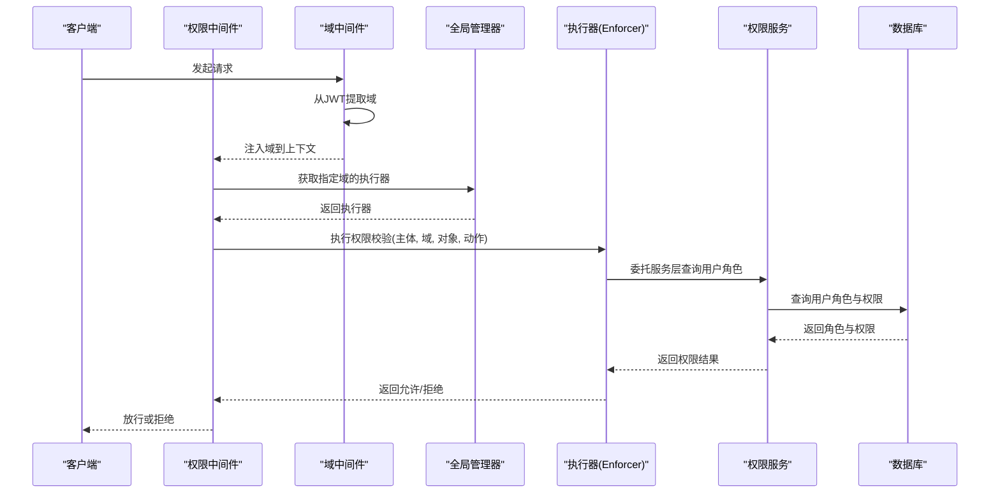

**图表来源**
- [permission.go](file://internal/middleware/permission.go)
- [global.go](file://internal/global/global.go)
- [permission.go](file://internal/service/permission.go)
- [casbinrule.go](file://internal/ent/casbinrule.go)
- [userrole.go](file://internal/ent/userrole.go)
- [role.go](file://internal/ent/role.go)

**章节来源**
- [permission.go](file://internal/middleware/permission.go)
- [global.go](file://internal/global/global.go)
- [permission.go](file://internal/service/permission.go)
- [casbinrule.go](file://internal/ent/casbinrule.go)
- [userrole.go](file://internal/ent/userrole.go)
- [role.go](file://internal/ent/role.go)

## 详细组件分析

### 组件一：权限适配器（Casbin 与数据库桥接）
- 职责
  - 加载策略：按主键顺序加载全部策略，或按过滤条件加载部分策略。
  - 保存策略：事务内清空并批量写入策略，支持大体量数据的分批插入。
  - 增删改策略：单条或多条策略的新增、删除、更新与批量更新。
  - 过滤策略：支持按策略类型与若干字段进行过滤删除与更新。
  - 事务封装：统一的 WithTx 封装，确保一致性与回滚。
- 数据结构
  - 适配器内部使用 Filter 结构体接收过滤条件，映射到数据库查询谓词。
  - 通过 Ent 的 CasbinRule 模型进行字段映射与唯一索引约束。
- 性能特性
  - 批量插入采用固定批次大小，降低内存占用与数据库压力。
  - 过滤加载与过滤删除利用数据库索引与谓词组合，减少全表扫描。

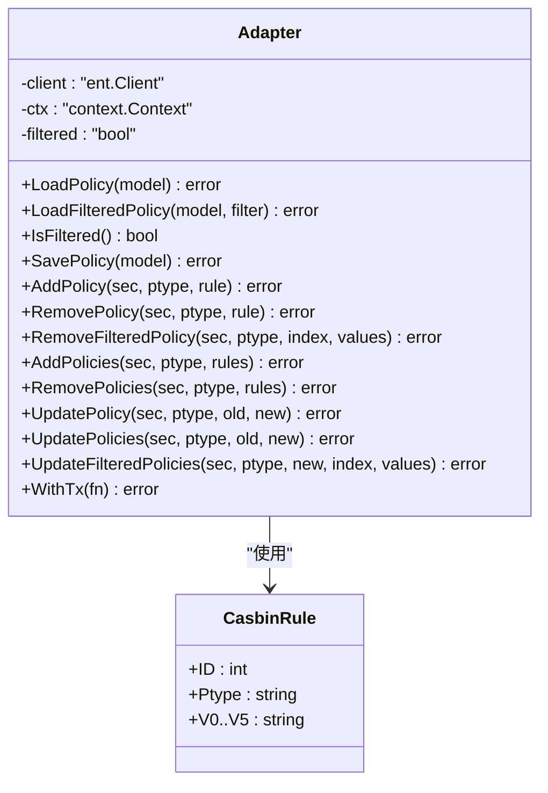

**图表来源**
- [adapter.go](file://internal/casbin/adapter/adapter.go)
- [casbinrule.go](file://internal/ent/casbinrule.go)

**章节来源**
- [adapter.go](file://internal/casbin/adapter/adapter.go)
- [casbinrule.go](file://internal/ent/casbinrule.go)
- [casbinrule_create.go](file://internal/ent/casbinrule_create.go)
- [casbinrule.go](file://internal/ent/schema/casbinrule.go)

### 组件二：权限服务（业务逻辑）
- 权限 CRUD
  - 创建：校验类型与角色存在性，去重后写入策略。
  - 更新：定位唯一策略，按需更新对象、动作、类型与描述。
  - 删除：定位唯一策略并删除。
  - 查询：支持分页、关键词、类型、域、角色名等多维筛选。
- 角色权限管理
  - 批量分配：逐条检查去重后创建。
  - 批量移除：按角色与域匹配删除。
  - 查询角色权限：按角色与域查询。
- 用户权限与校验
  - 获取用户菜单/按钮/API 权限：先查用户角色，再查对应权限。
  - 校验权限：根据用户角色集合与域、对象、动作进行存在性判断。

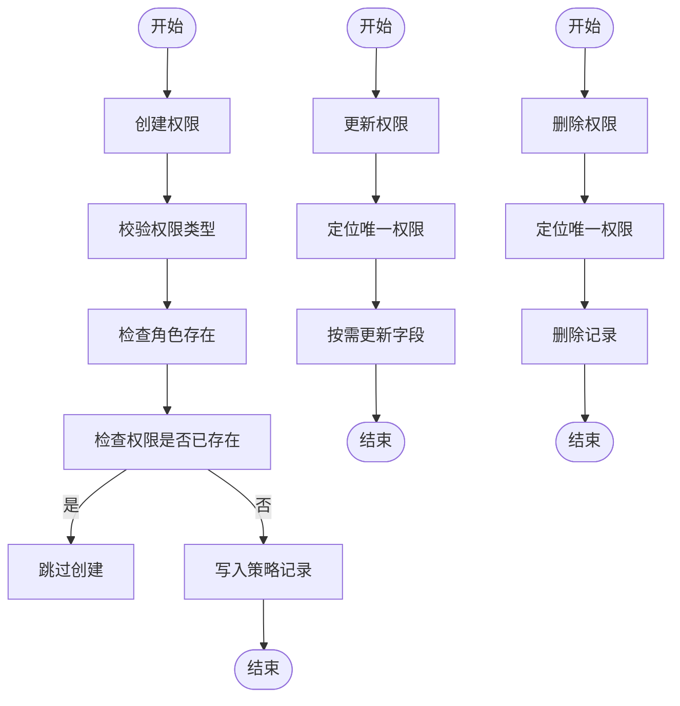

**图表来源**
- [permission.go](file://internal/service/permission.go)
- [casbinrule.go](file://internal/ent/casbinrule.go)
- [role.go](file://internal/ent/role.go)

**章节来源**
- [permission.go](file://internal/service/permission.go)
- [casbinrule.go](file://internal/ent/casbinrule.go)
- [role.go](file://internal/ent/role.go)
- [userrole.go](file://internal/ent/userrole.go)

### 组件三：中间件与控制器（HTTP 层）
- 权限中间件
  - 从上下文获取用户 ID 与域，调用执行器进行权限校验，失败返回 403。
- 域中间件
  - 从 JWT 中提取域并注入到上下文。
- 控制器
  - 定义权限管理、角色权限管理、用户权限查询等接口，解析参数并调用服务层，封装响应。

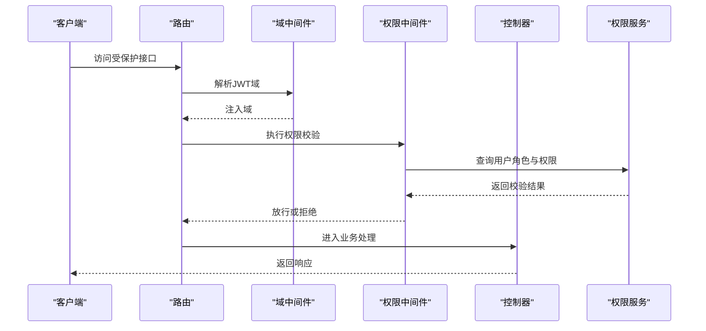

**图表来源**
- [permission.go](file://internal/middleware/permission.go)
- [permission.go](file://internal/handler/permission.go)
- [router.go](file://internal/router.go)
- [permission.go](file://internal/service/permission.go)

**章节来源**
- [permission.go](file://internal/middleware/permission.go)
- [permission.go](file://internal/handler/permission.go)
- [router.go](file://internal/router.go)
- [permission.go](file://internal/service/permission.go)

### 组件四：多域权限控制与继承规则
- 多域配置
  - 通过配置文件定义默认域与多个域，每个域可配置自动加载与模型文本。
- 模型匹配
  - 模型中定义了带域的请求与策略结构，匹配器中包含域相等条件，确保跨域隔离。
- 执行器管理
  - 初始化阶段创建适配器并注入执行器管理器，按域获取执行器进行校验。

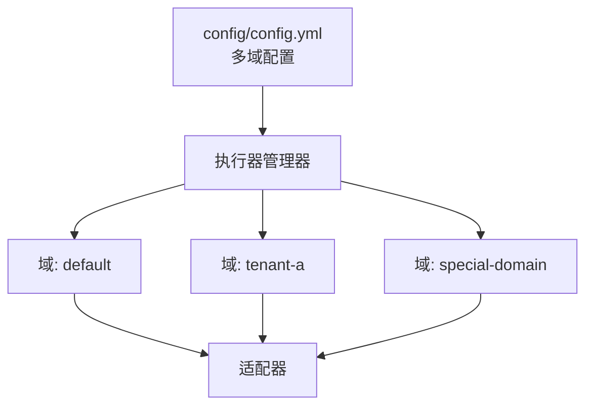

**图表来源**
- [config.yml](file://config/config.yml)
- [global.go](file://internal/global/global.go)
- [init.go](file://internal/init.go)
- [adapter.go](file://internal/casbin/adapter/adapter.go)

**章节来源**
- [config.yml](file://config/config.yml)
- [config.rbac_model.conf](file://config/rbac_model.conf)
- [global.go](file://internal/global/global.go)
- [init.go](file://internal/init.go)
- [adapter.go](file://internal/casbin/adapter/adapter.go)

### 组件五：权限数据模型与存储机制
- 字段设计
  - Ptype：策略类型（如“p”）。
  - V0..V5：策略值，分别承载角色、域、对象、动作、类型、描述等。
- 索引与约束
  - 唯一索引覆盖全部字段，避免重复策略。
- Ent 生成
  - 通过 Ent Schema 生成模型与查询构建器，支持批量创建与唯一约束检查。

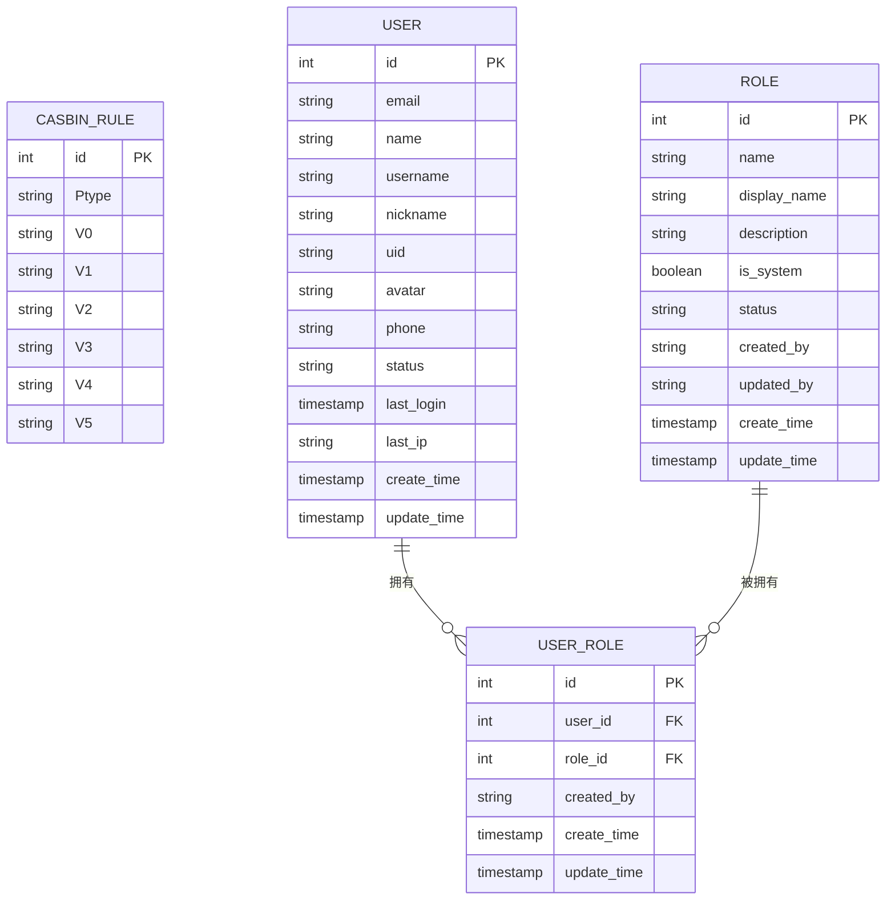

**图表来源**
- [casbinrule.go](file://internal/ent/schema/casbinrule.go)
- [casbinrule.go](file://internal/ent/casbinrule.go)
- [role.go](file://internal/ent/role.go)
- [user.go](file://internal/ent/user.go)
- [userrole.go](file://internal/ent/userrole.go)

**章节来源**
- [casbinrule.go](file://internal/ent/schema/casbinrule.go)
- [casbinrule.go](file://internal/ent/casbinrule.go)
- [casbinrule_create.go](file://internal/ent/casbinrule_create.go)
- [role.go](file://internal/ent/role.go)
- [user.go](file://internal/ent/user.go)
- [userrole.go](file://internal/ent/userrole.go)

## 依赖关系分析
- 组件耦合
  - 适配器依赖 Ent 客户端与数据库驱动，向上提供 Casbin 持久化接口。
  - 服务层依赖 Ent 模型与执行器管理器，封装业务规则。
  - 中间件依赖全局执行器管理器与 JWT 解析。
  - 控制器依赖服务层与响应封装工具。
- 外部依赖
  - Casbin 执行器管理器、JWT 解析库、Fiber Web 框架、Ent ORM。
- 循环依赖
  - 当前结构清晰，无明显循环依赖迹象。

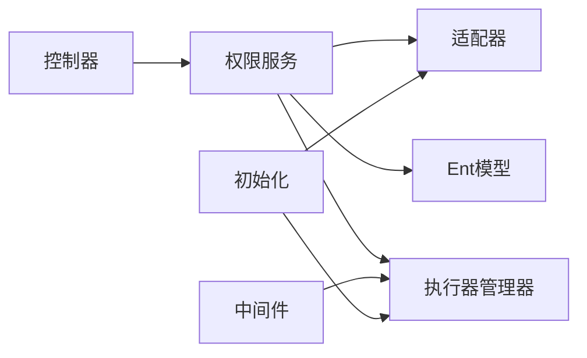

**图表来源**
- [permission.go](file://internal/handler/permission.go)
- [permission.go](file://internal/service/permission.go)
- [adapter.go](file://internal/casbin/adapter/adapter.go)
- [casbinrule.go](file://internal/ent/casbinrule.go)
- [global.go](file://internal/global/global.go)
- [init.go](file://internal/init.go)

**章节来源**
- [permission.go](file://internal/handler/permission.go)
- [permission.go](file://internal/service/permission.go)
- [adapter.go](file://internal/casbin/adapter/adapter.go)
- [casbinrule.go](file://internal/ent/casbinrule.go)
- [global.go](file://internal/global/global.go)
- [init.go](file://internal/init.go)

## 性能考量
- 事务与批量写入
  - 保存策略时清空旧数据并批量插入，批次大小可控，适合大规模策略导入。
- 过滤加载与删除
  - 支持按策略类型与若干字段过滤，减少不必要的数据传输与处理。
- 唯一索引
  - 唯一索引避免重复策略，提高查询效率与一致性。
- 建议
  - 高频访问域启用自动加载，减少首次请求延迟。
  - 对热点域可考虑缓存策略集，结合版本号或时间戳进行失效控制。
  - 合理设置批量大小与并发度，平衡吞吐与资源占用。

[本节为通用性能建议，无需特定文件引用]

## 故障排查指南
- 常见错误与定位
  - 权限不存在：在更新、删除、查询时出现，检查角色与策略参数是否正确。
  - 角色不存在：分配权限前需确认角色存在。
  - 参数非法：控制器对请求参数进行校验，检查必填项与格式。
  - 权限检查失败：中间件返回 500，检查执行器初始化与模型配置。
- 日志与监控
  - 建议在适配器与服务层增加关键操作的日志埋点，便于追踪策略变更与校验失败原因。
- 快速修复步骤
  - 确认模型配置与多域配置一致。
  - 检查数据库连接与表结构。
  - 验证 JWT 中域字段是否正确传递至中间件。

**章节来源**
- [permission.go](file://internal/service/permission.go)
- [permission.go](file://internal/middleware/permission.go)
- [permission.go](file://internal/handler/permission.go)

## 结论
本权限管理方案以 Casbin 为核心，结合 Ent ORM 实现了灵活、可扩展的 RBAC 权限体系。通过多域配置与唯一策略索引，系统在保证安全性的同时兼顾性能。中间件与控制器的清晰分离使得权限控制易于集成与维护。建议在生产环境中配合缓存与审计日志进一步提升可用性与可观测性。

[本节为总结性内容，无需特定文件引用]

## 附录

### 权限分配与撤销流程（时序图）
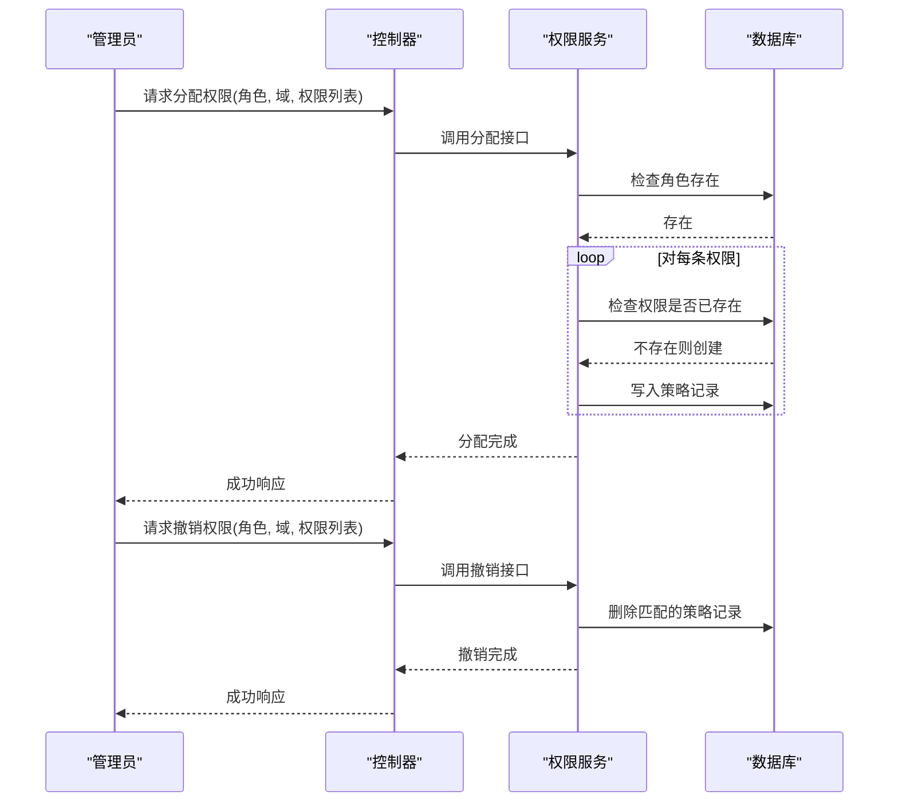

**图表来源**
- [permission.go](file://internal/handler/permission.go)
- [permission.go](file://internal/service/permission.go)
- [casbinrule.go](file://internal/ent/casbinrule.go)

**章节来源**
- [permission.go](file://internal/handler/permission.go)
- [permission.go](file://internal/service/permission.go)
- [casbinrule.go](file://internal/ent/casbinrule.go)

### 权限查询与批量操作（流程图）
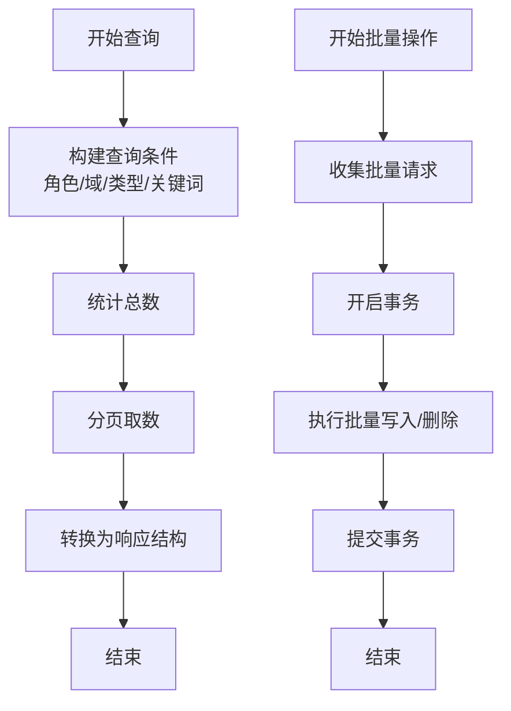

**图表来源**
- [permission.go](file://internal/service/permission.go)
- [casbinrule.go](file://internal/ent/casbinrule.go)

**章节来源**
- [permission.go](file://internal/service/permission.go)
- [casbinrule.go](file://internal/ent/casbinrule.go)

### 权限验证流程（类图）
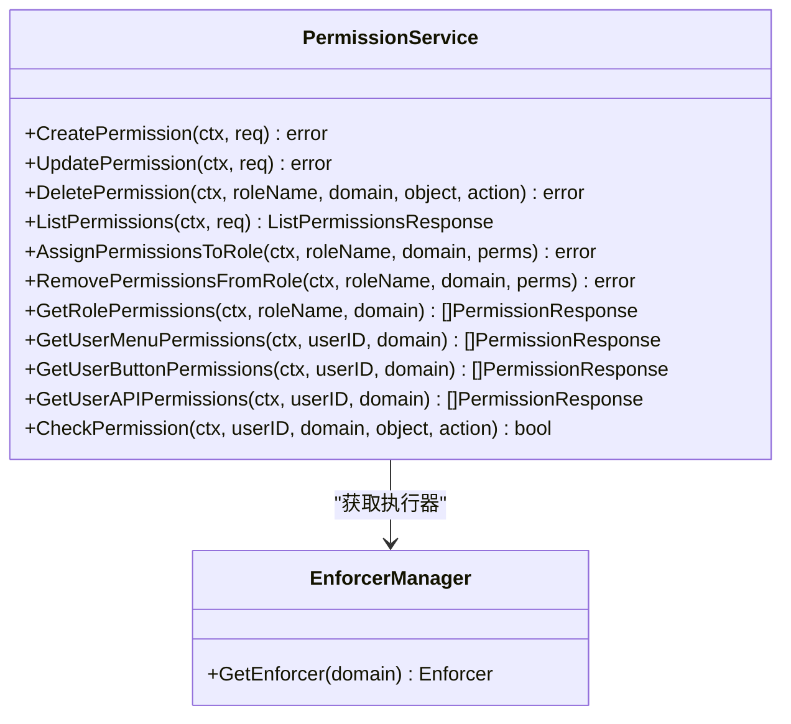

**图表来源**
- [permission.go](file://internal/service/permission.go)
- [global.go](file://internal/global/global.go)

**章节来源**
- [permission.go](file://internal/service/permission.go)
- [global.go](file://internal/global/global.go)

### 权限审计与变更追踪（建议）
- 建议在策略表中增加审计字段（如创建人、修改人、创建时间、修改时间），并在适配器层记录变更历史。
- 对高风险操作（批量导入/导出、角色权限大范围调整）增加二次确认与审批流程。
- 结合日志系统输出权限校验失败事件，便于事后审计。

[本节为通用建议，无需特定文件引用]

### 最佳实践与安全建议
- 最小权限原则：为角色分配最小必要的权限集合。
- 多域隔离：不同租户或业务域使用独立模型与策略，避免交叉污染。
- 定期清理：定期清理无效角色与冗余策略，保持策略集简洁。
- 安全传输：JWT 与密钥管理遵循最小暴露原则，定期轮换。
- 监控告警：对权限校验失败率与策略变更频率设置阈值告警。

[本节为通用建议，无需特定文件引用]

### 冲突检测与解决机制
- 冲突场景
  - 同一角色在同一域对同一对象与动作存在多条策略。
  - 角色继承链导致权限相互覆盖或抵消。
- 检测手段
  - 利用唯一索引在写入前发现重复策略。
  - 通过策略查询与比对，识别冗余与冲突。
- 解决策略
  - 合并策略：将重复策略合并为一条更精确的规则。
  - 明确优先级：通过策略效果与匹配器排序明确优先级。
  - 清理与重构：定期清理冲突策略并重构权限模型。

[本节为通用建议，无需特定文件引用]