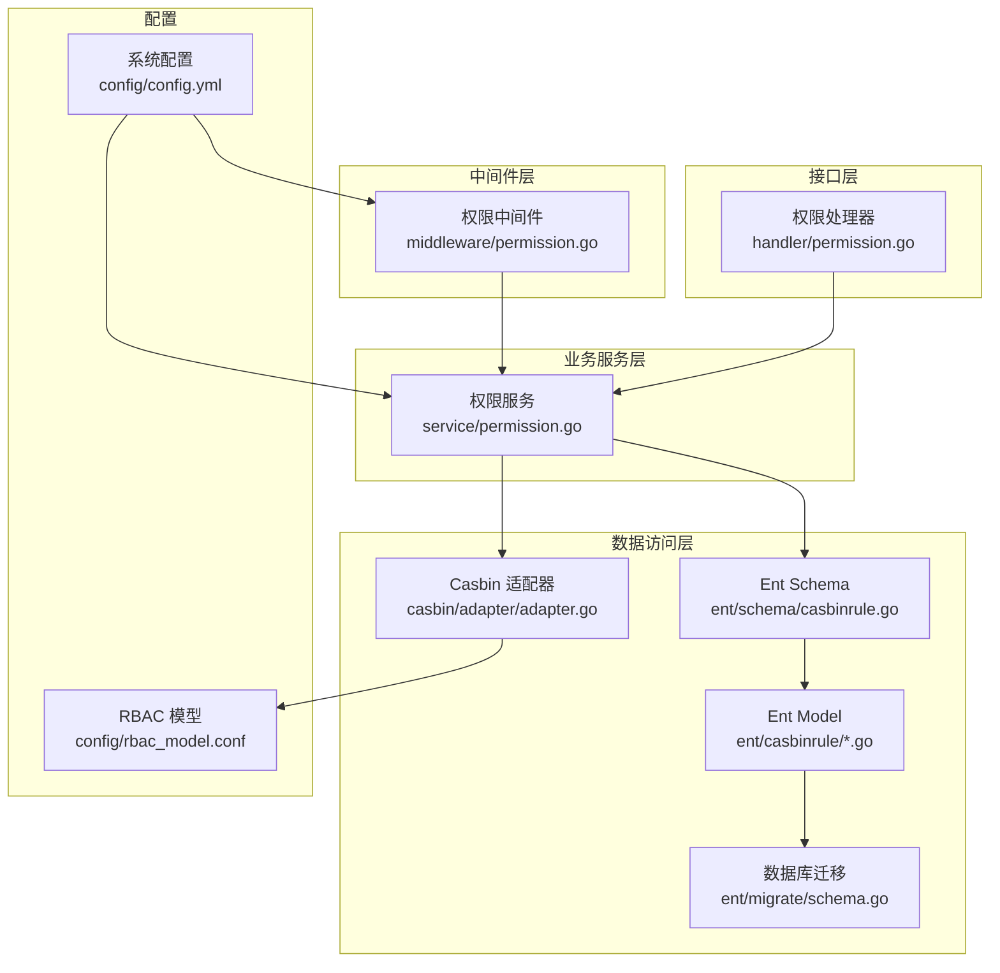
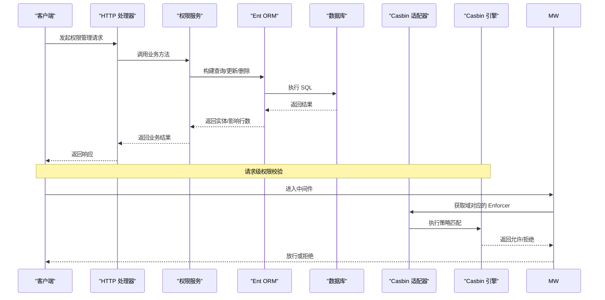
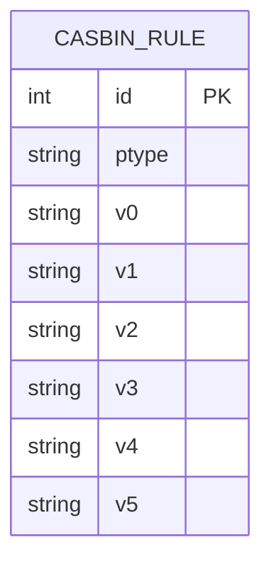
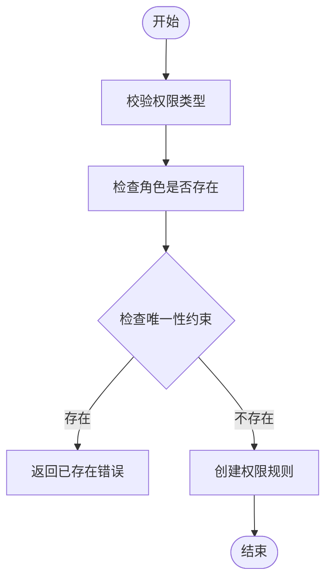
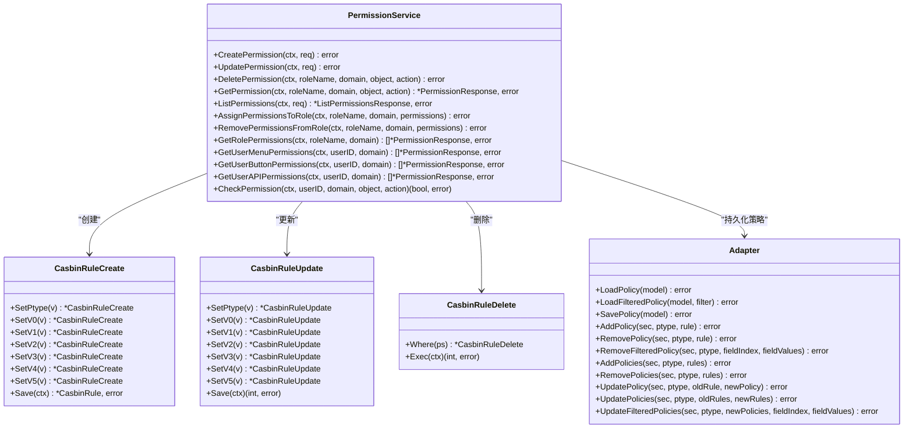

# 权限规则管理

<cite>
**本文档引用的文件**
- [casbinrule.go](file://internal/ent/schema/casbinrule.go)
- [casbinrule.go](file://internal/ent/casbinrule/casbinrule.go)
- [permission.go](file://internal/service/permission.go)
- [permission.go](file://internal/middleware/permission.go)
- [permission.go](file://internal/handler/permission.go)
- [casbinrule_create.go](file://internal/ent/casbinrule_create.go)
- [casbinrule_update.go](file://internal/ent/casbinrule_update.go)
- [casbinrule_delete.go](file://internal/ent/casbinrule_delete.go)
- [casbinrule_query.go](file://internal/ent/casbinrule_query.go)
- [schema.go](file://internal/ent/migrate/schema.go)
- [adapter.go](file://internal/casbin/adapter/adapter.go)
- [rbac_model.conf](file://config/rbac_model.conf)
- [config.yml](file://config/config.yml)
</cite>

## 目录
1. [简介](#简介)
2. [项目结构](#项目结构)
3. [核心组件](#核心组件)
4. [架构概览](#架构概览)
5. [详细组件分析](#详细组件分析)
6. [依赖关系分析](#依赖关系分析)
7. [性能考虑](#性能考虑)
8. [故障排查指南](#故障排查指南)
9. [结论](#结论)
10. [附录](#附录)

## 简介
本文件为 Go Admin 管理系统的权限规则管理提供全面的技术文档。系统基于 Casbin + Ent ORM 实现权限控制，采用 RBAC（基于角色的访问控制）模型，支持 API、菜单、按钮三类权限规则的创建、查询、更新与删除，并通过中间件在请求层进行权限校验。文档涵盖数据结构设计、存储机制、权限类型分类、CRUD 实现、唯一性约束与冲突检测、批量操作与事务策略、高级查询过滤、导入导出与迁移工具、审计日志与变更追踪以及缓存策略与性能优化。

## 项目结构
权限规则管理涉及以下关键模块：
- 数据模型与存储：Ent Schema 定义、数据库迁移、索引与唯一约束
- 业务服务：权限规则 CRUD、角色权限分配、用户权限查询与校验
- 接口层：HTTP API 处理器，提供 RESTful 接口
- 中间件：请求级权限校验与域解析
- Casbin 适配器：将数据库持久化为 Casbin 策略存储
- 配置：RBAC 模型定义、多域配置、数据库连接与缓存配置

图表来源
- [permission.go:13-506](file://internal/handler/permission.go#L13-L506)
- [permission.go:115-671](file://internal/service/permission.go#L115-L671)
- [permission.go:11-69](file://internal/middleware/permission.go#L11-L69)
- [casbinrule.go:9-37](file://internal/ent/schema/casbinrule.go#L9-L37)
- [casbinrule.go:11-118](file://internal/ent/casbinrule/casbinrule.go#L11-L118)
- [schema.go:14-37](file://internal/ent/migrate/schema.go#L14-L37)
- [adapter.go:115-214](file://internal/casbin/adapter/adapter.go#L115-L214)
- [rbac_model.conf:1-15](file://config/rbac_model.conf#L1-L15)
- [config.yml:77-143](file://config/config.yml#L77-L143)

章节来源
- [permission.go:13-506](file://internal/handler/permission.go#L13-L506)
- [permission.go:115-671](file://internal/service/permission.go#L115-L671)
- [permission.go:11-69](file://internal/middleware/permission.go#L11-L69)
- [casbinrule.go:9-37](file://internal/ent/schema/casbinrule.go#L9-L37)
- [casbinrule.go:11-118](file://internal/ent/casbinrule/casbinrule.go#L11-L118)
- [schema.go:14-37](file://internal/ent/migrate/schema.go#L14-L37)
- [adapter.go:115-214](file://internal/casbin/adapter/adapter.go#L115-L214)
- [rbac_model.conf:1-15](file://config/rbac_model.conf#L1-L15)
- [config.yml:77-143](file://config/config.yml#L77-L143)

## 核心组件
- 权限规则实体：基于 Casbin 的 p 策略表结构，字段包括 Ptype、V0-V5，其中 V4 存储权限类型（api/menu/button），V5 存储描述
- 权限服务：提供权限规则的增删改查、角色权限分配与回收、用户权限查询与校验
- HTTP 处理器：暴露 RESTful API，支持分页、筛选、批量操作
- 权限中间件：在请求进入业务逻辑前进行权限校验
- Casbin 适配器：将数据库中的策略持久化到 Casbin 引擎，支持事务批量写入
- 数据库迁移：定义表结构、主键与唯一索引，确保权限规则的唯一性约束

章节来源
- [casbinrule.go:15-36](file://internal/ent/schema/casbinrule.go#L15-L36)
- [casbinrule.go:11-118](file://internal/ent/casbinrule/casbinrule.go#L11-L118)
- [permission.go:24-113](file://internal/service/permission.go#L24-L113)
- [permission.go:13-506](file://internal/handler/permission.go#L13-L506)
- [adapter.go:115-214](file://internal/casbin/adapter/adapter.go#L115-L214)
- [schema.go:14-37](file://internal/ent/migrate/schema.go#L14-L37)

## 架构概览
系统采用分层架构，请求从 HTTP 层进入，经过中间件校验后交由业务服务处理，服务层通过 Ent ORM 访问数据库，同时通过 Casbin 适配器与 Casbin 引擎交互。

图表来源
- [permission.go:13-506](file://internal/handler/permission.go#L13-L506)
- [permission.go:127-174](file://internal/service/permission.go#L127-L174)
- [casbinrule_create.go:125-144](file://internal/ent/casbinrule_create.go#L125-L144)
- [casbinrule_update.go:133-150](file://internal/ent/casbinrule_update.go#L133-L150)
- [casbinrule_delete.go:28-40](file://internal/ent/casbinrule_delete.go#L28-L40)
- [adapter.go:115-175](file://internal/casbin/adapter/adapter.go#L115-L175)
- [permission.go:11-53](file://internal/middleware/permission.go#L11-L53)

## 详细组件分析

### 数据结构与存储机制
- 字段设计
  - Ptype：策略类型，固定为 p
  - V0：角色名
  - V1：域（domain）
  - V2：对象（API 路径、菜单路径或按钮标识）
  - V3：动作（HTTP 方法、menu、button）
  - V4：权限类型（api/menu/button）
  - V5：描述
- 唯一性约束
  - 唯一索引覆盖 Ptype、V0、V1、V2、V3、V4、V5，确保同一角色在同域下对同一对象的同一动作仅能有一条规则
- 表结构与迁移
  - 使用 Ent 的迁移生成器定义表结构与索引，支持自定义表前缀

图表来源
- [schema.go:14-37](file://internal/ent/migrate/schema.go#L14-L37)
- [casbinrule.go:15-36](file://internal/ent/schema/casbinrule.go#L15-L36)

章节来源
- [casbinrule.go:15-36](file://internal/ent/schema/casbinrule.go#L15-L36)
- [casbinrule.go:11-118](file://internal/ent/casbinrule/casbinrule.go#L11-L118)
- [schema.go:14-37](file://internal/ent/migrate/schema.go#L14-L37)

### 权限类型分类与应用场景
- API 权限：适用于 RESTful API 的资源访问控制，动作通常为 HTTP 方法（GET、POST、PUT、DELETE 等）
- 菜单权限：用于前端导航菜单的显示与跳转控制
- 按钮权限：用于页面按钮级别的细粒度控制（如新增、编辑、删除按钮）

章节来源
- [permission.go:24-34](file://internal/service/permission.go#L24-L34)
- [permission.go:660-670](file://internal/service/permission.go#L660-L670)

### 权限规则 CRUD 实现与业务逻辑
- 创建权限
  - 校验权限类型合法性
  - 检查角色是否存在
  - 检查唯一性约束（同一角色、域、对象、动作组合）
  - 写入数据库
- 更新权限
  - 校验权限类型合法性
  - 检查角色是否存在
  - 查找并更新指定规则，支持部分字段更新
- 删除权限
  - 查找并删除指定规则
- 查询权限
  - 支持按角色名、域、权限类型、关键字（对象或描述）筛选
  - 支持分页与总数统计

图表来源
- [permission.go:127-174](file://internal/service/permission.go#L127-L174)

章节来源
- [permission.go:127-263](file://internal/service/permission.go#L127-L263)
- [casbinrule_create.go:125-144](file://internal/ent/casbinrule_create.go#L125-L144)
- [casbinrule_update.go:133-150](file://internal/ent/casbinrule_update.go#L133-L150)
- [casbinrule_delete.go:28-40](file://internal/ent/casbinrule_delete.go#L28-L40)

### 唯一性约束与冲突检测机制
- 数据库层面：唯一索引防止重复规则
- 业务层面：创建前先查询是否存在相同规则，避免重复插入
- 冲突检测：当尝试创建已存在的规则时，返回“权限已存在”错误

章节来源
- [schema.go:30-36](file://internal/ent/migrate/schema.go#L30-L36)
- [permission.go:143-157](file://internal/service/permission.go#L143-L157)

### 批量操作与事务处理策略
- 批量创建：使用 Ent 的批量创建器，按批次提交，减少单次事务开销
- 批量删除：根据条件批量删除
- 事务封装：适配器内部使用 WithTx 包装，确保保存策略时的原子性
- 批处理大小：默认 5000 条，可根据数据量调整

章节来源
- [casbinrule_create.go:265-352](file://internal/ent/casbinrule_create.go#L265-L352)
- [adapter.go:177-214](file://internal/casbin/adapter/adapter.go#L177-L214)
- [adapter.go:304-325](file://internal/casbin/adapter/adapter.go#L304-L325)

### 权限规则查询与过滤的高级用法
- 支持多维筛选：角色名、域、权限类型、关键字（对象或描述）
- 分页查询：支持页码与每页数量限制
- 排序：按字段排序（ID、Ptype、V0-V5）
- 统计：支持 Count 与 Exist 操作

章节来源
- [permission.go:286-354](file://internal/service/permission.go#L286-L354)
- [casbinrule_query.go:18-28](file://internal/ent/casbinrule_query.go#L18-L28)
- [casbinrule_query.go:301-305](file://internal/ent/casbinrule_query.go#L301-L305)

### 权限规则的导入导出与迁移工具
- 导入：通过 Casbin 适配器的 SavePolicy 将内存中的策略写入数据库，支持批量写入
- 导出：通过 LoadPolicy 或 LoadFilteredPolicy 从数据库读取策略
- 迁移：Ent 迁移生成器自动生成表结构与索引，支持表前缀配置

章节来源
- [adapter.go:177-214](file://internal/casbin/adapter/adapter.go#L177-L214)
- [adapter.go:115-175](file://internal/casbin/adapter/adapter.go#L115-L175)
- [schema.go:14-37](file://internal/ent/migrate/schema.go#L14-L37)

### 审计日志与变更追踪功能
- 当前代码未直接实现审计日志与变更追踪功能
- 建议在权限规则的 CRUD 操作中增加审计记录（如操作人、时间、变更前后对比），可在业务服务层扩展

章节来源
- [permission.go:127-263](file://internal/service/permission.go#L127-L263)

### 缓存策略与性能优化方法
- 缓存配置：支持内存与 Redis 缓存，可通过配置文件启用
- 性能建议：
  - 对高频访问的域启用自动加载（auto_load: true）
  - 合理设置批处理大小（默认 5000）
  - 使用唯一索引与合适的查询条件，避免全表扫描
  - 在高并发场景下，结合数据库连接池与缓存策略

章节来源
- [config.yml:32-58](file://config/config.yml#L32-L58)
- [config.yml:77-143](file://config/config.yml#L77-L143)
- [adapter.go:199-213](file://internal/casbin/adapter/adapter.go#L199-L213)

## 依赖关系分析

图表来源
- [permission.go:115-671](file://internal/service/permission.go#L115-L671)
- [casbinrule_create.go:15-124](file://internal/ent/casbinrule_create.go#L15-L124)
- [casbinrule_update.go:17-131](file://internal/ent/casbinrule_update.go#L17-L131)
- [casbinrule_delete.go:15-40](file://internal/ent/casbinrule_delete.go#L15-L40)
- [adapter.go:43-58](file://internal/casbin/adapter/adapter.go#L43-L58)

## 性能考虑
- 数据库层面
  - 唯一索引确保规则唯一性，避免重复写入
  - 合理的查询条件与分页，避免全表扫描
- 业务层面
  - 批量操作使用批量创建器，减少事务次数
  - 高频域启用自动加载，减少初始化开销
- 缓存层面
  - 可配置内存或 Redis 缓存，降低数据库压力

章节来源
- [schema.go:30-36](file://internal/ent/migrate/schema.go#L30-L36)
- [adapter.go:199-213](file://internal/casbin/adapter/adapter.go#L199-L213)
- [config.yml:32-58](file://config/config.yml#L32-L58)

## 故障排查指南
- 常见错误
  - 无效的权限类型：检查请求中的 type 字段
  - 角色不存在：确认角色已创建
  - 权限已存在：检查唯一性约束
  - 权限不存在：确认查询条件正确
- 排查步骤
  - 检查请求参数与权限类型
  - 确认角色存在且状态正常
  - 核对唯一性约束条件
  - 查看数据库日志与中间件返回的错误信息

章节来源
- [permission.go:16-22](file://internal/service/permission.go#L16-L22)
- [permission.go:127-174](file://internal/service/permission.go#L127-L174)
- [permission.go:176-236](file://internal/service/permission.go#L176-L236)
- [permission.go:238-263](file://internal/service/permission.go#L238-L263)

## 结论
Go Admin 的权限规则管理基于 Casbin 与 Ent ORM，实现了灵活的 RBAC 控制。通过唯一性约束与严格的业务校验，确保权限规则的一致性；通过批量操作与事务封装，保障大规模数据处理的可靠性；通过中间件与配置，实现请求级权限校验与多域支持。建议在现有基础上扩展审计日志与变更追踪功能，进一步提升系统的可观测性与合规性。

## 附录
- RBAC 模型配置：支持多域配置，可按需启用自动加载
- 数据库连接：支持自定义表前缀，便于多租户隔离
- 缓存配置：支持内存与 Redis，可按需启用

章节来源
- [rbac_model.conf:1-15](file://config/rbac_model.conf#L1-L15)
- [config.yml:19-31](file://config/config.yml#L19-L31)
- [config.yml:32-58](file://config/config.yml#L32-L58)
- [config.yml:77-143](file://config/config.yml#L77-L143)