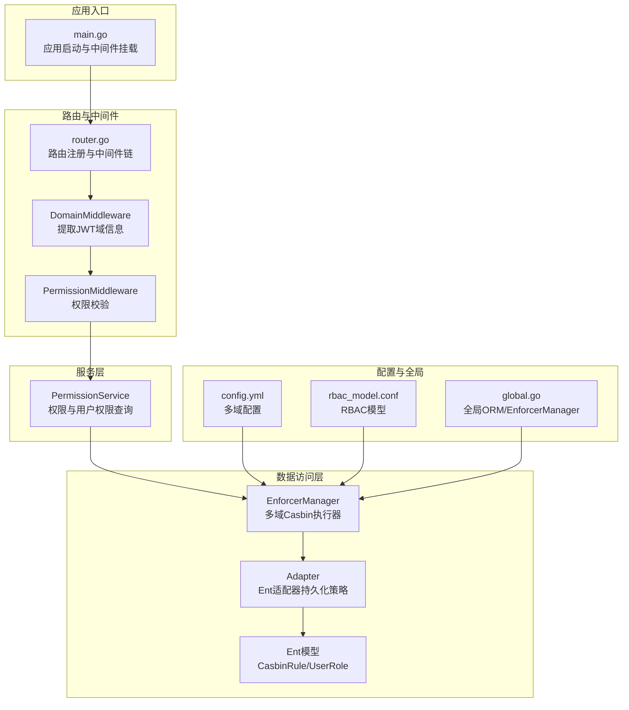
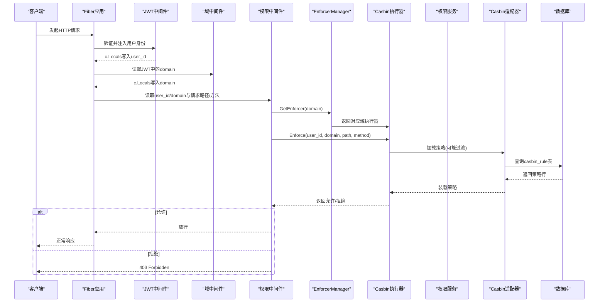
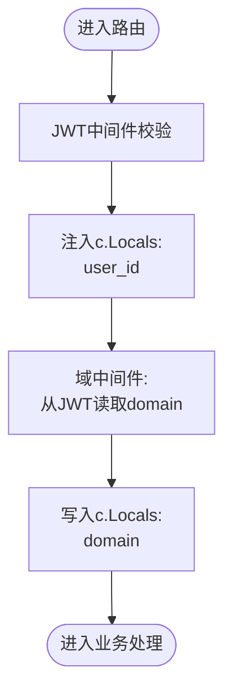
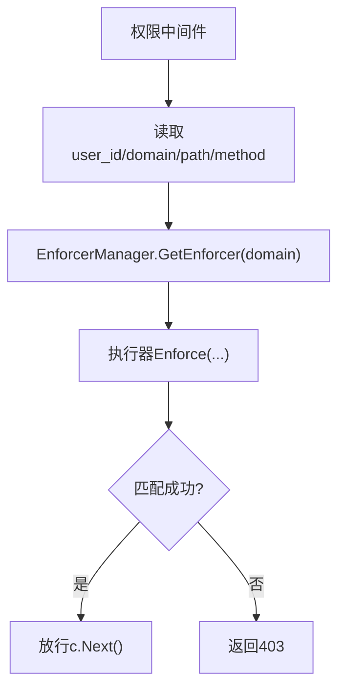
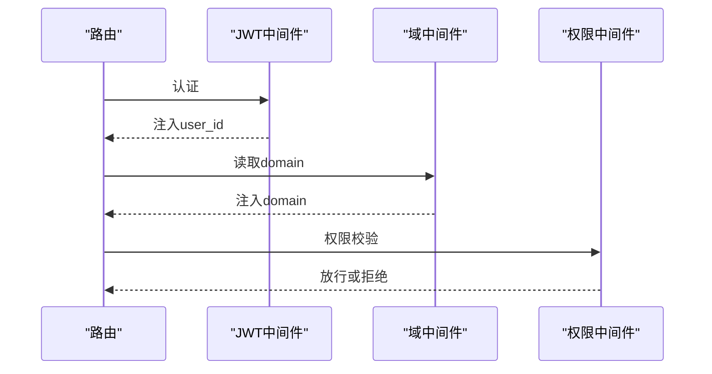
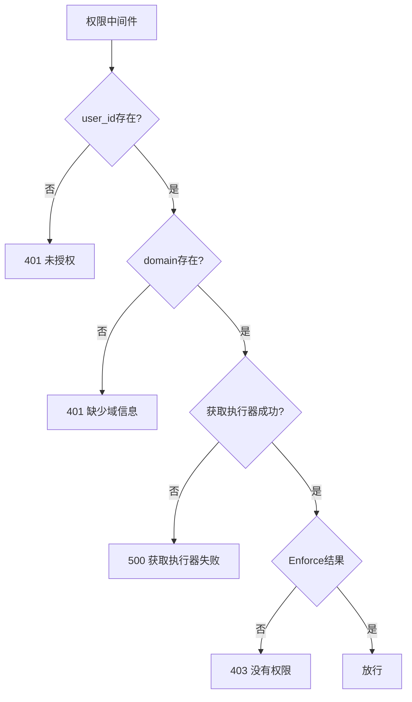
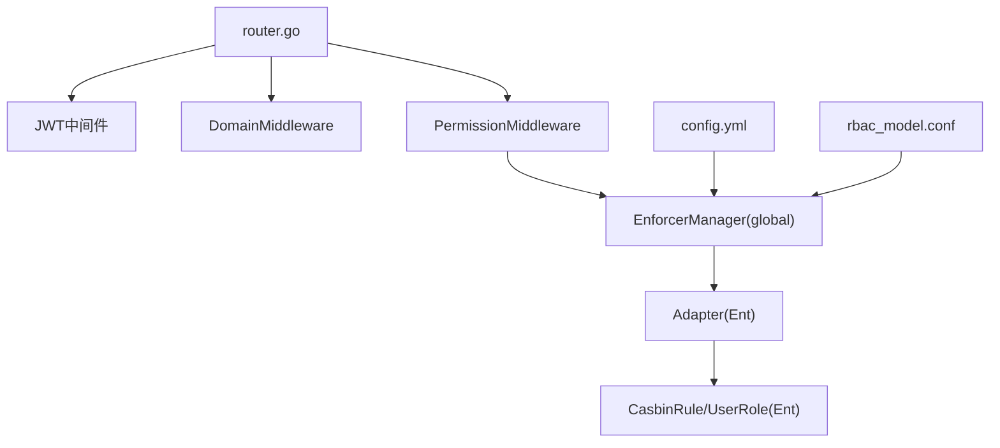
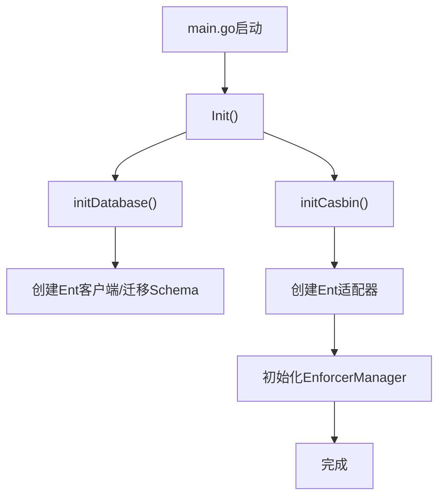

# 权限验证机制

<cite>
**本文引用的文件**
- [main.go](file://main.go)
- [router.go](file://internal/router.go)
- [permission.go](file://internal/middleware/permission.go)
- [permission.go](file://internal/handler/permission.go)
- [permission.go](file://internal/service/permission.go)
- [adapter.go](file://internal/casbin/adapter/adapter.go)
- [rbac_model.conf](file://config/rbac_model.conf)
- [config.yml](file://config/config.yml)
- [global.go](file://internal/global/global.go)
- [response.go](file://internal/utils/response.go)
- [msg.go](file://internal/global/msg.go)
- [casbinrule.go](file://internal/ent/schema/casbinrule.go)
- [userrole.go](file://internal/ent/schema/userrole.go)
- [init.go](file://internal/init.go)
</cite>

## 目录
1. [简介](#简介)
2. [项目结构](#项目结构)
3. [核心组件](#核心组件)
4. [架构总览](#架构总览)
5. [详细组件分析](#详细组件分析)
6. [依赖分析](#依赖分析)
7. [性能考量](#性能考量)
8. [故障排查指南](#故障排查指南)
9. [结论](#结论)
10. [附录](#附录)

## 简介
本文件系统性阐述 Go Admin 管理系统的权限验证机制，覆盖以下方面：
- 完整的权限验证流程与执行策略
- JWT 令牌解析与用户身份识别
- 基于角色的权限检查算法与执行逻辑
- 多域权限验证与权限继承规则
- 权限缓存机制与性能优化策略
- 中间件实现与配置方法
- 错误处理与异常情况处理
- 日志记录与监控指标建议
- 安全考虑与防护措施
- 测试方法与调试技巧

## 项目结构
围绕权限验证的关键模块包括：
- 路由与中间件层：负责路由注册、JWT 认证、域中间件、权限中间件
- 服务层：封装权限创建、更新、删除、查询、角色权限分配与用户权限获取
- 数据访问层：基于 Ent 的实体模型与 Casbin 适配器
- 配置层：Casbin 多域模型与运行时配置
- 工具层：统一响应结构与消息映射

**图表来源**
- [main.go:43-89](file://main.go#L43-L89)
- [router.go:14-72](file://internal/router.go#L14-L72)
- [permission.go:55-68](file://internal/middleware/permission.go#L55-L68)
- [permission.go:11-52](file://internal/middleware/permission.go#L11-L52)
- [permission.go:115-671](file://internal/service/permission.go#L115-L671)
- [adapter.go:115-175](file://internal/casbin/adapter/adapter.go#L115-L175)
- [casbinrule.go:9-37](file://internal/ent/schema/casbinrule.go#L9-L37)
- [userrole.go:11-56](file://internal/ent/schema/userrole.go#L11-L56)
- [config.yml:77-143](file://config/config.yml#L77-L143)
- [rbac_model.conf:1-15](file://config/rbac_model.conf#L1-L15)
- [global.go:10-14](file://internal/global/global.go#L10-L14)

**章节来源**
- [main.go:43-89](file://main.go#L43-L89)
- [router.go:14-72](file://internal/router.go#L14-L72)

## 核心组件
- JWT 中间件：由框架提供的 JWT 中间件负责签名校验与用户身份注入（user_id 等），权限中间件通过 c.Locals 读取
- 域中间件：从 JWT 声明中提取 domain 并写入 c.Locals，作为多域权限判断依据
- 权限中间件：从 c.Locals 读取 user_id 与 domain，结合当前请求路径与方法，调用 EnforcerManager 获取对应域的执行器进行 Enforce 判断
- 权限服务：封装权限 CRUD、角色权限分配/移除、用户菜单/按钮/API 权限查询、CheckPermission 统一校验
- Casbin 适配器：将 Ent ORM 作为策略存储，支持批量保存、过滤加载等
- 多域模型：通过 config.yml 的 domains 配置与 rbac_model.conf 的匹配器定义，实现按域隔离的权限控制

**章节来源**
- [permission.go:11-52](file://internal/middleware/permission.go#L11-L52)
- [permission.go:55-68](file://internal/middleware/permission.go#L55-L68)
- [permission.go:115-671](file://internal/service/permission.go#L115-L671)
- [adapter.go:115-175](file://internal/casbin/adapter/adapter.go#L115-L175)
- [config.yml:77-143](file://config/config.yml#L77-L143)
- [rbac_model.conf:1-15](file://config/rbac_model.conf#L1-L15)

## 架构总览
下图展示了从请求进入至权限决策的完整链路。

**图表来源**
- [router.go:32-37](file://internal/router.go#L32-L37)
- [permission.go:11-52](file://internal/middleware/permission.go#L11-L52)
- [permission.go:55-68](file://internal/middleware/permission.go#L55-L68)
- [permission.go:115-671](file://internal/service/permission.go#L115-L671)
- [adapter.go:115-175](file://internal/casbin/adapter/adapter.go#L115-L175)
- [casbinrule.go:9-37](file://internal/ent/schema/casbinrule.go#L9-L37)

## 详细组件分析

### JWT 令牌解析与用户身份识别
- JWT 中间件负责签名校验并将用户身份注入到 c.Locals，权限中间件通过 c.Locals("user_id") 获取当前用户 ID
- 域中间件从 JWT 声明中读取 domain 字段并写入 c.Locals("domain")，作为后续权限判断的域上下文
- 登录/刷新令牌流程中，JWT 声明包含 token_type、id、subject、issuer、domain、expires、issued_at 等字段，确保后续中间件能正确读取

**图表来源**
- [router.go:32-37](file://internal/router.go#L32-L37)
- [permission.go:55-68](file://internal/middleware/permission.go#L55-L68)

**章节来源**
- [router.go:32-37](file://internal/router.go#L32-L37)
- [permission.go:55-68](file://internal/middleware/permission.go#L55-L68)

### 基于角色的权限检查算法与执行逻辑
- 权限中间件读取 user_id、domain、请求路径与方法，调用 EnforcerManager.GetEnforcer(domain) 获取对应域的执行器
- 执行器 Enforce(user_id, domain, path, method) 进行策略匹配，匹配器由 rbac_model.conf 定义
- 权限服务提供 CheckPermission，其内部先查询用户关联的角色集合，再在 Casbin 策略表中匹配 p(sub, dom, obj, act)

**图表来源**
- [permission.go:11-52](file://internal/middleware/permission.go#L11-L52)
- [rbac_model.conf:14-15](file://config/rbac_model.conf#L14-L15)

**章节来源**
- [permission.go:11-52](file://internal/middleware/permission.go#L11-L52)
- [permission.go:602-640](file://internal/service/permission.go#L602-L640)
- [rbac_model.conf:14-15](file://config/rbac_model.conf#L14-L15)

### 多域权限验证与权限继承规则
- 多域配置通过 config.yml 的 domains 列表定义，每个域可配置 auto_load、model_text 或 model_path
- 默认域由 domains_default 指定；当启用 auto_load 时，系统在启动时加载对应模型
- 匹配器 m = g(r.sub, p.sub, r.dom) && r.dom == p.dom && r.obj == p.obj && r.act == p.act 实现按域隔离的策略匹配
- 权限继承通过 Casbin 内置的 g 关系（角色继承）实现，具体取决于模型配置与策略数据

**图表来源**
- [config.yml:77-143](file://config/config.yml#L77-L143)
- [rbac_model.conf:8-15](file://config/rbac_model.conf#L8-L15)

**章节来源**
- [config.yml:77-143](file://config/config.yml#L77-L143)
- [rbac_model.conf:8-15](file://config/rbac_model.conf#L8-L15)

### 权限缓存机制与性能优化策略
- 当前代码未显式实现权限缓存层；建议在高并发场景下引入缓存（如内存/Redis）以减少数据库与 Casbin 执行器的频繁调用
- 可采用用户维度的权限聚合结果缓存，结合 TTL 与失效策略；同时在策略变更时主动清理相关缓存键
- 对高频访问的域可设置 auto_load，减少首次请求的加载开销

**章节来源**
- [config.yml:32-41](file://config/config.yml#L32-L41)
- [config.yml:86-87](file://config/config.yml#L86-L87)

### 中间件实现与配置方法
- 路由注册时，将 JWT 中间件、域中间件、权限中间件按顺序挂载，形成认证→域识别→权限校验的链路
- 权限中间件依赖全局 EnforcerManager，通过 GetEnforcer(domain) 获取执行器
- 域中间件依赖 JWT 中间件提供的声明，从 JWT 中提取 domain

**图表来源**
- [router.go:32-37](file://internal/router.go#L32-L37)
- [permission.go:11-52](file://internal/middleware/permission.go#L11-L52)
- [permission.go:55-68](file://internal/middleware/permission.go#L55-L68)

**章节来源**
- [router.go:32-37](file://internal/router.go#L32-L37)
- [permission.go:11-52](file://internal/middleware/permission.go#L11-L52)
- [permission.go:55-68](file://internal/middleware/permission.go#L55-L68)

### 错误处理与异常情况处理
- 权限中间件在缺失 user_id、domain、执行器获取失败、Enforce 执行异常、无权限等情况分别返回 401、403、500
- 服务层对角色不存在、权限不存在、权限已存在等业务异常进行区分返回
- 统一响应结构由 utils.Response 提供，错误码与消息映射由 global.msg.go 管理

**图表来源**
- [permission.go:11-52](file://internal/middleware/permission.go#L11-L52)
- [response.go:9-50](file://internal/utils/response.go#L9-L50)
- [msg.go:25-45](file://internal/global/msg.go#L25-L45)

**章节来源**
- [permission.go:11-52](file://internal/middleware/permission.go#L11-L52)
- [response.go:9-50](file://internal/utils/response.go#L9-L50)
- [msg.go:25-45](file://internal/global/msg.go#L25-L45)

### 日志记录与监控指标
- 应用层具备日志配置（文件/控制台输出、轮转大小与天数），可用于记录权限校验关键事件
- 建议在权限中间件与服务层增加关键路径日志（如拒绝原因、耗时、用户ID、域、路径、方法）
- 监控指标建议：权限命中率、拒绝率、平均耗时、错误率、不同域的负载分布

**章节来源**
- [config.yml:11-18](file://config/config.yml#L11-L18)

### 安全考虑与防护措施
- 严格依赖 JWT 中间件进行签名校验，避免伪造 user_id 与 domain
- 确保 domain 字段来自可信来源（JWT），并在中间件中进行非空校验
- 对敏感接口采用细粒度 API 权限控制，避免仅依赖菜单/按钮权限
- 定期审计策略表（casbin_rule），清理无效/冗余策略
- 在生产环境开启 auto_load 以减少首次加载延迟与潜在的冷启动风险

**章节来源**
- [permission.go:55-68](file://internal/middleware/permission.go#L55-L68)
- [config.yml:86-87](file://config/config.yml#L86-L87)

### 测试方法与调试技巧
- 单元测试：针对权限服务的 CheckPermission、角色权限分配/移除、用户权限查询等函数编写测试用例，模拟不同角色与策略组合
- 集成测试：通过构造不同 domain 与策略，验证多域隔离与继承效果
- 调试技巧：
  - 在权限中间件与服务层增加日志，记录 user_id、domain、path、method、策略命中情况
  - 使用 Swagger 或 Postman 构造请求，逐步验证登录、刷新令牌、权限查询与权限校验链路
  - 在 config.yml 中为高频域设置 auto_load，观察首次请求耗时变化

**章节来源**
- [permission.go:115-671](file://internal/service/permission.go#L115-L671)
- [config.yml:86-87](file://config/config.yml#L86-L87)

## 依赖分析
- 路由层依赖 JWT 中间件与自定义中间件链
- 中间件层依赖全局 EnforcerManager 与 JWT 工具
- 服务层依赖 Ent ORM 与 Casbin 适配器
- 配置层通过 config.yml 与 rbac_model.conf 影响执行器行为

**图表来源**
- [router.go:32-37](file://internal/router.go#L32-L37)
- [permission.go:11-52](file://internal/middleware/permission.go#L11-L52)
- [global.go:10-14](file://internal/global/global.go#L10-L14)
- [adapter.go:115-175](file://internal/casbin/adapter/adapter.go#L115-L175)
- [casbinrule.go:9-37](file://internal/ent/schema/casbinrule.go#L9-L37)
- [userrole.go:11-56](file://internal/ent/schema/userrole.go#L11-L56)
- [config.yml:77-143](file://config/config.yml#L77-L143)
- [rbac_model.conf:1-15](file://config/rbac_model.conf#L1-L15)

**章节来源**
- [router.go:32-37](file://internal/router.go#L32-L37)
- [permission.go:11-52](file://internal/middleware/permission.go#L11-L52)
- [global.go:10-14](file://internal/global/global.go#L10-L14)
- [adapter.go:115-175](file://internal/casbin/adapter/adapter.go#L115-L175)
- [casbinrule.go:9-37](file://internal/ent/schema/casbinrule.go#L9-L37)
- [userrole.go:11-56](file://internal/ent/schema/userrole.go#L11-L56)
- [config.yml:77-143](file://config/config.yml#L77-L143)
- [rbac_model.conf:1-15](file://config/rbac_model.conf#L1-L15)

## 性能考量
- 高频域启用 auto_load，降低首次请求延迟
- 引入权限结果缓存（用户维度），结合 TTL 与失效策略
- 批量策略导入/导出时使用 Adapter 的批量写入能力，减少事务开销
- 对策略表建立合适索引，确保 Enforce 匹配效率

**章节来源**
- [config.yml:86-87](file://config/config.yml#L86-L87)
- [adapter.go:177-214](file://internal/casbin/adapter/adapter.go#L177-L214)

## 故障排查指南
- 401 未授权：确认 JWT 是否正确、user_id 是否注入、域中间件是否正常工作
- 401 缺少域信息：检查 JWT 声明中 domain 字段是否存在且非空
- 500 获取执行器失败：检查 EnforcerManager 初始化与配置
- 403 没有权限：核对策略表（casbin_rule）中是否存在匹配的 p 策略，确认用户角色与 domain 是否正确

**章节来源**
- [permission.go:11-52](file://internal/middleware/permission.go#L11-L52)
- [permission.go:55-68](file://internal/middleware/permission.go#L55-L68)
- [casbinrule.go:9-37](file://internal/ent/schema/casbinrule.go#L9-L37)

## 结论
本系统通过 JWT 认证、域中间件与权限中间件的组合，实现了以 Casbin 为核心的多域权限控制。配合 Ent 适配器与策略表，能够灵活地表达角色继承与域隔离。建议在高并发场景下引入缓存与监控，持续优化性能与可观测性。

## 附录
- 初始化流程：应用启动时先初始化数据库，再初始化 Casbin 执行器管理器，确保策略持久化可用

**图表来源**
- [main.go:43-89](file://main.go#L43-L89)
- [init.go:17-65](file://internal/init.go#L17-L65)

**章节来源**
- [main.go:43-89](file://main.go#L43-L89)
- [init.go:17-65](file://internal/init.go#L17-L65)