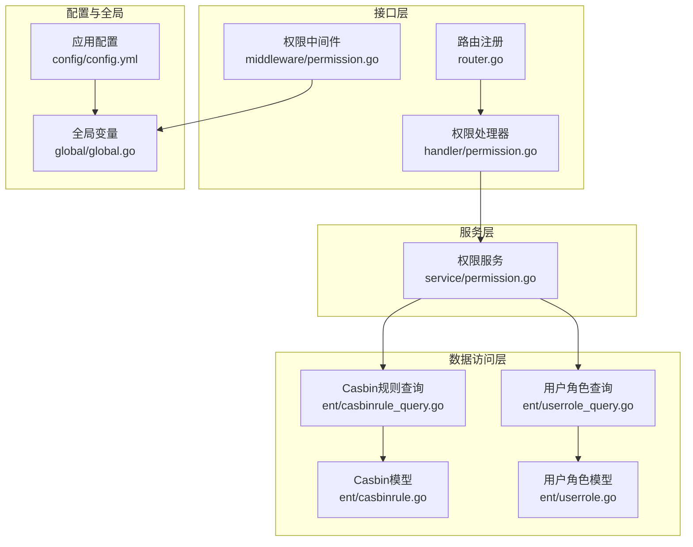
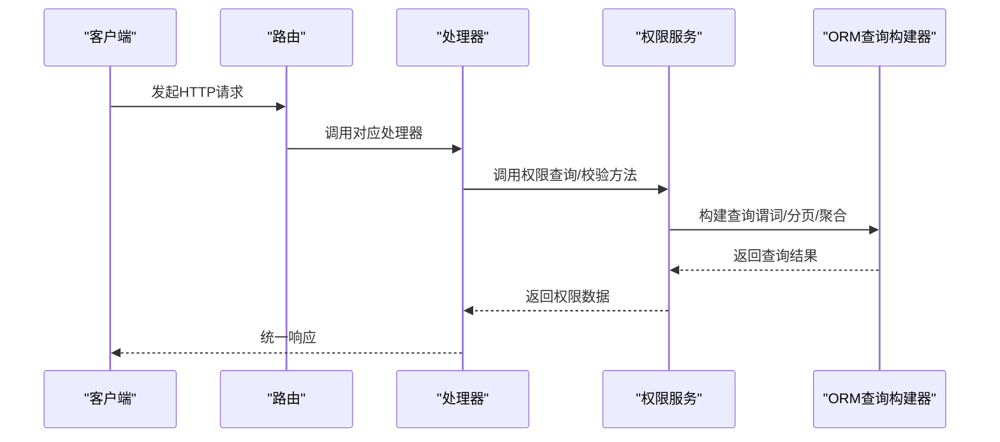
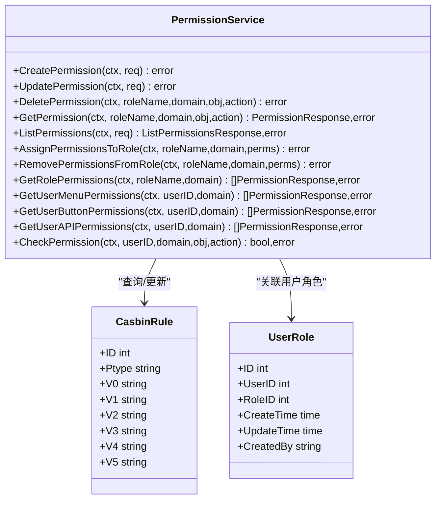
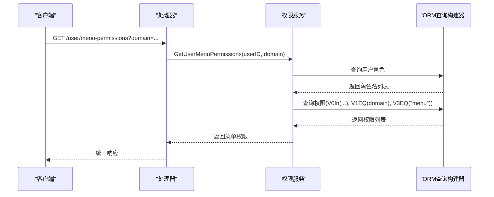
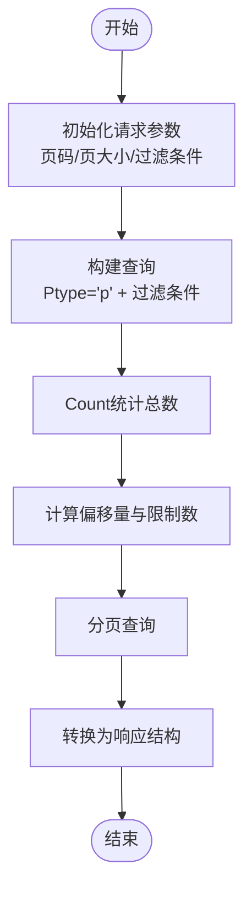
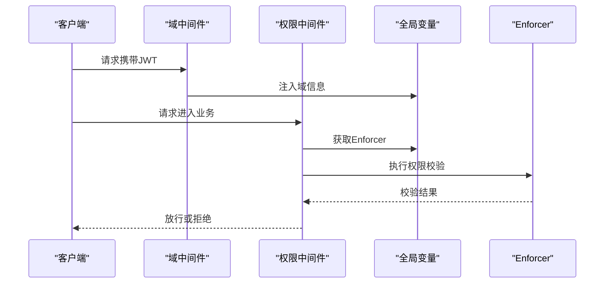
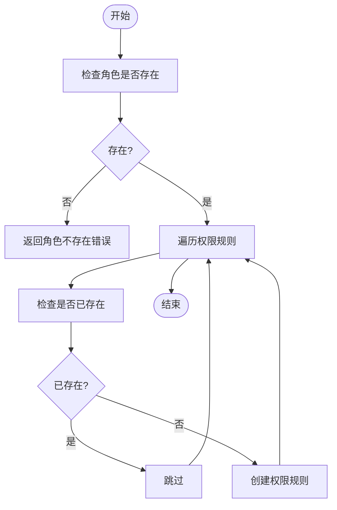
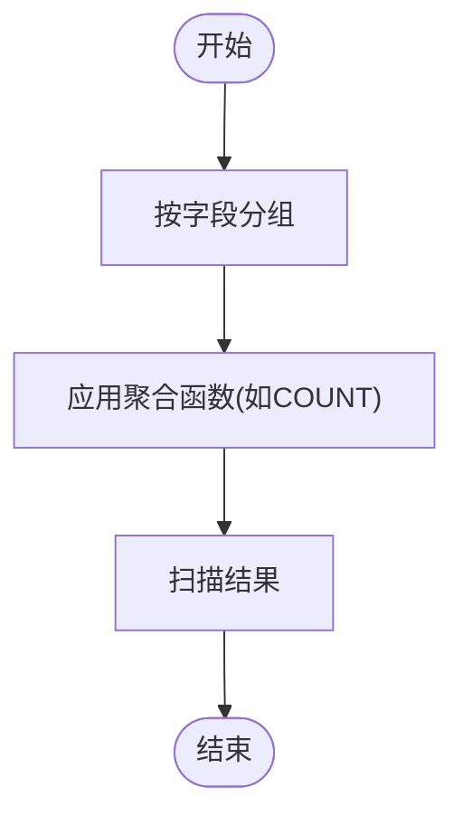
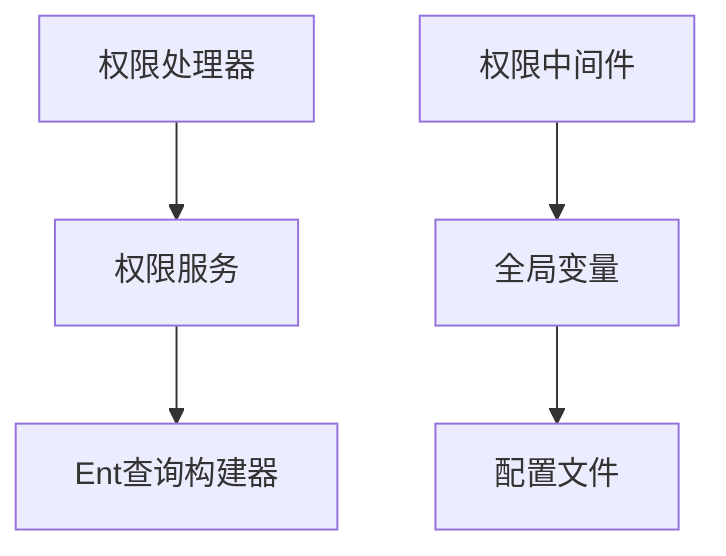

# 用户权限查询

<cite>
**本文档引用的文件**
- [permission.go](file://internal/service/permission.go)
- [permission.go](file://internal/handler/permission.go)
- [permission.go](file://internal/middleware/permission.go)
- [router.go](file://internal/router.go)
- [casbinrule_query.go](file://internal/ent/casbinrule_query.go)
- [casbinrule.go](file://internal/ent/casbinrule.go)
- [userrole_query.go](file://internal/ent/userrole_query.go)
- [userrole.go](file://internal/ent/userrole.go)
- [config.yml](file://config/config.yml)
- [global.go](file://internal/global/global.go)
</cite>

## 目录
1. [简介](#简介)
2. [项目结构](#项目结构)
3. [核心组件](#核心组件)
4. [架构总览](#架构总览)
5. [详细组件分析](#详细组件分析)
6. [依赖关系分析](#依赖关系分析)
7. [性能考虑](#性能考虑)
8. [故障排查指南](#故障排查指南)
9. [结论](#结论)
10. [附录](#附录)

## 简介
本文件面向Go Admin管理系统的用户权限查询能力，系统性阐述权限查询的实现原理、数据流与处理逻辑，覆盖菜单、按钮、API三类权限的查询方法与过滤条件；详解用户角色关联查询与权限合并算法；说明分页、排序、统计与聚合能力；并给出性能优化、索引策略、缓存机制、批量操作与验证、错误处理与测试验证等实践建议。

## 项目结构
围绕权限查询的关键模块包括：
- 服务层：权限服务实现，负责权限增删改查、角色权限管理、用户权限查询与权限校验
- 处理层：HTTP接口封装，暴露REST API供前端调用
- 中间件：权限拦截与域解析，保障请求在进入业务前完成权限校验
- ORM层：基于Ent的查询构建器，提供强类型的查询谓词与聚合能力
- 配置层：应用配置与缓存配置，支撑运行期性能与扩展

**图表来源**
- [router.go:14-72](file://internal/router.go#L14-L72)
- [permission.go:13-506](file://internal/handler/permission.go#L13-L506)
- [permission.go:11-69](file://internal/middleware/permission.go#L11-L69)
- [permission.go:115-125](file://internal/service/permission.go#L115-L125)
- [casbinrule_query.go:18-528](file://internal/ent/casbinrule_query.go#L18-L528)
- [userrole_query.go:20-682](file://internal/ent/userrole_query.go#L20-L682)
- [casbinrule.go:14-170](file://internal/ent/casbinrule.go#L14-L170)
- [userrole.go:17-199](file://internal/ent/userrole.go#L17-L199)
- [config.yml:1-74](file://config/config.yml#L1-L74)
- [global.go:10-14](file://internal/global/global.go#L10-L14)

**章节来源**
- [router.go:14-72](file://internal/router.go#L14-L72)
- [permission.go:13-506](file://internal/handler/permission.go#L13-L506)
- [permission.go:11-69](file://internal/middleware/permission.go#L11-L69)
- [permission.go:115-125](file://internal/service/permission.go#L115-L125)
- [casbinrule_query.go:18-528](file://internal/ent/casbinrule_query.go#L18-L528)
- [userrole_query.go:20-682](file://internal/ent/userrole_query.go#L20-L682)
- [casbinrule.go:14-170](file://internal/ent/casbinrule.go#L14-L170)
- [userrole.go:17-199](file://internal/ent/userrole.go#L17-L199)
- [config.yml:1-74](file://config/config.yml#L1-L74)
- [global.go:10-14](file://internal/global/global.go#L10-L14)

## 核心组件
- 权限服务接口与实现：定义权限管理、角色权限管理、用户权限查询与权限校验等方法，并通过Ent ORM执行数据库查询
- 权限处理器：封装HTTP接口，解析请求参数，调用权限服务，返回统一响应
- 权限中间件：在请求进入业务逻辑前进行权限校验，确保API访问受控
- ORM查询构建器：提供强类型谓词、分页、聚合、排序等能力，支撑复杂权限查询场景

**章节来源**
- [permission.go:92-113](file://internal/service/permission.go#L92-L113)
- [permission.go:13-506](file://internal/handler/permission.go#L13-L506)
- [permission.go:11-69](file://internal/middleware/permission.go#L11-L69)
- [casbinrule_query.go:18-528](file://internal/ent/casbinrule_query.go#L18-L528)

## 架构总览
权限查询贯穿“接口层—服务层—数据访问层”，形成清晰的职责分离与可扩展的数据流。

**图表来源**
- [router.go:14-72](file://internal/router.go#L14-L72)
- [permission.go:13-506](file://internal/handler/permission.go#L13-L506)
- [permission.go:286-354](file://internal/service/permission.go#L286-L354)
- [casbinrule_query.go:161-239](file://internal/ent/casbinrule_query.go#L161-L239)

## 详细组件分析

### 权限类型与数据模型
- 权限类型：API、菜单、按钮
- 数据模型：使用Casbin规则表存储权限，字段包含策略类型、角色名、域、对象、动作、类型、描述等
- 用户角色模型：用户与角色的多对多关系，通过用户角色表维护

**图表来源**
- [permission.go:115-125](file://internal/service/permission.go#L115-L125)
- [casbinrule.go:14-170](file://internal/ent/casbinrule.go#L14-L170)
- [userrole.go:17-199](file://internal/ent/userrole.go#L17-L199)

**章节来源**
- [permission.go:24-113](file://internal/service/permission.go#L24-L113)
- [casbinrule.go:14-170](file://internal/ent/casbinrule.go#L14-L170)
- [userrole.go:17-199](file://internal/ent/userrole.go#L17-L199)

### 用户权限查询流程
- 用户菜单权限：根据用户ID查询其角色集合，再按域与动作类型“menu”查询权限
- 用户按钮权限：同上，动作类型为“button”
- 用户API权限：同上，排除“menu”和“button”类型
- 权限合并：同一用户可能拥有多个角色，权限查询以角色集合作为IN条件，最终得到去重后的权限集合

**图表来源**
- [permission.go:358-388](file://internal/handler/permission.go#L358-L388)
- [permission.go:466-509](file://internal/service/permission.go#L466-L509)
- [userrole_query.go:209-226](file://internal/ent/userrole_query.go#L209-L226)
- [casbinrule_query.go:161-178](file://internal/ent/casbinrule_query.go#L161-L178)

**章节来源**
- [permission.go:358-451](file://internal/handler/permission.go#L358-L451)
- [permission.go:466-600](file://internal/service/permission.go#L466-L600)
- [userrole_query.go:209-226](file://internal/ent/userrole_query.go#L209-L226)
- [casbinrule_query.go:161-178](file://internal/ent/casbinrule_query.go#L161-L178)

### 权限列表查询与过滤
- 支持分页：默认页码与页大小限制，偏移量与限制数计算
- 支持过滤：角色名、域、权限类型、关键字（对象或描述包含匹配）
- 排序：ORM查询构建器支持Order选项，可扩展排序字段
- 聚合：Count用于统计总数，配合分页返回

**图表来源**
- [permission.go:286-354](file://internal/service/permission.go#L286-L354)
- [casbinrule_query.go:201-239](file://internal/ent/casbinrule_query.go#L201-L239)
- [casbinrule_query.go:333-405](file://internal/ent/casbinrule_query.go#L333-L405)

**章节来源**
- [permission.go:286-354](file://internal/service/permission.go#L286-L354)
- [casbinrule_query.go:201-239](file://internal/ent/casbinrule_query.go#L201-L239)

### 权限校验与中间件集成
- 中间件在请求到达业务逻辑前进行权限校验，使用Enforcer执行策略匹配
- 域信息来自JWT载荷，通过域中间件注入到上下文
- 校验失败返回统一错误响应

**图表来源**
- [permission.go:11-69](file://internal/middleware/permission.go#L11-L69)
- [global.go:10-14](file://internal/global/global.go#L10-L14)

**章节来源**
- [permission.go:11-69](file://internal/middleware/permission.go#L11-L69)
- [global.go:10-14](file://internal/global/global.go#L10-L14)

### 角色权限管理与批量操作
- 为角色分配/移除权限：批量创建或删除权限规则，自动去重已存在权限
- 类型推断：根据动作字符串自动判断权限类型（菜单/按钮/API）

**图表来源**
- [permission.go:356-433](file://internal/service/permission.go#L356-L433)
- [permission.go:660-670](file://internal/service/permission.go#L660-L670)

**章节来源**
- [permission.go:356-433](file://internal/service/permission.go#L356-L433)
- [permission.go:660-670](file://internal/service/permission.go#L660-L670)

### 统计分析与聚合计算
- 使用ORM查询构建器的GroupBy与Aggregate能力进行权限统计
- 可按域、角色、类型等维度进行分组统计与计数

**图表来源**
- [casbinrule_query.go:273-280](file://internal/ent/casbinrule_query.go#L273-L280)
- [casbinrule_query.go:440-458](file://internal/ent/casbinrule_query.go#L440-L458)

**章节来源**
- [casbinrule_query.go:273-280](file://internal/ent/casbinrule_query.go#L273-L280)
- [casbinrule_query.go:440-458](file://internal/ent/casbinrule_query.go#L440-L458)

## 依赖关系分析
- 权限服务依赖Ent ORM生成的查询构建器与模型
- 处理器依赖权限服务接口
- 中间件依赖全局Enforcer与JWT解析
- 配置文件提供缓存与数据库连接参数

**图表来源**
- [permission.go:115-125](file://internal/service/permission.go#L115-L125)
- [casbinrule_query.go:18-528](file://internal/ent/casbinrule_query.go#L18-L528)
- [permission.go:13-506](file://internal/handler/permission.go#L13-L506)
- [permission.go:11-69](file://internal/middleware/permission.go#L11-L69)
- [global.go:10-14](file://internal/global/global.go#L10-L14)
- [config.yml:1-74](file://config/config.yml#L1-L74)

**章节来源**
- [permission.go:115-125](file://internal/service/permission.go#L115-L125)
- [casbinrule_query.go:18-528](file://internal/ent/casbinrule_query.go#L18-L528)
- [permission.go:13-506](file://internal/handler/permission.go#L13-L506)
- [permission.go:11-69](file://internal/middleware/permission.go#L11-L69)
- [global.go:10-14](file://internal/global/global.go#L10-L14)
- [config.yml:1-74](file://config/config.yml#L1-L74)

## 性能考虑
- 索引策略
  - Casbin规则表应建立复合索引：(Ptype, V0, V1, V3)，以覆盖常见查询模式（策略类型+角色+域+动作）
  - 用户角色表应建立索引：(user_id)，以加速用户角色查询
- 分页与排序
  - 使用ORM的Limit/Offset实现分页，避免一次性加载大量数据
  - 对常用排序字段建立索引，减少排序成本
- 缓存机制
  - 应用配置支持内存与Redis缓存，可用于缓存用户权限结果或角色权限映射，降低重复查询成本
  - 缓存键建议采用“用户ID:域:权限类型”的命名规范，便于失效与清理
- 批量操作
  - 批量分配/移除权限时，优先使用IN查询去重，减少重复写入
- 统计与聚合
  - 使用GroupBy与Aggregate进行离线统计，定期生成报表，避免在线高频聚合

[本节为通用性能指导，不直接分析具体文件]

## 故障排查指南
- 常见错误
  - 权限不存在：在查询/更新/删除时，若目标权限不存在，返回相应错误
  - 角色不存在：在为角色分配权限或查询角色权限时，若角色不存在，返回相应错误
  - 无效权限类型：权限类型不在允许范围内，返回类型错误
  - 无效权限请求：请求参数校验失败，返回参数错误
- 错误处理流程
  - 服务层捕获数据库错误并包装为可识别的错误类型
  - 处理器层根据错误类型返回统一响应
  - 中间件层在权限校验失败时返回403

**章节来源**
- [permission.go:16-22](file://internal/service/permission.go#L16-L22)
- [permission.go:127-174](file://internal/service/permission.go#L127-L174)
- [permission.go:38-47](file://internal/handler/permission.go#L38-L47)

## 结论
Go Admin的权限查询体系以服务层为核心，结合强类型的ORM查询构建器与中间件拦截，实现了菜单、按钮、API三类权限的灵活查询与校验。通过合理的索引策略、分页与缓存机制，以及批量操作与统计聚合能力，系统在保证安全性的同时具备良好的性能与可扩展性。

## 附录

### API定义与调用示例
- 创建权限
  - 方法：POST
  - 路径：/api/v1/admin/auth/permissions
  - 请求体：CreatePermissionRequest
- 更新权限
  - 方法：PUT
  - 路径：/api/v1/admin/auth/permissions
  - 请求体：UpdatePermissionRequest
- 删除权限
  - 方法：DELETE
  - 路径：/api/v1/admin/auth/permissions
  - 参数：role_name, domain, object, action
- 获取权限详情
  - 方法：GET
  - 路径：/api/v1/admin/auth/permissions/detail
  - 参数：role_name, domain, object, action
- 获取权限列表
  - 方法：GET
  - 路径：/api/v1/admin/auth/permissions
  - 参数：page, page_size, keyword, type, domain, role_name
- 为角色分配权限
  - 方法：POST
  - 路径：/api/v1/admin/auth/roles/permissions/assign
  - 参数：role_name, domain
  - 请求体：[]PermissionRule
- 从角色移除权限
  - 方法：POST
  - 路径：/api/v1/admin/auth/roles/permissions/remove
  - 参数：role_name, domain
  - 请求体：[]PermissionRule
- 获取角色权限
  - 方法：GET
  - 路径：/api/v1/admin/auth/roles/permissions
  - 参数：role_name, domain
- 获取用户菜单权限
  - 方法：GET
  - 路径：/api/v1/admin/auth/user/menu-permissions
  - 参数：domain
- 获取用户按钮权限
  - 方法：GET
  - 路径：/api/v1/admin/auth/user/button-permissions
  - 参数：domain
- 获取用户API权限
  - 方法：GET
  - 路径：/api/v1/admin/auth/user/api-permissions
  - 参数：domain
- 获取用户所有权限
  - 方法：GET
  - 路径：/api/v1/admin/auth/user/permissions
  - 参数：domain

**章节来源**
- [router.go:52-71](file://internal/router.go#L52-L71)
- [permission.go:13-506](file://internal/handler/permission.go#L13-L506)