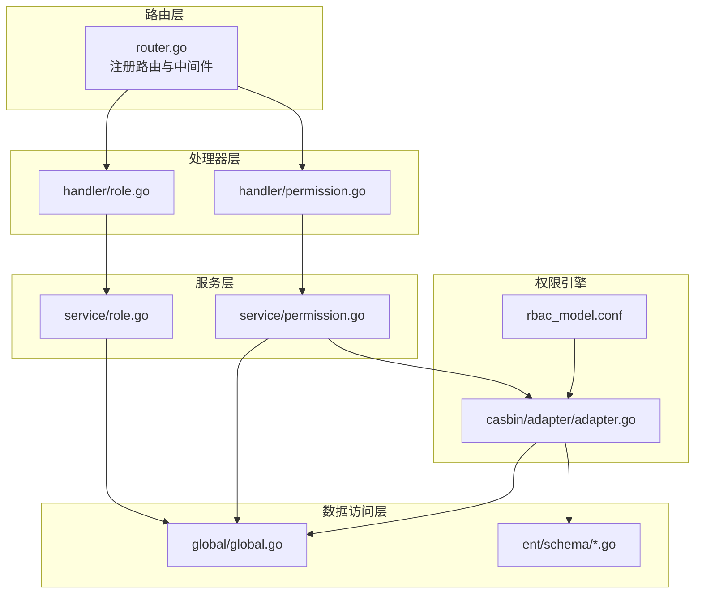
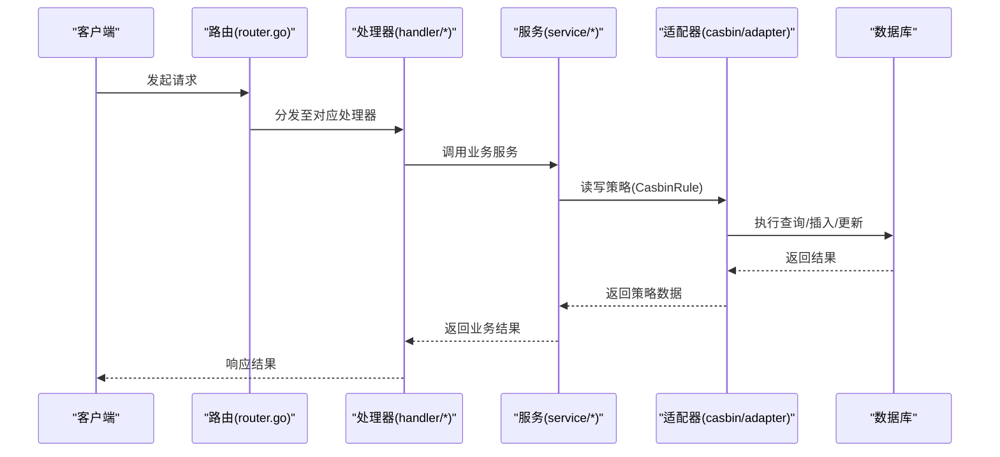
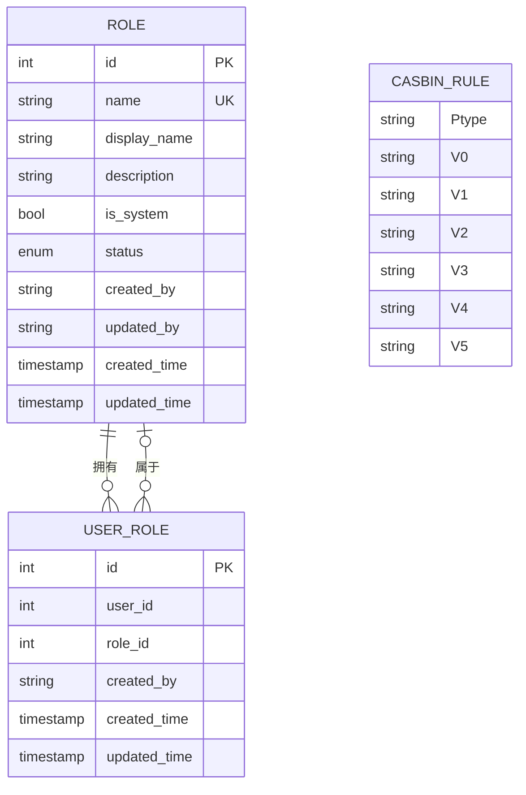
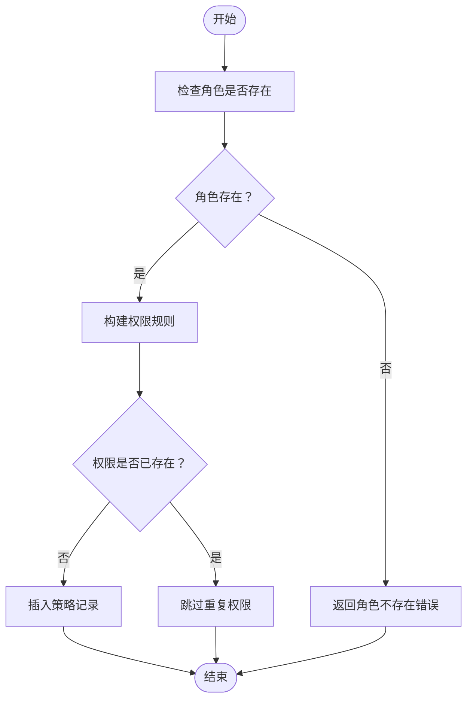
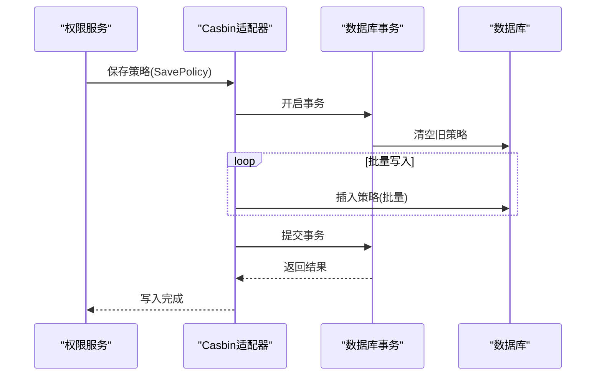
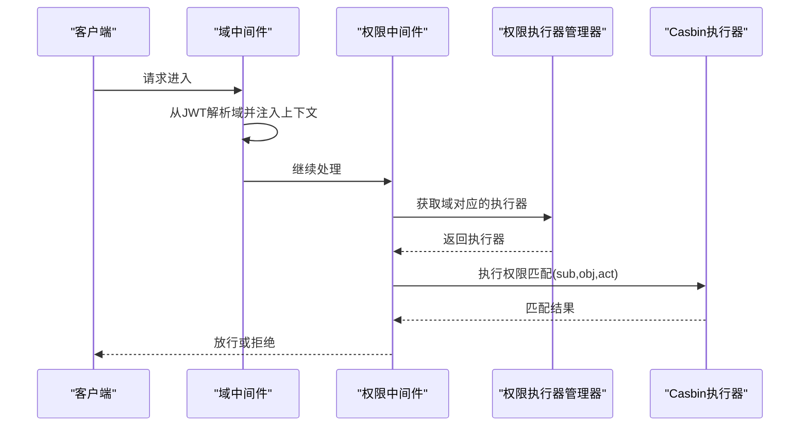
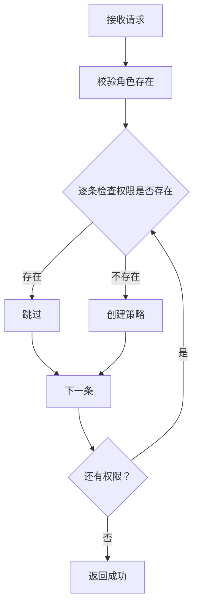
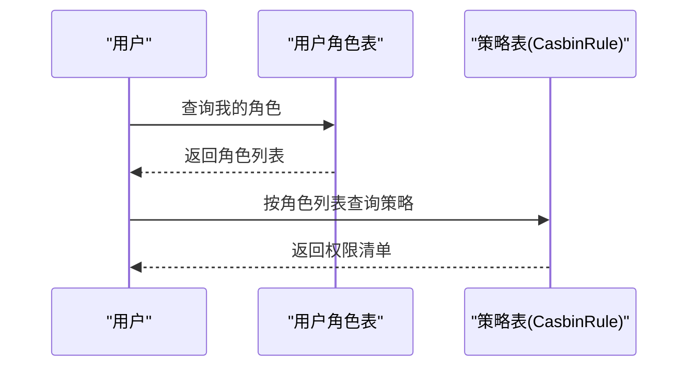
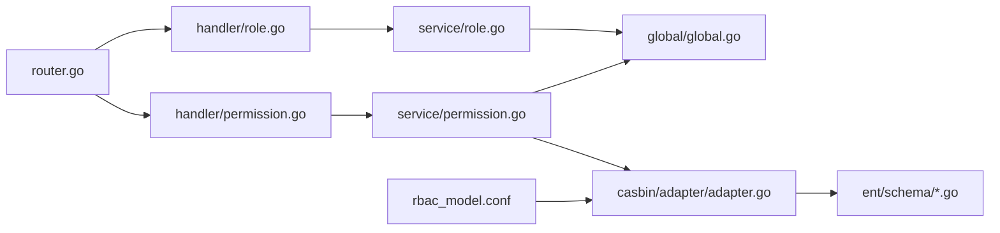

# 角色权限映射

<cite>
**本文引用的文件**
- [adapter.go](file://internal/casbin/adapter/adapter.go)
- [role.go](file://internal/service/role.go)
- [permission.go](file://internal/service/permission.go)
- [permission.go](file://internal/middleware/permission.go)
- [role.go](file://internal/handler/role.go)
- [permission.go](file://internal/handler/permission.go)
- [role.go](file://internal/ent/schema/role.go)
- [userrole.go](file://internal/ent/schema/userrole.go)
- [casbinrule.go](file://internal/ent/schema/casbinrule.go)
- [global.go](file://internal/global/global.go)
- [rbac_model.conf](file://config/rbac_model.conf)
- [router.go](file://internal/router.go)
- [init.go](file://internal/init.go)
</cite>

## 目录
1. [简介](#简介)
2. [项目结构](#项目结构)
3. [核心组件](#核心组件)
4. [架构总览](#架构总览)
5. [详细组件分析](#详细组件分析)
6. [依赖分析](#依赖分析)
7. [性能考虑](#性能考虑)
8. [故障排查指南](#故障排查指南)
9. [结论](#结论)
10. [附录](#附录)

## 简介
本文件围绕 Go Admin 管理系统中的“角色权限映射”主题，系统化阐述角色与权限的关联关系、映射机制、业务流程与实现逻辑；覆盖角色权限分配的批量操作与事务处理策略、用户角色查询与权限继承的实现原理、权限的动态加载与缓存机制、查询优化与索引策略、审计追踪与变更历史、批量导入导出能力、冲突检测与解决机制，并给出最佳实践与设计建议。

## 项目结构
系统采用分层架构：路由层负责请求接入与中间件装配；处理器层承接业务请求并调用服务层；服务层封装领域业务逻辑；数据访问层通过 Ent ORM 访问数据库；权限引擎通过 Casbin 执行策略匹配；全局模块统一注入 ORM 与权限执行器管理器。

图表来源
- [router.go:14-72](file://internal/router.go#L14-L72)
- [role.go:1-152](file://internal/handler/role.go#L1-L152)
- [permission.go:1-506](file://internal/handler/permission.go#L1-L506)
- [role.go:1-396](file://internal/service/role.go#L1-L396)
- [permission.go:1-671](file://internal/service/permission.go#L1-L671)
- [adapter.go:1-544](file://internal/casbin/adapter/adapter.go#L1-L544)
- [rbac_model.conf:1-15](file://config/rbac_model.conf#L1-L15)
- [global.go:10-14](file://internal/global/global.go#L10-L14)
- [role.go:1-73](file://internal/ent/schema/role.go#L1-L73)
- [userrole.go:1-56](file://internal/ent/schema/userrole.go#L1-L56)
- [casbinrule.go:1-37](file://internal/ent/schema/casbinrule.go#L1-L37)

章节来源
- [router.go:14-72](file://internal/router.go#L14-L72)
- [global.go:10-14](file://internal/global/global.go#L10-L14)

## 核心组件
- 角色服务：提供角色的增删改查、启停等生命周期管理。
- 权限服务：提供权限的创建、更新、删除、查询、角色权限分配/移除、用户权限查询与权限校验。
- Casbin 适配器：将策略持久化到数据库，支持批量写入、过滤加载、事务封装。
- 中间件：基于 JWT 的域中间件与权限中间件，统一进行权限校验。
- Ent Schema：定义角色、用户角色关联、策略规则的数据模型与索引。
- 全局注入：ORM 与权限执行器管理器在应用启动时初始化。

章节来源
- [role.go:25-396](file://internal/service/role.go#L25-L396)
- [permission.go:92-671](file://internal/service/permission.go#L92-L671)
- [adapter.go:43-544](file://internal/casbin/adapter/adapter.go#L43-L544)
- [permission.go:11-69](file://internal/middleware/permission.go#L11-L69)
- [role.go:10-73](file://internal/ent/schema/role.go#L10-L73)
- [userrole.go:11-56](file://internal/ent/schema/userrole.go#L11-L56)
- [casbinrule.go:9-37](file://internal/ent/schema/casbinrule.go#L9-L37)
- [global.go:10-14](file://internal/global/global.go#L10-L14)

## 架构总览
系统通过“路由 -> 处理器 -> 服务 -> 数据库/适配器”的链路完成角色权限映射的全生命周期管理。权限校验在中间件层统一拦截，利用 Casbin 执行器按域加载策略并进行匹配。

图表来源
- [router.go:14-72](file://internal/router.go#L14-L72)
- [role.go:1-152](file://internal/handler/role.go#L1-L152)
- [permission.go:1-506](file://internal/handler/permission.go#L1-L506)
- [role.go:94-396](file://internal/service/role.go#L94-L396)
- [permission.go:127-671](file://internal/service/permission.go#L127-L671)
- [adapter.go:115-544](file://internal/casbin/adapter/adapter.go#L115-L544)

## 详细组件分析

### 角色与用户角色映射
- 角色实体：包含名称、显示名、描述、系统内置标记、状态、创建/更新者等字段，并具备名称唯一索引与状态索引。
- 用户角色关联：多对多关系通过中间表维护，包含用户ID、角色ID及唯一约束，便于快速查询某用户的角色集合与某角色的用户集合。
- 用户权限查询：服务层通过用户角色表查询用户所拥有的全部角色名称，再基于这些角色名在策略表中查询其权限。

图表来源
- [role.go:16-66](file://internal/ent/schema/role.go#L16-L66)
- [userrole.go:17-49](file://internal/ent/schema/userrole.go#L17-L49)
- [casbinrule.go:15-36](file://internal/ent/schema/casbinrule.go#L15-L36)

章节来源
- [role.go:10-73](file://internal/ent/schema/role.go#L10-L73)
- [userrole.go:11-56](file://internal/ent/schema/userrole.go#L11-L56)
- [permission.go:466-600](file://internal/service/permission.go#L466-L600)

### 权限服务与策略存储
- 权限类型：API、菜单、按钮三类，通过策略表的第4列区分。
- 策略字段：Ptype、V0(角色)、V1(域)、V2(对象)、V3(动作)、V4(类型)、V5(描述)，形成唯一索引，确保策略唯一性。
- 业务操作：
  - 创建/更新/删除/查询权限：基于策略表的 CRUD。
  - 角色权限分配/移除：批量写入或删除策略。
  - 用户权限查询：先查用户角色，再按角色集合查询策略。
  - 权限校验：按用户角色集合与域、对象、动作进行匹配。

图表来源
- [permission.go:356-403](file://internal/service/permission.go#L356-L403)
- [casbinrule.go:15-36](file://internal/ent/schema/casbinrule.go#L15-L36)

章节来源
- [permission.go:127-433](file://internal/service/permission.go#L127-L433)
- [casbinrule.go:9-37](file://internal/ent/schema/casbinrule.go#L9-L37)

### Casbin 适配器与事务处理
- 适配器职责：将 Casbin 策略持久化到数据库，支持加载全部策略、按条件过滤加载、保存策略、批量插入、更新与删除策略。
- 事务封装：所有策略写入均在事务内执行，失败自动回滚，保证一致性。
- 批量策略写入：采用批量创建，提升大体量策略导入/同步的性能。

图表来源
- [adapter.go:177-214](file://internal/casbin/adapter/adapter.go#L177-L214)
- [adapter.go:304-325](file://internal/casbin/adapter/adapter.go#L304-L325)

章节来源
- [adapter.go:177-214](file://internal/casbin/adapter/adapter.go#L177-L214)
- [adapter.go:304-325](file://internal/casbin/adapter/adapter.go#L304-L325)

### 中间件与权限校验
- 域中间件：从 JWT 中提取域信息并注入上下文，供后续权限校验使用。
- 权限中间件：获取当前用户ID、域、请求路径与方法，调用权限执行器进行匹配，拒绝无权访问。

图表来源
- [permission.go:11-69](file://internal/middleware/permission.go#L11-L69)
- [global.go:10-14](file://internal/global/global.go#L10-L14)
- [init.go:49-65](file://internal/init.go#L49-L65)

章节来源
- [permission.go:11-69](file://internal/middleware/permission.go#L11-L69)
- [global.go:10-14](file://internal/global/global.go#L10-L14)
- [init.go:49-65](file://internal/init.go#L49-L65)

### 角色权限分配的业务流程
- 输入：角色名、域、权限规则数组（对象、动作）。
- 流程：校验角色存在 -> 逐条判断权限是否已存在 -> 不存在则创建策略 -> 成功返回。
- 并发与一致性：通过服务层逐条处理，结合适配器的事务保障，避免部分写入导致的不一致。

图表来源
- [permission.go:356-403](file://internal/service/permission.go#L356-L403)

章节来源
- [permission.go:356-403](file://internal/service/permission.go#L356-L403)

### 用户角色查询与权限继承
- 用户角色查询：通过用户角色表查询用户所拥有的全部角色名称。
- 权限继承：系统通过“用户角色集合 -> 策略查询”的方式实现权限继承，无需显式角色层级，天然支持多角色叠加权限。

图表来源
- [permission.go:466-600](file://internal/service/permission.go#L466-L600)
- [userrole.go:17-49](file://internal/ent/schema/userrole.go#L17-L49)

章节来源
- [permission.go:466-600](file://internal/service/permission.go#L466-L600)
- [userrole.go:11-56](file://internal/ent/schema/userrole.go#L11-L56)

### 动态加载与缓存机制
- 动态加载：系统启动时初始化 Casbin 执行器管理器，按需加载策略；运行时可通过适配器加载过滤后的策略。
- 缓存策略：建议在业务层对常用角色权限进行缓存（如 Redis），结合策略变更事件触发失效，降低数据库压力。

章节来源
- [init.go:49-65](file://internal/init.go#L49-L65)
- [adapter.go:115-175](file://internal/casbin/adapter/adapter.go#L115-L175)

### 查询优化与索引策略
- 策略表唯一索引：Ptype+V0+V1+V2+V3+V4+V5，确保策略唯一性，加速精确匹配。
- 角色表索引：name 唯一索引、status 索引，支持角色检索与状态筛选。
- 用户角色表索引：user_id、role_id 及联合唯一索引，支撑用户角色查询与去重。

章节来源
- [casbinrule.go:32-36](file://internal/ent/schema/casbinrule.go#L32-L36)
- [role.go:61-66](file://internal/ent/schema/role.go#L61-L66)
- [userrole.go:43-49](file://internal/ent/schema/userrole.go#L43-L49)

### 审计追踪与变更历史
- 建议在策略表增加审计字段（如 created_by、updated_by、created_at、updated_at）以记录策略变更历史。
- 对关键操作（角色创建/删除、权限分配/移除、角色启停）增加日志记录与审计事件，便于追踪与回溯。

章节来源
- [casbinrule.go:15-24](file://internal/ent/schema/casbinrule.go#L15-L24)
- [role.go:35-49](file://internal/ent/schema/role.go#L35-L49)

### 批量导入导出功能
- 导入：通过批量创建策略接口，按角色、域、对象、动作、类型批量写入。
- 导出：按角色或域筛选策略，输出为结构化数据（如 JSON/CSV），便于迁移与备份。
- 注意：导入时应先校验角色存在性与权限唯一性，避免重复与错误。

章节来源
- [permission.go:356-403](file://internal/service/permission.go#L356-L403)
- [permission.go:286-354](file://internal/service/permission.go#L286-L354)

### 冲突检测与解决机制
- 冲突场景：同一角色在同一域对同一对象同一动作重复授权；不同角色对同一对象同一动作产生互斥策略。
- 检测：在创建前查询策略是否存在；在批量导入时预先去重。
- 解决：优先级策略（如 allow/deny 效果）与规则顺序；必要时提供更新覆盖或删除冲突项后再创建。

章节来源
- [permission.go:127-174](file://internal/service/permission.go#L127-L174)
- [adapter.go:455-509](file://internal/casbin/adapter/adapter.go#L455-L509)

## 依赖分析
- 路由依赖：路由层依赖处理器层；处理器层依赖服务层；服务层依赖全局 ORM 与权限执行器管理器；权限执行器依赖 Casbin 适配器与策略表。
- 数据模型：角色与用户角色通过中间表建立多对多关系；策略表承载权限规则。
- 权限模型：rbac_model.conf 定义了请求、策略、角色关系与匹配器，决定权限校验的语义。

图表来源
- [router.go:14-72](file://internal/router.go#L14-L72)
- [role.go:1-152](file://internal/handler/role.go#L1-L152)
- [permission.go:1-506](file://internal/handler/permission.go#L1-L506)
- [role.go:1-396](file://internal/service/role.go#L1-L396)
- [permission.go:1-671](file://internal/service/permission.go#L1-L671)
- [adapter.go:1-544](file://internal/casbin/adapter/adapter.go#L1-L544)
- [global.go:10-14](file://internal/global/global.go#L10-L14)
- [rbac_model.conf:1-15](file://config/rbac_model.conf#L1-L15)

章节来源
- [router.go:14-72](file://internal/router.go#L14-L72)
- [role.go:1-396](file://internal/service/role.go#L1-L396)
- [permission.go:1-671](file://internal/service/permission.go#L1-L671)
- [adapter.go:1-544](file://internal/casbin/adapter/adapter.go#L1-L544)
- [rbac_model.conf:1-15](file://config/rbac_model.conf#L1-L15)

## 性能考虑
- 批量写入：策略保存采用批量创建，减少往返次数；建议根据数据规模调整批次大小。
- 事务边界：所有策略写入置于事务中，失败回滚，避免脏数据。
- 索引优化：策略表唯一索引、角色表索引、用户角色表索引，有助于精确查询与去重。
- 缓存策略：对热点角色权限进行缓存，结合失效策略降低数据库压力。
- 中间件性能：权限中间件仅做最小必要查询，避免复杂计算；可考虑将常用权限预热到本地缓存。

章节来源
- [adapter.go:177-214](file://internal/casbin/adapter/adapter.go#L177-L214)
- [adapter.go:304-325](file://internal/casbin/adapter/adapter.go#L304-L325)
- [casbinrule.go:32-36](file://internal/ent/schema/casbinrule.go#L32-L36)
- [role.go:61-66](file://internal/ent/schema/role.go#L61-L66)
- [userrole.go:43-49](file://internal/ent/schema/userrole.go#L43-L49)

## 故障排查指南
- 角色不存在：创建/更新/删除角色时若角色不存在，返回相应错误；请先确认角色已创建。
- 权限已存在：创建权限时若策略已存在，返回重复错误；请先删除旧策略或更新。
- 权限校验失败：中间件返回 403 或 401，检查 JWT 是否包含域信息、用户是否具有对应角色、策略是否正确加载。
- 事务异常：保存策略失败时会自动回滚；检查数据库连接与权限、并发写入冲突。
- 策略未生效：确认策略已保存且执行器已按域加载；检查 rbac_model.conf 的匹配器配置。

章节来源
- [role.go:94-396](file://internal/service/role.go#L94-L396)
- [permission.go:127-263](file://internal/service/permission.go#L127-L263)
- [permission.go:11-69](file://internal/middleware/permission.go#L11-L69)
- [adapter.go:304-325](file://internal/casbin/adapter/adapter.go#L304-L325)
- [rbac_model.conf:1-15](file://config/rbac_model.conf#L1-L15)

## 结论
本系统通过“角色-用户角色-策略表”的清晰映射与 Casbin 执行器的强匹配能力，实现了灵活、可扩展的角色权限体系。配合事务与批量写入、完善的索引与中间件拦截，满足高并发下的权限校验需求。建议进一步完善审计与缓存策略，持续优化查询与导入导出体验。

## 附录
- 最佳实践
  - 严格控制角色命名与域划分，避免策略歧义。
  - 在批量导入前进行去重与冲突检测。
  - 对热点角色权限进行缓存，定期失效刷新。
  - 审计字段与变更日志完善，便于问题定位与合规审计。
  - 使用中间件统一拦截，确保权限校验的一致性与可靠性。