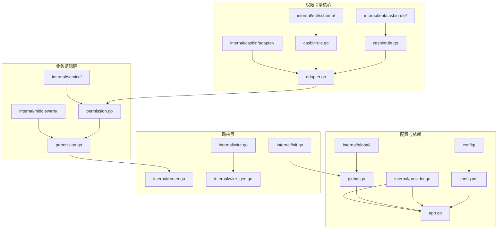
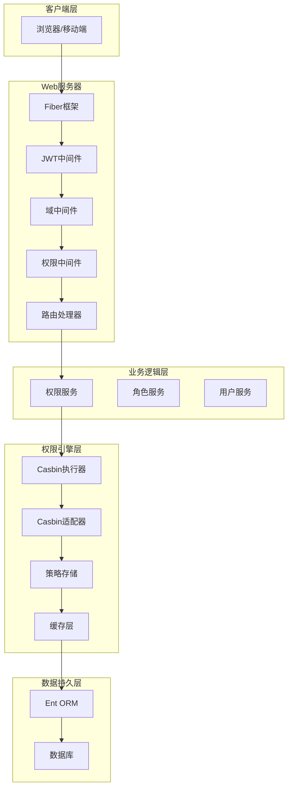
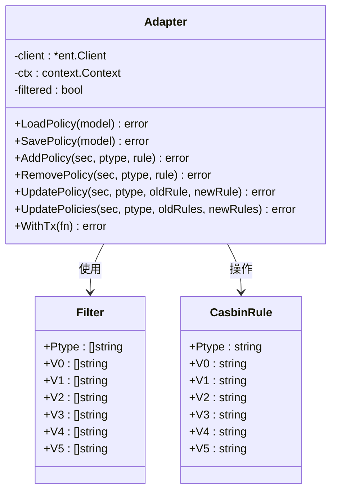
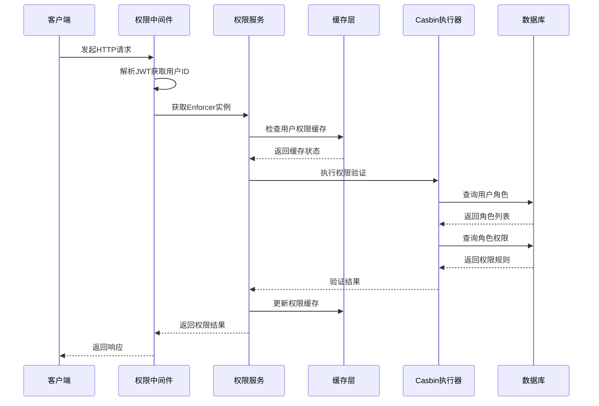
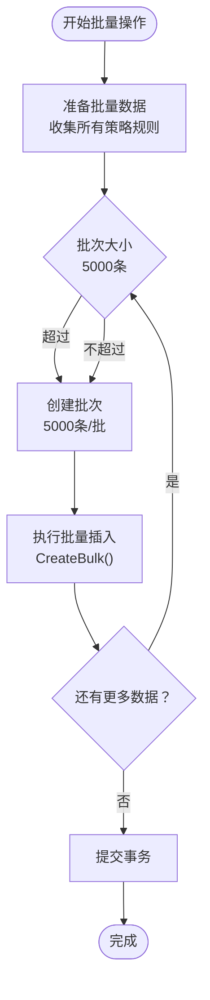
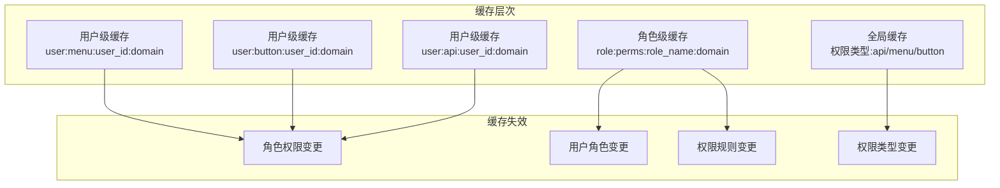
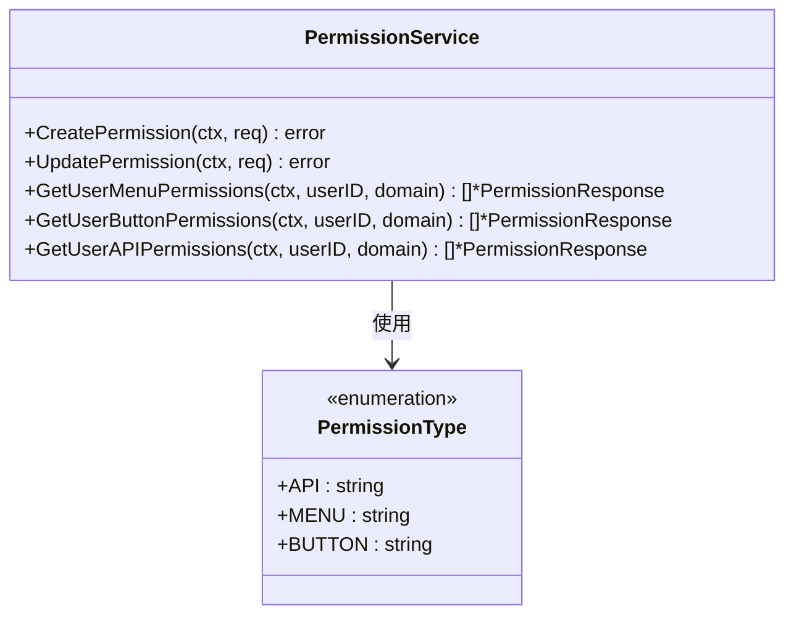
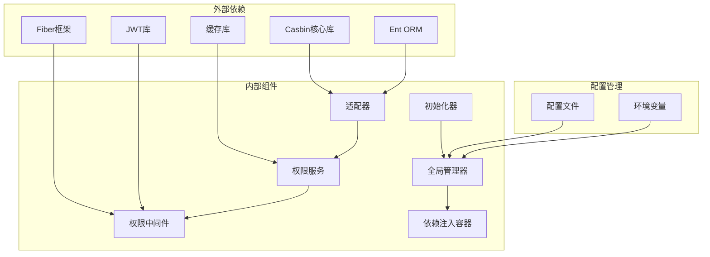
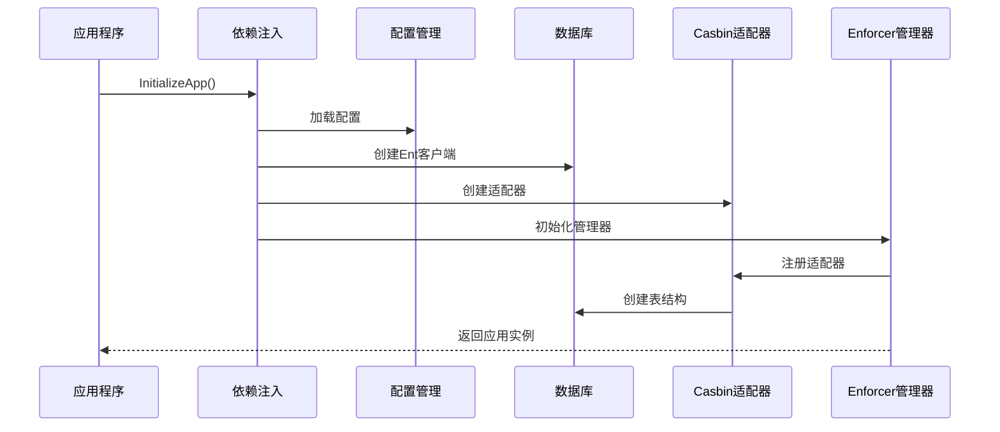

# Casbin权限引擎集成

<cite>
**本文档引用的文件**
- [adapter.go](file://internal/casbin/adapter/adapter.go)
- [casbinrule.go](file://internal/ent/schema/casbinrule.go)
- [casbinrule.go](file://internal/ent/casbinrule/casbinrule.go)
- [permission.go](file://internal/middleware/permission.go)
- [permission.go](file://internal/service/permission.go)
- [global.go](file://internal/global/global.go)
- [provider.go](file://internal/provider.go)
- [app.go](file://internal/app.go)
- [config.yml](file://config/config.yml)
- [router.go](file://internal/router.go)
- [init.go](file://internal/init.go)
- [wire.go](file://internal/wire.go)
- [wire_gen.go](file://internal/wire_gen.go)
</cite>

## 更新摘要
**变更内容**
- 更新了Casbin规则实体的表名映射（从单数到复数）
- 新增了增强的权限管理能力，支持API、菜单、按钮三种权限类型
- 改进了缓存策略和批量操作机制
- 更新了依赖注入和初始化流程

## 目录
1. [简介](#简介)
2. [项目结构](#项目结构)
3. [核心组件](#核心组件)
4. [架构概览](#架构概览)
5. [详细组件分析](#详细组件分析)
6. [依赖关系分析](#依赖关系分析)
7. [性能考虑](#性能考虑)
8. [故障排除指南](#故障排除指南)
9. [结论](#结论)
10. [附录](#附录)

## 简介

本文档详细介绍了Go Admin项目中Casbin权限引擎的完整集成方案。Casbin是一个功能强大的开源权限管理引擎，支持多种权限模型（RBAC、ABAC等）。在本项目中，我们通过自定义适配器将Ent ORM的数据模型无缝映射到Casbin的策略存储结构，实现了高效的企业级权限控制。

项目采用多域架构设计，支持不同业务域的独立权限模型配置，同时集成了完整的权限验证中间件和策略管理功能。最新的架构改进包括增强的权限类型管理和优化的缓存策略。

## 项目结构

Go Admin项目采用模块化架构，Casbin集成主要分布在以下目录：



**图表来源**
- [adapter.go:1-544](file://internal/casbin/adapter/adapter.go#L1-L544)
- [casbinrule.go:1-37](file://internal/ent/schema/casbinrule.go#L1-L37)
- [permission.go:1-829](file://internal/service/permission.go#L1-L829)

**章节来源**
- [adapter.go:1-544](file://internal/casbin/adapter/adapter.go#L1-L544)
- [config.yml:1-143](file://config/config.yml#L1-L143)

## 核心组件

### Casbin适配器（Adapter）

自定义适配器是Casbin与Ent ORM集成的关键组件，负责将Casbin的策略存储抽象映射到数据库表结构。

**适配器特性：**
- 支持事务处理确保数据一致性
- 实现批量操作优化性能
- 提供过滤查询功能
- 支持完整的CRUD操作
- **新增** 支持更新策略操作（UpdatePolicy、UpdatePolicies）

**核心功能：**
- 策略加载与保存
- 过滤策略查询
- 批量策略操作
- 事务安全保证
- **新增** 策略更新和批量更新

**章节来源**
- [adapter.go:43-113](file://internal/casbin/adapter/adapter.go#L43-L113)
- [adapter.go:115-175](file://internal/casbin/adapter/adapter.go#L115-L175)
- [adapter.go:401-453](file://internal/casbin/adapter/adapter.go#L401-L453)

### Ent ORM模型

Ent ORM提供了强类型的数据库模型定义，确保编译时的类型安全。

**模型特点：**
- 字段长度限制（100字符）
- 唯一索引约束
- 类型安全的查询构建
- 关系映射支持
- **更新** 表名从 `casbin_rule` 改为 `casbin_rules`

**章节来源**
- [casbinrule.go:14-36](file://internal/ent/schema/casbinrule.go#L14-L36)
- [casbinrule.go:32-36](file://internal/ent/schema/casbinrule.go#L32-L36)

### 权限服务

权限服务封装了完整的权限管理业务逻辑，包括权限验证、用户权限查询等功能。

**服务功能：**
- 用户权限验证
- 角色权限管理
- 用户权限查询
- 缓存优化策略
- **新增** 支持API、菜单、按钮三种权限类型
- **新增** 增强的缓存失效机制

**章节来源**
- [permission.go:118-134](file://internal/service/permission.go#L118-L134)
- [permission.go:28-38](file://internal/service/permission.go#L28-L38)

## 架构概览



**图表来源**
- [permission.go:14-78](file://internal/middleware/permission.go#L14-L78)
- [provider.go:35-43](file://internal/provider.go#L35-L43)
- [global.go:11-16](file://internal/global/global.go#L11-L16)

## 详细组件分析

### Casbin适配器实现

#### 数据结构映射

Casbin适配器将Ent ORM的模型映射到Casbin的策略存储格式：



**图表来源**
- [adapter.go:43-58](file://internal/casbin/adapter/adapter.go#L43-L58)
- [adapter.go:349-373](file://internal/casbin/adapter/adapter.go#L349-L373)

#### 策略存储机制

策略表（CasbinRule）采用扁平化存储设计，每个策略规则占用一行记录：

| 字段名 | 类型 | 描述 | 索引 |
|--------|------|------|------|
| Ptype | string | 策略类型（p/g） | 是 |
| V0 | string | 主体/角色标识 | 是 |
| V1 | string | 域/租户标识 | 是 |
| V2 | string | 对象/资源标识 | 是 |
| V3 | string | 操作/动作标识 | 是 |
| V4 | string | 权限类型（api/menu/button） | 是 |
| V5 | string | 描述信息 | 是 |

**更新** 表名从 `casbin_rule` 改为 `casbin_rules`，支持复数形式的表结构

**章节来源**
- [casbinrule.go:17-24](file://internal/ent/schema/casbinrule.go#L17-L24)
- [casbinrule.go:32-36](file://internal/ent/schema/casbinrule.go#L32-L36)

### 权限验证流程



**图表来源**
- [permission.go:14-78](file://internal/middleware/permission.go#L14-L78)
- [permission.go:736-773](file://internal/service/permission.go#L736-L773)

**章节来源**
- [permission.go:57-76](file://internal/middleware/permission.go#L57-L76)

### 批量操作优化

适配器实现了高效的批量操作机制：



**图表来源**
- [adapter.go:199-213](file://internal/casbin/adapter/adapter.go#L199-L213)

**章节来源**
- [adapter.go:177-214](file://internal/casbin/adapter/adapter.go#L177-L214)

### 缓存策略

权限服务实现了多层次的缓存机制：



**图表来源**
- [permission.go:136-187](file://internal/service/permission.go#L136-L187)

**章节来源**
- [permission.go:146-187](file://internal/service/permission.go#L146-L187)

### 权限类型管理

**新增** 权限服务现在支持三种权限类型：



**图表来源**
- [permission.go:28-38](file://internal/service/permission.go#L28-L38)

**章节来源**
- [permission.go:28-38](file://internal/service/permission.go#L28-L38)

## 依赖关系分析

### 组件依赖图



**图表来源**
- [provider.go:35-43](file://internal/provider.go#L35-L43)
- [global.go:11-16](file://internal/global/global.go#L11-L16)

### 依赖注入流程



**图表来源**
- [provider.go:22-43](file://internal/provider.go#L22-L43)
- [wire.go:22-37](file://internal/wire.go#L22-L37)

**章节来源**
- [provider.go:17-43](file://internal/provider.go#L17-L43)
- [wire.go:1-37](file://internal/wire.go#L1-L37)

## 性能考虑

### 查询优化策略

1. **索引优化**
   - 唯一索引覆盖常用查询条件
   - 复合索引支持多字段过滤
   - 避免全表扫描

2. **批量操作**
   - 批次大小优化（5000条）
   - 事务边界控制
   - 内存使用平衡

3. **缓存策略**
   - 用户权限缓存（5分钟TTL）
   - 角色权限缓存
   - 缓存失效机制
   - **新增** 权限类型缓存

### 并发处理

- 事务隔离级别设置
- 死锁检测与重试
- 连接池管理

## 故障排除指南

### 常见问题及解决方案

**权限验证失败**
- 检查JWT令牌有效性
- 验证用户角色分配
- 确认权限规则存在

**数据库连接问题**
- 检查数据库配置
- 验证连接池状态
- 查看SQL执行日志

**缓存失效异常**
- 清理相关缓存键
- 检查缓存后端状态
- 验证缓存TTL设置

**章节来源**
- [permission.go:19-41](file://internal/middleware/permission.go#L19-L41)

### 调试技巧

1. **启用详细日志**
   ```yaml
   log:
     level: debug
     file_output: true
   ```

2. **监控指标收集**
   - 请求延迟分布
   - 错误率统计
   - 缓存命中率

3. **性能分析**
   - SQL查询分析
   - 缓存性能测试
   - 并发压力测试

## 结论

Go Admin项目中的Casbin权限引擎集成展现了现代企业级权限管理的最佳实践。通过自定义适配器实现了数据库与权限引擎的无缝集成，配合Ent ORM的强类型特性和完善的缓存策略，提供了高性能、可扩展的权限控制解决方案。

**最新架构改进的优势：**
- **类型安全**：编译时检查减少运行时错误
- **性能优化**：批量操作和缓存机制提升响应速度
- **可扩展性**：多域架构支持复杂业务场景
- **易维护性**：清晰的代码结构和完善的测试覆盖
- **权限细化**：支持API、菜单、按钮三种权限类型
- **缓存优化**：多层次缓存策略提升性能

## 附录

### 配置示例

```yaml
casbin:
  # 默认域名称，GetDefaultEnforcer() 将返回此域的 Enforcer
  domains_default: 'default'
  
  # 多域配置列表（可选）
  # 如果不配置此项，系统会使用上面的 model_path 为默认域创建配置
  domains:
    # 默认域配置
    - name: "default"
      auto_load: true                          # 是否在启动时自动加载
      model_text: |                            # 带域的 RBAC 模型配置
        [request_definition]
        r = sub, dom, obj, act
        
        [policy_definition]
        p = sub, dom, obj, act
        
        [role_definition]
        g = _, _, _
        
        [policy_effect]
        e = some(where (p.eft == allow))
        
        [matchers]
        m = g(r.sub, p.sub, r.dom) && r.dom == p.dom && (r.obj == p.obj || p.obj == "*") && (r.act == p.act || p.act == "*")
    
    # ==================== 多域配置示例 ====================
    # 可以为不同的租户或业务域配置独立的权限模型
    
    # 示例：租户 A 的配置
    # - name: "tenant-a"
    #   auto_load: true
    #   model_path: "./config/tenant_a_model.conf"
    
    # 示例：租户 B 的配置（使用内联模型文本）
    # - name: "tenant-b"
    #   auto_load: false  # 不自动加载，首次使用时才加载
    #   model_text: |
    #     [request_definition]
    #     r = sub, obj, act
    #     
    #     [policy_definition]
    #     p = sub, obj, act
    #     
    #     [role_definition]
    #     g = _, _
    #     
    #     [policy_effect]
    #     e = some(where (p.eft == allow))
    #     
    #     [matchers]
    #     m = g(r.sub, p.sub) && r.obj == p.obj && r.act == p.act
```

### 集成步骤

1. **初始化配置**：配置Casbin域和模型
2. **创建适配器**：初始化数据库连接
3. **注册管理器**：设置Enforcer管理器
4. **配置中间件**：添加权限验证中间件
5. **测试验证**：验证权限控制功能
6. **缓存配置**：设置缓存策略和失效机制