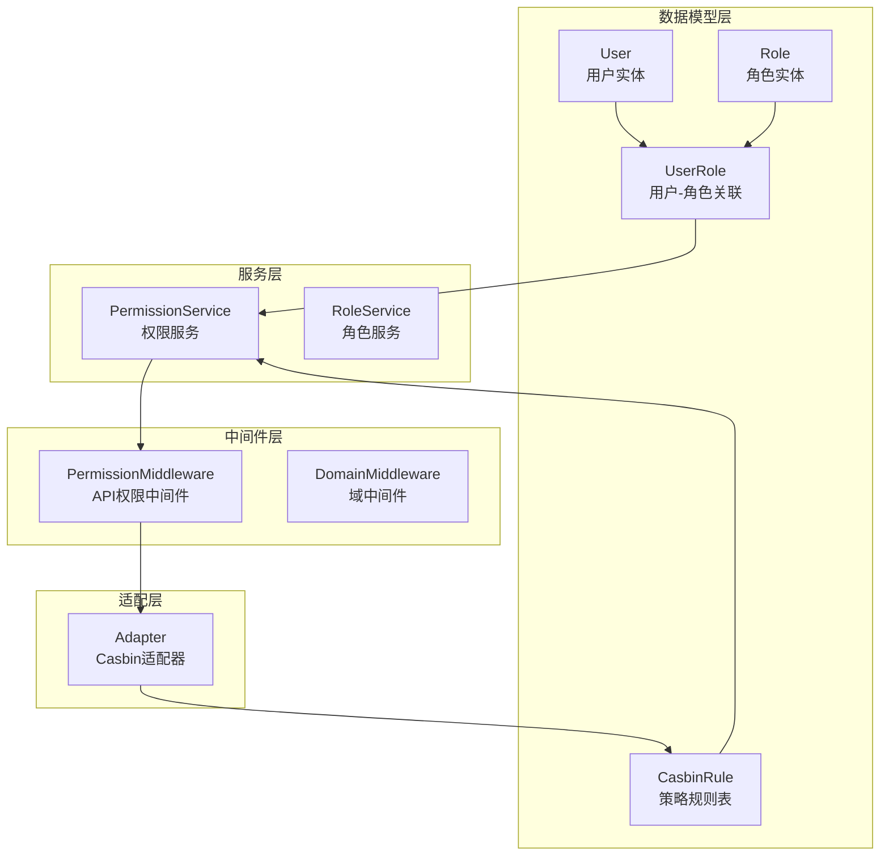
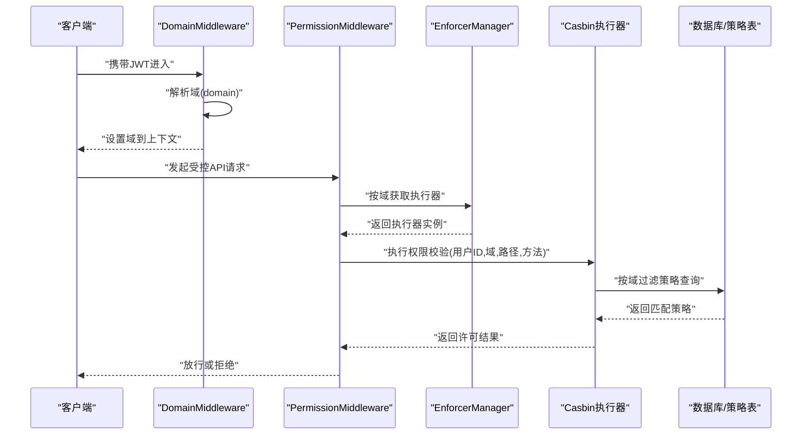
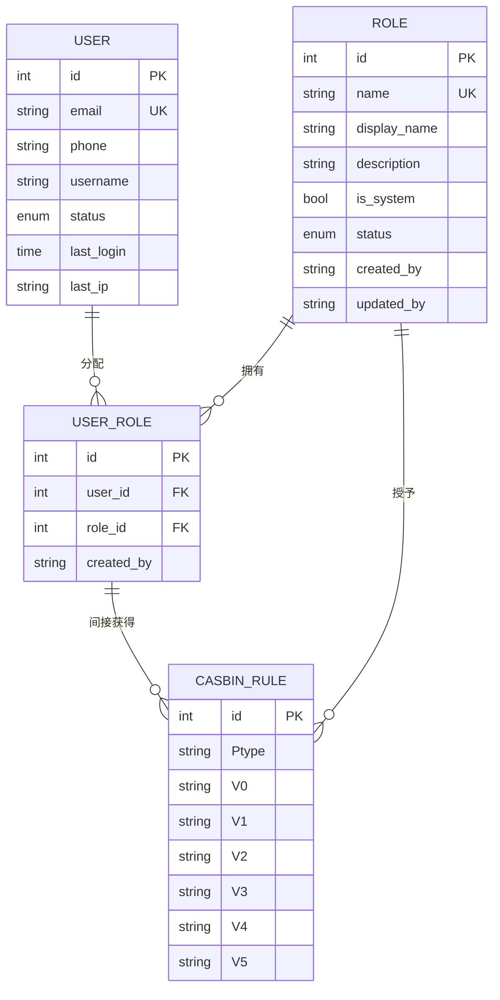
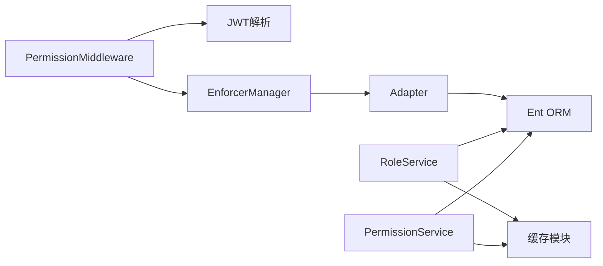

# RBAC模型设计

<cite>
**本文档引用的文件**
- [user.go](file://internal/ent/schema/user.go)
- [role.go](file://internal/ent/schema/role.go)
- [casbinrule.go](file://internal/ent/schema/casbinrule.go)
- [userrole.go](file://internal/ent/schema/userrole.go)
- [permission.go](file://internal/service/permission.go)
- [role.go](file://internal/service/role.go)
- [permission.go](file://internal/middleware/permission.go)
- [adapter.go](file://internal/casbin/adapter/adapter.go)
- [global.go](file://internal/global/global.go)
- [casbinrule.go](file://internal/ent/casbinrule.go)
- [user.go](file://internal/ent/user.go)
- [role.go](file://internal/ent/role.go)
- [userrole.go](file://internal/ent/userrole.go)
</cite>

## 目录
1. [引言](#引言)
2. [项目结构](#项目结构)
3. [核心组件](#核心组件)
4. [架构总览](#架构总览)
5. [详细组件分析](#详细组件分析)
6. [依赖分析](#依赖分析)
7. [性能考虑](#性能考虑)
8. [故障排查指南](#故障排查指南)
9. [结论](#结论)
10. [附录](#附录)

## 引言
本文件系统化阐述本项目的基于角色的访问控制（RBAC）权限模型设计，重点覆盖以下方面：
- 用户(User)、角色(Role)、权限(Permission)的三层关系设计与多对多映射
- 多租户域(domain)隔离与权限匹配
- 权限类型(API、菜单、按钮)的分类体系与策略存储
- 基于Casbin的策略适配与中间件集成
- 实体关系图与数据模型设计说明
- 为什么选择RBAC模型及相较其他模型的优势
- 典型业务场景下的角色层级与权限分配策略建议

## 项目结构
围绕RBAC模型，系统采用分层架构：
- 数据模型层：通过Ent定义User、Role、UserRole、CasbinRule等实体与索引
- 服务层：封装角色与权限的增删改查、缓存与批量操作
- 中间件层：在API入口进行权限校验，结合Casbin执行器
- 适配层：将Ent模型与Casbin策略表打通，支持过滤加载与事务写入

图表来源
- [user.go:17-104](file://internal/ent/schema/user.go#L17-L104)
- [role.go:10-73](file://internal/ent/schema/role.go#L10-L73)
- [userrole.go:11-56](file://internal/ent/schema/userrole.go#L11-L56)
- [casbinrule.go:9-37](file://internal/ent/schema/casbinrule.go#L9-L37)
- [permission.go:118-134](file://internal/service/permission.go#L118-L134)
- [role.go:41-56](file://internal/service/role.go#L41-L56)
- [permission.go:14-78](file://internal/middleware/permission.go#L14-L78)
- [adapter.go:43-95](file://internal/casbin/adapter/adapter.go#L43-L95)

章节来源
- [user.go:17-104](file://internal/ent/schema/user.go#L17-L104)
- [role.go:10-73](file://internal/ent/schema/role.go#L10-L73)
- [userrole.go:11-56](file://internal/ent/schema/userrole.go#L11-L56)
- [casbinrule.go:9-37](file://internal/ent/schema/casbinrule.go#L9-L37)
- [permission.go:118-134](file://internal/service/permission.go#L118-L134)
- [role.go:41-56](file://internal/service/role.go#L41-L56)
- [permission.go:14-78](file://internal/middleware/permission.go#L14-L78)
- [adapter.go:43-95](file://internal/casbin/adapter/adapter.go#L43-L95)

## 核心组件
- 用户(User)：承载身份凭证与基础属性，通过UserRole与角色建立多对多关系
- 角色(Role)：抽象权限集合，支持系统内置与状态管理
- 用户-角色(UserRole)：桥接表，记录用户与角色的分配关系及分配者
- 策略规则(CasbinRule)：持久化的策略表，存储“角色-域-对象-动作-类型-描述”五元组
- 权限服务(PermissionService)：负责权限的创建、更新、删除、查询与缓存清理
- 角色服务(RoleService)：负责角色的创建、查询、更新、启停与缓存清理
- 中间件(PermissionMiddleware/DomainMiddleware)：在请求链路中进行域解析与权限校验
- 适配器(Adapter)：将Ent模型与Casbin策略表双向映射，支持批量写入与过滤加载

章节来源
- [user.go:23-80](file://internal/ent/schema/user.go#L23-L80)
- [role.go:16-50](file://internal/ent/schema/role.go#L16-L50)
- [userrole.go:17-31](file://internal/ent/schema/userrole.go#L17-L31)
- [casbinrule.go:15-24](file://internal/ent/schema/casbinrule.go#L15-L24)
- [permission.go:118-134](file://internal/service/permission.go#L118-L134)
- [role.go:41-56](file://internal/service/role.go#L41-L56)
- [permission.go:14-78](file://internal/middleware/permission.go#L14-L78)
- [adapter.go:43-95](file://internal/casbin/adapter/adapter.go#L43-L95)

## 架构总览
下图展示了从HTTP请求到权限决策的完整流程，以及数据持久化与缓存策略：

图表来源
- [permission.go:14-78](file://internal/middleware/permission.go#L14-L78)
- [global.go:11-16](file://internal/global/global.go#L11-L16)
- [adapter.go:115-175](file://internal/casbin/adapter/adapter.go#L115-L175)

## 详细组件分析

### 数据模型与ER图
- 用户(User)：包含邮箱、密码、姓名、状态等字段；索引覆盖邮箱/手机/用户名
- 角色(Role)：包含名称、显示名、描述、系统内置标记、状态；索引覆盖名称唯一与状态
- 用户-角色(UserRole)：多对多桥接，字段含用户ID、角色ID、分配者；复合唯一索引避免重复
- 策略规则(CasbinRule)：Ptype/V0-V5构成策略字段，唯一索引确保策略唯一性

图表来源
- [user.go:23-96](file://internal/ent/schema/user.go#L23-L96)
- [role.go:16-65](file://internal/ent/schema/role.go#L16-L65)
- [userrole.go:17-48](file://internal/ent/schema/userrole.go#L17-L48)
- [casbinrule.go:15-35](file://internal/ent/schema/casbinrule.go#L15-L35)

章节来源
- [user.go:23-96](file://internal/ent/schema/user.go#L23-L96)
- [role.go:16-65](file://internal/ent/schema/role.go#L16-L65)
- [userrole.go:17-48](file://internal/ent/schema/userrole.go#L17-L48)
- [casbinrule.go:15-35](file://internal/ent/schema/casbinrule.go#L15-L35)

### 权限类型与策略存储
- 权限类型：API、菜单、按钮，分别对应不同的动作语义
- 策略字段映射：
  - V0：角色名
  - V1：域(domain)
  - V2：对象(object)，如API路径、菜单路径、按钮标识
  - V3：动作(action)，如HTTP方法、menu、button
  - V4：类型(type)，api/menu/button
  - V5：描述(description)
- 服务层提供创建、更新、删除、列表、按角色查询等能力，并在变更时清理相关缓存

章节来源
- [permission.go:27-86](file://internal/service/permission.go#L27-L86)
- [permission.go:189-334](file://internal/service/permission.go#L189-L334)
- [permission.go:512-556](file://internal/service/permission.go#L512-L556)

### 角色与权限的多对多映射
- 用户通过UserRole与多个角色关联，角色通过CasbinRule与多个权限关联
- 权限查询时，先获取用户所有角色名，再在指定域内查询对应策略
- 支持按菜单、按钮、API三类分别查询，便于前端渲染与鉴权

章节来源
- [userrole.go:35-39](file://internal/ent/schema/userrole.go#L35-L39)
- [permission.go:558-734](file://internal/service/permission.go#L558-L734)

### 多租户域(domain)隔离
- 域作为策略维度之一，贯穿中间件、服务与适配层
- 中间件从JWT中提取域并注入上下文，随后在权限校验时以域过滤策略
- 适配器支持按域过滤加载策略，保证不同域的策略相互隔离

章节来源
- [permission.go:46-76](file://internal/middleware/permission.go#L46-L76)
- [adapter.go:127-170](file://internal/casbin/adapter/adapter.go#L127-L170)
- [permission.go:512-556](file://internal/service/permission.go#L512-L556)

### 缓存与性能优化
- 用户级缓存：按用户+域+类型（菜单/按钮/API）缓存权限结果，默认5分钟过期
- 角色级缓存：按角色+域缓存角色权限，减少重复查询
- 缓存失效：当角色或权限发生变更时，清除相关用户与角色缓存，保证一致性

章节来源
- [permission.go:136-187](file://internal/service/permission.go#L136-L187)
- [role.go:58-72](file://internal/service/role.go#L58-L72)

### 中间件与执行器集成
- DomainMiddleware：从JWT中读取域并写入上下文
- PermissionMiddleware：获取用户ID与域，调用全局执行器管理器按域获取执行器，执行Enforce(user,domain,path,method)
- 执行器来自适配器，策略表按域过滤加载，确保跨域隔离

章节来源
- [permission.go:14-78](file://internal/middleware/permission.go#L14-L78)
- [global.go:11-16](file://internal/global/global.go#L11-L16)
- [adapter.go:115-175](file://internal/casbin/adapter/adapter.go#L115-L175)

### 适配器与策略持久化
- 适配器负责：
  - 加载全部策略或按Filter加载（支持Ptype/V0-V5过滤）
  - 保存策略（事务内清空后批量写入）
  - 新增/删除/更新策略
  - 批量新增/删除/更新策略
- 通过Ent的事务封装，保证策略写入的一致性

章节来源
- [adapter.go:115-325](file://internal/casbin/adapter/adapter.go#L115-L325)
- [adapter.go:401-520](file://internal/casbin/adapter/adapter.go#L401-L520)

### 服务层接口与实现要点
- 权限服务：
  - 权限CRUD与列表查询
  - 角色权限分配/移除
  - 用户各类权限查询（菜单/按钮/API）
  - 权限校验
- 角色服务：
  - 角色CRUD与状态管理
  - 系统内置角色保护与状态限制
  - 变更时清理相关用户缓存

章节来源
- [permission.go:95-116](file://internal/service/permission.go#L95-L116)
- [role.go:27-39](file://internal/service/role.go#L27-L39)

## 依赖分析
- 组件耦合：
  - 服务层依赖Ent ORM与缓存模块
  - 中间件依赖JWT解析与全局执行器管理器
  - 适配器依赖Ent客户端与Casbin模型
- 外部依赖：
  - Casbin执行器与模型
  - Fiber框架中间件生态
  - Ent ORM与SQL驱动

图表来源
- [permission.go:118-134](file://internal/service/permission.go#L118-L134)
- [role.go:41-56](file://internal/service/role.go#L41-L56)
- [permission.go:14-78](file://internal/middleware/permission.go#L14-L78)
- [global.go:11-16](file://internal/global/global.go#L11-L16)
- [adapter.go:43-95](file://internal/casbin/adapter/adapter.go#L43-L95)

章节来源
- [permission.go:118-134](file://internal/service/permission.go#L118-L134)
- [role.go:41-56](file://internal/service/role.go#L41-L56)
- [permission.go:14-78](file://internal/middleware/permission.go#L14-L78)
- [global.go:11-16](file://internal/global/global.go#L11-L16)
- [adapter.go:43-95](file://internal/casbin/adapter/adapter.go#L43-L95)

## 性能考虑
- 查询路径优化：
  - 使用WithRole预加载用户角色，减少N+1查询
  - 对角色名集合进行IN查询，降低多次查询成本
- 缓存策略：
  - 用户权限缓存按域与类型细分，命中率高且失效粒度细
  - 角色权限缓存用于批量查询场景
- 写入路径优化：
  - 适配器使用事务与批量插入，提升策略写入吞吐
- 索引设计：
  - 用户/角色/策略表均设置必要索引，保障高频查询性能

章节来源
- [permission.go:570-574](file://internal/service/permission.go#L570-L574)
- [permission.go:512-556](file://internal/service/permission.go#L512-L556)
- [adapter.go:177-214](file://internal/casbin/adapter/adapter.go#L177-L214)

## 故障排查指南
- 常见错误与定位：
  - 角色不存在/权限不存在：检查角色创建与权限分配流程
  - 权限类型无效：确认类型枚举与action推断逻辑
  - JWT缺失域信息：检查DomainMiddleware是否正确注入域
  - 执行器获取失败：检查全局执行器管理器初始化与域配置
- 排查步骤建议：
  - 核对JWT中域字段与中间件注入链路
  - 在服务层打印用户角色名集合与策略查询条件
  - 检查策略表唯一索引冲突与缓存键拼接
  - 验证适配器过滤加载是否按域生效

章节来源
- [permission.go:19-25](file://internal/service/permission.go#L19-L25)
- [permission.go:46-76](file://internal/middleware/permission.go#L46-L76)
- [adapter.go:127-170](file://internal/casbin/adapter/adapter.go#L127-L170)

## 结论
本RBAC模型通过清晰的三层关系与多租户域隔离，结合Casbin策略表与中间件执行器，实现了灵活、可扩展、高性能的权限控制方案。其优势在于：
- 结构清晰：用户-角色-权限层次分明，易于维护与扩展
- 隔离性强：域维度天然隔离，适合多租户场景
- 性能友好：缓存与批量写入策略兼顾读写效率
- 可观测性：策略表结构直观，便于审计与排错

## 附录

### 业务场景示例与策略设计建议
- 场景一：平台管理员与租户管理员
  - 设计：平台管理员角色（全平台域）与租户管理员角色（特定域）
  - 策略：前者授予全局API权限，后者仅授予域内API权限
- 场景二：菜单与按钮权限分离
  - 设计：菜单权限用于导航可见性，按钮权限用于交互可用性
  - 策略：菜单/按钮类型分别存储，前端按需拉取
- 场景三：动态权限与灰度发布
  - 设计：通过批量分配/移除权限快速回滚
  - 策略：利用适配器批量写入与缓存失效机制

### 为什么选择RBAC模型
- 相比 DAC/MAC：
  - 更易管理与理解，策略集中存储，便于审计
- 相比ABAC：
  - RBAC提供稳定的基线权限，ABAC适用于复杂条件判断，二者可组合使用
- 本项目优势：
  - 基于Casbin的成熟策略引擎，支持多种策略模型扩展
  - Ent ORM提供强类型与高性能的数据访问
  - 中间件与执行器解耦，便于横向扩展与多域部署