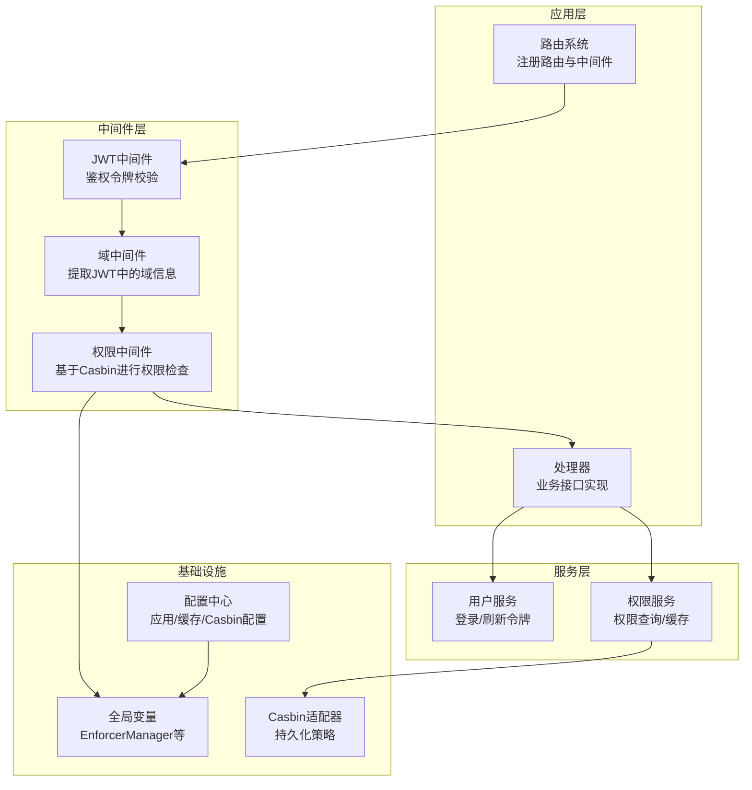
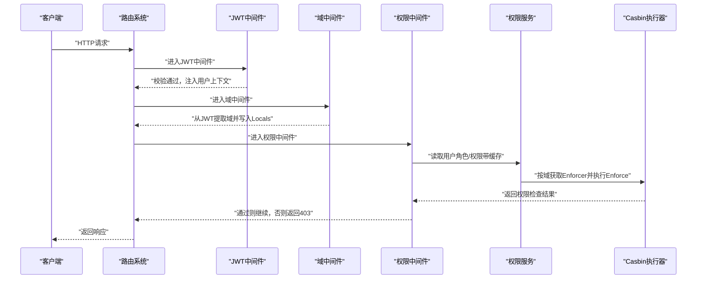
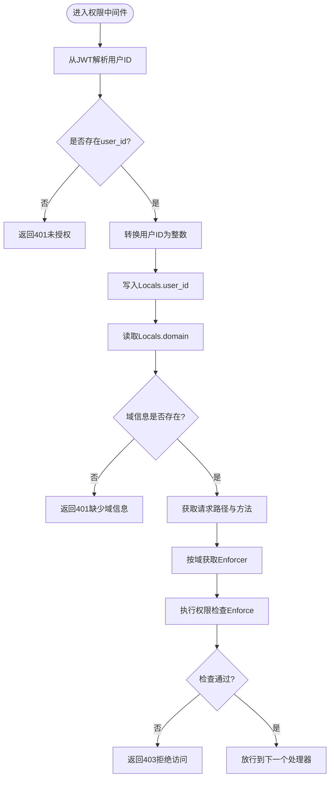
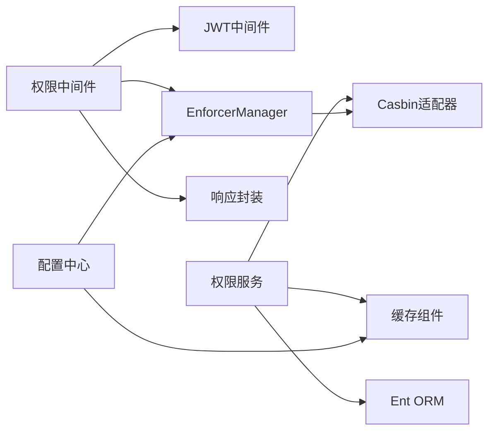

# 权限中间件实现

<cite>
**本文档引用的文件**
- [internal/middleware/permission.go](file://internal/middleware/permission.go)
- [internal/router.go](file://internal/router.go)
- [internal/app.go](file://internal/app.go)
- [internal/provider.go](file://internal/provider.go)
- [internal/global/global.go](file://internal/global/global.go)
- [internal/global/msg.go](file://internal/global/msg.go)
- [internal/utils/response.go](file://internal/utils/response.go)
- [internal/casbin/adapter/adapter.go](file://internal/casbin/adapter/adapter.go)
- [config/config.yml](file://config/config.yml)
- [internal/handler/public.go](file://internal/handler/public.go)
- [internal/handler/permission.go](file://internal/handler/permission.go)
</cite>

## 目录
1. [简介](#简介)
2. [项目结构](#项目结构)
3. [核心组件](#核心组件)
4. [架构总览](#架构总览)
5. [详细组件分析](#详细组件分析)
6. [依赖关系分析](#依赖关系分析)
7. [性能考虑](#性能考虑)
8. [故障排查指南](#故障排查指南)
9. [结论](#结论)
10. [附录](#附录)

## 简介
本文件面向开发者与运维人员，系统性阐述权限中间件的实现与使用，重点覆盖以下方面：
- JWT认证中间件与权限验证中间件的工作流程与执行顺序
- 请求拦截、用户身份解析、权限检查与响应处理的完整过程
- 错误处理机制与性能优化策略
- 权限缓存策略设计（用户权限缓存、角色权限缓存与全局权限缓存）
- 中间件配置示例与在不同场景下的使用方式（API接口保护、页面访问控制、按钮权限验证）
- 性能监控与调试技巧
- 与路由系统的集成方式与最佳实践

## 项目结构
权限中间件位于中间件层，配合路由系统、JWT中间件、Casbin执行器以及服务层共同完成权限控制。核心文件与职责如下：
- 中间件层：权限中间件与域中间件
- 路由层：路由注册与中间件挂载顺序
- 服务层：权限服务与用户服务（含JWT令牌发放与刷新）
- 配置层：应用配置、缓存配置、Casbin多域配置
- 全局与工具：全局变量、响应封装、Casbin适配器

**图表来源**
- [internal/router.go:16-149](file://internal/router.go#L16-L149)
- [internal/middleware/permission.go:14-93](file://internal/middleware/permission.go#L14-L93)
- [internal/app.go:15-26](file://internal/app.go#L15-L26)
- [internal/provider.go:35-43](file://internal/provider.go#L35-L43)
- [internal/casbin/adapter/adapter.go:115-125](file://internal/casbin/adapter/adapter.go#L115-L125)

**章节来源**
- [internal/router.go:16-149](file://internal/router.go#L16-L149)
- [internal/middleware/permission.go:14-93](file://internal/middleware/permission.go#L14-L93)
- [internal/app.go:15-26](file://internal/app.go#L15-L26)
- [internal/provider.go:35-43](file://internal/provider.go#L35-L43)
- [internal/casbin/adapter/adapter.go:115-125](file://internal/casbin/adapter/adapter.go#L115-L125)

## 核心组件
- 权限中间件（PermissionMiddleware）：从JWT中解析用户ID，从Locals中读取域信息，调用Casbin执行器进行权限校验，通过后放行。
- 域中间件（DomainMiddleware）：从JWT中提取域信息并写入Locals，供权限中间件使用。
- 路由系统：在特定路由组上挂载JWT中间件、域中间件与权限中间件，形成统一的鉴权链路。
- 权限服务：提供用户权限查询、角色权限查询与缓存清理能力；内部实现用户/角色权限的缓存策略。
- Casbin执行器：根据域动态获取对应Enforcer，执行权限匹配。

**章节来源**
- [internal/middleware/permission.go:14-93](file://internal/middleware/permission.go#L14-L93)
- [internal/router.go:52-59](file://internal/router.go#L52-L59)
- [internal/service/permission.go:118-134](file://internal/service/permission.go#L118-L134)
- [internal/global/global.go:11-16](file://internal/global/global.go#L11-L16)

## 架构总览
权限中间件与JWT中间件协同工作，形成“先认证、后授权”的标准流程。JWT中间件负责令牌校验，域中间件负责提取域信息，权限中间件负责基于Casbin的细粒度权限控制。

**图表来源**
- [internal/router.go:52-59](file://internal/router.go#L52-L59)
- [internal/middleware/permission.go:14-93](file://internal/middleware/permission.go#L14-L93)
- [internal/service/permission.go:558-734](file://internal/service/permission.go#L558-L734)

## 详细组件分析

### 权限中间件（PermissionMiddleware）
- 功能要点
  - 从JWT中解析用户ID，支持多种数值类型与字符串类型转换
  - 将用户ID写入Locals，供后续处理器使用
  - 从Locals读取域信息，若缺失则直接返回未授权
  - 从请求上下文中获取路径与方法
  - 通过全局EnforcerManager按域获取对应执行器
  - 调用Enforce进行权限校验，失败返回403，成功放行

- 执行流程图

**图表来源**
- [internal/middleware/permission.go:14-93](file://internal/middleware/permission.go#L14-L93)

**章节来源**
- [internal/middleware/permission.go:14-93](file://internal/middleware/permission.go#L14-L93)

### 域中间件（DomainMiddleware）
- 功能要点
  - 从JWT中提取域信息
  - 若缺失或为空，返回未授权
  - 将域写入Locals，供权限中间件使用

**章节来源**
- [internal/middleware/permission.go:80-93](file://internal/middleware/permission.go#L80-L93)

### 路由系统与中间件挂载
- 在/admin/auth路由组上，按顺序挂载：
  - JWT中间件（鉴权）
  - 域中间件（提取域）
  - 权限中间件（权限检查）
- 该顺序确保：只有通过JWT校验的请求才能进入域解析与权限检查阶段

**章节来源**
- [internal/router.go:52-59](file://internal/router.go#L52-L59)

### 权限服务与缓存策略
- 缓存键设计
  - 用户权限缓存键：user:{type}:{userID}:{domain}
  - 角色权限缓存键：role:perms:{roleName}:{domain}
- 缓存过期时间：默认5分钟
- 缓存清理策略
  - 角色权限变更时，清除该角色与该域下的权限缓存
  - 用户角色变更时，清除该用户在该域下的所有权限缓存
  - 支持批量清理，避免脏数据

- 关键实现位置
  - 缓存键生成与TTL：[internal/service/permission.go:136-144](file://internal/service/permission.go#L136-L144)
  - 用户权限缓存清理：[internal/service/permission.go:146-154](file://internal/service/permission.go#L146-L154)
  - 角色权限缓存清理：[internal/service/permission.go:156-162](file://internal/service/permission.go#L156-L162)
  - 角色与用户联动清理：[internal/service/permission.go:164-187](file://internal/service/permission.go#L164-L187)
  - 用户菜单权限查询（含缓存）：[internal/service/permission.go:558-615](file://internal/service/permission.go#L558-L615)
  - 用户按钮权限查询（含缓存）：[internal/service/permission.go:617-674](file://internal/service/permission.go#L617-L674)
  - 用户API权限查询（含缓存）：[internal/service/permission.go:676-734](file://internal/service/permission.go#L676-L734)
  - 角色权限查询（含缓存）：[internal/service/permission.go:512-556](file://internal/service/permission.go#L512-L556)

**章节来源**
- [internal/service/permission.go:118-134](file://internal/service/permission.go#L118-L134)
- [internal/service/permission.go:136-187](file://internal/service/permission.go#L136-L187)
- [internal/service/permission.go:512-734](file://internal/service/permission.go#L512-L734)

### Casbin执行器与适配器
- 执行器管理
  - 通过全局EnforcerManager按域获取对应执行器
  - 支持多域配置，域默认名称来自配置
- 适配器
  - 基于Ent ORM持久化策略，支持批量写入与事务保证
  - 提供过滤加载、保存策略、增删改查等能力

**章节来源**
- [internal/global/global.go:11-16](file://internal/global/global.go#L11-L16)
- [internal/casbin/adapter/adapter.go:115-125](file://internal/casbin/adapter/adapter.go#L115-L125)
- [config/config.yml:77-143](file://config/config.yml#L77-L143)

### JWT与令牌刷新
- 登录接口：接收用户名/密码，返回访问令牌与刷新令牌
- 刷新令牌：校验刷新令牌有效性，签发新的访问令牌
- 令牌声明包含：用户ID、用户主体、域、过期时间、签发时间、令牌类型等

**章节来源**
- [internal/handler/public.go:19-60](file://internal/handler/public.go#L19-L60)
- [internal/handler/public.go:180-213](file://internal/handler/public.go#L180-L213)

## 依赖关系分析
- 中间件依赖
  - 权限中间件依赖JWT中间件提供的用户上下文与域信息
  - 权限中间件依赖全局EnforcerManager按域获取执行器
- 服务依赖
  - 权限服务依赖Ent ORM与Casbin适配器
  - 权限服务依赖缓存组件（可选）
- 配置依赖
  - Casbin多域配置决定执行器初始化与自动加载策略
  - 缓存配置决定权限服务的缓存行为

**图表来源**
- [internal/middleware/permission.go:14-93](file://internal/middleware/permission.go#L14-L93)
- [internal/service/permission.go:118-134](file://internal/service/permission.go#L118-L134)
- [internal/casbin/adapter/adapter.go:115-125](file://internal/casbin/adapter/adapter.go#L115-L125)
- [config/config.yml:77-143](file://config/config.yml#L77-L143)

**章节来源**
- [internal/middleware/permission.go:14-93](file://internal/middleware/permission.go#L14-L93)
- [internal/service/permission.go:118-134](file://internal/service/permission.go#L118-L134)
- [internal/casbin/adapter/adapter.go:115-125](file://internal/casbin/adapter/adapter.go#L115-L125)
- [config/config.yml:77-143](file://config/config.yml#L77-L143)

## 性能考虑
- 缓存策略
  - 用户权限缓存：针对菜单、按钮、API三类权限分别缓存，键空间隔离，避免跨类型污染
  - 角色权限缓存：缓存角色拥有的全部权限，减少重复查询
  - 缓存过期：默认5分钟，兼顾实时性与性能
  - 清理策略：权限变更时主动清理相关缓存，保证一致性
- 数据库访问
  - 用户权限查询使用预加载（eager loading）一次性获取角色，降低N+1查询风险
  - Casbin规则查询使用精确条件过滤，避免全表扫描
- 执行器管理
  - 多域执行器按需获取，建议高频域开启自动加载以减少首次延迟
- 响应封装
  - 统一响应结构，便于前端处理与日志记录

**章节来源**
- [internal/service/permission.go:136-187](file://internal/service/permission.go#L136-L187)
- [internal/service/permission.go:558-734](file://internal/service/permission.go#L558-L734)
- [config/config.yml:77-143](file://config/config.yml#L77-L143)

## 故障排查指南
- 常见错误与定位
  - 401未授权：JWT缺失或无效；检查请求头Authorization与令牌签名
  - 401缺少域信息：JWT中未包含域字段；检查令牌声明中的domain字段
  - 403拒绝访问：权限检查失败；检查Casbin规则与用户角色映射
  - 500内部错误：执行器获取失败或权限检查异常；检查EnforcerManager与数据库连接
- 调试建议
  - 开启请求日志中间件，观察中间件执行顺序与响应状态
  - 在权限中间件前后打印关键上下文（用户ID、域、路径、方法）
  - 检查缓存命中情况，确认缓存键与TTL设置
  - 校验Casbin规则是否正确导入与过滤加载
- 错误码与消息
  - 统一错误码与消息映射，便于前端一致化提示

**章节来源**
- [internal/middleware/permission.go:14-93](file://internal/middleware/permission.go#L14-L93)
- [internal/global/msg.go:4-84](file://internal/global/msg.go#L4-L84)
- [internal/utils/response.go:9-50](file://internal/utils/response.go#L9-L50)

## 结论
本权限中间件实现以JWT为基础、以Casbin为核心，结合服务层缓存与路由层中间件挂载，构建了高可用、可扩展的权限控制体系。通过明确的执行顺序、完善的错误处理与缓存策略，能够在保障安全的同时兼顾性能。建议在生产环境中启用多域自动加载、合理设置缓存TTL，并持续监控执行器与缓存命中率。

## 附录

### 中间件配置示例与使用场景
- API接口保护
  - 在/admin/auth路由组上挂载JWT中间件、域中间件与权限中间件，确保所有子接口均受保护
  - 参考：[internal/router.go:52-59](file://internal/router.go#L52-L59)
- 页面访问控制
  - 前端在访问页面前携带访问令牌；后端通过权限中间件校验用户对该页面的菜单权限
  - 参考：用户菜单权限查询接口与权限服务实现
- 按钮权限验证
  - 前端根据按钮权限动态显示/隐藏按钮；后端通过权限中间件校验用户对该按钮的操作权限
  - 参考：用户按钮权限查询接口与权限服务实现
- 刷新令牌
  - 使用刷新令牌换取新的访问令牌，保持会话连续性
  - 参考：[internal/handler/public.go:180-213](file://internal/handler/public.go#L180-L213)

### 中间件执行顺序与最佳实践
- 执行顺序
  - JWT中间件 → 域中间件 → 权限中间件 → 业务处理器
- 最佳实践
  - 明确域划分，按租户或业务域隔离权限
  - 合理设置缓存TTL，平衡实时性与性能
  - 权限变更后及时清理缓存，避免脏读
  - 对高频域开启自动加载，减少首次请求延迟