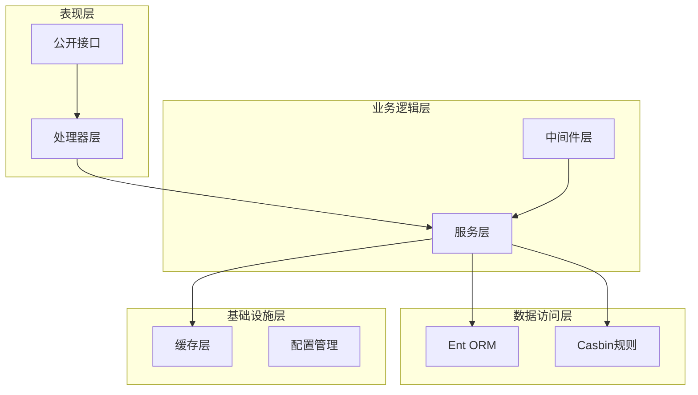
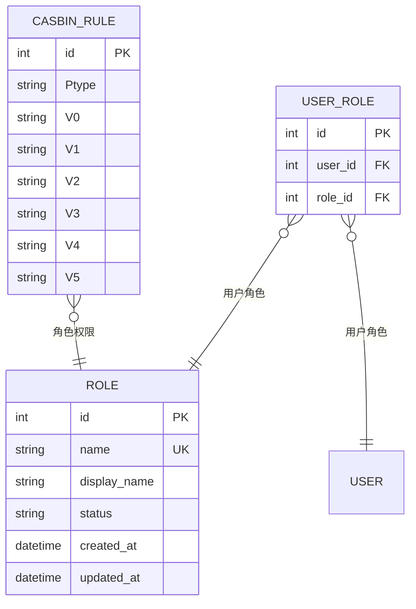
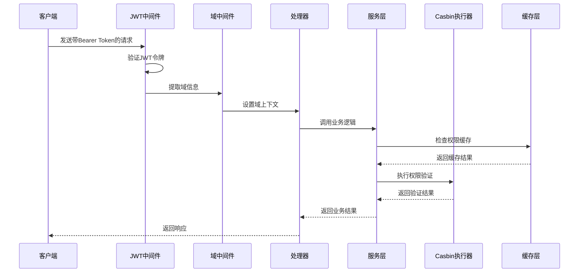
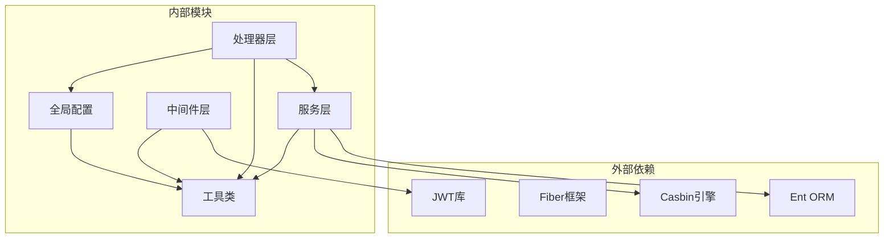

# 权限服务API

<cite>
**本文档引用的文件**
- [internal/handler/permission.go](file://internal/handler/permission.go)
- [internal/service/permission.go](file://internal/service/permission.go)
- [internal/middleware/permission.go](file://internal/middleware/permission.go)
- [internal/router.go](file://internal/router.go)
- [docs/swagger.yaml](file://docs/swagger.yaml)
- [internal/utils/response.go](file://internal/utils/response.go)
- [internal/global/msg.go](file://internal/global/msg.go)
- [internal/ent/schema/casbinrule.go](file://internal/ent/schema/casbinrule.go)
- [internal/ent/casbinrule.go](file://internal/ent/casbinrule.go)
- [internal/service/permission_test.go](file://internal/service/permission_test.go)
</cite>

## 目录
1. [简介](#简介)
2. [项目结构](#项目结构)
3. [核心组件](#核心组件)
4. [架构概览](#架构概览)
5. [详细组件分析](#详细组件分析)
6. [依赖关系分析](#依赖关系分析)
7. [性能考虑](#性能考虑)
8. [故障排除指南](#故障排除指南)
9. [结论](#结论)
10. [附录](#附录)

## 简介

权限服务API是一个基于RBAC（基于角色的访问控制）模型的权限管理系统，采用Casbin作为权限引擎。该系统提供了完整的权限管理功能，包括权限的增删改查、角色权限分配、用户权限查询等核心功能。系统支持三种权限类型：API权限、菜单权限和按钮权限，能够满足现代Web应用的复杂权限需求。

## 项目结构

权限服务API采用分层架构设计，主要包含以下层次：



**图表来源**
- [internal/router.go:16-150](file://internal/router.go#L16-L150)
- [internal/handler/permission.go:1-571](file://internal/handler/permission.go#L1-L571)

**章节来源**
- [internal/router.go:16-150](file://internal/router.go#L16-L150)
- [internal/handler/permission.go:1-571](file://internal/handler/permission.go#L1-L571)

## 核心组件

### 权限类型定义

系统支持三种权限类型，每种类型都有特定的用途和验证方式：

| 权限类型 | 描述 | 动作值 | 用途 |
|---------|------|--------|------|
| API权限 | 控制API接口访问 | HTTP方法(GET, POST, PUT, DELETE等) | RESTful API接口控制 |
| 菜单权限 | 控制页面菜单显示 | "menu" | 前端菜单导航控制 |
| 按钮权限 | 控制按钮操作权限 | "button" | 前端按钮显示和交互控制 |

### 数据模型

权限数据采用Casbin规则表存储，具有以下字段结构：



**图表来源**
- [internal/ent/schema/casbinrule.go:10-36](file://internal/ent/schema/casbinrule.go#L10-L36)
- [internal/ent/casbinrule.go:14-34](file://internal/ent/casbinrule.go#L14-L34)

**章节来源**
- [internal/service/permission.go:27-86](file://internal/service/permission.go#L27-L86)
- [internal/ent/schema/casbinrule.go:10-36](file://internal/ent/schema/casbinrule.go#L10-L36)

## 架构概览

权限服务采用中间件驱动的权限验证架构，通过JWT令牌传递用户身份信息和域信息。



**图表来源**
- [internal/middleware/permission.go:14-78](file://internal/middleware/permission.go#L14-L78)
- [internal/router.go:52-59](file://internal/router.go#L52-L59)

**章节来源**
- [internal/middleware/permission.go:14-78](file://internal/middleware/permission.go#L14-L78)
- [internal/router.go:52-59](file://internal/router.go#L52-L59)

## 详细组件分析

### 权限管理API

#### 创建权限

**接口定义**
- 方法: POST
- 路径: `/api/v1/admin/auth/permissions`
- 认证: Bearer Token
- 权限: 系统管理员

**请求参数**
| 参数名 | 类型 | 必填 | 描述 |
|-------|------|------|------|
| role_name | string | 是 | 角色名称 |
| domain | string | 是 | 域标识符 |
| type | enum | 是 | 权限类型(api/menu/button) |
| object | string | 是 | 权限对象(API路径/菜单路径/按钮标识) |
| action | string | 是 | 权限动作(HTTP方法/menu/button) |
| description | string | 否 | 权限描述 |

**响应格式**
```json
{
  "code": 1,
  "message": "权限创建成功",
  "data": null
}
```

**错误码**
- 400: 请求参数无效
- 401: 未授权访问
- 403: 拒绝访问
- 500: 内部服务器错误

**章节来源**
- [internal/handler/permission.go:14-60](file://internal/handler/permission.go#L14-L60)
- [docs/swagger.yaml:1845-1887](file://docs/swagger.yaml#L1845-L1887)

#### 更新权限

**接口定义**
- 方法: PUT
- 路径: `/api/v1/admin/auth/permissions`
- 认证: Bearer Token
- 权限: 系统管理员

**请求参数**
| 参数名 | 类型 | 必填 | 描述 |
|-------|------|------|------|
| role_name | string | 是 | 角色名称 |
| domain | string | 是 | 域标识符 |
| type | enum | 是 | 权限类型(api/menu/button) |
| object | string | 是 | 权限对象 |
| action | string | 是 | 权限动作 |
| new_object | string | 否 | 新的权限对象 |
| new_action | string | 否 | 新的权限动作 |
| description | string | 否 | 权限描述 |

**响应格式**
```json
{
  "code": 1,
  "message": "权限更新成功",
  "data": null
}
```

**错误码**
- 400: 请求参数无效
- 401: 未授权访问
- 403: 拒绝访问
- 500: 内部服务器错误

**章节来源**
- [internal/handler/permission.go:62-108](file://internal/handler/permission.go#L62-L108)
- [docs/swagger.yaml:1888-1930](file://docs/swagger.yaml#L1888-L1930)

#### 删除权限

**接口定义**
- 方法: DELETE
- 路径: `/api/v1/admin/auth/permissions`
- 认证: Bearer Token
- 权限: 系统管理员

**查询参数**
| 参数名 | 类型 | 必填 | 描述 |
|-------|------|------|------|
| role_name | string | 是 | 角色名称 |
| domain | string | 是 | 域标识符 |
| object | string | 是 | 权限对象 |
| action | string | 是 | 权限动作 |

**响应格式**
```json
{
  "code": 1,
  "message": "权限删除成功",
  "data": null
}
```

**错误码**
- 400: 请求参数无效
- 401: 未授权访问
- 403: 拒绝访问
- 500: 内部服务器错误

**章节来源**
- [internal/handler/permission.go:110-158](file://internal/handler/permission.go#L110-L158)
- [docs/swagger.yaml:1730-1786](file://docs/swagger.yaml#L1730-L1786)

#### 获取权限详情

**接口定义**
- 方法: GET
- 路径: `/api/v1/admin/auth/permissions/detail`
- 认证: Bearer Token
- 权限: 系统管理员

**查询参数**
| 参数名 | 类型 | 必填 | 描述 |
|-------|------|------|------|
| role_name | string | 是 | 角色名称 |
| domain | string | 是 | 域标识符 |
| object | string | 是 | 权限对象 |
| action | string | 是 | 权限动作 |

**响应格式**
```json
{
  "code": 1,
  "message": "获取权限详情成功",
  "data": {
    "id": 1,
    "role_name": "admin",
    "domain": "default",
    "type": "api",
    "object": "/api/users",
    "action": "GET",
    "description": "获取用户列表"
  }
}
```

**错误码**
- 400: 请求参数无效
- 401: 未授权访问
- 403: 拒绝访问
- 404: 资源不存在
- 500: 内部服务器错误

**章节来源**
- [internal/handler/permission.go:160-206](file://internal/handler/permission.go#L160-L206)
- [docs/swagger.yaml:1931-1993](file://docs/swagger.yaml#L1931-L1993)

#### 获取权限列表

**接口定义**
- 方法: GET
- 路径: `/api/v1/admin/auth/permissions`
- 认证: Bearer Token
- 权限: 系统管理员

**查询参数**
| 参数名 | 类型 | 必填 | 描述 | 默认值 |
|-------|------|------|------|--------|
| page | int | 否 | 页码 | 1 |
| page_size | int | 否 | 每页数量 | 10 |
| keyword | string | 否 | 关键字 | - |
| type | enum | 否 | 权限类型 | - |
| domain | string | 否 | 域标识符 | - |
| role_name | string | 否 | 角色名称 | - |

**响应格式**
```json
{
  "code": 1,
  "message": "获取权限列表成功",
  "data": {
    "total": 100,
    "page": 1,
    "data": [
      {
        "id": 1,
        "role_name": "admin",
        "domain": "default",
        "type": "api",
        "object": "/api/users",
        "action": "GET",
        "description": "获取用户列表"
      }
    ]
  }
}
```

**错误码**
- 401: 未授权访问
- 403: 拒绝访问
- 500: 内部服务器错误

**章节来源**
- [internal/handler/permission.go:208-257](file://internal/handler/permission.go#L208-L257)
- [docs/swagger.yaml:1787-1844](file://docs/swagger.yaml#L1787-L1844)

### 角色权限管理API

#### 为角色分配权限

**接口定义**
- 方法: POST
- 路径: `/api/v1/admin/auth/roles/permissions/assign`
- 认证: Bearer Token
- 权限: 系统管理员

**查询参数**
| 参数名 | 类型 | 必填 | 描述 |
|-------|------|------|------|
| role_name | string | 是 | 角色名称 |
| domain | string | 是 | 域标识符 |

**请求体**
```json
[
  {
    "object": "/api/users",
    "action": "GET"
  },
  {
    "object": "btn:create",
    "action": "button"
  }
]
```

**响应格式**
```json
{
  "code": 1,
  "message": "为角色分配权限成功",
  "data": null
}
```

**错误码**
- 400: 请求参数无效
- 401: 未授权访问
- 403: 拒绝访问
- 404: 角色不存在
- 500: 内部服务器错误

**章节来源**
- [internal/handler/permission.go:259-311](file://internal/handler/permission.go#L259-L311)
- [docs/swagger.yaml:2370-2429](file://docs/swagger.yaml#L2370-L2429)

#### 从角色移除权限

**接口定义**
- 方法: POST
- 路径: `/api/v1/admin/auth/roles/permissions/remove`
- 认证: Bearer Token
- 权限: 系统管理员

**查询参数**
| 参数名 | 类型 | 必填 | 描述 |
|-------|------|------|------|
| role_name | string | 是 | 角色名称 |
| domain | string | 是 | 域标识符 |

**请求体**
```json
[
  {
    "object": "/api/users",
    "action": "GET"
  },
  {
    "object": "btn:create",
    "action": "button"
  }
]
```

**响应格式**
```json
{
  "code": 1,
  "message": "从角色移除权限成功",
  "data": null
}
```

**错误码**
- 400: 请求参数无效
- 401: 未授权访问
- 403: 拒绝访问
- 404: 角色不存在
- 500: 内部服务器错误

**章节来源**
- [internal/handler/permission.go:313-365](file://internal/handler/permission.go#L313-L365)
- [docs/swagger.yaml:2430-2489](file://docs/swagger.yaml#L2430-L2489)

#### 获取角色权限

**接口定义**
- 方法: GET
- 路径: `/api/v1/admin/auth/roles/permissions`
- 认证: Bearer Token
- 权限: 系统管理员

**查询参数**
| 参数名 | 类型 | 必填 | 描述 |
|-------|------|------|------|
| role_name | string | 是 | 角色名称 |
| domain | string | 是 | 域标识符 |

**响应格式**
```json
{
  "code": 1,
  "message": "获取角色权限成功",
  "data": [
    {
      "id": 1,
      "role_name": "admin",
      "domain": "default",
      "type": "api",
      "object": "/api/users",
      "action": "GET",
      "description": "获取用户列表"
    }
  ]
}
```

**错误码**
- 400: 请求参数无效
- 401: 未授权访问
- 403: 拒绝访问
- 404: 角色不存在
- 500: 内部服务器错误

**章节来源**
- [internal/handler/permission.go:367-409](file://internal/handler/permission.go#L367-L409)
- [docs/swagger.yaml:2315-2369](file://docs/swagger.yaml#L2315-L2369)

### 用户权限查询API

#### 获取用户菜单权限

**接口定义**
- 方法: GET
- 路径: `/api/v1/admin/auth/user/menu-permissions`
- 认证: Bearer Token
- 权限: 已登录用户

**查询参数**
| 参数名 | 类型 | 必填 | 描述 | 默认值 |
|-------|------|------|------|--------|
| domain | string | 否 | 域标识符 | default |

**响应格式**
```json
{
  "code": 1,
  "message": "获取用户菜单权限成功",
  "data": [
    {
      "id": 1,
      "role_name": "admin",
      "domain": "default",
      "type": "menu",
      "object": "/dashboard",
      "action": "menu",
      "description": "仪表板"
    }
  ]
}
```

**错误码**
- 401: 未授权访问
- 403: 拒绝访问
- 500: 内部服务器错误

**章节来源**
- [internal/handler/permission.go:411-444](file://internal/handler/permission.go#L411-L444)
- [docs/swagger.yaml:2641-2681](file://docs/swagger.yaml#L2641-L2681)

#### 获取用户按钮权限

**接口定义**
- 方法: GET
- 路径: `/api/v1/admin/auth/user/button-permissions`
- 认证: Bearer Token
- 权限: 已登录用户

**查询参数**
| 参数名 | 类型 | 必填 | 描述 | 默认值 |
|-------|------|------|------|--------|
| domain | string | 否 | 域标识符 | default |

**响应格式**
```json
{
  "code": 1,
  "message": "获取用户按钮权限成功",
  "data": [
    {
      "id": 1,
      "role_name": "admin",
      "domain": "default",
      "type": "button",
      "object": "btn:create",
      "action": "button",
      "description": "创建按钮"
    }
  ]
}
```

**错误码**
- 401: 未授权访问
- 403: 拒绝访问
- 500: 内部服务器错误

**章节来源**
- [internal/handler/permission.go:446-479](file://internal/handler/permission.go#L446-L479)
- [docs/swagger.yaml:2600-2640](file://docs/swagger.yaml#L2600-L2640)

#### 获取用户API权限

**接口定义**
- 方法: GET
- 路径: `/api/v1/admin/auth/user/api-permissions`
- 认证: Bearer Token
- 权限: 已登录用户

**查询参数**
| 参数名 | 类型 | 必填 | 描述 | 默认值 |
|-------|------|------|------|--------|
| domain | string | 否 | 域标识符 | default |

**响应格式**
```json
{
  "code": 1,
  "message": "获取用户API权限成功",
  "data": [
    {
      "id": 1,
      "role_name": "admin",
      "domain": "default",
      "type": "api",
      "object": "/api/users",
      "action": "GET",
      "description": "获取用户列表"
    }
  ]
}
```

**错误码**
- 401: 未授权访问
- 403: 拒绝访问
- 500: 内部服务器错误

**章节来源**
- [internal/handler/permission.go:481-514](file://internal/handler/permission.go#L481-L514)
- [docs/swagger.yaml:2559-2599](file://docs/swagger.yaml#L2559-L2599)

#### 获取用户所有权限

**接口定义**
- 方法: GET
- 路径: `/api/v1/admin/auth/user/permissions`
- 认证: Bearer Token
- 权限: 已登录用户

**查询参数**
| 参数名 | 类型 | 必填 | 描述 | 默认值 |
|-------|------|------|------|--------|
| domain | string | 否 | 域标识符 | default |

**响应格式**
```json
{
  "code": 1,
  "message": "获取用户权限成功",
  "data": {
    "menu": [
      {
        "id": 1,
        "role_name": "admin",
        "domain": "default",
        "type": "menu",
        "object": "/dashboard",
        "action": "menu",
        "description": "仪表板"
      }
    ],
    "button": [
      {
        "id": 1,
        "role_name": "admin",
        "domain": "default",
        "type": "button",
        "object": "btn:create",
        "action": "button",
        "description": "创建按钮"
      }
    ]
  }
}
```

**错误码**
- 401: 未授权访问
- 403: 拒绝访问
- 500: 内部服务器错误

**章节来源**
- [internal/handler/permission.go:516-561](file://internal/handler/permission.go#L516-L561)
- [docs/swagger.yaml:2682-2724](file://docs/swagger.yaml#L2682-L2724)

## 依赖关系分析

权限服务API的依赖关系呈现清晰的分层结构：



**图表来源**
- [internal/handler/permission.go:3-12](file://internal/handler/permission.go#L3-L12)
- [internal/service/permission.go:3-17](file://internal/service/permission.go#L3-L17)
- [internal/middleware/permission.go:3-12](file://internal/middleware/permission.go#L3-L12)

**章节来源**
- [internal/handler/permission.go:3-12](file://internal/handler/permission.go#L3-L12)
- [internal/service/permission.go:3-17](file://internal/service/permission.go#L3-L17)
- [internal/middleware/permission.go:3-12](file://internal/middleware/permission.go#L3-L12)

## 性能考虑

### 缓存策略

权限服务实现了多级缓存机制来提升性能：

1. **角色权限缓存**: 缓存角色的完整权限列表
2. **用户权限缓存**: 缓存用户的菜单、按钮和API权限
3. **自动失效**: 权限变更时自动清除相关缓存

### 性能优化建议

1. **合理设置缓存TTL**: 默认5分钟，可根据业务调整
2. **批量操作**: 使用批量分配/移除权限减少数据库查询
3. **分页查询**: 对于大量权限数据使用分页机制
4. **索引优化**: 确保权限查询字段建立适当索引

**章节来源**
- [internal/service/permission.go:141-187](file://internal/service/permission.go#L141-L187)
- [internal/service/permission_test.go:114-190](file://internal/service/permission_test.go#L114-L190)

## 故障排除指南

### 常见错误及解决方案

| 错误码 | 错误类型 | 可能原因 | 解决方案 |
|--------|----------|----------|----------|
| 400 | 请求参数错误 | 参数格式不正确 | 检查请求参数格式和必填项 |
| 401 | 未授权访问 | JWT令牌无效或过期 | 重新登录获取新令牌 |
| 403 | 拒绝访问 | 权限不足 | 检查用户角色和权限分配 |
| 404 | 资源不存在 | 角色或权限不存在 | 验证角色名称和权限标识符 |
| 500 | 服务器错误 | 系统内部异常 | 检查服务日志和数据库连接 |

### 调试技巧

1. **启用详细日志**: 在开发环境中开启请求日志
2. **检查JWT载荷**: 验证JWT中包含的用户ID和域信息
3. **验证Casbin规则**: 确认权限规则在数据库中的正确性
4. **监控缓存状态**: 检查缓存命中率和失效情况

**章节来源**
- [internal/global/msg.go:4-42](file://internal/global/msg.go#L4-L42)
- [internal/utils/response.go:9-50](file://internal/utils/response.go#L9-L50)

## 结论

权限服务API提供了一个完整、灵活且高性能的权限管理解决方案。通过RBAC模型和Casbin引擎的结合，系统能够轻松处理复杂的权限场景。主要特点包括：

1. **完整的权限管理**: 支持权限的全生命周期管理
2. **多类型权限支持**: API、菜单、按钮三种权限类型的统一管理
3. **高性能缓存**: 多级缓存机制确保系统性能
4. **安全可靠**: 基于JWT的身份验证和权限验证
5. **易于扩展**: 清晰的架构设计便于功能扩展

该系统适合各种规模的应用程序，从小型Web应用到大型企业级系统都能提供可靠的权限保障。

## 附录

### API测试用例

系统提供了完整的单元测试覆盖，包括：

1. **缓存功能测试**: 验证缓存的命中和失效机制
2. **权限分配测试**: 测试批量权限分配和移除
3. **用户权限查询测试**: 验证不同权限类型的查询功能
4. **错误处理测试**: 验证各种异常情况的处理

### 前端集成示例

```javascript
// 获取用户权限
async function getUserPermissions(domain = 'default') {
  const response = await fetch(`/api/v1/admin/auth/user/permissions?domain=${domain}`, {
    headers: {
      'Authorization': `Bearer ${localStorage.getItem('access_token')}`
    }
  });
  return response.json();
}

// 检查API权限
async function checkPermission(object, action, domain = 'default') {
  const response = await fetch(`/api/v1/admin/auth/user/api-permissions?domain=${domain}`, {
    headers: {
      'Authorization': `Bearer ${localStorage.getItem('access_token')}`
    }
  });
  const permissions = await response.json();
  return permissions.data.some(p => p.object === object && p.action === action);
}
```