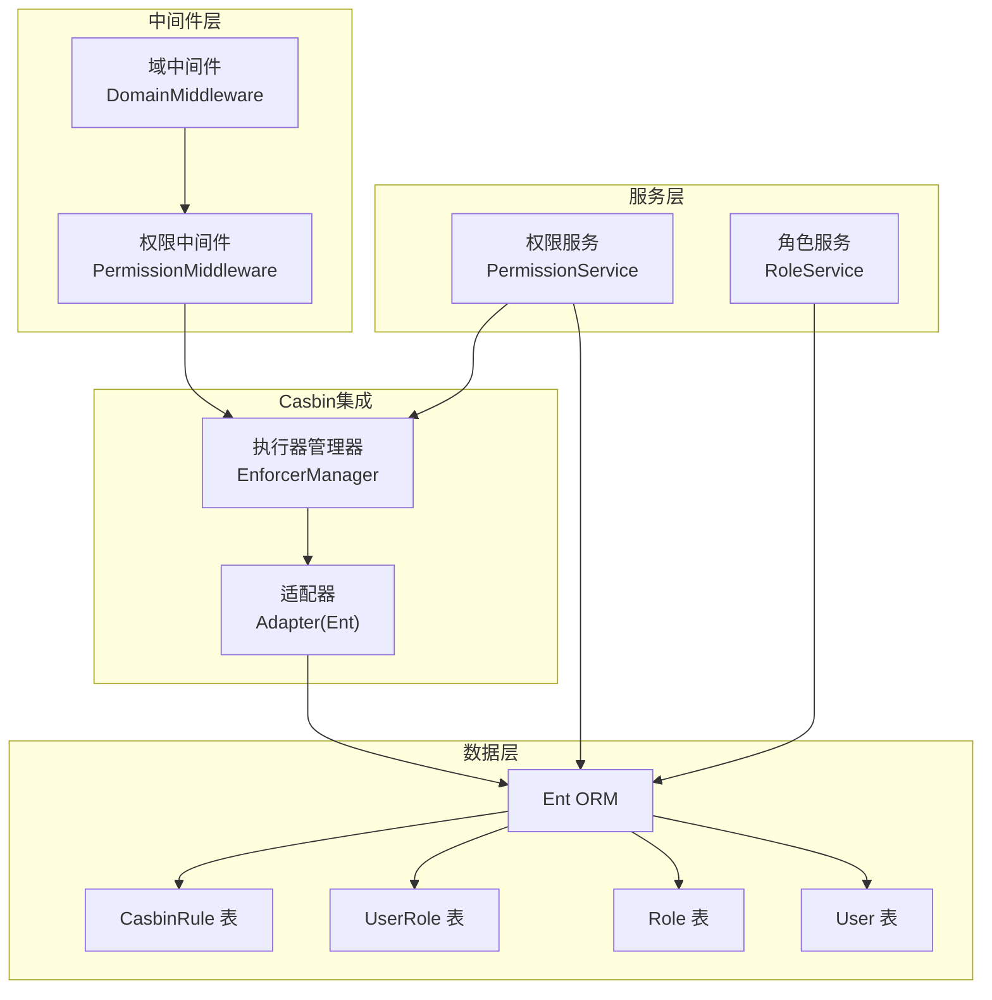
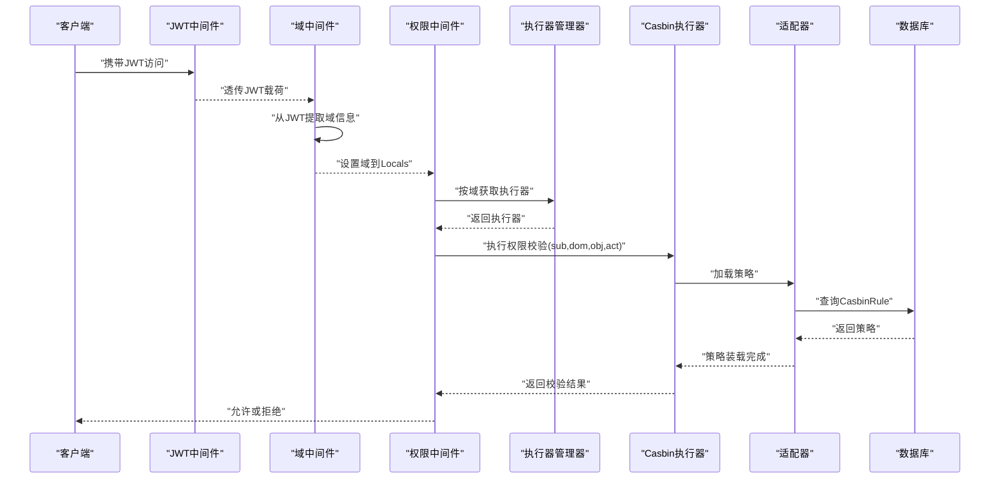
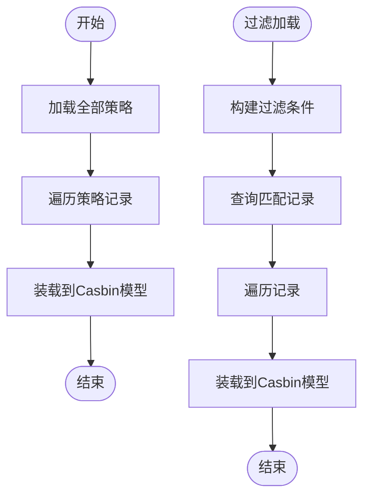
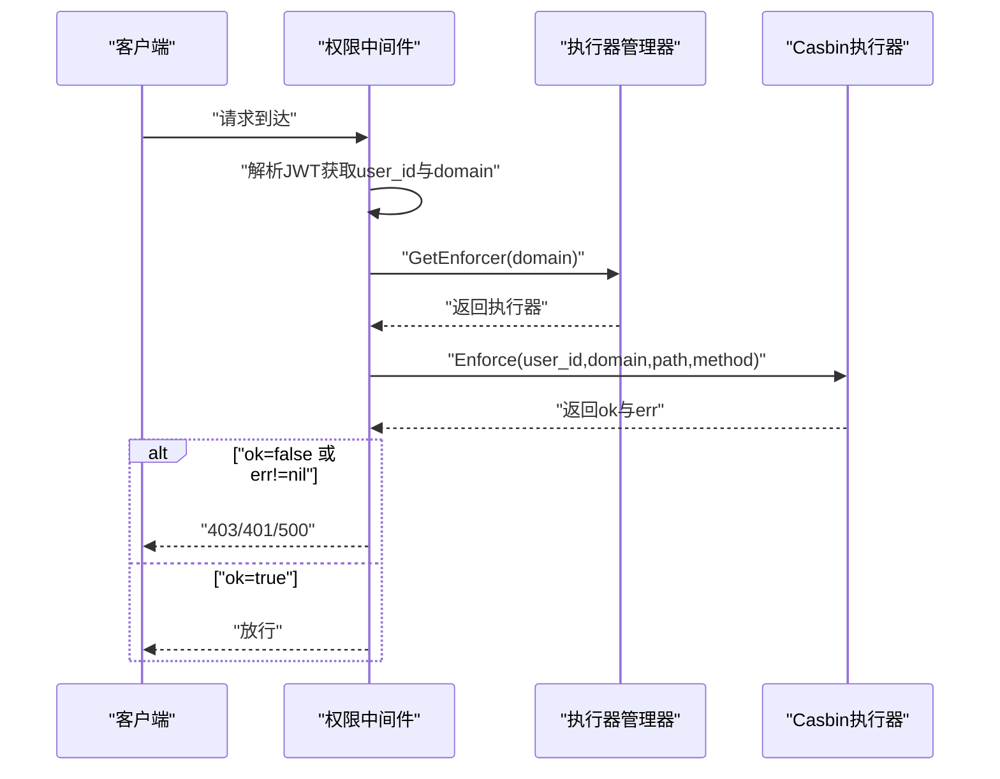
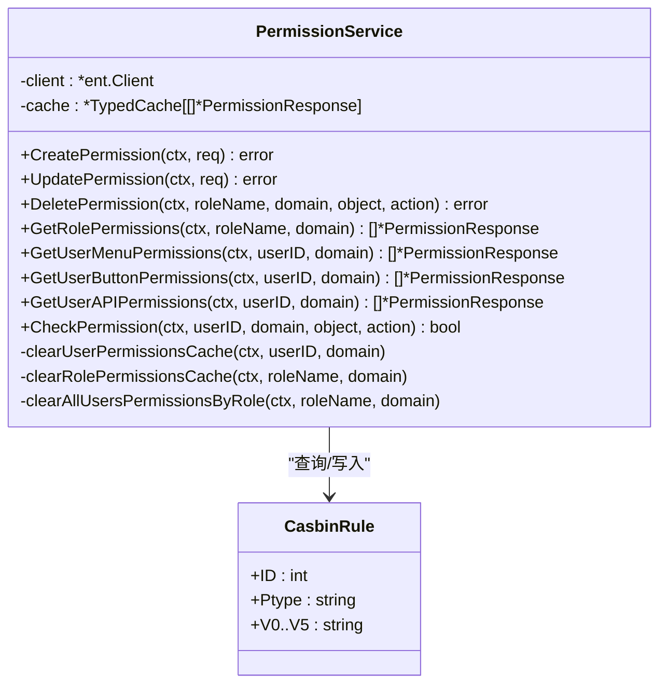
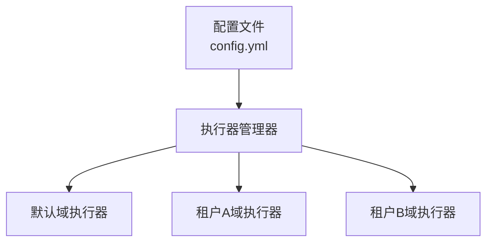
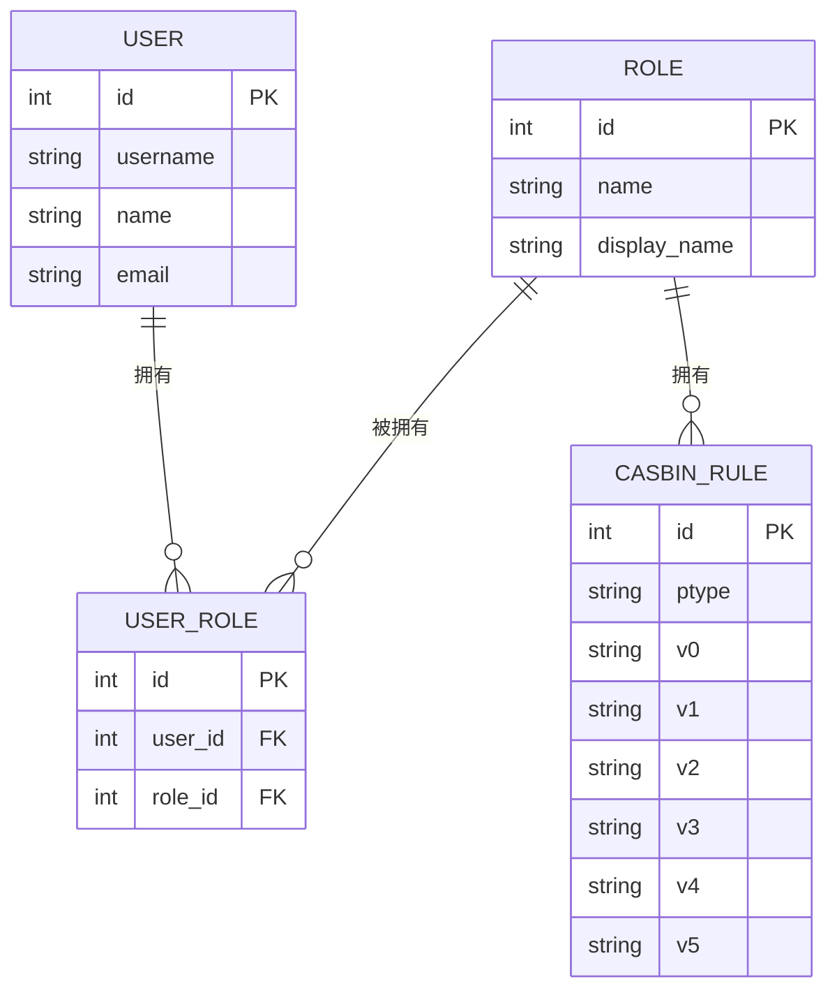
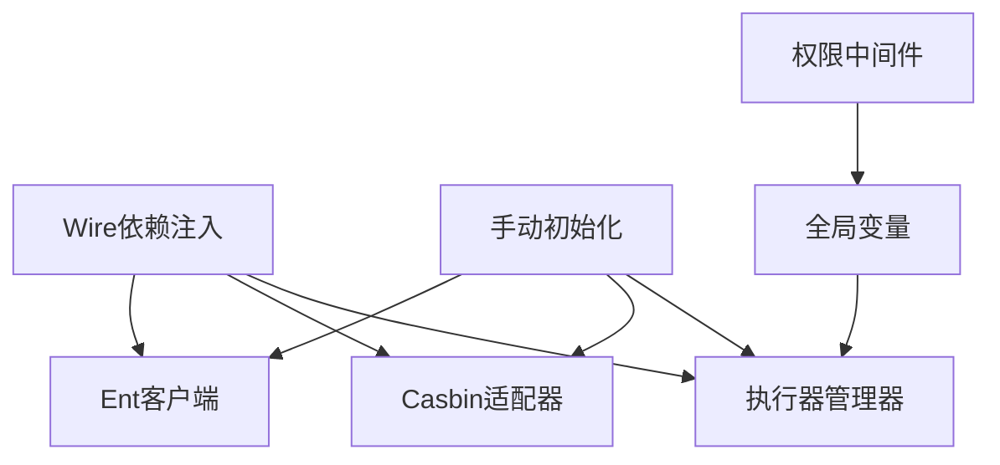

# 权限管理系统

<cite>
**本文档引用的文件**
- [adapter.go](file://internal/casbin/adapter/adapter.go)
- [permission.go](file://internal/middleware/permission.go)
- [permission.go](file://internal/service/permission.go)
- [casbinrule.go](file://internal/ent/casbinrule/casbinrule.go)
- [casbinrule.go](file://internal/ent/schema/casbinrule.go)
- [global.go](file://internal/global/global.go)
- [config.yml](file://config/config.yml)
- [router.go](file://internal/router.go)
- [user.go](file://internal/ent/user/user.go)
- [role.go](file://internal/ent/role/role.go)
- [userrole.go](file://internal/ent/userrole/userrole.go)
- [provider.go](file://internal/provider.go)
- [init.go](file://internal/init.go)
- [permission_test.go](file://internal/service/permission_test.go)
</cite>

## 目录
1. [简介](#简介)
2. [项目结构](#项目结构)
3. [核心组件](#核心组件)
4. [架构总览](#架构总览)
5. [详细组件分析](#详细组件分析)
6. [依赖关系分析](#依赖关系分析)
7. [性能考虑](#性能考虑)
8. [故障排查指南](#故障排查指南)
9. [结论](#结论)
10. [附录](#附录)

## 简介
本文件面向Go Admin管理系统的权限管理模块，系统采用基于RBAC（基于角色的访问控制）的权限控制模型，并通过Casbin作为权限引擎，结合Ent ORM进行权限规则持久化与查询。系统支持多域权限控制（租户隔离）、动态权限检查、权限缓存与失效策略，并提供完善的权限中间件工作流与最佳实践。

## 项目结构
权限管理相关代码主要分布在以下模块：
- Casbin适配层：负责将Ent ORM与Casbin模型对接，实现策略的加载、保存与更新
- 中间件层：在HTTP请求链路中进行域识别与权限校验
- 服务层：提供权限、角色、用户权限查询与缓存管理能力
- 数据模型层：通过Ent定义权限规则表与用户/角色/用户-角色关联表
- 配置层：多域Casbin模型配置与缓存配置

**图表来源**
- [permission.go:14-78](file://internal/middleware/permission.go#L14-L78)
- [permission.go:118-134](file://internal/service/permission.go#L118-L134)
- [adapter.go:115-125](file://internal/casbin/adapter/adapter.go#L115-L125)
- [casbinrule.go:11-36](file://internal/ent/casbinrule/casbinrule.go#L11-L36)
- [userrole.go:14-47](file://internal/ent/userrole/userrole.go#L14-L47)
- [role.go:14-37](file://internal/ent/role/role.go#L14-L37)
- [user.go:14-52](file://internal/ent/user/user.go#L14-L52)

**章节来源**
- [router.go:52-59](file://internal/router.go#L52-L59)
- [config.yml:77-143](file://config/config.yml#L77-L143)

## 核心组件
- Casbin适配器：封装Ent ORM对Casbin规则表的读写，支持批量插入、事务性更新与过滤加载
- 权限中间件：从JWT提取用户域信息与用户ID，调用Casbin执行器进行权限校验
- 权限服务：提供权限增删改查、角色权限分配、用户权限查询与缓存管理
- 多域Casbin模型：支持按域隔离的RBAC模型，每域独立的策略与执行器
- 缓存策略：基于TypedCache的用户与角色权限缓存，配合失效策略保证一致性

**章节来源**
- [adapter.go:115-214](file://internal/casbin/adapter/adapter.go#L115-L214)
- [permission.go:14-78](file://internal/middleware/permission.go#L14-L78)
- [permission.go:118-134](file://internal/service/permission.go#L118-L134)
- [config.yml:77-143](file://config/config.yml#L77-L143)

## 架构总览
系统通过Wire依赖注入创建Ent客户端、Casbin适配器与执行器管理器；路由层在鉴权后加载域中间件与权限中间件，形成统一的权限控制链路。

**图表来源**
- [permission.go:58-76](file://internal/middleware/permission.go#L58-L76)
- [adapter.go:115-125](file://internal/casbin/adapter/adapter.go#L115-L125)
- [global.go:11-16](file://internal/global/global.go#L11-L16)
- [router.go:52-59](file://internal/router.go#L52-L59)

## 详细组件分析

### Casbin适配器（Adapter）
- 功能职责
  - 加载全部策略：按ID升序查询并逐条装载至Casbin模型
  - 过滤加载：支持按Ptype/V0-V5字段过滤条件加载策略
  - 保存策略：清空后批量写入，使用事务确保一致性
  - 动态增删改：支持AddPolicy/RemovePolicy/UpdatePolicy等
  - 批量操作：批量插入与更新，使用批量大小优化写入性能
- 关键点
  - 使用WithTx包裹写操作，异常回滚，保证原子性
  - SavePolicy采用批量写入，批次大小固定，避免单次过大
  - LoadFilteredPolicy支持多字段过滤，便于按域或角色快速加载

**图表来源**
- [adapter.go:115-125](file://internal/casbin/adapter/adapter.go#L115-L125)
- [adapter.go:127-170](file://internal/casbin/adapter/adapter.go#L127-L170)
- [adapter.go:177-214](file://internal/casbin/adapter/adapter.go#L177-L214)

**章节来源**
- [adapter.go:115-214](file://internal/casbin/adapter/adapter.go#L115-L214)
- [adapter.go:304-325](file://internal/casbin/adapter/adapter.go#L304-L325)

### 权限中间件（PermissionMiddleware）
- 工作流程
  - 从JWT载荷提取用户ID与域信息
  - 从全局执行器管理器按域获取对应执行器
  - 调用Enforce进行权限校验（参数顺序：用户ID、域、路径、方法）
  - 校验失败返回403，成功进入下一个处理器
- 错误处理
  - 用户ID缺失或类型不正确时直接返回401
  - 域缺失或执行器获取失败返回500
  - 执行器报错返回500

**图表来源**
- [permission.go:14-78](file://internal/middleware/permission.go#L14-L78)

**章节来源**
- [permission.go:14-78](file://internal/middleware/permission.go#L14-L78)

### 权限服务（PermissionService）
- 能力概览
  - 权限管理：创建、更新、删除、查询权限
  - 角色权限管理：为角色分配/移除权限，查询角色权限
  - 用户权限查询：按菜单、按钮、API类型分别查询用户权限
  - 权限验证：根据用户ID与域判断是否存在某权限
  - 缓存管理：基于TypedCache的用户与角色权限缓存，提供缓存键生成与失效策略
- 关键实现
  - 缓存键命名规范：前缀:类型:主体:域
  - 默认缓存TTL：5分钟
  - 失效策略：权限变更时清除角色与关联用户缓存，或清除特定用户缓存
  - 用户权限查询：先查用户角色，再按域与类型查询CasbinRule

**图表来源**
- [permission.go:118-134](file://internal/service/permission.go#L118-L134)
- [casbinrule.go:11-36](file://internal/ent/casbinrule/casbinrule.go#L11-L36)

**章节来源**
- [permission.go:118-134](file://internal/service/permission.go#L118-L134)
- [permission.go:136-187](file://internal/service/permission.go#L136-L187)
- [permission.go:512-556](file://internal/service/permission.go#L512-L556)
- [permission.go:558-734](file://internal/service/permission.go#L558-L734)

### 多域权限控制
- 配置方式
  - 在配置文件中定义domains_default与domains列表
  - 每个域可配置auto_load与model_text（或model_path）
  - 支持默认域与自定义域的混合配置
- 执行器管理
  - 通过全局EnforcerManager按域获取执行器
  - 首次使用时按配置加载模型，支持自动加载与延迟加载
- 实践建议
  - 高频访问域设置auto_load以减少首次延迟
  - 不同租户或业务域使用独立域隔离策略

**图表来源**
- [config.yml:77-143](file://config/config.yml#L77-L143)
- [global.go:11-16](file://internal/global/global.go#L11-L16)

**章节来源**
- [config.yml:77-143](file://config/config.yml#L77-L143)
- [global.go:11-16](file://internal/global/global.go#L11-L16)

### 权限数据模型与关系
- CasbinRule表
  - 字段：Ptype、V0-V5，其中V0为角色名、V1为域、V2为对象、V3为动作、V4为权限类型、V5为描述
  - 索引：全字段唯一索引，保证策略唯一性
- 用户-角色-角色权限
  - User：用户基本信息
  - Role：角色信息
  - UserRole：用户与角色的多对多关联
  - 权限通过CasbinRule表与角色绑定，形成RBAC关系

**图表来源**
- [casbinrule.go:11-36](file://internal/ent/casbinrule/casbinrule.go#L11-L36)
- [casbinrule.go:14-36](file://internal/ent/schema/casbinrule.go#L14-L36)
- [userrole.go:14-47](file://internal/ent/userrole/userrole.go#L14-L47)
- [role.go:14-37](file://internal/ent/role/role.go#L14-L37)
- [user.go:14-52](file://internal/ent/user/user.go#L14-L52)

**章节来源**
- [casbinrule.go:14-36](file://internal/ent/schema/casbinrule.go#L14-L36)
- [userrole.go:14-47](file://internal/ent/userrole/userrole.go#L14-L47)
- [role.go:14-37](file://internal/ent/role/role.go#L14-L37)
- [user.go:14-52](file://internal/ent/user/user.go#L14-L52)

### 路由与中间件集成
- 路由组织
  - /api/v1/admin/auth 下的接口均需经过JWT、域中间件与权限中间件
  - 公开接口位于/public，无需权限校验
- 中间件顺序
  - JWT -> 域中间件 -> 权限中间件 -> 业务处理器
- 服务注入
  - 在中间件链路中注入权限服务与角色服务实例

**章节来源**
- [router.go:52-59](file://internal/router.go#L52-L59)
- [router.go:35-44](file://internal/router.go#L35-L44)

## 依赖关系分析
- 依赖注入
  - Wire提供NewEntClient、NewCasbinAdapter、NewEnforcerManager
  - init.go中兼容旧模式的手动初始化流程
- 运行时依赖
  - 全局变量持有ORM、执行器管理器、定时任务管理器
  - 中间件通过全局执行器管理器按域获取执行器

**图表来源**
- [provider.go:17-43](file://internal/provider.go#L17-L43)
- [init.go:86-100](file://internal/init.go#L86-L100)
- [global.go:11-16](file://internal/global/global.go#L11-L16)

**章节来源**
- [provider.go:17-43](file://internal/provider.go#L17-L43)
- [init.go:86-100](file://internal/init.go#L86-L100)
- [global.go:11-16](file://internal/global/global.go#L11-L16)

## 性能考虑
- 策略加载
  - LoadPolicy按ID升序加载，保证策略顺序稳定
  - LoadFilteredPolicy支持按域与角色过滤，减少加载量
- 写入优化
  - SavePolicy使用事务包裹，批量写入，批次大小固定
  - AddPolicies/RemovePolicies/UpdatePolicies提供批量接口
- 缓存策略
  - 用户权限缓存键按用户ID与域区分，类型区分菜单/按钮/API
  - 角色权限缓存键按角色名与域区分
  - 默认TTL为5分钟，命中率高且更新及时
  - 权限变更时清除角色与关联用户缓存，避免脏读
- 查询优化
  - 用户权限查询使用预加载角色，减少N+1查询
  - 按域与类型过滤查询，避免全表扫描

**章节来源**
- [adapter.go:177-214](file://internal/casbin/adapter/adapter.go#L177-L214)
- [permission.go:136-187](file://internal/service/permission.go#L136-L187)
- [permission.go:512-556](file://internal/service/permission.go#L512-L556)
- [permission.go:558-734](file://internal/service/permission.go#L558-L734)

## 故障排查指南
- 常见错误与定位
  - 未授权访问：JWT中缺少user_id或类型不正确
  - 缺少域信息：JWT中缺少domain或中间件未设置
  - 权限检查失败：执行器获取失败或Enforce报错
  - 权限不存在：查询角色或权限时未找到
- 缓存问题
  - 缓存未命中：确认缓存键生成规则与TTL
  - 缓存未失效：权限变更后未触发缓存清理
- 测试验证
  - 单元测试覆盖了缓存命中、更新与删除后的缓存失效场景

**章节来源**
- [permission.go:14-78](file://internal/middleware/permission.go#L14-L78)
- [permission_test.go:114-138](file://internal/service/permission_test.go#L114-L138)
- [permission_test.go:261-269](file://internal/service/permission_test.go#L261-L269)
- [permission_test.go:271-307](file://internal/service/permission_test.go#L271-L307)
- [permission_test.go:309-310](file://internal/service/permission_test.go#L309-L310)

## 结论
本权限系统以RBAC为核心，结合Casbin的灵活策略模型与Ent的强类型ORM，实现了多域隔离、动态权限检查与高效缓存。通过中间件链路统一接入权限控制，服务层提供完善的权限与缓存管理能力，满足企业级权限管理需求。建议在生产环境中启用多域配置与自动加载，合理设置缓存TTL，并建立完善的权限变更与缓存失效流程。

## 附录

### 权限规则存储结构
- 表：casbin_rules（带表前缀）
- 字段：Ptype、V0（角色名）、V1（域）、V2（对象）、V3（动作）、V4（权限类型）、V5（描述）
- 索引：全字段唯一索引，保证策略唯一性

**章节来源**
- [casbinrule.go:11-36](file://internal/ent/casbinrule/casbinrule.go#L11-L36)
- [casbinrule.go:14-36](file://internal/ent/schema/casbinrule.go#L14-L36)

### 权限类型与动作约定
- 权限类型：api、menu、button
- 动作约定：menu、button为保留关键字，其他API权限使用HTTP方法或自定义动作

**章节来源**
- [permission.go:27-37](file://internal/service/permission.go#L27-L37)
- [permission.go:789-800](file://internal/service/permission.go#L789-L800)

### 多域配置示例（节选）
- 默认域：default，auto_load: true
- 模型文本：包含请求定义、策略定义、角色定义、策略效果与匹配器
- 建议：高频域开启自动加载，降低首次访问延迟

**章节来源**
- [config.yml:77-143](file://config/config.yml#L77-L143)