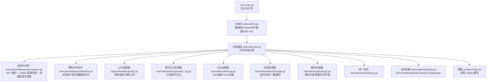
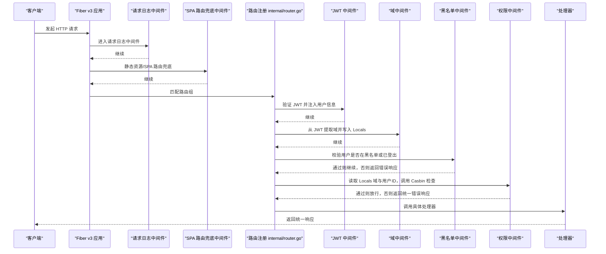
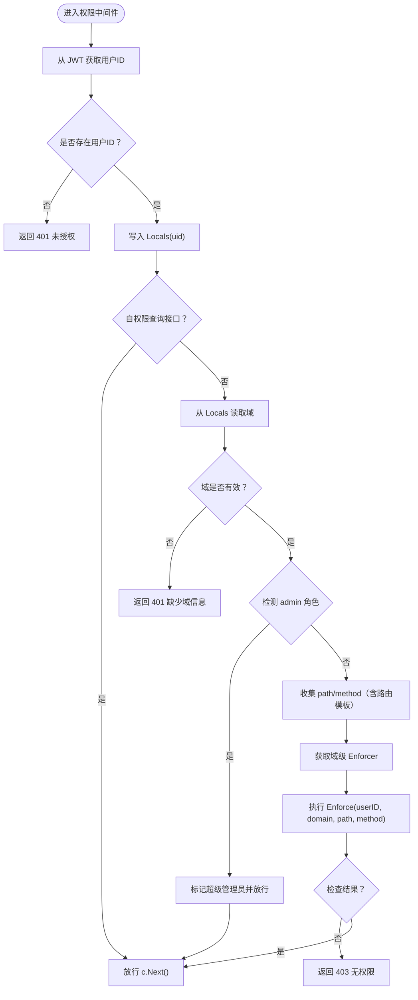
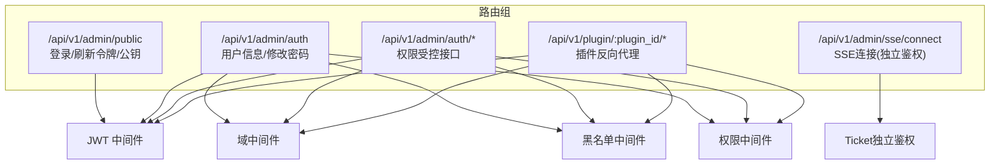
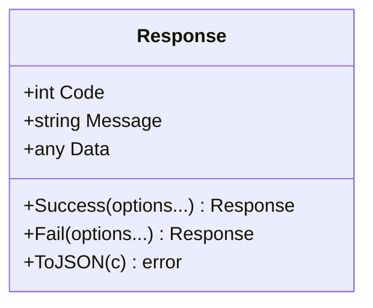
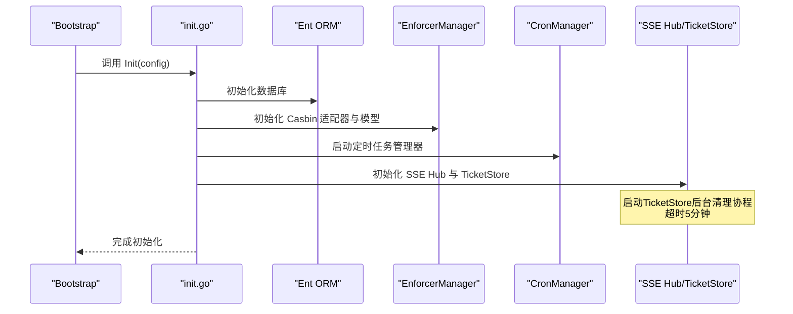
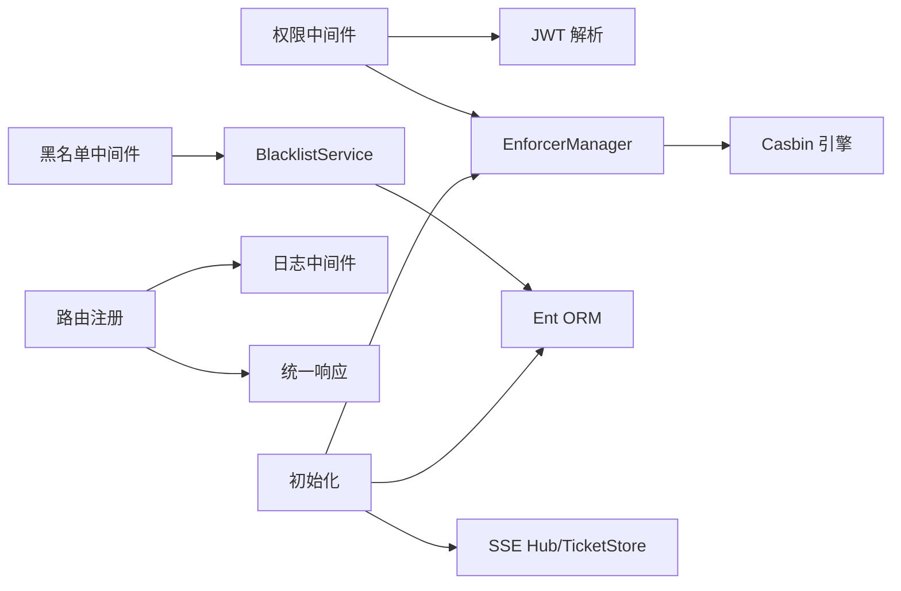

# 中间件架构

<cite>
**本文档引用的文件**
- [main.go](file://main.go)
- [internal/app.go](file://internal/app.go)
- [internal/router.go](file://internal/router.go)
- [internal/middleware/permission.go](file://internal/middleware/permission.go)
- [internal/middleware/blacklist.go](file://internal/middleware/blacklist.go)
- [internal/utils/response.go](file://internal/utils/response.go)
- [internal/global/global.go](file://internal/global/global.go)
- [internal/init.go](file://internal/init.go)
- [config/config.yml](file://config/config.yml)
- [internal/handler/public.go](file://internal/handler/public.go)
- [internal/handler/operation_log.go](file://internal/handler/operation_log.go)
- [internal/handler/sse.go](file://internal/handler/sse.go)
- [internal/handler/message.go](file://internal/handler/message.go)
- [internal/handler/plugin.go](file://internal/handler/plugin.go)
</cite>

## 目录
1. [简介](#简介)
2. [项目结构](#项目结构)
3. [核心组件](#核心组件)
4. [架构总览](#架构总览)
5. [详细组件分析](#详细组件分析)
6. [依赖关系分析](#依赖关系分析)
7. [性能考量](#性能考量)
8. [故障排查指南](#故障排查指南)
9. [结论](#结论)
10. [附录](#附录)

## 简介
本文件面向 Go Admin 系统的中间件架构设计，围绕基于 Fiber v3 的中间件链展开，重点覆盖以下方面：
- 中间件执行顺序与请求处理流程
- 响应处理机制与统一响应封装
- 权限中间件实现原理：JWT 令牌解析、Casbin 权限检查、多域权限控制、超级管理员旁路
- 黑名单校验中间件：JWT 认证后拦截已加入黑名单或已登出的用户
- 自定义中间件开发模式：接口设计、错误处理与日志记录
- 中间件组合最佳实践、性能优化策略与调试技巧
- 中间件链可视化图示与典型使用场景的代码示例路径

## 项目结构
Go Admin 采用模块化组织，关键与中间件相关的核心目录与文件如下：
- 入口与引导：main.go、internal/init.go
- 路由与中间件注册：internal/router.go
- 权限中间件：internal/middleware/permission.go
- 黑名单中间件：internal/middleware/blacklist.go
- 统一响应封装：internal/utils/response.go
- 全局依赖容器：internal/app.go
- 全局共享变量：internal/global/global.go
- 配置：config/config.yml
- 处理器示例：internal/handler/public.go、internal/handler/operation_log.go、internal/handler/sse.go、internal/handler/message.go、internal/handler/plugin.go

**图表来源**
- [main.go:47-107](file://main.go#L47-L107)
- [internal/init.go:46-129](file://internal/init.go#L46-L129)
- [internal/router.go:16-365](file://internal/router.go#L16-L365)
- [internal/middleware/permission.go:13-131](file://internal/middleware/permission.go#L13-L131)
- [internal/middleware/blacklist.go:13-49](file://internal/middleware/blacklist.go#L13-L49)
- [internal/utils/response.go:9-49](file://internal/utils/response.go#L9-L49)
- [internal/global/global.go:11-16](file://internal/global/global.go#L11-L16)
- [config/config.yml:77-143](file://config/config.yml#L77-L143)

**章节来源**
- [main.go:47-107](file://main.go#L47-L107)
- [internal/router.go:16-365](file://internal/router.go#L16-L365)

## 核心组件
- Fiber v3 应用与中间件链
  - 在引导阶段通过 Bootstrap 注册全局中间件（静态资源与 SPA 路由兜底），随后注册路由与路由级中间件。
- 权限中间件
  - DomainMiddleware：从 JWT 中提取域信息并写入 c.Locals，供后续中间件使用。
  - PermissionMiddleware：从 JWT 获取用户 ID，结合域、路径与方法调用 Casbin 执行权限检查，通过后放行；超级管理员（admin 角色）直接放行。
- 黑名单中间件
  - BlacklistCheck：在 JWT 认证通过后、PermissionMiddleware 之前执行，校验用户是否被加入黑名单或已登出。
- 统一响应封装
  - Response 结构体与 Success/Fail/ToJSON 方法，保证所有中间件与处理器返回一致的 JSON 响应格式。
- 全局依赖
  - App 容器持有 Config、Logger、DB、Validator、Cache、EntClient、EnforcerManager、Filesystem、Hub、TicketStore 等；EnforcerManager 由 Casbin 提供，支持多域模型。
- 配置
  - config.yml 支持多域 Casbin 模型配置，包含默认域与可选的多个域配置项。

**章节来源**
- [internal/middleware/permission.go:13-131](file://internal/middleware/permission.go#L13-L131)
- [internal/middleware/blacklist.go:13-49](file://internal/middleware/blacklist.go#L13-L49)
- [internal/utils/response.go:9-49](file://internal/utils/response.go#L9-L49)
- [internal/app.go:15-28](file://internal/app.go#L15-L28)
- [internal/global/global.go:11-16](file://internal/global/global.go#L11-L16)
- [config/config.yml:77-143](file://config/config.yml#L77-L143)

## 架构总览
下图展示从请求进入 Fiber v3 应用到路由处理与权限检查的整体流程，以及中间件链的执行顺序与职责划分。

**图表来源**
- [main.go:62-94](file://main.go#L62-L94)
- [internal/router.go:16-70](file://internal/router.go#L16-L70)
- [internal/middleware/permission.go:13-131](file://internal/middleware/permission.go#L13-L131)
- [internal/middleware/blacklist.go:13-49](file://internal/middleware/blacklist.go#L13-L49)
- [internal/utils/response.go:9-49](file://internal/utils/response.go#L9-L49)

## 详细组件分析

### 权限中间件：JWT + Casbin + 多域
- 设计要点
  - JWT 中间件负责解析 Token 并将用户信息注入上下文，权限中间件从上下文读取用户 ID。
  - 域中间件从 JWT 中读取域信息并写入 c.Locals，权限中间件从 Locals 读取域，实现多域隔离。
  - 权限检查使用 EnforcerManager.GetEnforcer(domain) 获取对应域的 Casbin 执行器，调用 Enforce(userID, domain, path, method)。
  - 超级管理员旁路：PermissionMiddleware 中检测 admin 角色直接放行，减少不必要的 Casbin 查询。
- 路由模板匹配：支持使用 Fiber 路由模板路径（如 /roles/{id}）与实际请求路径两种方式匹配 Casbin 策略。
- 错误处理
  - 未授权访问、无效用户ID、缺少域信息、权限检查失败、内部错误均通过统一响应封装返回。
- 性能建议
  - 对高频访问域启用 auto_load，减少首次使用时的延迟。
  - 将权限中间件置于路由组级别，避免对公开接口重复检查。

**图表来源**
- [internal/middleware/permission.go:13-131](file://internal/middleware/permission.go#L13-L131)
- [internal/utils/response.go:9-49](file://internal/utils/response.go#L9-L49)

**章节来源**
- [internal/middleware/permission.go:13-131](file://internal/middleware/permission.go#L13-L131)
- [internal/utils/response.go:9-49](file://internal/utils/response.go#L9-L49)

### 黑名单中间件（BlacklistCheck）
- 设计要点
  - 在 JWT 认证通过后、PermissionMiddleware 之前执行，拦截已加入黑名单或已登出的用户。
  - 校验逻辑：
    1. 从 JWT 中提取用户 UID。
    2. 调用 BlacklistService.IsBlacklisted 检测是否在黑名单中。
    3. 调用 BlacklistService.IsLoggedOut 检测是否已登出。
  - 未携带 JWT 的请求（公开接口）直接放行。
- 错误处理
  - 黑名单用户返回 403 禁止访问。
  - 已登出用户返回 401 登录已失效。
  - 黑名单服务异常返回 500 内部错误。

**图表来源**
- [internal/middleware/blacklist.go:13-49](file://internal/middleware/blacklist.go#L13-L49)
- [internal/utils/response.go:9-49](file://internal/utils/response.go#L9-L49)

**章节来源**
- [internal/middleware/blacklist.go:13-49](file://internal/middleware/blacklist.go#L13-L49)
- [internal/utils/response.go:9-49](file://internal/utils/response.go#L9-L49)

### 路由与中间件链注册
- 全局中间件
  - 通过 Bootstrap 注册请求日志中间件与 SPA 路由兜底逻辑，确保 API 请求不被静态资源中间件拦截。
- 路由组与中间件
  - /api/v1/admin/public：仅 JWT 认证，无需权限检查。
  - /api/v1/admin/auth：JWT -> 域中间件 -> 黑名单中间件 -> 注入服务 -> 权限中间件 -> 处理器。
  - /api/v1/admin/auth/*（权限受控）：JWT -> 域 -> 黑名单 -> 注入服务 -> 权限 -> 处理器。
  - 路由组内通过 c.Locals 注入服务实例与统一响应对象，便于处理器复用。
  - 插件反向代理路由：/api/v1/plugin/:plugin_id/* 支持 UDS 代理，含 JWT/域/黑名单/权限中间件。

**图表来源**
- [internal/router.go:48-120](file://internal/router.go#L48-L120)
- [internal/router.go:16-70](file://internal/router.go#L16-L70)

**章节来源**
- [internal/router.go:16-365](file://internal/router.go#L16-L365)

### 统一响应封装与错误码
- Response 结构体包含 code、message、data 字段，提供 Success/Fail/ToJSON 方法。
- 全局错误码集中于 internal/global/msg.go，如 401、403、500 等，便于前后端约定。

**图表来源**
- [internal/utils/response.go:9-49](file://internal/utils/response.go#L9-L49)

**章节来源**
- [internal/utils/response.go:9-49](file://internal/utils/response.go#L9-L49)
- [internal/global/global.go:4-16](file://internal/global/global.go#L4-L16)

### 初始化与全局依赖
- 初始化流程
  - 初始化数据库、Casbin、定时任务、NonceStore、KeyManager、种子数据与字典数据、SSE Hub/TicketStore。
  - Casbin 初始化使用 Ent 适配器与配置，生成 EnforcerManager 并注入全局。
  - SSE Hub 提供实时消息推送，TicketStore 管理 SSE 连接凭证（超时 5 分钟）。
- 全局共享
  - ORM、EnforcerManager、Bootstrap、CronManager 通过 internal/global/global.go 暴露，供中间件与服务层使用。

**图表来源**
- [internal/init.go:46-129](file://internal/init.go#L46-L129)
- [internal/global/global.go:11-16](file://internal/global/global.go#L11-L16)

**章节来源**
- [internal/init.go:46-129](file://internal/init.go#L46-L129)
- [internal/global/global.go:11-16](file://internal/global/global.go#L11-L16)

### 典型使用场景与代码示例路径
- 登录与刷新令牌（公开接口）
  - 登录接口：[internal/handler/public.go:78-145](file://internal/handler/public.go#L78-L145)
  - 刷新令牌接口：[internal/handler/public.go:277-298](file://internal/handler/public.go#L277-L298)
- 用户信息与修改（认证接口，无需权限检查）
  - 获取用户信息：[internal/handler/public.go:158-184](file://internal/handler/public.go#L158-L184)
  - 更新用户信息：[internal/handler/public.go:199-218](file://internal/handler/public.go#L199-L218)
  - 修改密码：[internal/handler/public.go:234-263](file://internal/handler/public.go#L234-L263)
- 权限受控接口（JWT + 域 + 黑名单 + 权限）
  - 路由注册与中间件链：[internal/router.go:63-120](file://internal/router.go#L63-L120)
  - 权限中间件实现：[internal/middleware/permission.go:13-131](file://internal/middleware/permission.go#L13-L131)
  - 黑名单中间件实现：[internal/middleware/blacklist.go:13-49](file://internal/middleware/blacklist.go#L13-L49)
- 操作日志记录
  - 辅助函数：[internal/handler/operation_log.go:16-43](file://internal/handler/operation_log.go#L16-L43)
- 站内消息与 SSE
  - SSE 凭证签发：[internal/handler/sse.go](file://internal/handler/sse.go)
  - SSE 连接建立：[internal/handler/sse.go](file://internal/handler/sse.go)
  - 消息管理：[internal/handler/message.go](file://internal/handler/message.go)
- 插件管理
  - 插件 CRUD：[internal/handler/plugin.go](file://internal/handler/plugin.go)
  - 插件反向代理：[internal/router.go:113-124](file://internal/router.go#L113-L124)

**章节来源**
- [internal/handler/public.go:78-298](file://internal/handler/public.go#L78-L298)
- [internal/router.go:63-120](file://internal/router.go#L63-L120)
- [internal/middleware/permission.go:13-131](file://internal/middleware/permission.go#L13-L131)
- [internal/middleware/blacklist.go:13-49](file://internal/middleware/blacklist.go#L13-L49)
- [internal/handler/operation_log.go:16-43](file://internal/handler/operation_log.go#L16-L43)

## 依赖关系分析
- 组件耦合
  - 权限中间件依赖 JWT 解析能力与全局 EnforcerManager；EnforcerManager 由初始化阶段注入。
  - 黑名单中间件依赖 BlacklistService，通过 c.Locals 注入。
  - 路由注册依赖全局 Logger 与统一响应对象，通过 c.Locals 注入服务实例。
- 外部依赖
  - Fiber v3 作为 Web 框架；Casbin 作为权限引擎；Ent 作为 ORM；Zap 作为日志库。
- 潜在循环依赖
  - 当前结构清晰，中间件与处理器通过 c.Locals 传递依赖，避免直接导入导致的循环。

**图表来源**
- [internal/middleware/permission.go:13-131](file://internal/middleware/permission.go#L13-L131)
- [internal/middleware/blacklist.go:13-49](file://internal/middleware/blacklist.go#L13-L49)
- [internal/router.go:16-70](file://internal/router.go#L16-L70)
- [internal/init.go:46-129](file://internal/init.go#L46-L129)

**章节来源**
- [internal/middleware/permission.go:13-131](file://internal/middleware/permission.go#L13-L131)
- [internal/middleware/blacklist.go:13-49](file://internal/middleware/blacklist.go#L13-L49)
- [internal/router.go:16-70](file://internal/router.go#L16-L70)
- [internal/init.go:46-129](file://internal/init.go#L46-L129)

## 性能考量
- 中间件链顺序优化
  - 将公开接口与认证接口置于更早的路由组，避免不必要的权限检查。
  - 将权限中间件置于路由组级，减少重复注册。
  - 黑名单中间件在权限中间件之前执行，快速拦截无效用户。
- Casbin 多域性能
  - 对高频域启用 auto_load，减少首次加载开销。
  - 合理设计模型匹配器，避免过于复杂的匹配条件。
  - 超级管理员旁路检测，减少对 admin 角色的重复 Casbin 查询。
- 日志与响应
  - 使用统一响应封装，减少重复序列化与状态码判断。
  - 请求日志中间件仅在开发环境开启或按需配置。

[本节为通用指导，无需特定文件来源]

## 故障排查指南
- 常见错误与定位
  - 401 未授权：检查 JWT 是否正确携带与签名是否有效；确认 DomainMiddleware 是否正确从 JWT 提取域。
  - 403 无权限：检查 Casbin 策略是否正确加载；确认 EnforcerManager.GetEnforcer(domain) 返回正常。
  - 403 黑名单：确认用户是否被加入黑名单；检查 BlacklistService 的校验逻辑。
  - 500 内部错误：检查权限检查过程中的异常分支与日志输出。
- 调试技巧
  - 在权限中间件与处理器中打印 c.Path()、c.Method()、c.Locals("domain")、c.Locals("uid")，核对请求上下文。
  - 使用统一响应封装的 ToJSON 输出，确保错误消息一致且可读。
  - 在初始化阶段验证 Casbin 策略是否加载成功（init.go 中的日志输出）。

**章节来源**
- [internal/middleware/permission.go:13-131](file://internal/middleware/permission.go#L13-L131)
- [internal/middleware/blacklist.go:13-49](file://internal/middleware/blacklist.go#L13-L49)
- [internal/utils/response.go:9-49](file://internal/utils/response.go#L9-L49)
- [internal/init.go:294-306](file://internal/init.go#L294-L306)

## 结论
Go Admin 的中间件架构以 Fiber v3 为核心，通过明确的中间件链顺序与职责划分，实现了从 JWT 认证、域解析、黑名单校验到 Casbin 权限检查的完整闭环。新增的黑名单中间件提供了用户级别的访问控制，配合统一响应封装与全局依赖容器，系统具备良好的扩展性与可维护性。建议在实际部署中根据业务域特征启用 auto_load，并持续优化模型匹配器与日志输出，以获得更佳的性能与可观测性。

[本节为总结，无需特定文件来源]

## 附录
- 配置参考
  - 多域 Casbin 模型配置：[config/config.yml:77-143](file://config/config.yml#L77-L143)
- 入口与引导
  - 应用启动与中间件注册：[main.go:47-107](file://main.go#L47-L107)
- 初始化流程
  - 数据库、Casbin、定时任务与种子数据初始化：[internal/init.go:46-129](file://internal/init.go#L46-L129)

**章节来源**
- [config/config.yml:77-143](file://config/config.yml#L77-L143)
- [main.go:47-107](file://main.go#L47-L107)
- [internal/init.go:46-129](file://internal/init.go#L46-L129)
