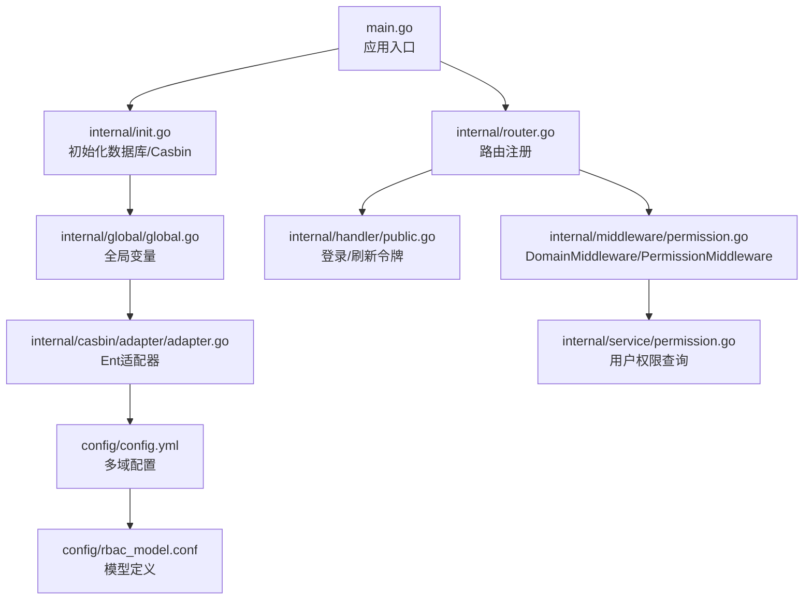
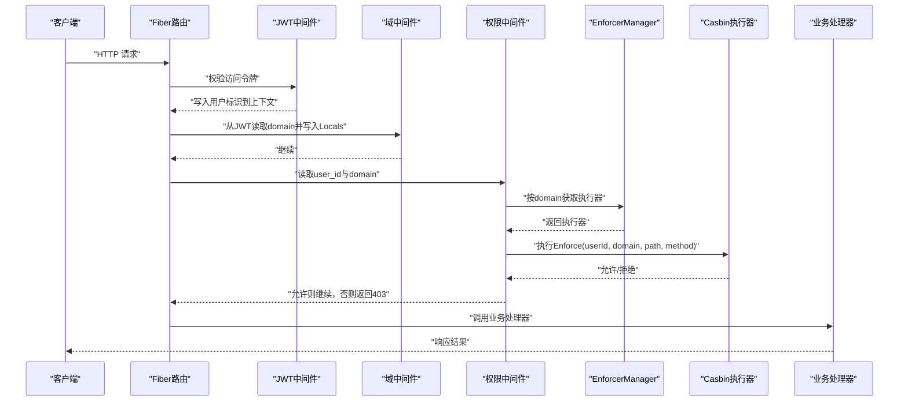
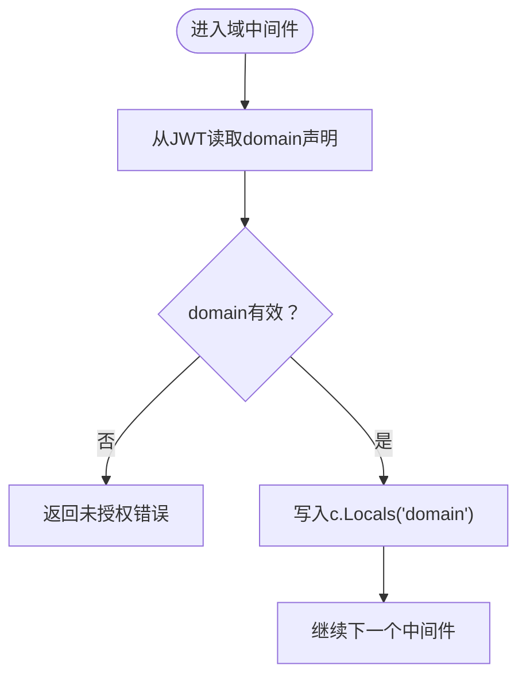
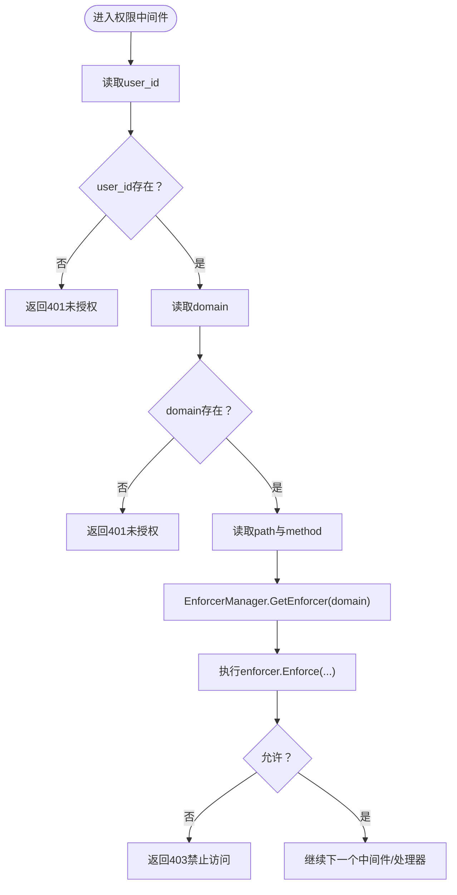
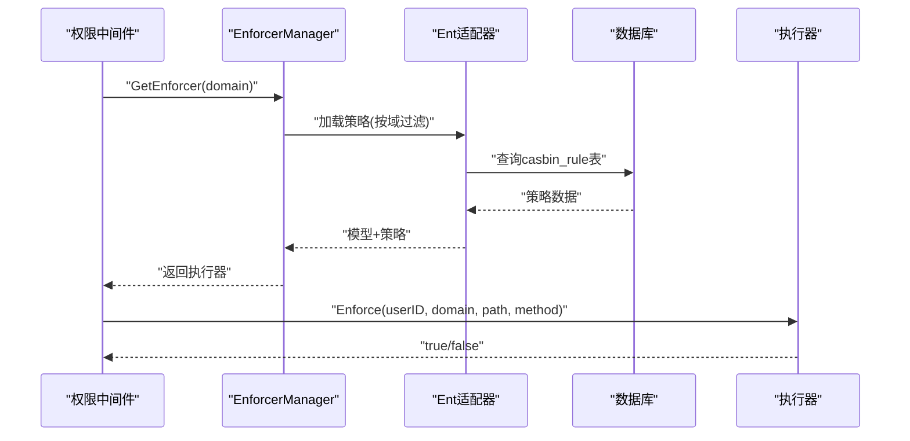
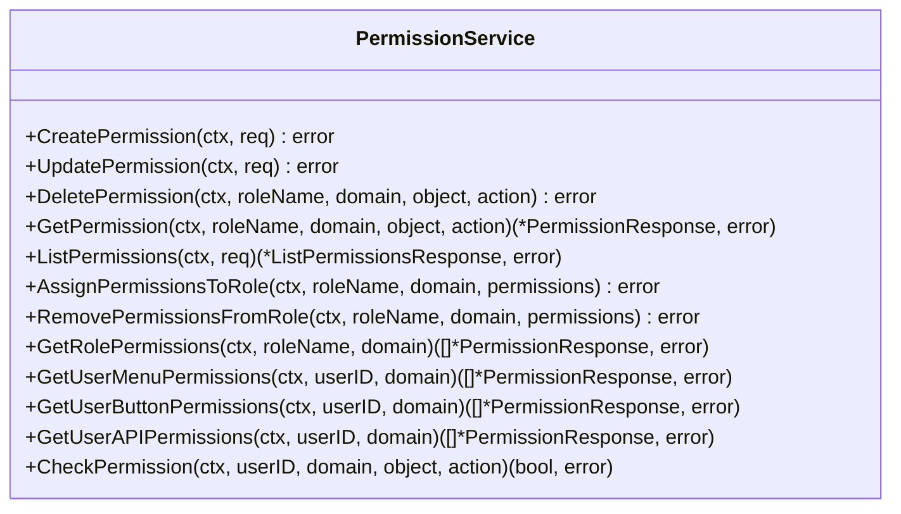
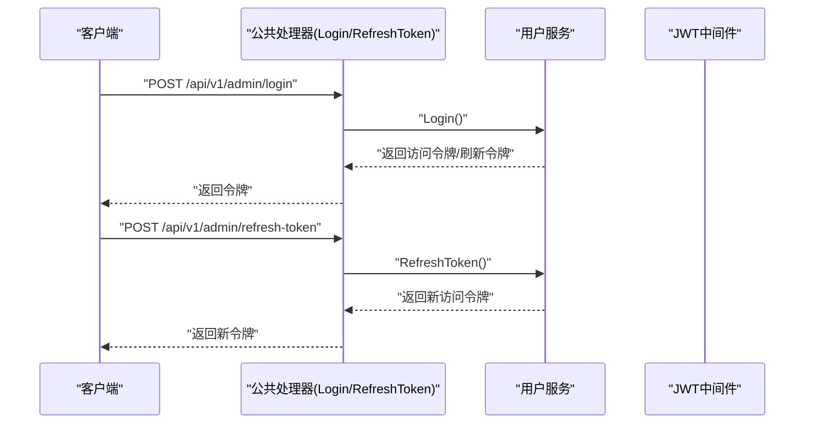
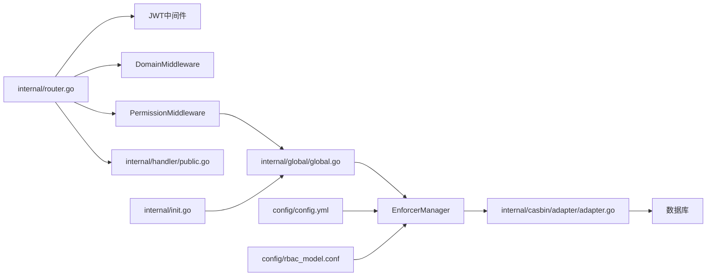

# 中间件系统

<cite>
**本文档引用的文件**
- [internal/middleware/permission.go](file://internal/middleware/permission.go)
- [internal/router.go](file://internal/router.go)
- [internal/init.go](file://internal/init.go)
- [internal/global/global.go](file://internal/global/global.go)
- [config/config.yml](file://config/config.yml)
- [config/rbac_model.conf](file://config/rbac_model.conf)
- [internal/casbin/adapter/adapter.go](file://internal/casbin/adapter/adapter.go)
- [internal/service/permission.go](file://internal/service/permission.go)
- [internal/handler/public.go](file://internal/handler/public.go)
- [internal/utils/response.go](file://internal/utils/response.go)
- [main.go](file://main.go)
</cite>

## 目录
1. [简介](#简介)
2. [项目结构](#项目结构)
3. [核心组件](#核心组件)
4. [架构总览](#架构总览)
5. [详细组件分析](#详细组件分析)
6. [依赖关系分析](#依赖关系分析)
7. [性能考虑](#性能考虑)
8. [故障排查指南](#故障排查指南)
9. [结论](#结论)
10. [附录](#附录)

## 简介
本文件系统性阐述 Go Admin 管理系统的中间件体系，重点覆盖 JWT 认证中间件与权限控制中间件的实现原理、工作机制与执行顺序。文档同时解释多域权限模型（基于 Casbin）的域解析、执行器获取与权限检查流程，并提供配置项说明、错误处理策略与性能优化建议，以及使用示例与最佳实践。

## 项目结构
中间件系统位于 internal/middleware 目录，配合路由注册、全局初始化与配置文件共同构成认证与授权链路。关键文件职责如下：
- internal/middleware/permission.go：定义 DomainMiddleware 与 PermissionMiddleware
- internal/router.go：注册路由组与中间件链
- internal/init.go：初始化数据库与 Casbin 执行器管理器
- internal/global/global.go：全局变量持有 ORM 与 EnforcerManager
- config/config.yml：Casbin 多域配置
- config/rbac_model.conf：基础 RBAC 模型
- internal/casbin/adapter/adapter.go：Casbin Ent 适配器
- internal/service/permission.go：权限服务（含用户权限查询与权限检查）
- internal/handler/public.go：登录与刷新令牌处理器
- internal/utils/response.go：统一响应封装
- main.go：应用入口与中间件挂载

**图表来源**
- [main.go:43-89](file://main.go#L43-L89)
- [internal/router.go:14-72](file://internal/router.go#L14-L72)
- [internal/middleware/permission.go:11-68](file://internal/middleware/permission.go#L11-L68)
- [internal/init.go:17-65](file://internal/init.go#L17-L65)
- [internal/global/global.go:10-14](file://internal/global/global.go#L10-L14)
- [config/config.yml:77-143](file://config/config.yml#L77-L143)
- [config/rbac_model.conf:1-15](file://config/rbac_model.conf#L1-L15)
- [internal/casbin/adapter/adapter.go:115-175](file://internal/casbin/adapter/adapter.go#L115-L175)
- [internal/service/permission.go:466-600](file://internal/service/permission.go#L466-L600)

**章节来源**
- [main.go:43-89](file://main.go#L43-L89)
- [internal/router.go:14-72](file://internal/router.go#L14-L72)

## 核心组件
- JWT 认证中间件：由框架提供的 JWT 中间件负责校验访问令牌，解析用户标识并写入上下文，供后续中间件使用。
- 域中间件（DomainMiddleware）：从 JWT 声明中读取 domain 字段，写入 c.Locals，作为权限检查的域标识。
- 权限中间件（PermissionMiddleware）：从 c.Locals 读取 user_id 与 domain，结合请求路径与方法，通过 EnforcerManager 获取对应域的 Casbin 执行器并执行权限检查。
- 权限服务（PermissionService）：提供用户菜单/按钮/API 权限查询与权限检查能力，内部通过 Ent 客户端查询角色与权限规则。
- Casbin 执行器管理器（EnforcerManager）：根据配置的多域模型动态获取/加载对应域的执行器；底层使用 Ent 适配器持久化策略数据。

**章节来源**
- [internal/middleware/permission.go:11-68](file://internal/middleware/permission.go#L11-L68)
- [internal/service/permission.go:92-113](file://internal/service/permission.go#L92-L113)
- [internal/init.go:49-65](file://internal/init.go#L49-L65)
- [internal/global/global.go:10-14](file://internal/global/global.go#L10-L14)

## 架构总览
下图展示了从请求进入至权限检查的整体流程，包括 JWT 校验、域解析、权限执行器获取与权限判断。

**图表来源**
- [internal/router.go:32-37](file://internal/router.go#L32-L37)
- [internal/middleware/permission.go:12-52](file://internal/middleware/permission.go#L12-L52)
- [internal/init.go:61](file://internal/init.go#L61)
- [internal/service/permission.go:602-640](file://internal/service/permission.go#L602-L640)

## 详细组件分析

### JWT 认证中间件与域中间件
- JWT 中间件负责校验访问令牌，解析用户标识并写入上下文，确保后续中间件能读取 user_id。
- 域中间件从 JWT 声明中提取 domain 字段，写入 c.Locals("domain")，作为权限检查的域标识。
- 若 JWT 缺少 domain 或解析失败，域中间件直接返回未授权错误。

**图表来源**
- [internal/middleware/permission.go:55-68](file://internal/middleware/permission.go#L55-L68)

**章节来源**
- [internal/middleware/permission.go:55-68](file://internal/middleware/permission.go#L55-L68)

### 权限控制中间件
- 从 c.Locals 读取 user_id 与 domain，若缺失则返回未授权。
- 从 Fiber 上下文获取请求路径与方法。
- 通过 EnforcerManager.GetEnforcer(domain) 获取对应域的 Casbin 执行器。
- 调用执行器的 Enforce 方法进行权限判断，若返回拒绝则返回 403，异常则返回 500，通过则继续。

**图表来源**
- [internal/middleware/permission.go:12-52](file://internal/middleware/permission.go#L12-L52)
- [internal/global/global.go:10-14](file://internal/global/global.go#L10-L14)

**章节来源**
- [internal/middleware/permission.go:12-52](file://internal/middleware/permission.go#L12-L52)

### 权限验证逻辑与用户域解析
- 用户域解析：JWT 声明中包含 domain 字段，域中间件将其写入 c.Locals("domain")，权限中间件据此选择对应的 Casbin 执行器。
- Casbin 执行器获取：EnforcerManager 根据配置的多域模型动态创建/获取对应域的执行器。
- 权限检查过程：权限中间件调用执行器的 Enforce，传入用户 ID、域、请求路径与方法，执行器依据模型与策略进行匹配，返回允许/拒绝。

**图表来源**
- [internal/middleware/permission.go:32-44](file://internal/middleware/permission.go#L32-L44)
- [internal/casbin/adapter/adapter.go:115-175](file://internal/casbin/adapter/adapter.go#L115-L175)
- [config/config.yml:77-143](file://config/config.yml#L77-L143)

**章节来源**
- [internal/middleware/permission.go:32-44](file://internal/middleware/permission.go#L32-L44)
- [internal/casbin/adapter/adapter.go:115-175](file://internal/casbin/adapter/adapter.go#L115-L175)
- [config/config.yml:77-143](file://config/config.yml#L77-L143)

### 权限服务与用户权限查询
- 权限服务提供用户菜单权限、按钮权限与 API 权限查询，内部通过用户角色关联查询角色名集合，再在 casbin_rule 表中按域与动作类型筛选。
- 支持 CheckPermission 直接检查某条权限是否存在，便于在业务逻辑中做细粒度判断。

**图表来源**
- [internal/service/permission.go:92-113](file://internal/service/permission.go#L92-L113)

**章节来源**
- [internal/service/permission.go:466-600](file://internal/service/permission.go#L466-L600)

### 登录与刷新令牌流程
- 登录接口生成访问令牌与刷新令牌，其中访问令牌声明包含 domain 字段，默认为 "default"。
- 刷新令牌接口使用刷新令牌换取新的访问令牌，保持 domain 一致。

**图表来源**
- [internal/handler/public.go:13-45](file://internal/handler/public.go#L13-L45)
- [internal/handler/public.go:149-179](file://internal/handler/public.go#L149-L179)

**章节来源**
- [internal/handler/public.go:13-45](file://internal/handler/public.go#L13-L45)
- [internal/handler/public.go:149-179](file://internal/handler/public.go#L149-L179)

## 依赖关系分析
- 路由层依赖中间件层与处理器层；中间件层依赖全局的 EnforcerManager 与工具层响应封装。
- 初始化阶段先建立数据库连接，再创建 Casbin 执行器管理器并注入全局变量。
- 权限中间件通过 EnforcerManager 获取执行器，执行器依赖 Ent 适配器访问数据库中的策略表。

**图表来源**
- [internal/router.go:32-37](file://internal/router.go#L32-L37)
- [internal/middleware/permission.go:32-37](file://internal/middleware/permission.go#L32-L37)
- [internal/global/global.go:10-14](file://internal/global/global.go#L10-L14)
- [internal/init.go:61](file://internal/init.go#L61)
- [config/config.yml:77-143](file://config/config.yml#L77-L143)
- [config/rbac_model.conf:14](file://config/rbac_model.conf#L14)

**章节来源**
- [internal/router.go:32-37](file://internal/router.go#L32-L37)
- [internal/init.go:61](file://internal/init.go#L61)

## 性能考虑
- 多域自动加载：在 config.yml 中为高频访问的域设置 auto_load: true，可在启动时预热执行器，减少首次请求的加载开销。
- 策略批量保存：Casbin 适配器在保存策略时采用批量插入，降低数据库写入压力。
- 事务一致性：适配器在批量操作时使用事务，保证策略变更的一致性。
- 建议
  - 对高频域启用 auto_load，避免运行时动态加载带来的延迟。
  - 在高并发场景下，结合缓存层（如 Redis）对热点策略进行缓存（需在上层扩展）。
  - 合理设计权限模型与策略粒度，避免过于复杂的匹配规则导致匹配耗时增加。

**章节来源**
- [config/config.yml:86-87](file://config/config.yml#L86-L87)
- [internal/casbin/adapter/adapter.go:177-214](file://internal/casbin/adapter/adapter.go#L177-L214)
- [internal/casbin/adapter/adapter.go:304-325](file://internal/casbin/adapter/adapter.go#L304-L325)

## 故障排查指南
- 未授权访问（401）
  - 域中间件检测到 JWT 缺少 domain 或解析失败，返回未授权。
  - 权限中间件检测到 c.Locals 中缺少 user_id 或 domain，返回未授权。
- 禁止访问（403）
  - 权限中间件执行 Enforce 返回拒绝，返回 403。
- 服务器错误（500）
  - 获取执行器失败或执行 Enforce 发生异常，返回 500。
- 统一响应
  - 所有错误均通过统一响应封装返回，便于前端统一处理。

**章节来源**
- [internal/middleware/permission.go:16-18](file://internal/middleware/permission.go#L16-L18)
- [internal/middleware/permission.go:23-25](file://internal/middleware/permission.go#L23-L25)
- [internal/middleware/permission.go:35-37](file://internal/middleware/permission.go#L35-L37)
- [internal/middleware/permission.go:42-44](file://internal/middleware/permission.go#L42-L44)
- [internal/middleware/permission.go:48](file://internal/middleware/permission.go#L48)
- [internal/utils/response.go:15-49](file://internal/utils/response.go#L15-L49)

## 结论
本中间件系统通过 JWT 认证与域中间件完成用户身份与域标识解析，再由权限中间件结合 Casbin 执行器完成细粒度权限控制。系统支持多域配置与自动加载，具备良好的扩展性与性能潜力。建议在生产环境中启用多域自动加载、合理设计权限模型，并结合缓存与监控进一步优化。

## 附录

### 中间件配置选项
- 多域默认域：config.yml 中 domains_default 指定默认域名称。
- 多域列表：domains 数组中可配置多个域，每个域包含 name、auto_load、model_text/model_path 等字段。
- 模型定义：rbac_model.conf 定义了请求、策略、角色与匹配器规则。

**章节来源**
- [config/config.yml:77-143](file://config/config.yml#L77-L143)
- [config/rbac_model.conf:1-15](file://config/rbac_model.conf#L1-15)

### 使用示例与最佳实践
- 路由挂载顺序
  - 先挂载 JWT 中间件，再挂载域中间件，最后挂载权限中间件，确保上下文中已有 user_id 与 domain。
- 域设计
  - 为不同租户或业务域设置独立 domain，避免权限冲突。
- 权限模型
  - 使用 rbac_model.conf 定义清晰的匹配规则，避免过于复杂的正则导致性能问题。
- 错误处理
  - 统一使用响应封装返回错误，便于前端统一处理。
- 性能优化
  - 为高频域开启 auto_load，减少首次加载延迟；合理批量操作策略，使用事务保证一致性。

**章节来源**
- [internal/router.go:32-37](file://internal/router.go#L32-L37)
- [config/config.yml:86-87](file://config/config.yml#L86-L87)
- [internal/utils/response.go:15-49](file://internal/utils/response.go#L15-L49)