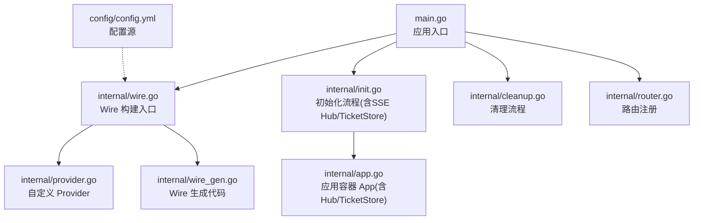
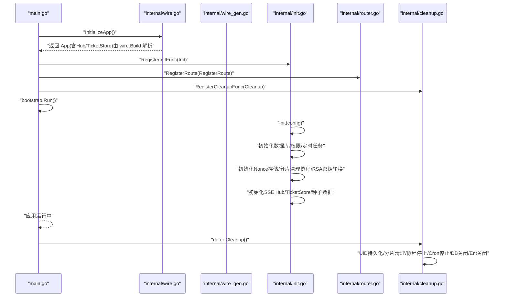
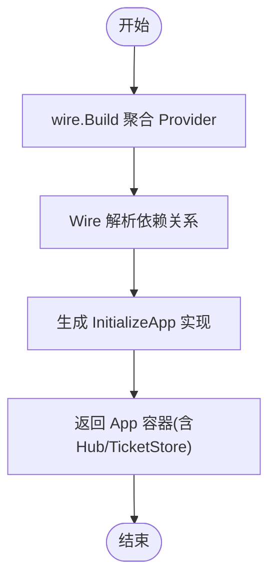
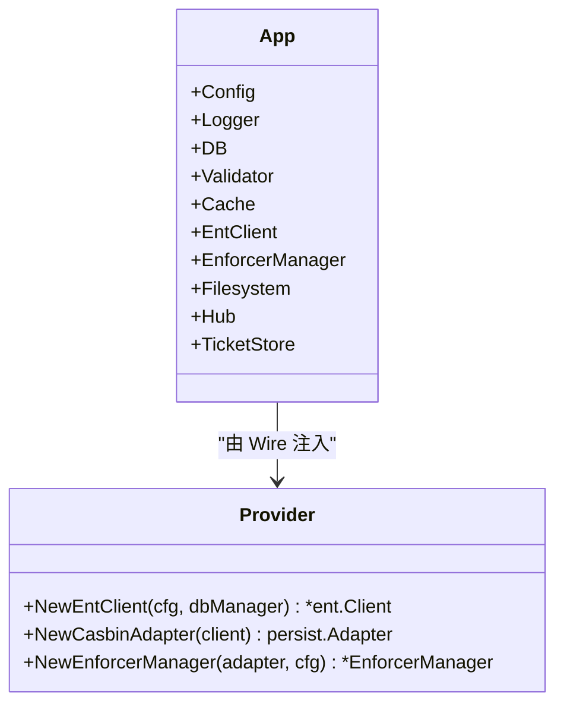
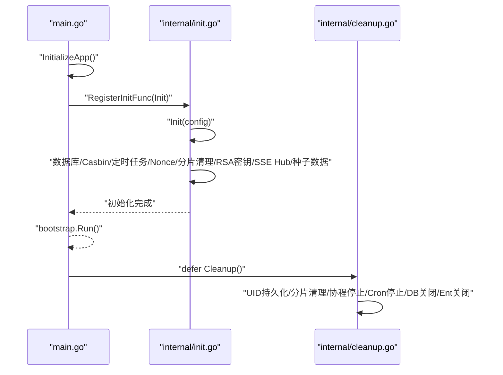
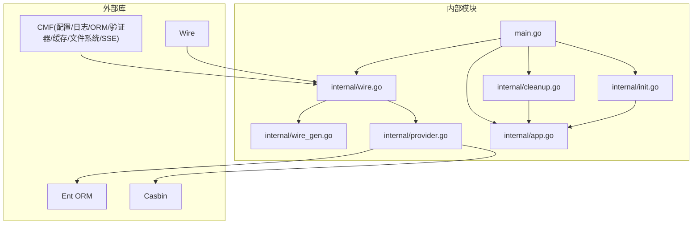

# 依赖注入架构

<cite>
**本文引用的文件**
- [main.go](file://main.go)
- [internal/wire.go](file://internal/wire.go)
- [internal/provider.go](file://internal/provider.go)
- [internal/wire_gen.go](file://internal/wire_gen.go)
- [internal/app.go](file://internal/app.go)
- [internal/init.go](file://internal/init.go)
- [internal/cleanup.go](file://internal/cleanup.go)
- [internal/router.go](file://internal/router.go)
- [config/config.yml](file://config/config.yml)
- [go.mod](file://go.mod)
</cite>

## 目录
1. [简介](#简介)
2. [项目结构](#项目结构)
3. [核心组件](#核心组件)
4. [架构总览](#架构总览)
5. [详细组件分析](#详细组件分析)
6. [依赖关系分析](#依赖关系分析)
7. [性能考量](#性能考量)
8. [故障排查指南](#故障排查指南)
9. [结论](#结论)
10. [附录](#附录)

## 简介
本文件系统性阐述 Go Admin 系统基于 Google Wire 的依赖注入架构与实现细节，覆盖 Provider 配置、依赖声明、注入点定义、组件生命周期管理（从启动到关闭）、优势与最佳实践，并结合仓库中的实际代码路径给出可操作的参考。

## 项目结构
Go Admin 采用分层与模块化组织方式：
- 入口程序位于根目录的 main.go，负责应用启动、引导框架集成与生命周期回调注册。
- 核心依赖注入逻辑集中在 internal 包中，包含 wire 构建入口、Provider 实现、以及生成的初始化代码。
- 配置通过 config/config.yml 提供，支持数据库、缓存、Redis、文件系统、Casbin、SSE 等多模块配置。
- 运行时通过 internal/init.go 和 internal/cleanup.go 管理初始化与清理流程。

图表来源
- [main.go:47-107](file://main.go#L47-L107)
- [internal/wire.go:22-35](file://internal/wire.go#L22-L35)
- [internal/provider.go:17-46](file://internal/provider.go#L17-L46)
- [internal/wire_gen.go:17-62](file://internal/wire_gen.go#L17-L62)
- [internal/init.go:46-129](file://internal/init.go#L46-L129)
- [internal/cleanup.go:12-51](file://internal/cleanup.go#L12-L51)
- [internal/router.go:16-365](file://internal/router.go#L16-L365)
- [config/config.yml:1-143](file://config/config.yml#L1-L143)

章节来源
- [main.go:47-107](file://main.go#L47-L107)
- [internal/wire.go:22-35](file://internal/wire.go#L22-L35)
- [internal/provider.go:17-46](file://internal/provider.go#L17-L46)
- [internal/wire_gen.go:17-62](file://internal/wire_gen.go#L17-L62)
- [internal/init.go:46-129](file://internal/init.go#L46-L129)
- [internal/cleanup.go:12-51](file://internal/cleanup.go#L12-L51)
- [internal/router.go:16-365](file://internal/router.go#L16-L365)
- [config/config.yml:1-143](file://config/config.yml#L1-L143)

## 核心组件
- 应用容器 App：集中承载配置、日志、数据库、验证器、缓存、ORM 客户端、权限管理器、文件系统、SSE Hub、SSE TicketStore 等依赖。
- Wire 构建入口：通过 wire.Build 组织 Provider 集合，形成可编译的依赖图。
- Provider 实现：封装具体组件的创建与初始化逻辑，如 Ent ORM 客户端、Casbin 适配器与管理器。
- 生成代码：wire_gen.go 在非 wireinject 构建标签下提供与 wire.Build 等价的手动初始化实现，便于理解与回退。
- 生命周期管理：main.go 中注册初始化、中间件、路由与清理函数；init.go 负责数据库、权限、定时任务、Nonce 存储、分片上传清理协程、RSA 密钥轮换、SSE Hub/TicketStore 等子系统初始化；cleanup.go 负责资源回收（UID 持久化、分片会话清理、协程停止、Cron 停止、DB 关闭、Ent 关闭）。

章节来源
- [internal/app.go:15-28](file://internal/app.go#L15-L28)
- [internal/wire.go:22-35](file://internal/wire.go#L22-L35)
- [internal/provider.go:17-46](file://internal/provider.go#L17-L46)
- [internal/wire_gen.go:17-62](file://internal/wire_gen.go#L17-L62)
- [internal/init.go:46-129](file://internal/init.go#L46-L129)
- [internal/cleanup.go:12-51](file://internal/cleanup.go#L12-L51)

## 架构总览
下图展示了从应用启动到运行期间的关键交互：main.go 调用 InitializeApp 获取 App 容器，随后注册初始化、中间件、路由与清理函数，最终由引导框架统一运行。

图表来源
- [main.go:47-107](file://main.go#L47-L107)
- [internal/wire.go:22-35](file://internal/wire.go#L22-L35)
- [internal/wire_gen.go:17-62](file://internal/wire_gen.go#L17-L62)
- [internal/init.go:46-129](file://internal/init.go#L46-L129)
- [internal/cleanup.go:12-51](file://internal/cleanup.go#L12-L51)

## 详细组件分析

### Wire 构建与 Provider 配置
- 构建入口：wire.Build 明确列出所有 Provider，包括上下文提供者、配置、日志、ORM、验证器、缓存、文件系统，以及自定义的 Ent 客户端、Casbin 适配器与管理器。
- Provider 类型：
  - 构造函数式 Provider：如 config.NewConfig、orm.ProviderSet、log.ProviderSet 等。
  - 自定义 Provider：NewEntClient、NewCasbinAdapter、NewEnforcerManager。
- 生成代码对照：wire_gen.go 展示了与 wire.Build 等价的手动初始化顺序，便于理解依赖解析结果。

图表来源
- [internal/wire.go:22-35](file://internal/wire.go#L22-L35)
- [internal/wire_gen.go:17-62](file://internal/wire_gen.go#L17-L62)

章节来源
- [internal/wire.go:22-35](file://internal/wire.go#L22-L35)
- [internal/wire_gen.go:17-62](file://internal/wire_gen.go#L17-L62)

### 自定义 Provider 实现
- NewEntClient：基于配置与 DBManager 创建 Ent ORM 客户端，并执行 schema 自动迁移。
- NewCasbinAdapter：基于 Ent 客户端创建 Casbin 适配器。
- NewEnforcerManager：基于适配器与配置创建 EnforcerManager。
- 注：SSE Hub 与 TicketStore 不是在 Provider 中创建，而是由 Init 流程在运行时按需初始化。

图表来源
- [internal/app.go:15-28](file://internal/app.go#L15-L28)
- [internal/provider.go:17-46](file://internal/provider.go#L17-L46)

章节来源
- [internal/provider.go:17-46](file://internal/provider.go#L17-L46)
- [internal/app.go:15-28](file://internal/app.go#L15-L28)

### 初始化与生命周期管理
- 启动阶段：
  - main.go 调用 InitializeApp 获取 App 容器并设置为全局可用。
  - 注册初始化函数 Init，负责数据库、权限、定时任务、Nonce 存储、分片上传清理协程、RSA 密钥轮换、SSE Hub/TicketStore、种子数据等初始化。
  - 注册中间件与路由。
- 运行阶段：
  - 通过路由注册与中间件实现 API 服务。
  - SSE Hub 提供实时消息推送，插件系统提供 UDS 通信扩展。
- 关闭阶段：
  - 注册 Cleanup，在 defer 中调用，负责持久化 UID 计数器、执行最后一次分片会话清理、停止清理协程、停止定时任务管理器、关闭数据库连接池与 Ent 客户端。

图表来源
- [main.go:47-107](file://main.go#L47-L107)
- [internal/init.go:46-129](file://internal/init.go#L46-L129)
- [internal/cleanup.go:12-51](file://internal/cleanup.go#L12-L51)

章节来源
- [main.go:47-107](file://main.go#L47-L107)
- [internal/init.go:46-129](file://internal/init.go#L46-L129)
- [internal/cleanup.go:12-51](file://internal/cleanup.go#L12-L51)

### 依赖注入优势与实践
- 松耦合设计：通过 App 容器集中管理依赖，业务代码通过接口或直接使用注入对象，避免硬编码依赖。
- 测试友好性：可在测试中替换 Provider（如缓存、文件系统、数据库），便于单元测试与集成测试。
- 配置灵活性：配置来源于 config.yml，通过 ProviderSet 与自定义 Provider 组合，支持多环境与多驱动切换。
- 运行时灵活性：SSE Hub 和 TicketStore 在 Init 阶段按需初始化，不强制要求 Wire Provider 注入。

章节来源
- [config/config.yml:1-143](file://config/config.yml#L1-L143)
- [internal/wire.go:22-35](file://internal/wire.go#L22-L35)
- [internal/provider.go:17-46](file://internal/provider.go#L17-L46)

### 循环依赖处理与注意事项
- 代码中未见显式循环依赖。Wire 会在构建阶段检测并报错，建议遵循"单向依赖链"原则：上层模块依赖底层模块，底层模块不应反向依赖上层模块。
- 若出现潜在循环，可通过接口抽象、延迟初始化或引入中间层服务解耦。

章节来源
- [internal/wire.go:22-35](file://internal/wire.go#L22-L35)

### Wire 生成代码解析与自定义 Provider 开发指南
- 生成代码对照：wire_gen.go 展示了与 wire.Build 等价的手动初始化顺序，有助于理解 Provider 的调用顺序与依赖关系。
- 自定义 Provider 开发步骤：
  - 定义构造函数，明确输入参数（通常是其他 Provider 或配置）。
  - 在 wire.Build 中注册该 Provider。
  - 在 App 结构体中添加字段以接收注入。
  - 在初始化流程中使用注入的组件（如 Init 中使用 EnforcerManager）。

章节来源
- [internal/wire_gen.go:17-62](file://internal/wire_gen.go#L17-L62)
- [internal/wire.go:22-35](file://internal/wire.go#L22-L35)
- [internal/app.go:15-28](file://internal/app.go#L15-L28)
- [internal/init.go:46-129](file://internal/init.go#L46-L129)

## 依赖关系分析
- 外部依赖：Wire、CMF（配置、日志、ORM、验证器、缓存、文件系统、SSE）、Ent ORM、Casbin。
- 内部依赖：main.go 依赖 internal.InitializeApp；InitializeApp 依赖 wire.Build 与 Provider；Provider 依赖 CMF 与内部组件；Init/Cleanup 依赖 App 与全局状态。

图表来源
- [go.mod:5-19](file://go.mod#L5-L19)
- [main.go:47-107](file://main.go#L47-L107)
- [internal/wire.go:22-35](file://internal/wire.go#L22-L35)
- [internal/wire_gen.go:17-62](file://internal/wire_gen.go#L17-L62)
- [internal/provider.go:17-46](file://internal/provider.go#L17-L46)
- [internal/init.go:46-129](file://internal/init.go#L46-L129)
- [internal/cleanup.go:12-51](file://internal/cleanup.go#L12-L51)
- [internal/app.go:15-28](file://internal/app.go#L15-L28)

章节来源
- [go.mod:5-19](file://go.mod#L5-L19)
- [main.go:47-107](file://main.go#L47-L107)
- [internal/wire.go:22-35](file://internal/wire.go#L22-L35)
- [internal/wire_gen.go:17-62](file://internal/wire_gen.go#L17-L62)
- [internal/provider.go:17-46](file://internal/provider.go#L17-L46)
- [internal/init.go:46-129](file://internal/init.go#L46-L129)
- [internal/cleanup.go:12-51](file://internal/cleanup.go#L12-L51)
- [internal/app.go:15-28](file://internal/app.go#L15-L28)

## 性能考量
- 依赖解析在编译期完成，运行时零反射成本。
- 通过 ProviderSet 与自定义 Provider 组合，可按需启用/禁用功能模块，减少初始化开销。
- 缓存与文件系统等组件的注入可提升服务响应速度与扩展性。
- SSE Hub 与 TicketStore 在 Init 阶段按需初始化，避免不必要的资源占用。

## 故障排查指南
- 初始化失败：检查 config.yml 的数据库、缓存、Redis、文件系统等配置项是否正确。
- 权限初始化异常：确认 Casbin EnforcerManager 注入成功，必要时回退到手动初始化分支。
- SSE/Ticket 初始化异常：检查 Init 中 Hub 与 TicketStore 的创建日志，确认 SSE 连接路径配置正确。
- 资源未释放：确保 Cleanup 正常执行，关注 UID 持久化、分片清理协程停止、数据库连接池与 Ent 客户端的关闭日志。

章节来源
- [config/config.yml:1-143](file://config/config.yml#L1-L143)
- [internal/init.go:46-129](file://internal/init.go#L46-L129)
- [internal/cleanup.go:12-51](file://internal/cleanup.go#L12-L51)

## 结论
本项目通过 Google Wire 将配置、日志、ORM、验证器、缓存、文件系统、权限管理等组件以声明式方式注入到 App 容器中，实现了清晰的依赖边界与可维护的生命周期管理。配合生成代码与初始化/清理流程，既保证了运行效率，又提升了可测试性与可扩展性。SSE Hub 和 TicketStore 的按需初始化设计进一步增强了灵活性。

## 附录
- 代码片段路径参考（不含具体代码内容）：
  - [Wire 构建入口:22-35](file://internal/wire.go#L22-L35)
  - [自定义 Provider：Ent 客户端:17-36](file://internal/provider.go#L17-L36)
  - [自定义 Provider：Casbin 适配器:38-41](file://internal/provider.go#L38-L41)
  - [自定义 Provider：EnforcerManager:43-46](file://internal/provider.go#L43-L46)
  - [生成代码等价实现:17-62](file://internal/wire_gen.go#L17-L62)
  - [应用容器 App 字段:15-28](file://internal/app.go#L15-L28)
  - [初始化流程 Init:46-129](file://internal/init.go#L46-L129)
  - [清理流程 Cleanup:12-51](file://internal/cleanup.go#L12-L51)
  - [路由注册 RegisterRoute:16-365](file://internal/router.go#L16-L365)
  - [配置文件 config.yml:1-143](file://config/config.yml#L1-L143)
  - [主程序入口 main.go:47-107](file://main.go#L47-L107)
  - [依赖声明 go.mod:5-19](file://go.mod#L5-L19)
