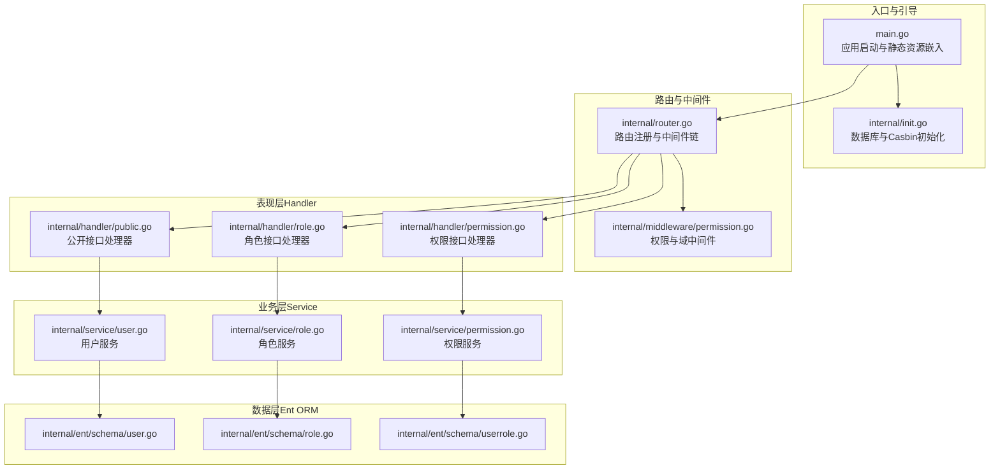
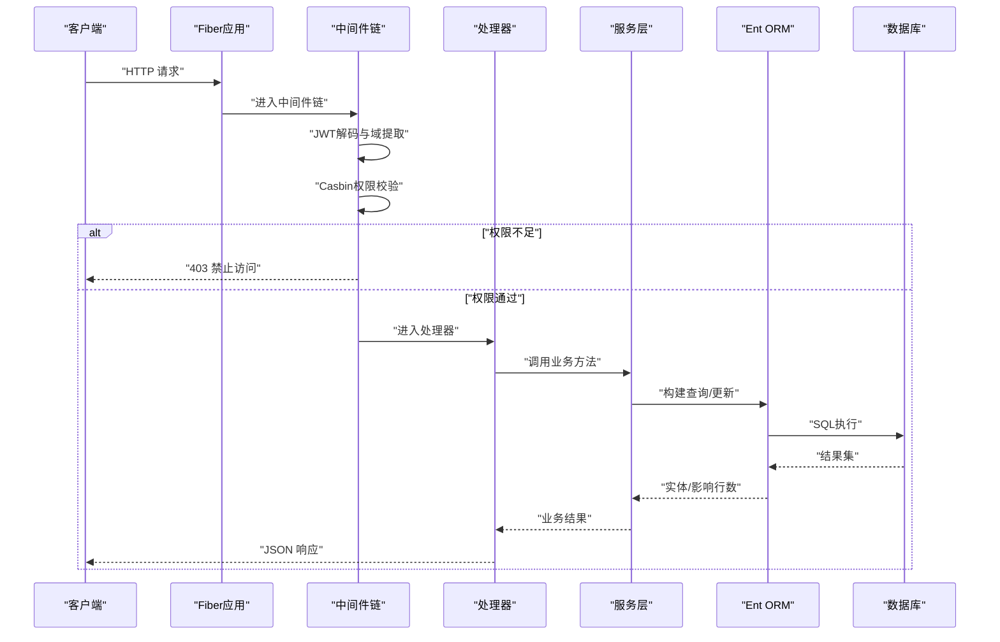
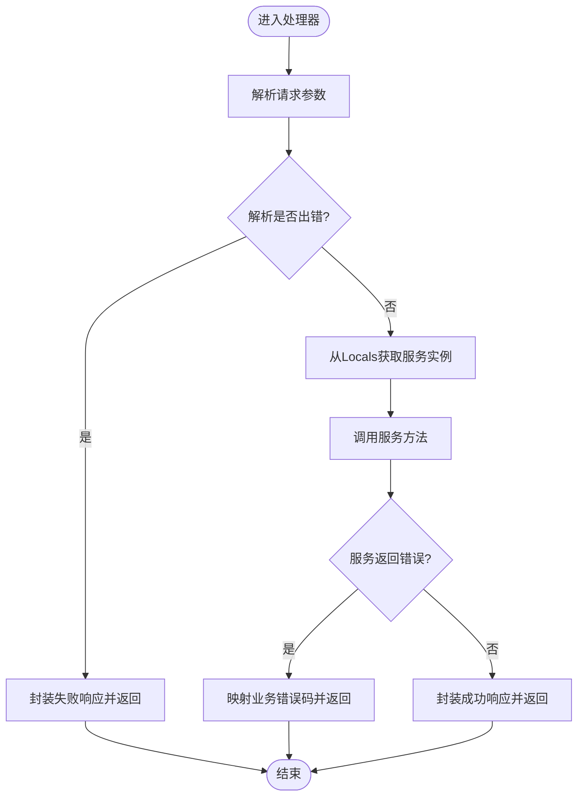
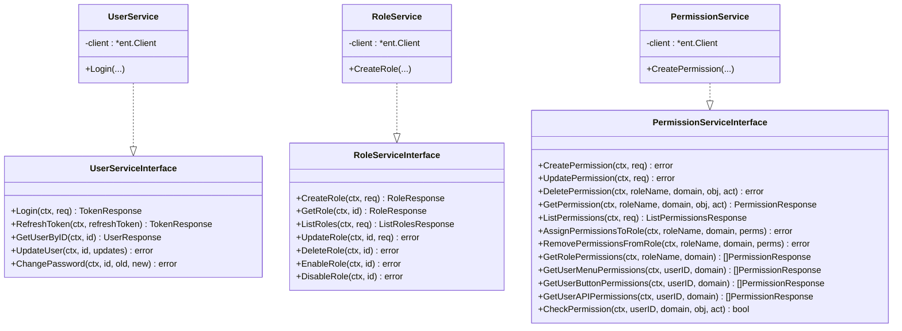
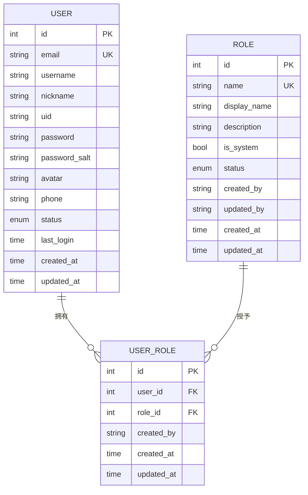
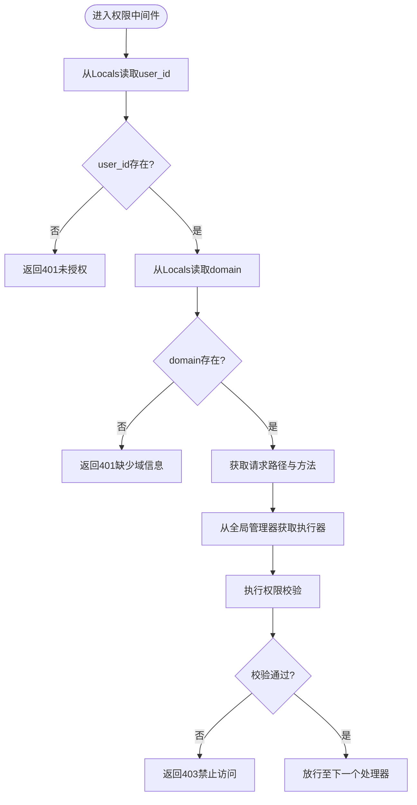
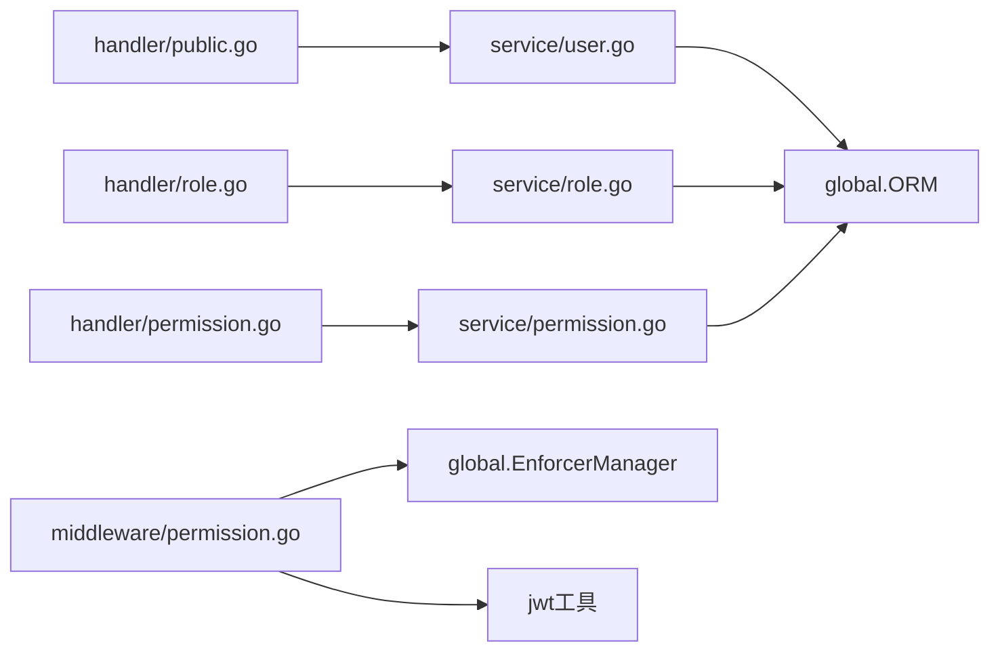

# 分层架构设计

<cite>
**本文引用的文件**   
- [main.go](file://main.go)
- [init.go](file://internal/init.go)
- [router.go](file://internal/router.go)
- [global.go](file://internal/global/global.go)
- [permission.go](file://internal/middleware/permission.go)
- [public.go](file://internal/handler/public.go)
- [role.go](file://internal/handler/role.go)
- [permission.go](file://internal/handler/permission.go)
- [user.go](file://internal/service/user.go)
- [role.go](file://internal/service/role.go)
- [permission.go](file://internal/service/permission.go)
- [response.go](file://internal/utils/response.go)
- [user.go](file://internal/ent/schema/user.go)
- [role.go](file://internal/ent/schema/role.go)
- [userrole.go](file://internal/ent/schema/userrole.go)
</cite>

## 目录
1. [引言](#引言)
2. [项目结构](#项目结构)
3. [核心组件](#核心组件)
4. [架构总览](#架构总览)
5. [详细组件分析](#详细组件分析)
6. [依赖分析](#依赖分析)
7. [性能考虑](#性能考虑)
8. [故障排查指南](#故障排查指南)
9. [结论](#结论)
10. [附录](#附录)

## 引言
本设计文档面向 Go Admin 管理系统，聚焦其分层架构：表现层（Handler）、业务层（Service）、数据层（Ent ORM）。文档阐述各层职责与边界、数据传递方式与调用关系，解释中间件层如何处理认证、权限校验等横切关注点，并给出接口定义、依赖注入机制与错误处理策略。同时提供架构图与数据流示例，帮助开发者快速理解与维护系统。

## 项目结构
系统采用“入口应用 -> 路由注册 -> 中间件链 -> 处理器 -> 服务 -> ORM”的标准分层组织方式。入口通过引导框架完成初始化、中间件挂载与路由注册；路由按版本与权限分组，绑定处理器；处理器负责参数解析与响应封装，调用服务层；服务层编排业务逻辑并访问 ORM；ORM 层基于 Ent 实现数据持久化与查询。

**图表来源**
- [main.go:43-89](file://main.go#L43-L89)
- [init.go:17-65](file://internal/init.go#L17-L65)
- [router.go:14-72](file://internal/router.go#L14-L72)
- [permission.go:11-68](file://internal/middleware/permission.go#L11-L68)
- [public.go:22-45](file://internal/handler/public.go#L22-L45)
- [role.go:14-29](file://internal/handler/role.go#L14-L29)
- [permission.go:24-50](file://internal/handler/permission.go#L24-L50)
- [user.go:27-44](file://internal/service/user.go#L27-L44)
- [role.go:25-48](file://internal/service/role.go#L25-L48)
- [permission.go:92-125](file://internal/service/permission.go#L92-L125)
- [user.go:17-104](file://internal/ent/schema/user.go#L17-L104)
- [role.go:10-73](file://internal/ent/schema/role.go#L10-L73)
- [userrole.go:11-56](file://internal/ent/schema/userrole.go#L11-L56)

**章节来源**
- [main.go:43-89](file://main.go#L43-L89)
- [init.go:17-65](file://internal/init.go#L17-L65)
- [router.go:14-72](file://internal/router.go#L14-L72)

## 核心组件
- 表现层（Handler）
  - 负责接收请求、解析参数、调用服务层、封装响应。
  - 示例：登录、刷新令牌、用户信息、角色增删改查、权限增删改查等。
- 业务层（Service）
  - 定义领域服务接口，实现业务规则与流程编排，访问 ORM 完成数据读写。
  - 示例：用户登录/刷新令牌、角色创建/查询/分页、权限分配/查询等。
- 数据层（Ent ORM）
  - 基于 Ent 的 Schema 定义实体与索引，提供强类型的查询与更新能力。
  - 示例：User、Role、UserRole 等实体模型。
- 中间件层
  - 认证与权限：从 JWT 提取域与用户信息，结合 Casbin 执行器进行权限校验。
- 工具层
  - 统一响应封装，简化错误与成功返回。

**章节来源**
- [public.go:22-45](file://internal/handler/public.go#L22-L45)
- [role.go:14-29](file://internal/handler/role.go#L14-L29)
- [permission.go:24-50](file://internal/handler/permission.go#L24-L50)
- [user.go:27-44](file://internal/service/user.go#L27-L44)
- [role.go:25-48](file://internal/service/role.go#L25-L48)
- [permission.go:92-125](file://internal/service/permission.go#L92-L125)
- [response.go:9-49](file://internal/utils/response.go#L9-L49)

## 架构总览
下图展示一次典型请求从入口到数据层的完整调用链路，以及中间件对认证与权限的横切处理。

**图表来源**
- [router.go:32-51](file://internal/router.go#L32-L51)
- [permission.go:11-52](file://internal/middleware/permission.go#L11-L52)
- [public.go:22-45](file://internal/handler/public.go#L22-L45)
- [user.go:128-206](file://internal/service/user.go#L128-L206)
- [init.go:33-47](file://internal/init.go#L33-L47)

## 详细组件分析

### 表现层（Handler）职责与调用关系
- 职责
  - 参数解析与校验（BodyParser/QueryParser/Params）。
  - 从上下文 Locals 获取服务实例与统一响应工具。
  - 调用服务层执行业务逻辑，根据错误类型映射为合适的 HTTP 状态码。
- 关键调用链
  - 登录：解析请求 -> 调用用户服务 -> 返回令牌。
  - 用户信息：解析JWT -> 查询用户 -> 过滤敏感字段 -> 返回。
  - 角色管理：解析分页参数 -> 调用角色服务 -> 返回结果。
  - 权限管理：解析查询/路径参数 -> 调用权限服务 -> 返回结果。
- 错误处理
  - 对特定业务错误（如用户不存在、密码错误、权限不足）返回明确的错误码与消息。
  - 其他异常统一返回服务器内部错误。

**图表来源**
- [public.go:22-45](file://internal/handler/public.go#L22-L45)
- [role.go:14-29](file://internal/handler/role.go#L14-L29)
- [permission.go:24-50](file://internal/handler/permission.go#L24-L50)

**章节来源**
- [public.go:22-179](file://internal/handler/public.go#L22-L179)
- [role.go:14-152](file://internal/handler/role.go#L14-L152)
- [permission.go:13-506](file://internal/handler/permission.go#L13-L506)

### 业务层（Service）职责与依赖注入
- 职责
  - 定义清晰的接口（UserServiceInterface、RoleServiceInterface、PermissionServiceInterface）。
  - 编排业务流程：参数校验、加密/解密、JWT签发、权限规则存取等。
  - 通过全局 ORM 客户端访问 Ent 模型，执行查询与更新。
- 依赖注入
  - 服务实例通过路由中间件注入到 Fiber 上下文 Locals，处理器直接从 Locals 取用。
  - ORM 客户端通过全局变量注入，避免在构造函数中硬编码。
- 错误处理
  - 明确的业务错误常量（如用户不存在、权限已存在、角色被占用等），便于上层映射。
  - 对外部依赖（如JWT、加密库）的错误进行包装与传播。

**图表来源**
- [user.go:27-44](file://internal/service/user.go#L27-L44)
- [role.go:25-48](file://internal/service/role.go#L25-L48)
- [permission.go:92-125](file://internal/service/permission.go#L92-L125)
- [user.go:36-44](file://internal/service/user.go#L36-L44)
- [role.go:39-48](file://internal/service/role.go#L39-L48)
- [permission.go:115-125](file://internal/service/permission.go#L115-L125)

**章节来源**
- [user.go:27-394](file://internal/service/user.go#L27-L394)
- [role.go:25-396](file://internal/service/role.go#L25-L396)
- [permission.go:92-671](file://internal/service/permission.go#L92-L671)

### 数据层（Ent ORM）模型与查询
- 实体模型
  - User：邮箱、用户名、昵称、头像、状态、最后登录等字段，含索引与时间混入。
  - Role：名称、显示名、描述、系统内置标记、状态、创建/更新人等。
  - UserRole：用户与角色的多对多关联表，含唯一索引与时间混入。
- 查询模式
  - 通过 Ent 查询器构建条件、排序、分页与聚合。
  - 使用事务与更新器进行批量更新与删除。
- 复杂度分析
  - 单表查询：O(log n)（基于索引）+ 结果集大小。
  - 多表关联：取决于 JOIN 策略与过滤条件选择性。

**图表来源**
- [user.go:17-104](file://internal/ent/schema/user.go#L17-L104)
- [role.go:10-73](file://internal/ent/schema/role.go#L10-L73)
- [userrole.go:11-56](file://internal/ent/schema/userrole.go#L11-L56)

**章节来源**
- [user.go:17-104](file://internal/ent/schema/user.go#L17-L104)
- [role.go:10-73](file://internal/ent/schema/role.go#L10-L73)
- [userrole.go:11-56](file://internal/ent/schema/userrole.go#L11-L56)

### 中间件层（认证与权限）
- 域中间件（DomainMiddleware）
  - 从 JWT 中提取域信息并写入上下文，供后续权限中间件使用。
- 权限中间件（PermissionMiddleware）
  - 从上下文获取用户ID与域，构造 Casbin 执行器，执行 Enforce 校验。
  - 若校验失败返回 403，否则放行。
- 与路由集成
  - 在需要认证与权限的路由组中串联 JWT 中间件与域中间件，再接入权限中间件。

**图表来源**
- [permission.go:11-52](file://internal/middleware/permission.go#L11-L52)
- [router.go:32-37](file://internal/router.go#L32-L37)

**章节来源**
- [permission.go:11-68](file://internal/middleware/permission.go#L11-L68)
- [router.go:32-37](file://internal/router.go#L32-L37)

### 接口定义与依赖注入机制
- 接口定义
  - 用户服务接口：Login、RefreshToken、GetUserByID、UpdateUser、ChangePassword。
  - 角色服务接口：CreateRole、GetRole、ListRoles、UpdateRole、DeleteRole、Enable/DisableRole。
  - 权限服务接口：权限增删改查、角色权限管理、用户权限查询、权限校验。
- 依赖注入
  - 服务实例在路由中间件阶段创建并注入到上下文 Locals。
  - ORM 客户端通过全局变量注入，服务层直接使用。

**章节来源**
- [user.go:27-44](file://internal/service/user.go#L27-L44)
- [role.go:25-48](file://internal/service/role.go#L25-L48)
- [permission.go:92-125](file://internal/service/permission.go#L92-L125)
- [router.go:23-37](file://internal/router.go#L23-L37)
- [global.go:10-14](file://internal/global/global.go#L10-L14)

### 错误处理策略
- Handler 层
  - 将业务错误映射为明确的 HTTP 状态码与消息，便于前端统一处理。
- Service 层
  - 使用预定义错误常量，避免魔法字符串；对外部依赖错误进行包装。
- Middleware 层
  - 对 JWT 缺失、权限校验失败等情况返回相应状态码。
- 统一响应
  - 通过统一响应工具封装 code、message、data，保证输出一致性。

**章节来源**
- [public.go:32-42](file://internal/handler/public.go#L32-L42)
- [permission.go:39-49](file://internal/middleware/permission.go#L39-L49)
- [response.go:9-49](file://internal/utils/response.go#L9-L49)

## 依赖分析
- 组件耦合
  - Handler 仅依赖 Service 接口，低耦合高内聚。
  - Service 依赖 Ent ORM，但通过全局客户端隔离具体驱动。
  - Middleware 依赖全局 Casbin 管理器与 JWT 工具。
- 外部依赖
  - Fiber：Web 框架与中间件生态。
  - Ent：ORM 与 Schema 定义。
  - Casbin：策略引擎与执行器管理。
  - JWT：令牌生成与解析。
- 循环依赖
  - 当前结构未见循环依赖，路由、中间件、处理器、服务与 ORM 形成单向依赖链。

**图表来源**
- [public.go:22-45](file://internal/handler/public.go#L22-L45)
- [role.go:14-29](file://internal/handler/role.go#L14-L29)
- [permission.go:24-50](file://internal/handler/permission.go#L24-L50)
- [user.go:36-44](file://internal/service/user.go#L36-L44)
- [role.go:39-48](file://internal/service/role.go#L39-L48)
- [permission.go:115-125](file://internal/service/permission.go#L115-L125)
- [permission.go:11-52](file://internal/middleware/permission.go#L11-L52)
- [global.go:10-14](file://internal/global/global.go#L10-L14)

**章节来源**
- [router.go:14-72](file://internal/router.go#L14-L72)
- [init.go:33-65](file://internal/init.go#L33-L65)

## 性能考虑
- 查询优化
  - 为高频查询字段建立索引（如用户邮箱、角色名称、用户角色唯一组合）。
  - 分页查询限制最大页大小，避免超大结果集。
- 缓存策略
  - 对热点权限规则可引入缓存（如用户权限聚合结果），降低 Casbin 查询压力。
- 并发与事务
  - 批量写入使用 ORM 更新器减少往返次数；必要时使用事务保证一致性。
- 中间件开销
  - JWT 解析与 Casbin 校验为每次请求必经步骤，建议优化执行器获取与缓存策略。

## 故障排查指南
- 登录失败
  - 检查用户是否存在、状态是否激活、密码是否正确。
  - 关注服务层错误映射与响应封装。
- 权限拒绝
  - 确认 JWT 是否包含域信息、域是否正确、Casbin 策略是否配置。
  - 核查中间件链顺序与执行器管理器初始化。
- 数据异常
  - 检查 Ent 查询条件与分页参数，确认索引命中情况。
  - 关注服务层对 Not Found 与重复记录的处理。

**章节来源**
- [public.go:32-42](file://internal/handler/public.go#L32-L42)
- [permission.go:39-49](file://internal/middleware/permission.go#L39-L49)
- [user.go:128-206](file://internal/service/user.go#L128-L206)

## 结论
本系统采用清晰的三层架构：Handler 负责请求与响应、Service 负责业务编排、ORM 负责数据持久化；中间件统一处理认证与权限校验。通过接口抽象与依赖注入，系统具备良好的可测试性与扩展性。建议持续完善缓存与监控，提升整体性能与可观测性。

## 附录
- 数据流向示例（登录）
  - 客户端 -> 路由 -> 中间件（JWT/Casbin）-> 处理器 -> 用户服务 -> ORM -> 数据库 -> 返回令牌。
- 关键文件定位
  - 入口与引导：[main.go](file://main.go)、[init.go](file://internal/init.go)
  - 路由与中间件：[router.go](file://internal/router.go)、[permission.go](file://internal/middleware/permission.go)
  - 处理器：[public.go](file://internal/handler/public.go)、[role.go](file://internal/handler/role.go)、[permission.go](file://internal/handler/permission.go)
  - 服务：[user.go](file://internal/service/user.go)、[role.go](file://internal/service/role.go)、[permission.go](file://internal/service/permission.go)
  - ORM 模型：[user.go](file://internal/ent/schema/user.go)、[role.go](file://internal/ent/schema/role.go)、[userrole.go](file://internal/ent/schema/userrole.go)
  - 统一响应：[response.go](file://internal/utils/response.go)