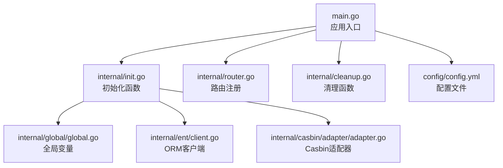
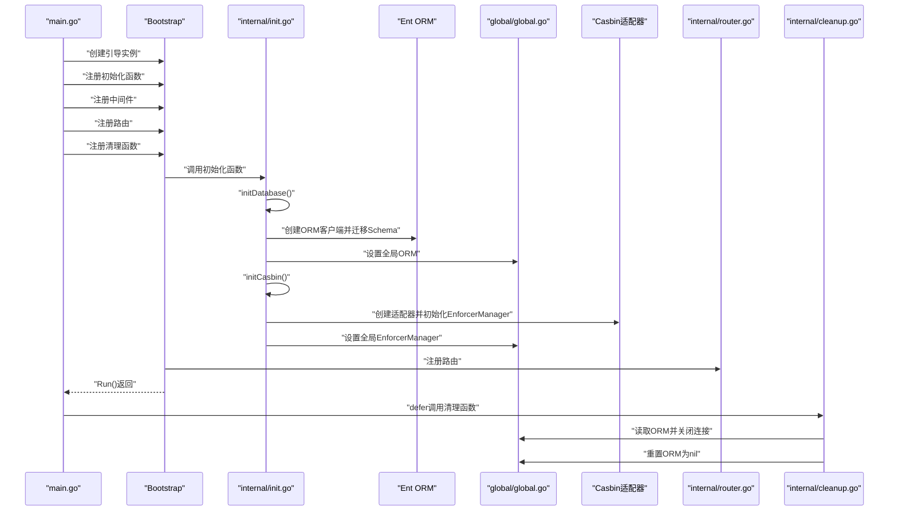
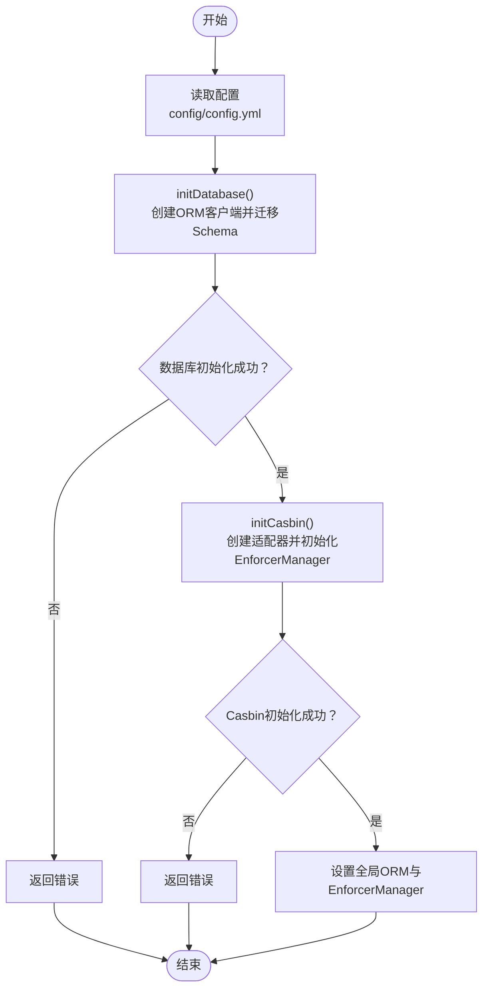
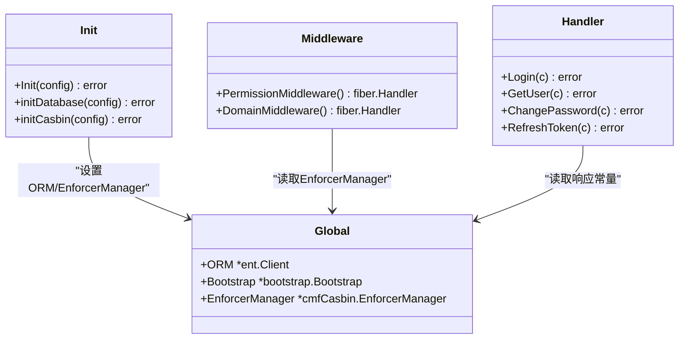
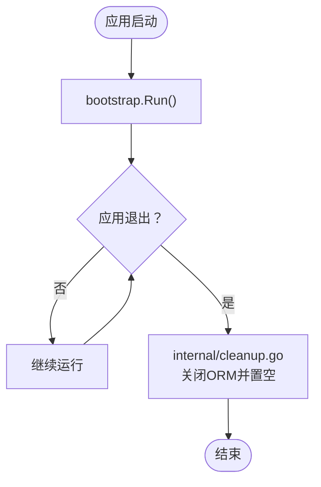
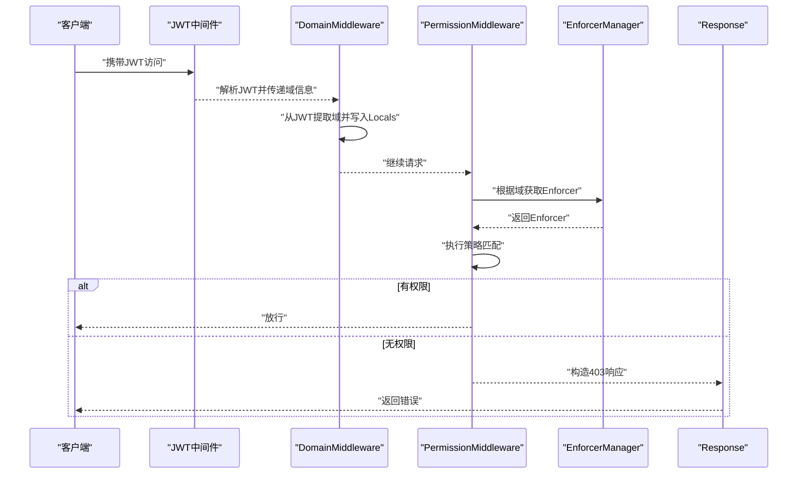
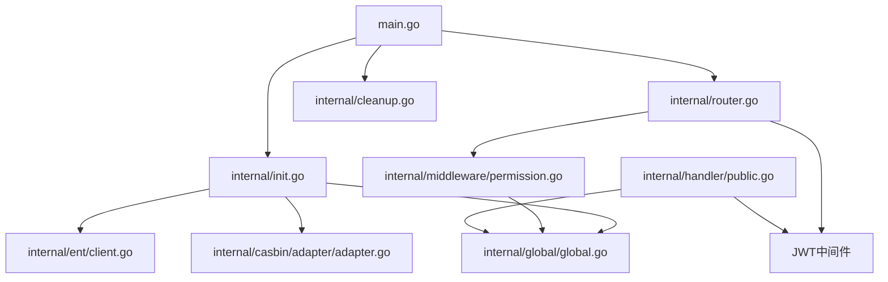

# 初始化流程

<cite>
**本文引用的文件**
- [main.go](file://main.go)
- [internal/init.go](file://internal/init.go)
- [internal/cleanup.go](file://internal/cleanup.go)
- [internal/global/global.go](file://internal/global/global.go)
- [config/config.yml](file://config/config.yml)
- [internal/router.go](file://internal/router.go)
- [internal/casbin/adapter/adapter.go](file://internal/casbin/adapter/adapter.go)
- [internal/ent/client.go](file://internal/ent/client.go)
- [internal/middleware/permission.go](file://internal/middleware/permission.go)
- [internal/handler/public.go](file://internal/handler/public.go)
- [internal/utils/response.go](file://internal/utils/response.go)
- [internal/global/msg.go](file://internal/global/msg.go)
</cite>

## 目录
1. [简介](#简介)
2. [项目结构](#项目结构)
3. [核心组件](#核心组件)
4. [架构总览](#架构总览)
5. [详细组件分析](#详细组件分析)
6. [依赖分析](#依赖分析)
7. [性能考虑](#性能考虑)
8. [故障排除指南](#故障排除指南)
9. [结论](#结论)

## 简介
本文档面向Go Admin管理系统，系统化梳理应用启动时的初始化流程与资源清理流程，重点覆盖：
- 应用启动初始化顺序：数据库初始化、Casbin权限系统初始化、全局配置设置
- 依赖注入机制与全局变量使用
- 资源清理与关闭流程
- 初始化错误处理、配置验证与环境检查
- 提供初始化流程图与故障排除指南

## 项目结构
系统采用分层与模块化组织方式，入口文件负责引导框架生命周期，内部模块负责具体初始化逻辑与路由注册，全局包存放跨模块共享的全局状态。

图表来源
- [main.go:43-89](file://main.go#L43-L89)
- [internal/init.go:17-65](file://internal/init.go#L17-L65)
- [internal/router.go:14-72](file://internal/router.go#L14-L72)
- [internal/cleanup.go:7-19](file://internal/cleanup.go#L7-L19)
- [internal/global/global.go:10-14](file://internal/global/global.go#L10-L14)
- [internal/ent/client.go:41-53](file://internal/ent/client.go#L41-L53)
- [internal/casbin/adapter/adapter.go:97-113](file://internal/casbin/adapter/adapter.go#L97-L113)
- [config/config.yml:1-143](file://config/config.yml#L1-L143)

章节来源
- [main.go:43-89](file://main.go#L43-L89)
- [internal/init.go:17-65](file://internal/init.go#L17-L65)
- [internal/router.go:14-72](file://internal/router.go#L14-L72)
- [internal/cleanup.go:7-19](file://internal/cleanup.go#L7-L19)
- [internal/global/global.go:10-14](file://internal/global/global.go#L10-L14)
- [config/config.yml:1-143](file://config/config.yml#L1-L143)

## 核心组件
- 应用入口与生命周期引导：main.go通过引导框架注册初始化函数、中间件、路由与清理函数，并在defer中确保最终清理。
- 初始化函数：internal/init.go按序完成数据库初始化与Casbin权限系统初始化。
- 全局状态：internal/global/global.go定义ORM、Bootstrap、EnforcerManager等全局变量，供其他模块使用。
- ORM客户端：internal/ent/client.go提供Ent ORM客户端及Schema管理能力。
- Casbin适配器：internal/casbin/adapter/adapter.go提供基于Ent的策略持久化适配器。
- 路由与中间件：internal/router.go注册API路由；internal/middleware/permission.go提供JWT域解析与权限校验中间件。
- 配置：config/config.yml提供应用、日志、数据库、缓存、Redis、文件系统、Casbin等配置项。
- 清理函数：internal/cleanup.go负责关闭ORM连接并重置全局状态。

章节来源
- [main.go:43-89](file://main.go#L43-L89)
- [internal/init.go:17-65](file://internal/init.go#L17-L65)
- [internal/global/global.go:10-14](file://internal/global/global.go#L10-L14)
- [internal/ent/client.go:41-53](file://internal/ent/client.go#L41-L53)
- [internal/casbin/adapter/adapter.go:97-113](file://internal/casbin/adapter/adapter.go#L97-L113)
- [internal/router.go:14-72](file://internal/router.go#L14-L72)
- [internal/middleware/permission.go:11-69](file://internal/middleware/permission.go#L11-L69)
- [config/config.yml:1-143](file://config/config.yml#L1-L143)
- [internal/cleanup.go:7-19](file://internal/cleanup.go#L7-L19)

## 架构总览
下图展示应用启动时的关键交互与数据流，体现初始化顺序、依赖注入与全局变量的使用。

图表来源
- [main.go:43-89](file://main.go#L43-L89)
- [internal/init.go:17-65](file://internal/init.go#L17-L65)
- [internal/global/global.go:10-14](file://internal/global/global.go#L10-L14)
- [internal/ent/client.go:41-53](file://internal/ent/client.go#L41-L53)
- [internal/casbin/adapter/adapter.go:97-113](file://internal/casbin/adapter/adapter.go#L97-L113)
- [internal/router.go:14-72](file://internal/router.go#L14-L72)
- [internal/cleanup.go:7-19](file://internal/cleanup.go#L7-L19)

## 详细组件分析

### 初始化流程（数据库与Casbin）
初始化流程严格遵循“先数据库，后Casbin”的顺序，确保Casbin策略存储依赖于已就绪的ORM。

图表来源
- [internal/init.go:17-65](file://internal/init.go#L17-L65)
- [config/config.yml:19-31](file://config/config.yml#L19-L31)
- [internal/ent/client.go:41-53](file://internal/ent/client.go#L41-L53)
- [internal/casbin/adapter/adapter.go:97-113](file://internal/casbin/adapter/adapter.go#L97-L113)
- [internal/global/global.go:10-14](file://internal/global/global.go#L10-L14)

章节来源
- [internal/init.go:17-65](file://internal/init.go#L17-L65)
- [config/config.yml:19-31](file://config/config.yml#L19-L31)
- [internal/ent/client.go:41-53](file://internal/ent/client.go#L41-L53)
- [internal/casbin/adapter/adapter.go:97-113](file://internal/casbin/adapter/adapter.go#L97-L113)
- [internal/global/global.go:10-14](file://internal/global/global.go#L10-L14)

### 依赖注入机制与全局变量
- 全局变量集中定义于global包，包括ORM客户端、Bootstrap实例、Casbin执行器管理器。
- 初始化阶段将ORM与EnforcerManager写入全局变量，后续中间件与处理器通过global包读取。
- 路由注册阶段通过Locals注入服务实例，形成局部依赖注入与全局共享变量的混合模式。

图表来源
- [internal/global/global.go:10-14](file://internal/global/global.go#L10-L14)
- [internal/init.go:17-65](file://internal/init.go#L17-L65)
- [internal/middleware/permission.go:11-69](file://internal/middleware/permission.go#L11-L69)
- [internal/handler/public.go:13-179](file://internal/handler/public.go#L13-L179)
- [internal/utils/response.go:9-49](file://internal/utils/response.go#L9-L49)
- [internal/global/msg.go:3-45](file://internal/global/msg.go#L3-L45)

章节来源
- [internal/global/global.go:10-14](file://internal/global/global.go#L10-L14)
- [internal/init.go:17-65](file://internal/init.go#L17-L65)
- [internal/middleware/permission.go:11-69](file://internal/middleware/permission.go#L11-L69)
- [internal/handler/public.go:13-179](file://internal/handler/public.go#L13-L179)
- [internal/utils/response.go:9-49](file://internal/utils/response.go#L9-L49)
- [internal/global/msg.go:3-45](file://internal/global/msg.go#L3-L45)

### 资源清理与关闭流程
- 应用退出前通过defer触发清理函数，确保ORM连接被正确关闭。
- 清理函数在关闭后将全局ORM置空，避免重复关闭导致的异常。

图表来源
- [main.go:80-84](file://main.go#L80-L84)
- [internal/cleanup.go:7-19](file://internal/cleanup.go#L7-L19)

章节来源
- [main.go:80-84](file://main.go#L80-L84)
- [internal/cleanup.go:7-19](file://internal/cleanup.go#L7-L19)

### API权限控制流程
权限控制通过中间件链实现：JWT域解析中间件先解析JWT中的域信息，再由权限中间件基于EnforcerManager进行策略匹配。

图表来源
- [internal/middleware/permission.go:11-69](file://internal/middleware/permission.go#L11-L69)
- [internal/global/global.go:10-14](file://internal/global/global.go#L10-L14)
- [internal/utils/response.go:9-49](file://internal/utils/response.go#L9-L49)
- [internal/global/msg.go:3-45](file://internal/global/msg.go#L3-L45)

章节来源
- [internal/middleware/permission.go:11-69](file://internal/middleware/permission.go#L11-L69)
- [internal/global/global.go:10-14](file://internal/global/global.go#L10-L14)
- [internal/utils/response.go:9-49](file://internal/utils/response.go#L9-L49)
- [internal/global/msg.go:3-45](file://internal/global/msg.go#L3-L45)

## 依赖分析
- main.go依赖bootstrap框架提供的生命周期钩子，注册初始化、中间件、路由与清理函数。
- internal/init.go依赖ORM库与Casbin库，以及全局包。
- internal/casbin/adapter/adapter.go依赖Ent ORM客户端，用于策略表的Schema创建与事务封装。
- internal/router.go依赖JWT中间件与权限中间件，形成认证与授权链路。
- internal/middleware/permission.go依赖global包中的EnforcerManager与utils包中的响应工具。
- internal/handler/public.go依赖service层与jwt库，结合全局响应常量输出统一响应。

图表来源
- [main.go:43-89](file://main.go#L43-L89)
- [internal/init.go:17-65](file://internal/init.go#L17-L65)
- [internal/router.go:14-72](file://internal/router.go#L14-L72)
- [internal/cleanup.go:7-19](file://internal/cleanup.go#L7-L19)
- [internal/global/global.go:10-14](file://internal/global/global.go#L10-L14)
- [internal/ent/client.go:41-53](file://internal/ent/client.go#L41-L53)
- [internal/casbin/adapter/adapter.go:97-113](file://internal/casbin/adapter/adapter.go#L97-L113)
- [internal/middleware/permission.go:11-69](file://internal/middleware/permission.go#L11-L69)
- [internal/handler/public.go:13-179](file://internal/handler/public.go#L13-L179)

章节来源
- [main.go:43-89](file://main.go#L43-L89)
- [internal/init.go:17-65](file://internal/init.go#L17-L65)
- [internal/router.go:14-72](file://internal/router.go#L14-L72)
- [internal/cleanup.go:7-19](file://internal/cleanup.go#L7-L19)
- [internal/global/global.go:10-14](file://internal/global/global.go#L10-L14)
- [internal/ent/client.go:41-53](file://internal/ent/client.go#L41-L53)
- [internal/casbin/adapter/adapter.go:97-113](file://internal/casbin/adapter/adapter.go#L97-L113)
- [internal/middleware/permission.go:11-69](file://internal/middleware/permission.go#L11-L69)
- [internal/handler/public.go:13-179](file://internal/handler/public.go#L13-L179)

## 性能考虑
- Casbin多域自动加载：配置中支持为高频访问域开启auto_load，可减少首次访问延迟。
- 批量策略写入：Casbin适配器在保存策略时采用批量插入，降低数据库写入开销。
- 中间件链短路：权限中间件在缺少域或JWT信息时尽早返回，避免无效的策略匹配。
- ORM事务封装：适配器内部使用事务保证策略变更的一致性，同时捕获panic回滚。

章节来源
- [config/config.yml:83-142](file://config/config.yml#L83-L142)
- [internal/casbin/adapter/adapter.go:177-214](file://internal/casbin/adapter/adapter.go#L177-L214)
- [internal/middleware/permission.go:11-69](file://internal/middleware/permission.go#L11-L69)
- [internal/casbin/adapter/adapter.go:304-325](file://internal/casbin/adapter/adapter.go#L304-L325)

## 故障排除指南
- 数据库初始化失败
  - 现象：应用启动时报数据库连接或Schema迁移错误。
  - 排查要点：检查config.yml中的数据库连接参数（driver、host、port、user、password、name、table_prefix）是否正确；确认数据库服务可用且具备相应权限。
  - 相关位置
    - [internal/init.go:33-47](file://internal/init.go#L33-L47)
    - [config/config.yml:19-31](file://config/config.yml#L19-L31)
- Casbin初始化失败
  - 现象：EnforcerManager未正确初始化，权限中间件报错。
  - 排查要点：确认initDatabase已成功；检查Casbin配置（domains_default、domains）是否有效；查看适配器创建与EnforcerManager初始化日志。
  - 相关位置
    - [internal/init.go:49-65](file://internal/init.go#L49-L65)
    - [internal/casbin/adapter/adapter.go:97-113](file://internal/casbin/adapter/adapter.go#L97-L113)
    - [config/config.yml:77-142](file://config/config.yml#L77-L142)
- 权限中间件返回403
  - 现象：用户登录后访问受控接口返回403。
  - 排查要点：确认JWT中包含域信息；检查EnforcerManager是否按域正确加载策略；核对请求路径与方法是否匹配策略。
  - 相关位置
    - [internal/middleware/permission.go:11-69](file://internal/middleware/permission.go#L11-L69)
    - [internal/global/global.go:10-14](file://internal/global/global.go#L10-L14)
- 清理阶段报错
  - 现象：应用退出时清理函数报错。
  - 排查要点：确认ORM连接已关闭；避免重复关闭；检查全局ORM是否已被置空。
  - 相关位置
    - [internal/cleanup.go:7-19](file://internal/cleanup.go#L7-L19)
    - [main.go:80-84](file://main.go#L80-L84)

章节来源
- [internal/init.go:33-65](file://internal/init.go#L33-L65)
- [config/config.yml:19-31](file://config/config.yml#L19-L31)
- [internal/casbin/adapter/adapter.go:97-113](file://internal/casbin/adapter/adapter.go#L97-L113)
- [config/config.yml:77-142](file://config/config.yml#L77-L142)
- [internal/middleware/permission.go:11-69](file://internal/middleware/permission.go#L11-L69)
- [internal/global/global.go:10-14](file://internal/global/global.go#L10-L14)
- [internal/cleanup.go:7-19](file://internal/cleanup.go#L7-L19)
- [main.go:80-84](file://main.go#L80-L84)

## 结论
Go Admin管理系统的初始化流程清晰地将数据库与权限系统初始化串联起来，配合全局变量与中间件链实现了认证与授权的统一入口。通过配置驱动与适配器模式，系统具备良好的扩展性与可维护性。建议在生产环境中：
- 明确配置项校验与环境检查（如数据库连通性、Casbin模型完整性），在初始化阶段提前暴露问题。
- 对关键初始化步骤增加更细粒度的日志与监控指标，便于定位性能瓶颈。
- 在高并发场景下，合理配置Casbin多域auto_load与批量策略写入策略，优化权限检查性能。