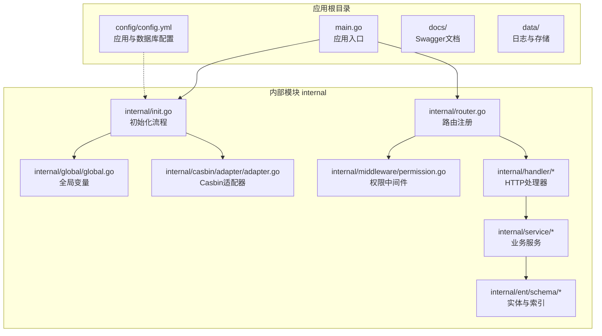
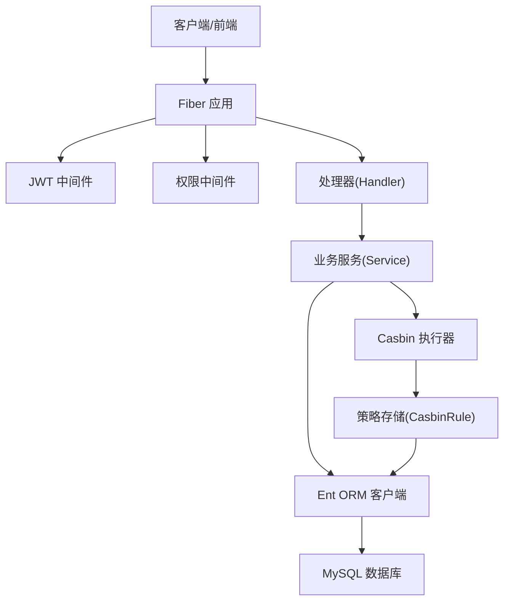
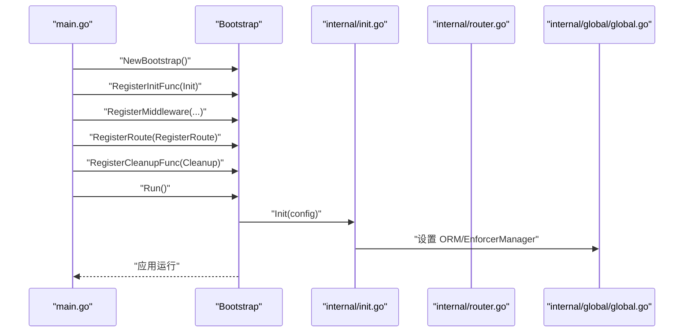
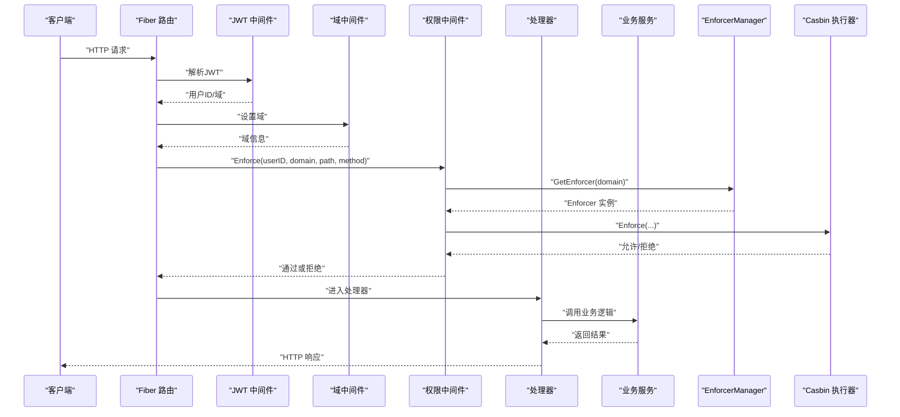
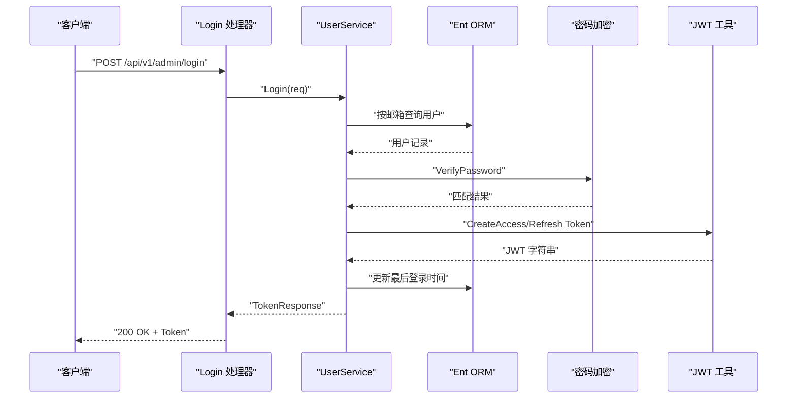
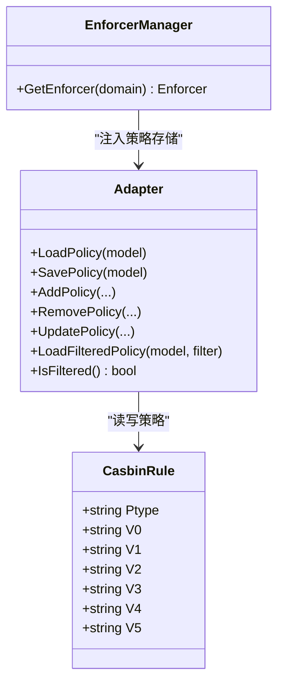
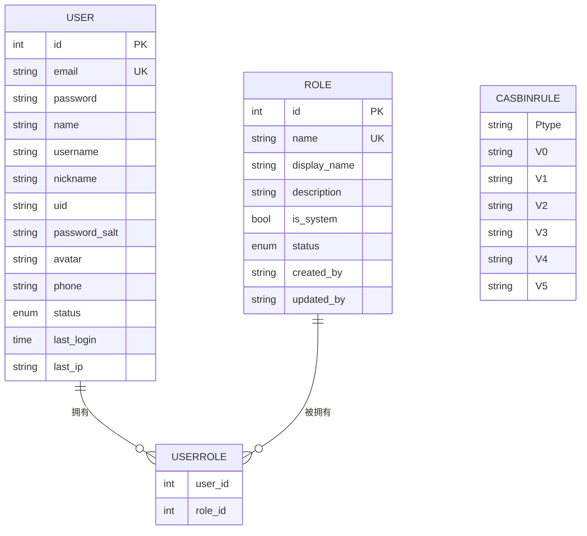
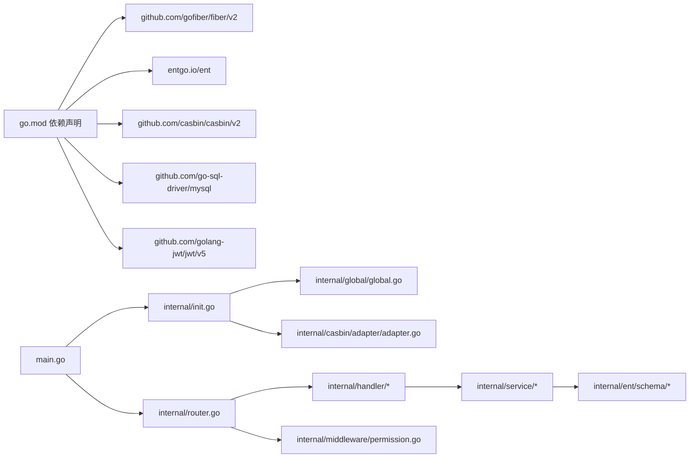
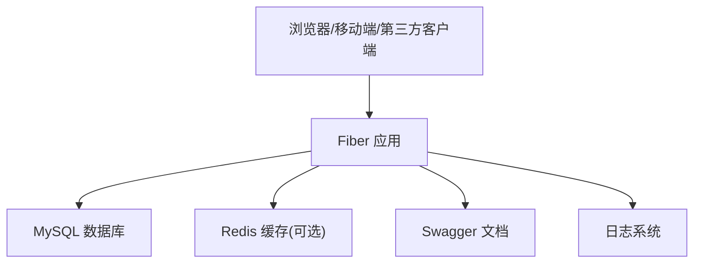

# 整体架构

<cite>
**本文引用的文件**
- [main.go](file://main.go)
- [init.go](file://internal/init.go)
- [router.go](file://internal/router.go)
- [global.go](file://internal/global/global.go)
- [config.yml](file://config/config.yml)
- [adapter.go](file://internal/casbin/adapter/adapter.go)
- [permission.go](file://internal/middleware/permission.go)
- [public.go](file://internal/handler/public.go)
- [user.go](file://internal/service/user.go)
- [permission.go](file://internal/handler/permission.go)
- [permission.go](file://internal/service/permission.go)
- [user.go](file://internal/ent/schema/user.go)
- [role.go](file://internal/ent/schema/role.go)
- [casbinrule.go](file://internal/ent/schema/casbinrule.go)
- [go.mod](file://go.mod)
</cite>

## 目录
1. [引言](#引言)
2. [项目结构](#项目结构)
3. [核心组件](#核心组件)
4. [架构总览](#架构总览)
5. [详细组件分析](#详细组件分析)
6. [依赖分析](#依赖分析)
7. [性能考虑](#性能考虑)
8. [故障排查指南](#故障排查指南)
9. [结论](#结论)
10. [附录](#附录)

## 引言
本文件面向Go Admin管理系统，提供整体架构文档。系统采用分层架构模式，分为表现层（Fiber Web框架）、数据访问层（Ent ORM）与权限控制层（Casbin）。本文将阐述系统边界、组件划分、启动流程、组件间依赖与交互方式，并给出系统上下文图与关键流程图，帮助开发者与运维人员快速理解与维护系统。

## 项目结构
系统采用模块化组织，主要目录与职责如下：
- internal：核心业务逻辑，包含路由、中间件、处理器、服务层、实体定义与全局变量等
- config：应用配置与Casbin策略模型配置
- data：日志与存储目录
- docs：Swagger文档
- .trae：规则与文档（仓库中未深入分析）

图表来源
- [main.go:43-89](file://main.go#L43-L89)
- [init.go:17-65](file://internal/init.go#L17-L65)
- [router.go:14-72](file://internal/router.go#L14-L72)
- [global.go:10-14](file://internal/global/global.go#L10-L14)
- [config.yml:1-143](file://config/config.yml#L1-L143)

章节来源
- [main.go:1-90](file://main.go#L1-L90)
- [init.go:1-66](file://internal/init.go#L1-L66)
- [router.go:1-73](file://internal/router.go#L1-L73)
- [global.go:1-15](file://internal/global/global.go#L1-L15)
- [config.yml:1-143](file://config/config.yml#L1-L143)

## 核心组件
- 表现层（Web层）
  - Fiber应用：负责路由注册、静态资源托管、中间件链路与HTTP请求处理
  - Swagger文档：通过注解与工具生成API文档
- 数据访问层（ORM层）
  - Ent ORM：自动生成客户端与Schema，提供类型安全的数据访问
  - 数据库：MySQL驱动，连接池与表前缀配置
- 权限控制层（RBAC）
  - Casbin：基于策略的访问控制，策略持久化至数据库
  - 自定义适配器：将Casbin策略映射到Ent实体，支持批量写入与过滤查询

章节来源
- [main.go:43-89](file://main.go#L43-L89)
- [router.go:14-72](file://internal/router.go#L14-L72)
- [adapter.go:115-175](file://internal/casbin/adapter/adapter.go#L115-L175)
- [config.yml:19-31](file://config/config.yml#L19-L31)

## 架构总览
系统采用三层架构与清晰的分层边界：
- 表现层（Fiber）：接收HTTP请求，解析参数，调用服务层，返回统一响应
- 业务层（Service）：封装领域逻辑，协调ORM与权限校验
- 数据访问层（Ent）：提供强类型查询与事务能力
- 权限控制层（Casbin）：在中间件中进行细粒度API权限校验

图表来源
- [router.go:14-72](file://internal/router.go#L14-L72)
- [permission.go:12-53](file://internal/middleware/permission.go#L12-L53)
- [user.go:28-44](file://internal/service/user.go#L28-L44)
- [adapter.go:115-175](file://internal/casbin/adapter/adapter.go#L115-L175)
- [global.go:10-14](file://internal/global/global.go#L10-L14)

## 详细组件分析

### 组件A：系统启动流程
系统启动顺序：main -> 初始化（数据库与Casbin）-> 注册路由与中间件 -> 运行应用

图表来源
- [main.go:43-89](file://main.go#L43-L89)
- [init.go:17-65](file://internal/init.go#L17-L65)
- [router.go:14-72](file://internal/router.go#L14-L72)
- [global.go:10-14](file://internal/global/global.go#L10-L14)

章节来源
- [main.go:43-89](file://main.go#L43-L89)
- [init.go:17-65](file://internal/init.go#L17-L65)

### 组件B：权限中间件与API校验
权限中间件在JWT之后执行，从JWT载荷提取域与用户ID，结合Casbin执行器进行策略匹配。

图表来源
- [router.go:32-52](file://internal/router.go#L32-L52)
- [permission.go:12-53](file://internal/middleware/permission.go#L12-L53)
- [global.go:10-14](file://internal/global/global.go#L10-L14)

章节来源
- [router.go:32-52](file://internal/router.go#L32-L52)
- [permission.go:12-53](file://internal/middleware/permission.go#L12-L53)

### 组件C：用户登录与令牌发放
登录流程包含用户校验、状态检查、密码验证、JWT签发与最后登录时间更新。

图表来源
- [public.go:22-45](file://internal/handler/public.go#L22-L45)
- [user.go:128-206](file://internal/service/user.go#L128-L206)

章节来源
- [public.go:22-45](file://internal/handler/public.go#L22-L45)
- [user.go:128-206](file://internal/service/user.go#L128-L206)

### 组件D：权限模型与策略存储
系统使用多域RBAC模型，策略存储于CasbinRule表，适配器支持批量写入与过滤查询。

图表来源
- [casbinrule.go:15-36](file://internal/ent/schema/casbinrule.go#L15-L36)
- [adapter.go:115-175](file://internal/casbin/adapter/adapter.go#L115-L175)
- [adapter.go:304-325](file://internal/casbin/adapter/adapter.go#L304-L325)

章节来源
- [adapter.go:115-175](file://internal/casbin/adapter/adapter.go#L115-L175)
- [adapter.go:304-325](file://internal/casbin/adapter/adapter.go#L304-L325)
- [casbinrule.go:15-36](file://internal/ent/schema/casbinrule.go#L15-L36)

### 组件E：实体模型与索引
用户、角色与策略实体定义了字段、索引与Mixin，确保数据完整性与查询效率。

图表来源
- [user.go:24-80](file://internal/ent/schema/user.go#L24-L80)
- [role.go:16-50](file://internal/ent/schema/role.go#L16-L50)
- [casbinrule.go:15-24](file://internal/ent/schema/casbinrule.go#L15-L24)

章节来源
- [user.go:24-80](file://internal/ent/schema/user.go#L24-L80)
- [role.go:16-50](file://internal/ent/schema/role.go#L16-L50)
- [casbinrule.go:15-24](file://internal/ent/schema/casbinrule.go#L15-L24)

## 依赖分析
- 外部依赖
  - Fiber：Web框架与中间件生态
  - Ent：类型安全ORM与Schema工具链
  - Casbin：策略引擎与适配器
  - MySQL驱动：数据库连接
  - JWT：令牌生成与解析
- 内部依赖
  - 路由依赖中间件与处理器
  - 处理器依赖服务层
  - 服务层依赖ORM与全局配置
  - 初始化阶段建立ORM与Casbin执行器管理器

图表来源
- [go.mod:5-13](file://go.mod#L5-L13)
- [main.go:3-18](file://main.go#L3-L18)
- [init.go:3-15](file://internal/init.go#L3-L15)
- [router.go:3-12](file://internal/router.go#L3-L12)

章节来源
- [go.mod:5-13](file://go.mod#L5-L13)
- [main.go:3-18](file://main.go#L3-L18)
- [init.go:3-15](file://internal/init.go#L3-L15)
- [router.go:3-12](file://internal/router.go#L3-L12)

## 性能考虑
- 数据库层
  - 使用Ent Schema自动生成索引，建议根据查询模式补充复合索引
  - 批量写入策略：适配器支持批量插入，减少事务提交次数
- 权限层
  - 多域模型支持按域缓存执行器，降低动态加载开销
  - 过滤查询支持按域与角色条件过滤，避免全表扫描
- Web层
  - 中间件链路短且职责单一，避免在中间件中做重计算
  - 静态资源通过文件系统中间件直接返回，减少不必要的路由处理

## 故障排查指南
- 启动阶段
  - 数据库连接失败：检查配置文件中的数据库连接参数与网络连通性
  - Schema创建失败：确认数据库权限与表前缀配置
- 运行阶段
  - 权限拒绝：确认JWT中域信息与用户角色映射，检查策略表中对应规则
  - 登录失败：核对用户状态、密码哈希与盐值
- 日志与监控
  - 应用日志输出路径与轮转配置见配置文件
  - 建议在中间件与服务层增加关键路径的日志埋点

章节来源
- [config.yml:11-18](file://config/config.yml#L11-L18)
- [permission.go:12-53](file://internal/middleware/permission.go#L12-L53)
- [user.go:128-206](file://internal/service/user.go#L128-L206)

## 结论
本系统通过Fiber、Ent与Casbin的组合实现了清晰的分层架构与可扩展的权限体系。初始化流程确保ORM与权限执行器在应用启动时就绪；路由与中间件链路简洁高效；服务层封装业务逻辑并与ORM、权限层协作。建议在生产环境中进一步完善索引策略、优化批量写入与缓存策略，并加强可观测性与告警机制。

## 附录
- 系统上下文图（展示系统与外部环境的交互）

图表来源
- [config.yml:42-58](file://config/config.yml#L42-L58)
- [config.yml:11-18](file://config/config.yml#L11-L18)
- [main.go:40-76](file://main.go#L40-L76)