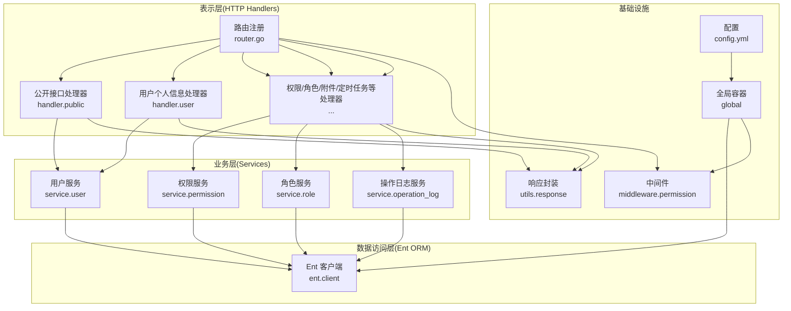
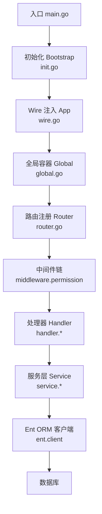
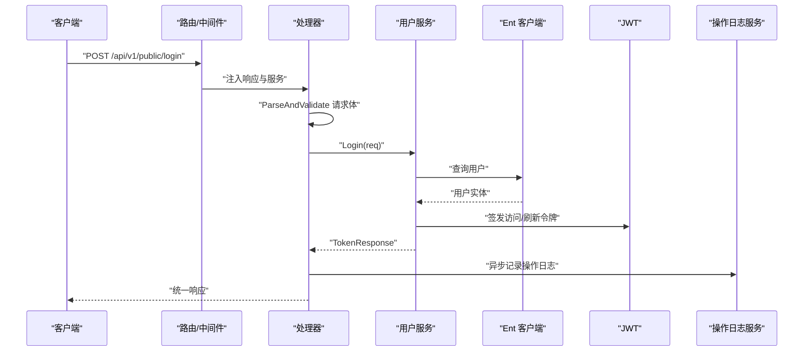
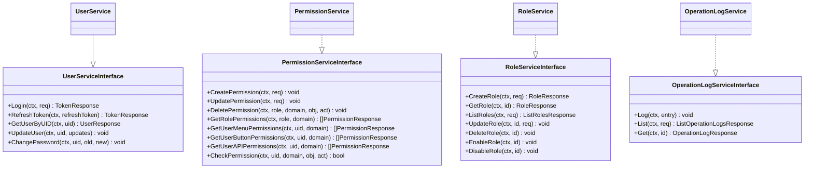
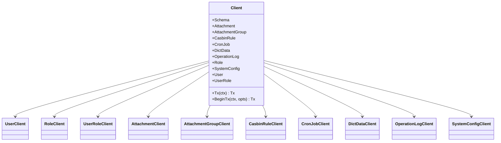
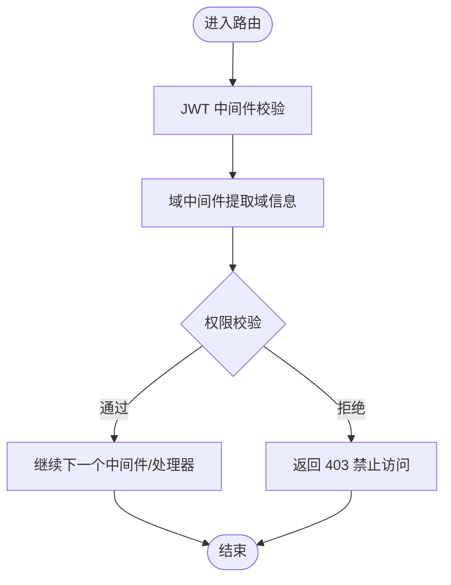
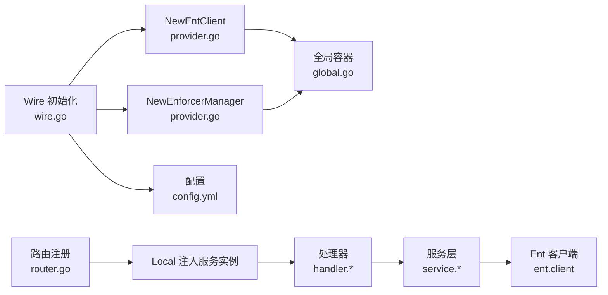

# 整体架构模式

<cite>
**本文档引用的文件**
- [main.go](file://main.go)
- [app.go](file://internal/app.go)
- [router.go](file://internal/router.go)
- [provider.go](file://internal/provider.go)
- [config.yml](file://config/config.yml)
- [public.go](file://internal/handler/public.go)
- [permission.go](file://internal/middleware/permission.go)
- [user.go](file://internal/service/user.go)
- [permission.go](file://internal/service/permission.go)
- [role.go](file://internal/service/role.go)
- [operation_log.go](file://internal/service/operation_log.go)
- [client.go](file://internal/ent/client.go)
- [global.go](file://internal/global/global.go)
- [response.go](file://internal/utils/response.go)
- [init.go](file://internal/init.go)
- [wire.go](file://internal/wire.go)
</cite>

## 目录
1. [简介](#简介)
2. [项目结构](#项目结构)
3. [核心组件](#核心组件)
4. [架构总览](#架构总览)
5. [详细组件分析](#详细组件分析)
6. [依赖分析](#依赖分析)
7. [性能考虑](#性能考虑)
8. [故障排查指南](#故障排查指南)
9. [结论](#结论)
10. [附录](#附录)

## 简介
本文件面向 Go Admin 系统的整体架构模式，围绕分层架构理念，系统化阐述表示层（HTTP Handlers）、业务层（Services）、数据访问层（Ent ORM）的职责划分与交互关系；解释 MVC/MVVM 模式在本项目中的落地方式；明确系统边界、核心模块职责范围与接口设计原则；并给出架构决策的技术考量、性能优化策略与可扩展性设计建议。同时，提供架构图表与组件关系图，说明各层之间的通信协议与错误处理机制。

## 项目结构
Go Admin 采用典型的分层架构组织，结合依赖注入（Wire）与中间件机制，形成清晰的职责边界：
- 表示层：基于 Fiber 框架的 HTTP 路由与处理器，负责请求接入、参数解析、响应封装与中间件链路。
- 业务层：服务层封装领域逻辑与流程编排，协调数据访问与外部能力（如缓存、文件系统、JWT/Casbin 等）。
- 数据访问层：基于 Ent ORM，提供强类型的实体构建器与查询器，屏蔽 SQL 细节，统一事务与迁移管理。
- 全局与基础设施：配置、日志、缓存、文件系统、Casbin 权限引擎、定时任务等。

**图表来源**
- [router.go:16-190](file://internal/router.go#L16-L190)
- [public.go:1-299](file://internal/handler/public.go#L1-L299)
- [user.go:1-427](file://internal/service/user.go#L1-L427)
- [permission.go:1-829](file://internal/service/permission.go#L1-L829)
- [role.go:1-429](file://internal/service/role.go#L1-L429)
- [operation_log.go:1-218](file://internal/service/operation_log.go#L1-L218)
- [client.go:1-800](file://internal/ent/client.go#L1-L800)
- [global.go:11-17](file://internal/global/global.go#L11-L17)
- [response.go:1-50](file://internal/utils/response.go#L1-L50)
- [permission.go:11-80](file://internal/middleware/permission.go#L11-L80)
- [config.yml:1-143](file://config/config.yml#L1-L143)

**章节来源**
- [router.go:16-190](file://internal/router.go#L16-L190)
- [config.yml:1-143](file://config/config.yml#L1-L143)

## 核心组件
- 应用依赖容器 App：集中持有配置、日志、数据库、验证器、缓存、Ent 客户端、Casbin 执行器、文件系统等基础设施。
- 路由与中间件：基于 Fiber 的路由分组与中间件链，统一注入服务实例、响应封装与权限校验。
- 处理器 Handler：面向具体业务的 HTTP 接口，负责参数解析、调用服务、返回统一响应。
- 服务 Service：封装业务规则与流程，协调 Ent ORM 与外部能力，提供幂等与可测试的接口。
- Ent ORM：自动生成的客户端与查询器，提供类型安全的数据访问与事务支持。
- 全局容器 Global：跨模块共享的 ORM、EnforcerManager、CronManager 等。
- 响应封装 Utils：统一的响应结构与状态码映射，简化控制器返回。

**章节来源**
- [app.go:15-26](file://internal/app.go#L15-L26)
- [router.go:16-190](file://internal/router.go#L16-L190)
- [public.go:17-299](file://internal/handler/public.go#L17-L299)
- [user.go:28-427](file://internal/service/user.go#L28-L427)
- [client.go:31-282](file://internal/ent/client.go#L31-L282)
- [global.go:11-17](file://internal/global/global.go#L11-L17)
- [response.go:9-50](file://internal/utils/response.go#L9-L50)

## 架构总览
系统采用“表示层-业务层-数据访问层”的三层分离，配合中间件实现横切关注点（认证、鉴权、日志）。Wire 负责依赖注入，确保各层解耦与可替换；Ent 提供强类型数据访问与迁移能力；Casbin 实现多域 RBAC 权限控制；缓存与文件系统作为可插拔能力参与业务流程。

**图表来源**
- [main.go:47-108](file://main.go#L47-L108)
- [init.go:39-96](file://internal/init.go#L39-L96)
- [wire.go:22-38](file://internal/wire.go#L22-L38)
- [global.go:11-17](file://internal/global/global.go#L11-L17)
- [router.go:16-190](file://internal/router.go#L16-L190)
- [permission.go:11-80](file://internal/middleware/permission.go#L11-L80)
- [public.go:1-299](file://internal/handler/public.go#L1-L299)
- [user.go:1-427](file://internal/service/user.go#L1-L427)
- [client.go:1-800](file://internal/ent/client.go#L1-L800)

## 详细组件分析

### 表示层（HTTP Handlers）
- 职责：接收请求、参数校验、调用服务、封装响应。
- 关键点：
  - 统一响应封装：通过 Local 注入响应工具，保证一致的状态码与消息。
  - 参数校验：利用全局验证器对请求体进行结构化校验。
  - 服务实例注入：在路由中间件中按需注入 UserService、PermissionService、RoleService 等。
- 典型流程：登录 → 参数解析与校验 → 调用用户服务 → 生成 JWT → 记录操作日志 → 返回统一响应。

**图表来源**
- [router.go:49-51](file://internal/router.go#L49-L51)
- [public.go:78-145](file://internal/handler/public.go#L78-L145)
- [user.go:139-218](file://internal/service/user.go#L139-L218)
- [operation_log.go:88-118](file://internal/service/operation_log.go#L88-L118)

**章节来源**
- [public.go:17-299](file://internal/handler/public.go#L17-L299)
- [router.go:16-190](file://internal/router.go#L16-L190)
- [response.go:9-50](file://internal/utils/response.go#L9-L50)

### 业务层（Services）
- 职责：封装业务规则、编排流程、协调数据访问与外部能力。
- 关键点：
  - 用户服务：登录、刷新令牌、用户信息变更、密码修改。
  - 权限服务：权限增删改查、角色权限分配、用户权限查询、权限缓存。
  - 角色服务：角色 CRUD、状态管理、与权限缓存联动。
  - 操作日志服务：异步写入操作日志，支持分页查询。
- 设计原则：接口隔离、错误分类、幂等与可测试性。

**图表来源**
- [user.go:28-35](file://internal/service/user.go#L28-L35)
- [permission.go:96-117](file://internal/service/permission.go#L96-L117)
- [role.go:27-40](file://internal/service/role.go#L27-L40)
- [operation_log.go:18-25](file://internal/service/operation_log.go#L18-L25)

**章节来源**
- [user.go:1-427](file://internal/service/user.go#L1-L427)
- [permission.go:1-829](file://internal/service/permission.go#L1-L829)
- [role.go:1-429](file://internal/service/role.go#L1-L429)
- [operation_log.go:1-218](file://internal/service/operation_log.go#L1-L218)

### 数据访问层（Ent ORM）
- 职责：提供类型安全的实体构建器与查询器，支持事务、钩子与拦截器。
- 关键点：
  - 自动生成的客户端与查询器，屏蔽 SQL 细节。
  - 支持事务与批量操作。
  - 与迁移模块集成，支持 schema 自动迁移。
- 与业务层协作：服务层通过 Ent 客户端执行数据读写，保持业务逻辑与数据访问的清晰边界。

**图表来源**
- [client.go:31-77](file://internal/ent/client.go#L31-L77)
- [client.go:283-580](file://internal/ent/client.go#L283-L580)

**章节来源**
- [client.go:1-800](file://internal/ent/client.go#L1-L800)

### 中间件与权限控制
- JWT 中间件：校验访问令牌，提取用户信息与域信息。
- 权限中间件：基于 Casbin 执行器进行权限校验，支持 API 路径与方法匹配。
- 域中间件：从 JWT 中提取域信息，支持多域权限模型。

**图表来源**
- [permission.go:11-80](file://internal/middleware/permission.go#L11-L80)

**章节来源**
- [permission.go:11-80](file://internal/middleware/permission.go#L11-L80)

### MVC/MVVM 模式应用
- MVC 视角：
  - Model：Ent 实体与查询器（数据模型）。
  - View：前端静态资源与 SPA 路由（由文件系统中间件与 SPA 回退策略支撑）。
  - Controller：处理器（Handler）承担控制器职责，调用服务并返回响应。
- MVVM 视角：
  - ViewModel：由处理器与服务共同构造的响应数据结构，向视图层提供所需数据。
  - Model：服务层封装的业务模型与数据访问。
  - View：前端页面与 API 文档（Swagger）。
- 在本项目中，MVVM 更贴合前后端分离的 SPA 场景：处理器与服务负责数据准备与业务编排，前端负责展示与交互。

**章节来源**
- [router.go:16-190](file://internal/router.go#L16-L190)
- [public.go:1-299](file://internal/handler/public.go#L1-L299)
- [main.go:44-96](file://main.go#L44-L96)

## 依赖分析
- 依赖注入：通过 Wire ProviderSet 与自定义 Provider（如 NewEntClient、NewEnforcerManager）集中管理依赖。
- 运行时注入：路由中间件在运行时将服务实例注入到 Fiber 上下文 Local，供处理器使用。
- 全局共享：全局容器保存 ORM、EnforcerManager、CronManager 等，便于跨模块复用。
- 配置驱动：配置文件决定数据库、缓存、Redis、文件系统、Casbin 等能力的启用与参数。

**图表来源**
- [wire.go:22-38](file://internal/wire.go#L22-L38)
- [provider.go:17-47](file://internal/provider.go#L17-L47)
- [config.yml:1-143](file://config/config.yml#L1-143)
- [global.go:11-17](file://internal/global/global.go#L11-L17)
- [router.go:36-44](file://internal/router.go#L36-L44)

**章节来源**
- [wire.go:1-38](file://internal/wire.go#L1-L38)
- [provider.go:1-47](file://internal/provider.go#L1-L47)
- [router.go:16-190](file://internal/router.go#L16-L190)
- [global.go:11-17](file://internal/global/global.go#L11-L17)

## 性能考虑
- 缓存策略：
  - 权限服务对角色与用户权限结果进行缓存，降低 Casbin 查询压力。
  - 缓存键按域与类型区分，支持失效与批量清理。
- 并发与异步：
  - 操作日志服务采用 goroutine 异步写入，避免阻塞主请求链路。
- 数据库与 ORM：
  - 使用 Ent 的批量创建/更新与预加载（eager loading）减少 N+1 查询。
  - 事务封装与回滚，保证一致性。
- 中间件与路由：
  - 文件系统中间件与 SPA 回退策略减少不必要的 IO，提升静态资源访问效率。
- 配置与连接池：
  - 数据库与 Redis 连接池参数可配置，按环境调整并发与延迟。

**章节来源**
- [permission.go:125-135](file://internal/service/permission.go#L125-L135)
- [permission.go:514-557](file://internal/service/permission.go#L514-L557)
- [permission.go:560-622](file://internal/service/permission.go#L560-L622)
- [operation_log.go:88-118](file://internal/service/operation_log.go#L88-L118)
- [client.go:154-210](file://internal/ent/client.go#L154-L210)
- [main.go:62-96](file://main.go#L62-L96)
- [config.yml:19-76](file://config/config.yml#L19-L76)

## 故障排查指南
- 认证与权限：
  - JWT 中间件返回 401 通常表示令牌缺失或无效；权限中间件返回 403 表示无权限访问。
  - 检查 JWT 中的域信息与请求路径/方法是否匹配。
- 数据访问：
  - Ent 查询报错通常来自实体不存在或约束冲突；检查实体 ID 与唯一性约束。
- 服务错误：
  - 用户服务返回特定错误（如用户不存在、密码错误、状态异常）；权限/角色服务返回相应业务错误。
- 日志与监控：
  - 使用统一响应封装与请求日志中间件定位问题；操作日志服务记录关键操作以便审计。

**章节来源**
- [permission.go:11-80](file://internal/middleware/permission.go#L11-L80)
- [user.go:20-26](file://internal/service/user.go#L20-L26)
- [permission.go:20-26](file://internal/service/permission.go#L20-L26)
- [router.go:17-21](file://internal/router.go#L17-L21)
- [operation_log.go:88-118](file://internal/service/operation_log.go#L88-L118)

## 结论
Go Admin 通过清晰的分层架构与依赖注入，实现了表示层、业务层与数据访问层的职责分离；借助中间件与权限控制，保障了系统的安全性与可维护性；通过缓存、异步与 ORM 优化，兼顾性能与可扩展性。整体设计遵循接口隔离与单一职责原则，具备良好的演进空间与工程实践价值。

## 附录
- 系统边界：
  - 表示层：对外暴露 REST API 与静态资源；内部通过中间件与处理器编排。
  - 业务层：封装领域逻辑与流程，向上提供稳定接口，向下协调数据与外部能力。
  - 数据访问层：提供类型安全的数据访问与事务支持，屏蔽底层差异。
- 接口设计原则：
  - 明确输入输出契约，统一错误码与消息格式。
  - 服务接口最小化，避免跨模块耦合。
  - 数据访问接口以实体为中心，提供查询与变更能力。
- 架构决策的技术考量：
  - Fiber 提供高性能 HTTP 能力与中间件生态。
  - Wire 简化依赖注入，提升可测试性与可维护性。
  - Ent 提供强类型 ORM 与迁移能力，降低数据库抽象成本。
  - Casbin 支持多域 RBAC，满足复杂权限场景。
  - 缓存与异步写入提升用户体验与系统吞吐。