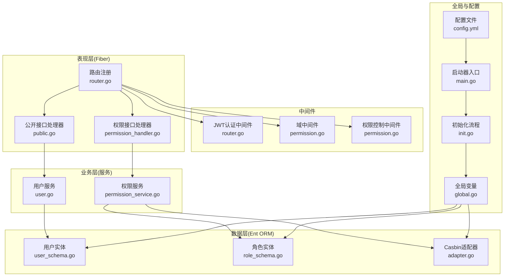
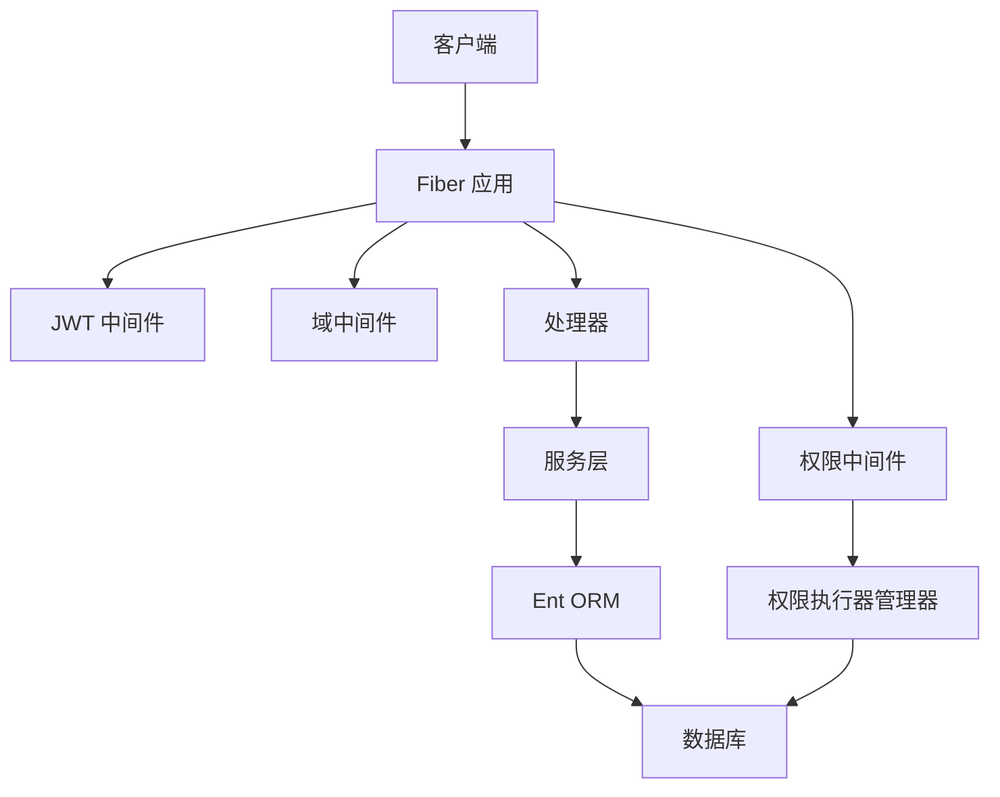
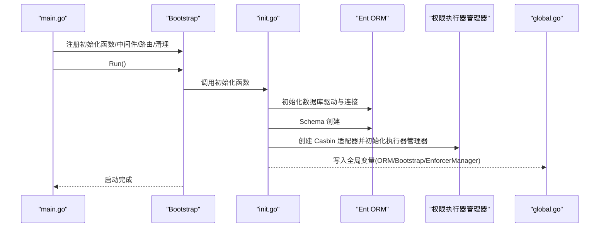
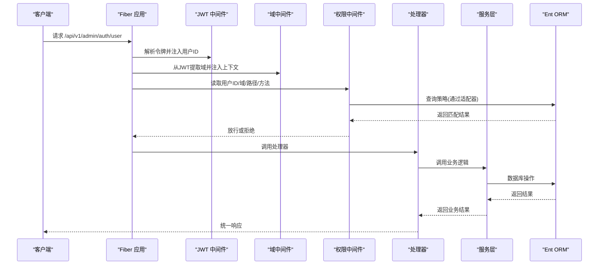
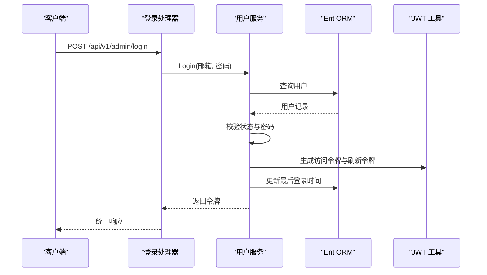
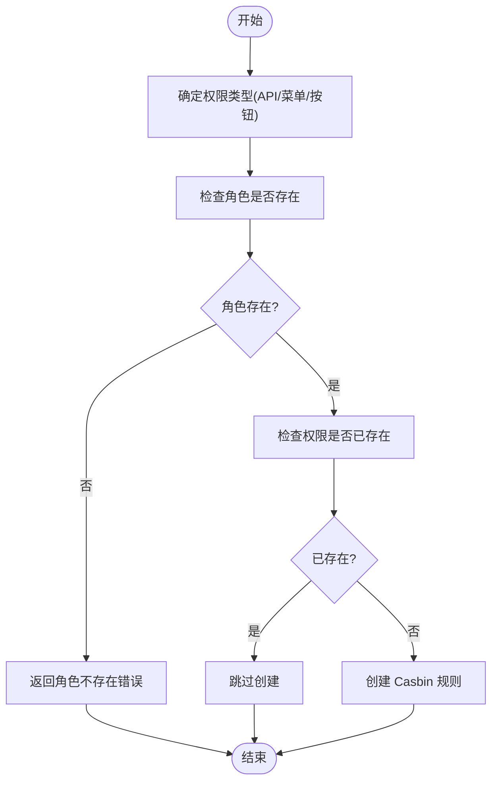
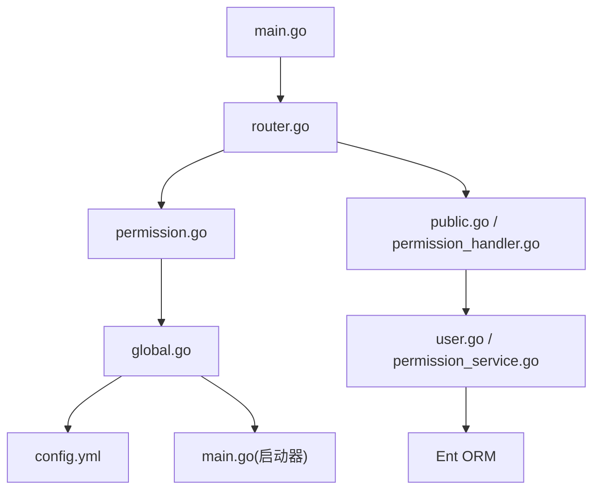

# 架构设计

<cite>
**本文引用的文件**
- [main.go](file://main.go)
- [init.go](file://internal/init.go)
- [router.go](file://internal/router.go)
- [global.go](file://internal/global/global.go)
- [permission.go](file://internal/middleware/permission.go)
- [public.go](file://internal/handler/public.go)
- [user.go](file://internal/service/user.go)
- [adapter.go](file://internal/casbin/adapter/adapter.go)
- [permission_handler.go](file://internal/handler/permission.go)
- [permission_service.go](file://internal/service/permission.go)
- [config.yml](file://config/config.yml)
- [response.go](file://internal/utils/response.go)
- [user_schema.go](file://internal/ent/schema/user.go)
- [role_schema.go](file://internal/ent/schema/role.go)
- [go.mod](file://go.mod)
</cite>

## 目录
1. [引言](#引言)
2. [项目结构](#项目结构)
3. [核心组件](#核心组件)
4. [架构总览](#架构总览)
5. [详细组件分析](#详细组件分析)
6. [依赖分析](#依赖分析)
7. [性能考虑](#性能考虑)
8. [故障排查指南](#故障排查指南)
9. [结论](#结论)
10. [附录](#附录)

## 引言
本项目是一个基于 Go 语言与 Fiber 框架构建的后台管理系统，采用分层架构与中介者模式相结合的设计，通过 JWT 认证与 Casbin 授权实现细粒度的权限控制。系统通过 Bootstrap 启动器统一初始化数据库、权限执行器管理器，并在路由层集成中间件完成认证与授权校验。数据访问层采用 Ent ORM，提供强类型的实体模型与查询能力。

## 项目结构
项目采用按功能域划分的目录组织方式，主要模块如下：
- 表现层：Fiber 路由与处理器，负责接收请求、解析参数、调用服务层并返回统一响应。
- 业务层：服务层封装领域逻辑，协调数据访问与外部依赖。
- 数据层：Ent ORM 实体与查询，提供类型安全的数据访问。
- 中间件：JWT 认证与权限控制中间件，贯穿请求生命周期。
- 全局：全局变量与启动器集成点，集中管理 ORM、权限执行器等共享资源。
- 配置：YAML 配置文件，定义应用、数据库、缓存、Redis、文件系统与 Casbin 多域模型。

图表来源
- [router.go:14-72](file://internal/router.go#L14-L72)
- [public.go:22-45](file://internal/handler/public.go#L22-L45)
- [permission_handler.go:24-50](file://internal/handler/permission.go#L24-L50)
- [user.go:128-206](file://internal/service/user.go#L128-L206)
- [permission_service.go:127-174](file://internal/service/permission_service.go#L127-L174)
- [permission.go:12-52](file://internal/middleware/permission.go#L12-L52)
- [adapter.go:115-125](file://internal/casbin/adapter/adapter.go#L115-L125)
- [global.go:10-14](file://internal/global/global.go#L10-L14)
- [config.yml:1-143](file://config/config.yml#L1-L143)
- [main.go:43-89](file://main.go#L43-L89)
- [init.go:17-65](file://internal/init.go#L17-L65)

章节来源
- [main.go:43-89](file://main.go#L43-L89)
- [init.go:17-65](file://internal/init.go#L17-L65)
- [router.go:14-72](file://internal/router.go#L14-L72)
- [global.go:10-14](file://internal/global/global.go#L10-L14)
- [config.yml:1-143](file://config/config.yml#L1-L143)

## 核心组件
- 启动器与初始化
  - 启动器负责注册初始化函数、中间件、路由与清理函数，统一运行应用生命周期。
  - 初始化流程负责数据库连接与迁移、Casbin 执行器管理器初始化。
- 路由与中间件
  - 路由分组与版本化，公开接口与认证接口分离；JWT 中间件与域中间件负责身份解析与域注入；权限中间件基于 Casbin 执行器进行策略校验。
- 处理器与服务
  - 处理器负责参数解析与响应封装；服务层封装业务逻辑，协调 ORM 与权限校验。
- 数据层与适配器
  - Ent ORM 提供强类型实体与查询；Casbin 适配器将策略持久化到数据库，支持多域模型。
- 统一响应
  - 统一响应结构体封装状态码、消息与数据，简化控制器返回。

章节来源
- [main.go:43-89](file://main.go#L43-L89)
- [init.go:17-65](file://internal/init.go#L17-L65)
- [router.go:14-72](file://internal/router.go#L14-L72)
- [permission.go:12-52](file://internal/middleware/permission.go#L12-L52)
- [public.go:22-45](file://internal/handler/public.go#L22-L45)
- [user.go:128-206](file://internal/service/user.go#L128-L206)
- [adapter.go:115-125](file://internal/casbin/adapter/adapter.go#L115-L125)
- [response.go:9-49](file://internal/utils/response.go#L9-L49)

## 架构总览
系统采用分层架构与中介者模式：
- 分层架构：表现层（Fiber）、业务层（Service）、数据层（Ent ORM），职责清晰、耦合可控。
- 中介者模式：路由作为中介者，编排中间件、处理器与服务层，统一请求处理流程。
- 适配器模式：Casbin 适配器将策略存储抽象为接口，便于替换与扩展。

图表来源
- [router.go:32-37](file://internal/router.go#L32-L37)
- [permission.go:12-52](file://internal/middleware/permission.go#L12-L52)
- [init.go:49-65](file://internal/init.go#L49-L65)
- [adapter.go:115-125](file://internal/casbin/adapter/adapter.go#L115-L125)

## 详细组件分析

### 初始化流程与依赖注入
- 初始化顺序：数据库初始化（驱动选择、连接、Schema 创建）→ Casbin 初始化（适配器创建、执行器管理器注册）。
- 全局注入：ORM 客户端、Bootstrap 实例、权限执行器管理器注入至全局变量，供路由与服务层使用。
- 配置来源：YAML 配置文件提供数据库、缓存、Redis、文件系统与 Casbin 多域模型。

图表来源
- [main.go:43-89](file://main.go#L43-L89)
- [init.go:17-65](file://internal/init.go#L17-L65)
- [global.go:10-14](file://internal/global/global.go#L10-L14)

章节来源
- [main.go:43-89](file://main.go#L43-L89)
- [init.go:17-65](file://internal/init.go#L17-L65)
- [global.go:10-14](file://internal/global/global.go#L10-L14)
- [config.yml:19-31](file://config/config.yml#L19-L31)

### 路由与中间件交互
- 路由分组：/api/v1/admin 下的公开接口与认证接口分别注册。
- 中间件链路：JWT 中间件解析令牌并注入用户信息；域中间件从 JWT 中提取域并注入上下文；权限中间件基于 Casbin 执行器进行策略校验。
- 本地存储：在路由中间件中通过 fiber.Ctx.Locals 注入服务实例与统一响应工具，避免全局依赖。

图表来源
- [router.go:32-37](file://internal/router.go#L32-L37)
- [permission.go:12-52](file://internal/middleware/permission.go#L12-L52)
- [public.go:55-81](file://internal/handler/public.go#L55-L81)
- [user.go:208-228](file://internal/service/user.go#L208-L228)

章节来源
- [router.go:14-72](file://internal/router.go#L14-L72)
- [permission.go:12-52](file://internal/middleware/permission.go#L12-L52)
- [public.go:22-45](file://internal/handler/public.go#L22-L45)

### 用户服务与登录流程
- 登录：根据邮箱查询用户，校验状态与密码，生成访问令牌与刷新令牌，更新最后登录时间。
- 刷新：解析刷新令牌，校验类型与用户状态，重新签发访问令牌。
- 密码修改：校验旧密码，加密新密码并更新。

图表来源
- [public.go:22-45](file://internal/handler/public.go#L22-L45)
- [user.go:128-206](file://internal/service/user.go#L128-L206)
- [user_schema.go:23-80](file://internal/ent/schema/user.go#L23-L80)

章节来源
- [public.go:22-45](file://internal/handler/public.go#L22-L45)
- [user.go:128-206](file://internal/service/user.go#L128-L206)
- [user_schema.go:23-80](file://internal/ent/schema/user.go#L23-L80)

### 权限服务与策略存储
- 权限类型：API、菜单、按钮；权限以 Casbin 规则形式存储，支持按角色、域、对象、动作组合查询。
- 角色权限：为角色批量分配/移除权限，查询角色拥有的全部权限。
- 用户权限：根据用户角色集合查询其菜单、按钮与 API 权限。
- 策略存储：Casbin 适配器通过 Ent ORM 将策略写入数据库表，支持过滤加载与事务保证。

图表来源
- [permission_service.go:127-174](file://internal/service/permission_service.go#L127-L174)
- [adapter.go:115-125](file://internal/casbin/adapter/adapter.go#L115-L125)

章节来源
- [permission_service.go:127-174](file://internal/service/permission_service.go#L127-L174)
- [permission_service.go:356-403](file://internal/service/permission_service.go#L356-L403)
- [permission_service.go:435-464](file://internal/service/permission_service.go#L435-L464)
- [permission_service.go:466-600](file://internal/service/permission_service.go#L466-L600)
- [adapter.go:115-125](file://internal/casbin/adapter/adapter.go#L115-L125)

### 统一响应与错误处理
- 统一响应结构：包含状态码、消息与数据字段，支持 Success/Fail 两种输出路径。
- 错误映射：处理器根据服务层返回的错误类型映射为合适的 HTTP 状态码与提示信息。

章节来源
- [response.go:9-49](file://internal/utils/response.go#L9-L49)
- [public.go:32-42](file://internal/handler/public.go#L32-L42)
- [permission_handler.go:38-49](file://internal/handler/permission.go#L38-L49)

## 依赖分析
- 外部依赖
  - Fiber：Web 框架与中间件生态。
  - Ent：类型安全的 ORM 与 Schema 管理。
  - Casbin：基于策略的访问控制框架。
  - JWT：令牌生成与解析。
  - MySQL 驱动：数据库连接。
- 内部依赖
  - 路由依赖中间件与服务层；服务层依赖 Ent ORM 与全局变量；中间件依赖全局的权限执行器管理器。

图表来源
- [go.mod:5-13](file://go.mod#L5-L13)
- [main.go:43-89](file://main.go#L43-L89)
- [router.go:14-72](file://internal/router.go#L14-L72)
- [permission.go:12-52](file://internal/middleware/permission.go#L12-L52)
- [public.go:22-45](file://internal/handler/public.go#L22-L45)
- [permission_handler.go:24-50](file://internal/handler/permission.go#L24-L50)
- [user.go:128-206](file://internal/service/user.go#L128-L206)
- [permission_service.go:127-174](file://internal/service/permission_service.go#L127-L174)
- [global.go:10-14](file://internal/global/global.go#L10-L14)
- [config.yml:1-143](file://config/config.yml#L1-L143)

章节来源
- [go.mod:5-13](file://go.mod#L5-L13)
- [main.go:43-89](file://main.go#L43-L89)
- [router.go:14-72](file://internal/router.go#L14-L72)
- [permission.go:12-52](file://internal/middleware/permission.go#L12-L52)
- [public.go:22-45](file://internal/handler/public.go#L22-L45)
- [permission_handler.go:24-50](file://internal/handler/permission.go#L24-L50)
- [user.go:128-206](file://internal/service/user.go#L128-L206)
- [permission_service.go:127-174](file://internal/service/permission_service.go#L127-L174)
- [global.go:10-14](file://internal/global/global.go#L10-L14)
- [config.yml:1-143](file://config/config.yml#L1-L143)

## 性能考虑
- 中间件链路短而明确，避免重复解析与计算。
- Casbin 多域模型支持按需自动加载，建议对高频域启用自动加载以减少首次延迟。
- Ent ORM 查询尽量使用索引字段与精确条件，避免全表扫描。
- 事务批处理：Casbin 适配器保存策略时采用批量插入，降低写入开销。
- 缓存与 Redis：可结合配置启用缓存与 Redis 存储，进一步优化热点数据访问。

## 故障排查指南
- 初始化失败
  - 检查数据库连接参数与驱动配置，确认 Schema 创建日志。
  - 关注 Casbin 适配器初始化与执行器管理器注册日志。
- 权限校验失败
  - 确认 JWT 中是否包含域信息；检查权限中间件是否正确注入用户ID与域。
  - 核对 Casbin 规则表中的策略是否完整且类型正确。
- 登录异常
  - 核对用户状态是否为激活；检查密码哈希与盐值是否一致。
  - 确认 JWT 秘钥与过期时间配置。

章节来源
- [init.go:33-47](file://internal/init.go#L33-L47)
- [permission.go:12-52](file://internal/middleware/permission.go#L12-L52)
- [user.go:128-206](file://internal/service/user.go#L128-L206)

## 结论
本系统通过分层架构与中介者模式实现了清晰的职责划分与高内聚低耦合；JWT 与 Casbin 的组合提供了灵活且强大的认证与授权能力；Ent ORM 保障了数据访问的类型安全与可维护性。整体设计在可扩展性、可测试性与可运维性方面具备良好基础，适合在多域场景下演进。

## 附录
- 系统边界
  - 表现层：对外暴露 REST API 与静态资源托管。
  - 业务层：封装领域逻辑与跨服务编排。
  - 数据层：提供类型安全的实体与查询能力。
  - 权限层：基于 Casbin 的策略存储与执行。
- 架构决策与权衡
  - 采用 Fiber 与 Bootstrap 统一启动，简化生命周期管理。
  - 使用 Ent ORM 替代原生 SQL，提升开发效率与安全性。
  - Casbin 多域模型支持租户隔离与业务域扩展。
  - 中间件链路短、职责单一，便于调试与监控。