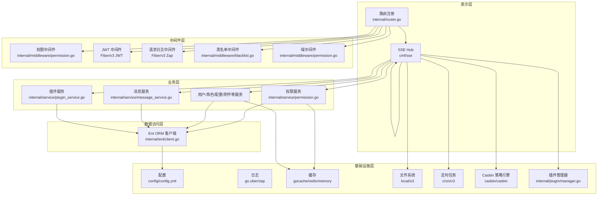
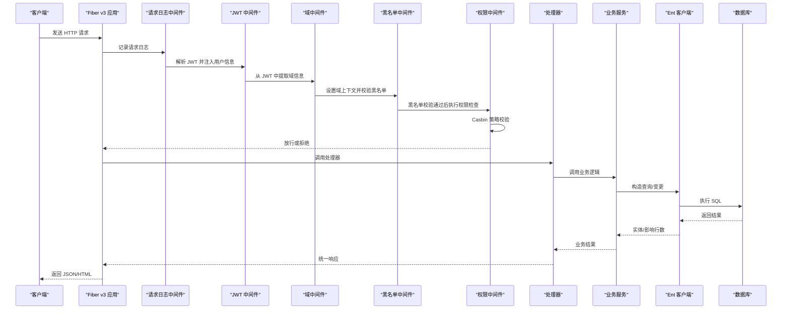
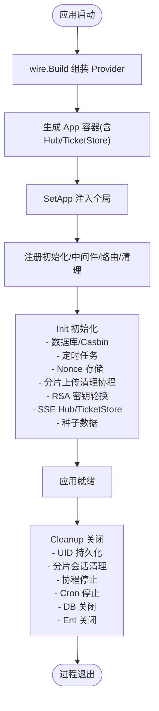
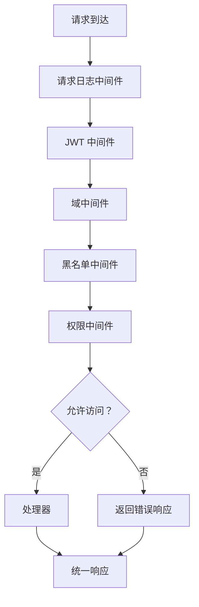
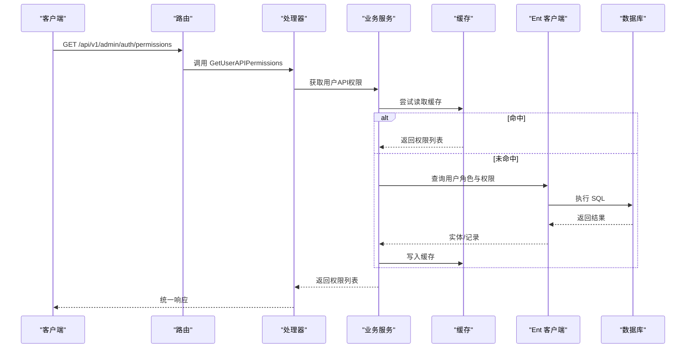
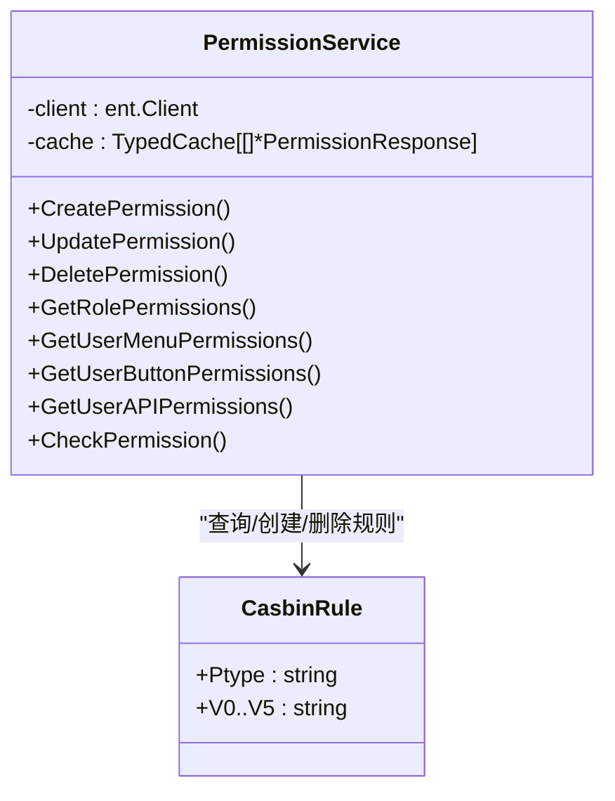
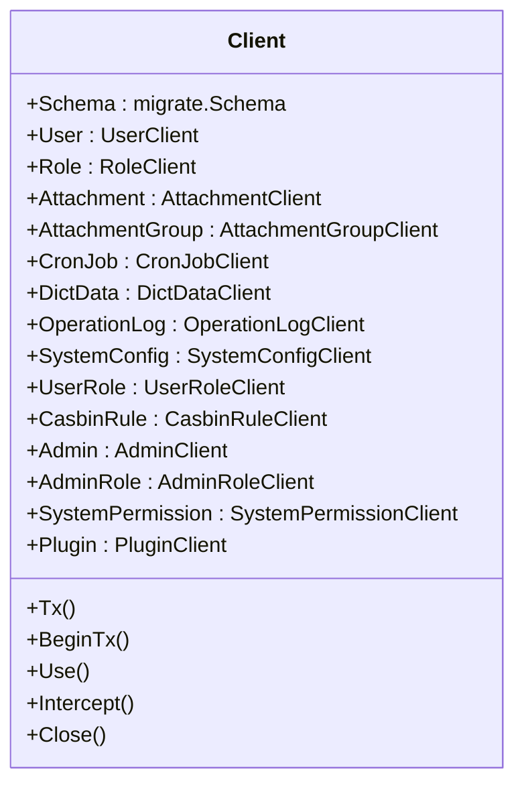
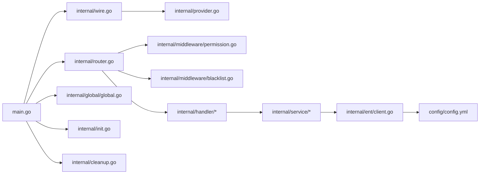

# 架构设计

<cite>
**本文档引用的文件**
- [main.go](file://main.go)
- [internal/app.go](file://internal/app.go)
- [internal/wire.go](file://internal/wire.go)
- [internal/provider.go](file://internal/provider.go)
- [internal/router.go](file://internal/router.go)
- [internal/middleware/permission.go](file://internal/middleware/permission.go)
- [internal/middleware/blacklist.go](file://internal/middleware/blacklist.go)
- [internal/handler/public.go](file://internal/handler/public.go)
- [internal/service/permission.go](file://internal/service/permission.go)
- [internal/plugin/manager.go](file://internal/plugin/manager.go)
- [internal/global/global.go](file://internal/global/global.go)
- [internal/init.go](file://internal/init.go)
- [internal/cleanup.go](file://internal/cleanup.go)
- [internal/ent/client.go](file://internal/ent/client.go)
- [config/config.yml](file://config/config.yml)
- [go.mod](file://go.mod)
</cite>

## 目录
1. [简介](#简介)
2. [项目结构](#项目结构)
3. [核心组件](#核心组件)
4. [架构总览](#架构总览)
5. [详细组件分析](#详细组件分析)
6. [依赖分析](#依赖分析)
7. [性能考量](#性能考量)
8. [故障排查指南](#故障排查指南)
9. [结论](#结论)
10. [附录](#附录)

## 简介
本项目为 Go Admin 管理系统，采用分层架构与依赖注入（Wire）相结合的设计，围绕 Fiber v3 Web 框架构建，集成 Casbin 权限控制、Ent ORM 数据访问、多存储缓存与文件系统、定时任务、站内消息与 SSE 实时推送、插件系统等能力。系统通过 Bootstrap 生命周期管理初始化、中间件注册、路由挂载与清理流程，形成清晰的请求处理管道与数据流。

## 项目结构
项目采用按职责分层的组织方式：
- 表示层（HTTP 层）：Fiber v3 路由与处理器
- 中间件层：认证、权限、日志、黑名单校验等横切关注点
- 业务层（Service）：领域逻辑封装与缓存策略
- 数据访问层（ORM/Ent）：实体模型与查询构建器
- 基础设施层：配置、日志、缓存、文件系统、定时任务、Casbin 策略引擎、SSE Hub、插件管理器

图表来源
- [internal/router.go:16-365](file://internal/router.go#L16-L365)
- [internal/middleware/permission.go:13-131](file://internal/middleware/permission.go#L13-L131)
- [internal/middleware/blacklist.go:13-49](file://internal/middleware/blacklist.go#L13-L49)
- [internal/handler/public.go:1-299](file://internal/handler/public.go#L1-L299)
- [internal/service/permission.go:119-829](file://internal/service/permission.go#L119-L829)
- [internal/ent/client.go:31-281](file://internal/ent/client.go#L31-L281)
- [config/config.yml:1-143](file://config/config.yml#L1-L143)

章节来源
- [main.go:47-107](file://main.go#L47-L107)
- [internal/router.go:16-365](file://internal/router.go#L16-L365)
- [config/config.yml:1-143](file://config/config.yml#L1-L143)

## 核心组件
- 应用容器 App：集中持有配置、日志、数据库、验证器、缓存、Ent 客户端、Casbin 策略管理器、文件系统、SSE Hub、SSE TicketStore 等依赖
- 依赖注入（Wire）：通过 Provider 集合与 ProviderSet 组织组件装配，简化初始化与测试替身
- 路由与中间件：基于 Fiber v3 的路由分组与中间件链，统一处理认证、权限、日志、黑名单校验
- 业务服务：权限、用户、角色、定时任务、附件、配置、站内消息、插件管理等服务，结合缓存优化热点查询
- 数据访问：Ent ORM 客户端，提供强类型实体与查询构建器，支持事务与拦截器
- 基础设施：配置中心、日志、缓存、文件系统、定时任务、Casbin 策略引擎、SSE Hub（实时消息推送）、插件管理器
- 插件系统：基于 UDS（Unix Domain Socket）通信的插件进程生命周期管理，支持安装、启用、禁用、卸载

章节来源
- [internal/app.go:15-28](file://internal/app.go#L15-L28)
- [internal/wire.go:22-35](file://internal/wire.go#L22-L35)
- [internal/provider.go:17-46](file://internal/provider.go#L17-L46)
- [internal/router.go:16-365](file://internal/router.go#L16-L365)
- [internal/service/permission.go:119-829](file://internal/service/permission.go#L119-L829)
- [internal/ent/client.go:31-281](file://internal/ent/client.go#L31-L281)

## 架构总览
系统采用"请求驱动"的处理流程：客户端请求进入 Fiber v3，经过日志、JWT、域解析、黑名单校验、权限校验等中间件，再由处理器调用对应服务，服务通过 Ent 访问数据库，必要时读写缓存与文件系统，最终返回统一响应。

图表来源
- [internal/router.go:16-365](file://internal/router.go#L16-L365)
- [internal/middleware/permission.go:13-131](file://internal/middleware/permission.go#L13-L131)
- [internal/middleware/blacklist.go:13-49](file://internal/middleware/blacklist.go#L13-L49)
- [internal/handler/public.go:78-145](file://internal/handler/public.go#L78-L145)
- [internal/service/permission.go:190-240](file://internal/service/permission.go#L190-L240)
- [internal/ent/client.go:31-281](file://internal/ent/client.go#L31-L281)

## 详细组件分析

### 依赖注入与组件生命周期（Wire）
- Provider 配置
  - 配置：config.NewConfig
  - 日志：log.ProviderSet
  - ORM：orm.ProviderSet
  - 验证器：validate.ProviderSet
  - 缓存：cache.ProviderSet
  - 文件系统：filesystem.ProviderSet
  - Ent 客户端：NewEntClient（延迟初始化表前缀、自动迁移）
  - Casbin 适配器：NewCasbinAdapter
  - EnforcerManager：NewEnforcerManager
- SSE Hub 与 TicketStore
  - Hub：由 cmf/sse.NewHub 创建，支持自定义 Logger
  - TicketStore：由 sse.NewTicketStore 创建，默认超时 5 分钟
  - TicketStore 启动后台协程定期清理过期凭证
- 初始化流程
  - main 调用 internal.InitializeApp，触发 wire.Build，返回 App 容器
  - internal.SetApp(app) 将 App 注入全局，供后续初始化使用
  - Bootstrap.RegisterInitFunc(internal.Init) 完成数据库、Casbin、定时任务、Nonce 存储、分片上传清理协程、RSA 密钥轮换、SSE Hub/TicketStore 初始化以及密钥与种子数据
  - Bootstrap.RegisterCleanupFunc(internal.Cleanup) 在应用退出时清理资源
- 生命周期要点
  - 优先使用 Wire 注入的组件；若缺失则回退到内部 initDatabase/initCasbin
  - Ent 客户端在初始化阶段执行 schema 自动迁移
  - CronManager 在 Init 中启动，Cleanup 中停止
  - 分片上传清理协程由 Init 启动，Cleanup 中停止
  - Nonce 存储和 RSA 密钥管理器在 Init 中初始化

图表来源
- [internal/wire.go:22-35](file://internal/wire.go#L22-L35)
- [internal/provider.go:17-46](file://internal/provider.go#L17-L46)
- [internal/init.go:46-129](file://internal/init.go#L46-L129)
- [internal/cleanup.go:12-51](file://internal/cleanup.go#L12-L51)

章节来源
- [internal/wire.go:22-35](file://internal/wire.go#L22-L35)
- [internal/provider.go:17-46](file://internal/provider.go#L17-L46)
- [internal/init.go:46-129](file://internal/init.go#L46-L129)
- [internal/cleanup.go:12-51](file://internal/cleanup.go#L12-L51)

### 中间件架构与请求处理管道
- 中间件链
  - 请求日志：统一记录请求与响应状态
  - JWT：解析并注入用户信息（含域信息）
  - 域中间件：从 JWT 中提取域，供权限校验使用
  - 黑名单校验：拦截已加入黑名单的用户
  - 权限中间件：基于 Casbin 执行策略校验
- 执行顺序
  - 路由注册时按声明顺序插入中间件：先日志、JWT、域、黑名单、权限，最后处理器
  - 认证但无需权限的路由（如用户个人信息）在黑名单之后、权限中间件之前
- 错误处理
  - 权限不足返回 403，未授权返回 401，策略异常返回 500
  - JWT 缺失或域缺失时直接返回错误响应
  - 黑名单用户返回 403，已登出用户返回 401

图表来源
- [internal/router.go:16-70](file://internal/router.go#L16-L70)
- [internal/middleware/permission.go:13-131](file://internal/middleware/permission.go#L13-L131)
- [internal/middleware/blacklist.go:13-49](file://internal/middleware/blacklist.go#L13-L49)

章节来源
- [internal/router.go:16-70](file://internal/router.go#L16-L70)
- [internal/middleware/permission.go:13-131](file://internal/middleware/permission.go#L13-L131)
- [internal/middleware/blacklist.go:13-49](file://internal/middleware/blacklist.go#L13-L49)

### 数据流架构：从 HTTP 请求到数据库
- 登录流程示例
  - 路由：/api/v1/public/login
  - 处理器：解析请求体、可选 RSA 解密、调用用户服务登录
  - 服务：校验用户、生成令牌、记录操作日志
  - ORM：查询用户、更新用户信息（如需要）
  - 响应：统一包装返回
- 权限查询流程
  - 路由：/api/v1/admin/auth/permissions/*
  - 处理器：获取用户 ID、域、请求路径与方法
  - 服务：根据用户角色集合查询 Casbin 规则，支持缓存
  - ORM：查询用户角色、角色权限、权限详情
  - 响应：权限列表或布尔校验结果

图表来源
- [internal/router.go:88-101](file://internal/router.go#L88-L101)
- [internal/handler/public.go:147-184](file://internal/handler/public.go#L147-L184)
- [internal/service/permission.go:689-753](file://internal/service/permission.go#L689-L753)
- [internal/ent/client.go:31-281](file://internal/ent/client.go#L31-L281)

章节来源
- [internal/router.go:88-101](file://internal/router.go#L88-L101)
- [internal/handler/public.go:147-184](file://internal/handler/public.go#L147-L184)
- [internal/service/permission.go:689-753](file://internal/service/permission.go#L689-L753)
- [internal/ent/client.go:31-281](file://internal/ent/client.go#L31-L281)

### 权限服务与 Casbin 集成
- 权限类型：API、菜单、按钮
- 规则存储：CasbinRule 实体，支持 p（策略）与 g（角色继承）规则
- 查询策略：
  - 角色权限：按角色名与域查询
  - 用户权限：按用户 UID 与其角色集合查询，区分菜单、按钮、API
  - 缓存：对角色与用户权限结果进行 TTL 缓存，变更时清除相关键
- 策略校验：在中间件中通过 EnforcerManager 获取指定域的 Enforcer 执行 Enforce
- 超级管理员识别：PermissionMiddleware 通过当前域 `g` 规则检测 `admin` 角色并标记 `isSuperAdmin`，访问放行仍以 Enforce 策略结果为准

图表来源
- [internal/service/permission.go:119-829](file://internal/service/permission.go#L119-L829)
- [internal/ent/client.go:581-712](file://internal/ent/client.go#L581-L712)

章节来源
- [internal/service/permission.go:119-829](file://internal/service/permission.go#L119-L829)
- [internal/ent/client.go:581-712](file://internal/ent/client.go#L581-L712)

### 数据访问层（Ent ORM）
- 客户端结构：Client 持有 Schema、各实体客户端（User、Role、Attachment、CronJob、DictData、OperationLog、SystemConfig、UserRole、CasbinRule、Admin、AdminRole、SystemPermission、Plugin 等）
- 事务支持：Tx/BeginTx 提供事务客户端，支持拦截器与钩子
- Hook/Interceptor：可在实体层添加变更钩子与查询拦截器，便于审计与横切逻辑
- 连接与关闭：Close 关闭底层驱动连接；Init 阶段执行 schema 迁移

图表来源
- [internal/ent/client.go:31-281](file://internal/ent/client.go#L31-L281)

章节来源
- [internal/ent/client.go:31-281](file://internal/ent/client.go#L31-L281)

### 配置与系统边界
- 配置项
  - 应用：端口、调试、超时、Swagger 开关、JWT 密钥、登录过期时间
  - 日志：文件路径、控制台输出、文件输出、滚动策略
  - 数据库：驱动、主机、端口、用户、密码、库名、SSL、表前缀
  - 缓存：内存/Redis 存储、默认 TTL
  - Redis：连接参数、连接池大小、超时
  - 文件系统：本地/云存储（S3）驱动与选项
  - Casbin：默认域、多域模型配置
- 系统边界
  - 外部依赖：MySQL、Redis、S3（可选）、Casbin 策略
  - 内部边界：路由、中间件、服务、ORM、缓存、文件系统、定时任务、SSE Hub、插件管理器

章节来源
- [config/config.yml:1-143](file://config/config.yml#L1-L143)

## 依赖分析
- 模块依赖
  - Web 框架：github.com/gofiber/fiber/v3
  - ORM：entgo.io/ent
  - 权限：github.com/casbin/casbin/v2
  - JWT：github.com/golang-jwt/jwt/v5
  - 依赖注入：github.com/google/wire
  - 日志：go.uber.org/zap
  - 定时任务：github.com/robfig/cron/v3
  - Swagger：github.com/swaggo/swag
  - 替换本地模块：github.com/wuwuseo/cmf、github.com/wuwuseo/ent
- 组件耦合
  - 路由依赖中间件与服务；服务依赖 ORM 与缓存；中间件依赖 JWT、Casbin 与黑名单服务；全局共享 ORM、EnforcerManager、CronManager
  - 低耦合体现在 Provider 抽象与接口隔离（如 PermissionServiceInterface）

图表来源
- [main.go:47-107](file://main.go#L47-L107)
- [internal/wire.go:22-35](file://internal/wire.go#L22-L35)
- [internal/provider.go:17-46](file://internal/provider.go#L17-L46)
- [internal/router.go:16-365](file://internal/router.go#L16-L365)
- [internal/middleware/permission.go:13-131](file://internal/middleware/permission.go#L13-L131)
- [internal/middleware/blacklist.go:13-49](file://internal/middleware/blacklist.go#L13-L49)
- [internal/handler/public.go:1-299](file://internal/handler/public.go#L1-L299)
- [internal/service/permission.go:119-829](file://internal/service/permission.go#L119-L829)
- [internal/ent/client.go:31-281](file://internal/ent/client.go#L31-L281)
- [config/config.yml:1-143](file://config/config.yml#L1-L143)
- [internal/global/global.go:11-16](file://internal/global/global.go#L11-L16)
- [internal/init.go:46-129](file://internal/init.go#L46-L129)
- [internal/cleanup.go:12-51](file://internal/cleanup.go#L12-L51)

章节来源
- [go.mod:5-19](file://go.mod#L5-L19)
- [go.mod:126-128](file://go.mod#L126-L128)

## 性能考量
- 缓存策略
  - 权限服务对角色与用户权限结果进行 TTL 缓存，减少频繁查询
  - 缓存键按用户/角色/域维度划分，变更时精确清理
- ORM 优化
  - 使用 WithRole 预加载用户角色，减少 N+1 查询
  - 事务批量写入（如批量分配权限）
- 中间件与日志
  - 请求日志中间件仅在开发环境开启，生产环境建议按需调整
  - 黑名单校验中间件缓存校验结果，减少高频查询
- 数据库迁移
  - 初始化阶段执行 schema 迁移，确保结构一致性；生产环境建议配合版本化迁移工具
- SSE 实时推送
  - Hub 按用户 UID 分发消息，支持按偏好过滤与免打扰时段

## 故障排查指南
- 启动失败
  - 检查配置文件（数据库连接、Redis/S3、Casbin 模型）
  - 查看初始化日志（Init 中的日志输出）
- 权限问题
  - 确认 JWT 中包含域信息；检查 EnforcerManager 是否正确初始化
  - 核对 Casbin 规则（p/g）是否匹配用户角色与请求路径/方法
- 数据库问题
  - 确认表前缀与连接字符串；查看 Ent 迁移日志
  - 检查连接池配置与超时设置
- 清理与退出
  - 确保 Cleanup 正常关闭 CronManager、DB 连接池与 Ent 客户端
  - 确保分片上传清理协程正确停止
- SSE/消息问题
  - 确认 SSE Hub 与 TicketStore 已初始化
  - 检查 SSE 连接路径 /api/v1/admin/sse/connect 与 Ticket 签发路径

章节来源
- [internal/init.go:46-129](file://internal/init.go#L46-L129)
- [internal/cleanup.go:12-51](file://internal/cleanup.go#L12-L51)
- [internal/middleware/permission.go:13-131](file://internal/middleware/permission.go#L13-L131)

## 结论
本系统通过清晰的分层架构与 Wire 依赖注入，实现了高内聚、低耦合的模块化设计。中间件层统一处理认证、权限、黑名单校验与日志，业务层以服务为核心封装领域逻辑，并结合缓存与 ORM 提升性能与可维护性。SSE Hub 提供实时消息推送能力，插件系统支持通过 UDS 通信扩展功能。配置驱动的基础设施与 Bootstrap 生命周期管理，使系统具备良好的可扩展性与可观测性。未来可在以下方面演进：
- 引入更细粒度的监控指标与链路追踪
- 支持多租户与动态模型切换
- 增强 API 文档与契约管理
- 优化批量操作与异步任务处理

## 附录
- 关键文件路径与职责
  - [main.go](file://main.go)：应用入口，初始化与运行 Bootstrap
  - [internal/app.go](file://internal/app.go)：应用容器定义（含 Hub、TicketStore）
  - [internal/wire.go](file://internal/wire.go)：Provider 组装入口
  - [internal/provider.go](file://internal/provider.go)：具体 Provider 实现
  - [internal/router.go](file://internal/router.go)：路由与中间件注册（含插件反向代理路由）
  - [internal/middleware/permission.go](file://internal/middleware/permission.go)：权限与域中间件
  - [internal/middleware/blacklist.go](file://internal/middleware/blacklist.go)：黑名单校验中间件
  - [internal/handler/public.go](file://internal/handler/public.go)：公开接口处理器示例
  - [internal/service/permission.go](file://internal/service/permission.go)：权限服务实现
  - [internal/plugin/manager.go](file://internal/plugin/manager.go)：插件管理器
  - [internal/ent/client.go](file://internal/ent/client.go)：Ent 客户端与实体客户端
  - [config/config.yml](file://config/config.yml)：系统配置
  - [internal/init.go](file://internal/init.go)：初始化流程
  - [internal/cleanup.go](file://internal/cleanup.go)：清理流程
  - [internal/global/global.go](file://internal/global/global.go)：全局共享对象
