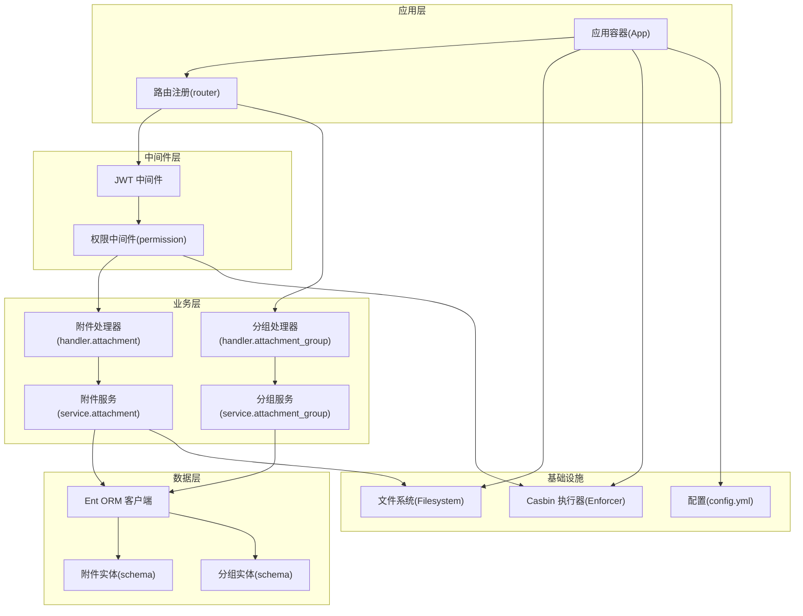
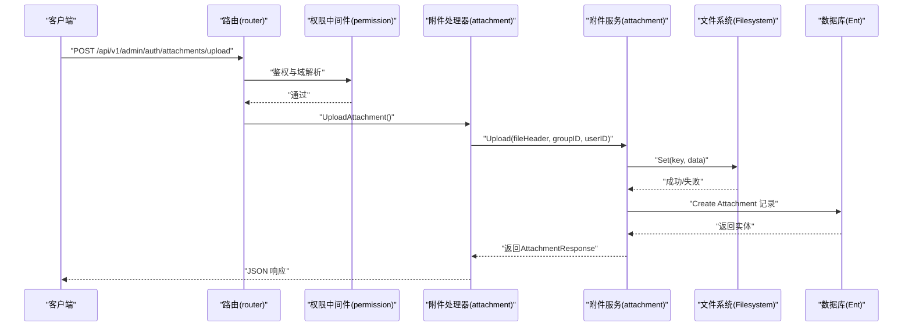
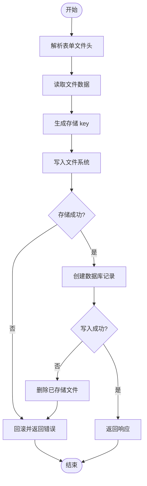
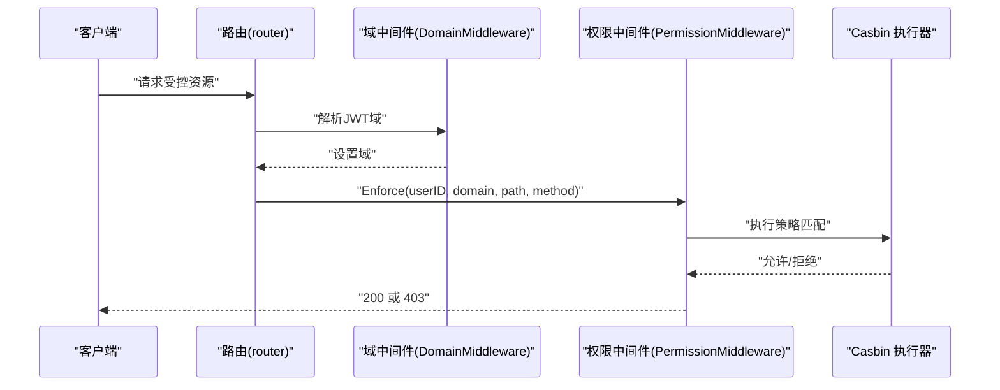
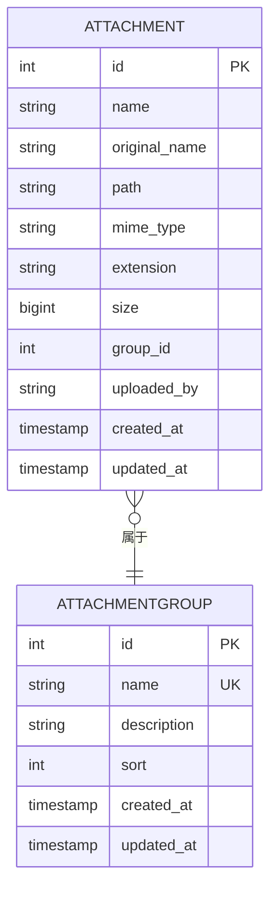
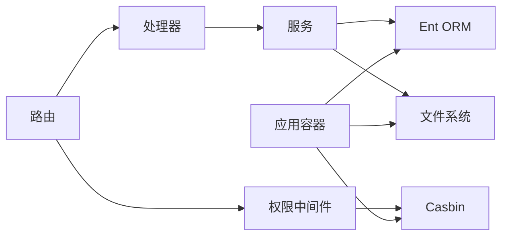

# 文件管理系统

<cite>
**本文引用的文件**
- [app.go](file://internal/app.go)
- [router.go](file://internal/router.go)
- [config.yml](file://config/config.yml)
- [attachment.go](file://internal/handler/attachment.go)
- [attachment_group.go](file://internal/handler/attachment_group.go)
- [attachment.go](file://internal/service/attachment.go)
- [attachment_group.go](file://internal/service/attachment_group.go)
- [attachment.go](file://internal/ent/schema/attachment.go)
- [attachmentgroup.go](file://internal/ent/schema/attachmentgroup.go)
- [permission.go](file://internal/middleware/permission.go)
- [global.go](file://internal/global/global.go)
- [init.go](file://internal/init.go)
- [msg.go](file://internal/global/msg.go)
- [utils.go](file://internal/utils/utils.go)
- [swagger.json](file://docs/swagger.json)
</cite>

## 目录
1. [简介](#简介)
2. [项目结构](#项目结构)
3. [核心组件](#核心组件)
4. [架构总览](#架构总览)
5. [详细组件分析](#详细组件分析)
6. [依赖分析](#依赖分析)
7. [性能考虑](#性能考虑)
8. [故障排查指南](#故障排查指南)
9. [结论](#结论)
10. [附录](#附录)

## 简介
本文件管理系统基于模块化设计，提供文件上传、存储、分组管理、元数据持久化与权限控制能力。系统通过统一的文件存储抽象层支持本地与云存储后端；通过权限中间件与多域 Casbin 策略实现细粒度访问控制；通过 Swagger 文档与标准响应封装提供清晰的 API 接口与错误码体系。

## 项目结构
- 应用入口与依赖注入：应用容器集中管理配置、日志、数据库、缓存、ORM 客户端、权限执行器与文件系统。
- 路由与中间件：统一注册 v1 API 路由，鉴权与权限中间件贯穿附件与分组管理。
- 业务层：附件与附件分组的服务层负责业务逻辑与数据持久化。
- 数据模型：基于 Ent 定义附件与分组实体及索引、边关系。
- 配置：文件系统支持本地与 S3，权限模型支持多域。

图表来源
- [app.go:15-26](file://internal/app.go#L15-L26)
- [router.go:16-190](file://internal/router.go#L16-L190)
- [attachment.go:31-61](file://internal/handler/attachment.go#L31-L61)
- [attachment_group.go:30-54](file://internal/handler/attachment_group.go#L30-L54)
- [attachment.go:94-148](file://internal/service/attachment.go#L94-L148)
- [attachment_group.go:80-106](file://internal/service/attachment_group.go#L80-L106)
- [attachment.go:12-89](file://internal/ent/schema/attachment.go#L12-L89)
- [attachmentgroup.go:11-57](file://internal/ent/schema/attachmentgroup.go#L11-L57)
- [permission.go:12-64](file://internal/middleware/permission.go#L12-L64)
- [config.yml:60-76](file://config/config.yml#L60-L76)

章节来源
- [app.go:15-26](file://internal/app.go#L15-L26)
- [router.go:16-190](file://internal/router.go#L16-L190)
- [config.yml:60-76](file://config/config.yml#L60-L76)

## 核心组件
- 应用容器：集中持有配置、日志、数据库、缓存、ORM、权限执行器与文件系统实例，便于全局注入与复用。
- 路由与中间件：统一注册 v1 API，鉴权中间件从 JWT 提取用户信息，权限中间件结合 Casbin 进行域级访问控制。
- 附件服务：实现上传、删除、批量删除、列表、详情、预览/下载、移动分组等功能；通过文件系统抽象层写入/读取存储。
- 分组服务：实现分组的创建、更新、删除、列表与详情；删除时校验非空约束。
- 数据模型：附件实体包含名称、原始名、存储路径、MIME 类型、扩展名、大小、分组ID、上传者与时间戳；分组实体包含名称、描述、排序与时间戳。
- 配置：文件系统支持本地与 S3；Casbin 支持多域模型与自动加载。

章节来源
- [app.go:15-26](file://internal/app.go#L15-L26)
- [router.go:16-190](file://internal/router.go#L16-L190)
- [attachment.go:94-148](file://internal/service/attachment.go#L94-L148)
- [attachment_group.go:80-106](file://internal/service/attachment_group.go#L80-L106)
- [attachment.go:12-89](file://internal/ent/schema/attachment.go#L12-L89)
- [attachmentgroup.go:11-57](file://internal/ent/schema/attachmentgroup.go#L11-L57)
- [config.yml:60-76](file://config/config.yml#L60-L76)

## 架构总览
系统采用“路由-处理器-服务-存储/数据库”的分层架构，权限控制贯穿请求链路，文件存储通过统一抽象层适配不同后端。

图表来源
- [router.go:141-151](file://internal/router.go#L141-L151)
- [attachment.go:31-61](file://internal/handler/attachment.go#L31-L61)
- [attachment.go:94-148](file://internal/service/attachment.go#L94-L148)

## 详细组件分析

### 附件上传流程
- 请求参数：multipart/form-data，必需字段为 file；可选字段 group_id（整型）。
- 处理步骤：
  1) 解析表单文件头，读取文件数据。
  2) 生成存储 key（按年/月组织目录，UUID+原扩展名）。
  3) 写入文件系统，失败回滚。
  4) 在数据库创建附件记录（名称、原始名、路径、MIME、扩展名、大小、分组ID、上传者）。
  5) 返回标准化响应。
- 错误处理：参数校验失败、文件读取失败、存储失败、数据库写入失败均返回相应错误码。

图表来源
- [attachment.go:35-61](file://internal/handler/attachment.go#L35-L61)
- [attachment.go:94-148](file://internal/service/attachment.go#L94-L148)

章节来源
- [attachment.go:31-61](file://internal/handler/attachment.go#L31-L61)
- [attachment.go:94-148](file://internal/service/attachment.go#L94-L148)

### 附件列表与筛选
- 支持分页、关键字搜索（名称/原始名）、分组筛选、MIME 类型前缀筛选。
- 列表请求参数：page/page_size/keyword/group_id/mime_type。
- 服务端限制每页最大 100 条，避免滥用。

章节来源
- [attachment.go:63-105](file://internal/handler/attachment.go#L63-L105)
- [attachment.go:215-274](file://internal/service/attachment.go#L215-L274)

### 附件详情与预览/下载
- 详情：根据 ID 查询附件元数据。
- 预览/下载：根据 MIME 类型决定 Content-Disposition（图片/PDF inline，其他类型 attachment 下载）。

章节来源
- [attachment.go:107-139](file://internal/handler/attachment.go#L107-L139)
- [attachment.go:141-182](file://internal/handler/attachment.go#L141-L182)
- [attachment.go:276-294](file://internal/service/attachment.go#L276-L294)

### 附件删除与批量删除
- 单删：先删除存储文件，再删除数据库记录。
- 批删：查询附件集合，逐个删除存储文件，然后批量删除数据库记录。

章节来源
- [attachment.go:184-218](file://internal/handler/attachment.go#L184-L218)
- [attachment.go:150-198](file://internal/service/attachment.go#L150-L198)

### 附件移动分组
- 支持将附件移动到指定分组，group_id 为 null 时表示移出分组。
- 通过更新附件记录的 group_id 实现。

章节来源
- [attachment.go:256-300](file://internal/handler/attachment.go#L256-L300)
- [attachment.go:296-321](file://internal/service/attachment.go#L296-L321)

### 附件分组管理
- 创建：校验名称唯一性，支持描述与排序。
- 更新：可更新名称（唯一性校验）、描述、排序。
- 删除：若分组下存在附件则拒绝删除。
- 列表：支持关键字搜索（名称/描述），排序规则为 sort 升序、创建时间降序。

章节来源
- [attachment_group.go:15-54](file://internal/handler/attachment_group.go#L15-L54)
- [attachment_group.go:80-186](file://internal/service/attachment_group.go#L80-L186)

### 权限控制与访问策略
- 鉴权中间件：从 JWT 中提取用户 UID 并注入到上下文。
- 域中间件：从 JWT 中提取域信息，用于 Casbin 策略匹配。
- 权限中间件：使用 Casbin 执行器进行策略匹配（sub, dom, obj, act），未授权返回 403。
- 系统初始化：种子数据为 admin 角色建立“拥有所有权限”策略，并将用户 UID 映射到该角色。

图表来源
- [permission.go:12-64](file://internal/middleware/permission.go#L12-L64)
- [init.go:231-307](file://internal/init.go#L231-L307)

章节来源
- [permission.go:12-64](file://internal/middleware/permission.go#L12-L64)
- [init.go:231-307](file://internal/init.go#L231-L307)

### 存储后端与配置
- 本地存储：driver: local，options.root 指向本地根目录。
- S3 存储：driver: s3，支持 access_key、secret_key、region、bucket、endpoint 等选项。
- 默认磁盘与 is_and_local 控制策略见配置文件。

章节来源
- [config.yml:60-76](file://config/config.yml#L60-L76)

### 数据模型与关系
- 附件实体包含：id、name、original_name、path、mime_type、extension、size、group_id、uploaded_by、created_at、updated_at。
- 分组实体包含：id、name、description、sort、created_at、updated_at。
- 附件与分组为多对一关系（group_id 边）。

图表来源
- [attachment.go:12-89](file://internal/ent/schema/attachment.go#L12-L89)
- [attachmentgroup.go:11-57](file://internal/ent/schema/attachmentgroup.go#L11-L57)

章节来源
- [attachment.go:12-89](file://internal/ent/schema/attachment.go#L12-L89)
- [attachmentgroup.go:11-57](file://internal/ent/schema/attachmentgroup.go#L11-L57)

## 依赖分析
- 组件耦合：
  - 路由依赖处理器，处理器依赖服务，服务依赖 ORM 与文件系统。
  - 权限中间件依赖 Casbin 执行器与 JWT。
- 外部依赖：
  - 文件系统抽象层（本地/S3）。
  - Casbin 权限引擎。
  - Ent ORM。
- 潜在风险：
  - 上传流程中文件读取到内存，建议在高并发场景限制单文件大小或采用流式写入。
  - 删除流程先删存储再删数据库，需保证事务一致性或幂等性。

图表来源
- [router.go:16-190](file://internal/router.go#L16-L190)
- [attachment.go:94-148](file://internal/service/attachment.go#L94-L148)
- [permission.go:12-64](file://internal/middleware/permission.go#L12-L64)
- [app.go:15-26](file://internal/app.go#L15-L26)

章节来源
- [router.go:16-190](file://internal/router.go#L16-L190)
- [attachment.go:94-148](file://internal/service/attachment.go#L94-L148)
- [permission.go:12-64](file://internal/middleware/permission.go#L12-L64)
- [app.go:15-26](file://internal/app.go#L15-L26)

## 性能考虑
- 上传内存占用：当前实现将整个文件读入内存，建议在生产环境限制文件大小或引入流式写入以降低峰值内存。
- 分页与索引：列表接口支持分页与多字段索引（group_id、mime_type、created_at），有助于提升查询性能。
- 缓存与并发：可利用现有缓存层（内存/Redis）对热点分组与权限策略进行缓存，减少重复计算。
- 日志与监控：建议增加上传耗时、存储命中率与权限检查耗时的指标埋点。

## 故障排查指南
- 上传失败：检查文件系统写入权限、磁盘空间与 key 生成规则；确认数据库写入是否回滚。
- 删除失败：确认附件记录是否存在、存储文件是否可删除。
- 权限拒绝：核对 JWT 中域信息、Casbin 策略是否加载、用户 UID 与角色映射是否正确。
- 参数校验失败：检查请求参数类型与必填项，参考 Swagger 文档与错误码映射。

章节来源
- [attachment.go:21-25](file://internal/service/attachment.go#L21-L25)
- [msg.go:32-42](file://internal/global/msg.go#L32-L42)
- [permission.go:42-62](file://internal/middleware/permission.go#L42-L62)

## 结论
本系统提供了完整的文件管理能力，具备清晰的分层架构、可扩展的存储后端与完善的权限控制。通过 Swagger 文档与标准化响应，开发者可快速集成上传、分组、预览/下载与批量操作等核心功能。建议在生产环境中进一步优化上传性能、增强安全策略与可观测性。

## 附录

### API 接口清单与参数说明
- 附件上传
  - 方法与路径：POST /api/v1/admin/auth/attachments/upload
  - 表单参数：
    - file：必填，上传文件
    - group_id：可选，整型，分组ID
  - 成功响应：AttachmentResponse
  - 常见错误：400 参数无效、401 未授权、403 权限不足、500 服务器错误

- 附件列表
  - 方法与路径：GET /api/v1/admin/auth/attachments
  - 查询参数：page、page_size、keyword、group_id、mime_type
  - 成功响应：ListAttachmentsResponse
  - 常见错误：400 参数无效、401 未授权、403 权限不足、500 服务器错误

- 附件详情
  - 方法与路径：GET /api/v1/admin/auth/attachments/{id}
  - 路径参数：id（整型）
  - 成功响应：AttachmentResponse
  - 常见错误：400 无效ID、401 未授权、403 权限不足、404 不存在、500 服务器错误

- 预览/下载
  - 方法与路径：GET /api/v1/admin/auth/attachments/{id}/preview
  - 路径参数：id（整型）
  - 响应：文件内容（Content-Type 与 Content-Disposition 根据 MIME 类型动态设置）
  - 常见错误：400 无效ID、401 未授权、403 权限不足、404 不存在、500 服务器错误

- 删除附件
  - 方法与路径：DELETE /api/v1/admin/auth/attachments/{id}
  - 路径参数：id（整型）
  - 成功响应：空数据
  - 常见错误：400 无效ID、401 未授权、403 权限不足、404 不存在、500 服务器错误

- 批量删除
  - 方法与路径：DELETE /api/v1/admin/auth/attachments/batch
  - 请求体：ids（整型数组，至少1个）
  - 成功响应：空数据
  - 常见错误：400 参数无效、401 未授权、403 权限不足、500 服务器错误

- 移动分组
  - 方法与路径：PUT /api/v1/admin/auth/attachments/{id}/move
  - 路径参数：id（整型）
  - 请求体：group_id（整型或 null）
  - 成功响应：空数据
  - 常见错误：400 参数无效、401 未授权、403 权限不足、404 不存在、500 服务器错误

- 附件分组管理
  - 创建分组：POST /api/v1/admin/auth/attachment-groups
  - 更新分组：PUT /api/v1/admin/auth/attachment-groups/{id}
  - 删除分组：DELETE /api/v1/admin/auth/attachment-groups/{id}
  - 列表：GET /api/v1/admin/auth/attachment-groups
  - 详情：GET /api/v1/admin/auth/attachment-groups/{id}

章节来源
- [attachment.go:16-61](file://internal/handler/attachment.go#L16-L61)
- [attachment.go:63-105](file://internal/handler/attachment.go#L63-L105)
- [attachment.go:107-139](file://internal/handler/attachment.go#L107-L139)
- [attachment.go:141-182](file://internal/handler/attachment.go#L141-L182)
- [attachment.go:184-218](file://internal/handler/attachment.go#L184-L218)
- [attachment.go:220-254](file://internal/handler/attachment.go#L220-L254)
- [attachment.go:256-300](file://internal/handler/attachment.go#L256-L300)
- [attachment_group.go:15-54](file://internal/handler/attachment_group.go#L15-L54)
- [attachment_group.go:56-96](file://internal/handler/attachment_group.go#L56-L96)
- [attachment_group.go:98-130](file://internal/handler/attachment_group.go#L98-L130)
- [attachment_group.go:132-181](file://internal/handler/attachment_group.go#L132-L181)
- [attachment_group.go:183-222](file://internal/handler/attachment_group.go#L183-L222)

### 文件类型与大小限制
- 当前实现未对文件类型与大小进行显式限制，建议在网关或处理器层增加：
  - 文件大小上限（如 10MB/50MB）
  - MIME 类型白名单（如 image/*, application/pdf, doc/* 等）
  - 文件扩展名白名单
- 上传流程中建议限制单次读取大小，避免内存溢出。

章节来源
- [attachment.go:94-148](file://internal/service/attachment.go#L94-L148)

### 安全策略与最佳实践
- 传输安全：启用 HTTPS，使用强随机密钥与短时效 JWT。
- 权限策略：为不同业务域配置独立模型，最小权限原则，定期审计策略。
- 存储安全：S3 使用 IAM 最小权限角色，开启服务器端加密；本地存储设置严格文件权限。
- 输入验证：对所有外部输入进行严格校验与白名单过滤。
- 日志与审计：记录操作日志与异常事件，保留足够上下文信息（用户UID、域、路径、方法、IP）。

章节来源
- [permission.go:12-64](file://internal/middleware/permission.go#L12-L64)
- [init.go:231-307](file://internal/init.go#L231-L307)
- [utils.go:48-61](file://internal/utils/utils.go#L48-L61)