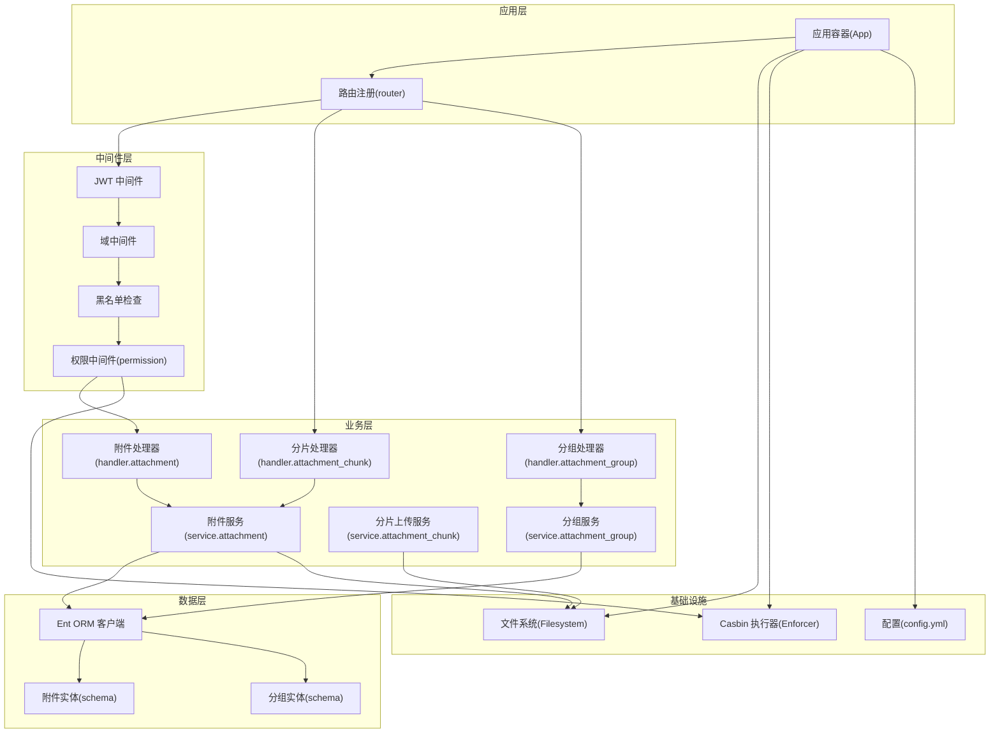
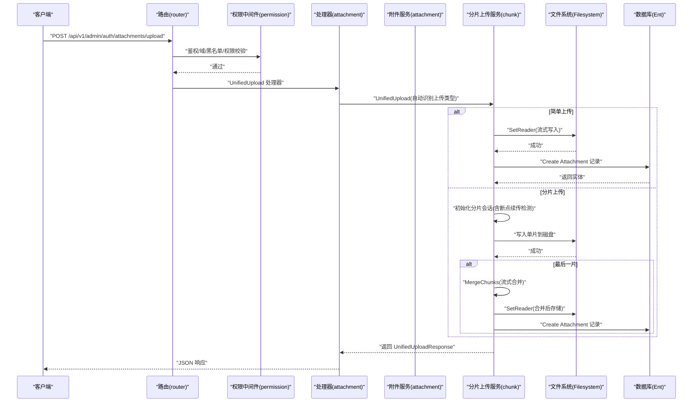
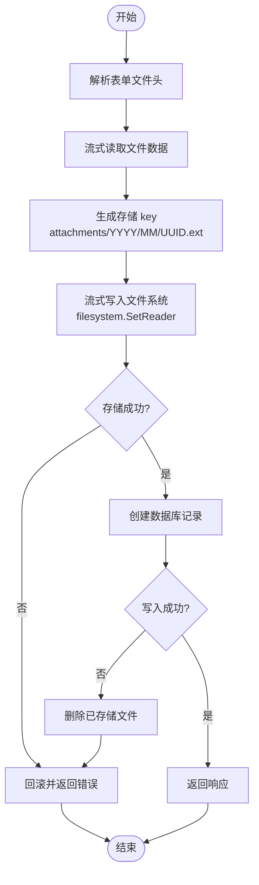
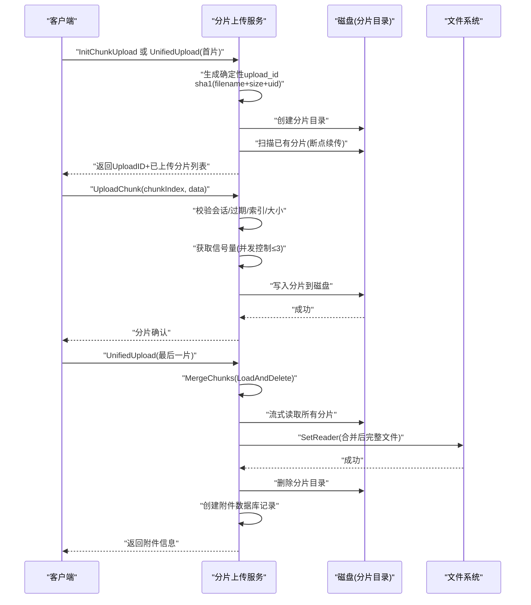
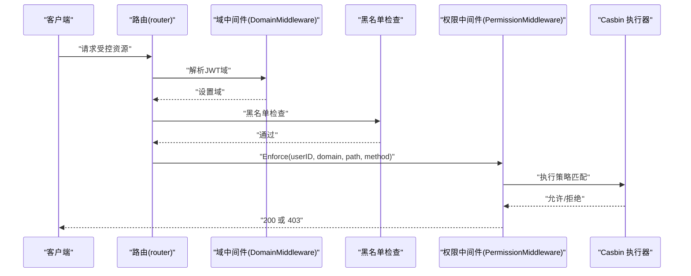
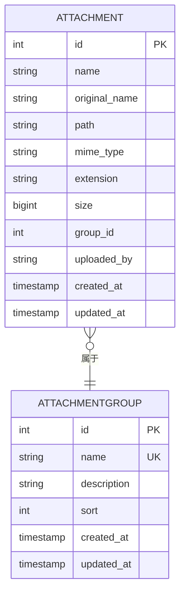
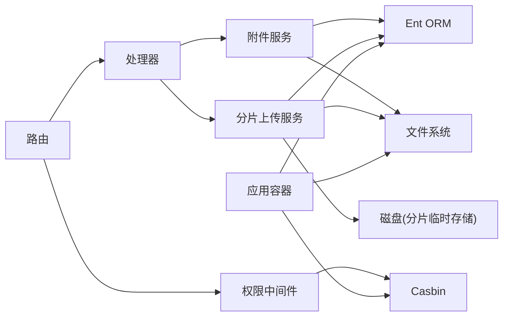

# 文件管理系统

<cite>
**本文引用的文件**
- [app.go](file://internal/app.go)
- [router.go](file://internal/router.go)
- [config.yml](file://config/config.yml)
- [attachment.go](file://internal/handler/attachment.go)
- [attachment_chunk.go](file://internal/handler/attachment_chunk.go)
- [attachment_group.go](file://internal/handler/attachment_group.go)
- [attachment.go](file://internal/service/attachment.go)
- [attachment_chunk.go](file://internal/service/attachment_chunk.go)
- [attachment_group.go](file://internal/service/attachment_group.go)
- [attachment.go](file://internal/ent/schema/attachment.go)
- [attachmentgroup.go](file://internal/ent/schema/attachmentgroup.go)
- [permission.go](file://internal/middleware/permission.go)
- [global.go](file://internal/global/global.go)
- [init.go](file://internal/init.go)
- [msg.go](file://internal/global/msg.go)
- [utils.go](file://internal/utils/utils.go)
- [swagger.json](file://docs/swagger.json)
</cite>

## 目录
1. [简介](#简介)
2. [项目结构](#项目结构)
3. [核心组件](#核心组件)
4. [架构总览](#架构总览)
5. [详细组件分析](#详细组件分析)
6. [依赖分析](#依赖分析)
7. [性能考虑](#性能考虑)
8. [故障排查指南](#故障排查指南)
9. [结论](#结论)
10. [附录](#附录)

## 简介
本文件管理系统基于模块化设计，提供文件上传（简单上传与分片上传）、存储、分组管理、元数据持久化与权限控制能力。系统通过统一的文件存储抽象层支持本地与云存储后端；通过权限中间件与多域 Casbin 策略实现细粒度访问控制；分片上传支持大文件断点续传、并发控制与过期清理；六重安全加固保障上传安全性；通过 Swagger 文档与标准响应封装提供清晰的 API 接口与错误码体系。

## 项目结构
- 应用入口与依赖注入：应用容器集中管理配置、日志、数据库、缓存、ORM 客户端、权限执行器与文件系统。
- 路由与中间件：统一注册 v1 API 路由，鉴权、域、黑名单与权限中间件贯穿附件与分组管理。
- 业务层：附件、附件分组与分片上传的服务层负责业务逻辑与数据持久化。
- 数据模型：基于 Ent 定义附件与分组实体及索引、边关系。
- 配置：文件系统支持本地与 S3，权限模型支持多域；分片上传参数（阈值、分片大小）通过动态配置管理。

图表来源
- [app.go:15-28](file://internal/app.go#L15-L28)
- [router.go:126-271](file://internal/router.go#L126-L271)
- [attachment.go:31-61](file://internal/handler/attachment.go#L31-L61)
- [attachment_chunk.go:13-67](file://internal/handler/attachment_chunk.go#L13-L67)
- [attachment_group.go:30-54](file://internal/handler/attachment_group.go#L30-L54)
- [attachment.go:89-137](file://internal/service/attachment.go#L89-L137)
- [attachment_chunk.go:241-808](file://internal/service/attachment_chunk.go#L241-L808)
- [attachment_group.go:80-106](file://internal/service/attachment_group.go#L80-L106)
- [attachment.go:12-89](file://internal/ent/schema/attachment.go#L12-L89)
- [attachmentgroup.go:11-57](file://internal/ent/schema/attachmentgroup.go#L11-L57)
- [permission.go:13-76](file://internal/middleware/permission.go#L13-L76)
- [config.yml:60-76](file://config/config.yml#L60-L76)

章节来源
- [app.go:15-28](file://internal/app.go#L15-L28)
- [router.go:126-271](file://internal/router.go#L126-L271)
- [config.yml:60-76](file://config/config.yml#L60-L76)

## 核心组件
- 应用容器：集中持有配置、日志、数据库、缓存、ORM、权限执行器与文件系统实例，便于全局注入与复用。
- 路由与中间件：统一注册 v1 API，鉴权中间件从 JWT 提取用户信息，域中间件注入权限域，黑名单检查拦截被封用户，权限中间件结合 Casbin 进行域级访问控制。
- 附件服务：实现上传（简单上传与统一上传接口）、删除、批量删除、列表、详情、预览/下载、移动分组等功能；通过文件系统抽象层写入/读取存储。
- 分片上传服务：实现分片上传会话初始化（支持断点续传）、逐片上传播、并发控制（信号量限制每会话3个并发）、自动合并（流式 `io.MultiReader`）、过期清理协程；统一上传入口 `UnifiedUpload` 自动识别上传类型。
- 分组服务：实现分组的创建、更新、删除、列表与详情；删除时校验非空约束。
- 数据模型：附件实体包含名称、原始名、存储路径、MIME 类型、扩展名、大小、分组ID、上传者与时间戳；分组实体包含名称、描述、排序与时间戳。
- 安全加固：六重安全机制包括 MIME 类型白名单、文件魔数检测、路径穿越防护、文件大小限制、并发安全（`sync.Map`+信号量+原子操作）、内容检测。

章节来源
- [app.go:15-28](file://internal/app.go#L15-L28)
- [router.go:126-271](file://internal/router.go#L126-L271)
- [attachment.go:89-137](file://internal/service/attachment.go#L89-L137)
- [attachment_chunk.go:92-808](file://internal/service/attachment_chunk.go#L92-L808)
- [attachment_group.go:80-106](file://internal/service/attachment_group.go#L80-L106)
- [attachment.go:12-89](file://internal/ent/schema/attachment.go#L12-L89)
- [attachmentgroup.go:11-57](file://internal/ent/schema/attachmentgroup.go#L11-L57)
- [config.yml:60-76](file://config/config.yml#L60-L76)

## 架构总览
系统采用"路由-处理器-服务-存储/数据库"的分层架构，权限控制贯穿请求链路，文件存储通过统一抽象层适配不同后端。分片上传支持大文件分片传输、并发控制、断点续传与自动过期清理。

图表来源
- [router.go:257-270](file://internal/router.go#L257-L270)
- [attachment.go:31-61](file://internal/handler/attachment.go#L31-L61)
- [attachment_chunk.go:13-67](file://internal/handler/attachment_chunk.go#L13-L67)
- [attachment.go:89-137](file://internal/service/attachment.go#L89-L137)
- [attachment_chunk.go:525-680](file://internal/service/attachment_chunk.go#L525-L680)

## 详细组件分析

### 附件上传流程（简单上传）
- 请求参数：multipart/form-data，必需字段为 file；可选字段 group_id（整型）。
- 处理步骤：
  1) 解析表单文件头，读取文件数据。
  2) 生成存储 key（按年/月组织目录，UUID+原扩展名）。
  3) 流式写入文件系统（使用 `SetReader` 避免全量内存加载）。
  4) 在数据库创建附件记录（名称、原始名、路径、MIME、扩展名、大小、分组ID、上传者）。
  5) 返回标准化响应。
- 错误处理：参数校验失败、文件读取失败、存储失败、数据库写入失败均返回相应错误码；数据库写入失败时自动清理已存储文件。

图表来源
- [attachment.go:89-137](file://internal/service/attachment.go#L89-L137)

章节来源
- [attachment.go:89-137](file://internal/service/attachment.go#L89-L137)

### 分片上传流程
- 分片上传会话：以 `sync.Map` 管理所有活跃会话，每个会话包含文件名、总大小、分片大小、总片数、已上传分片、过期时间和并发控制信号量。
- 初始化：生成确定性 upload_id（基于文件名+大小+用户ID的 SHA1 哈希），实现并发首片幂等初始化；支持断点续传（扫描已有分片目录）。
- 上传播：并发限制（信号量 `maxConcurrentChunksPerSession=3`），写入前校验会话状态、过期时间、分片索引和大小，写入后二次校验防止 TOCTOU 竞态。
- 合并：使用 `LoadAndDelete` 原子化防止并发重复合并，`io.MultiReader` 流式合并所有分片避免全量内存加载。
- 统一上传入口：`UnifiedUpload` 自动判别简单上传（TotalChunks==0）和分片上传；分片最后一片自动触发合并。
- 过期清理：`StartChunkSessionCleanup` 启动后台协程（每小时扫描），`CleanupExpiredSessions` 清理过期会话及其磁盘目录；`StopChunkSessionCleanup` 优雅停止。
- 数据模型：分片临时存储于 `./data/storage/chunks/{upload_id}/{index}`，合并后按附件标准路径存储。

图表来源
- [attachment_chunk.go:241-808](file://internal/service/attachment_chunk.go#L241-L808)

章节来源
- [attachment_chunk.go:241-808](file://internal/service/attachment_chunk.go#L241-L808)

### 六重安全加固
- **MIME 类型白名单（S1）**：`isMimeTypeAllowed` 维护精确 MIME 类型白名单（图片、文档、Office、压缩包、音视频等），支持通配符匹配（如 `image/*`）；明确排除 `application/octet-stream`。
- **文件魔数检测（S2）**：简单上传和分片首片通过 `http.DetectContentType` 读取文件头 512 字节检测真实 MIME 类型，不信任客户端声明；区分真实 I/O 错误与正常短读。
- **路径穿越防护（S3）**：使用标准化路径 API（`filepath.Join`、`filepath.Clean`）构建存储路径，避免 `../` 路径穿越。
- **文件大小限制（S4）**：简单上传最大 100MB；分片上传总文件最大 5GB；单分片最大 50MB；使用 `fileHeader.Size` 做实际大小校验防止声明绕过。
- **并发安全（S5）**：`sync.Map` 管理会话；`sync.Mutex` 保护 `Uploaded` map；`atomic.Bool` 标记会话删除状态；信号量限制每会话并发分片数；`LoadOrStore` 原子化初始化防 TOCTOU。
- **内容检测（S6）**：空文件、读取失败等异常场景回退到客户端声明 MIME 校验而非静默放行，并记录 Warn 日志供排查。

章节来源
- [attachment_chunk.go:144-220](file://internal/service/attachment_chunk.go#L144-L220)
- [attachment_chunk.go:301-391](file://internal/service/attachment_chunk.go#L301-L391)
- [attachment_chunk.go:520-580](file://internal/service/attachment_chunk.go#L520-L580)

### 统一上传接口设计规范
- `UnifiedUpload` 作为唯一上传入口，自动识别上传类型：
  - `TotalChunks == 0`：简单上传，直接存储并创建附件。
  - `TotalChunks > 0 && UploadID == ""`：首次分片，使用确定性 upload_id 实现幂等初始化。
  - `TotalChunks > 0 && UploadID != ""`：后续分片，追加到已有会话。
  - `ChunkIndex == TotalChunks - 1`：最后一片，自动合并并返回附件信息。
- 确定性 upload_id：基于 `sha1(filename + fileSize + userID)` 生成，同一用户同一文件始终得到相同 ID。
- 返回值统一为 `UnifiedUploadResponse`：包含附件对象（简单上传/合并完成）或分片确认信息（分片上传播中）。

章节来源
- [attachment_chunk.go:67-90](file://internal/service/attachment_chunk.go#L67-L90)
- [attachment_chunk.go:525-680](file://internal/service/attachment_chunk.go#L525-L680)

### 附件列表与筛选
- 支持分页、关键字搜索（名称/原始名）、分组筛选、MIME 类型前缀筛选。
- 列表请求参数：page/page_size/keyword/group_id/mime_type。
- 服务端限制每页最大 100 条，避免滥用。

章节来源
- [attachment.go:63-105](file://internal/handler/attachment.go#L63-L105)
- [attachment.go:197-239](file://internal/service/attachment.go#L197-L239)

### 附件详情与预览/下载
- 详情：根据 ID 查询附件元数据。
- 预览/下载：根据 MIME 类型决定 Content-Disposition（图片/PDF inline，其他类型 attachment 下载）。

章节来源
- [attachment.go:107-139](file://internal/handler/attachment.go#L107-L139)
- [attachment.go:141-182](file://internal/handler/attachment.go#L141-L182)
- [attachment.go:241-259](file://internal/service/attachment.go#L241-L259)

### 附件删除与批量删除
- 单删：先删除存储文件，再删除数据库记录。
- 批删：查询附件集合，逐个删除存储文件，然后批量删除数据库记录。

章节来源
- [attachment.go:184-218](file://internal/handler/attachment.go#L184-L218)
- [attachment.go:139-187](file://internal/service/attachment.go#L139-L187)

### 附件移动分组
- 支持将附件移动到指定分组，group_id 为 null 时表示移出分组。
- 通过更新附件记录的 group_id 实现。

章节来源
- [attachment.go:256-300](file://internal/handler/attachment.go#L256-L300)
- [attachment.go:261-286](file://internal/service/attachment.go#L261-L286)

### 分片上传状态查询与取消
- 状态查询：`GetChunkStatus` 查询指定 upload_id 的会话信息（文件名、总大小、总片数、已上传分片列表）。
- 取消上传：`CancelChunkUpload` 先原子化移除会话（`LoadAndDelete`），再清理磁盘分片目录；已被合并的会话由合并流程负责清理。

章节来源
- [attachment_chunk.go:13-67](file://internal/handler/attachment_chunk.go#L13-L67)
- [attachment_chunk.go:682-731](file://internal/service/attachment_chunk.go#L682-L731)

### 附件分组管理
- 创建：校验名称唯一性，支持描述与排序。
- 更新：可更新名称（唯一性校验）、描述、排序。
- 删除：若分组下存在附件则拒绝删除。
- 列表：支持关键字搜索（名称/描述），排序规则为 sort 升序、创建时间降序。

章节来源
- [attachment_group.go:15-54](file://internal/handler/attachment_group.go#L15-L54)
- [attachment_group.go:80-186](file://internal/service/attachment_group.go#L80-L186)

### 权限控制与访问策略
- 鉴权中间件：从 JWT 中提取用户 UID 并注入到上下文。
- 域中间件：从 JWT 中提取域信息，用于 Casbin 策略匹配。
- 黑名单检查：`BlacklistCheck` 拦截已加入黑名单的用户。
- 权限中间件：使用 Casbin 执行器进行策略匹配（sub, dom, obj, act），通过 `g` 规则识别 `admin` 角色并标记 `isSuperAdmin`，未授权返回 403。
- 系统初始化：种子数据为 admin 角色建立"拥有所有权限"策略，并将用户 UID 映射到该角色；normal_admin 角色拥有所有系统权限。

图表来源
- [permission.go:13-76](file://internal/middleware/permission.go#L13-L76)
- [init.go:231-307](file://internal/init.go#L231-L307)

章节来源
- [permission.go:13-76](file://internal/middleware/permission.go#L13-L76)
- [init.go:231-307](file://internal/init.go#L231-L307)

### 存储后端与配置
- 本地存储：driver: local，options.root 指向本地根目录。
- S3 存储：driver: s3，支持 access_key、secret_key、region、bucket、endpoint 等选项。
- 默认磁盘与 is_and_local 控制策略见配置文件。

章节来源
- [config.yml:60-76](file://config/config.yml#L60-L76)

### 数据模型与关系
- 附件实体包含：id、name、original_name、path、mime_type、extension、size、group_id、uploaded_by、created_at、updated_at。
- 分组实体包含：id、name、description、sort、created_at、updated_at。
- 附件与分组为多对一关系（group_id 边）。

图表来源
- [attachment.go:12-89](file://internal/ent/schema/attachment.go#L12-L89)
- [attachmentgroup.go:11-57](file://internal/ent/schema/attachmentgroup.go#L11-L57)

章节来源
- [attachment.go:12-89](file://internal/ent/schema/attachment.go#L12-L89)
- [attachmentgroup.go:11-57](file://internal/ent/schema/attachmentgroup.go#L11-L57)

## 依赖分析
- 组件耦合：
  - 路由依赖处理器，处理器依赖服务，服务依赖 ORM 与文件系统。
  - 分片上传服务依赖磁盘 I/O（`os` 包）进行分片临时存储。
  - 权限中间件依赖 Casbin 执行器与 JWT。
- 外部依赖：
  - 文件系统抽象层（本地/S3）。
  - Casbin 权限引擎。
  - Ent ORM。
- 并发安全：
  - `sync.Map` 管理分片会话，`sync.Mutex` 保护共享状态，`atomic.Bool` 标记会话删除。
  - 信号量限制每会话并发分片数（max=3），防止 I/O 争用。
- 潜在风险：
  - 分片临时数据存储在磁盘，需确保磁盘空间充足并启用过期清理。
  - 分片上传会话过期清理依赖后台协程，需配合优雅关闭确保清理完成。

图表来源
- [router.go:126-271](file://internal/router.go#L126-L271)
- [attachment.go:89-137](file://internal/service/attachment.go#L89-L137)
- [attachment_chunk.go:241-808](file://internal/service/attachment_chunk.go#L241-L808)
- [permission.go:13-76](file://internal/middleware/permission.go#L13-L76)
- [app.go:15-28](file://internal/app.go#L15-L28)

章节来源
- [router.go:126-271](file://internal/router.go#L126-L271)
- [attachment.go:89-137](file://internal/service/attachment.go#L89-L137)
- [attachment_chunk.go:241-808](file://internal/service/attachment_chunk.go#L241-L808)
- [permission.go:13-76](file://internal/middleware/permission.go#L13-L76)
- [app.go:15-28](file://internal/app.go#L15-L28)

## 性能考虑
- 上传内存占用：简单上传使用 `SetReader` 流式写入，避免全量加载；分片合并使用 `io.MultiReader` 流式串联分片，O(1) 内存消耗。
- 分页与索引：列表接口支持分页与多字段索引（group_id、mime_type、created_at），有助于提升查询性能。
- 分片并发控制：信号量限制每会话最多 3 个并发分片上传，防止过多并发导致磁盘 I/O 瓶颈。
- 分片过期清理：后台协程每小时扫描清理超过 24 小时的过期会话，避免磁盘空间耗尽。
- 确定性 upload_id：基于 SHA1 哈希生成同一用户同一文件的唯一 upload_id，`LoadOrStore` 原子化初始化，避免并发首片的 TOCTOU 问题。
- 缓存与并发：可利用现有缓存层（内存/Redis）对热点分组与权限策略进行缓存，减少重复计算。
- 日志与监控：建议增加上传耗时、存储命中率与权限检查耗时的指标埋点。

## 故障排查指南
- 简单上传失败：检查文件系统写入权限、磁盘空间与 key 生成规则；确认 MIME 类型是否在白名单内；确认文件大小是否超过 100MB 限制。
- 分片上传失败：检查分片会话是否过期（24小时 TTL）；确认所有分片索引是否正确；检查并发数是否超过限制（每会话3个）；检查磁盘空间。
- 分片合并失败：确认所有分片已上传；检查磁盘 I/O 错误；检查合并过程文件系统调用。
- 删除失败：确认附件记录是否存在、存储文件是否可删除。
- 权限拒绝：核对 JWT 中域信息、Casbin 策略是否加载、用户 UID 与角色映射是否正确。
- 参数校验失败：检查请求参数类型与必填项，参考 Swagger 文档与错误码映射。

章节来源
- [attachment_chunk.go:143-151](file://internal/service/attachment_chunk.go#L143-L151)
- [attachment.go:21-25](file://internal/service/attachment.go#L21-L25)
- [msg.go:32-42](file://internal/global/msg.go#L32-L42)
- [permission.go:42-62](file://internal/middleware/permission.go#L42-L62)

## 结论
本系统提供了完整的文件管理能力，具备清晰的分层架构、可扩展的存储后端与完善的权限控制。分片上传功能支持大文件断点续传、并发控制与自动过期清理，六重安全加固保障上传安全性。通过统一上传接口设计，简单上传与分片上传共用单一入口，降低了客户端集成复杂度。建议在生产环境中进一步优化上传性能、增强安全策略与可观测性。

## 附录

### API 接口清单与参数说明
- 附件上传（统一接口）
  - 方法与路径：POST /api/v1/admin/auth/attachments/upload
  - 表单参数：
    - file：必填，上传文件
    - group_id：可选，整型，分组ID
    - upload_id：可选，分片上传会话ID（首次不填）
    - chunk_index：分片上传时必填，分片索引（0-based）
    - total_chunks：分片上传时必填，总片数（简单上传填0）
    - filename：分片上传时必填，文件名
    - file_size：分片上传时必填，文件总大小
    - chunk_size：分片上传时必填，单片大小
    - mime_type：可选，MIME类型
  - 成功响应：UnifiedUploadResponse（含附件对象或分片确认信息）
  - 常见错误：400 参数无效、401 未授权、403 权限不足、413 文件过大、415 不支持的文件类型、500 服务器错误

- 分片上传状态查询
  - 方法与路径：GET /api/v1/admin/auth/attachments/chunk/status/{upload_id}
  - 路径参数：upload_id，上传会话ID
  - 成功响应：ChunkStatusResponse（含已上传分片列表）
  - 常见错误：400 参数无效、401 未授权、404 会话不存在

- 取消分片上传
  - 方法与路径：DELETE /api/v1/admin/auth/attachments/chunk/{upload_id}
  - 路径参数：upload_id，上传会话ID
  - 成功响应：空数据
  - 常见错误：400 参数无效、401 未授权、500 服务器错误

- 附件列表
  - 方法与路径：GET /api/v1/admin/auth/attachments
  - 查询参数：page、page_size、keyword、group_id、mime_type
  - 成功响应：ListAttachmentsResponse
  - 常见错误：400 参数无效、401 未授权、403 权限不足、500 服务器错误

- 附件详情
  - 方法与路径：GET /api/v1/admin/auth/attachments/{id}
  - 路径参数：id（整型）
  - 成功响应：AttachmentResponse
  - 常见错误：400 无效ID、401 未授权、403 权限不足、404 不存在、500 服务器错误

- 预览/下载
  - 方法与路径：GET /api/v1/admin/auth/attachments/{id}/preview
  - 路径参数：id（整型）
  - 响应：文件内容（Content-Type 与 Content-Disposition 根据 MIME 类型动态设置）
  - 常见错误：400 无效ID、401 未授权、403 权限不足、404 不存在、500 服务器错误

- 删除附件
  - 方法与路径：DELETE /api/v1/admin/auth/attachments/{id}
  - 路径参数：id（整型）
  - 成功响应：空数据
  - 常见错误：400 无效ID、401 未授权、403 权限不足、404 不存在、500 服务器错误

- 批量删除
  - 方法与路径：DELETE /api/v1/admin/auth/attachments/batch
  - 请求体：ids（整型数组，至少1个）
  - 成功响应：空数据
  - 常见错误：400 参数无效、401 未授权、403 权限不足、500 服务器错误

- 移动分组
  - 方法与路径：PUT /api/v1/admin/auth/attachments/{id}/move
  - 路径参数：id（整型）
  - 请求体：group_id（整型或 null）
  - 成功响应：空数据
  - 常见错误：400 参数无效、401 未授权、403 权限不足、404 不存在、500 服务器错误

- 附件分组管理
  - 创建分组：POST /api/v1/admin/auth/attachment-groups
  - 更新分组：PUT /api/v1/admin/auth/attachment-groups/{id}
  - 删除分组：DELETE /api/v1/admin/auth/attachment-groups/{id}
  - 列表：GET /api/v1/admin/auth/attachment-groups
  - 详情：GET /api/v1/admin/auth/attachment-groups/{id}

章节来源
- [attachment.go:16-61](file://internal/handler/attachment.go#L16-L61)
- [attachment.go:63-105](file://internal/handler/attachment.go#L63-L105)
- [attachment.go:107-139](file://internal/handler/attachment.go#L107-L139)
- [attachment.go:141-182](file://internal/handler/attachment.go#L141-L182)
- [attachment.go:184-218](file://internal/handler/attachment.go#L184-L218)
- [attachment.go:220-254](file://internal/handler/attachment.go#L220-L254)
- [attachment.go:256-300](file://internal/handler/attachment.go#L256-L300)
- [attachment_chunk.go:13-67](file://internal/handler/attachment_chunk.go#L13-L67)
- [attachment_group.go:15-54](file://internal/handler/attachment_group.go#L15-L54)
- [attachment_group.go:56-96](file://internal/handler/attachment_group.go#L56-L96)
- [attachment_group.go:98-130](file://internal/handler/attachment_group.go#L98-L130)
- [attachment_group.go:132-181](file://internal/handler/attachment_group.go#L132-L181)
- [attachment_group.go:183-222](file://internal/handler/attachment_group.go#L183-L222)

### 文件类型与大小限制
- 文件类型白名单（MIME 类型）：
  - 图片：image/jpeg、image/png、image/gif、image/webp、image/svg+xml、image/bmp、image/tiff
  - 文档：application/pdf、text/plain、text/csv、text/html、text/xml、application/json、application/xml
  - Office：application/msword、application/vnd.openxmlformats-officedocument.wordprocessingml.document、application/vnd.ms-excel、application/vnd.openxmlformats-officedocument.spreadsheetml.sheet、application/vnd.ms-powerpoint、application/vnd.openxmlformats-officedocument.presentationml.presentation
  - 压缩包：application/zip、application/x-rar-compressed、application/x-7z-compressed、application/gzip、application/x-tar
  - 音视频：audio/mpeg、audio/wav、audio/ogg、audio/aac、video/mp4、video/webm、video/x-msvideo、video/quicktime
  - 通配符支持：通过 `image/*` 通配符匹配所有图片类型
- 文件大小限制：
  - 简单上传：最大 100MB
  - 分片上传总文件：最大 5GB
  - 单分片：最大 50MB
- 文件魔数检测：通过 `http.DetectContentType` 读取文件头 512 字节检测真实 MIME，不信任客户端声明

章节来源
- [attachment_chunk.go:144-197](file://internal/service/attachment_chunk.go#L144-L197)
- [attachment_chunk.go:520-580](file://internal/service/attachment_chunk.go#L520-L580)

### 安全策略与最佳实践
- 传输安全：启用 HTTPS，使用强随机密钥与短时效 JWT。
- 权限策略：为不同业务域配置独立模型，最小权限原则，定期审计策略。
- 存储安全：S3 使用 IAM 最小权限角色，开启服务器端加密；本地存储设置严格文件权限。
- 输入验证：对所有外部输入进行严格校验与白名单过滤。
- 上传安全：六重安全加固（MIME 白名单、魔数检测、路径穿越防护、大小限制、并发安全、内容检测）。
- 日志与审计：记录操作日志与异常事件，保留足够上下文信息（用户UID、域、路径、方法、IP）。

章节来源
- [permission.go:13-76](file://internal/middleware/permission.go#L13-L76)
- [init.go:231-307](file://internal/init.go#L231-L307)
- [utils.go:48-61](file://internal/utils/utils.go#L48-L61)
- [attachment_chunk.go:143-220](file://internal/service/attachment_chunk.go#L143-L220)
