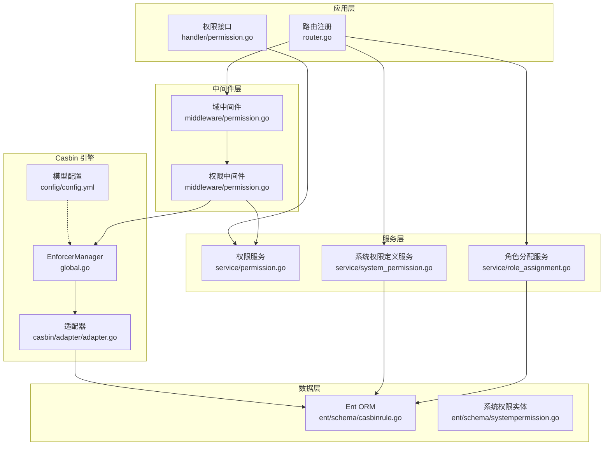
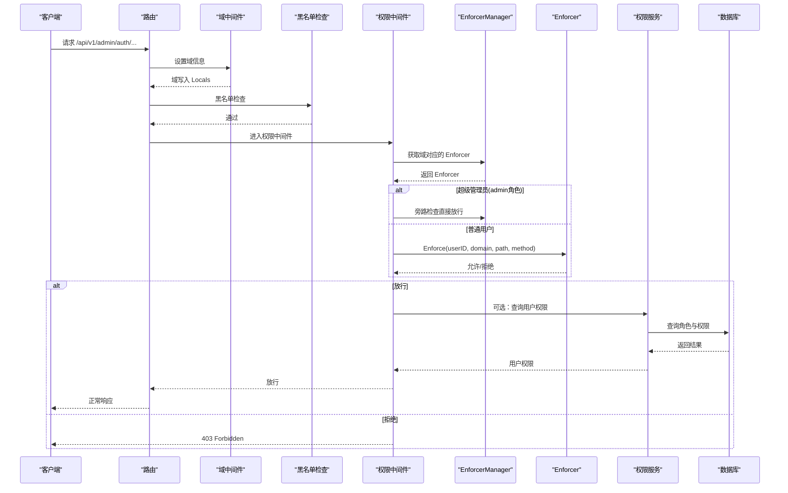
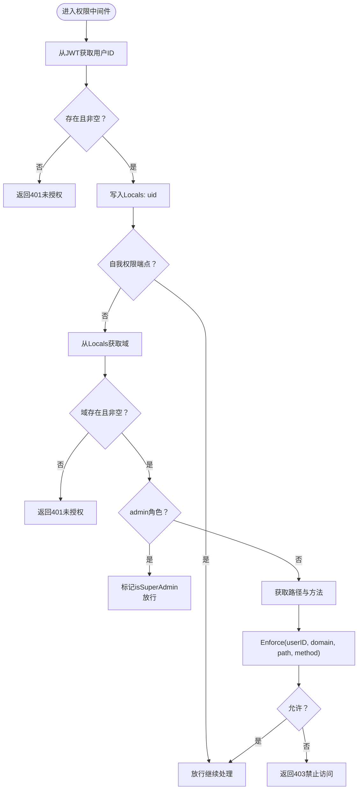
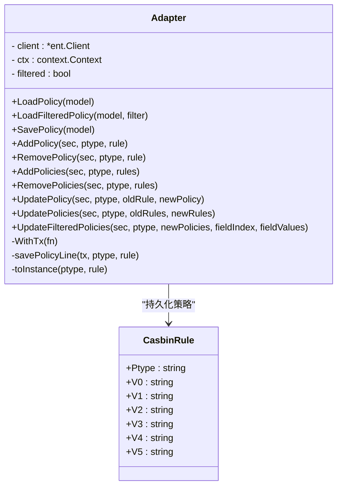
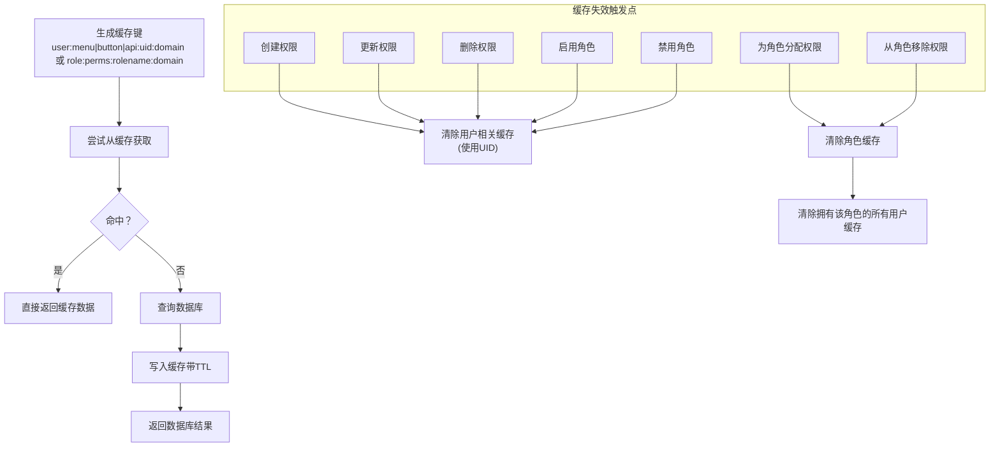
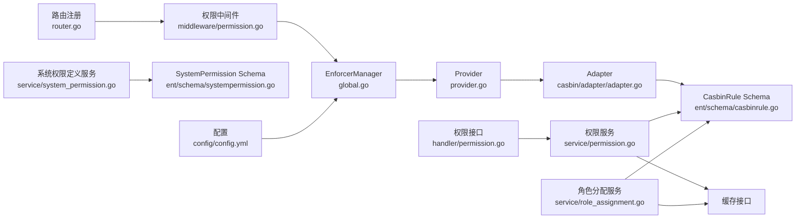

# 权限控制模块

<cite>
**本文档引用的文件**
- [permission.go](file://internal/middleware/permission.go)
- [adapter.go](file://internal/casbin/adapter/adapter.go)
- [permission.go](file://internal/service/permission.go)
- [system_permission.go](file://internal/service/system_permission.go)
- [role_assignment.go](file://internal/service/role_assignment.go)
- [permission.go](file://internal/handler/permission.go)
- [config.yml](file://config/config.yml)
- [global.go](file://internal/global/global.go)
- [casbinrule.go](file://internal/ent/schema/casbinrule.go)
- [router.go](file://internal/router.go)
- [init.go](file://internal/init.go)
- [provider.go](file://internal/provider.go)
- [permission_test.go](file://internal/service/permission_test.go)
- [app.go](file://internal/app.go)
</cite>

## 目录
1. [简介](#简介)
2. [项目结构](#项目结构)
3. [核心组件](#核心组件)
4. [架构总览](#架构总览)
5. [详细组件分析](#详细组件分析)
6. [依赖关系分析](#依赖关系分析)
7. [性能考量](#性能考量)
8. [故障排查指南](#故障排查指南)
9. [结论](#结论)
10. [附录](#附录)

## 简介
本项目采用基于 Casbin 的 RBAC（基于角色的访问控制）权限模型，结合自定义适配器与 Ent ORM 实现策略持久化，提供多域权限支持、动态权限分配与缓存优化。权限中间件负责请求拦截与决策，服务层封装权限规则的增删改查与用户权限聚合，Handler 层提供 REST 接口，配置文件定义多域模型与默认域。新增系统权限定义服务（`SystemPermissionService`）管理菜单/按钮/API 权限定义与初始化，角色分配服务（`RoleAssignmentService`）支持用户/管理员与角色关系维护。

## 项目结构
权限控制模块主要分布在以下目录：
- 中间件层：权限拦截与域解析
- 服务层：权限规则管理、系统权限定义、角色分配与用户权限聚合
- Handler 层：REST API 接口
- Casbin 适配器：策略持久化到数据库
- 配置：多域模型与默认域配置
- 全局变量：全局 EnforcerManager 管理器
- 路由：中间件注册与路由分组

图表来源
- [router.go:16-365](file://internal/router.go#L16-L365)
- [permission.go:13-131](file://internal/middleware/permission.go#L13-L131)
- [permission.go:138-154](file://internal/service/permission.go#L138-L154)
- [system_permission.go:136-151](file://internal/service/system_permission.go#L136-L151)
- [role_assignment.go:46-66](file://internal/service/role_assignment.go#L46-L66)
- [adapter.go:76-113](file://internal/casbin/adapter/adapter.go#L76-L113)
- [config.yml:77-143](file://config/config.yml#L77-L143)
- [casbinrule.go:10-37](file://internal/ent/schema/casbinrule.go#L10-L37)

章节来源
- [router.go:16-365](file://internal/router.go#L16-L365)
- [config.yml:77-143](file://config/config.yml#L77-L143)

## 核心组件
- 权限中间件：从 JWT 提取用户 ID，从 Locals 获取域，调用 Enforcer 进行权限决策；超级管理员角色（admin）旁路检查直接放行；自我权限端点（用户菜单/按钮/API 查询）跳过校验。
- 域中间件：从 JWT 提取域信息并写入 Locals，供后续中间件使用。
- 权限服务：封装权限规则的 CRUD、角色权限管理、用户权限聚合查询（菜单/按钮/API）与缓存失效逻辑；缓存键使用 UID（而非 DB ID）确保一致性。
- 系统权限定义服务（`SystemPermissionService`）：管理菜单、按钮、API 三类权限定义的 CRUD、权限树生成；`InitSystemPermissions` 初始化系统内置种子权限。
- 角色分配服务（`RoleAssignmentService`）：支持用户与管理员两种维度的角色分配，事务操作（先删后插），同步更新 Casbin 分组策略（g 规则）和清理缓存。
- Casbin 适配器：将策略持久化到数据库，支持批量保存、事务、过滤加载等。
- EnforcerManager：全局 Casbin 执行器管理器，按域获取 Enforcer 并支持自动加载。
- Ent Schema：CasbinRule 表结构定义，字段对应 ptype、v0-v5；SystemPermission 表定义权限元数据。
- 配置：多域模型配置，支持默认域与自定义域，以及自动加载策略。

章节来源
- [permission.go:13-131](file://internal/middleware/permission.go#L13-L131)
- [permission.go:138-154](file://internal/service/permission.go#L138-L154)
- [system_permission.go:126-151](file://internal/service/system_permission.go#L126-L151)
- [role_assignment.go:46-66](file://internal/service/role_assignment.go#L46-L66)
- [adapter.go:115-175](file://internal/casbin/adapter/adapter.go#L115-L175)
- [global.go:11-17](file://internal/global/global.go#L11-L17)
- [casbinrule.go:10-37](file://internal/ent/schema/casbinrule.go#L10-L37)
- [config.yml:77-143](file://config/config.yml#L77-L143)

## 架构总览
系统通过中间件链路完成权限控制：JWT 认证后，先设置域、黑名单检查，再进行权限决策；服务层负责权限规则与用户权限的聚合查询，并通过缓存减少数据库压力；适配器将策略持久化到数据库，支持批量与事务操作；配置文件定义多域模型，支持不同域的独立策略。新增系统权限定义服务用于管理权限元数据和权限树生成，角色分配服务维护用户/管理员与角色的关系映射。

图表来源
- [router.go:126-146](file://internal/router.go#L126-L146)
- [permission.go:45-76](file://internal/middleware/permission.go#L45-L76)
- [permission.go:262-930](file://internal/service/permission.go#L262-L930)
- [adapter.go:115-125](file://internal/casbin/adapter/adapter.go#L115-L125)

## 详细组件分析

### 权限中间件工作原理
- 从 JWT 中提取用户 ID，写入 Locals 供后续处理器使用。
- 从 Locals 获取域信息，若缺失则返回未授权。
- 自我权限端点（用户查询自己的菜单/按钮/API 权限）跳过权限校验。
- 超级管理员旁路：通过 `CheckUserHasRole` 检查用户是否为 admin 角色，直接放行并标记 `isSuperAdmin`。
- 非超级管理员：获取请求路径与方法，通过实际路径和路由模板路径双重匹配，调用 `CheckPermission` 进行权限决策。
- 异常返回服务器错误，拒绝返回 403，允许放行。

图表来源
- [permission.go:13-76](file://internal/middleware/permission.go#L13-L76)

章节来源
- [permission.go:13-131](file://internal/middleware/permission.go#L13-L131)

### Casbin 适配器与策略持久化
- 支持从数据库加载策略、过滤加载、保存策略、批量保存、事务回滚。
- 使用 Ent ORM 对 CasbinRule 表进行 CRUD，字段映射 ptype、v0-v5。
- 提供批量插入与事务封装，确保策略一致性。

图表来源
- [adapter.go:43-544](file://internal/casbin/adapter/adapter.go#L43-L544)
- [casbinrule.go:10-37](file://internal/ent/schema/casbinrule.go#L10-L37)

章节来源
- [adapter.go:115-214](file://internal/casbin/adapter/adapter.go#L115-L214)
- [adapter.go:304-325](file://internal/casbin/adapter/adapter.go#L304-L325)
- [adapter.go:511-520](file://internal/casbin/adapter/adapter.go#L511-L520)

### 权限服务与缓存机制
- 提供权限规则的创建、更新、删除、查询与列表。
- 支持角色权限管理：为角色分配/移除权限、查询角色权限、覆盖式保存角色权限。
- 支持用户权限聚合：菜单权限、按钮权限、API 权限（超级管理员用户自动返回所有启用的系统权限）。
- 缓存键设计：用户权限按类型区分（menu/button/api），角色权限按角色与域区分；缓存键使用 UID 而非 DB ID，确保跨服务一致性。
- 缓存失效：权限变更（创建/更新/删除）、角色变更（分配/移除/启用/禁用）均触发缓存清理；清除拥有该角色的所有用户缓存。
- `CheckUserHasRole`：支持通过 Casbin g 规则和数据库角色关联双重验证。
- 超级管理员角色保护：`admin` 角色禁止通过 API 修改其权限。

图表来源
- [permission.go:156-208](file://internal/service/permission.go#L156-L208)
- [permission.go:262-322](file://internal/service/permission.go#L262-L322)
- [permission.go:843-930](file://internal/service/permission.go#L843-L930)

章节来源
- [permission.go:138-154](file://internal/service/permission.go#L138-L154)
- [permission.go:156-208](file://internal/service/permission.go#L156-L208)
- [permission.go:262-960](file://internal/service/permission.go#L262-L960)
- [permission_test.go:116-192](file://internal/service/permission_test.go#L116-L192)
- [permission_test.go:194-340](file://internal/service/permission_test.go#L194-L340)
- [permission_test.go:342-398](file://internal/service/permission_test.go#L342-L398)
- [permission_test.go:400-462](file://internal/service/permission_test.go#L400-L462)
- [permission_test.go:464-531](file://internal/service/permission_test.go#L464-L531)

### 系统权限定义服务（SystemPermissionService）
- 管理菜单（menu）、按钮（button）、API（api）三类权限定义的 CRUD。
- 支持权限树生成（`GetTree`），按父级 ID 递归构建树形结构，用于前端菜单/权限配置。
- `InitSystemPermissions` 初始化系统内置种子权限：包含仪表盘、系统管理、角色管理、权限定义、附件管理、定时任务、操作日志、字典数据、系统配置等模块的菜单、API 和按钮权限（共 47 个种子权限项）。
- `InitSeedPermissions`：通用的种子权限初始化方法，按 `domain+code` 唯一性跳过已存在的记录。
- 删除权限时检查子权限约束，有子权限的菜单禁止直接删除。

章节来源
- [system_permission.go:126-543](file://internal/service/system_permission.go#L126-L543)
- [init.go:441-445](file://internal/init.go#L441-L445)

### 角色分配服务（RoleAssignmentService）
- 支持用户（`GetUserRoles`/`AssignRoles`）和管理员（`GetAdminRoles`/`AssignAdminRoles`）两种维度的角色分配。
- 事务操作：在事务中先删除旧角色关联（`Delete`），再批量插入新角色关联（`Create`）。
- 同步 Casbin 分组策略：角色分配后自动更新 Casbin 的 g 规则（`DeleteRolesForUserInDomain` + `AddRoleForUserInDomain`），确保权限即时生效。
- 缓存清理：角色分配后删除用户权限缓存（menu/button/api），避免过期数据。
- `AssignRolesRequest`：支持指定主角色（`primary_role_id`），主角色必须在分配的角色列表内。

**章节来源**
- [role_assignment.go:46-338](file://internal/service/role_assignment.go#L46-L338)

### 权限缓存键一致性修复
- 缓存键使用 `utils.BuildCacheKey` 构造，统一格式为 `{prefix}:{type}:{identifier}:{domain}`。
- 用户权限缓存键使用 UID（如 `user:menu:{uid}:{domain}`）而非 DB ID，确保不同服务间（用户服务 vs 管理员服务）的缓存一致性。
- 角色分配服务在分配角色后使用 UID 删除用户权限缓存，与权限服务的缓存键生成逻辑保持一致。
- `clearAllUsersPermissionsByRole` 使用 UID 清除拥有指定角色的所有用户缓存。

**章节来源**
- [permission.go:161-177](file://internal/permission.go#L161-L177)
- [role_assignment.go:194-199](file://internal/role_assignment.go#L194-L199)
- [role_assignment.go:330-335](file://internal/role_assignment.go#L330-L335)

### 多域权限支持与模型配置
- 配置文件支持多域：默认域与自定义域，每个域可配置自动加载与模型文本。
- EnforcerManager 按域获取 Enforcer，支持不同域使用不同模型。
- 模型定义包含请求定义、策略定义、角色定义、策略效果与匹配器，支持通配符匹配。

章节来源
- [config.yml:77-143](file://config/config.yml#L77-L143)
- [init.go:118-132](file://internal/init.go#L118-L132)
- [provider.go:43-46](file://internal/provider.go#L43-L46)

### 动态权限分配与继承机制
- 动态权限分配：通过角色权限管理接口为角色分配/移除权限，权限规则以 ptype='p' 存储。
- 继承机制：通过 g 类型规则实现用户到角色的分组（用户 UID -> 角色名 -> 域），Enforce 时通过 g 函数匹配用户角色集合。
- 策略加载：初始化种子数据时创建用户到角色的分组规则，确保权限继承生效。

章节来源
- [permission.go:613-840](file://internal/service/permission.go#L613-L840)
- [init.go:261-292](file://internal/init.go#L261-L292)

### 权限规则定义与访问控制决策
- 规则字段：ptype、v0（角色/用户）、v1（域）、v2（对象/路径）、v3（动作/方法）、v4（权限类型）、v5（描述）。
- 决策流程：中间件获取 Enforcer，调用 Enforce 进行匹配，支持通配符"*"匹配任意对象或动作。

章节来源
- [casbinrule.go:14-24](file://internal/ent/schema/casbinrule.go#L14-L24)
- [adapter.go:327-347](file://internal/casbin/adapter/adapter.go#L327-L347)
- [config.yml:87-101](file://config/config.yml#L87-L101)

### 权限中间件与路由集成
- 路由注册：在 adminAuth 组合中挂载域中间件、黑名单检查与权限中间件，确保所有受保护接口都经过权限校验。
- 静态路径必须在参数路由前注册：特别注意 `/messages/preference`、`/messages/unread-count`、`/messages/read`、`/messages/read-all`、`/messages/unread`、`/messages/delete-batch`、`/messages/clear`、`/messages/broadcast`、`/messages/test-push` 等路径必须在 `/:id` 之前注册，避免被参数化路由捕获导致 strconv.Atoi 失败。
- 插件路由同样遵循此约束：`/plugins/install` 必须在 `/:plugin_id` 前注册。
- 角色路由：`/roles/permissions` 和 `/roles/all` 必须在 `/:id` 前注册。

章节来源
- [router.go:126-365](file://internal/router.go#L126-L365)
- [router.go:169-174](file://internal/router.go#L169-L174)

## 依赖关系分析

图表来源
- [permission.go:45-76](file://internal/middleware/permission.go#L45-L76)
- [global.go:11-17](file://internal/global/global.go#L11-L17)
- [provider.go:38-46](file://internal/provider.go#L38-L46)
- [adapter.go:76-113](file://internal/casbin/adapter/adapter.go#L76-L113)
- [casbinrule.go:10-37](file://internal/ent/schema/casbinrule.go#L10-L37)
- [system_permission.go:136-151](file://internal/service/system_permission.go#L136-L151)
- [permission.go:138-154](file://internal/service/permission.go#L138-L154)
- [role_assignment.go:46-66](file://internal/service/role_assignment.go#L46-L66)
- [permission.go:35-67](file://internal/handler/permission.go#L35-L67)
- [router.go:126-365](file://internal/router.go#L126-L365)
- [config.yml:77-143](file://config/config.yml#L77-L143)

章节来源
- [app.go:15-28](file://internal/app.go#L15-L28)
- [provider.go:17-46](file://internal/provider.go#L17-L46)

## 性能考量
- 缓存策略：用户权限（菜单/按钮/API）与角色权限分别缓存，默认 TTL 5 分钟，显著降低数据库压力。
- 批量写入：保存策略时使用批量插入，提升大体量策略导入效率。
- 事务保证：批量操作与更新操作均在事务中执行，确保一致性。
- 自动加载：高频域建议开启 auto_load，启动时预加载策略，减少首次请求延迟。
- 过滤加载：支持按条件过滤加载策略，减少内存占用与加载时间。
- 并发安全：`sync.Map` 用于分片上传会话管理；`sync.Mutex` 保护缓存清理逻辑避免竞态。

章节来源
- [permission.go:157-159](file://internal/service/permission.go#L157-L159)
- [adapter.go:199-213](file://internal/casbin/adapter/adapter.go#L199-L213)
- [adapter.go:304-325](file://internal/casbin/adapter/adapter.go#L304-L325)
- [config.yml:86-87](file://config/config.yml#L86-L87)

## 故障排查指南
- 未授权访问：检查 JWT 是否包含用户 ID 与域信息，确认域中间件与权限中间件顺序正确。
- 权限检查失败：检查 EnforcerManager 是否正确初始化，确认域配置与模型匹配。
- 权限不生效：确认用户到角色的分组规则（g 类型）已创建，且域一致；检查角色分配服务是否正确同步 Casbin 规则。
- 缓存不更新：确认权限变更后缓存清理逻辑正常执行，检查缓存键生成与失效策略（使用 UID 而非 DB ID）。
- 数据库异常：检查 CasbinRule 表结构与索引，确认批量插入与事务回滚逻辑。
- 路由冲突：检查静态路径是否在参数路由前注册，避免 `/messages/preference` 等路径被 `/:id` 捕获。

章节来源
- [permission.go:14-26](file://internal/middleware/permission.go#L14-L26)
- [permission.go:45-76](file://internal/middleware/permission.go#L45-L76)
- [init.go:261-292](file://internal/init.go#L261-L292)
- [role_assignment.go:117-202](file://internal/role_assignment.go#L117-L202)
- [adapter.go:304-325](file://internal/casbin/adapter/adapter.go#L304-L325)
- [router.go:333-351](file://internal/router.go#L333-L351)

## 结论
本权限控制模块基于 Casbin 实现了灵活的 RBAC 模型，支持多域、动态权限分配与继承，配合缓存与批量写入提升了性能。通过中间件链路与服务层封装，实现了清晰的职责分离与良好的扩展性。新增的 `SystemPermissionService` 提供系统权限定义管理，`RoleAssignmentService` 支持用户/管理员角色分配并同步 Casbin 规则。建议在生产环境中启用自动加载与合适的缓存策略，并定期清理与校验权限规则，确保系统安全与稳定。

## 附录

### 权限配置示例
- 默认域配置：在配置文件中定义默认域与模型文本，支持自动加载。
- 多域示例：可为不同租户或业务域配置独立模型，支持按需加载。
- 模型说明：包含请求定义、策略定义、角色定义、策略效果与匹配器，支持通配符。

章节来源
- [config.yml:77-143](file://config/config.yml#L77-L143)

### 角色与权限映射
- 角色定义：通过角色管理接口创建角色，角色名作为策略中的主体。
- 权限映射：为角色分配权限时，权限类型（api/menu/button）与对象/动作组合形成策略规则。
- 用户权限：通过用户角色查询聚合用户拥有的权限，支持菜单、按钮与 API 权限分类。
- 系统权限定义：通过 `SystemPermissionService` 管理的权限定义表，支持权限树与种子数据初始化。

章节来源
- [permission.go:613-840](file://internal/service/permission.go#L613-L840)
- [system_permission.go:418-520](file://internal/service/system_permission.go#L418-L520)

### 策略规则编写
- 字段含义：ptype、v0（角色/用户）、v1（域）、v2（对象/路径）、v3（动作/方法）、v4（权限类型）、v5（描述）。
- 匹配器：支持通配符"*"匹配任意对象或动作，满足灵活的权限控制需求。

章节来源
- [casbinrule.go:14-24](file://internal/ent/schema/casbinrule.go#L14-L24)
- [config.yml:100-101](file://config/config.yml#L100-L101)

### 实际使用场景
- 管理后台：通过权限中间件统一拦截受保护接口，按域与角色控制访问。
- 动态权限：通过接口为角色分配/移除权限，实时生效并清理缓存。
- 用户权限聚合：前端可调用用户权限接口获取菜单与按钮权限，实现界面动态展示。
- 角色分配：管理端通过角色分配接口为用户/管理员分配角色，自动同步 Casbin 策略。
- 权限定义管理：管理端通过系统权限定义接口管理菜单/按钮/API 权限树与种子数据。

章节来源
- [router.go:126-365](file://internal/router.go#L126-L365)
- [permission.go:406-556](file://internal/handler/permission.go#L406-L556)
