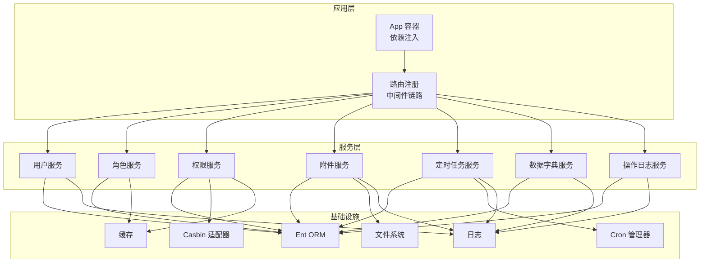
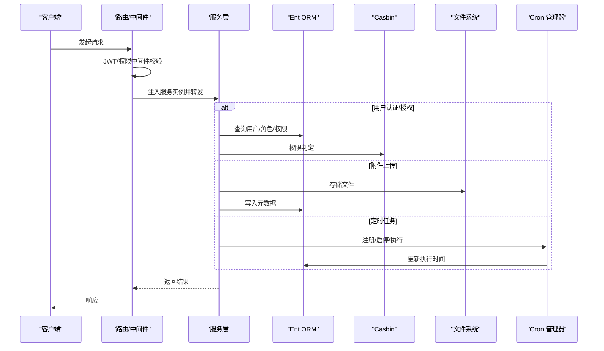
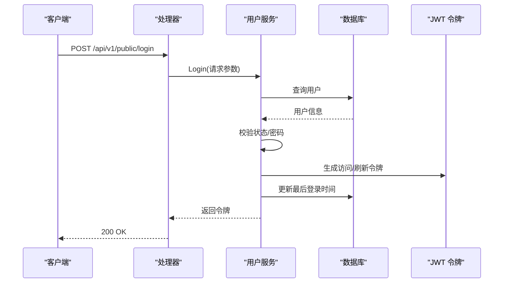
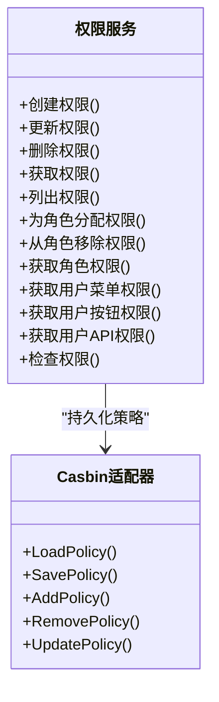
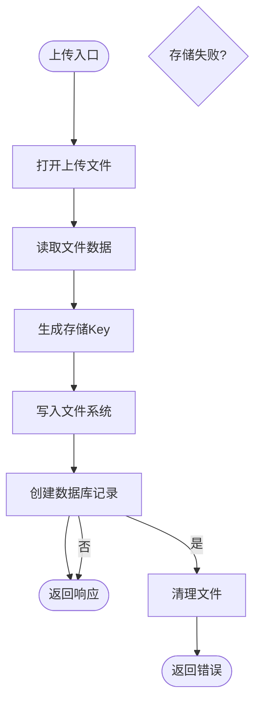
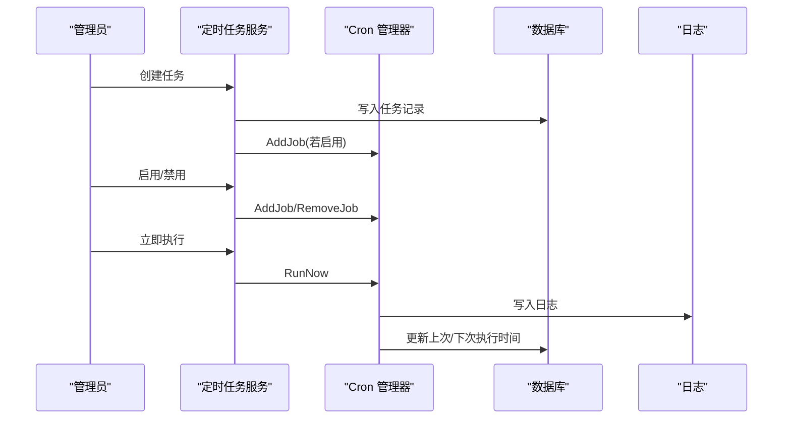
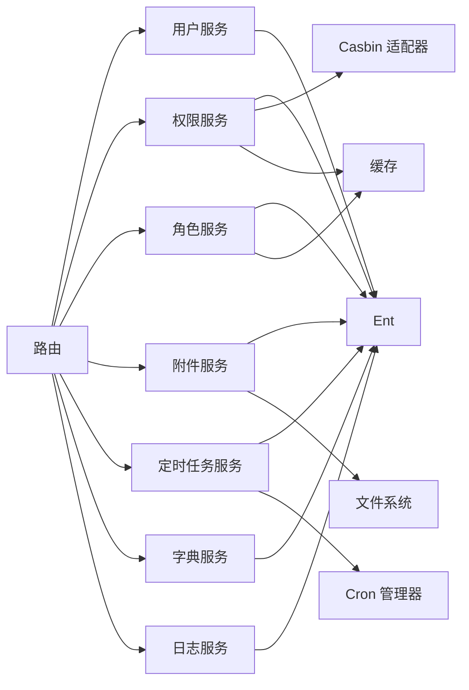

# 核心模块

<cite>
**本文引用的文件**
- [internal/app.go](file://internal/app.go)
- [internal/router.go](file://internal/router.go)
- [internal/provider.go](file://internal/provider.go)
- [internal/init.go](file://internal/init.go)
- [config/config.yml](file://config/config.yml)
- [internal/service/user.go](file://internal/service/user.go)
- [internal/service/permission.go](file://internal/service/permission.go)
- [internal/service/role.go](file://internal/service/role.go)
- [internal/service/attachment.go](file://internal/service/attachment.go)
- [internal/service/cron_job.go](file://internal/service/cron_job.go)
- [internal/service/dict_data.go](file://internal/service/dict_data.go)
- [internal/service/operation_log.go](file://internal/service/operation_log.go)
- [internal/casbin/adapter/adapter.go](file://internal/casbin/adapter/adapter.go)
- [internal/cron/manager.go](file://internal/cron/manager.go)
- [internal/ent/schema/user.go](file://internal/ent/schema/user.go)
</cite>

## 目录
1. [简介](#简介)
2. [项目结构](#项目结构)
3. [核心组件](#核心组件)
4. [架构总览](#架构总览)
5. [详细组件分析](#详细组件分析)
6. [依赖分析](#依赖分析)
7. [性能考虑](#性能考虑)
8. [故障排查指南](#故障排查指南)
9. [结论](#结论)
10. [附录](#附录)

## 简介
本文件面向 Go Admin 管理系统的核心模块，系统性梳理用户认证与授权、权限控制、文件管理、定时任务、数据字典与操作审计等模块的设计与实现。文档覆盖模块职责、数据模型、业务流程、服务接口、模块间依赖与协作、性能优化与最佳实践，并提供可视化图示帮助开发者快速理解与扩展。

## 项目结构
系统采用分层与模块化组织方式：
- 应用入口与依赖注入：App 容器、Wire Provider、初始化流程
- 路由与中间件：Fiber 路由注册、JWT 与权限中间件
- 服务层：用户、角色、权限、附件、定时任务、数据字典、操作日志
- 基础设施：Casbin 权限引擎适配器、Cron 调度器、ORM（Ent）、文件系统、缓存、日志
- 配置：YAML 配置文件

**图表来源**
- [internal/app.go:15-26](file://internal/app.go#L15-L26)
- [internal/router.go:16-190](file://internal/router.go#L16-L190)
- [internal/provider.go:17-47](file://internal/provider.go#L17-L47)
- [internal/init.go:39-96](file://internal/init.go#L39-L96)

**章节来源**
- [internal/app.go:15-26](file://internal/app.go#L15-L26)
- [internal/router.go:16-190](file://internal/router.go#L16-L190)
- [internal/provider.go:17-47](file://internal/provider.go#L17-L47)
- [internal/init.go:39-96](file://internal/init.go#L39-L96)

## 核心组件
- 应用容器 App：集中管理配置、日志、DB、Validator、Cache、Ent 客户端、Casbin EnforcerManager、文件系统等依赖。
- 路由与中间件：统一注册 v1 接口组，集成 JWT 认证、权限中间件、请求日志中间件；按需注入各服务实例。
- 初始化流程：优先使用 Wire 注入的依赖，否则回退到手动初始化；完成数据库、Casbin、定时任务、密钥与种子数据初始化。
- 配置中心：YAML 驱动，涵盖应用、日志、数据库、缓存、Redis、文件系统、Casbin 多域模型等。

**章节来源**
- [internal/app.go:15-26](file://internal/app.go#L15-L26)
- [internal/router.go:16-190](file://internal/router.go#L16-L190)
- [internal/init.go:39-96](file://internal/init.go#L39-L96)
- [config/config.yml:1-143](file://config/config.yml#L1-143)

## 架构总览
系统采用“路由 → 中间件 → 服务 → 基础设施”的分层架构，服务层通过 Ent 访问数据库，Casbin 提供细粒度权限控制，Cron 管理器负责任务调度与日志，文件系统支撑附件存储，缓存提升权限查询性能，日志贯穿全链路。

**图表来源**
- [internal/router.go:49-189](file://internal/router.go#L49-L189)
- [internal/service/user.go:139-218](file://internal/service/user.go#L139-L218)
- [internal/service/permission.go:514-557](file://internal/service/permission.go#L514-L557)
- [internal/service/attachment.go:93-148](file://internal/service/attachment.go#L93-L148)
- [internal/service/cron_job.go:107-164](file://internal/service/cron_job.go#L107-L164)
- [internal/cron/manager.go:85-116](file://internal/cron/manager.go#L85-L116)

## 详细组件分析

### 用户认证模块
- 职责：用户注册、登录、刷新令牌、个人信息维护、密码变更。
- 实现要点：
  - 登录流程：查询用户、校验状态、验证密码、签发 JWT（含访问令牌与刷新令牌），记录最后登录时间。
  - 刷新令牌：解析并验证刷新令牌，生成新的访问令牌。
  - 密码安全：密码哈希与盐值存储，支持密码变更。
  - 防重放：NonceStore 与密钥轮换。
- 接口与路由：登录、刷新令牌、获取公钥、获取/更新用户信息、修改密码。
- 数据模型：User 实体包含邮箱、用户名、昵称、UID、状态、最后登录等字段。

**图表来源**
- [internal/router.go:49-61](file://internal/router.go#L49-L61)
- [internal/service/user.go:139-218](file://internal/service/user.go#L139-L218)

**章节来源**
- [internal/service/user.go:139-218](file://internal/service/user.go#L139-L218)
- [internal/ent/schema/user.go:23-80](file://internal/ent/schema/user.go#L23-L80)
- [internal/init.go:74-81](file://internal/init.go#L74-L81)

### 权限控制模块
- 职责：基于 Casbin 的 RBAC 权限管理，支持 API、菜单、按钮三类权限；角色权限分配与回收；用户权限查询与缓存。
- 实现要点：
  - 权限类型：API、菜单、按钮；权限规则持久化为 CasbinRule。
  - 缓存策略：角色权限与用户权限按域缓存，变更时批量失效。
  - 权限判定：根据用户 UID 与其角色集合进行匹配。
- 接口与路由：角色权限管理、用户权限查询、权限增删改查。
- 数据模型：Role、UserRole、CasbinRule。

**图表来源**
- [internal/service/permission.go:96-117](file://internal/service/permission.go#L96-L117)
- [internal/casbin/adapter/adapter.go:115-175](file://internal/casbin/adapter/adapter.go#L115-L175)

**章节来源**
- [internal/service/permission.go:190-335](file://internal/service/permission.go#L190-L335)
- [internal/service/permission.go:514-798](file://internal/service/permission.go#L514-L798)
- [internal/casbin/adapter/adapter.go:115-225](file://internal/casbin/adapter/adapter.go#L115-L225)

### 文件管理系统
- 职责：文件上传、删除、批量删除、列表查询、预览、移动分组。
- 实现要点：
  - 上传：读取 multipart 数据，生成存储 key，写入文件系统，创建数据库记录。
  - 删除：先删文件再删记录，保证一致性。
  - 预览：按 ID 获取文件二进制数据与原始名。
  - 分组：附件归属分组，支持移动。
- 接口与路由：上传、删除、批量删除、列表、详情、预览、移动。
- 数据模型：Attachment、AttachmentGroup。

**图表来源**
- [internal/service/attachment.go:93-148](file://internal/service/attachment.go#L93-L148)

**章节来源**
- [internal/service/attachment.go:93-321](file://internal/service/attachment.go#L93-L321)

### 定时任务系统
- 职责：任务定义、启停、立即执行、日志查看与滚动读取。
- 实现要点：
  - 支持 shell、curl、task 三种执行器。
  - CronManager 启动时加载 enabled 任务，注册到调度器；支持运行时启停与更新。
  - 日志：按任务 ID 分目录写入，支持列出、读取、滚动读取与定期清理。
- 接口与路由：创建、更新、删除、列表、详情、启停、立即执行、日志列表、日志内容、日志滚动。
- 数据模型：CronJob。

**图表来源**
- [internal/service/cron_job.go:107-164](file://internal/service/cron_job.go#L107-L164)
- [internal/cron/manager.go:85-116](file://internal/cron/manager.go#L85-L116)
- [internal/cron/manager.go:154-221](file://internal/cron/manager.go#L154-L221)

**章节来源**
- [internal/service/cron_job.go:107-492](file://internal/service/cron_job.go#L107-L492)
- [internal/cron/manager.go:26-77](file://internal/cron/manager.go#L26-L77)

### 数据字典系统
- 职责：字典项的增删改查、按类型查询、排序与状态控制。
- 实现要点：
  - 支持标签、值、类型、排序、状态、默认标记、备注等字段。
  - 列表按排序升序、创建时间降序。
- 接口与路由：按类型查询、创建、列表、详情、更新、删除。
- 数据模型：DictData。

**章节来源**
- [internal/service/dict_data.go:86-279](file://internal/service/dict_data.go#L86-L279)

### 操作审计系统
- 职责：异步记录操作日志，包括用户、模块、动作、请求方法、路径、状态码、耗时、请求体等。
- 实现要点：
  - 异步写入，避免阻塞主流程。
  - 支持按用户名、模块、动作、时间范围筛选。
- 接口与路由：日志列表、详情。
- 数据模型：OperationLog。

**章节来源**
- [internal/service/operation_log.go:88-197](file://internal/service/operation_log.go#L88-L197)

## 依赖分析
- 组件耦合：
  - 服务层对 Ent 的强依赖，权限服务同时依赖 Casbin 适配器与缓存。
  - 路由层通过 Locals 注入服务实例，降低控制器与服务层耦合。
- 外部依赖：
  - 数据库：Ent ORM + 本地/远端 SQL。
  - 权限：Casbin + 自定义适配器。
  - 文件：本地/云存储抽象。
  - 调度：robfig/cron。
  - 缓存：内存/Redis。
  - 日志：zap + 文件输出。
- 循环依赖：未见循环导入；服务层通过接口与适配器解耦。

**图表来源**
- [internal/router.go:36-189](file://internal/router.go#L36-L189)
- [internal/service/permission.go:120-135](file://internal/service/permission.go#L120-L135)
- [internal/service/role.go:41-56](file://internal/service/role.go#L41-L56)

**章节来源**
- [internal/router.go:36-189](file://internal/router.go#L36-L189)
- [internal/service/permission.go:120-135](file://internal/service/permission.go#L120-L135)
- [internal/service/role.go:41-56](file://internal/service/role.go#L41-L56)

## 性能考虑
- 缓存优化：权限服务对角色与用户权限进行缓存，变更时批量失效，减少数据库与 Casbin 查询压力。
- 数据库索引：User 等实体建立邮箱/电话/用户名索引，提升查询效率。
- IO 优化：附件上传采用流式读取与一次性写入，避免大文件内存占用。
- 调度与日志：Cron 管理器按秒级调度，日志按任务分目录并定期清理，避免磁盘膨胀。
- 并发与异步：操作日志异步写入，定时任务执行在后台 goroutine，降低主线程阻塞风险。
- 最佳实践：
  - 合理设置缓存 TTL，平衡一致性与性能。
  - 对高频查询使用分页与索引，避免全表扫描。
  - 控制定时任务并发度，避免资源争用。
  - 使用连接池与超时控制，保障数据库稳定性。

[本节为通用指导，无需特定文件引用]

## 故障排查指南
- 登录失败
  - 检查用户状态是否为激活；确认密码哈希与盐值正确；核对 JWT 秘钥与过期时间。
  - 参考：[internal/service/user.go:139-218](file://internal/service/user.go#L139-L218)
- 权限不足
  - 确认角色与用户 UID 的分组规则；检查策略是否已加载；核对缓存是否过期。
  - 参考：[internal/service/permission.go:514-557](file://internal/service/permission.go#L514-L557)，[internal/casbin/adapter/adapter.go:115-175](file://internal/casbin/adapter/adapter.go#L115-L175)
- 附件上传失败
  - 检查文件系统配置与存储路径；确认数据库记录回滚清理逻辑是否执行。
  - 参考：[internal/service/attachment.go:93-148](file://internal/service/attachment.go#L93-L148)
- 定时任务未执行
  - 检查任务是否启用；核对 cron 表达式；查看日志目录与清理策略。
  - 参考：[internal/service/cron_job.go:107-164](file://internal/service/cron_job.go#L107-L164)，[internal/cron/manager.go:85-116](file://internal/cron/manager.go#L85-L116)
- 数据字典异常
  - 检查字典类型编码与状态；确认排序字段与默认标记。
  - 参考：[internal/service/dict_data.go:86-279](file://internal/service/dict_data.go#L86-L279)
- 操作日志缺失
  - 确认异步写入是否触发；检查日志表结构与权限。
  - 参考：[internal/service/operation_log.go:88-197](file://internal/service/operation_log.go#L88-L197)

**章节来源**
- [internal/service/user.go:139-218](file://internal/service/user.go#L139-L218)
- [internal/service/permission.go:514-557](file://internal/service/permission.go#L514-L557)
- [internal/casbin/adapter/adapter.go:115-175](file://internal/casbin/adapter/adapter.go#L115-L175)
- [internal/service/attachment.go:93-148](file://internal/service/attachment.go#L93-L148)
- [internal/service/cron_job.go:107-164](file://internal/service/cron_job.go#L107-L164)
- [internal/cron/manager.go:85-116](file://internal/cron/manager.go#L85-L116)
- [internal/service/dict_data.go:86-279](file://internal/service/dict_data.go#L86-L279)
- [internal/service/operation_log.go:88-197](file://internal/service/operation_log.go#L88-L197)

## 结论
Go Admin 通过清晰的分层与模块化设计，结合 Casbin 权限引擎、Cron 调度、文件系统与缓存，构建了稳定可扩展的后台管理能力。开发者可基于现有服务接口与数据模型快速扩展新功能，同时遵循缓存、IO、并发与日志的最佳实践，持续优化系统性能与可靠性。

[本节为总结性内容，无需特定文件引用]

## 附录
- 配置项概览（摘自配置文件）
  - 应用：名称、端口、调试、超时、Swagger 开关、密钥、登录过期。
  - 日志：文件路径、控制台/文件输出开关、切割大小与保留。
  - 数据库：驱动、主机、端口、账号、密码、库名、SSL、表前缀。
  - 缓存：默认存储、内存/Redis 配置。
  - Redis：连接参数、连接池配置。
  - 文件系统：本地/云存储驱动与选项。
  - Casbin：多域模型配置（默认域与可选自定义域）。

**章节来源**
- [config/config.yml:1-143](file://config/config.yml#L1-143)