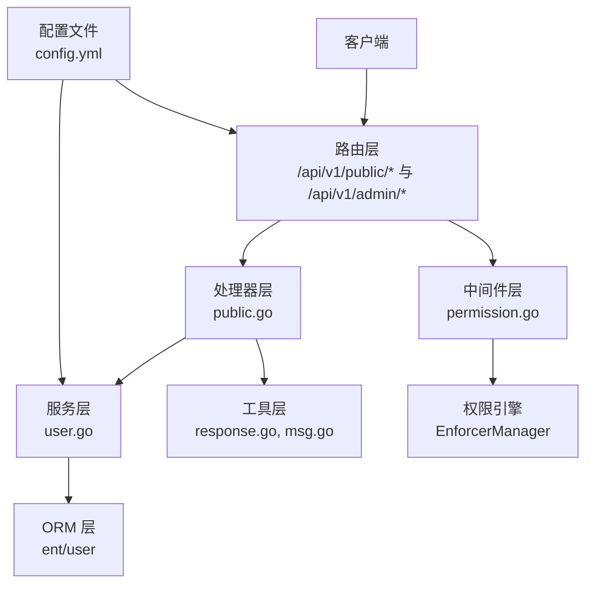
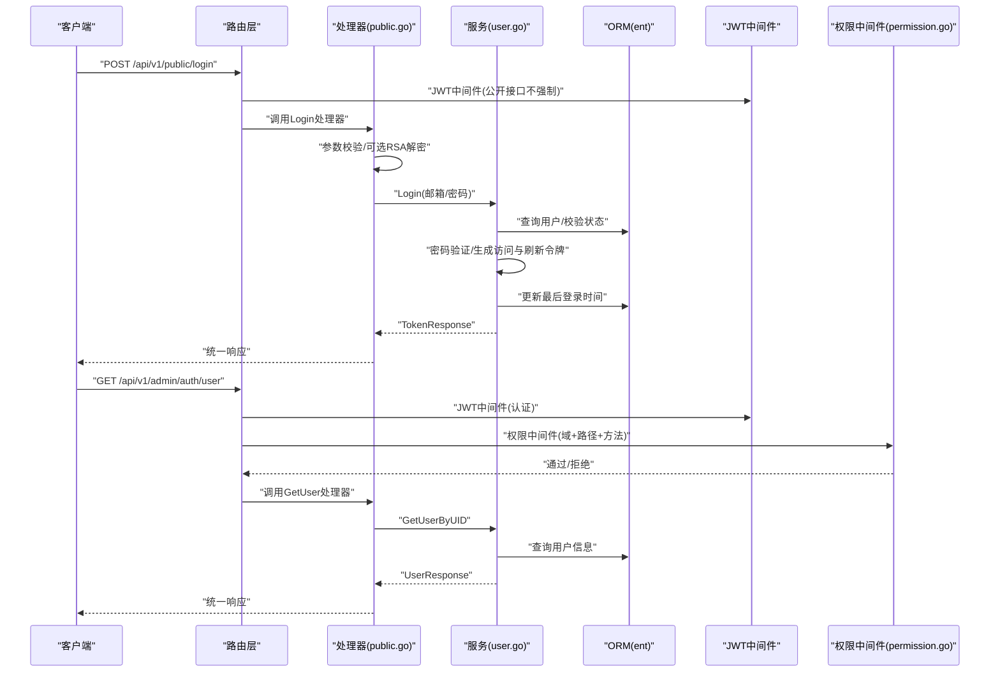
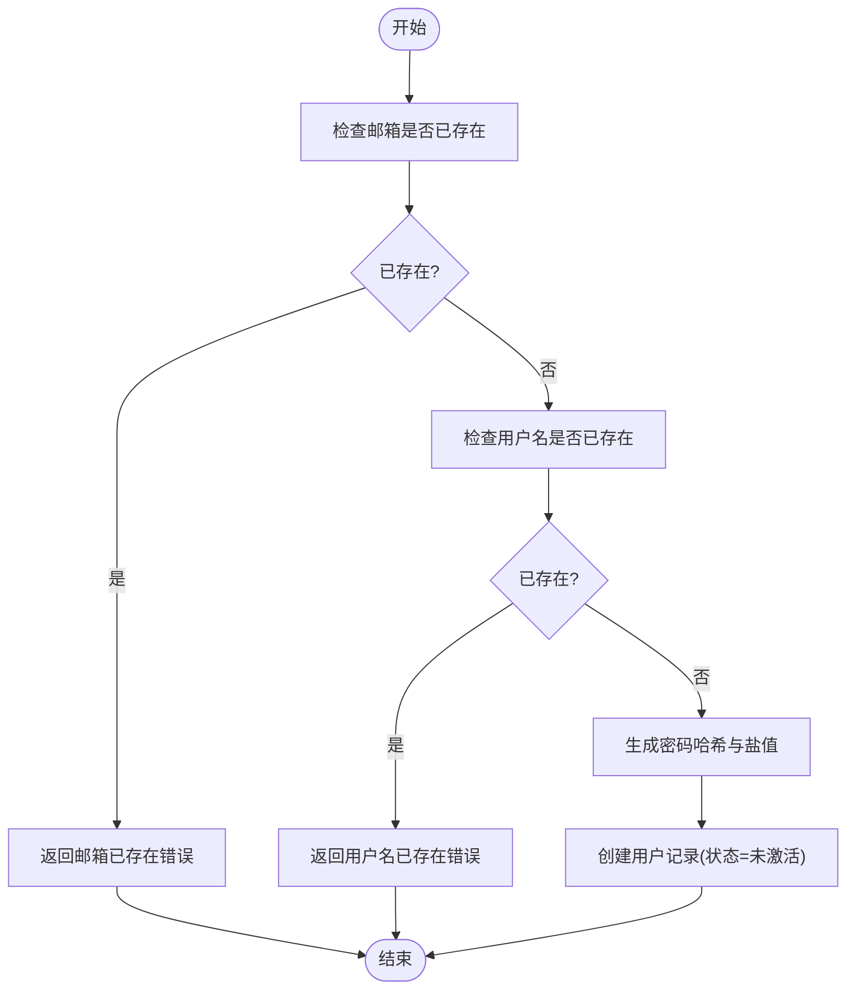
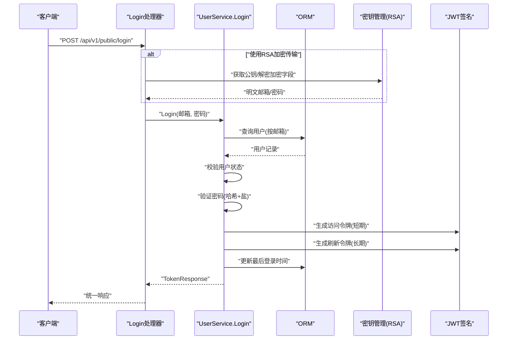
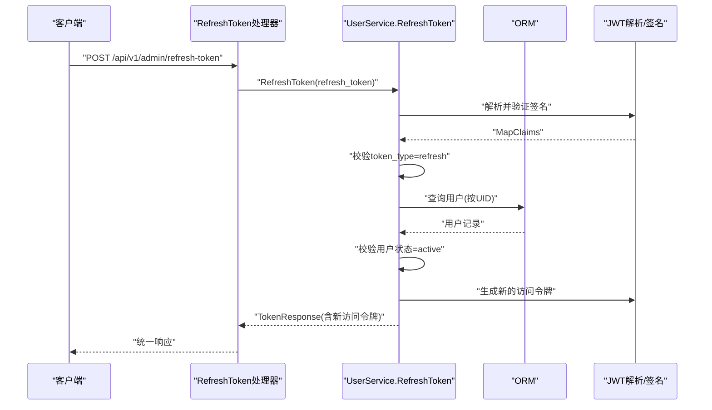
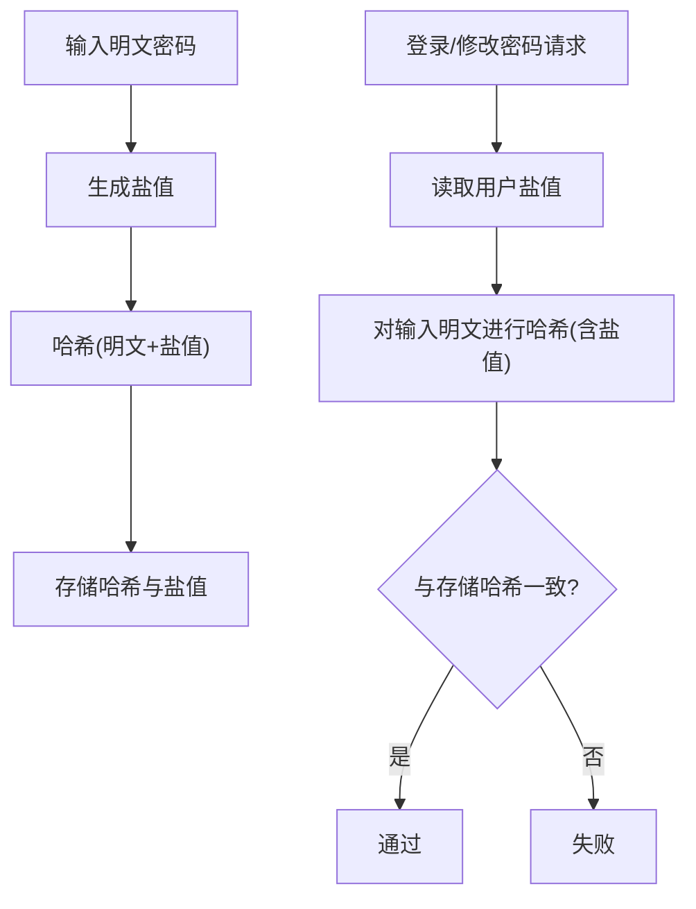
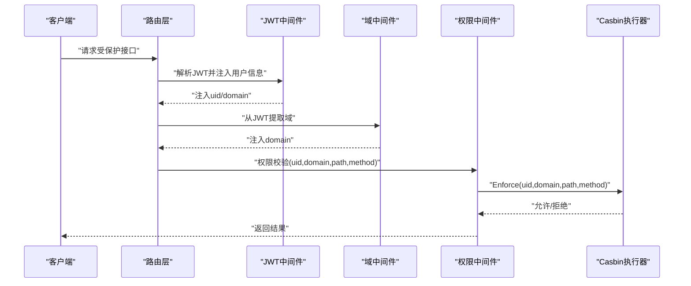
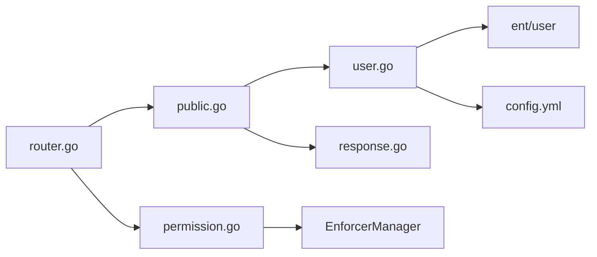

# 用户认证模块

<cite>
**本文引用的文件**
- [main.go](file://main.go)
- [router.go](file://internal/router.go)
- [public.go](file://internal/handler/public.go)
- [permission.go](file://internal/middleware/permission.go)
- [user.go](file://internal/service/user.go)
- [response.go](file://internal/utils/response.go)
- [msg.go](file://internal/global/msg.go)
- [config.yml](file://config/config.yml)
- [user.go](file://internal/ent/schema/user.go)
- [user.go](file://internal/ent/user/user.go)
</cite>

## 目录
1. [简介](#简介)
2. [项目结构](#项目结构)
3. [核心组件](#核心组件)
4. [架构总览](#架构总览)
5. [详细组件分析](#详细组件分析)
6. [依赖分析](#依赖分析)
7. [性能考虑](#性能考虑)
8. [故障排查指南](#故障排查指南)
9. [结论](#结论)
10. [附录](#附录)

## 简介
本文件面向开发者与运维人员，系统性梳理用户认证模块的设计与实现，覆盖用户注册、登录、令牌管理（访问令牌与刷新令牌）、密码安全机制、用户状态与权限控制、API 接口定义、错误处理策略及最佳实践。文档基于仓库中的实际代码进行分析，确保内容可追溯、可落地。

## 项目结构
认证模块围绕 Fiber 应用组织，采用“路由-处理器-服务-中间件-工具”分层设计：
- 路由层：在路由注册中划分公开接口与需要认证的接口组，分别挂载 JWT 中间件与权限中间件。
- 处理器层：负责请求解析、参数校验、调用服务层并返回统一响应格式。
- 服务层：封装业务逻辑，包括用户注册、登录、令牌刷新、密码变更、用户信息查询与更新。
- 中间件层：JWT 解析与用户身份注入、域信息注入、权限校验。
- 工具层：统一响应体、错误码映射、配置读取。

**图表来源**
- [router.go:16-190](file://internal/router.go#L16-L190)
- [public.go:1-299](file://internal/handler/public.go#L1-L299)
- [user.go:1-427](file://internal/service/user.go#L1-L427)
- [permission.go:1-80](file://internal/middleware/permission.go#L1-L80)
- [response.go:1-50](file://internal/utils/response.go#L1-L50)
- [msg.go:1-84](file://internal/global/msg.go#L1-L84)
- [config.yml:1-143](file://config/config.yml#L1-L143)

**章节来源**
- [router.go:16-190](file://internal/router.go#L16-L190)
- [public.go:1-299](file://internal/handler/public.go#L1-L299)
- [user.go:1-427](file://internal/service/user.go#L1-L427)
- [permission.go:1-80](file://internal/middleware/permission.go#L1-L80)
- [response.go:1-50](file://internal/utils/response.go#L1-L50)
- [msg.go:1-84](file://internal/global/msg.go#L1-L84)
- [config.yml:1-143](file://config/config.yml#L1-L143)

## 核心组件
- 路由与中间件
  - 公开接口组：登录、刷新令牌、获取公钥。
  - 认证接口组：用户信息、修改资料、修改密码。
  - 权限接口组：在认证基础上增加域中间件与权限中间件。
- 处理器
  - 登录：支持明文或加密传输（RSA 公钥加密邮箱与密码），并进行时间戳与随机数校验。
  - 刷新令牌：解析并验证刷新令牌，签发新的访问令牌。
  - 用户信息：基于 JWT 提取用户 ID 查询用户信息。
  - 修改密码：校验旧密码，加密新密码并更新。
- 服务层
  - 注册：邮箱/用户名去重、密码哈希与盐值生成、初始状态为未激活。
  - 登录：查找用户、校验状态、验证密码、生成访问令牌与刷新令牌、记录最后登录时间。
  - 刷新：解析刷新令牌、校验类型与用户状态、生成新的访问令牌。
  - 密码变更：校验旧密码、生成新密码哈希与盐值并更新。
- 工具与配置
  - 统一响应体与错误码映射。
  - 配置项：应用名、密钥、登录过期时间、刷新过期时间等。

**章节来源**
- [router.go:48-71](file://internal/router.go#L48-L71)
- [public.go:78-145](file://internal/handler/public.go#L78-L145)
- [public.go:277-298](file://internal/handler/public.go#L277-L298)
- [user.go:92-137](file://internal/service/user.go#L92-L137)
- [user.go:139-218](file://internal/service/user.go#L139-L218)
- [user.go:307-389](file://internal/service/user.go#L307-L389)
- [user.go:391-426](file://internal/service/user.go#L391-L426)
- [response.go:9-49](file://internal/utils/response.go#L9-L49)
- [msg.go:44-84](file://internal/global/msg.go#L44-L84)
- [config.yml:1-143](file://config/config.yml#L1-L143)

## 架构总览
认证模块遵循“请求-解析-鉴权-业务-持久化-响应”的闭环流程，结合 JWT 与 Casbin 实现多域权限控制。

**图表来源**
- [router.go:48-71](file://internal/router.go#L48-L71)
- [public.go:78-145](file://internal/handler/public.go#L78-L145)
- [user.go:139-218](file://internal/service/user.go#L139-L218)
- [permission.go:11-64](file://internal/middleware/permission.go#L11-L64)

## 详细组件分析

### 用户注册流程
- 输入参数：邮箱、密码、用户名、昵称、手机。
- 校验规则：邮箱唯一、用户名唯一、密码最小长度、手机可选数字。
- 密码安全：使用密码哈希与盐值存储，初始状态为未激活。
- 数据持久化：写入用户表，包含 UID、状态、盐值等。

**图表来源**
- [user.go:92-137](file://internal/service/user.go#L92-L137)

**章节来源**
- [user.go:47-54](file://internal/service/user.go#L47-L54)
- [user.go:92-137](file://internal/service/user.go#L92-L137)
- [user.go:24-80](file://internal/ent/schema/user.go#L24-L80)

### 用户登录与令牌发放
- 输入参数：邮箱、密码；或加密字段（加密邮箱、加密密码、时间戳、随机数、密钥ID）。
- 安全增强：时间戳窗口校验、一次性随机数防重放、RSA 公钥获取接口。
- 业务流程：查找用户、校验状态、验证密码、生成访问令牌与刷新令牌、更新最后登录时间。
- 令牌类型：
  - 访问令牌：短期有效，用于日常 API 访问。
  - 刷新令牌：长期有效，用于换取新的访问令牌。

**图表来源**
- [public.go:78-145](file://internal/handler/public.go#L78-L145)
- [user.go:139-218](file://internal/service/user.go#L139-L218)

**章节来源**
- [public.go:78-145](file://internal/handler/public.go#L78-L145)
- [user.go:56-65](file://internal/service/user.go#L56-L65)
- [user.go:139-218](file://internal/service/user.go#L139-L218)
- [config.yml:8-10](file://config/config.yml#L8-L10)

### 刷新令牌流程
- 输入参数：刷新令牌。
- 校验规则：签名方法校验、令牌有效性、声明类型为 refresh、用户存在且状态正常。
- 业务流程：解析刷新令牌、提取用户信息、生成新的访问令牌（保持刷新令牌可用）。

**图表来源**
- [public.go:277-298](file://internal/handler/public.go#L277-L298)
- [user.go:307-389](file://internal/service/user.go#L307-L389)

**章节来源**
- [public.go:277-298](file://internal/handler/public.go#L277-L298)
- [user.go:75-78](file://internal/service/user.go#L75-L78)
- [user.go:307-389](file://internal/service/user.go#L307-L389)

### 密码安全机制
- 存储：密码与盐值分离存储，盐值参与哈希计算，保证相同明文产生不同哈希。
- 校验：登录与修改密码均使用“明文+盐值”进行哈希比对。
- 传输：支持 RSA 公钥加密传输邮箱与密码，降低明文泄露风险。
- 防重放：登录请求支持时间戳与随机数校验，配合一次性随机数存储。

**图表来源**
- [user.go:118-122](file://internal/service/user.go#L118-L122)
- [user.go:157-164](file://internal/service/user.go#L157-L164)
- [user.go:413-417](file://internal/service/user.go#L413-L417)
- [user.go:404-411](file://internal/service/user.go#L404-L411)

**章节来源**
- [user.go:118-122](file://internal/service/user.go#L118-L122)
- [user.go:157-164](file://internal/service/user.go#L157-L164)
- [user.go:404-411](file://internal/service/user.go#L404-L411)
- [user.go:413-417](file://internal/service/user.go#L413-L417)

### 用户状态管理与账户激活
- 用户状态枚举：active、inactive、suspended。
- 登录前置条件：仅 active 状态用户可登录。
- 注册默认状态：inactive，需后续激活流程（本仓库未提供激活接口，建议在业务侧补充）。

**章节来源**
- [user.go:69-72](file://internal/ent/schema/user.go#L69-L72)
- [user.go:112-137](file://internal/ent/user/user.go#L112-L137)
- [user.go:133](file://internal/service/user.go#L133)
- [user.go:152-155](file://internal/service/user.go#L152-L155)

### 权限控制与多域支持
- JWT 中间件：从请求头中解析 JWT 并注入用户信息到上下文。
- 域中间件：从 JWT 中提取域信息，作为权限校验维度。
- 权限中间件：基于 Casbin 执行器进行“用户ID+域+路径+方法”的权限判断。

**图表来源**
- [router.go:64-70](file://internal/router.go#L64-L70)
- [permission.go:11-64](file://internal/middleware/permission.go#L11-L64)

**章节来源**
- [router.go:64-70](file://internal/router.go#L64-L70)
- [permission.go:11-64](file://internal/middleware/permission.go#L11-L64)

### API 接口文档

- 获取RSA公钥
  - 方法与路径：GET /api/v1/public/public-key
  - 认证：无需
  - 响应：包含密钥ID、公钥、算法、创建与过期时间、轮换周期
  - 错误：500 内部服务器错误

- 用户登录
  - 方法与路径：POST /api/v1/public/login
  - 认证：无需
  - 请求体：邮箱/密码 或 加密邮箱/密码 + 时间戳/随机数/密钥ID
  - 响应：访问令牌、令牌类型、过期秒数、刷新令牌
  - 错误：400 参数错误、401 用户不存在/密码错误、403 用户未激活、404 资源不存在、500 服务器错误

- 刷新访问令牌
  - 方法与路径：POST /api/v1/admin/refresh-token
  - 认证：Bearer
  - 请求体：刷新令牌
  - 响应：新的访问令牌、令牌类型、过期秒数、保留刷新令牌
  - 错误：400 参数错误、401 无效刷新令牌、500 服务器错误

- 获取当前用户信息
  - 方法与路径：GET /api/v1/admin/auth/user
  - 认证：Bearer
  - 响应：用户基本信息（过滤敏感字段）
  - 错误：401 未授权、404 用户不存在、500 服务器错误

- 更新当前用户信息
  - 方法与路径：PUT /api/v1/admin/auth/user
  - 认证：Bearer
  - 请求体：昵称、电话、头像、状态等键值对
  - 响应：空数据
  - 错误：400 参数错误、401 未授权、500 服务器错误

- 修改密码
  - 方法与路径：PUT /api/v1/admin/auth/password
  - 认证：Bearer
  - 请求体：旧密码、新密码
  - 响应：空数据
  - 错误：400 参数错误、401 旧密码错误、404 用户不存在、500 服务器错误

**章节来源**
- [public.go:27-56](file://internal/handler/public.go#L27-L56)
- [public.go:64-145](file://internal/handler/public.go#L64-L145)
- [public.go:265-298](file://internal/handler/public.go#L265-L298)
- [public.go:147-184](file://internal/handler/public.go#L147-L184)
- [public.go:186-218](file://internal/handler/public.go#L186-L218)
- [public.go:220-263](file://internal/handler/public.go#L220-L263)

## 依赖分析
- 组件耦合
  - 路由层依赖处理器与中间件；处理器依赖服务层；服务层依赖 ORM 与配置。
  - 权限中间件依赖 JWT 中间件提供的用户信息与域信息。
- 外部依赖
  - JWT：令牌生成与解析。
  - Casbin：多域权限控制。
  - Ent：ORM 对用户表的读写。
  - Crypto：密码哈希、RSA 密钥管理与时间戳校验。

**图表来源**
- [router.go:16-190](file://internal/router.go#L16-L190)
- [public.go:1-299](file://internal/handler/public.go#L1-L299)
- [user.go:1-427](file://internal/service/user.go#L1-L427)
- [permission.go:1-80](file://internal/middleware/permission.go#L1-L80)
- [config.yml:1-143](file://config/config.yml#L1-L143)

**章节来源**
- [router.go:16-190](file://internal/router.go#L16-L190)
- [public.go:1-299](file://internal/handler/public.go#L1-L299)
- [user.go:1-427](file://internal/service/user.go#L1-L427)
- [permission.go:1-80](file://internal/middleware/permission.go#L1-L80)
- [config.yml:1-143](file://config/config.yml#L1-L143)

## 性能考虑
- 令牌过期时间：登录过期与刷新过期由配置决定，建议根据业务安全需求调整。
- 缓存：路由层对公开接口组与认证接口组分别注入服务实例，减少重复初始化成本。
- 日志：请求日志中间件便于追踪与性能分析。
- 数据库索引：用户表对邮箱、手机号、用户名建立索引，优化查询效率。

**章节来源**
- [config.yml:8-10](file://config/config.yml#L8-L10)
- [router.go:22-71](file://internal/router.go#L22-L71)
- [user.go:89-95](file://internal/ent/schema/user.go#L89-L95)

## 故障排查指南
- 登录失败
  - 用户不存在或密码错误：检查邮箱与密码是否正确，确认用户状态为 active。
  - 参数校验失败：检查请求体字段与校验规则。
- 刷新令牌无效
  - 刷新令牌签名或类型不正确：确认使用的是 refresh 类型令牌。
  - 用户状态异常：确认用户仍处于 active 状态。
- 权限拒绝
  - JWT 中缺少域信息：确认 JWT 包含 domain 字段。
  - 权限不足：确认用户角色与路径/方法的授权关系。
- 统一响应与错误码
  - 使用统一响应体，错误码与消息映射集中管理，便于前端统一处理。

**章节来源**
- [user.go:145-149](file://internal/service/user.go#L145-L149)
- [user.go:157-164](file://internal/service/user.go#L157-L164)
- [user.go:311-340](file://internal/service/user.go#L311-L340)
- [permission.go:14-36](file://internal/middleware/permission.go#L14-L36)
- [response.go:9-49](file://internal/utils/response.go#L9-L49)
- [msg.go:44-84](file://internal/global/msg.go#L44-L84)

## 结论
本认证模块以清晰的分层设计实现了用户注册、登录、令牌管理与密码安全机制，并通过 JWT 与 Casbin 实现了多域权限控制。建议在现有基础上补充账户激活流程与刷新令牌回收策略，进一步提升安全性与用户体验。

## 附录

### 集成示例指引
- 获取RSA公钥并加密登录凭据
  - 调用 GET /api/v1/public/public-key 获取公钥与密钥ID。
  - 使用公钥对邮箱与密码进行加密，构造登录请求体。
- 登录并获取令牌
  - 发送 POST /api/v1/public/login，携带加密后的邮箱与密码。
  - 成功后获得访问令牌与刷新令牌。
- 使用访问令牌访问受保护接口
  - 在请求头中添加 Authorization: Bearer {access_token}。
- 刷新访问令牌
  - 当访问令牌即将过期时，发送 POST /api/v1/admin/refresh-token，传入刷新令牌。
- 修改密码
  - 发送 PUT /api/v1/admin/auth/password，传入旧密码与新密码。

**章节来源**
- [public.go:27-56](file://internal/handler/public.go#L27-L56)
- [public.go:64-145](file://internal/handler/public.go#L64-L145)
- [public.go:265-298](file://internal/handler/public.go#L265-L298)
- [public.go:220-263](file://internal/handler/public.go#L220-L263)