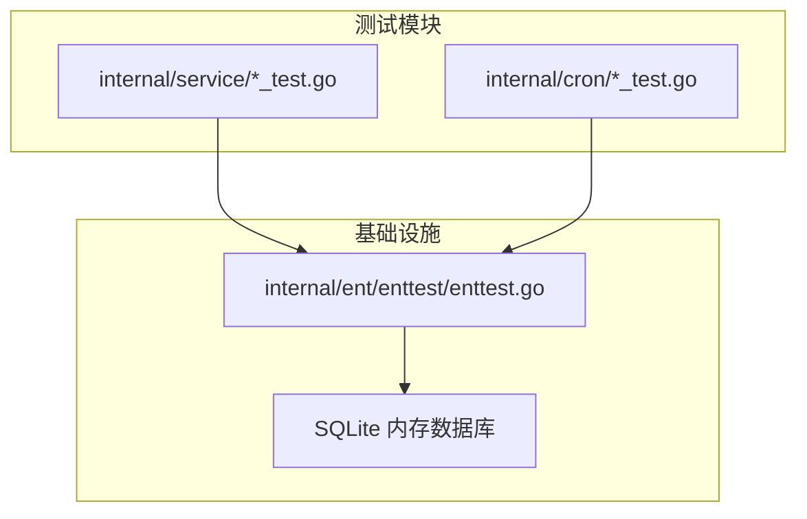
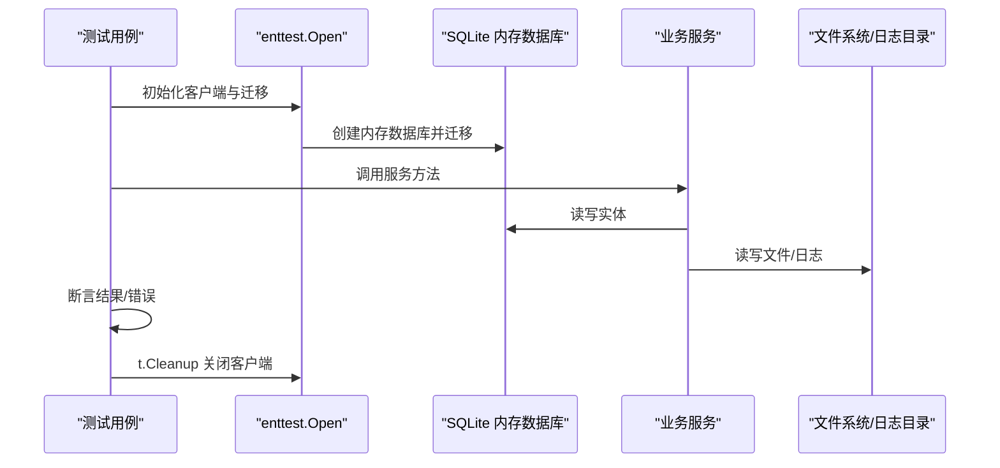
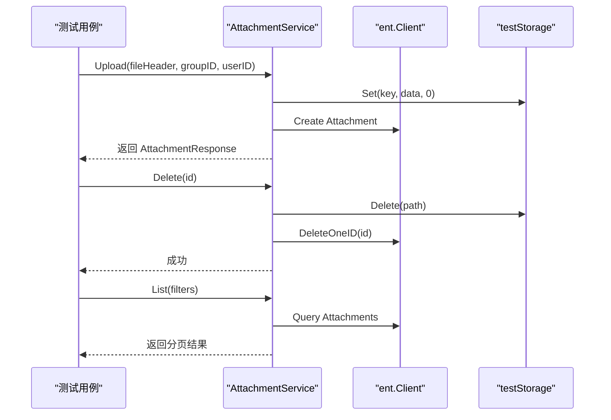
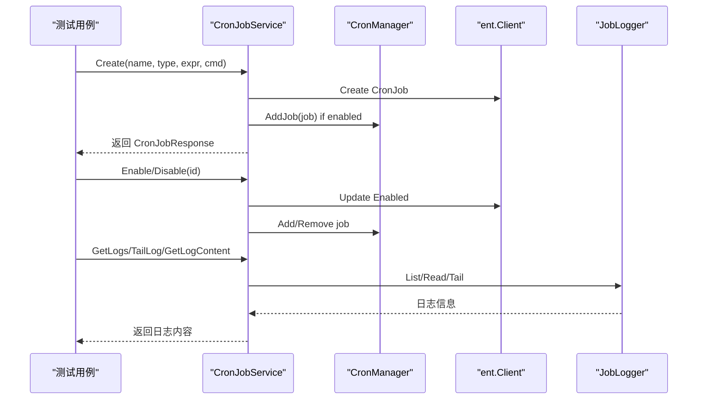
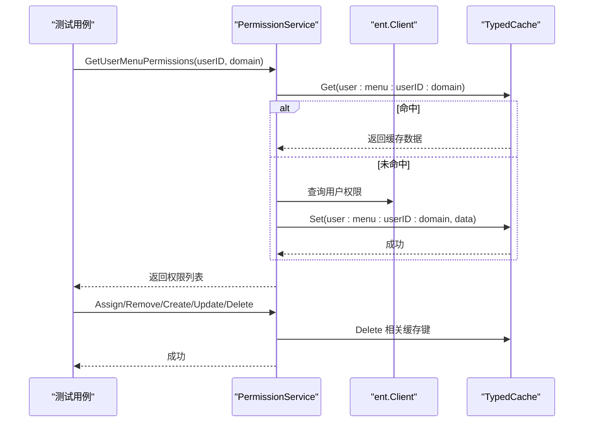
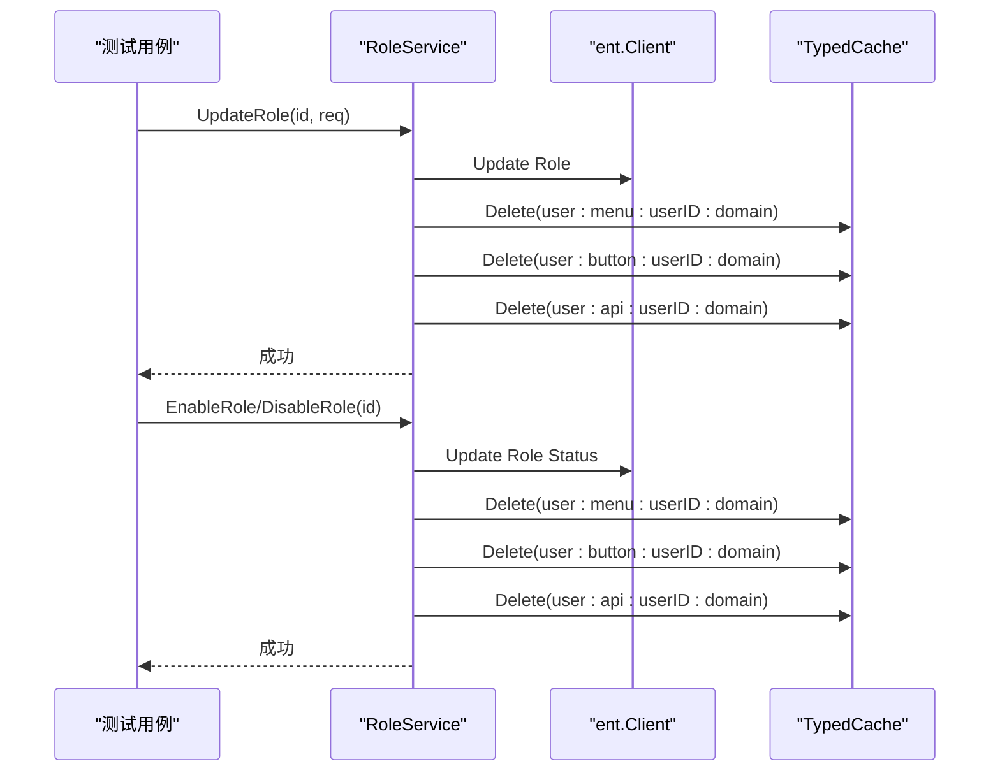
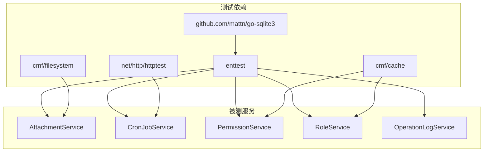

# 单元测试

<cite>
**本文引用的文件**
- [internal/service/attachment_test.go](file://internal/service/attachment_test.go)
- [internal/service/cron_job_test.go](file://internal/service/cron_job_test.go)
- [internal/service/permission_test.go](file://internal/service/permission_test.go)
- [internal/service/role_test.go](file://internal/service/role_test.go)
- [internal/service/operation_log_test.go](file://internal/service/operation_log_test.go)
- [internal/cron/executor_test.go](file://internal/cron/executor_test.go)
- [internal/cron/manager_test.go](file://internal/cron/manager_test.go)
- [internal/cron/logger_test.go](file://internal/cron/logger_test.go)
- [internal/ent/enttest/enttest.go](file://internal/ent/enttest/enttest.go)
- [internal/service/attachment.go](file://internal/service/attachment.go)
- [internal/service/cron_job.go](file://internal/service/cron_job.go)
- [internal/service/permission.go](file://internal/service/permission.go)
- [internal/service/role.go](file://internal/service/role.go)
- [go.mod](file://go.mod)
- [.golangci.yml](file://.golangci.yml)
</cite>

## 目录
1. [简介](#简介)
2. [项目结构](#项目结构)
3. [核心组件](#核心组件)
4. [架构总览](#架构总览)
5. [详细组件分析](#详细组件分析)
6. [依赖分析](#依赖分析)
7. [性能考虑](#性能考虑)
8. [故障排查指南](#故障排查指南)
9. [结论](#结论)
10. [附录](#附录)

## 简介
本文件面向 Go Admin 管理系统的单元测试，系统化阐述测试编写规范与最佳实践，覆盖以下主题：
- 测试用例设计原则、断言方法与错误处理策略
- 使用 SQLite 内存数据库进行测试隔离，以及 enttest 包的使用方式与数据库连接配置
- 测试数据准备策略：测试夹具的创建与清理机制
- 具体测试示例：附件服务、定时任务服务、权限服务、角色服务与操作日志服务的关键功能
- 测试覆盖率测量方法与提升测试质量的技巧

## 项目结构
本项目的测试集中在 internal/service 与 internal/cron 目录下，分别对应业务服务与定时任务子系统。enttest 提供了在测试中快速初始化内存数据库的能力，确保每个测试用例的独立性与可重复性。

图表来源
- [internal/service/attachment_test.go:1-502](file://internal/service/attachment_test.go#L1-L502)
- [internal/service/cron_job_test.go:1-445](file://internal/service/cron_job_test.go#L1-L445)
- [internal/service/permission_test.go:1-528](file://internal/service/permission_test.go#L1-L528)
- [internal/service/role_test.go:1-238](file://internal/service/role_test.go#L1-L238)
- [internal/service/operation_log_test.go:1-329](file://internal/service/operation_log_test.go#L1-L329)
- [internal/cron/executor_test.go:1-183](file://internal/cron/executor_test.go#L1-L183)
- [internal/cron/manager_test.go:1-214](file://internal/cron/manager_test.go#L1-L214)
- [internal/cron/logger_test.go:1-210](file://internal/cron/logger_test.go#L1-L210)
- [internal/ent/enttest/enttest.go:1-86](file://internal/ent/enttest/enttest.go#L1-L86)

章节来源
- [internal/service/attachment_test.go:1-502](file://internal/service/attachment_test.go#L1-L502)
- [internal/service/cron_job_test.go:1-445](file://internal/service/cron_job_test.go#L1-L445)
- [internal/service/permission_test.go:1-528](file://internal/service/permission_test.go#L1-L528)
- [internal/service/role_test.go:1-238](file://internal/service/role_test.go#L1-L238)
- [internal/service/operation_log_test.go:1-329](file://internal/service/operation_log_test.go#L1-L329)
- [internal/cron/executor_test.go:1-183](file://internal/cron/executor_test.go#L1-L183)
- [internal/cron/manager_test.go:1-214](file://internal/cron/manager_test.go#L1-L214)
- [internal/cron/logger_test.go:1-210](file://internal/cron/logger_test.go#L1-L210)
- [internal/ent/enttest/enttest.go:1-86](file://internal/ent/enttest/enttest.go#L1-L86)

## 核心组件
- 测试隔离与数据库初始化
  - 使用 enttest.Open 在内存中创建 SQLite 数据库，自动迁移表结构，关闭时通过 t.Cleanup 自动释放资源
  - 通过 WithMigrateOptions(migrate.WithForeignKeys(false)) 关闭外键校验以适配内存数据库特性
- 测试夹具与清理
  - 使用 t.TempDir() 为文件型存储与日志目录提供临时空间
  - 使用 t.Cleanup 注册客户端与资源的销毁逻辑，保证测试结束后资源回收
- 断言与错误处理
  - 使用 t.Fatalf/t.Fatal 输出详细错误并终止当前测试；对预期错误使用错误常量对比
  - 对缓存命中/失效场景，显式读取缓存键验证缓存行为
- 外部依赖模拟
  - 附件上传使用自定义 testStorage 将文件写入临时目录，避免真实文件系统问题
  - 定时任务日志使用 JobLogger 的临时目录，提供 Tail/TailLog/CleanOldLogs 等能力

章节来源
- [internal/ent/enttest/enttest.go:56-86](file://internal/ent/enttest/enttest.go#L56-L86)
- [internal/service/attachment_test.go:56-82](file://internal/service/attachment_test.go#L56-L82)
- [internal/service/permission_test.go:46-62](file://internal/service/permission_test.go#L46-L62)
- [internal/service/role_test.go:20-48](file://internal/service/role_test.go#L20-L48)
- [internal/service/cron_job_test.go:26-40](file://internal/service/cron_job_test.go#L26-L40)
- [internal/cron/manager_test.go:23-44](file://internal/cron/manager_test.go#L23-L44)
- [internal/cron/logger_test.go:12-38](file://internal/cron/logger_test.go#L12-L38)

## 架构总览
下图展示了测试运行时的典型交互：测试用例通过 enttest 初始化内存数据库与迁移，随后调用被测服务执行业务逻辑，服务再访问数据库与外部存储（如文件系统或日志目录）。

图表来源
- [internal/ent/enttest/enttest.go:56-86](file://internal/ent/enttest/enttest.go#L56-L86)
- [internal/service/attachment_test.go:56-82](file://internal/service/attachment_test.go#L56-L82)
- [internal/service/cron_job_test.go:26-40](file://internal/service/cron_job_test.go#L26-L40)
- [internal/cron/manager_test.go:23-44](file://internal/cron/manager_test.go#L23-L44)
- [internal/cron/logger_test.go:12-38](file://internal/cron/logger_test.go#L12-L38)

## 详细组件分析

### 附件服务测试
- 测试目标
  - 分组：创建/更新/删除（含非空分组保护）、列表与搜索
  - 文件：上传、删除、批量删除、移动到分组、列表过滤（关键词/分组/MIME）
- 测试要点
  - 使用 newTestAttachmentService 创建带内存数据库与临时文件系统的服务实例
  - 通过 createTestFileHeader 构造 multipart 文件头，模拟上传
  - 通过直接创建数据库记录验证删除/移动等边界条件
- 断言与错误处理
  - 对重复名称、非空分组删除、不存在对象等场景断言预期错误
  - 对列表搜索按关键词、分组、MIME 前缀进行断言

图表来源
- [internal/service/attachment_test.go:68-82](file://internal/service/attachment_test.go#L68-L82)
- [internal/service/attachment_test.go:280-306](file://internal/service/attachment_test.go#L280-L306)
- [internal/service/attachment_test.go:308-334](file://internal/service/attachment_test.go#L308-L334)
- [internal/service/attachment_test.go:370-444](file://internal/service/attachment_test.go#L370-L444)
- [internal/service/attachment_test.go:446-501](file://internal/service/attachment_test.go#L446-L501)

章节来源
- [internal/service/attachment_test.go:116-140](file://internal/service/attachment_test.go#L116-L140)
- [internal/service/attachment_test.go:142-158](file://internal/service/attachment_test.go#L142-L158)
- [internal/service/attachment_test.go:160-189](file://internal/service/attachment_test.go#L160-L189)
- [internal/service/attachment_test.go:191-241](file://internal/service/attachment_test.go#L191-L241)
- [internal/service/attachment_test.go:243-278](file://internal/service/attachment_test.go#L243-L278)
- [internal/service/attachment_test.go:280-306](file://internal/service/attachment_test.go#L280-L306)
- [internal/service/attachment_test.go:308-334](file://internal/service/attachment_test.go#L308-L334)
- [internal/service/attachment_test.go:336-368](file://internal/service/attachment_test.go#L336-L368)
- [internal/service/attachment_test.go:370-444](file://internal/service/attachment_test.go#L370-L444)
- [internal/service/attachment_test.go:446-501](file://internal/service/attachment_test.go#L446-L501)

### 定时任务服务测试
- 测试目标
  - 任务：创建/更新/删除、启用/禁用、列表与关键字搜索
  - 日志：列出日志、尾读、读取内容、运行一次
- 测试要点
  - 使用 newTestCronJobService 创建带内存数据库与 CronManager 的服务实例
  - 通过 CronManager.AddJob/RunNow 驱动调度器行为
  - 通过 JobLogger.CreateLogFile/ReadLog/TailLog 验证日志读写
- 断言与错误处理
  - 对重复名称、非法表达式、不存在对象断言预期错误
  - 对启用/禁用状态变更断言

图表来源
- [internal/service/cron_job_test.go:26-40](file://internal/service/cron_job_test.go#L26-L40)
- [internal/service/cron_job_test.go:42-67](file://internal/service/cron_job_test.go#L42-L67)
- [internal/service/cron_job_test.go:94-107](file://internal/service/cron_job_test.go#L94-L107)
- [internal/service/cron_job_test.go:109-146](file://internal/service/cron_job_test.go#L109-L146)
- [internal/service/cron_job_test.go:159-194](file://internal/service/cron_job_test.go#L159-L194)
- [internal/service/cron_job_test.go:196-224](file://internal/service/cron_job_test.go#L196-L224)
- [internal/service/cron_job_test.go:226-242](file://internal/service/cron_job_test.go#L226-L242)
- [internal/service/cron_job_test.go:244-294](file://internal/service/cron_job_test.go#L244-L294)
- [internal/service/cron_job_test.go:296-327](file://internal/service/cron_job_test.go#L296-L327)
- [internal/service/cron_job_test.go:329-370](file://internal/service/cron_job_test.go#L329-L370)
- [internal/service/cron_job_test.go:372-406](file://internal/service/cron_job_test.go#L372-L406)
- [internal/service/cron_job_test.go:408-444](file://internal/service/cron_job_test.go#L408-L444)

章节来源
- [internal/service/cron_job_test.go:42-67](file://internal/service/cron_job_test.go#L42-L67)
- [internal/service/cron_job_test.go:94-107](file://internal/service/cron_job_test.go#L94-L107)
- [internal/service/cron_job_test.go:109-146](file://internal/service/cron_job_test.go#L109-L146)
- [internal/service/cron_job_test.go:159-194](file://internal/service/cron_job_test.go#L159-L194)
- [internal/service/cron_job_test.go:196-224](file://internal/service/cron_job_test.go#L196-L224)
- [internal/service/cron_job_test.go:226-242](file://internal/service/cron_job_test.go#L226-L242)
- [internal/service/cron_job_test.go:244-294](file://internal/service/cron_job_test.go#L244-L294)
- [internal/service/cron_job_test.go:296-327](file://internal/service/cron_job_test.go#L296-L327)
- [internal/service/cron_job_test.go:329-370](file://internal/service/cron_job_test.go#L329-L370)
- [internal/service/cron_job_test.go:372-406](file://internal/service/cron_job_test.go#L372-L406)
- [internal/service/cron_job_test.go:408-444](file://internal/service/cron_job_test.go#L408-L444)

### 权限服务测试
- 测试目标
  - 用户菜单/按钮/API 权限获取与缓存命中/失效
  - 角色权限分配/移除/创建/更新/删除后缓存清理
- 测试要点
  - 使用 newTestPermissionService 创建带内存数据库与内存缓存的服务实例
  - 通过 setupTestData 构造角色、用户、用户角色与 Casbin 规则
  - 通过 cacheKey 与 TypedCache 显式读取/断言缓存状态
- 断言与错误处理
  - 缓存命中：二次查询返回相同数量的数据
  - 缓存失效：在分配/移除/创建/更新/删除权限后，缓存键不存在

图表来源
- [internal/service/permission_test.go:46-62](file://internal/service/permission_test.go#L46-L62)
- [internal/service/permission_test.go:64-112](file://internal/service/permission_test.go#L64-L112)
- [internal/service/permission_test.go:114-147](file://internal/service/permission_test.go#L114-L147)
- [internal/service/permission_test.go:149-190](file://internal/service/permission_test.go#L149-L190)
- [internal/service/permission_test.go:192-232](file://internal/service/permission_test.go#L192-L232)
- [internal/service/permission_test.go:234-269](file://internal/service/permission_test.go#L234-L269)
- [internal/service/permission_test.go:271-307](file://internal/service/permission_test.go#L271-L307)
- [internal/service/permission_test.go:309-338](file://internal/service/permission_test.go#L309-L338)
- [internal/service/permission_test.go:340-396](file://internal/service/permission_test.go#L340-L396)
- [internal/service/permission_test.go:398-459](file://internal/service/permission_test.go#L398-L459)
- [internal/service/permission_test.go:461-527](file://internal/service/permission_test.go#L461-L527)

章节来源
- [internal/service/permission_test.go:114-147](file://internal/service/permission_test.go#L114-L147)
- [internal/service/permission_test.go:149-190](file://internal/service/permission_test.go#L149-L190)
- [internal/service/permission_test.go:192-232](file://internal/service/permission_test.go#L192-L232)
- [internal/service/permission_test.go:234-269](file://internal/service/permission_test.go#L234-L269)
- [internal/service/permission_test.go:271-307](file://internal/service/permission_test.go#L271-L307)
- [internal/service/permission_test.go:309-338](file://internal/service/permission_test.go#L309-L338)
- [internal/service/permission_test.go:340-396](file://internal/service/permission_test.go#L340-L396)
- [internal/service/permission_test.go:398-459](file://internal/service/permission_test.go#L398-L459)
- [internal/service/permission_test.go:461-527](file://internal/service/permission_test.go#L461-L527)

### 角色服务测试
- 测试目标
  - 角色：创建/获取/列表/更新/删除
  - 角色状态：启用/禁用
  - 缓存清理：角色更新/启用/禁用后清除关联用户的菜单/按钮/API 权限缓存
- 测试要点
  - 使用 newTestRoleService 创建带内存数据库与内存缓存的服务实例
  - 通过 setupRoleTestData 构造角色、用户、用户角色并预热用户权限缓存
- 断言与错误处理
  - 更新角色后，用户相关缓存键被清理
  - 启用/禁用角色后，用户相关缓存键被清理

图表来源
- [internal/service/role_test.go:20-48](file://internal/service/role_test.go#L20-L48)
- [internal/service/role_test.go:50-95](file://internal/service/role_test.go#L50-L95)
- [internal/service/role_test.go:99-135](file://internal/service/role_test.go#L99-L135)
- [internal/service/role_test.go:137-180](file://internal/service/role_test.go#L137-L180)
- [internal/service/role_test.go:182-237](file://internal/service/role_test.go#L182-L237)

章节来源
- [internal/service/role_test.go:99-135](file://internal/service/role_test.go#L99-L135)
- [internal/service/role_test.go:137-180](file://internal/service/role_test.go#L137-L180)
- [internal/service/role_test.go:182-237](file://internal/service/role_test.go#L182-L237)

### 操作日志服务测试
- 测试目标
  - 异步记录操作日志：创建、列表、筛选（模块/动作/用户名/时间范围）、获取详情
- 测试要点
  - 使用 newTestOperationLogService 创建带内存数据库的服务实例
  - 通过 createTestLog 直接创建日志条目，绕过异步流程细节
- 断言与错误处理
  - 列表分页与筛选正确返回总数与条目数
  - 不存在对象断言预期错误

章节来源
- [internal/service/operation_log_test.go:16-26](file://internal/service/operation_log_test.go#L16-L26)
- [internal/service/operation_log_test.go:28-59](file://internal/service/operation_log_test.go#L28-L59)
- [internal/service/operation_log_test.go:61-94](file://internal/service/operation_log_test.go#L61-L94)
- [internal/service/operation_log_test.go:96-137](file://internal/service/operation_log_test.go#L96-L137)
- [internal/service/operation_log_test.go:139-165](file://internal/service/operation_log_test.go#L139-L165)
- [internal/service/operation_log_test.go:167-193](file://internal/service/operation_log_test.go#L167-L193)
- [internal/service/operation_log_test.go:195-222](file://internal/service/operation_log_test.go#L195-L222)
- [internal/service/operation_log_test.go:224-276](file://internal/service/operation_log_test.go#L224-L276)
- [internal/service/operation_log_test.go:278-328](file://internal/service/operation_log_test.go#L278-L328)

### 定时任务执行器测试
- 测试目标
  - ShellExecutor：执行简单命令、失败命令
  - CurlExecutor：GET/POST 请求、无效 JSON、错误状态码
  - TaskExecutor：已注册/未注册任务
- 测试要点
  - 使用 httptest 服务器模拟 HTTP 响应
  - 使用临时注册任务验证任务执行器行为
- 断言与错误处理
  - 对输出内容、错误消息与状态码进行断言

章节来源
- [internal/cron/executor_test.go:18-31](file://internal/cron/executor_test.go#L18-L31)
- [internal/cron/executor_test.go:33-41](file://internal/cron/executor_test.go#L33-L41)
- [internal/cron/executor_test.go:45-75](file://internal/cron/executor_test.go#L45-L75)
- [internal/cron/executor_test.go:77-110](file://internal/cron/executor_test.go#L77-L110)
- [internal/cron/executor_test.go:112-123](file://internal/cron/executor_test.go#L112-L123)
- [internal/cron/executor_test.go:125-146](file://internal/cron/executor_test.go#L125-L146)
- [internal/cron/executor_test.go:150-169](file://internal/cron/executor_test.go#L150-L169)
- [internal/cron/executor_test.go:171-182](file://internal/cron/executor_test.go#L171-L182)

### 定时任务管理器测试
- 测试目标
  - 初始化：创建 CronManager、注册执行器
  - 生命周期：添加/移除任务、立即运行、启动加载启用任务、停止
- 测试要点
  - 通过 AddJob/RemoveJob 验证任务映射
  - 通过 RunNow 验证日志文件生成
  - 通过 Start/Stop 验证调度器生命周期
- 断言与错误处理
  - 对任务映射、日志文件数量与内容进行断言

章节来源
- [internal/cron/manager_test.go:23-44](file://internal/cron/manager_test.go#L23-L44)
- [internal/cron/manager_test.go:46-85](file://internal/cron/manager_test.go#L46-L85)
- [internal/cron/manager_test.go:87-125](file://internal/cron/manager_test.go#L87-L125)
- [internal/cron/manager_test.go:127-140](file://internal/cron/manager_test.go#L127-L140)
- [internal/cron/manager_test.go:142-198](file://internal/cron/manager_test.go#L142-L198)
- [internal/cron/manager_test.go:200-213](file://internal/cron/manager_test.go#L200-L213)

### 定时任务日志器测试
- 测试目标
  - 日志文件：创建、列出、读取、尾读、路径穿越防护、旧日志清理
- 测试要点
  - 使用临时目录模拟日志存储
  - 验证排序、内容与清理策略
- 断言与错误处理
  - 对文件名后缀、排序顺序、错误消息进行断言

章节来源
- [internal/cron/logger_test.go:12-38](file://internal/cron/logger_test.go#L12-L38)
- [internal/cron/logger_test.go:40-72](file://internal/cron/logger_test.go#L40-L72)
- [internal/cron/logger_test.go:74-85](file://internal/cron/logger_test.go#L74-L85)
- [internal/cron/logger_test.go:87-103](file://internal/cron/logger_test.go#L87-L103)
- [internal/cron/logger_test.go:105-116](file://internal/cron/logger_test.go#L105-L116)
- [internal/cron/logger_test.go:118-148](file://internal/cron/logger_test.go#L118-L148)
- [internal/cron/logger_test.go:150-158](file://internal/cron/logger_test.go#L150-L158)
- [internal/cron/logger_test.go:160-184](file://internal/cron/logger_test.go#L160-L184)
- [internal/cron/logger_test.go:186-209](file://internal/cron/logger_test.go#L186-L209)

## 依赖分析
- 测试依赖
  - enttest：提供内存数据库初始化与迁移
  - SQLite 驱动：用于内存数据库连接
  - 缓存：内存缓存用于权限与角色服务的缓存行为测试
  - 文件系统：用于附件服务的文件存储模拟
  - httptest：用于 HTTP 执行器的测试
- 外部依赖与版本
  - go.mod 中声明了 ent、casbin、robfig/cron/v3、sqlite3 等依赖

图表来源
- [go.mod:5-21](file://go.mod#L5-L21)
- [internal/ent/enttest/enttest.go:56-86](file://internal/ent/enttest/enttest.go#L56-L86)
- [internal/service/attachment_test.go:56-82](file://internal/service/attachment_test.go#L56-L82)
- [internal/service/cron_job_test.go:26-40](file://internal/service/cron_job_test.go#L26-L40)
- [internal/service/permission_test.go:46-62](file://internal/service/permission_test.go#L46-L62)
- [internal/service/role_test.go:20-48](file://internal/service/role_test.go#L20-L48)
- [internal/cron/executor_test.go:45-53](file://internal/cron/executor_test.go#L45-L53)

章节来源
- [go.mod:5-21](file://go.mod#L5-L21)
- [internal/ent/enttest/enttest.go:56-86](file://internal/ent/enttest/enttest.go#L56-L86)

## 性能考虑
- 内存数据库与临时目录
  - 使用 SQLite 内存数据库与 t.TempDir() 可显著降低 I/O 开销，提升测试执行速度
- 缓存行为测试
  - 通过显式读取缓存键验证缓存命中/失效，避免不必要的缓存穿透
- 并发与异步
  - 操作日志服务为异步写入，测试中通过等待短时间确保落盘完成后再断言
- 资源清理
  - 使用 t.Cleanup 确保客户端与临时目录在测试结束时被释放，避免资源泄漏

## 故障排查指南
- 数据库连接与迁移
  - 若出现迁移失败或外键约束错误，确认是否使用 WithMigrateOptions(migrate.WithForeignKeys(false))
- 缓存未生效
  - 检查缓存键格式与 TTL，确认在权限变更后是否调用了缓存清理方法
- 文件存储异常
  - 确认 testStorage 的 basePath 正确设置，且临时目录权限允许读写
- HTTP 执行器失败
  - 使用 httptest 服务器验证请求方法、状态码与响应体
- 日志清理异常
  - 检查日志保留时间与文件名格式，确认旧日志清理逻辑正常

章节来源
- [internal/ent/enttest/enttest.go:41-46](file://internal/ent/enttest/enttest.go#L41-L46)
- [internal/service/permission_test.go:130-137](file://internal/service/permission_test.go#L130-L137)
- [internal/cron/logger_test.go:160-184](file://internal/cron/logger_test.go#L160-L184)

## 结论
本项目单元测试遵循“隔离、夹具、断言、清理”的测试范式，结合 enttest 与 SQLite 内存数据库实现了高隔离度与高效率的测试环境。通过显式的缓存键验证与资源清理机制，确保测试结果稳定可靠。建议在后续迭代中持续补充边界与异常场景测试，进一步提升覆盖率与健壮性。

## 附录
- 测试覆盖率测量
  - 使用 go test -cover 生成覆盖率报告，结合 .golangci.yml 的配置排除生成代码与测试文件
- 最佳实践清单
  - 使用 t.Helper() 统一测试辅助函数
  - 使用 t.Cleanup 注册资源销毁
  - 对错误进行明确断言，避免忽略错误
  - 对缓存行为进行显式键级验证
  - 对异步流程增加短暂等待或事件驱动验证

章节来源
- [.golangci.yml:1-38](file://.golangci.yml#L1-L38)